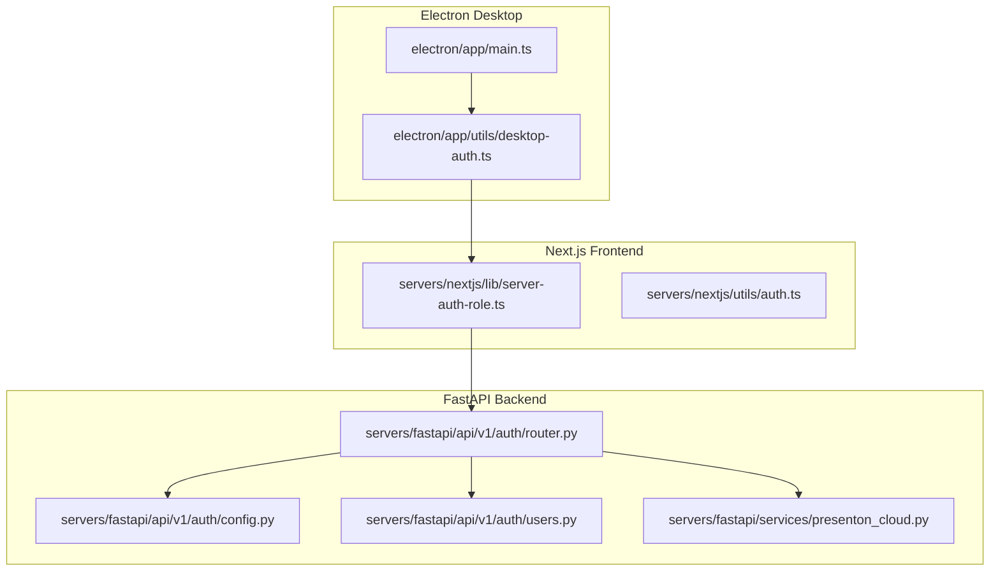
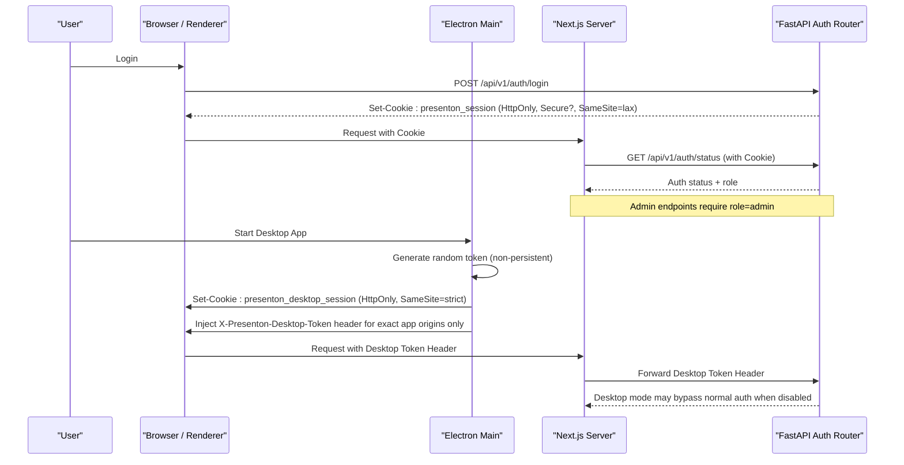
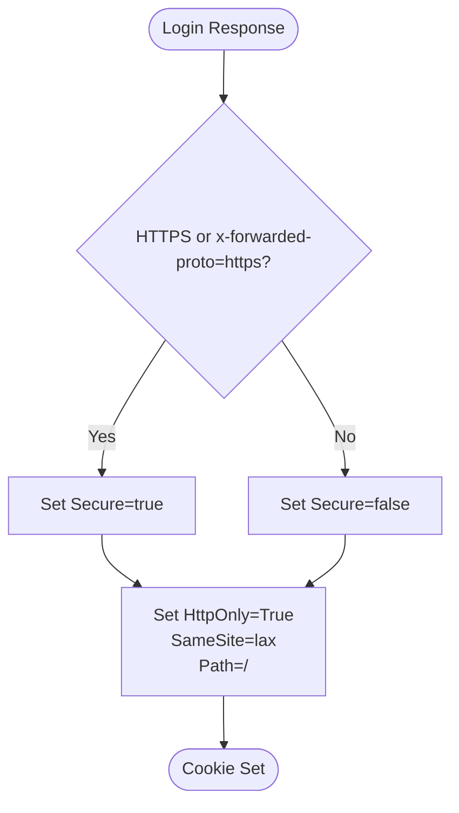
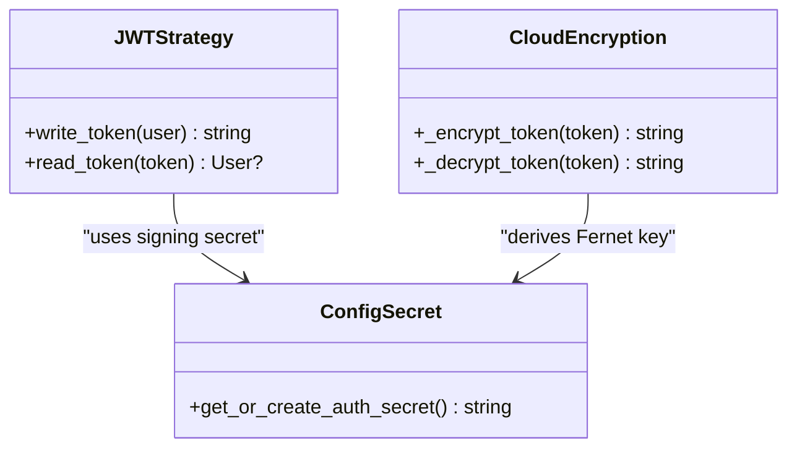
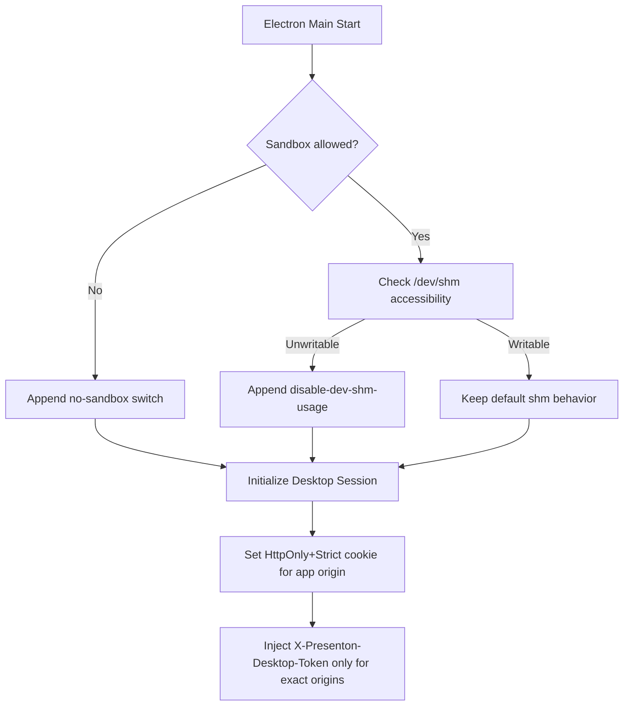
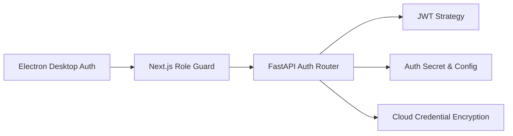

# Security Best Practices

<cite>
**Referenced Files in This Document**
- [router.py](file://servers/fastapi/api/v1/auth/router.py)
- [config.py](file://servers/fastapi/api/v1/auth/config.py)
- [users.py](file://servers/fastapi/api/v1/auth/users.py)
- [presenton_cloud.py](file://servers/fastapi/services/presenton_cloud.py)
- [server-auth-role.ts](file://servers/nextjs/lib/server-auth-role.ts)
- [auth.ts](file://servers/nex tjs/utils/auth.ts)
- [desktop-auth.ts](file://electron/app/utils/desktop-auth.ts)
- [main.ts](file://electron/app/main.ts)
- [desktop-security.test.mjs](file://servers/nex tjs/tests/desktop-security.test.mjs)
- [test_internal_auth_headers.py](file://servers/fastapi/tests/unit/test_internal_auth_headers.py)
</cite>

## Table of Contents
1. [Introduction](#introduction)
2. [Project Structure](#project-structure)
3. [Core Components](#core-components)
4. [Architecture Overview](#architecture-overview)
5. [Detailed Component Analysis](#detailed-component-analysis)
6. [Dependency Analysis](#dependency-analysis)
7. [Performance Considerations](#performance-considerations)
8. [Troubleshooting Guide](#troubleshooting-guide)
9. [Conclusion](#conclusion)

## Introduction
This document explains the security best practices implemented across Presenton’s backend (FastAPI), frontend (Next.js), and Electron desktop runtime. It covers secure cookie configuration, environment-driven security controls, input validation patterns, protection against common web vulnerabilities, encryption strategies for sensitive data, secure password storage with bcrypt, token management, desktop-specific security considerations, and guidance for audits, vulnerability assessments, incident response, compliance, and monitoring.

## Project Structure
Presenton is a multi-component application:
- FastAPI backend provides authentication, session handling, JWT issuance, and encrypted credential storage.
- Next.js frontend enforces admin-only routes and integrates with the backend via secure cookies and desktop tokens.
- Electron main process manages a private, non-persisted desktop session and restricts token injection to exact app origins.

**Diagram sources**
- [main.ts:74-90](file://electron/app/main.ts#L74-L90)
- [desktop-auth.ts:12-50](file://electron/app/utils/desktop-auth.ts#L12-L50)
- [server-auth-role.ts:20-54](file://servers/nextjs/lib/server-auth-role.ts#L20-L54)
- [router.py:39-55](file://servers/fastapi/api/v1/auth/router.py#L39-L55)
- [config.py:71-81](file://servers/fastapi/api/v1/auth/config.py#L71-L81)
- [users.py:140-182](file://servers/fastapi/api/v1/auth/users.py#L140-L182)
- [presenton_cloud.py:28-47](file://servers/fastapi/services/presenton_cloud.py#L28-L47)

**Section sources**
- [main.ts:74-90](file://electron/app/main.ts#L74-L90)
- [desktop-auth.ts:12-50](file://electron/app/utils/desktop-auth.ts#L12-L50)
- [server-auth-role.ts:20-54](file://servers/nextjs/lib/server-auth-role.ts#L20-L54)
- [router.py:39-55](file://servers/fastapi/api/v1/auth/router.py#L39-L55)
- [config.py:71-81](file://servers/fastapi/api/v1/auth/config.py#L71-L81)
- [users.py:140-182](file://servers/fastapi/api/v1/auth/users.py#L140-L182)
- [presenton_cloud.py:28-47](file://servers/fastapi/services/presenton_cloud.py#L28-L47)

## Core Components
- Secure session cookies: HttpOnly, Secure (when HTTPS), SameSite lax on the backend; Strict and HttpOnly for the desktop session cookie.
- Environment-based controls: DISABLE_AUTH toggles permissive behavior for local development; PRESENTON_DESKTOP_TOKEN and related variables control desktop-only flows.
- Password hashing: bcrypt via a helper used during setup and login.
- Token management: Versioned JWTs signed by a persistent secret; external OAuth credentials encrypted at rest using Fernet derived from the same secret.
- Desktop isolation: Private, non-persisted token injected only into exact app origins; cross-origin requests have the desktop cookie stripped.

**Section sources**
- [router.py:39-55](file://servers/fastapi/api/v1/auth/router.py#L39-L55)
- [desktop-auth.ts:12-50](file://electron/app/utils/desktop-auth.ts#L12-L50)
- [config.py:71-81](file://servers/fastapi/api/v1/auth/config.py#L71-L81)
- [users.py:140-182](file://servers/fastapi/api/v1/auth/users.py#L140-L182)
- [presenton_cloud.py:28-47](file://servers/fastapi/services/presenton_cloud.py#L28-L47)

## Architecture Overview
The authentication flow combines browser cookies and an Electron-managed desktop token. The backend issues a versioned JWT stored in an HttpOnly cookie. For desktop usage, Electron generates a random token, sets it as an HttpOnly+SameSite=strict cookie scoped to app origins, and injects a custom header only for exact app URLs.

**Diagram sources**
- [router.py:46-55](file://servers/fastapi/api/v1/auth/router.py#L46-L55)
- [router.py:58-78](file://servers/fastapi/api/v1/auth/router.py#L58-L78)
- [server-auth-role.ts:20-54](file://servers/nextjs/lib/server-auth-role.ts#L20-L54)
- [desktop-auth.ts:12-50](file://electron/app/utils/desktop-auth.ts#L12-L50)

## Detailed Component Analysis

### Secure Cookie Configuration
- Session cookie name: presenton_session.
- Attributes:
  - HttpOnly: prevents client-side script access.
  - Secure: enabled when the request is HTTPS or proxied via x-forwarded-proto=https.
  - SameSite: lax for browser sessions; strict for desktop session cookie.
  - Path: root path “/”.
- TTL: 30 days for session cookie.

**Diagram sources**
- [router.py:39-55](file://servers/fastapi/api/v1/auth/router.py#L39-L55)

**Section sources**
- [router.py:39-55](file://servers/fastapi/api/v1/auth/router.py#L39-L55)
- [config.py:11-13](file://servers/fastapi/api/v1/auth/config.py#L11-L13)

### Environment-Based Security Controls
- DISABLE_AUTH: When truthy (e.g., “true”, “1”, “yes”, “on”), backend treats the user as authenticated with admin role for certain endpoints and skips normal auth checks.
- NEXT.js reads DISABLE_AUTH from window.env or process.env to adapt UI behavior.

Best practices:
- Never enable DISABLE_AUTH in production.
- Use explicit feature flags and separate dev/staging/prod environments.

**Section sources**
- [router.py:63-70](file://servers/fastapi/api/v1/auth/router.py#L63-L70)
- [router.py:86-92](file://servers/fastapi/api/v1/auth/router.py#L86-L92)
- [auth.ts:1-20](file://servers/nextjs/utils/auth.ts#L1-L20)

### Input Validation and Sanitization Patterns
- Username normalization: trim whitespace before validation and lookup.
- Setup endpoint validates minimum username length and hashes passwords before persistence.
- Content-Type enforcement in desktop settings route tests ensures only JSON updates are accepted, rejecting text/plain attacks.

Recommendations:
- Apply schema validation at API boundaries (Pydantic models).
- Enforce strict content-type headers for state-changing endpoints.
- Validate and sanitize all inputs, including file paths and URLs.

**Section sources**
- [router.py:119-124](file://servers/fastapi/api/v1/auth/router.py#L119-L124)
- [router.py:163-173](file://servers/fastapi/api/v1/auth/router.py#L163-L173)
- [desktop-security.test.mjs:77-95](file://servers/nex tjs/tests/desktop-security.test.mjs#L77-L95)

### Protection Against Common Web Vulnerabilities
- XSS mitigation:
  - Avoid rendering untrusted HTML directly; use safe templating and output encoding.
  - Restrict CSP and avoid inline scripts where possible.
- CSRF mitigation:
  - Use SameSite cookies (lax for browser, strict for desktop).
  - Require authorization headers/tokens for sensitive operations.
- SQL injection prevention:
  - Use parameterized queries through SQLAlchemy ORM.
- File access restrictions:
  - Desktop file readers deny access outside allowed directories and resolve symlinks safely.

**Section sources**
- [router.py:39-55](file://servers/fastapi/api/v1/auth/router.py#L39-L55)
- [desktop-security.test.mjs:179-187](file://servers/nex tjs/tests/desktop-security.test.mjs#L179-L187)

### Encryption Strategies for Sensitive Data
- External OAuth credentials (access tokens) are encrypted at rest using Fernet, with keys derived from the deployment secret.
- API keys are also encrypted and validated before reveal.

Key properties:
- Symmetric encryption with deterministic key derivation from a persistent secret.
- Decryption failures return clear errors prompting reconnection.

**Section sources**
- [presenton_cloud.py:28-47](file://servers/fastapi/services/presenton_cloud.py#L28-L47)
- [presenton_cloud.py:84-115](file://servers/fastapi/services/presenton_cloud.py#L84-L115)
- [presenton_cloud.py:126-139](file://servers/fastapi/services/presenton_cloud.py#L126-L139)

### Secure Password Storage with bcrypt
- Passwords are hashed using bcrypt via a helper that supports verification and automatic hash upgrades.
- Initial setup creates a superuser with a hashed password and persists recovery credentials securely.

**Section sources**
- [router.py:125-146](file://servers/fastapi/api/v1/auth/router.py#L125-L146)
- [router.py:171-178](file://servers/fastapi/api/v1/auth/router.py#L171-L178)

### Token Management Best Practices
- JWTs:
  - Signed with a persistent secret generated and stored in user config.
  - Include subject, audience, and an auth version to invalidate old sessions.
  - Stored in HttpOnly cookies.
- Desktop token:
  - Randomly generated per session, not persisted to disk.
  - Scoped to exact app origins; injected via a custom header only for those origins.

**Diagram sources**
- [users.py:140-182](file://servers/fastapi/api/v1/auth/users.py#L140-L182)
- [config.py:71-81](file://servers/fastapi/api/v1/auth/config.py#L71-L81)
- [presenton_cloud.py:28-47](file://servers/fastapi/services/presenton_cloud.py#L28-L47)

**Section sources**
- [users.py:140-182](file://servers/fastapi/api/v1/auth/users.py#L140-L182)
- [config.py:71-81](file://servers/fastapi/api/v1/auth/config.py#L71-L81)
- [desktop-auth.ts:12-50](file://electron/app/utils/desktop-auth.ts#L12-L50)

### Desktop-Specific Security Considerations
- Sandbox and Chromium switches:
  - The main process conditionally disables sandboxing based on system conditions and adjusts shared memory usage to ensure renderer stability.
- Desktop session isolation:
  - Non-persistent token stored only in memory and Electron session.
  - Cookie set with HttpOnly and SameSite=strict.
  - Custom header injected only for exact app origins; other requests have the desktop cookie stripped.

**Diagram sources**
- [main.ts:74-90](file://electron/app/main.ts#L74-L90)
- [desktop-auth.ts:12-50](file://electron/app/utils/desktop-auth.ts#L12-L50)

**Section sources**
- [main.ts:74-90](file://electron/app/main.ts#L74-L90)
- [desktop-auth.ts:12-50](file://electron/app/utils/desktop-auth.ts#L12-L50)
- [desktop-security.test.mjs:196-219](file://servers/nex tjs/tests/desktop-security.test.mjs#L196-L219)

### Security Audit Procedures and Vulnerability Assessment Guidelines
Recommended audit checklist:
- Verify DISABLE_AUTH is false in production.
- Confirm cookies are HttpOnly and Secure (where applicable) and SameSite is configured appropriately.
- Validate that external credentials are encrypted at rest and decrypted only when needed.
- Ensure file access is restricted to allowed directories and symlink escapes are blocked.
- Review dependency versions for known vulnerabilities (e.g., bcrypt, cryptography).
- Test CSRF protections by attempting cross-site requests without proper headers.
- Inspect logging and telemetry to ensure secrets are never emitted.

**Section sources**
- [router.py:39-55](file://servers/fastapi/api/v1/auth/router.py#L39-L55)
- [presenton_cloud.py:28-47](file://servers/fastapi/services/presenton_cloud.py#L28-L47)
- [desktop-security.test.mjs:179-187](file://servers/nex tjs/tests/desktop-security.test.mjs#L179-L187)

### Incident Response Protocols
- If a session token is compromised:
  - Rotate the deployment secret to invalidate existing JWTs (auth_version changes force re-authentication).
  - Revoke external provider tokens and clear stored credentials.
- If desktop token leakage is suspected:
  - Restart the Electron app to generate a new non-persistent token.
  - Audit logs for unexpected header presence on non-app origins.

**Section sources**
- [users.py:140-182](file://servers/fastapi/api/v1/auth/users.py#L140-L182)
- [presenton_cloud.py:187-220](file://servers/fastapi/services/presenton_cloud.py#L187-L220)
- [desktop-auth.ts:12-50](file://electron/app/utils/desktop-auth.ts#L12-L50)

### Compliance Considerations and Security Monitoring
- Data privacy:
  - Minimize collection and retention of sensitive data.
  - Encrypt sensitive fields at rest; limit decryption to necessary services.
- Monitoring:
  - Log failed authentication attempts and asset access denials.
  - Monitor for unusual patterns in internal service calls and cloud API usage.
- Auditing:
  - Track configuration changes and credential rotations.
  - Periodically review permissions and access controls.

[No sources needed since this section provides general guidance]

## Dependency Analysis
Internal dependencies between security-critical components:

**Diagram sources**
- [router.py:10-24](file://servers/fastapi/api/v1/auth/router.py#L10-L24)
- [users.py:140-182](file://servers/fastapi/api/v1/auth/users.py#L140-L182)
- [config.py:71-81](file://servers/fastapi/api/v1/auth/config.py#L71-L81)
- [presenton_cloud.py:28-47](file://servers/fastapi/services/presenton_cloud.py#L28-L47)
- [server-auth-role.ts:20-54](file://servers/nextjs/lib/server-auth-role.ts#L20-L54)
- [desktop-auth.ts:12-50](file://electron/app/utils/desktop-auth.ts#L12-L50)

**Section sources**
- [router.py:10-24](file://servers/fastapi/api/v1/auth/router.py#L10-L24)
- [server-auth-role.ts:20-54](file://servers/nextjs/lib/server-auth-role.ts#L20-L54)
- [desktop-auth.ts:12-50](file://electron/app/utils/desktop-auth.ts#L12-L50)

## Performance Considerations
- bcrypt cost factor should be tuned to balance security and latency; consider hardware benchmarks.
- JWT verification is lightweight; avoid unnecessary re-verification on every request if session state is already established.
- Encrypted credential decryption should be cached within short-lived scopes to reduce cryptographic overhead.

[No sources needed since this section provides general guidance]

## Troubleshooting Guide
Common issues and resolutions:
- Login fails due to missing setup:
  - Ensure initial admin account creation has completed successfully.
- Unauthorized asset access:
  - Verify the original URI is authorized for the current user/admin role.
- Internal service calls missing authentication:
  - Confirm DISABLE_AUTH and PRESENTON_ELECTRON environment variables are set correctly for the intended environment.
- Desktop token not injected:
  - Check that the request URL matches one of the allowed app origins exactly.

**Section sources**
- [router.py:161-169](file://servers/fastapi/api/v1/auth/router.py#L161-L169)
- [router.py:96-102](file://servers/fastapi/api/v1/auth/router.py#L96-L102)
- [test_internal_auth_headers.py:67-73](file://servers/fastapi/tests/unit/test_internal_auth_headers.py#L67-L73)
- [desktop-security.test.mjs:196-219](file://servers/nex tjs/tests/desktop-security.test.mjs#L196-L219)

## Conclusion
Presenton implements robust security controls across its stack:
- Secure cookie attributes and environment-driven modes protect sessions and limit exposure.
- bcrypt-based password hashing and versioned JWTs provide strong authentication.
- Encrypted storage for external tokens and API keys reduces risk at rest.
- Electron isolates desktop credentials and restricts their scope to exact app origins.
Adhering to the recommended audit, monitoring, and incident response practices will further harden the system and support compliance requirements.