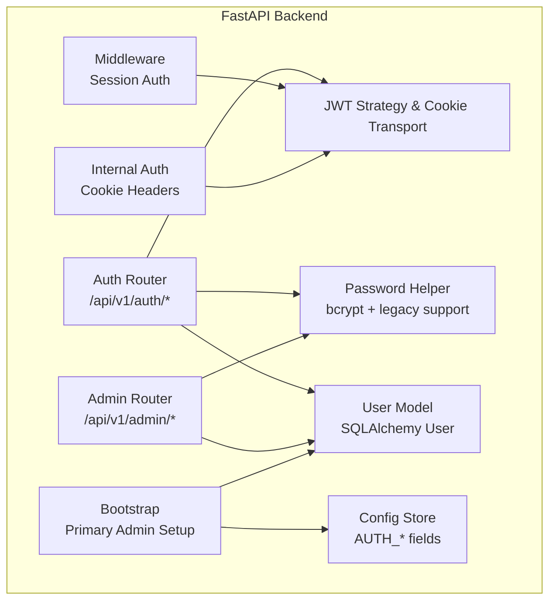
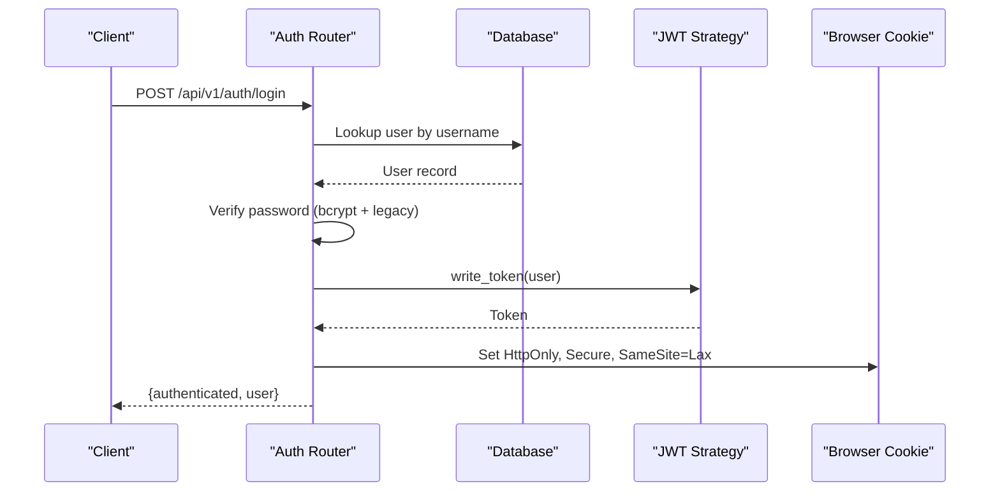
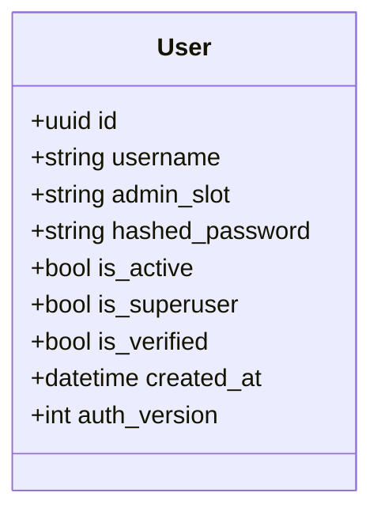
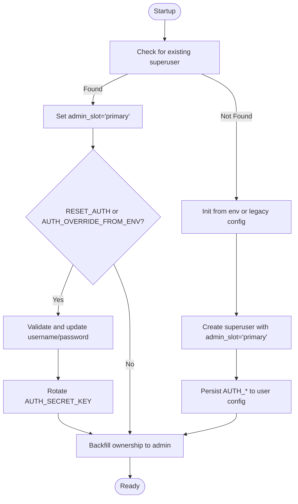
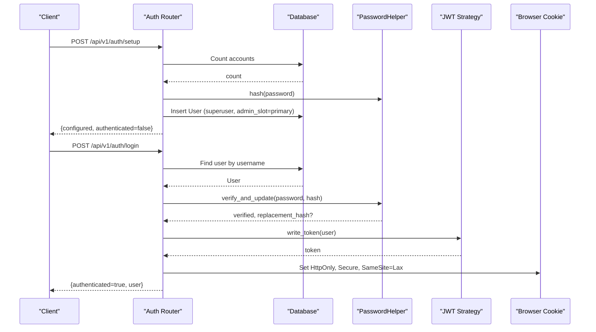
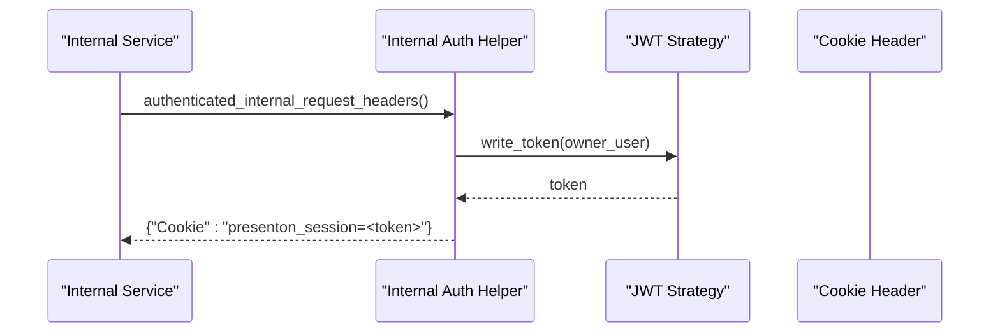
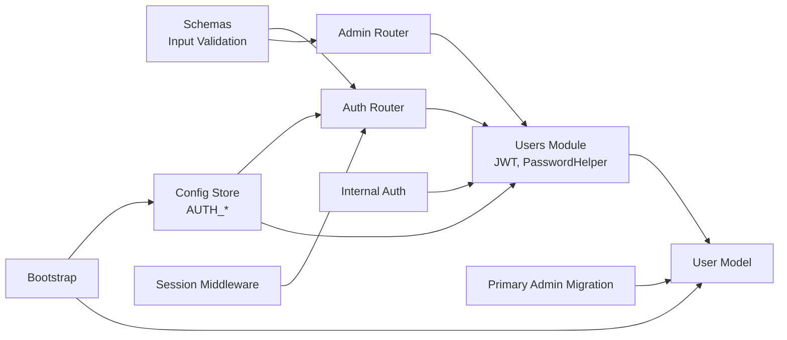

# User Management

<cite>
**Referenced Files in This Document**
- [user.py](file://servers/fastapi/models/sql/user.py)
- [users.py](file://servers/fastapi/api/v1/auth/users.py)
- [router.py](file://servers/fastapi/api/v1/auth/router.py)
- [config.py](file://servers/fastapi/api/v1/auth/config.py)
- [schemas.py](file://servers/fastapi/api/v1/auth/schemas.py)
- [admin_router.py](file://servers/fastapi/api/v1/admin/router.py)
- [bootstrap.py](file://servers/fastapi/api/v1/auth/bootstrap.py)
- [primary_admin_slot_migration.py](file://servers/fastapi/alembic/versions/e1b3c5d7f9a2_primary_admin_slot.py)
- [middlewares.py](file://servers/fastapi/api/middlewares.py)
- [internal.py](file://servers/fastapi/api/v1/auth/internal.py)
</cite>

## Table of Contents
1. [Introduction](#introduction)
2. [Project Structure](#project-structure)
3. [Core Components](#core-components)
4. [Architecture Overview](#architecture-overview)
5. [Detailed Component Analysis](#detailed-component-analysis)
6. [Dependency Analysis](#dependency-analysis)
7. [Performance Considerations](#performance-considerations)
8. [Troubleshooting Guide](#troubleshooting-guide)
9. [Conclusion](#conclusion)

## Introduction
This document explains Presenton’s user management system with a focus on the User model, lifecycle management, account provisioning, authentication, and security. It covers:
- User model structure and state fields
- Registration and login flows
- Password hashing and legacy migration
- Admin slot assignment and primary admin behavior
- Multi-user scenarios and ownership backfill
- Serialization and validation rules
- Session handling, cookie-based authentication, and secure token storage
- Examples of creating, modifying, and deleting users
- Security considerations for data protection and privacy

## Project Structure
The user management functionality is implemented primarily in the FastAPI backend under `servers/fastapi`:
- Data model: `models/sql/user.py`
- Authentication core: `api/v1/auth/users.py`, `api/v1/auth/router.py`, `api/v1/auth/config.py`
- API schemas: `api/v1/auth/schemas.py`
- Admin operations: `api/v1/admin/router.py`
- Bootstrap and migrations: `api/v1/auth/bootstrap.py`, `alembic/versions/e1b3c5d7f9a2_primary_admin_slot.py`
- Request middleware and internal auth helpers: `api/middlewares.py`, `api/v1/auth/internal.py`

**Diagram sources**
- [router.py:1-202](file://servers/fastapi/api/v1/auth/router.py#L1-L202)
- [admin_router.py:1-265](file://servers/fastapi/api/v1/admin/router.py#L1-L265)
- [user.py:1-46](file://servers/fastapi/models/sql/user.py#L1-L46)
- [users.py:1-234](file://servers/fastapi/api/v1/auth/users.py#L1-L234)
- [config.py:1-108](file://servers/fastapi/api/v1/auth/config.py#L1-L108)
- [bootstrap.py:1-152](file://servers/fastapi/api/v1/auth/bootstrap.py#L1-L152)
- [middlewares.py:1-39](file://servers/fastapi/api/middlewares.py#L1-L39)
- [internal.py:1-25](file://servers/fastapi/api/v1/auth/internal.py#L1-L25)

**Section sources**
- [router.py:1-202](file://servers/fastapi/api/v1/auth/router.py#L1-L202)
- [admin_router.py:1-265](file://servers/fastapi/api/v1/admin/router.py#L1-L265)
- [user.py:1-46](file://servers/fastapi/models/sql/user.py#L1-L46)
- [users.py:1-234](file://servers/fastapi/api/v1/auth/users.py#L1-L234)
- [config.py:1-108](file://servers/fastapi/api/v1/auth/config.py#L1-L108)
- [bootstrap.py:1-152](file://servers/fastapi/api/v1/auth/bootstrap.py#L1-L152)
- [middlewares.py:1-39](file://servers/fastapi/api/middlewares.py#L1-L39)
- [internal.py:1-25](file://servers/fastapi/api/v1/auth/internal.py#L1-L25)

## Core Components
- User model: Defines identity, roles, and lifecycle flags.
- Authentication stack: JWT strategy, cookie transport, password helper, and request principal resolution.
- Admin endpoints: Create, reset password, list, and delete users; manage API keys.
- Bootstrap: Migrates or initializes the primary administrator and backfills ownership.
- Config persistence: Stores AUTH_* credentials and signing secret.

Key responsibilities:
- Enforce username uniqueness and minimum length.
- Hash passwords using bcrypt with legacy pbkdf2 compatibility.
- Issue and validate versioned JWTs stored in HttpOnly cookies.
- Protect sensitive endpoints behind session authentication.
- Ensure only one primary admin exists via unique admin_slot.

**Section sources**
- [user.py:16-46](file://servers/fastapi/models/sql/user.py#L16-L46)
- [users.py:27-46](file://servers/fastapi/api/v1/auth/users.py#L27-L46)
- [users.py:107-133](file://servers/fastapi/api/v1/auth/users.py#L107-L133)
- [users.py:136-199](file://servers/fastapi/api/v1/auth/users.py#L136-L199)
- [router.py:110-188](file://servers/fastapi/api/v1/auth/router.py#L110-L188)
- [admin_router.py:182-265](file://servers/fastapi/api/v1/admin/router.py#L182-L265)
- [bootstrap.py:43-125](file://servers/fastapi/api/v1/auth/bootstrap.py#L43-L125)
- [config.py:71-108](file://servers/fastapi/api/v1/auth/config.py#L71-L108)

## Architecture Overview
The authentication architecture combines FastAPI Users abstractions with custom logic:
- Requests enter through routers (auth and admin).
- Middleware updates environment from user config and enforces session checks.
- Login verifies credentials, hashes passwords, issues JWT, and sets a secure cookie.
- Subsequent requests read the cookie, decode the JWT, and resolve the current user.
- Admin routes require superuser status and protect critical operations.

**Diagram sources**
- [router.py:155-188](file://servers/fastapi/api/v1/auth/router.py#L155-L188)
- [users.py:136-173](file://servers/fastapi/api/v1/auth/users.py#L136-L173)
- [config.py:11-13](file://servers/fastapi/api/v1/auth/config.py#L11-L13)

**Section sources**
- [middlewares.py:29-39](file://servers/fastapi/api/middlewares.py#L29-L39)
- [router.py:58-107](file://servers/fastapi/api/v1/auth/router.py#L58-L107)
- [router.py:155-188](file://servers/fastapi/api/v1/auth/router.py#L155-L188)
- [users.py:136-199](file://servers/fastapi/api/v1/auth/users.py#L136-L199)

## Detailed Component Analysis

### User Model and Lifecycle
The User model defines:
- Identity: UUID id, unique username
- Roles and slots: is_superuser, admin_slot (unique constraint ensures single primary admin)
- Lifecycle flags: is_active, is_verified
- Security: hashed_password, auth_version (used to invalidate sessions after password changes)
- Timestamps: created_at

Lifecycle states:
- Active/inactive controls login eligibility.
- Verified defaults to true for local accounts.
- Superuser grants administrative capabilities.
- Primary admin is identified by admin_slot="primary".

**Diagram sources**
- [user.py:16-46](file://servers/fastapi/models/sql/user.py#L16-L46)

**Section sources**
- [user.py:16-46](file://servers/fastapi/models/sql/user.py#L16-L46)
- [primary_admin_slot_migration.py:19-55](file://servers/fastapi/alembic/versions/e1b3c5d7f9a2_primary_admin_slot.py#L19-L55)

### Account Provisioning and Bootstrap
Two provisioning paths exist:
- Interactive setup via `/api/v1/auth/setup` creates the first user as superuser with admin_slot="primary".
- Bootstrap migrates legacy single-admin accounts or initializes from environment variables when no admin exists.

Bootstrap behavior:
- If an existing superuser is found, it assigns admin_slot="primary".
- With reset or override flags, it can update username/password and rotate secrets.
- Backfills ownership of legacy assets to the bootstrap admin.

**Diagram sources**
- [bootstrap.py:43-125](file://servers/fastapi/api/v1/auth/bootstrap.py#L43-L125)
- [bootstrap.py:128-152](file://servers/fastapi/api/v1/auth/bootstrap.py#L128-L152)
- [config.py:95-108](file://servers/fastapi/api/v1/auth/config.py#L95-L108)

**Section sources**
- [router.py:110-152](file://servers/fastapi/api/v1/auth/router.py#L110-L152)
- [bootstrap.py:43-125](file://servers/fastapi/api/v1/auth/bootstrap.py#L43-L125)
- [bootstrap.py:128-152](file://servers/fastapi/api/v1/auth/bootstrap.py#L128-L152)
- [config.py:95-108](file://servers/fastapi/api/v1/auth/config.py#L95-L108)

### Registration and Login Flows
Registration:
- `/api/v1/auth/setup` validates username and password, creates a superuser with admin_slot="primary", persists credentials to user config, and returns configuration status.

Login:
- `/api/v1/auth/login` normalizes username, looks up the user, verifies password (supports legacy pbkdf2), optionally upgrades hash, writes a versioned JWT, and sets a secure cookie.

Logout:
- `/api/v1/auth/logout` deletes the session cookie with appropriate security flags.

**Diagram sources**
- [router.py:110-188](file://servers/fastapi/api/v1/auth/router.py#L110-L188)
- [users.py:27-46](file://servers/fastapi/api/v1/auth/users.py#L27-L46)
- [users.py:136-173](file://servers/fastapi/api/v1/auth/users.py#L136-L173)

**Section sources**
- [router.py:110-188](file://servers/fastapi/api/v1/auth/router.py#L110-L188)
- [schemas.py:28-45](file://servers/fastapi/api/v1/auth/schemas.py#L28-L45)

### Password Hashing and Legacy Migration
- New passwords are hashed using bcrypt via a password helper that delegates to FastAPI Users’ PasswordHelper.
- Legacy pbkdf2_sha256 hashes are supported during verification; upon successful verification, the hash is upgraded to bcrypt.
- The login flow triggers this upgrade transparently.

Security notes:
- Minimum password lengths differ between setup/login and admin resets to maintain backward compatibility.
- The AUTH_SECRET_KEY used for JWT signing is persisted securely in user config.

**Section sources**
- [users.py:27-46](file://servers/fastapi/api/v1/auth/users.py#L27-L46)
- [users.py:116-128](file://servers/fastapi/api/v1/auth/users.py#L116-L128)
- [router.py:171-178](file://servers/fastapi/api/v1/auth/router.py#L171-L178)
- [config.py:50-68](file://servers/fastapi/api/v1/auth/config.py#L50-L68)
- [config.py:71-81](file://servers/fastapi/api/v1/auth/config.py#L71-L81)

### Admin Slot Assignment and Primary Admin
- The database migration adds a unique index on admin_slot to enforce exactly one primary administrator.
- During bootstrap, any existing superuser is assigned admin_slot="primary".
- The setup endpoint explicitly sets admin_slot="primary" for the initial admin.

Operational constraints:
- The primary admin cannot be deleted via admin endpoints.
- The primary admin’s password is managed through deployment settings (bootstrap/env), not standard admin reset.

**Section sources**
- [primary_admin_slot_migration.py:19-55](file://servers/fastapi/alembic/versions/e1b3c5d7f9a2_primary_admin_slot.py#L19-L55)
- [bootstrap.py:54-79](file://servers/fastapi/api/v1/auth/bootstrap.py#L54-L79)
- [router.py:126-134](file://servers/fastapi/api/v1/auth/router.py#L126-L134)
- [admin_router.py:225-233](file://servers/fastapi/api/v1/admin/router.py#L225-L233)
- [admin_router.py:245-249](file://servers/fastapi/api/v1/admin/router.py#L245-L249)

### Multi-User Scenarios and Ownership Backfill
- After bootstrap, all owned resources without an owner are assigned to the bootstrap admin.
- Admin endpoints allow creating additional non-superuser accounts.
- Each user has isolated app data directories under images, exports, uploads, and processing folders.

Ownership backfill includes presentations, slides, async tasks, chat history, image assets, webhook subscriptions, and non-default templates.

**Section sources**
- [bootstrap.py:128-152](file://servers/fastapi/api/v1/auth/bootstrap.py#L128-L152)
- [admin_router.py:182-212](file://servers/fastapi/api/v1/admin/router.py#L182-L212)
- [admin_router.py:252-265](file://servers/fastapi/api/v1/admin/router.py#L252-L265)

### User Serialization and Deserialization
- Public responses serialize only safe fields: id, username, role, created_at.
- Role is derived from is_superuser.
- Input models validate usernames and passwords with strict patterns and length constraints.

Validation rules:
- Username must be non-whitespace, min 3, max 128 characters.
- Passwords: setup requires at least 8 characters; login accepts legacy minimum of 6 for compatibility; admin reset requires at least 8.

**Section sources**
- [users.py:227-234](file://servers/fastapi/api/v1/auth/users.py#L227-L234)
- [schemas.py:7-45](file://servers/fastapi/api/v1/auth/schemas.py#L7-L45)
- [schemas.py:48-53](file://servers/fastapi/api/v1/auth/schemas.py#L48-L53)

### Session Handling, Cookie-Based Authentication, and Secure Token Storage
- Sessions use a cookie named presenton_session with a 30-day TTL.
- Cookies are HttpOnly and SameSite=Lax; Secure flag is set when the request is HTTPS.
- JWTs include user id and auth_version; tokens are invalidated if the user becomes inactive or auth_version changes.
- Internal services inject authenticated headers by issuing short-lived JWTs for the current owner.

**Diagram sources**
- [internal.py:10-25](file://servers/fastapi/api/v1/auth/internal.py#L10-L25)
- [users.py:136-173](file://servers/fastapi/api/v1/auth/users.py#L136-L173)
- [config.py:11-13](file://servers/fastapi/api/v1/auth/config.py#L11-L13)

**Section sources**
- [router.py:46-55](file://servers/fastapi/api/v1/auth/router.py#L46-L55)
- [router.py:191-201](file://servers/fastapi/api/v1/auth/router.py#L191-L201)
- [users.py:187-199](file://servers/fastapi/api/v1/auth/users.py#L187-L199)
- [users.py:202-208](file://servers/fastapi/api/v1/auth/users.py#L202-L208)
- [internal.py:10-25](file://servers/fastapi/api/v1/auth/internal.py#L10-L25)

### Examples of User Operations
- Create user (admin):
  - Endpoint: POST /api/v1/admin/users
  - Behavior: Validates username uniqueness and length, hashes password, sets active/verified, returns serialized user.
- Reset user password (admin):
  - Endpoint: PUT /api/v1/admin/users/{user_id}/password
  - Behavior: Prevents resetting primary admin or self; increments auth_version to invalidate sessions.
- Delete user (admin):
  - Endpoint: DELETE /api/v1/admin/users/{user_id}
  - Behavior: Prevents deleting primary admin or self; removes user-owned directories safely.

**Section sources**
- [admin_router.py:182-212](file://servers/fastapi/api/v1/admin/router.py#L182-L212)
- [admin_router.py:215-233](file://servers/fastapi/api/v1/admin/router.py#L215-L233)
- [admin_router.py:236-265](file://servers/fastapi/api/v1/admin/router.py#L236-L265)

## Dependency Analysis

**Diagram sources**
- [schemas.py:1-82](file://servers/fastapi/api/v1/auth/schemas.py#L1-L82)
- [admin_router.py:1-265](file://servers/fastapi/api/v1/admin/router.py#L1-L265)
- [router.py:1-202](file://servers/fastapi/api/v1/auth/router.py#L1-L202)
- [users.py:1-234](file://servers/fastapi/api/v1/auth/users.py#L1-L234)
- [user.py:1-46](file://servers/fastapi/models/sql/user.py#L1-L46)
- [config.py:1-108](file://servers/fastapi/api/v1/auth/config.py#L1-L108)
- [bootstrap.py:1-152](file://servers/fastapi/api/v1/auth/bootstrap.py#L1-L152)
- [primary_admin_slot_migration.py:1-69](file://servers/fastapi/alembic/versions/e1b3c5d7f9a2_primary_admin_slot.py#L1-L69)
- [middlewares.py:1-39](file://servers/fastapi/api/middlewares.py#L1-L39)
- [internal.py:1-25](file://servers/fastapi/api/v1/auth/internal.py#L1-L25)

**Section sources**
- [admin_router.py:1-265](file://servers/fastapi/api/v1/admin/router.py#L1-L265)
- [router.py:1-202](file://servers/fastapi/api/v1/auth/router.py#L1-L202)
- [users.py:1-234](file://servers/fastapi/api/v1/auth/users.py#L1-L234)
- [user.py:1-46](file://servers/fastapi/models/sql/user.py#L1-L46)
- [config.py:1-108](file://servers/fastapi/api/v1/auth/config.py#L1-L108)
- [bootstrap.py:1-152](file://servers/fastapi/api/v1/auth/bootstrap.py#L1-L152)
- [primary_admin_slot_migration.py:1-69](file://servers/fastapi/alembic/versions/e1b3c5d7f9a2_primary_admin_slot.py#L1-L69)
- [middlewares.py:1-39](file://servers/fastapi/api/middlewares.py#L1-L39)
- [internal.py:1-25](file://servers/fastapi/api/v1/auth/internal.py#L1-L25)

## Performance Considerations
- Password hashing uses bcrypt; ensure appropriate cost factors are configured by the underlying library.
- JWT reads/writes are lightweight; avoid unnecessary re-hashing by leveraging the legacy-aware password helper.
- Database queries for user lookup and listing are indexed by username and created_at to optimize common operations.
- Avoid exposing sensitive fields in serialization; only public fields are returned.

[No sources needed since this section provides general guidance]

## Troubleshooting Guide
Common issues and resolutions:
- Credentials already configured:
  - Attempting `/api/v1/auth/setup` when a user exists returns conflict. Remove or migrate existing data before setup.
- Login setup required:
  - Logging in before any user exists returns a specific error; run setup or bootstrap first.
- Unauthorized due to inactive user:
  - Ensure the user’s is_active flag is true.
- Asset access denied:
  - Verify the requesting user owns the asset path or is an admin.
- Primary admin protections:
  - Cannot delete or reset the primary admin via admin endpoints; use bootstrap/environment mechanisms.

**Section sources**
- [router.py:116-117](file://servers/fastapi/api/v1/auth/router.py#L116-L117)
- [router.py:161-162](file://servers/fastapi/api/v1/auth/router.py#L161-L162)
- [router.py:167-169](file://servers/fastapi/api/v1/auth/router.py#L167-L169)
- [router.py:97-102](file://servers/fastapi/api/v1/auth/router.py#L97-L102)
- [admin_router.py:225-233](file://servers/fastapi/api/v1/admin/router.py#L225-L233)
- [admin_router.py:245-249](file://servers/fastapi/api/v1/admin/router.py#L245-L249)

## Conclusion
Presenton’s user management system provides a secure, extensible foundation for multi-user environments:
- Strong password hashing with bcrypt and seamless legacy migration.
- Robust session handling with secure cookies and versioned JWTs.
- Clear separation between interactive setup, bootstrap initialization, and ongoing admin operations.
- Protection of the primary admin and enforcement of unique admin_slot.
- Safe serialization and validation to minimize exposure of sensitive data.

[No sources needed since this section summarizes without analyzing specific files]