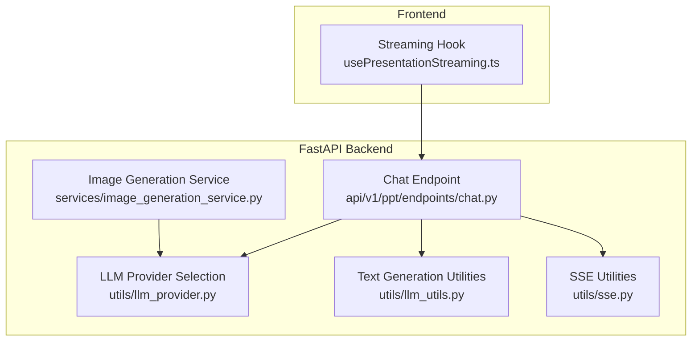
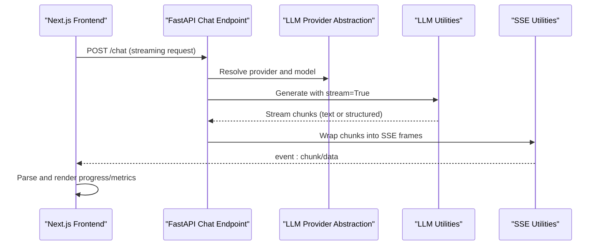
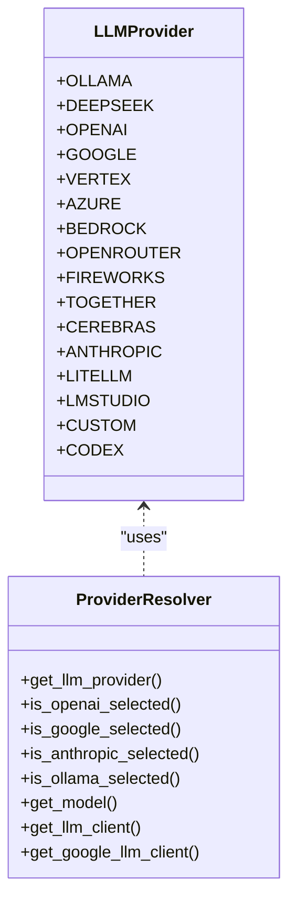
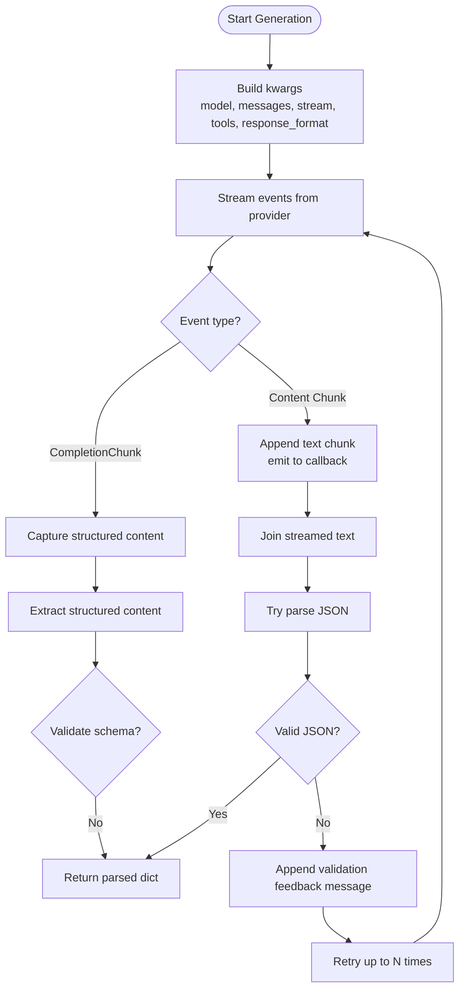
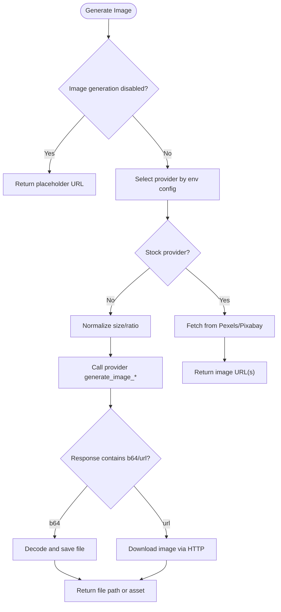
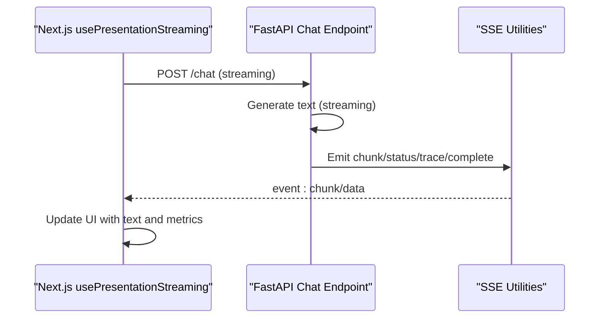
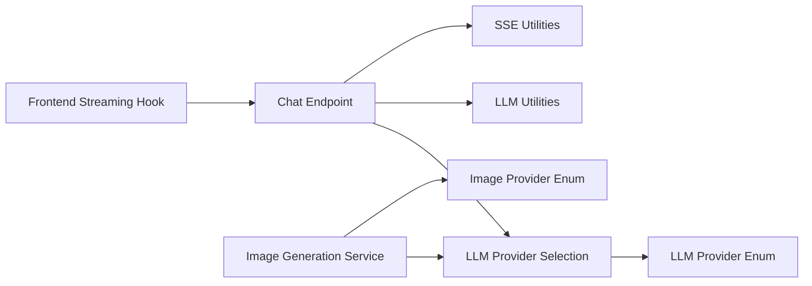

# AI Integration Services

<cite>
**Referenced Files in This Document**
- [llm_provider.py](file://servers/fastapi/utils/llm_provider.py)
- [llm_utils.py](file://servers/fastapi/utils/llm_utils.py)
- [image_generation_service.py](file://servers/fastapi/services/image_generation_service.py)
- [llm_provider_enum.py](file://servers/fastapi/enums/llm_provider.py)
- [image_provider_enum.py](file://servers/fastapi/enums/image_provider.py)
- [generation_endpoint.py](file://servers/fastapi/api/v1/ppt/endpoints/generation.py)
- [chat_endpoint.py](file://servers/fastapi/api/v1/ppt/endpoints/chat.py)
- [sse_utils.py](file://servers/fastapi/utils/sse.py)
- [usePresentationStreaming.ts](file://servers/nextjs/app/(presentation-generator)/presentation/hooks/usePresentationStreaming.ts)
</cite>

## Table of Contents
1. [Introduction](#introduction)
2. [Project Structure](#project-structure)
3. [Core Components](#core-components)
4. [Architecture Overview](#architecture-overview)
5. [Detailed Component Analysis](#detailed-component-analysis)
6. [Dependency Analysis](#dependency-analysis)
7. [Performance Considerations](#performance-considerations)
8. [Troubleshooting Guide](#troubleshooting-guide)
9. [Conclusion](#conclusion)

## Introduction
This document explains the AI integration services layer that unifies text and image generation across multiple providers. It covers:
- LLM provider abstraction for OpenAI, Google GenAI, Anthropic, Ollama, Vertex, Azure, Bedrock, OpenRouter, Fireworks, Together, Cerebras, LiteLLM, LM Studio, DeepSeek, Codex, and custom backends.
- A unified interface for text generation with streaming, structured output, prompt engineering patterns, and response processing.
- Image generation services for OpenAI DALL·E (GPT Image 1.5/2), Google Gemini Flash and NanoBanana Pro, ComfyUI, Open WebUI, Pexels/Pixabay stock images, and OpenAI-compatible endpoints.
- Provider selection logic, fallback mechanisms, rate limiting considerations, error handling, and cost optimization strategies.
- Streaming responses via Server-Sent Events (SSE) and client-side consumption.

## Project Structure
The AI integration services are implemented primarily in the FastAPI backend under `servers/fastapi`, with a Next.js frontend consuming streaming chat responses.

**Diagram sources**
- [llm_provider.py:47-193](file://servers/fastapi/utils/llm_provider.py#L47-L193)
- [llm_utils.py:68-107](file://servers/fastapi/utils/llm_utils.py#L68-L107)
- [image_generation_service.py:132-235](file://servers/fastapi/services/image_generation_service.py#L132-L235)
- [chat_endpoint.py:145-165](file://servers/fastapi/api/v1/ppt/endpoints/chat.py#L145-L165)
- [sse_utils.py:10-38](file://servers/fastapi/utils/sse.py#L10-L38)
- [usePresentationStreaming.ts:305-340](file://servers/nextjs/app/(presentation-generator)/presentation/hooks/usePresentationStreaming.ts#L305-L340)

**Section sources**
- [llm_provider.py:47-193](file://servers/fastapi/utils/llm_provider.py#L47-L193)
- [image_generation_service.py:132-235](file://servers/fastapi/services/image_generation_service.py#L132-L235)
- [chat_endpoint.py:145-165](file://servers/fastapi/api/v1/ppt/endpoints/chat.py#L145-L165)
- [sse_utils.py:10-38](file://servers/fastapi/utils/sse.py#L10-L38)
- [usePresentationStreaming.ts:305-340](file://servers/nextjs/app/(presentation-generator)/presentation/hooks/usePresentationStreaming.ts#L305-L340)

## Core Components
- LLM Provider Abstraction: Centralized provider resolution and model selection.
- Text Generation Utilities: Streaming, structured content extraction, metrics, and retry loops.
- Image Generation Service: Multi-provider image generation with size/ratio normalization and fallbacks.
- Streaming Endpoints: SSE-based chat streaming with typed events.
- Frontend Streaming Consumer: Parses SSE frames and updates UI state.

Key responsibilities:
- Provider selection and model resolution.
- Unified text generation with streaming and structured outputs.
- Robust image generation across cloud and local providers.
- Consistent error handling and metrics reporting.

**Section sources**
- [llm_provider.py:47-193](file://servers/fastapi/utils/llm_provider.py#L47-L193)
- [llm_utils.py:68-107](file://servers/fastapi/utils/llm_utils.py#L68-L107)
- [image_generation_service.py:132-235](file://servers/fastapi/services/image_generation_service.py#L132-L235)
- [chat_endpoint.py:145-165](file://servers/fastapi/api/v1/ppt/endpoints/chat.py#L145-L165)

## Architecture Overview
The system uses a layered architecture:
- API Layer: Endpoints expose streaming chat and image generation APIs.
- Service Layer: Providers are abstracted behind utilities and services.
- Client Layer: The Next.js frontend consumes streaming events and renders results.

**Diagram sources**
- [chat_endpoint.py:145-165](file://servers/fastapi/api/v1/ppt/endpoints/chat.py#L145-L165)
- [llm_provider.py:47-193](file://servers/fastapi/utils/llm_provider.py#L47-L193)
- [llm_utils.py:68-107](file://servers/fastapi/utils/llm_utils.py#L68-L107)
- [sse_utils.py:10-38](file://servers/fastapi/utils/sse.py#L10-L38)

## Detailed Component Analysis

### LLM Provider Abstraction
Responsibilities:
- Enumerates supported providers and resolves the active provider from environment configuration.
- Provides helper predicates to check selected provider.
- Resolves the default model per provider, including special handling for Azure deployments and Codex model validation.
- Exposes clients for direct use in tests and integrations.

Provider list includes: OpenAI, DeepSeek, Google, Vertex, Azure, Bedrock, OpenRouter, Fireworks, Together, Cerebras, Anthropic, LiteLLM, LM Studio, Ollama, Custom, Codex.

**Diagram sources**
- [llm_provider_enum.py:4-20](file://servers/fastapi/enums/llm_provider.py#L4-L20)
- [llm_provider.py:47-193](file://servers/fastapi/utils/llm_provider.py#L47-L193)

**Section sources**
- [llm_provider_enum.py:4-20](file://servers/fastapi/enums/llm_provider.py#L4-L20)
- [llm_provider.py:47-193](file://servers/fastapi/utils/llm_provider.py#L47-L193)

### Text Generation Utilities
Responsibilities:
- Unified streaming generator that always streams to avoid provider-specific non-streaming constraints.
- Structured content extraction and serialization for JSON-like outputs.
- Token usage estimation and thinking/reasoning token support.
- Retry loops for structured generation with schema validation feedback.
- Disconnect-aware streaming to cancel long-running tasks when clients disconnect.

Key behaviors:
- Always requests streaming from providers; aggregates streamed text and structured completion chunks.
- Builds consistent metrics including input/output tokens, total tokens, throughput, duration, and thinking tokens.
- Validates structured outputs against schemas and injects repair prompts on failures.

**Diagram sources**
- [llm_utils.py:68-107](file://servers/fastapi/utils/llm_utils.py#L68-L107)
- [llm_utils.py:310-389](file://servers/fastapi/utils/llm_utils.py#L310-L389)
- [llm_utils.py:458-536](file://servers/fastapi/utils/llm_utils.py#L458-L536)

**Section sources**
- [llm_utils.py:68-107](file://servers/fastapi/utils/llm_utils.py#L68-L107)
- [llm_utils.py:191-273](file://servers/fastapi/utils/llm_utils.py#L191-L273)
- [llm_utils.py:310-389](file://servers/fastapi/utils/llm_utils.py#L310-L389)
- [llm_utils.py:458-536](file://servers/fastapi/utils/llm_utils.py#L458-L536)

### Image Generation Service
Responsibilities:
- Selects an image provider based on environment configuration.
- Normalizes target sizes and aspect ratios per provider.
- Implements fallbacks for unsupported sizes and retries with defaults.
- Supports stock images (Pexels/Pixabay), cloud models (OpenAI GPT Image 1.5/2, Gemini Flash/NanoBanana Pro), local workflows (ComfyUI), Open WebUI, and OpenAI-compatible endpoints.

Provider selection logic:
- If disabled, returns placeholder.
- Stock providers return URLs directly.
- Cloud providers generate images and save to disk or return URLs.
- Local providers require additional configuration (URL, workflow).

Size and ratio handling:
- OpenAI models accept specific sizes; falls back to default if rejected.
- Gemini models accept aspect ratios; selects closest option.

**Diagram sources**
- [image_generation_service.py:132-235](file://servers/fastapi/services/image_generation_service.py#L132-L235)
- [image_generation_service.py:237-298](file://servers/fastapi/services/image_generation_service.py#L237-L298)
- [image_generation_service.py:391-476](file://servers/fastapi/services/image_generation_service.py#L391-L476)
- [image_generation_service.py:565-647](file://servers/fastapi/services/image_generation_service.py#L565-L647)
- [image_generation_service.py:1038-1116](file://servers/fastapi/services/image_generation_service.py#L1038-L1116)

**Section sources**
- [image_generation_service.py:132-235](file://servers/fastapi/services/image_generation_service.py#L132-L235)
- [image_generation_service.py:237-298](file://servers/fastapi/services/image_generation_service.py#L237-L298)
- [image_generation_service.py:391-476](file://servers/fastapi/services/image_generation_service.py#L391-L476)
- [image_generation_service.py:565-647](file://servers/fastapi/services/image_generation_service.py#L565-L647)
- [image_generation_service.py:1038-1116](file://servers/fastapi/services/image_generation_service.py#L1038-L1116)

### Streaming Chat Endpoint
Responsibilities:
- Wraps chat generation into SSE frames with typed events: chunk, status, trace, complete, error.
- Ensures graceful cancellation and error propagation.

Client consumption:
- The Next.js hook parses SSE frames, extracts chunk data, and updates UI state including generation metrics.

**Diagram sources**
- [chat_endpoint.py:145-165](file://servers/fastapi/api/v1/ppt/endpoints/chat.py#L145-L165)
- [sse_utils.py:10-38](file://servers/fastapi/utils/sse.py#L10-L38)
- [usePresentationStreaming.ts:305-340](file://servers/nextjs/app/(presentation-generator)/presentation/hooks/usePresentationStreaming.ts#L305-L340)

**Section sources**
- [chat_endpoint.py:145-165](file://servers/fastapi/api/v1/ppt/endpoints/chat.py#L145-L165)
- [sse_utils.py:10-38](file://servers/fastapi/utils/sse.py#L10-L38)
- [usePresentationStreaming.ts:305-340](file://servers/nextjs/app/(presentation-generator)/presentation/hooks/usePresentationStreaming.ts#L305-L340)

### Prompt Engineering Patterns and Response Processing
Patterns:
- Use structured generation with response formats to enforce JSON schemas.
- Inject validation feedback messages to guide providers toward valid outputs.
- Estimate tokens and track thinking tokens for reasoning models.
- Serialize structured content for streaming when no raw text is emitted.

Response processing:
- Extract structured content from completion chunks or streamed text.
- Provide metrics including throughput and duration.
- Handle provider-specific quirks (e.g., missing usage fields) with estimations.

**Section sources**
- [llm_utils.py:68-107](file://servers/fastapi/utils/llm_utils.py#L68-L107)
- [llm_utils.py:191-273](file://servers/fastapi/utils/llm_utils.py#L191-L273)
- [llm_utils.py:310-389](file://servers/fastapi/utils/llm_utils.py#L310-L389)

### Provider Configuration Examples
- LLM provider selection and model resolution are driven by environment variables resolved through utility functions.
- Image provider selection is similarly environment-driven, with explicit checks for each provider.

Configuration references:
- LLM provider enum and selection helpers.
- Image provider enum and selection helpers.

**Section sources**
- [llm_provider_enum.py:4-20](file://servers/fastapi/enums/llm_provider.py#L4-L20)
- [image_provider_enum.py:4-14](file://servers/fastapi/enums/image_provider.py#L4-L14)
- [llm_provider.py:47-193](file://servers/fastapi/utils/llm_provider.py#L47-L193)
- [image_generation_service.py:132-160](file://servers/fastapi/services/image_generation_service.py#L132-L160)

### Result Processing Workflows
- Text: Streamed chunks are aggregated, structured content is extracted, validated, and serialized as needed. Metrics are computed and emitted.
- Images: Responses are normalized to files or URLs; errors are normalized and raised consistently.

**Section sources**
- [llm_utils.py:68-107](file://servers/fastapi/utils/llm_utils.py#L68-L107)
- [llm_utils.py:414-446](file://servers/fastapi/utils/llm_utils.py#L414-L446)
- [image_generation_service.py:165-235](file://servers/fastapi/services/image_generation_service.py#L165-L235)

## Dependency Analysis
The components interact as follows:
- Endpoints depend on provider selection and utilities.
- Utilities depend on provider enums and environment configuration.
- Image service depends on provider enums and environment configuration.
- Frontend depends on endpoint contracts and SSE frame formats.

**Diagram sources**
- [chat_endpoint.py:145-165](file://servers/fastapi/api/v1/ppt/endpoints/chat.py#L145-L165)
- [llm_provider.py:47-193](file://servers/fastapi/utils/llm_provider.py#L47-L193)
- [llm_utils.py:68-107](file://servers/fastapi/utils/llm_utils.py#L68-L107)
- [image_generation_service.py:132-160](file://servers/fastapi/services/image_generation_service.py#L132-L160)
- [llm_provider_enum.py:4-20](file://servers/fastapi/enums/llm_provider.py#L4-L20)
- [image_provider_enum.py:4-14](file://servers/fastapi/enums/image_provider.py#L4-L14)
- [usePresentationStreaming.ts:305-340](file://servers/nextjs/app/(presentation-generator)/presentation/hooks/usePresentationStreaming.ts#L305-L340)

**Section sources**
- [chat_endpoint.py:145-165](file://servers/fastapi/api/v1/ppt/endpoints/chat.py#L145-L165)
- [llm_provider.py:47-193](file://servers/fastapi/utils/llm_provider.py#L47-L193)
- [llm_utils.py:68-107](file://servers/fastapi/utils/llm_utils.py#L68-L107)
- [image_generation_service.py:132-160](file://servers/fastapi/services/image_generation_service.py#L132-L160)
- [llm_provider_enum.py:4-20](file://servers/fastapi/enums/llm_provider.py#L4-L20)
- [image_provider_enum.py:4-14](file://servers/fastapi/enums/image_provider.py#L4-L14)
- [usePresentationStreaming.ts:305-340](file://servers/nextjs/app/(presentation-generator)/presentation/hooks/usePresentationStreaming.ts#L305-L340)

## Performance Considerations
- Streaming reduces latency and improves responsiveness; always use streaming for structured generation to avoid provider timeouts.
- Token estimation provides approximate usage when providers omit usage fields; useful for monitoring and cost tracking.
- Image generation supports parallel execution when enabled; otherwise, a global lock serializes requests to prevent overload.
- Size/ratio normalization avoids provider rejections and reduces retries.
- Disconnect checking cancels long-running streams promptly when clients disconnect.

[No sources needed since this section provides general guidance]

## Troubleshooting Guide
Common issues and resolutions:
- Invalid LLM provider: Ensure environment variable matches one of the supported providers.
- Missing API keys: Verify provider-specific environment variables are set (e.g., OpenAI, Google).
- Image generation disabled: Check configuration flags; placeholder images will be returned.
- Unsupported image size: Provider-specific fallbacks apply; verify model capabilities.
- ComfyUI workflow errors: Validate workflow JSON and ensure required nodes exist.
- SSE stream failures: Errors are wrapped and emitted as typed events; inspect metadata for context.

Operational tips:
- Use structured generation with schema validation to reduce malformed outputs.
- Monitor generation metrics to detect slow providers or high token usage.
- For local providers (ComfyUI/Open WebUI), validate URLs and authentication headers.

**Section sources**
- [llm_provider.py:47-59](file://servers/fastapi/utils/llm_provider.py#L47-L59)
- [image_generation_service.py:132-160](file://servers/fastapi/services/image_generation_service.py#L132-L160)
- [image_generation_service.py:565-647](file://servers/fastapi/services/image_generation_service.py#L565-L647)
- [sse_utils.py:10-38](file://servers/fastapi/utils/sse.py#L10-L38)

## Conclusion
The AI integration services layer provides a robust, extensible foundation for multi-provider text and image generation. It standardizes provider selection, streaming, structured outputs, and error handling while offering flexibility for local and cloud integrations. By leveraging streaming, structured validation, and consistent metrics, the system delivers responsive and observable AI experiences across diverse backends.

[No sources needed since this section summarizes without analyzing specific files]