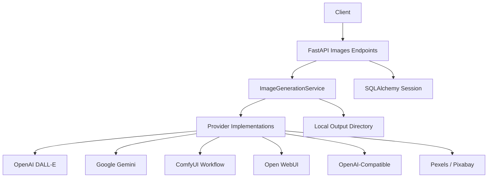
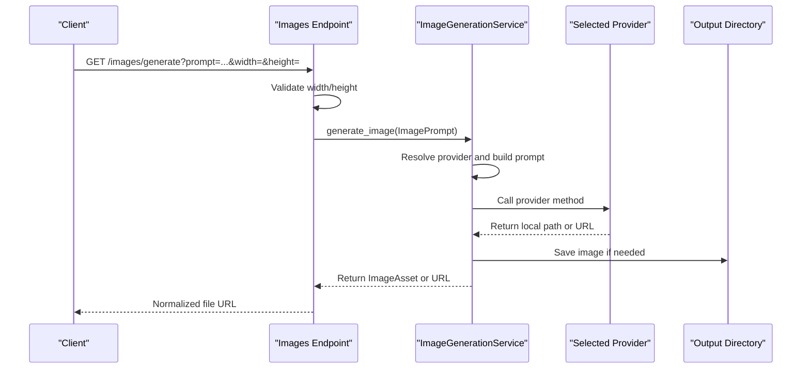
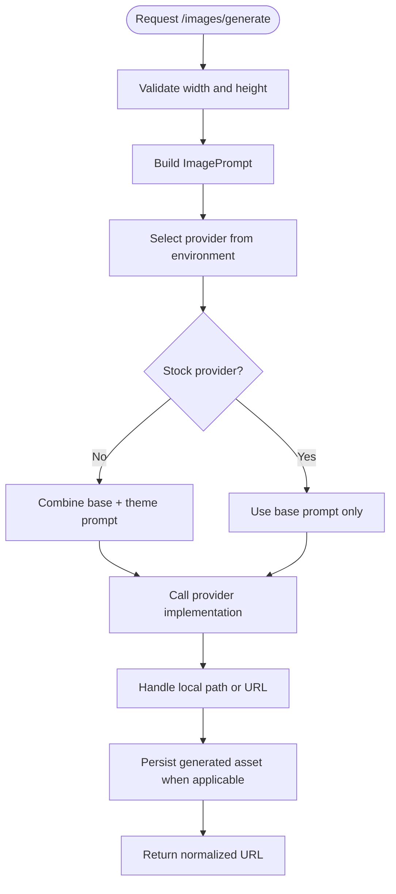
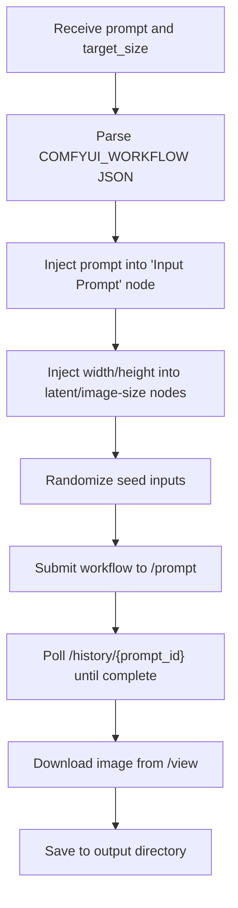
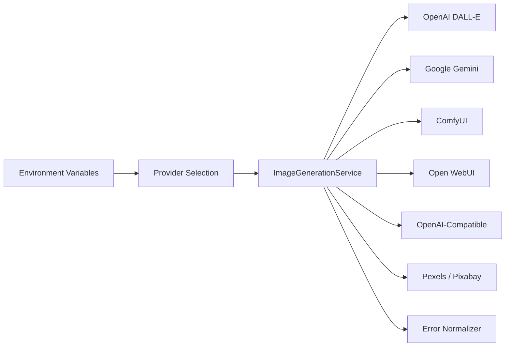

# Image Generation Services

<cite>
**Referenced Files in This Document**
- [image_generation_service.py](file://servers/fastapi/services/image_generation_service.py)
- [images.py](file://servers/fastapi/api/v1/ppt/endpoints/images.py)
- [image_provider.py](file://servers/fastapi/utils/image_provider.py)
- [image_prompt.py](file://servers/fastapi/models/image_prompt.py)
- [get_env.py](file://servers/fastapi/utils/get_env.py)
- [image_generation_error.py](file://servers/fastapi/utils/image_generation_error.py)
- [README.md](file://README.md)
- [test_image_generation_comfyui.py](file://servers/fastapi/tests/test_image_generation_comfyui.py)
</cite>

## Table of Contents
1. [Introduction](#introduction)
2. [Project Structure](#project-structure)
3. [Core Components](#core-components)
4. [Architecture Overview](#architecture-overview)
5. [Detailed Component Analysis](#detailed-component-analysis)
6. [Dependency Analysis](#dependency-analysis)
7. [Performance Considerations](#performance-considerations)
8. [Troubleshooting Guide](#troubleshooting-guide)
9. [Conclusion](#conclusion)

## Introduction
This document explains the image generation services that power slide visuals across the application. It covers supported backends, the unified generation interface, prompt processing, aspect ratio handling, output format management, provider-specific configuration, quality and optimization parameters, batch workflows, and error recovery strategies.

Supported backends include:
- OpenAI DALL-E family (GPT Image 2 and GPT Image 1.5)
- Google Gemini image models (Gemini Flash and NanoBanana Pro)
- ComfyUI workflow engine
- Open WebUI image API
- OpenAI-compatible image endpoints (for example LiteLLM or other compatible gateways)
- Stock image providers Pexels and Pixabay

The system exposes a single HTTP endpoint for generation and provides a service layer that selects and calls the configured backend while normalizing errors and managing outputs.

## Project Structure
Image generation is implemented primarily in the FastAPI backend:
- Service layer: `services/image_generation_service.py`
- HTTP endpoints: `api/v1/ppt/endpoints/images.py`
- Provider selection utilities: `utils/image_provider.py`
- Request model: `models/image_prompt.py`
- Environment configuration: `utils/get_env.py`
- Error normalization: `utils/image_generation_error.py`
- Documentation and environment variables: `README.md`
- Tests validating ComfyUI behavior: `tests/test_image_generation_comfyui.py`

**Diagram sources**
- [images.py:166-193](file://servers/fastapi/api/v1/ppt/endpoints/images.py#L166-L193)
- [image_generation_service.py:132-235](file://servers/fastapi/services/image_generation_service.py#L132-L235)

**Section sources**
- [image_generation_service.py:1-1117](file://servers/fastapi/services/image_generation_service.py#L1-L1117)
- [images.py:1-282](file://servers/fastapi/api/v1/ppt/endpoints/images.py#L1-L282)

## Core Components
- Unified generation entry point: `/images/generate` accepts a text prompt and optional width/height. It constructs an `ImagePrompt`, delegates to `ImageGenerationService.generate_image`, persists generated assets when applicable, and returns a normalized URL.
- Provider selection: The service chooses a backend based on environment configuration and helper predicates.
- Prompt processing: For non-stock providers, the service combines the user prompt with an optional theme prompt before calling the backend.
- Aspect ratio handling: The service maps requested dimensions to provider-supported sizes or ratios.
- Output handling: Generated images are saved locally; URLs are normalized for consumption by clients.

Key responsibilities:
- Normalize and validate inputs.
- Select the correct provider implementation.
- Translate target dimensions into provider-specific size or aspect-ratio settings.
- Persist generated images and return stable URLs.
- Normalize provider errors into consistent HTTP responses.

**Section sources**
- [images.py:166-193](file://servers/fastapi/api/v1/ppt/endpoints/images.py#L166-L193)
- [image_prompt.py:5-26](file://servers/fastapi/models/image_prompt.py#L5-L26)
- [image_generation_service.py:132-235](file://servers/fastapi/services/image_generation_service.py#L132-L235)

## Architecture Overview
The image generation flow starts at the HTTP endpoint and routes through the service layer to the selected provider.

**Diagram sources**
- [images.py:166-193](file://servers/fastapi/api/v1/ppt/endpoints/images.py#L166-L193)
- [image_generation_service.py:165-235](file://servers/fastapi/services/image_generation_service.py#L165-L235)

## Detailed Component Analysis

### Unified Interface and Prompt Processing
- Input validation ensures width and height are either both provided or both omitted, and that numeric values are positive and finite.
- `ImagePrompt` validates that width and height are supplied together and exposes a `target_size` tuple.
- When stock providers are not selected, the service appends the theme prompt to the base prompt before invoking the backend.

**Diagram sources**
- [images.py:166-193](file://servers/fastapi/api/v1/ppt/endpoints/images.py#L166-L193)
- [image_prompt.py:5-26](file://servers/fastapi/models/image_prompt.py#L5-L26)
- [image_generation_service.py:165-235](file://servers/fastapi/services/image_generation_service.py#L165-L235)

**Section sources**
- [images.py:166-193](file://servers/fastapi/api/v1/ppt/endpoints/images.py#L166-L193)
- [image_prompt.py:5-26](file://servers/fastapi/models/image_prompt.py#L5-L26)
- [image_generation_service.py:165-235](file://servers/fastapi/services/image_generation_service.py#L165-L235)

### Provider Selection and Configuration
Provider selection is driven by environment variables and helper functions:
- `IMAGE_PROVIDER` selects the active backend.
- Backends include Pexels, Pixabay, Gemini Flash, NanoBanana Pro, GPT Image 2, GPT Image 1.5, ComfyUI, Open WebUI, and OpenAI-compatible.
- Additional flags control parallelism and disabling image generation entirely.

Configuration highlights:
- `DISABLE_IMAGE_GENERATION`: Disables generation and returns a placeholder.
- `ENABLE_PARALLEL_IMAGE_GENERATION`: Controls whether concurrent provider requests are allowed.
- Per-provider keys and endpoints are read via dedicated getters.

**Section sources**
- [image_provider.py:1-62](file://servers/fastapi/utils/image_provider.py#L1-L62)
- [get_env.py:312-330](file://servers/fastapi/utils/get_env.py#L312-L330)
- [get_env.py:397-417](file://servers/fastapi/utils/get_env.py#L397-L417)
- [get_env.py:469-489](file://servers/fastapi/utils/get_env.py#L469-L489)
- [README.md:493-508](file://README.md#L493-L508)

### OpenAI DALL-E Support (GPT Image 2 and GPT Image 1.5)
Behavior:
- Uses the OpenAI client to generate images.
- Automatically selects a supported size based on the model and requested target dimensions.
- Falls back to a default size if the provider rejects the requested size due to dimension constraints.
- Writes base64-encoded image data to disk and returns the local path.

Quality settings:
- `GPT_IMAGE_2_QUALITY` controls GPT Image 2 quality.
- `GPT_IMAGE_1_5_QUALITY` controls GPT Image 1.5 quality.
- Legacy `DALL_E_3_QUALITY` mapping is preserved for compatibility.

Aspect ratio handling:
- Supported sizes include square and portrait/landscape variants.
- The service picks the closest supported size to the requested dimensions.

**Section sources**
- [image_generation_service.py:237-298](file://servers/fastapi/services/image_generation_service.py#L237-L298)
- [image_generation_service.py:93-99](file://servers/fastapi/services/image_generation_service.py#L93-L99)
- [get_env.py:405-417](file://servers/fastapi/utils/get_env.py#L405-L417)

### Google Gemini Image Models (Gemini Flash and NanoBanana Pro)
Behavior:
- Uses the Google GenAI SDK to generate images.
- Maps requested dimensions to supported aspect ratios.
- Extracts inline image data from the response and saves it to disk.

Aspect ratio handling:
- Supported ratios include common presentation-friendly formats such as 1:1, 16:9, 9:16, and others.
- If no ratio matches well, the service lets the model choose automatically.

**Section sources**
- [image_generation_service.py:391-476](file://servers/fastapi/services/image_generation_service.py#L391-L476)
- [image_generation_service.py:101-105](file://servers/fastapi/services/image_generation_service.py#L101-L105)

### ComfyUI Workflow Integration
Behavior:
- Requires `COMFYUI_URL` and `COMFYUI_WORKFLOW`.
- Injects the prompt into a designated prompt node in the exported workflow JSON.
- Optionally injects target width and height into latent or image-size nodes.
- Randomizes seed inputs to ensure varied outputs per regeneration.
- Submits the workflow, polls completion, and downloads the first available image.

Workflow injection details:
- Prompt injection targets nodes labeled “Input Prompt” and follows links to writable string fields.
- Size injection targets nodes whose title is “Image Size” or class types representing latent image creation.
- Seed randomization recognizes common seed input names and linked primitive sources.

**Diagram sources**
- [image_generation_service.py:565-646](file://servers/fastapi/services/image_generation_service.py#L565-L646)
- [image_generation_service.py:648-767](file://servers/fastapi/services/image_generation_service.py#L648-L767)
- [image_generation_service.py:769-907](file://servers/fastapi/services/image_generation_service.py#L769-L907)
- [image_generation_service.py:909-1034](file://servers/fastapi/services/image_generation_service.py#L909-L1034)

**Section sources**
- [image_generation_service.py:565-1034](file://servers/fastapi/services/image_generation_service.py#L565-L1034)
- [test_image_generation_comfyui.py:9-211](file://servers/fastapi/tests/test_image_generation_comfyui.py#L9-L211)

### Open WebUI Image API
Behavior:
- Sends a POST request to the Open WebUI image generation endpoint.
- Supports bearer token authentication.
- Accepts both base64 and URL-based image responses.
- Auto-appends `/api/v1` when a bare origin is provided.

Error hints:
- If the server returns 404 or 405, the error message suggests pointing the URL at the API root.

**Section sources**
- [image_generation_service.py:107-119](file://servers/fastapi/services/image_generation_service.py#L107-L119)
- [image_generation_service.py:300-389](file://servers/fastapi/services/image_generation_service.py#L300-L389)

### OpenAI-Compatible Image Endpoints
Behavior:
- Configured via base URL, API key, and model name.
- Reuses the same size-selection logic as OpenAI DALL-E.
- Handles both base64 and URL responses, including relative URLs.

**Section sources**
- [image_generation_service.py:1038-1116](file://servers/fastapi/services/image_generation_service.py#L1038-L1116)
- [get_env.py:478-489](file://servers/fastapi/utils/get_env.py#L478-L489)

### Stock Image Providers (Pexels and Pixabay)
Behavior:
- Search endpoints return direct image URLs rather than saving files locally.
- Support per-request API keys via headers or fall back to configured keys.
- Enforce rate limits and provide clear error messages for invalid keys.

Batching:
- Both providers support returning multiple results up to provider-defined limits.

**Section sources**
- [image_generation_service.py:478-563](file://servers/fastapi/services/image_generation_service.py#L478-L563)
- [images.py:116-163](file://servers/fastapi/api/v1/ppt/endpoints/images.py#L116-L163)

### Result Handling and Output Formats
- Local paths are wrapped in `ImageAsset` and persisted when generated by the backend.
- URLs returned by providers are normalized for client consumption.
- Static placeholders are served when generation is disabled or unavailable.

**Section sources**
- [image_generation_service.py:165-235](file://servers/fastapi/services/image_generation_service.py#L165-L235)
- [images.py:186-193](file://servers/fastapi/api/v1/ppt/endpoints/images.py#L186-L193)

## Dependency Analysis
The following diagram shows how components depend on each other during generation.

**Diagram sources**
- [image_provider.py:1-62](file://servers/fastapi/utils/image_provider.py#L1-L62)
- [image_generation_service.py:132-235](file://servers/fastapi/services/image_generation_service.py#L132-L235)
- [image_generation_error.py:58-72](file://servers/fastapi/utils/image_generation_error.py#L58-L72)

**Section sources**
- [image_provider.py:1-62](file://servers/fastapi/utils/image_provider.py#L1-L62)
- [image_generation_service.py:132-235](file://servers/fastapi/services/image_generation_service.py#L132-L235)
- [image_generation_error.py:58-72](file://servers/fastapi/utils/image_generation_error.py#L58-L72)

## Performance Considerations
- Parallel generation: By default, image provider requests may run concurrently. Set `ENABLE_PARALLEL_IMAGE_GENERATION=false` to serialize requests for providers with strict rate limits.
- Size fallback: For OpenAI-compatible APIs, unsupported sizes trigger an automatic retry with a default size to reduce failures.
- ComfyUI polling: The service polls the ComfyUI history endpoint with a timeout to avoid hanging indefinitely.
- Stock provider caching: Some stock providers may cache public search results; strict mode can force authentication checks.

Recommendations:
- Tune `ENABLE_PARALLEL_IMAGE_GENERATION` according to provider quotas.
- Prefer aspect-ratio-aware models (Gemini) when exact pixel dimensions are less critical.
- For ComfyUI, ensure workflows expose editable latent/image-size nodes to honor template dimensions.

**Section sources**
- [get_env.py:320-326](file://servers/fastapi/utils/get_env.py#L320-L326)
- [image_generation_service.py:254-266](file://servers/fastapi/services/image_generation_service.py#L254-L266)
- [image_generation_service.py:935-983](file://servers/fastapi/services/image_generation_service.py#L935-L983)
- [images.py:133-141](file://servers/fastapi/api/v1/ppt/endpoints/images.py#L133-L141)

## Troubleshooting Guide
Common issues and resolutions:
- Missing provider configuration:
  - Ensure required environment variables are set for the selected provider.
  - For Open WebUI, verify the URL points to the API root; the service auto-appends `/api/v1` for bare origins.
  - For ComfyUI, confirm both URL and workflow JSON are present and valid.
- Invalid API keys:
  - Stock providers return explicit 401 errors for invalid keys.
  - OpenAI errors are normalized into structured HTTP exceptions with provider codes.
- Dimension errors:
  - OpenAI-compatible endpoints may reject unsupported sizes; the service retries with a default size.
- No image returned:
  - Gemini and OpenAI-compatible implementations raise errors when no image data is found in the response.

Error normalization:
- All provider exceptions are converted into consistent HTTP exceptions with safe detail messages and optional provider codes.

**Section sources**
- [image_generation_service.py:300-389](file://servers/fastapi/services/image_generation_service.py#L300-L389)
- [image_generation_service.py:1038-1116](file://servers/fastapi/services/image_generation_service.py#L1038-L1116)
- [image_generation_error.py:58-72](file://servers/fastapi/utils/image_generation_error.py#L58-L72)
- [images.py:116-163](file://servers/fastapi/api/v1/ppt/endpoints/images.py#L116-L163)

## Conclusion
The image generation subsystem provides a unified interface over multiple backends, abstracting provider differences behind a consistent service layer. It supports modern AI image generators, self-hosted ComfyUI workflows, and stock imagery, while offering robust configuration, aspect ratio handling, and error normalization. Operators can tune performance and reliability through environment variables and provider-specific settings, and developers can extend the system by adding new provider implementations that conform to the existing service contract.