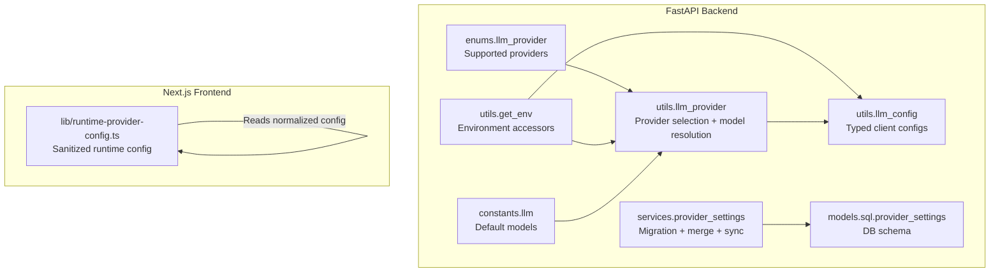
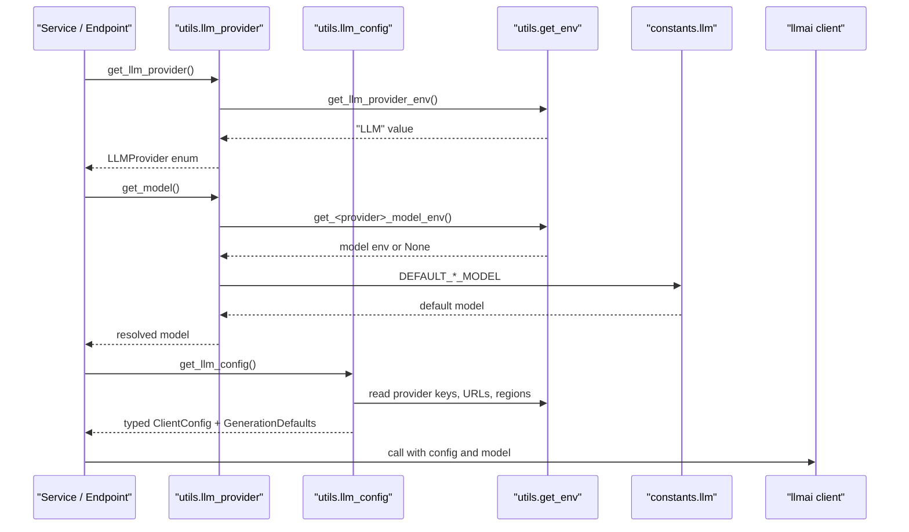
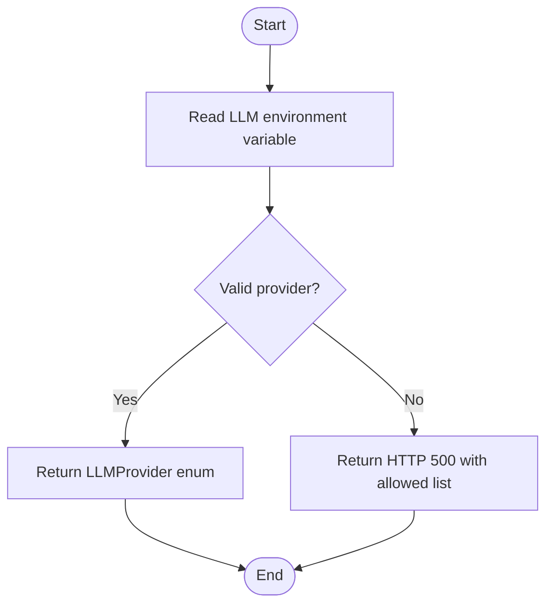
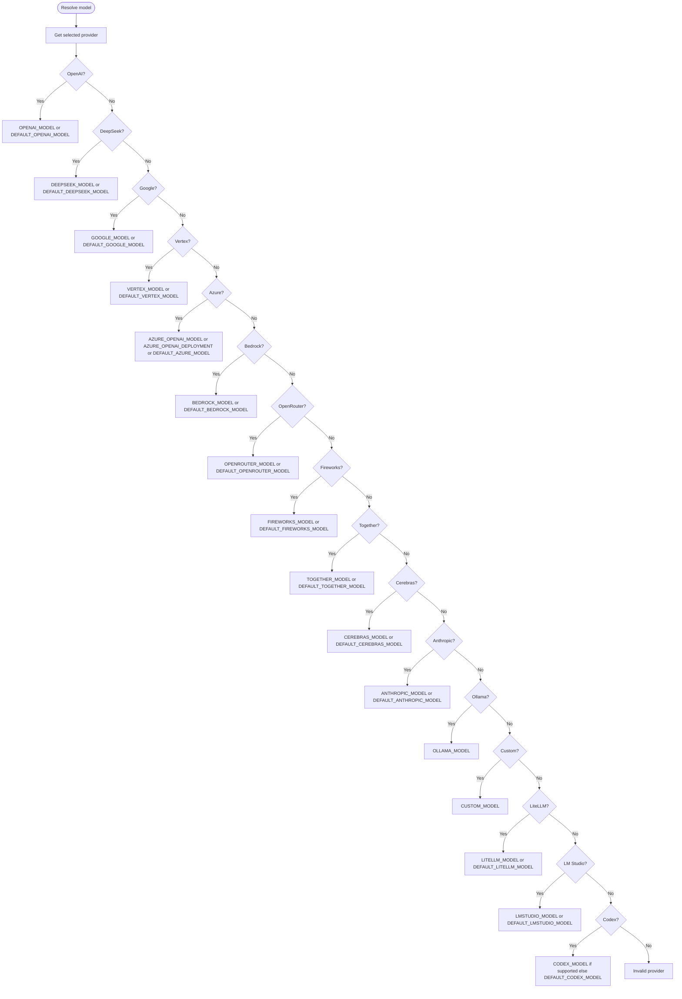
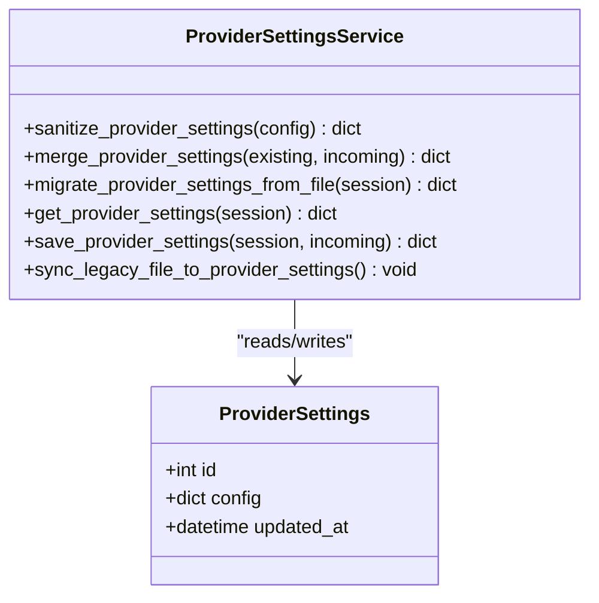
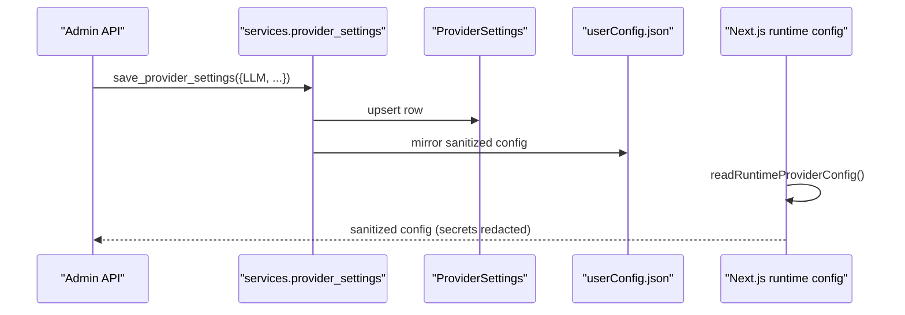
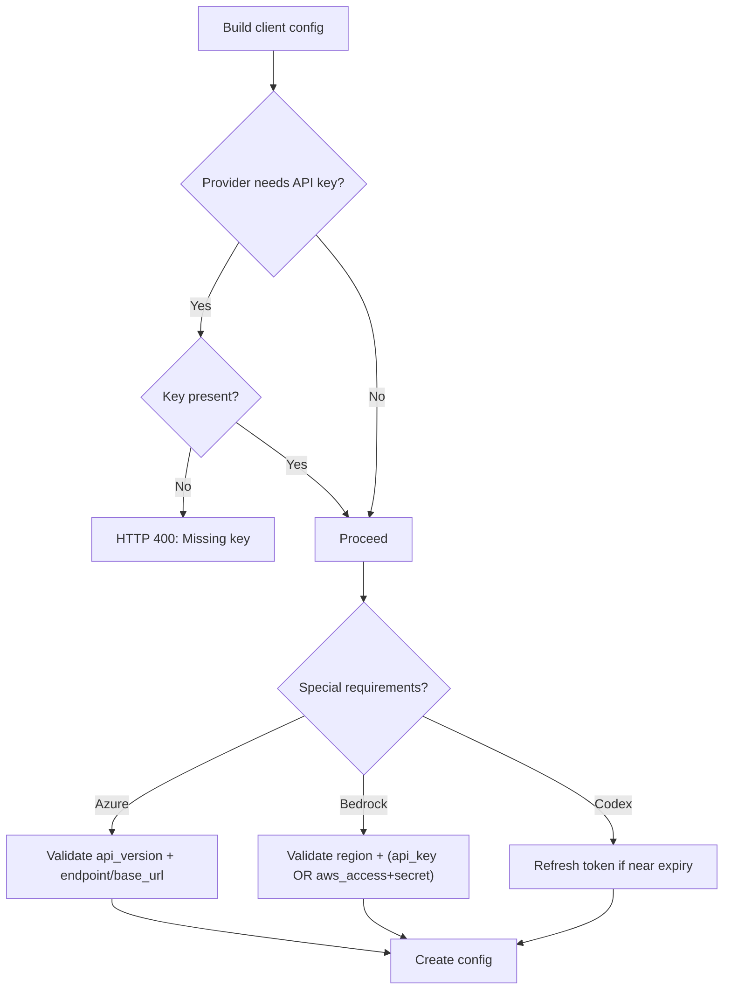
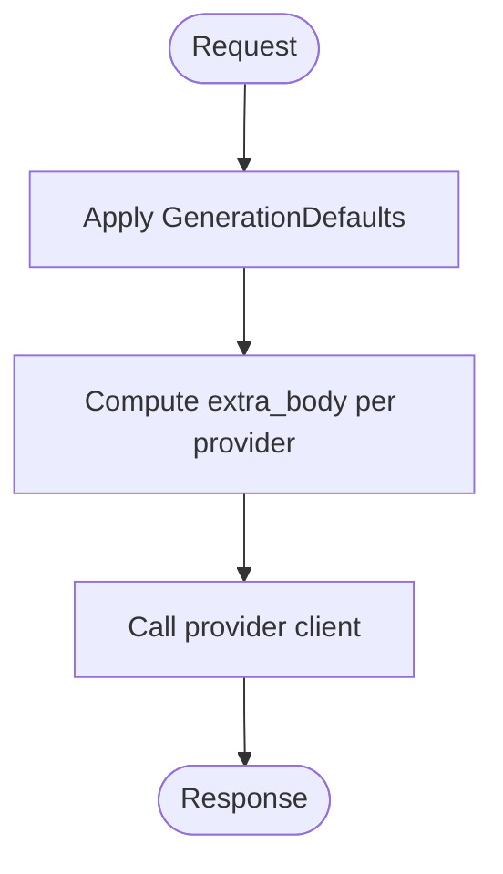
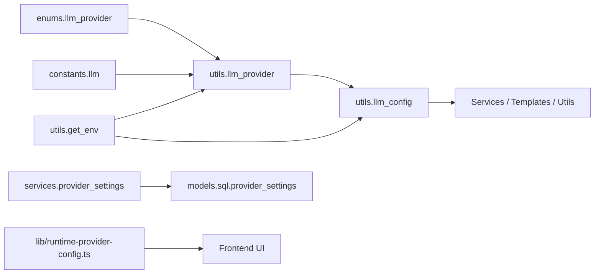

# LLM Provider Abstraction Layer

<cite>
**Referenced Files in This Document**
- [llm_provider.py](file://servers/fastapi/enums/llm_provider.py)
- [llm_provider.py](file://servers/fastapi/utils/llm_provider.py)
- [llm_config.py](file://servers/fastapi/utils/llm_config.py)
- [get_env.py](file://servers/fastapi/utils/get_env.py)
- [llm.py](file://servers/fastapi/constants/llm.py)
- [provider_settings.py](file://servers/fastapi/models/sql/provider_settings.py)
- [provider_settings.py](file://servers/fastapi/services/provider_settings.py)
- [runtime-provider-config.ts](file://servers/nextjs/lib/runtime-provider-config.ts)
- [test_provider_settings.py](file://servers/fastapi/tests/unit/test_provider_settings.py)
- [generate_smart_presentation.py](file://servers/fastapi/utils/llm_calls/generate_smart_presentation.py)
</cite>

## Table of Contents
1. [Introduction](#introduction)
2. [Project Structure](#project-structure)
3. [Core Components](#core-components)
4. [Architecture Overview](#architecture-overview)
5. [Detailed Component Analysis](#detailed-component-analysis)
6. [Dependency Analysis](#dependency-analysis)
7. [Performance Considerations](#performance-considerations)
8. [Troubleshooting Guide](#troubleshooting-guide)
9. [Conclusion](#conclusion)

## Introduction
This document explains the LLM provider abstraction layer that enables Presenton to work with multiple AI providers through a unified interface. It covers supported providers, provider selection, configuration management, model resolution, environment variables, runtime switching, error handling, authentication flows, and provider-specific optimizations such as reasoning controls and OpenRouter routing.

## Project Structure
The abstraction spans several modules:
- Enumerations define supported providers.
- Utility modules resolve the active provider and model from environment or stored settings.
- Configuration utilities build typed client configurations for each provider.
- Settings persistence migrates legacy user configuration into a database-backed singleton.
- The Next.js runtime reads a sanitized version of the administrator-managed configuration for the UI.

**Diagram sources**
- [llm_provider.py:4-20](file://servers/fastapi/enums/llm_provider.py#L4-L20)
- [llm_provider.py:47-193](file://servers/fastapi/utils/llm_provider.py#L47-L193)
- [llm_config.py:247-486](file://servers/fastapi/utils/llm_config.py#L247-L486)
- [get_env.py:88-309](file://servers/fastapi/utils/get_env.py#L88-L309)
- [llm.py:1-27](file://servers/fastapi/constants/llm.py#L1-L27)
- [provider_settings.py:10-23](file://servers/fastapi/models/sql/provider_settings.py#L10-L23)
- [provider_settings.py:52-192](file://servers/fastapi/services/provider_settings.py#L52-L192)
- [runtime-provider-config.ts:23-44](file://servers/nextjs/lib/runtime-provider-config.ts#L23-L44)

**Section sources**
- [llm_provider.py:4-20](file://servers/fastapi/enums/llm_provider.py#L4-L20)
- [llm_provider.py:47-193](file://servers/fastapi/utils/llm_provider.py#L47-L193)
- [llm_config.py:247-486](file://servers/fastapi/utils/llm_config.py#L247-L486)
- [get_env.py:88-309](file://servers/fastapi/utils/get_env.py#L88-L309)
- [llm.py:1-27](file://servers/fastapi/constants/llm.py#L1-L27)
- [provider_settings.py:10-23](file://servers/fastapi/models/sql/provider_settings.py#L10-L23)
- [provider_settings.py:52-192](file://servers/fastapi/services/provider_settings.py#L52-L192)
- [runtime-provider-config.ts:23-44](file://servers/nextjs/lib/runtime-provider-config.ts#L23-L44)

## Core Components
- Supported providers enum: Central list of recognized providers.
- Provider resolver: Reads the active provider and validates it.
- Model resolver: Chooses the model string per provider with defaults and validation.
- Client configuration builder: Builds typed llmai client configs per provider.
- Environment accessors: Read provider keys, URLs, regions, and advanced flags.
- Default constants: Provide fallback model names.
- Settings persistence: Migrates legacy userConfig.json into a DB-backed singleton and merges updates safely.
- Runtime provider config (frontend): Exposes a sanitized view of the admin-managed configuration to the UI.

Key responsibilities:
- Provider selection is environment-driven at runtime but persisted via the settings service.
- Model resolution uses provider-specific environment variables with sensible defaults.
- Authentication is validated early; missing credentials raise explicit errors.
- Advanced behaviors (reasoning, thinking, OpenRouter routing) are injected via extra request bodies.

**Section sources**
- [llm_provider.py:4-20](file://servers/fastapi/enums/llm_provider.py#L4-L20)
- [llm_provider.py:47-193](file://servers/fastapi/utils/llm_provider.py#L47-L193)
- [llm_config.py:189-244](file://servers/fastapi/utils/llm_config.py#L189-L244)
- [llm_config.py:247-486](file://servers/fastapi/utils/llm_config.py#L247-L486)
- [get_env.py:88-309](file://servers/fastapi/utils/get_env.py#L88-L309)
- [llm.py:1-27](file://servers/fastapi/constants/llm.py#L1-L27)
- [provider_settings.py:52-192](file://servers/fastapi/services/provider_settings.py#L52-L192)
- [runtime-provider-config.ts:23-44](file://servers/nextjs/lib/runtime-provider-config.ts#L23-L44)

## Architecture Overview
The system selects a provider, resolves its model, builds a typed client configuration, and applies generation defaults and provider-specific extras.

**Diagram sources**
- [llm_provider.py:47-193](file://servers/fastapi/utils/llm_provider.py#L47-L193)
- [llm_config.py:189-244](file://servers/fastapi/utils/llm_config.py#L189-L244)
- [llm_config.py:247-486](file://servers/fastapi/utils/llm_config.py#L247-L486)
- [get_env.py:88-309](file://servers/fastapi/utils/get_env.py#L88-L309)
- [llm.py:1-27](file://servers/fastapi/constants/llm.py#L1-L27)

## Detailed Component Analysis

### Supported Providers
All recognized providers are defined in a single enumeration. This list drives validation and branching logic throughout the stack.

- Providers include: Ollama, DeepSeek, OpenAI, Google, Vertex, Azure, Bedrock, OpenRouter, Fireworks, Together, Cerebras, Anthropic, LiteLLM, LM Studio, Custom, and Codex.

**Section sources**
- [llm_provider.py:4-20](file://servers/fastapi/enums/llm_provider.py#L4-L20)

### Provider Selection Mechanism
- The active provider is read from an environment variable and converted to an enum.
- Invalid values produce a clear HTTP error listing allowed providers.
- Convenience helpers check specific providers for conditional logic.

**Diagram sources**
- [llm_provider.py:47-59](file://servers/fastapi/utils/llm_provider.py#L47-L59)
- [get_env.py:88-89](file://servers/fastapi/utils/get_env.py#L88-L89)

**Section sources**
- [llm_provider.py:47-59](file://servers/fastapi/utils/llm_provider.py#L47-L59)
- [get_env.py:88-89](file://servers/fastapi/utils/get_env.py#L88-L89)

### Model Resolution Logic
Model resolution depends on the selected provider:
- Each provider has a dedicated environment variable for the model name.
- If unset, a default model is used from constants.
- Some providers have special rules (e.g., Azure falls back to deployment name; Codex validates against a supported set).

**Diagram sources**
- [llm_provider.py:126-174](file://servers/fastapi/utils/llm_provider.py#L126-L174)
- [llm.py:1-27](file://servers/fastapi/constants/llm.py#L1-L27)

**Section sources**
- [llm_provider.py:126-174](file://servers/fastapi/utils/llm_provider.py#L126-L174)
- [llm.py:1-27](file://servers/fastapi/constants/llm.py#L1-L27)

### Configuration Management and Persistence
- Legacy user configuration is migrated into a database-backed singleton table.
- Updates are merged with careful handling of managed fields (e.g., OAuth tokens), optional advanced fields, and empty-value preservation.
- Changes are mirrored back to the legacy file for compatibility paths.
- The frontend reads a sanitized runtime configuration that redacts secrets.

**Diagram sources**
- [provider_settings.py:10-23](file://servers/fastapi/models/sql/provider_settings.py#L10-L23)
- [provider_settings.py:52-192](file://servers/fastapi/services/provider_settings.py#L52-L192)

**Section sources**
- [provider_settings.py:52-192](file://servers/fastapi/services/provider_settings.py#L52-L192)
- [provider_settings.py:10-23](file://servers/fastapi/models/sql/provider_settings.py#L10-L23)
- [runtime-provider-config.ts:23-44](file://servers/nextjs/lib/runtime-provider-config.ts#L23-L44)
- [test_provider_settings.py:36-104](file://servers/fastapi/tests/unit/test_provider_settings.py#L36-L104)

### Environment Variables and Secrets
- Provider selection: LLM
- Per-provider API keys, base URLs, regions, projects, locations, deployments, and model names are read via dedicated getters.
- Advanced flags control reasoning mode, effort, budget, max output tokens, generation profile, and web grounding.
- Codex OAuth tokens and account metadata are handled separately and refreshed when needed.

Examples of key variables (non-exhaustive):
- LLM, OPENAI_API_KEY, OPENAI_MODEL
- GOOGLE_API_KEY, GOOGLE_MODEL
- VERTEX_API_KEY, VERTEX_PROJECT, VERTEX_LOCATION, VERTEX_BASE_URL, VERTEX_MODEL
- AZURE_OPENAI_API_KEY, AZURE_OPENAI_API_VERSION, AZURE_OPENAI_ENDPOINT, AZURE_OPENAI_BASE_URL, AZURE_OPENAI_DEPLOYMENT, AZURE_OPENAI_MODEL
- BEDROCK_REGION, BEDROCK_API_KEY, BEDROCK_AWS_ACCESS_KEY_ID, BEDROCK_AWS_SECRET_ACCESS_KEY, BEDROCK_AWS_SESSION_TOKEN, BEDROCK_PROFILE_NAME, BEDROCK_MODEL
- ANTHROPIC_API_KEY, ANTHROPIC_MODEL
- OPENROUTER_API_KEY, OPENROUTER_BASE_URL, OPENROUTER_MODEL, OPENROUTER_PROVIDER_ORDER, OPENROUTER_ALLOW_FALLBACKS, OPENROUTER_REQUIRE_PARAMETERS, OPENROUTER_DATA_COLLECTION, OPENROUTER_ZDR
- FIREWORKS_API_KEY, FIREWORKS_BASE_URL, FIREWORKS_MODEL
- TOGETHER_API_KEY, TOGETHER_BASE_URL, TOGETHER_MODEL
- CEREBRAS_API_KEY, CEREBRAS_BASE_URL, CEREBRAS_MODEL
- LITELLM_BASE_URL, LITELLM_API_KEY, LITELLM_MODEL
- LMSTUDIO_BASE_URL, LMSTUDIO_API_KEY, LMSTUDIO_MODEL
- CUSTOM_LLM_URL, CUSTOM_LLM_API_KEY, CUSTOM_MODEL
- OLLAMA_URL, OLLAMA_MODEL
- CODEX_ACCESS_TOKEN, CODEX_REFRESH_TOKEN, CODEX_TOKEN_EXPIRES, CODEX_ACCOUNT_ID, CODEX_MODEL

**Section sources**
- [get_env.py:88-309](file://servers/fastapi/utils/get_env.py#L88-L309)
- [get_env.py:337-362](file://servers/fastapi/utils/get_env.py#L337-L362)
- [get_env.py:420-450](file://servers/fastapi/utils/get_env.py#L420-L450)

### Runtime Provider Switching
- Changing the LLM environment variable switches the active provider at runtime.
- The settings service persists provider changes and mirrors them to the legacy file for compatibility.
- The frontend receives a sanitized runtime configuration suitable for display without exposing secrets.

**Diagram sources**
- [provider_settings.py:137-155](file://servers/fastapi/services/provider_settings.py#L137-L155)
- [provider_settings.py:85-100](file://servers/fastapi/services/provider_settings.py#L85-L100)
- [runtime-provider-config.ts:23-44](file://servers/nextjs/lib/runtime-provider-config.ts#L23-L44)

**Section sources**
- [provider_settings.py:85-100](file://servers/fastapi/services/provider_settings.py#L85-L100)
- [provider_settings.py:137-155](file://servers/fastapi/services/provider_settings.py#L137-L155)
- [runtime-provider-config.ts:23-44](file://servers/nextjs/lib/runtime-provider-config.ts#L23-L44)

### Authentication Management
- Most providers require an API key; missing keys raise explicit HTTP errors during configuration construction.
- Azure requires both API key and API version, plus endpoint or base URL.
- Bedrock supports either a direct API key or AWS credentials (access key and secret key).
- Codex uses OAuth tokens with automatic refresh when nearing expiration.

**Diagram sources**
- [llm_config.py:312-345](file://servers/fastapi/utils/llm_config.py#L312-L345)
- [llm_config.py:346-373](file://servers/fastapi/utils/llm_config.py#L346-L373)
- [llm_config.py:108-166](file://servers/fastapi/utils/llm_config.py#L108-L166)

**Section sources**
- [llm_config.py:247-486](file://servers/fastapi/utils/llm_config.py#L247-L486)
- [llm_config.py:108-166](file://servers/fastapi/utils/llm_config.py#L108-L166)

### Provider-Specific Optimizations and Extras
- Reasoning and thinking controls:
  - Global defaults for generation profile, reasoning mode/effort/budget, and max output tokens are applied to all providers.
  - Some providers receive provider-specific extra body parameters (e.g., disabling thinking for DeepSeek or custom endpoints).
- OpenRouter routing:
  - Provider order, fallback behavior, parameter requirements, data collection policy, and zero-day response (ZDR) can be configured via extra body.
- Model capability checks:
  - Smart presentation generation adapts reasoning based on whether the selected model supports it.

**Diagram sources**
- [llm_config.py:189-244](file://servers/fastapi/utils/llm_config.py#L189-L244)
- [llm_config.py:489-524](file://servers/fastapi/utils/llm_config.py#L489-L524)
- [generate_smart_presentation.py:705-730](file://servers/fastapi/utils/llm_calls/generate_smart_presentation.py#L705-L730)

**Section sources**
- [llm_config.py:189-244](file://servers/fastapi/utils/llm_config.py#L189-L244)
- [llm_config.py:489-524](file://servers/fastapi/utils/llm_config.py#L489-L524)
- [generate_smart_presentation.py:705-730](file://servers/fastapi/utils/llm_calls/generate_smart_presentation.py#L705-L730)

## Dependency Analysis
The following diagram shows how components depend on each other:

**Diagram sources**
- [llm_provider.py:4-20](file://servers/fastapi/enums/llm_provider.py#L4-L20)
- [llm_provider.py:47-193](file://servers/fastapi/utils/llm_provider.py#L47-L193)
- [llm_config.py:247-486](file://servers/fastapi/utils/llm_config.py#L247-L486)
- [get_env.py:88-309](file://servers/fastapi/utils/get_env.py#L88-L309)
- [llm.py:1-27](file://servers/fastapi/constants/llm.py#L1-L27)
- [provider_settings.py:10-23](file://servers/fastapi/models/sql/provider_settings.py#L10-L23)
- [provider_settings.py:52-192](file://servers/fastapi/services/provider_settings.py#L52-L192)
- [runtime-provider-config.ts:23-44](file://servers/nextjs/lib/runtime-provider-config.ts#L23-L44)

**Section sources**
- [llm_provider.py:47-193](file://servers/fastapi/utils/llm_provider.py#L47-L193)
- [llm_config.py:247-486](file://servers/fastapi/utils/llm_config.py#L247-L486)
- [get_env.py:88-309](file://servers/fastapi/utils/get_env.py#L88-L309)
- [llm.py:1-27](file://servers/fastapi/constants/llm.py#L1-L27)
- [provider_settings.py:52-192](file://servers/fastapi/services/provider_settings.py#L52-L192)
- [runtime-provider-config.ts:23-44](file://servers/nextjs/lib/runtime-provider-config.ts#L23-L44)

## Performance Considerations
- Avoid unnecessary reconfiguration by caching provider and model resolution where appropriate.
- Use provider-specific optimizations (e.g., disabling thinking when not needed) to reduce latency and cost.
- For OpenRouter, tune provider order and fallbacks to minimize retries and improve reliability.
- Respect max output tokens and reasoning budgets to prevent excessive token usage.

[No sources needed since this section provides general guidance]

## Troubleshooting Guide
Common issues and resolutions:
- Invalid provider: Ensure LLM is set to one of the supported providers.
- Missing API key: Configure the required provider key (e.g., OPENAI_API_KEY, GOOGLE_API_KEY, ANTHROPIC_API_KEY).
- Azure misconfiguration: Set AZURE_OPENAI_API_VERSION and either AZURE_OPENAI_ENDPOINT or AZURE_OPENAI_BASE_URL.
- Bedrock auth incomplete: Provide BEDROCK_API_KEY or both AWS access key and secret key.
- Codex session expired: Re-authenticate to refresh tokens; the system will attempt automatic refresh when near expiry.
- Reasoning errors: Verify LLM_REASONING_MODE, LLM_REASONING_EFFORT, and LLM_REASONING_BUDGET_TOKENS values.

**Section sources**
- [llm_provider.py:47-59](file://servers/fastapi/utils/llm_provider.py#L47-L59)
- [llm_config.py:312-345](file://servers/fastapi/utils/llm_config.py#L312-L345)
- [llm_config.py:346-373](file://servers/fastapi/utils/llm_config.py#L346-L373)
- [llm_config.py:108-166](file://servers/fastapi/utils/llm_config.py#L108-L166)
- [llm_config.py:189-244](file://servers/fastapi/utils/llm_config.py#L189-L244)

## Conclusion
The LLM provider abstraction layer centralizes provider selection, model resolution, and configuration across many AI backends. It enforces strong validation, supports rich provider-specific options, and persists settings securely while maintaining backward compatibility. By using environment variables and the settings service, administrators can switch providers at runtime, tune performance, and manage authentication consistently.