# Prompt Engineering & Templates

<cite>
**Referenced Files in This Document**
- [template-v2.md](file://docs/template-v2.md)
- [prompts.py](file://servers/fastapi/services/chat/prompts.py)
- [generate_presentation_outlines.py](file://servers/fastapi/utils/llm_calls/generate_presentation_outlines.py)
- [generate_presentation_structure.py](file://servers/fastapi/utils/llm_calls/generate_presentation_structure.py)
- [generate_slide_content.py](file://servers/fastapi/utils/llm_calls/generate_slide_content.py)
- [default_templates.py](file://servers/fastapi/templates/default_templates.py)
- [certified_generation.py](file://servers/fastapi/templates/v2/certified_generation.py)
- [generation.py](file://servers/fastapi/templates/v2/generation.py)
- [schema.py](file://servers/fastapi/templates/v2/schema.py)
- [content.py](file://servers/fastapi/templates/v2/content.py)
- [theme.py](file://servers/fastapi/templates/v2/theme.py)
</cite>

## Table of Contents
1. [Introduction](#introduction)
2. [Project Structure](#project-structure)
3. [Core Components](#core-components)
4. [Architecture Overview](#architecture-overview)
5. [Detailed Component Analysis](#detailed-component-analysis)
6. [Dependency Analysis](#dependency-analysis)
7. [Performance Considerations](#performance-considerations)
8. [Troubleshooting Guide](#troubleshooting-guide)
9. [Conclusion](#conclusion)
10. [Appendices](#appendices)

## Introduction
This document explains the prompt engineering system and template management used by the project to generate presentations, outlines, slide content, and Template V2 layouts. It covers:

- Structured prompt templates for outline generation, layout selection, and slide content creation.
- Template variables, conditional logic, and dynamic content insertion.
- Response formatting through JSON schemas and structured model outputs.
- Optimization techniques such as schema-driven retries, context trimming, parallel processing, and fallback strategies.
- The relationship between prompts and the Template V2 system, including certified layout creation, schema derivation, hydration, and theme generation.

The goal is to make the prompt-to-output pipeline understandable for both developers and non-technical users who need to extend or troubleshoot presentation generation.

## Project Structure
The prompt and template system spans three main areas:

- LLM call utilities that build prompts and enforce structured responses.
- Chat assistant prompts that guide interactive slide editing and Smart HTML workflows.
- Template V2 modules that convert source decks into reusable layouts, derive editable schemas, hydrate generated content, and produce semantic themes.

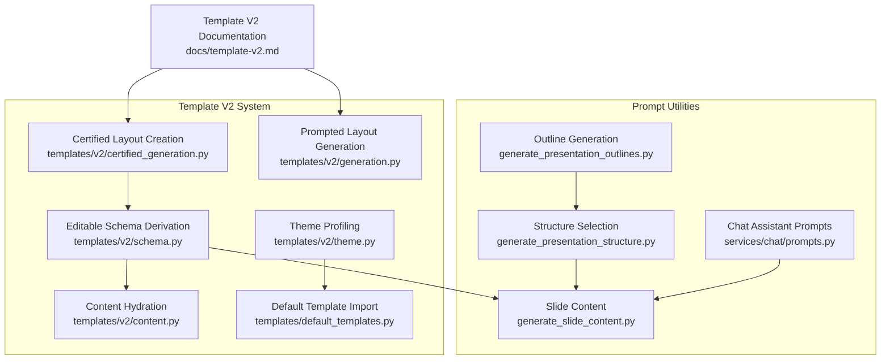

**Diagram sources**
- [generate_presentation_outlines.py:1-405](file://servers/fastapi/utils/llm_calls/generate_presentation_outlines.py#L1-L405)
- [generate_presentation_structure.py:1-212](file://servers/fastapi/utils/llm_calls/generate_presentation_structure.py#L1-L212)
- [generate_slide_content.py:1-276](file://servers/fastapi/utils/llm_calls/generate_slide_content.py#L1-L276)
- [prompts.py:1-251](file://servers/fastapi/services/chat/prompts.py#L1-L251)
- [certified_generation.py:1-800](file://servers/fastapi/templates/v2/certified_generation.py#L1-L800)
- [generation.py:1-800](file://servers/fastapi/templates/v2/generation.py#L1-L800)
- [schema.py:1-800](file://servers/fastapi/templates/v2/schema.py#L1-L800)
- [content.py:1-88](file://servers/fastapi/templates/v2/content.py#L1-L88)
- [theme.py:1-800](file://servers/fastapi/templates/v2/theme.py#L1-L800)
- [default_templates.py:1-316](file://servers/fastapi/templates/default_templates.py#L1-L316)
- [template-v2.md:1-177](file://docs/template-v2.md#L1-L177)

**Section sources**
- [template-v2.md:1-177](file://docs/template-v2.md#L1-L177)

## Core Components
The core prompt engineering components are responsible for turning user intent into structured presentation data:

- **Outline generation**: Produces a presentation title and per-slide Markdown outlines with constraints on language, tone, verbosity, slide count, table of contents, and web search integration.
- **Structure selection**: Chooses a compatible layout index for each outline slide based on available layouts, content characteristics, and user instructions.
- **Slide content generation**: Converts an outline and response schema into audience-facing structured content, including speaker notes, charts, tables, lists, images, and icons.
- **Chat assistant prompts**: Provide strict tool-use protocols for interactive slide editing, Smart HTML editing, asset handling, and template-aware operations.

These components share common patterns:

- System prompts define rules, voice, and output contracts.
- User prompts inject runtime variables such as date, language, slide number, instructions, and content.
- Responses are validated against JSON schemas and retried when invalid.
- Context is trimmed, limited, and prioritized to reduce token usage and improve reliability.

**Section sources**
- [generate_presentation_outlines.py:41-166](file://servers/fastapi/utils/llm_calls/generate_presentation_outlines.py#L41-L166)
- [generate_presentation_structure.py:16-105](file://servers/fastapi/utils/llm_calls/generate_presentation_structure.py#L16-L105)
- [generate_slide_content.py:20-84](file://servers/fastapi/utils/llm_calls/generate_slide_content.py#L20-L84)
- [prompts.py:10-166](file://servers/fastapi/services/chat/prompts.py#L10-L166)

## Architecture Overview
The end-to-end flow separates two major responsibilities:

1. **Template creation**: Converts a source PowerPoint deck into certified Template V2 layouts using vision-capable model passes.
2. **Presentation generation**: Uses existing Template V2 layouts to select layouts, generate schema-conforming content, hydrate layouts, fetch assets, and export the final presentation.

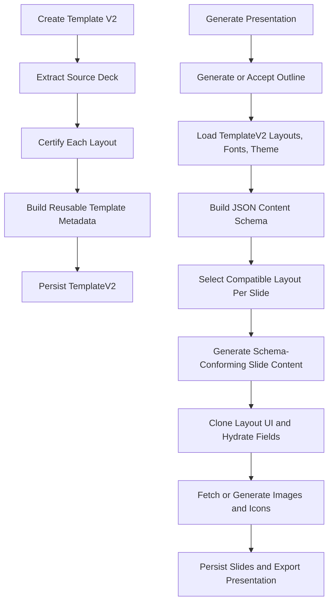

**Diagram sources**
- [template-v2.md:14-49](file://docs/template-v2.md#L14-L49)
- [template-v2.md:51-127](file://docs/template-v2.md#L51-L127)

**Section sources**
- [template-v2.md:1-177](file://docs/template-v2.md#L1-L177)

## Detailed Component Analysis

### Outline Generation Prompts
The outline generator builds a system prompt that enforces authoritative generation settings, audience-facing content rules, tone consistency, narrative flow, and limits on slide count and word count. It also supports optional web search routing and structured streaming output.

Key behaviors:

- Authoritative settings override conflicting user requests.
- Language can be auto-detected or explicitly set.
- Title slide and table of contents are conditionally included.
- Visual instructions are converted into content, not production commands.
- Web search may be routed through native model tools or external providers.
- Streaming events emit progress status and final structured content.

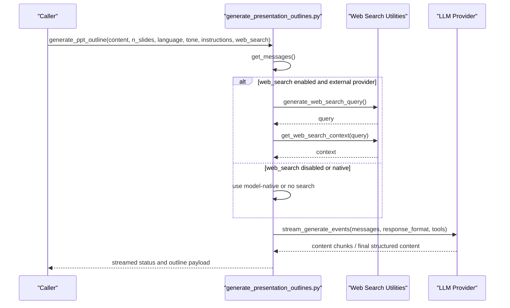

**Diagram sources**
- [generate_presentation_outlines.py:251-405](file://servers/fastapi/utils/llm_calls/generate_presentation_outlines.py#L251-L405)
- [generate_presentation_outlines.py:186-248](file://servers/fastapi/utils/llm_calls/generate_presentation_outlines.py#L186-L248)

**Section sources**
- [generate_presentation_outlines.py:41-166](file://servers/fastapi/utils/llm_calls/generate_presentation_outlines.py#L41-L166)
- [generate_presentation_outlines.py:169-248](file://servers/fastapi/utils/llm_calls/generate_presentation_outlines.py#L169-L248)
- [generate_presentation_outlines.py:251-405](file://servers/fastapi/utils/llm_calls/generate_presentation_outlines.py#L251-L405)

### Structure Selection Prompts
Structure selection chooses one layout index per slide. Two modes exist:

- A general design-focused mode that emphasizes visual variety and audience experience.
- A slides-markdown mode that derives layout choices from provided slide content and schema descriptions.

Important rules include:

- Tables require table layouts; numeric tables imply chart layouts.
- Image layouts should only be selected when imagery is requested or present.
- Adjacent slides should vary unless repetition serves the content.
- The supplied slide count is authoritative.
- User instructions win conflicts with original user requests.

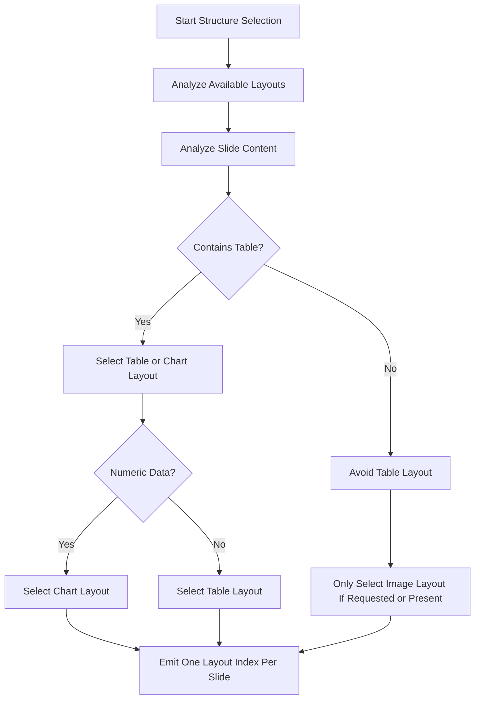

**Diagram sources**
- [generate_presentation_structure.py:16-63](file://servers/fastapi/utils/llm_calls/generate_presentation_structure.py#L16-L63)
- [generate_presentation_structure.py:66-105](file://servers/fastapi/utils/llm_calls/generate_presentation_structure.py#L66-L105)

**Section sources**
- [generate_presentation_structure.py:16-105](file://servers/fastapi/utils/llm_calls/generate_presentation_structure.py#L16-L105)
- [generate_presentation_structure.py:108-212](file://servers/fastapi/utils/llm_calls/generate_presentation_structure.py#L108-L212)

### Slide Content Prompts
Slide content generation converts an outline and a response schema into structured slide content. It adds speaker notes, enforces language rules, applies tone and verbosity instructions, and strips meta-production instructions from audience-facing output.

Key mechanisms:

- System prompt includes markdown emphasis rules, user instructions, tone, verbosity, and output fields.
- User prompt injects current date, icon/image prompt language, slide language, slide number, and outline content.
- Response schema is prepared by removing asset-only fields, ensuring object type, adding speaker note field, and normalizing arrays.
- Structured generation uses JSON schema validation with retries.

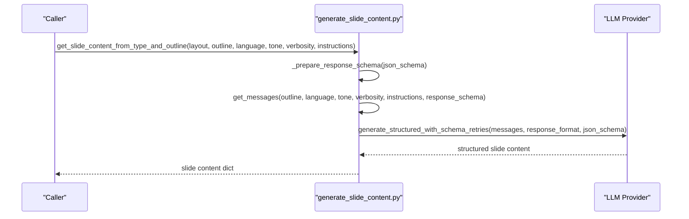

**Diagram sources**
- [generate_slide_content.py:20-84](file://servers/fastapi/utils/llm_calls/generate_slide_content.py#L20-L84)
- [generate_slide_content.py:113-192](file://servers/fastapi/utils/llm_calls/generate_slide_content.py#L113-L192)
- [generate_slide_content.py:203-276](file://servers/fastapi/utils/llm_calls/generate_slide_content.py#L203-L276)

**Section sources**
- [generate_slide_content.py:20-84](file://servers/fastapi/utils/llm_calls/generate_slide_content.py#L20-L84)
- [generate_slide_content.py:113-192](file://servers/fastapi/utils/llm_calls/generate_slide_content.py#L113-L192)
- [generate_slide_content.py:203-276](file://servers/fastapi/utils/llm_calls/generate_slide_content.py#L203-L276)

### Chat Assistant Prompts
The chat assistant system provides two primary modes:

- Standard template-based editing with strict tool-use protocols for slide discovery, component insertion, chart/table handling, asset generation, and full-slide edits.
- Smart HTML editing for complete editable HTML fragments stored in slide HTML content.

Important rules include:

- Tool outputs are authoritative over memory.
- Slide numbers are 1-based for users but 0-based for tools.
- Charts and tables must use real elements, not images or plain text.
- Asset generation happens before insertion.
- Smart HTML requires a single `<section>` root with explicit canvas dimensions and inline Chart.js initialization.

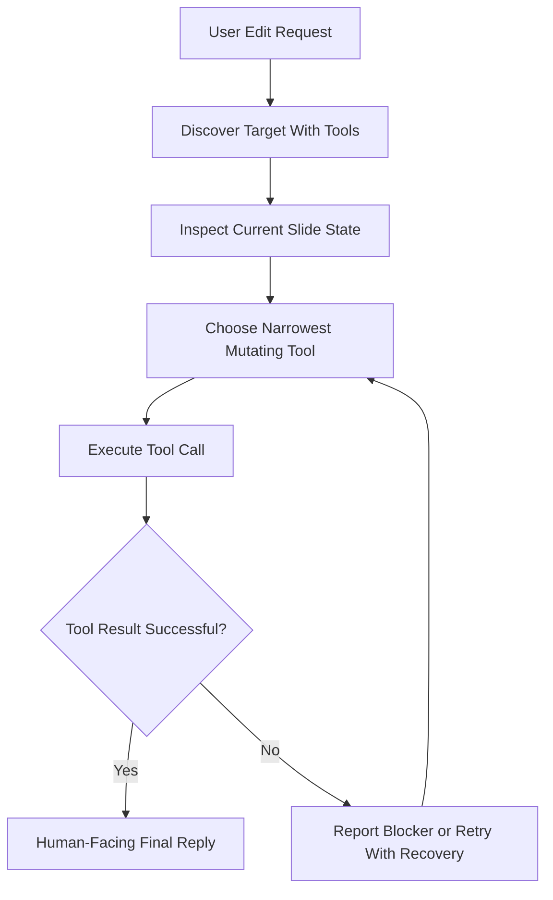

**Diagram sources**
- [prompts.py:10-166](file://servers/fastapi/services/chat/prompts.py#L10-L166)
- [prompts.py:168-224](file://servers/fastapi/services/chat/prompts.py#L168-L224)
- [prompts.py:227-251](file://servers/fastapi/services/chat/prompts.py#L227-L251)

**Section sources**
- [prompts.py:10-166](file://servers/fastapi/services/chat/prompts.py#L10-L166)
- [prompts.py:168-224](file://servers/fastapi/services/chat/prompts.py#L168-L224)
- [prompts.py:227-251](file://servers/fastapi/services/chat/prompts.py#L227-L251)

### Template V2 Certified Layout Creation
Template V2 creates reusable slide layouts from a source PPTX and rendered slide previews. It performs multiple focused model passes:

- Semantic manifest analysis for components and editable candidates.
- Visual-data detection for charts, tables, lists, and infographics.
- Flexible-region analysis for repeated or flow-based content.
- Text-capacity planning for safe growth without changing design.
- Compilation, certification, and fallback handling.

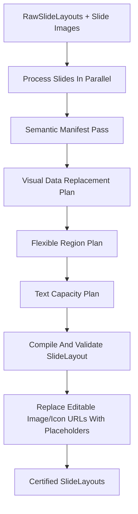

**Diagram sources**
- [certified_generation.py:111-178](file://servers/fastapi/templates/v2/certified_generation.py#L111-L178)
- [certified_generation.py:180-268](file://servers/fastapi/templates/v2/certified_generation.py#L180-L268)
- [certified_generation.py:288-443](file://servers/fastapi/templates/v2/certified_generation.py#L288-L443)
- [certified_generation.py:491-547](file://servers/fastapi/templates/v2/certified_generation.py#L491-L547)

**Section sources**
- [certified_generation.py:111-178](file://servers/fastapi/templates/v2/certified_generation.py#L111-L178)
- [certified_generation.py:180-268](file://servers/fastapi/templates/v2/certified_generation.py#L180-L268)
- [certified_generation.py:288-443](file://servers/fastapi/templates/v2/certified_generation.py#L288-L443)
- [certified_generation.py:491-547](file://servers/fastapi/templates/v2/certified_generation.py#L491-L547)

### Template V2 Prompted Layout Generation
The prompted layout generator creates a new editable Template V2 slide layout from a natural-language request while respecting the template’s visual language. It selects reference layouts and reusable components, validates the generated layout ID and structure, and replaces placeholder image/icon URLs.

Key behaviors:

- Maximum reference layouts and reusable components are bounded.
- Context size is trimmed if it exceeds character limits.
- Generated layout IDs must match a snake_case pattern.
- At least one editable element with `decorative=false` is required.
- Validation retries protect against malformed model output.

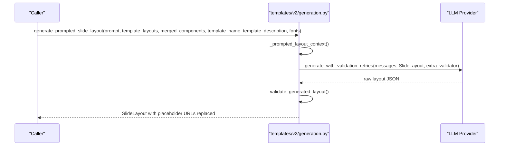

**Diagram sources**
- [generation.py:88-117](file://servers/fastapi/templates/v2/generation.py#L88-L117)
- [generation.py:631-693](file://servers/fastapi/templates/v2/generation.py#L631-L693)
- [generation.py:696-775](file://servers/fastapi/templates/v2/generation.py#L696-L775)

**Section sources**
- [generation.py:88-117](file://servers/fastapi/templates/v2/generation.py#L88-L117)
- [generation.py:631-693](file://servers/fastapi/templates/v2/generation.py#L631-L693)
- [generation.py:696-775](file://servers/fastapi/templates/v2/generation.py#L696-L775)

### Template V2 Schema Derivation
Schema derivation converts template layouts into JSON schemas that constrain generated slide content. It handles:

- Editable vs decorative elements.
- Text, lists, tables, charts, images, and infographics.
- Repeated children in flex/grid/group containers.
- Repeated top-level groups mapped to array fields.
- Table cell typography and capacity estimation.
- Hoisting nested definitions and stripping metadata.

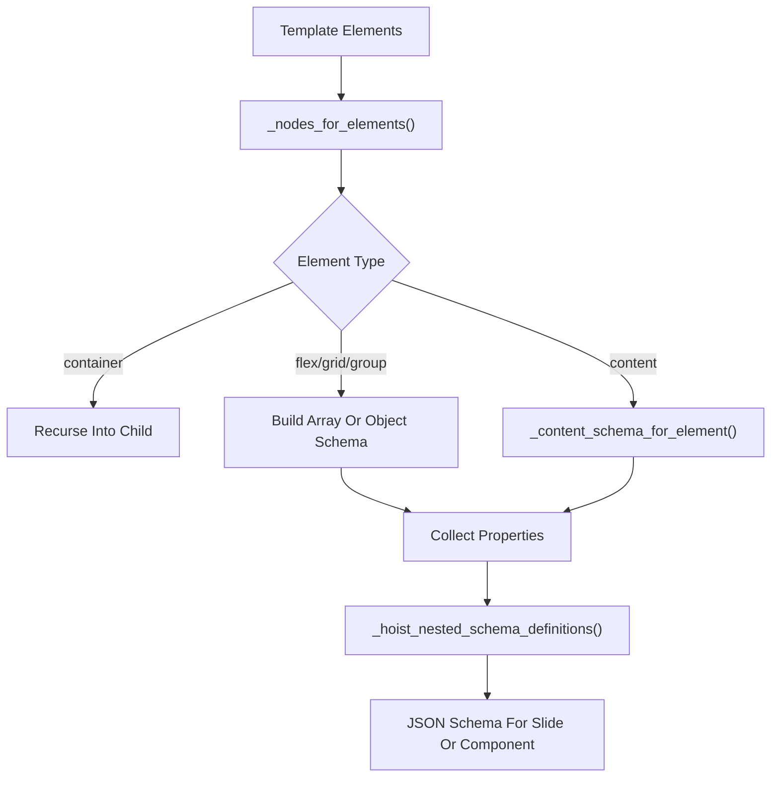

**Diagram sources**
- [schema.py:15-51](file://servers/fastapi/templates/v2/schema.py#L15-L51)
- [schema.py:183-215](file://servers/fastapi/templates/v2/schema.py#L183-L215)
- [schema.py:282-359](file://servers/fastapi/templates/v2/schema.py#L282-L359)
- [schema.py:361-423](file://servers/fastapi/templates/v2/schema.py#L361-L423)
- [schema.py:426-452](file://servers/fastapi/templates/v2/schema.py#L426-L452)
- [schema.py:218-248](file://servers/fastapi/templates/v2/schema.py#L218-L248)

**Section sources**
- [schema.py:15-51](file://servers/fastapi/templates/v2/schema.py#L15-L51)
- [schema.py:183-215](file://servers/fastapi/templates/v2/schema.py#L183-L215)
- [schema.py:282-359](file://servers/fastapi/templates/v2/schema.py#L282-L359)
- [schema.py:361-423](file://servers/fastapi/templates/v2/schema.py#L361-L423)
- [schema.py:426-452](file://servers/fastapi/templates/v2/schema.py#L426-L452)
- [schema.py:218-248](file://servers/fastapi/templates/v2/schema.py#L218-L248)

### Template V2 Content Hydration
Hydration maps generated content back onto the cloned layout UI. It supports:

- Infographic label cleanup by removing inline Markdown.
- Mapping repeated content items to template child positions.
- Centering reduced repeated groups.
- Applying item-specific transformations during hydration.

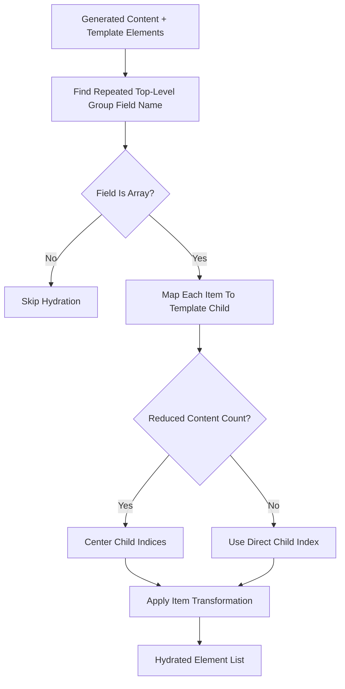

**Diagram sources**
- [content.py:27-40](file://servers/fastapi/templates/v2/content.py#L27-L40)
- [content.py:43-54](file://servers/fastapi/templates/v2/content.py#L43-L54)
- [content.py:57-87](file://servers/fastapi/templates/v2/content.py#L57-L87)

**Section sources**
- [content.py:1-88](file://servers/fastapi/templates/v2/content.py#L1-L88)

### Template V2 Theme Generation
Theme generation profiles colors and fonts across layouts, clusters similar colors, pairs foreground/background combinations, and assigns semantic theme roles. It can use an LLM for role selection or fall back to deterministic selection.

Key steps:

- Collect fill, stroke, text, chart, infographic, and font statistics.
- Cluster nearby colors and compute contrast ratios.
- Build a compact profile of colors, color pairs, and fonts.
- Select semantic roles such as background, primary, card, stroke, text colors, graph colors, and text font.
- Materialize a presentation theme with accessible text colors and extended graph palettes.

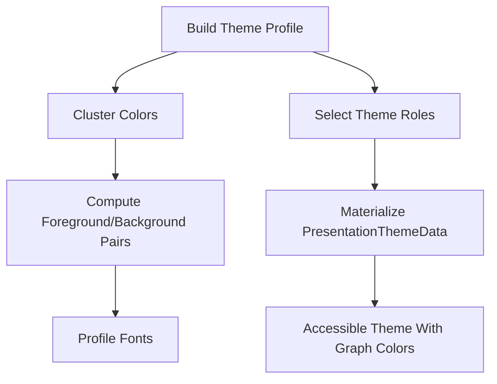

**Diagram sources**
- [theme.py:145-243](file://servers/fastapi/templates/v2/theme.py#L145-L243)
- [theme.py:246-302](file://servers/fastapi/templates/v2/theme.py#L246-L302)
- [theme.py:305-402](file://servers/fastapi/templates/v2/theme.py#L305-L402)

**Section sources**
- [theme.py:145-243](file://servers/fastapi/templates/v2/theme.py#L145-L243)
- [theme.py:246-302](file://servers/fastapi/templates/v2/theme.py#L246-L302)
- [theme.py:305-402](file://servers/fastapi/templates/v2/theme.py#L305-L402)

### Default Template Import
Default templates are bundled under the repository’s `templates` directory. On startup, the system imports them into the database, copies static assets, updates existing default templates, and removes stale defaults.

Important behaviors:

- Public template names resolve to persisted Template V2 IDs.
- Static asset paths are rewritten to application data locations.
- Layouts and merged components are coerced through Pydantic models.
- Assets collect icon type, fonts, images, and thumbnails.

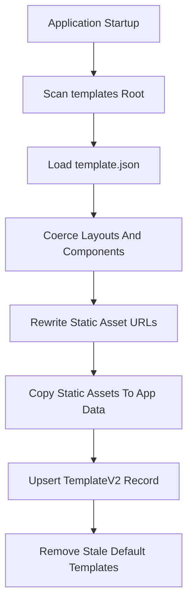

**Diagram sources**
- [default_templates.py:21-54](file://servers/fastapi/templates/default_templates.py#L21-L54)
- [default_templates.py:61-109](file://servers/fastapi/templates/default_templates.py#L61-L109)
- [default_templates.py:112-138](file://servers/fastapi/templates/default_templates.py#L112-L138)
- [default_templates.py:219-240](file://servers/fastapi/templates/default_templates.py#L219-L240)
- [default_templates.py:243-316](file://servers/fastapi/templates/default_templates.py#L243-L316)

**Section sources**
- [default_templates.py:21-54](file://servers/fastapi/templates/default_templates.py#L21-L54)
- [default_templates.py:61-109](file://servers/fastapi/templates/default_templates.py#L61-L109)
- [default_templates.py:112-138](file://servers/fastapi/templates/default_templates.py#L112-L138)
- [default_templates.py:219-240](file://servers/fastapi/templates/default_templates.py#L219-L240)
- [default_templates.py:243-316](file://servers/fastapi/templates/default_templates.py#L243-L316)

## Dependency Analysis
The prompt and template system has clear dependency boundaries:

- Outline generation depends on web search utilities and structured streaming helpers.
- Structure selection depends on presentation layout serialization and dynamic response models.
- Slide content generation depends on response schema preparation and structured retry utilities.
- Template V2 creation depends on layout models, element models, and schema contracts.
- Schema derivation depends on the infographic catalog and layout element structures.
- Hydration depends on schema-derived repeated group names.
- Theme generation depends on layout components and presentation theme models.
- Default template import depends on database sessions and environment configuration.

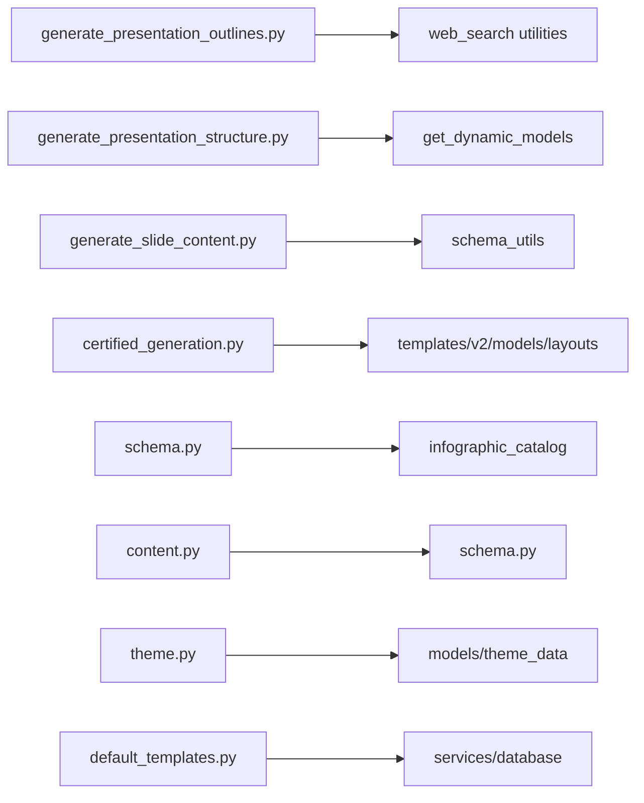

**Diagram sources**
- [generate_presentation_outlines.py:1-38](file://servers/fastapi/utils/llm_calls/generate_presentation_outlines.py#L1-L38)
- [generate_presentation_structure.py:1-13](file://servers/fastapi/utils/llm_calls/generate_presentation_structure.py#L1-L13)
- [generate_slide_content.py:1-18](file://servers/fastapi/utils/llm_calls/generate_slide_content.py#L1-L18)
- [certified_generation.py:15-56](file://servers/fastapi/templates/v2/certified_generation.py#L15-L56)
- [schema.py:1-12](file://servers/fastapi/templates/v2/schema.py#L1-L12)
- [content.py:1-11](file://servers/fastapi/templates/v2/content.py#L1-L11)
- [theme.py:1-23](file://servers/fastapi/templates/v2/theme.py#L1-L23)
- [default_templates.py:9-15](file://servers/fastapi/templates/default_templates.py#L9-L15)

**Section sources**
- [generate_presentation_outlines.py:1-38](file://servers/fastapi/utils/llm_calls/generate_presentation_outlines.py#L1-L38)
- [generate_presentation_structure.py:1-13](file://servers/fastapi/utils/llm_calls/generate_presentation_structure.py#L1-L13)
- [generate_slide_content.py:1-18](file://servers/fastapi/utils/llm_calls/generate_slide_content.py#L1-L18)
- [certified_generation.py:15-56](file://servers/fastapi/templates/v2/certified_generation.py#L15-L56)
- [schema.py:1-12](file://servers/fastapi/templates/v2/schema.py#L1-L12)
- [content.py:1-11](file://servers/fastapi/templates/v2/content.py#L1-L11)
- [theme.py:1-23](file://servers/fastapi/templates/v2/theme.py#L1-L23)
- [default_templates.py:9-15](file://servers/fastapi/templates/default_templates.py#L9-L15)

## Performance Considerations
Optimization techniques used across the system include:

- **Structured retries**: All LLM calls use schema validation and retry loops to recover from malformed outputs.
- **Parallel processing**: Template V2 layout certification processes up to ten slides concurrently.
- **Context trimming**: Prompted layout context reduces reusable components and reference layouts when JSON size exceeds limits.
- **Token budgeting**: Template creation recommends high output capacity, and clustering/validation functions cap tokens where appropriate.
- **Streaming**: Outline generation streams status and content chunks instead of waiting for a single large response.
- **Deterministic fallbacks**: Theme role selection falls back to deterministic logic when LLM selection fails.
- **Asset placeholders**: Replaceable image and icon URLs use stable placeholders to avoid unnecessary asset generation during analysis.

[No sources needed since this section provides general guidance]

## Troubleshooting Guide
Common issues and their likely causes:

- **Invalid structured responses**: Occur when the model does not follow the JSON schema. The system retries and validates responses before use.
- **Missing slide previews**: Template creation rejects requests when the number of rendered slide previews does not match the number of raw layouts.
- **Vision model requirements**: Creating templates requires a text model that accepts images; configuring only an image-generation model is insufficient.
- **Duplicate layout IDs**: Duplicate IDs are repaired automatically, but excessive duplicates indicate unstable model output.
- **Empty or non-editable layouts**: Prompted layout generation requires at least one element with `decorative=false`.
- **Schema mismatch**: Slide content generation returns empty content when the response schema lacks content properties after asset-only fields are removed.
- **Font mapping problems**: Non-standard fonts should be supplied during template creation so they are retained for rendering and export.

Recommended actions:

- Verify that the configured text model supports vision for template creation.
- Ensure one rendered preview image exists for every processed raw slide.
- Check that generated layouts contain editable content and valid IDs.
- Review schema definitions when slide content is unexpectedly empty.
- Confirm font mappings and static asset paths for default templates.

**Section sources**
- [template-v2.md:128-164](file://docs/template-v2.md#L128-L164)
- [certified_generation.py:59-64](file://servers/fastapi/templates/v2/certified_generation.py#L59-L64)
- [generation.py:631-693](file://servers/fastapi/templates/v2/generation.py#L631-L693)
- [generate_slide_content.py:203-226](file://servers/fastapi/utils/llm_calls/generate_slide_content.py#L203-L226)
- [default_templates.py:294-316](file://servers/fastapi/templates/default_templates.py#L294-L316)

## Conclusion
The prompt engineering system combines carefully designed system prompts, structured response schemas, and robust retry logic to turn user intent into reliable presentation data. Template V2 extends this approach by converting source decks into reusable, schema-backed layouts, deriving editable content schemas, hydrating generated values, and producing semantic themes. Together, these components enable consistent outline development, layout selection, slide content generation, and template-driven presentation export.

[No sources needed since this section summarizes without analyzing specific files]

## Appendices

### Template Variables and Dynamic Insertion
- **Outline generation variables**: content, n_slides, language, additional_context, tone, verbosity, instructions, include_title_slide, include_table_of_contents.
- **Structure selection variables**: presentation_layout string representation, n_slides, instructions, source_content.
- **Slide content variables**: current_date_time, language, slide_number_section, outline content, tone, verbosity, instructions, response_schema.
- **Chat assistant variables**: presentation_memory_context, chat_memory_context, presentation_type.
- **Template V2 variables**: raw_layouts, layouts, merged_components, theme, assets, fonts, images, icon_type, thumbnail.

**Section sources**
- [generate_presentation_outlines.py:186-248](file://servers/fastapi/utils/llm_calls/generate_presentation_outlines.py#L186-L248)
- [generate_presentation_structure.py:108-154](file://servers/fastapi/utils/llm_calls/generate_presentation_structure.py#L108-L154)
- [generate_slide_content.py:158-192](file://servers/fastapi/utils/llm_calls/generate_slide_content.py#L158-L192)
- [prompts.py:227-251](file://servers/fastapi/services/chat/prompts.py#L227-L251)
- [default_templates.py:219-240](file://servers/fastapi/templates/default_templates.py#L219-L240)

### Conditional Logic Patterns
- Auto-detect language when explicitly requested or omitted.
- Include title slide and table of contents based on flags.
- Select table or chart layouts based on content characteristics.
- Use deterministic theme roles when LLM selection fails.
- Trim prompted layout context when JSON size exceeds limits.
- Skip slide content generation when schema has no content fields.

**Section sources**
- [generate_presentation_outlines.py:169-183](file://servers/fastapi/utils/llm_calls/generate_presentation_outlines.py#L169-L183)
- [generate_presentation_structure.py:32-63](file://servers/fastapi/utils/llm_calls/generate_presentation_structure.py#L32-L63)
- [theme.py:246-302](file://servers/fastapi/templates/v2/theme.py#L246-L302)
- [generation.py:696-775](file://servers/fastapi/templates/v2/generation.py#L696-L775)
- [generate_slide_content.py:195-226](file://servers/fastapi/utils/llm_calls/generate_slide_content.py#L195-L226)

### Relationship Between Prompts and Template V2
- Prompts define how outlines, layouts, and slide content should be produced.
- Template V2 defines what layouts exist, which fields are editable, and how generated content must conform to schemas.
- Schema derivation bridges layout structure and prompt-driven content generation.
- Hydration applies generated content to actual layout UI.
- Theme generation ensures generated content fits within a consistent visual identity.

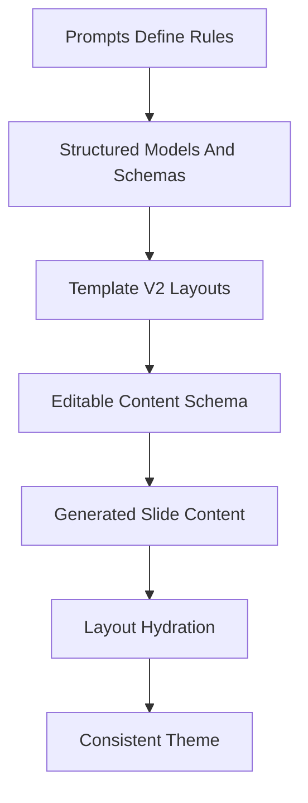

**Diagram sources**
- [generate_presentation_outlines.py:121-166](file://servers/fastapi/utils/llm_calls/generate_presentation_outlines.py#L121-L166)
- [generate_presentation_structure.py:16-105](file://servers/fastapi/utils/llm_calls/generate_presentation_structure.py#L16-L105)
- [generate_slide_content.py:20-84](file://servers/fastapi/utils/llm_calls/generate_slide_content.py#L20-L84)
- [schema.py:183-215](file://servers/fastapi/templates/v2/schema.py#L183-L215)
- [content.py:57-87](file://servers/fastapi/templates/v2/content.py#L57-L87)
- [theme.py:246-402](file://servers/fastapi/templates/v2/theme.py#L246-L402)