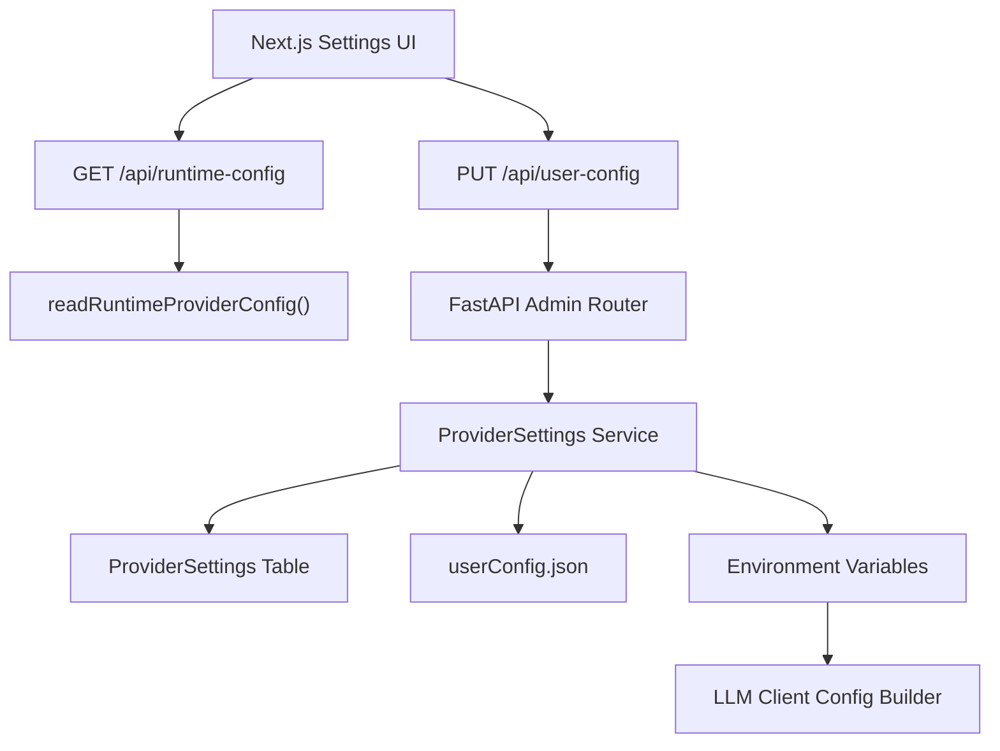
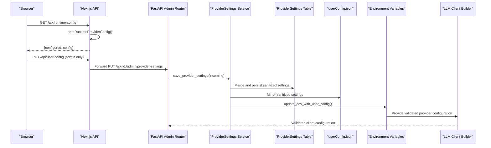
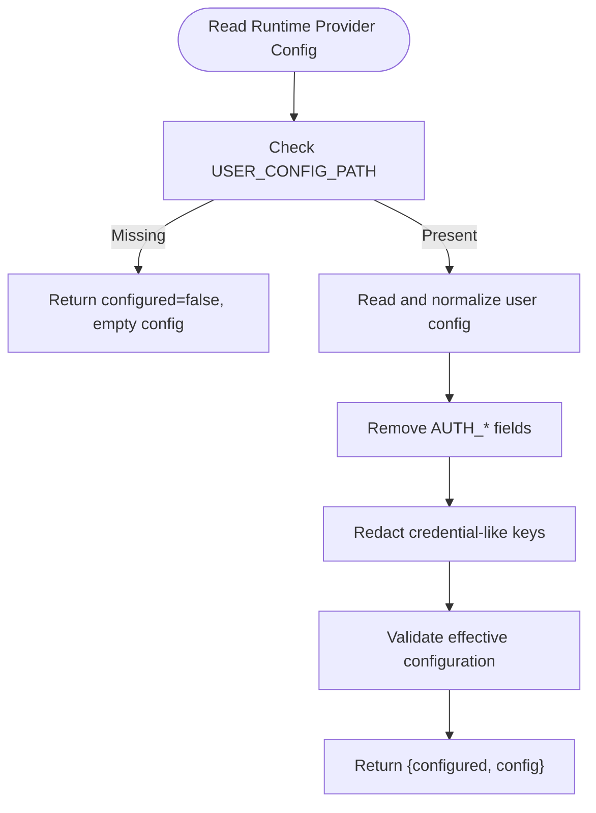
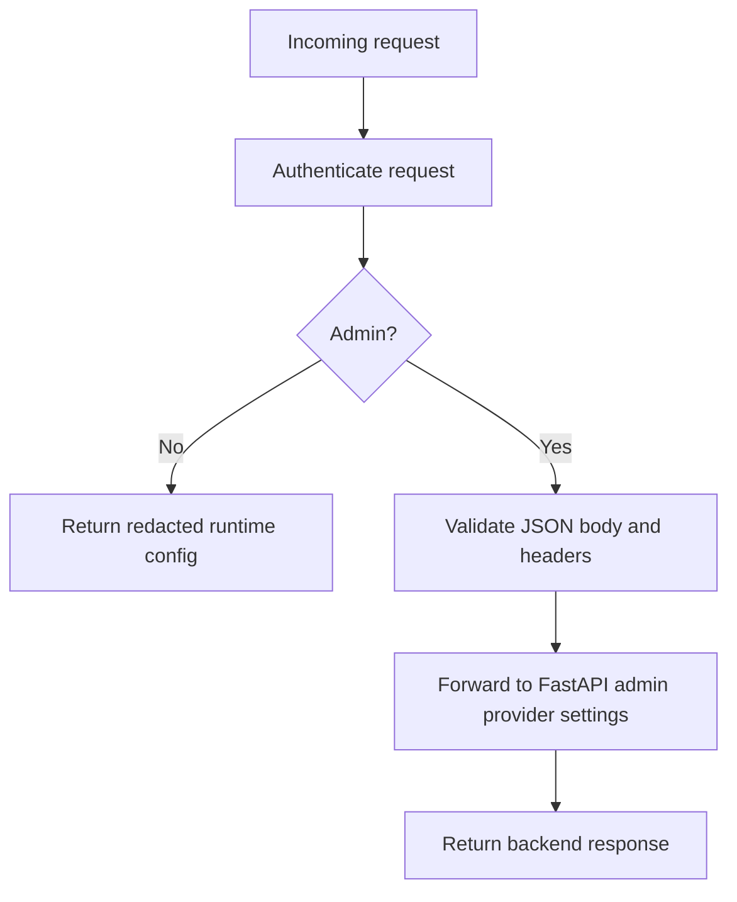
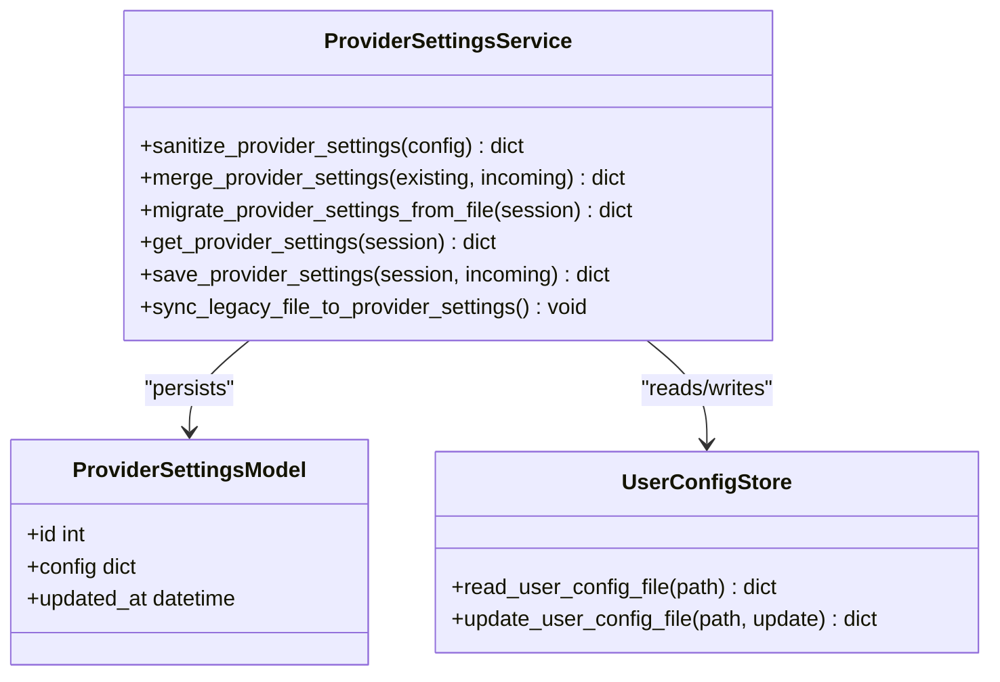
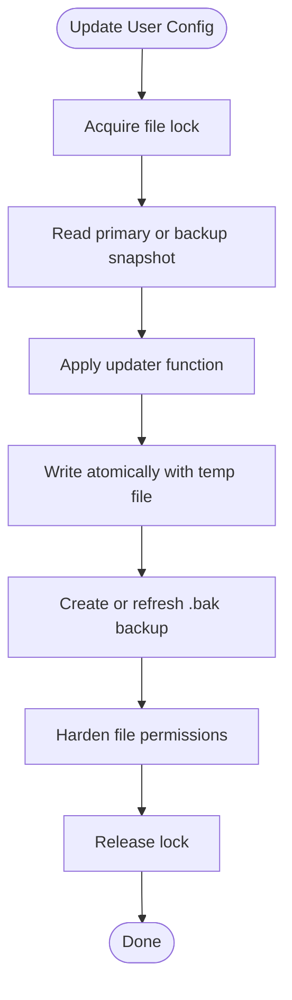
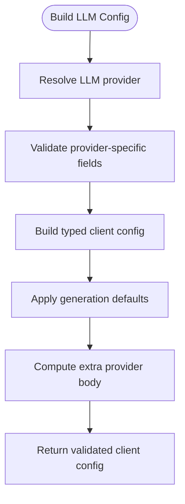
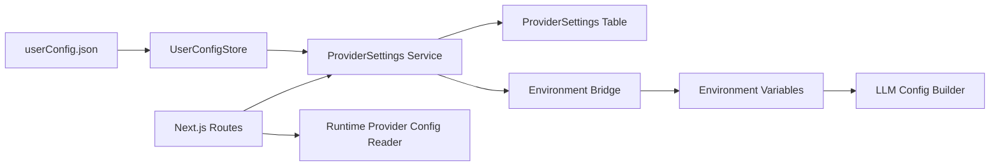

# Provider Configuration Management

<cite>
**Referenced Files in This Document**
- [runtime-provider-config.ts](file://servers/nex tjs/lib/runtime-provider-config.ts)
- [route.ts (Next.js runtime config)](file://servers/nextjs/app/api/runtime-config/route.ts)
- [route.ts (Next.js user-config)](file://servers/nextjs/app/api/user-config/route.ts)
- [provider_settings.py (service)](file://servers/fastapi/services/provider_settings.py)
- [provider_settings.py (SQL model)](file://servers/fastapi/models/sql/provider_settings.py)
- [user_config.py](file://servers/fastapi/utils/user_config.py)
- [llm_config.py](file://servers/fastapi/utils/llm_config.py)
- [user_config_store.py](file://servers/fastapi/utils/user_config_store.py)
- [test_provider_settings.py](file://servers/fastapi/tests/unit/test_provider_settings.py)
- [runtime-provider-config.test.mjs](file://servers/nextjs/tests/runtime-provider-config.test.mjs)
</cite>

## Table of Contents
1. [Introduction](#introduction)
2. [Project Structure](#project-structure)
3. [Core Components](#core-components)
4. [Architecture Overview](#architecture-overview)
5. [Detailed Component Analysis](#detailed-component-analysis)
6. [Dependency Analysis](#dependency-analysis)
7. [Performance Considerations](#performance-considerations)
8. [Troubleshooting Guide](#troubleshooting-guide)
9. [Conclusion](#conclusion)

## Introduction
This document explains how Presenton manages provider configuration for AI providers such as OpenAI, Anthropic, Google, Vertex, Azure, Bedrock, OpenRouter, Together, Cerebras, Fireworks, LiteLLM, LM Studio, Ollama, Custom LLMs, and ChatGPT Codex. It covers:

- How environment variables, the legacy user configuration file, and the database-backed provider settings interact.
- How configuration is validated, merged, and normalized.
- Security considerations including secret redaction and permission hardening.
- Multi-user isolation boundaries and administrator-only operations.
- Migration from the legacy `userConfig.json` to the database-backed provider settings table.
- Backup and recovery strategies for configuration files.
- Practical examples and troubleshooting guidance.

## Project Structure
Provider configuration spans both the Next.js frontend API layer and the FastAPI backend:

- Next.js exposes:
  - A runtime configuration endpoint that returns a safe, redacted view for regular users.
  - An admin-only user-config endpoint that forwards provider settings to the backend.
- FastAPI provides:
  - Database-backed provider settings with migration and merging logic.
  - Legacy file persistence and synchronization.
  - Runtime environment variable population for downstream services.
  - Provider-specific configuration validation and client construction.

**Diagram sources**
- [route.ts (Next.js runtime config):7-20](file://servers/nextjs/app/api/runtime-config/route.ts#L7-L20)
- [route.ts (Next.js user-config):10-37](file://servers/nextjs/app/api/user-config/route.ts#L10-L37)
- [provider_settings.py (service):103-155](file://servers/fastapi/services/provider_settings.py#L103-L155)
- [llm_config.py:247-486](file://servers/fastapi/utils/llm_config.py#L247-L486)

**Section sources**
- [route.ts (Next.js runtime config):1-21](file://servers/nextjs/app/api/runtime-config/route.ts#L1-L21)
- [route.ts (Next.js user-config):1-105](file://servers/nextjs/app/api/user-config/route.ts#L1-L105)
- [provider_settings.py (service):1-192](file://servers/fastapi/services/provider_settings.py#L1-L192)
- [llm_config.py:1-525](file://servers/fastapi/utils/llm_config.py#L1-L525)

## Core Components
- Runtime provider configuration reader:
  - Reads the configured provider settings from the user configuration path.
  - Normalizes the configuration and redacts secrets for non-admin users.
  - Determines whether the system appears configured based on normalized values.
- Next.js API routes:
  - `/api/runtime-config`: Returns a safe runtime configuration snapshot.
  - `/api/user-config`: Forwards admin-only provider settings reads and writes to the backend.
- FastAPI provider settings service:
  - Migrates legacy file-based settings into the database.
  - Sanitizes incoming settings by removing legacy authentication fields.
  - Merges new settings while preserving managed OAuth tokens and optional advanced fields.
  - Mirrors database settings back to the legacy file for compatibility.
- User configuration store:
  - Provides atomic, locked, and backed-up file read/write operations.
  - Hardens file permissions and maintains `.bak` snapshots.
- Environment-to-runtime bridge:
  - Loads provider configuration from the legacy file or environment variables.
  - Writes updated values back to environment variables for downstream consumers.
- LLM configuration builder:
  - Validates provider-specific configuration.
  - Builds typed client configurations per provider.
  - Applies generation defaults and reasoning options.

**Section sources**
- [runtime-provider-config.ts:6-45](file://servers/nex tjs/lib/runtime-provider-config.ts#L6-L45)
- [route.ts (Next.js runtime config):7-20](file://servers/nextjs/app/api/runtime-config/route.ts#L7-L20)
- [route.ts (Next.js user-config):39-104](file://servers/nextjs/app/api/user-config/route.ts#L39-L104)
- [provider_settings.py (service):52-155](file://servers/fastapi/services/provider_settings.py#L52-L155)
- [user_config_store.py:17-219](file://servers/fastapi/utils/user_config_store.py#L17-L219)
- [user_config.py:197-587](file://servers/fastapi/utils/user_config.py#L197-L587)
- [llm_config.py:189-486](file://servers/fastapi/utils/llm_config.py#L189-L486)

## Architecture Overview
The provider configuration system has three primary layers:

1. Presentation and access control:
   - Regular users receive a redacted runtime configuration.
   - Administrators can read and write full provider settings through an admin-only route.
2. Persistence and migration:
   - The database stores sanitized provider settings.
   - The legacy file remains for compatibility and rollback/recovery.
3. Runtime consumption:
   - Downstream services read environment variables populated from the effective configuration.
   - Provider clients are constructed with validated configuration.

**Diagram sources**
- [route.ts (Next.js runtime config):7-20](file://servers/nextjs/app/api/runtime-config/route.ts#L7-L20)
- [route.ts (Next.js user-config):10-37](file://servers/nextjs/app/api/user-config/route.ts#L10-L37)
- [provider_settings.py (service):137-155](file://servers/fastapi/services/provider_settings.py#L137-L155)
- [user_config.py:378-587](file://servers/fastapi/utils/user_config.py#L378-L587)
- [llm_config.py:247-486](file://servers/fastapi/utils/llm_config.py#L247-L486)

## Detailed Component Analysis

### Runtime Provider Configuration Reader
The runtime configuration reader normalizes the user configuration and redacts secrets for non-admin users. It filters out legacy authentication fields and replaces credential-like keys with a placeholder value.

Key behaviors:
- Uses `USER_CONFIG_PATH` to locate the configuration file.
- Normalizes the configuration before evaluation.
- Redacts keys ending with patterns like `API_KEY`, `ACCESS_TOKEN`, `PASSWORD`, etc.
- Excludes all keys starting with `AUTH_`.
- Reports whether the configuration is considered valid using a helper function.

**Diagram sources**
- [runtime-provider-config.ts:23-45](file://servers/nex tjs/lib/runtime-provider-config.ts#L23-L45)

**Section sources**
- [runtime-provider-config.ts:6-45](file://servers/nex tjs/lib/runtime-provider-config.ts#L6-L45)
- [runtime-provider-config.test.mjs:49-77](file://servers/nextjs/tests/runtime-provider-config.test.mjs#L49-L77)

### Next.js Runtime Config Endpoint
The runtime config endpoint authenticates requests and returns a safe configuration snapshot. If reading fails, it returns a minimal unconfigured response rather than leaking errors.

Important points:
- Requires authentication.
- Returns a JSON object containing `configured` and `config`.
- Treats exceptions as a fallback to an unconfigured state.

**Section sources**
- [route.ts (Next.js runtime config):7-20](file://servers/nextjs/app/api/runtime-config/route.ts#L7-L20)

### Next.js User Config Endpoint
The user-config endpoint enforces role-based access:
- Non-admin users receive the redacted runtime configuration.
- Admin users forward requests to the FastAPI admin provider settings endpoint.
- POST requests validate content type and JSON structure before forwarding.

Security implications:
- Shared secrets are never sent to non-admin browsers.
- Admin-only mutations require proper authorization.

**Diagram sources**
- [route.ts (Next.js user-config):39-104](file://servers/nextjs/app/api/user-config/route.ts#L39-L104)

**Section sources**
- [route.ts (Next.js user-config):10-37](file://servers/nextjs/app/api/user-config/route.ts#L10-L37)
- [route.ts (Next.js user-config):39-104](file://servers/nextjs/app/api/user-config/route.ts#L39-L104)

### FastAPI Provider Settings Service
The provider settings service is the authoritative source for sanitized provider configuration. It handles:

- Sanitization: Removes legacy authentication fields.
- Merging: Preserves OAuth-managed tokens and optional advanced fields.
- Migration: Imports legacy file settings into the database if missing.
- Mirroring: Writes sanitized settings back to the legacy file for compatibility.
- Synchronization: Persists synchronous file changes back into the database.

**Diagram sources**
- [provider_settings.py (service):52-192](file://servers/fastapi/services/provider_settings.py#L52-L192)
- [provider_settings.py (SQL model):10-23](file://servers/fastapi/models/sql/provider_settings.py#L10-L23)
- [user_config_store.py:202-219](file://servers/fastapi/utils/user_config_store.py#L202-L219)

**Section sources**
- [provider_settings.py (service):52-155](file://servers/fastapi/services/provider_settings.py#L52-L155)
- [provider_settings.py (service):158-192](file://servers/fastapi/services/provider_settings.py#L158-L192)
- [provider_settings.py (SQL model):10-23](file://servers/fastapi/models/sql/provider_settings.py#L10-L23)
- [test_provider_settings.py:36-104](file://servers/fastapi/tests/unit/test_provider_settings.py#L36-L104)

### User Configuration Store
The user configuration store ensures safe, concurrent-safe file operations:

- Atomic writes using temporary files and rename.
- File locking to prevent concurrent corruption.
- Automatic backup creation and restoration.
- Permission hardening to restrict access to sensitive files.
- Retry logic for transient OS-level errors.

**Diagram sources**
- [user_config_store.py:108-199](file://servers/fastapi/utils/user_config_store.py#L108-L199)
- [user_config_store.py:202-219](file://servers/fastapi/utils/user_config_store.py#L202-L219)

**Section sources**
- [user_config_store.py:17-219](file://servers/fastapi/utils/user_config_store.py#L17-L219)

### Environment-to-Runtime Bridge
The environment bridge loads provider configuration from the legacy file and environment variables, then updates environment variables so downstream components can consume them consistently.

Key responsibilities:
- Construct a unified configuration object.
- Prefer persisted values over environment variables when available.
- Normalize boolean and list values.
- Populate environment variables for each supported provider.

**Section sources**
- [user_config.py:197-375](file://servers/fastapi/utils/user_config.py#L197-L375)
- [user_config.py:378-587](file://servers/fastapi/utils/user_config.py#L378-L587)

### LLM Configuration Builder
The LLM configuration builder validates and constructs provider-specific client configurations. It also applies generation defaults and reasoning behavior.

Validation highlights:
- Required API keys per provider.
- Ambiguous or incomplete Vertex configuration detection.
- Azure endpoint/base URL requirements.
- Bedrock authentication completeness.
- OpenRouter provider options.
- Reasoning mode, effort, and budget token validation.
- Maximum output token positivity check.

**Diagram sources**
- [llm_config.py:189-244](file://servers/fastapi/utils/llm_config.py#L189-L244)
- [llm_config.py:247-486](file://servers/fastapi/utils/llm_config.py#L247-L486)
- [llm_config.py:489-524](file://servers/fastapi/utils/llm_config.py#L489-L524)

**Section sources**
- [llm_config.py:189-244](file://servers/fastapi/utils/llm_config.py#L189-L244)
- [llm_config.py:247-486](file://servers/fastapi/utils/llm_config.py#L247-L486)
- [llm_config.py:489-524](file://servers/fastapi/utils/llm_config.py#L489-L524)

## Dependency Analysis
The following diagram shows how configuration flows between components:

**Diagram sources**
- [user_config_store.py:202-219](file://servers/fastapi/utils/user_config_store.py#L202-L219)
- [provider_settings.py (service):103-155](file://servers/fastapi/services/provider_settings.py#L103-L155)
- [user_config.py:378-587](file://servers/fastapi/utils/user_config.py#L378-L587)
- [llm_config.py:247-486](file://servers/fastapi/utils/llm_config.py#L247-L486)
- [route.ts (Next.js user-config):10-37](file://servers/nextjs/app/api/user-config/route.ts#L10-L37)
- [runtime-provider-config.ts:23-45](file://servers/nex tjs/lib/runtime-provider-config.ts#L23-L45)

**Section sources**
- [provider_settings.py (service):103-155](file://servers/fastapi/services/provider_settings.py#L103-L155)
- [user_config.py:378-587](file://servers/fastapi/utils/user_config.py#L378-L587)
- [llm_config.py:247-486](file://servers/fastapi/utils/llm_config.py#L247-L486)
- [route.ts (Next.js user-config):10-37](file://servers/nextjs/app/api/user-config/route.ts#L10-L37)
- [runtime-provider-config.ts:23-45](file://servers/nex tjs/lib/runtime-provider-config.ts#L23-L45)

## Performance Considerations
- File I/O is retried for transient OS errors to reduce failure rates under contention.
- Atomic writes and backups avoid partial or corrupted configuration states.
- Locking prevents concurrent writes from corrupting the configuration file.
- Redacting secrets at the Next.js layer avoids unnecessary transmission of sensitive data.
- Provider configuration validation occurs close to usage, providing early failure feedback.

[No sources needed since this section provides general guidance]

## Troubleshooting Guide

Common configuration issues and resolutions:

- Missing provider API key:
  - Symptom: Validation error indicating the provider API key is not set.
  - Resolution: Set the corresponding provider API key in the provider settings or environment variables.
  - Relevant code paths:
    - [llm_config.py:251-262](file://servers/fastapi/utils/llm_config.py#L251-L262)
    - [llm_config.py:263-271](file://servers/fastapi/utils/llm_config.py#L263-L271)
    - [llm_config.py:272-276](file://servers/fastapi/utils/llm_config.py#L272-L276)

- Ambiguous Vertex configuration:
  - Symptom: Error stating Vertex configuration is ambiguous or incomplete.
  - Resolution: Configure either `VERTEX_API_KEY` or `VERTEX_PROJECT`/`VERTEX_LOCATION`, not both.
  - Relevant code paths:
    - [llm_config.py:277-311](file://servers/fastapi/utils/llm_config.py#L277-L311)

- Azure OpenAI missing endpoint or version:
  - Symptom: Error indicating Azure API key, API version, or endpoint/base URL is missing.
  - Resolution: Set `AZURE_OPENAI_API_KEY`, `AZURE_OPENAI_API_VERSION`, and either `AZURE_OPENAI_ENDPOINT` or `AZURE_OPENAI_BASE_URL`.
  - Relevant code paths:
    - [llm_config.py:312-345](file://servers/fastapi/utils/llm_config.py#L312-L345)

- Bedrock authentication incomplete:
  - Symptom: Error indicating Bedrock authentication requires either an API key or AWS access key plus secret key.
  - Resolution: Set `BEDROCK_API_KEY`, or both `BEDROCK_AWS_ACCESS_KEY_ID` and `BEDROCK_AWS_SECRET_ACCESS_KEY`.
  - Relevant code paths:
    - [llm_config.py:346-373](file://servers/fastapi/utils/llm_config.py#L346-L373)

- Invalid generation profile or reasoning settings:
  - Symptom: HTTP 400 error for invalid `LLM_GENERATION_PROFILE`, `LLM_REASONING_MODE`, `LLM_REASONING_EFFORT`, or negative `LLM_REASONING_BUDGET_TOKENS`.
  - Resolution: Use allowed values and ensure positive token budgets.
  - Relevant code paths:
    - [llm_config.py:189-244](file://servers/fastapi/utils/llm_config.py#L189-L244)

- Secrets appearing in browser responses:
  - Symptom: Non-admin users see actual API keys instead of placeholders.
  - Resolution: Ensure the runtime configuration reader is used for non-admin responses; verify that secret-matching keys are present.
  - Relevant code paths:
    - [runtime-provider-config.ts:11-12](file://servers/nex tjs/lib/runtime-provider-config.ts#L11-L12)
    - [runtime-provider-config.ts:32-39](file://servers/nex tjs/lib/runtime-provider-config.ts#L32-L39)
    - [runtime-provider-config.test.mjs:49-77](file://servers/nextjs/tests/runtime-provider-config.test.mjs#L49-L77)

- Configuration not persisted after restart:
  - Symptom: Provider settings disappear after process restart.
  - Resolution: Verify database persistence and legacy file mirroring; check file permissions and backup availability.
  - Relevant code paths:
    - [provider_settings.py (service):137-155](file://servers/fastapi/services/provider_settings.py#L137-L155)
    - [provider_settings.py (service):85-100](file://servers/fastapi/services/provider_settings.py#L85-L100)
    - [user_config_store.py:154-199](file://servers/fastapi/utils/user_config_store.py#L154-L199)

**Section sources**
- [llm_config.py:189-244](file://servers/fastapi/utils/llm_config.py#L189-L244)
- [llm_config.py:251-373](file://servers/fastapi/utils/llm_config.py#L251-L373)
- [runtime-provider-config.ts:11-39](file://servers/nex tjs/lib/runtime-provider-config.ts#L11-L39)
- [runtime-provider-config.test.mjs:49-77](file://servers/nextjs/tests/runtime-provider-config.test.mjs#L49-L77)
- [provider_settings.py (service):85-155](file://servers/fastapi/services/provider_settings.py#L85-L155)
- [user_config_store.py:154-199](file://servers/fastapi/utils/user_config_store.py#L154-L199)

## Conclusion
Presenton’s provider configuration management combines environment variables, a legacy configuration file, and a database-backed settings store. The system prioritizes security by sanitizing legacy authentication fields, redacting secrets for non-admin users, and hardening file permissions. Migration ensures backward compatibility while moving toward a more robust, transactional configuration model. Administrators manage provider settings through controlled endpoints, while regular users receive only the effective configuration required to run the application safely.

[No sources needed since this section summarizes without analyzing specific files]