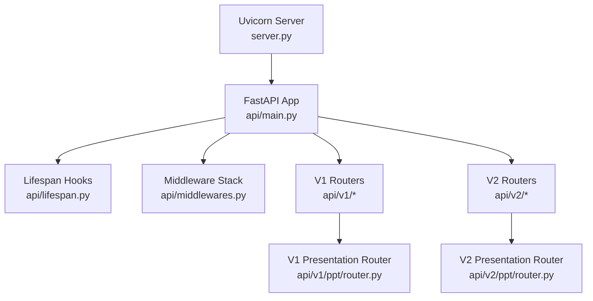
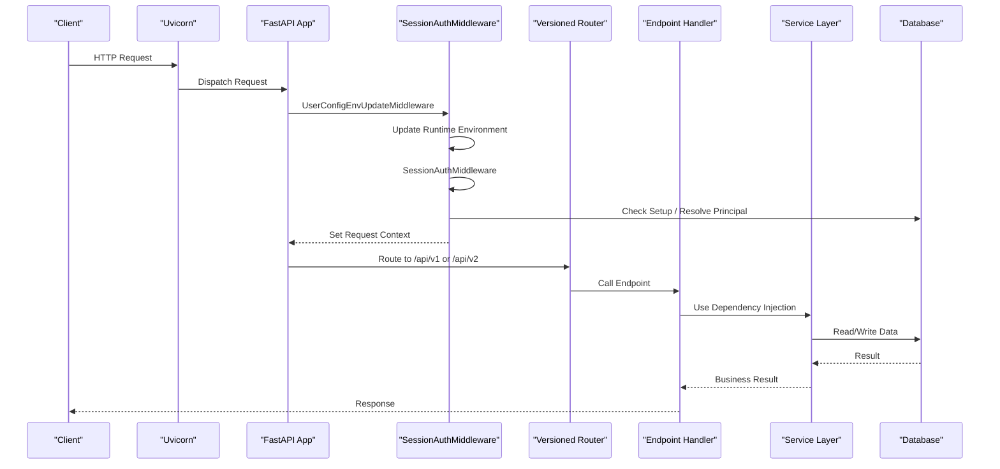
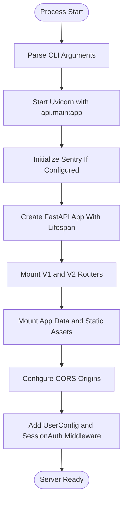
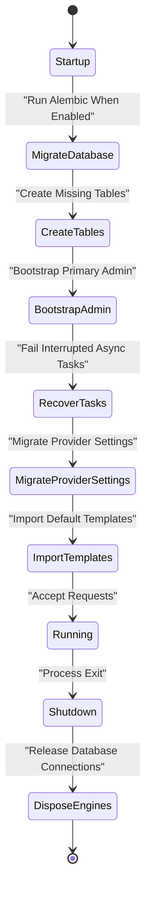
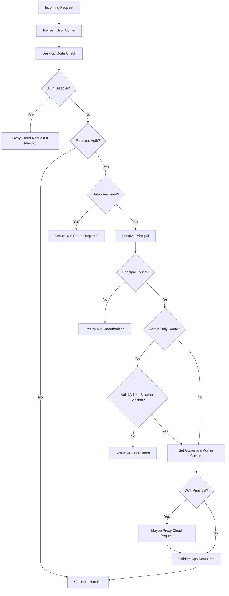
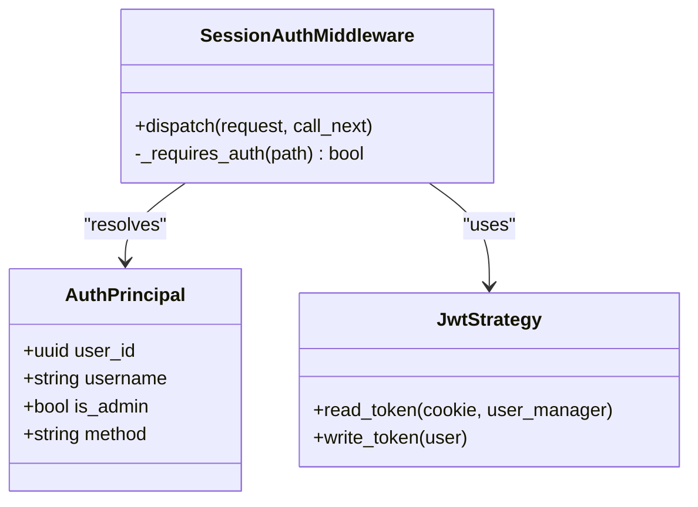
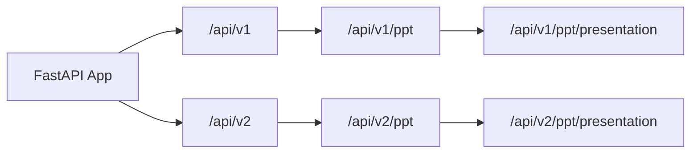
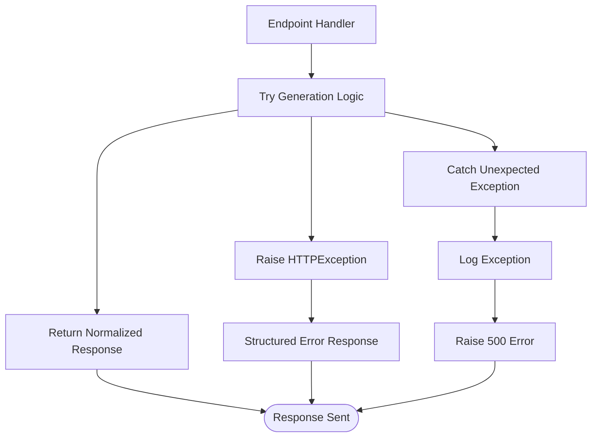
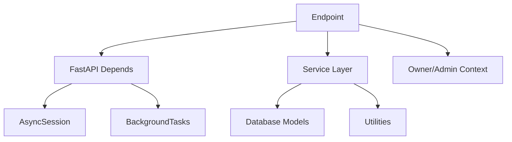
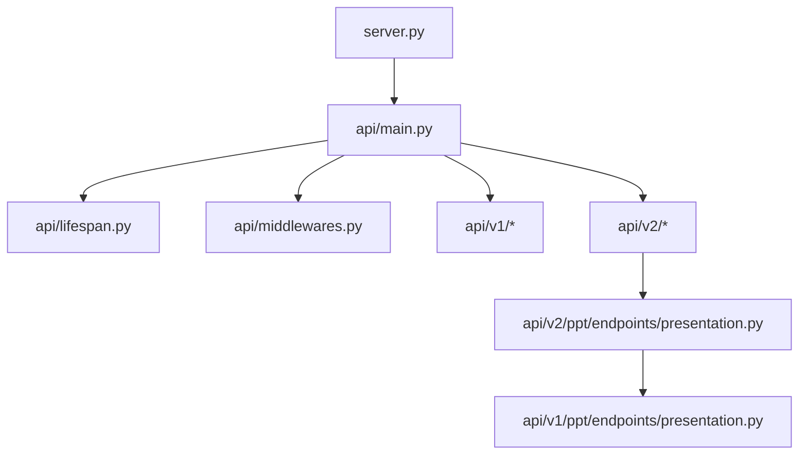

# API Architecture & Core Components

<cite>
**Referenced Files in This Document**
- [server.py](file://servers/fastapi/server.py)
- [main.py](file://servers/fastapi/api/main.py)
- [lifespan.py](file://servers/fastapi/api/lifespan.py)
- [middlewares.py](file://servers/fastapi/api/middlewares.py)
- [v1 router](file://servers/fastapi/api/v1/ppt/router.py)
- [v2 router](file://servers/fastapi/api/v2/router.py)
- [v2 presentation router](file://servers/fastapi/api/v2/ppt/router.py)
- [v2 presentation endpoints](file://servers/fastapi/api/v2/ppt/endpoints/presentation.py)
- [v1 presentation endpoints](file://servers/fastapi/api/v1/ppt/endpoints/presentation.py)
- [auth principal](file://servers/fastapi/api/v1/auth/principal.py)
- [auth users](file://servers/fastapi/api/v1/auth/users.py)
- [auth internal headers](file://servers/fastapi/api/v1/auth/internal.py)
- [API error model](file://servers/fastapi/models/api_error_model.py)
</cite>

## Table of Contents
1. [Introduction](#introduction)
2. [Project Structure](#project-structure)
3. [Core Components](#core-components)
4. [Architecture Overview](#architecture-overview)
5. [Detailed Component Analysis](#detailed-component-analysis)
6. [Dependency Analysis](#dependency-analysis)
7. [Performance Considerations](#performance-considerations)
8. [Troubleshooting Guide](#troubleshooting-guide)
9. [Conclusion](#conclusion)

## Introduction
This document explains the Presenton FastAPI backend architecture with a focus on application initialization, route organization, middleware pipeline configuration, server startup behavior, API versioning between v1 and v2, authentication and authorization, dependency injection patterns, service layer usage, and response/error conventions. It is intended for developers extending the API, integrating clients, or migrating from v1 to v2.

## Project Structure
The FastAPI backend lives under `servers/fastapi`. The most important entry points are:

- `server.py`: Uvicorn bootstrap script used when running the backend directly.
- `api/main.py`: FastAPI application factory, global middleware, CORS, static mounts, and router registration.
- `api/lifespan.py`: Application lifespan hooks for database migrations, default template import, provider settings migration, and shutdown cleanup.
- `api/middlewares.py`: Cross-cutting request handling including user config refresh, session-based authentication, admin checks, desktop mode handling, and optional cloud proxying.
- `api/v1/...` and `api/v2/...`: Versioned routers that group feature-specific sub-routers.

**Diagram sources**
- [server.py:1-29](file://servers/fastapi/server.py#L1-L29)
- [main.py:65-103](file://servers/fastapi/api/main.py#L65-L103)
- [lifespan.py:44-68](file://servers/fastapi/api/lifespan.py#L44-L68)
- [middlewares.py:23-149](file://servers/fastapi/api/middlewares.py#L23-L149)
- [v1 router:22-40](file://servers/fastapi/api/v1/ppt/router.py#L22-L40)
- [v2 router:6-7](file://servers/fastapi/api/v2/router.py#L6-L7)
- [v2 presentation router:6-7](file://servers/fastapi/api/v2/ppt/router.py#L6-L7)

**Section sources**
- [server.py:1-29](file://servers/fastapi/server.py#L1-L29)
- [main.py:1-119](file://servers/fastapi/api/main.py#L1-L119)
- [lifespan.py:1-69](file://servers/fastapi/api/lifespan.py#L1-L69)
- [middlewares.py:1-150](file://servers/fastapi/api/middlewares.py#L1-L150)
- [v1 router:1-41](file://servers/fastapi/api/v1/ppt/router.py#L1-L41)
- [v2 router:1-8](file://servers/fastapi/api/v2/router.py#L1-L8)
- [v2 presentation router:1-8](file://servers/fastapi/api/v2/ppt/router.py#L1-L8)

## Core Components
The core runtime consists of:

- **Application factory**: Creates the FastAPI instance, registers routers, mounts static assets, configures CORS, and installs middleware.
- **Lifespan hooks**: Initialize logging, app data directory, database migrations, tables, primary admin bootstrap, background task recovery, provider settings migration, default templates, and environment updates; on shutdown, dispose database engines.
- **Middleware stack**: Refreshes runtime user configuration, enforces authentication, handles desktop-only modes, validates admin access, sets request context, and optionally proxies requests to Presenton Cloud.
- **Versioned routers**: Group endpoints by domain and API version.

Key responsibilities:

| Component | Responsibility |
|---|---|
| `server.py` | Parses CLI arguments and starts Uvicorn bound to loopback. |
| `api/main.py` | Builds the FastAPI app, mounts routes, static files, CORS, and middleware. |
| `api/lifespan.py` | Runs startup/shutdown lifecycle tasks. |
| `api/middlewares.py` | Implements cross-cutting request processing and security. |
| `api/v1/*` | Stable API surface for presentations, auth, admin, async tasks, webhooks, and mock endpoints. |
| `api/v2/*` | Newer API surface focused on Smart presentation generation. |

**Section sources**
- [server.py:5-29](file://servers/fastapi/server.py#L5-L29)
- [main.py:32-103](file://servers/fastapi/api/main.py#L32-L103)
- [lifespan.py:19-68](file://servers/fastapi/api/lifespan.py#L19-L68)
- [middlewares.py:23-149](file://servers/fastapi/api/middlewares.py#L23-L149)

## Architecture Overview
At request time, the flow is:

1. Uvicorn receives an HTTP request.
2. Global middleware runs first, then Starlette/FastAPI routing selects the appropriate endpoint.
3. Authentication middleware resolves the current principal, enforces setup requirements, admin restrictions, and asset authorization.
4. Endpoint handlers use dependency-injected services and database sessions.
5. Responses are returned as JSON, file responses, streaming responses, or background-task-driven results.

**Diagram sources**
- [server.py:23-29](file://servers/fastapi/server.py#L23-L29)
- [main.py:65-103](file://servers/fastapi/api/main.py#L65-L103)
- [middlewares.py:23-149](file://servers/fastapi/api/middlewares.py#L23-L149)
- [v1 router:22-40](file://servers/fastapi/api/v1/ppt/router.py#L22-L40)
- [v2 router:6-7](file://servers/fastapi/api/v2/router.py#L6-L7)

## Detailed Component Analysis

### Application Initialization and Server Startup
The backend can be started directly through `server.py`, which parses command-line arguments for port, reload mode, and log level, then calls `uvicorn.run` with the FastAPI application object located at `api.main:app`.

Important startup behaviors:

- Sentry SDK is initialized only if a DSN is configured; trace sampling and PII settings are read from environment variables.
- The FastAPI app is created with a lifespan hook.
- Routers are registered after app creation.
- Static assets and app data directories are mounted conditionally.
- CORS is configured using `NEXT_PUBLIC_URL` when available; otherwise it allows all origins.
- Custom middleware is added for user configuration updates and session authentication.
- A custom HTTP middleware provides a placeholder fallback for missing icon assets.

**Diagram sources**
- [server.py:5-29](file://servers/fastapi/server.py#L5-L29)
- [main.py:32-103](file://servers/fastapi/api/main.py#L32-L103)

**Section sources**
- [server.py:1-29](file://servers/fastapi/server.py#L1-L29)
- [main.py:1-119](file://servers/fastapi/api/main.py#L1-L119)

### Lifespan Lifecycle Management
The lifespan context manager performs critical initialization before accepting traffic and cleanup during shutdown:

- Configures application logging based on `LOG_LEVEL`.
- Ensures the application data directory exists.
- Runs database migrations when enabled.
- Creates missing database tables.
- Bootstraps the primary administrator account.
- Recovers interrupted asynchronous tasks so polling clients receive consistent state.
- Migrates provider settings from legacy file storage into the database.
- Imports default templates.
- Updates runtime environment from user configuration.
- Disposes database engines on shutdown.

**Diagram sources**
- [lifespan.py:19-68](file://servers/fastapi/api/lifespan.py#L19-L68)

**Section sources**
- [lifespan.py:1-69](file://servers/fastapi/api/lifespan.py#L1-L69)

### Middleware Pipeline Configuration
The middleware stack is layered to provide environment updates, authentication, authorization, desktop-mode handling, and optional cloud proxying.

Order and responsibilities:

1. `UserConfigEnvUpdateMiddleware`: Refreshes runtime environment variables from persistent user configuration on every request.
2. `SessionAuthMiddleware`:
   - Denies unsupported desktop requests.
   - Supports disabled-auth single-user mode used by Electron.
   - Requires initial login setup before protected routes are accessible.
   - Resolves JWT cookies or bearer tokens to a principal.
   - Enforces admin-only routes for browser sessions.
   - Sets request context for owner identity and admin status.
   - Optionally proxies authenticated requests to Presenton Cloud.
   - Validates access to `/app_data` paths.

**Diagram sources**
- [middlewares.py:23-149](file://servers/fastapi/api/middlewares.py#L23-L149)

**Section sources**
- [middlewares.py:1-150](file://servers/fastapi/api/middlewares.py#L1-L150)

### Authentication and Authorization Model
Authentication supports two principal methods:

- **JWT cookie**: Used by browser-based sessions.
- **Bearer token**: Used by API keys or programmatic clients.

The principal resolution process:

1. Reads the session cookie.
2. If present, decodes the JWT and returns the associated user.
3. Otherwise, reads the `Authorization` header for a bearer token.
4. Verifies API keys where applicable.
5. Returns an immutable principal containing user identity, username, admin flag, and method.

Admin-only routes require a JWT browser session; API-key principals cannot access administrative configuration endpoints.

**Diagram sources**
- [auth principal:14-42](file://servers/fastapi/api/v1/auth/principal.py#L14-L42)
- [auth users:179-233](file://servers/fastapi/api/v1/auth/users.py#L179-L233)
- [middlewares.py:29-149](file://servers/fastapi/api/middlewares.py#L29-L149)

**Section sources**
- [auth principal:1-42](file://servers/fastapi/api/v1/auth/principal.py#L1-L42)
- [auth users:179-233](file://servers/fastapi/api/v1/auth/users.py#L179-L233)
- [auth internal headers:10-25](file://servers/fastapi/api/v1/auth/internal.py#L10-L25)
- [middlewares.py:29-149](file://servers/fastapi/api/middlewares.py#L29-L149)

### API Versioning Strategy: v1 vs v2
The API uses explicit version prefixes:

- `/api/v1/...`: Mature surface covering presentations, chat, templates, fonts, images, icons, outlines, slides, LLM providers, async tasks, admin, webhooks, and mock endpoints.
- `/api/v2/...`: Newer surface focused on Smart presentation generation.

Routing structure:

- `api/v2/router.py` defines the top-level `/api/v2` router and includes the presentation sub-router.
- `api/v2/ppt/router.py` defines `/ppt` under `/api/v2`, resulting in `/api/v2/presentation`.
- `api/v1/ppt/router.py` defines `/ppt` under `/api/v1`, resulting in `/api/v1/ppt`.

Backward compatibility considerations:

- v1 remains the broader, stable API surface.
- v2 introduces a dedicated Smart presentation workflow while reusing shared logic from v1 presentation endpoints.
- Migration should prefer v2 endpoints for new Smart generation features, while keeping existing v1 flows until clients are updated.

**Diagram sources**
- [main.py:68-74](file://servers/fastapi/api/main.py#L68-L74)
- [v1 router:22-40](file://servers/fastapi/api/v1/ppt/router.py#L22-L40)
- [v2 router:6-7](file://servers/fastapi/api/v2/router.py#L6-L7)
- [v2 presentation router:6-7](file://servers/fastapi/api/v2/ppt/router.py#L6-L7)

**Section sources**
- [main.py:68-74](file://servers/fastapi/api/main.py#L68-L74)
- [v1 router:1-41](file://servers/fastapi/api/v1/ppt/router.py#L1-L41)
- [v2 router:1-8](file://servers/fastapi/api/v2/router.py#L1-L8)
- [v2 presentation router:1-8](file://servers/fastapi/api/v2/ppt/router.py#L1-L8)

### Request Lifecycle and Error Handling
Error handling follows FastAPI conventions:

- Endpoints raise `HTTPException` with explicit status codes and human-readable details.
- Background tasks wrap failures in a structured error model.
- The `APIErrorModel` normalizes exceptions into a consistent representation with `status_code` and `detail`.

Response formatting standards:

- Successful responses return Pydantic models or dictionaries serialized by FastAPI.
- Streaming endpoints return `StreamingResponse` for long-running generation workflows.
- File exports return file responses or paths with edit links.
- Asynchronous generation returns task objects that clients poll for progress.

**Diagram sources**
- [v2 presentation endpoints:229-299](file://servers/fastapi/api/v2/ppt/endpoints/presentation.py#L229-L299)
- [API error model:5-13](file://servers/fastapi/models/api_error_model.py#L5-L13)

**Section sources**
- [v2 presentation endpoints:1-299](file://servers/fastapi/api/v2/ppt/endpoints/presentation.py#L1-L299)
- [v1 presentation endpoints:134-136](file://servers/fastapi/api/v1/ppt/endpoints/presentation.py#L134-L136)
- [API error model:1-13](file://servers/fastapi/models/api_error_model.py#L1-L13)

### Dependency Injection Patterns and Service Layer Organization
Endpoints use FastAPI’s `Depends` mechanism to inject:

- Database sessions via `get_async_session`.
- Background tasks for asynchronous work.
- Request objects for headers, cookies, and URL information.
- Shared services through module-level instances or factories.

Service layer responsibilities include:

- Database access and session management.
- Presentation generation orchestration.
- Template hydration and layout processing.
- Image generation, web search, and LLM tooling.
- Webhook delivery and async task tracking.
- Temporary file management and export utilities.

Cross-cutting concerns are implemented through:

- Middleware for authentication and environment updates.
- Context helpers for owner identity and admin flags.
- Internal helper functions for building export cookies and absolute MCP result links.
- Centralized error modeling and logging.

**Diagram sources**
- [v2 presentation endpoints:229-299](file://servers/fastapi/api/v2/ppt/endpoints/presentation.py#L229-L299)
- [v1 presentation endpoints:134-136](file://servers/fastapi/api/v1/ppt/endpoints/presentation.py#L134-L136)

**Section sources**
- [v2 presentation endpoints:1-299](file://servers/fastapi/api/v2/ppt/endpoints/presentation.py#L1-L299)
- [v1 presentation endpoints:1-800](file://servers/fastapi/api/v1/ppt/endpoints/presentation.py#L1-L800)

### Route Registration and Endpoint Structure Conventions
Route registration follows a hierarchical pattern:

- Top-level app mounts version routers.
- Each version has a domain router.
- Domain routers include feature routers such as presentation, chat, templates, fonts, images, icons, outlines, slides, LLM providers, and async tasks.

Endpoint structure conventions:

- Use Pydantic models for request validation.
- Use FastAPI tags for OpenAPI grouping.
- Prefer explicit `operation_id` for generated documentation.
- Return normalized response models rather than raw dictionaries.
- Use background tasks for long-running operations.
- Stream SSE events for incremental progress where appropriate.

Examples of route registration:

- V1 presentation router aggregates multiple feature routers under `/api/v1/ppt`.
- V2 presentation router exposes Smart presentation generation under `/api/v2/ppt/presentation`.

**Section sources**
- [main.py:68-74](file://servers/fastapi/api/main.py#L68-L74)
- [v1 router:22-40](file://servers/fastapi/api/v1/ppt/router.py#L22-L40)
- [v2 presentation router:35-38](file://servers/fastapi/api/v2/ppt/endpoints/presentation.py#L35-L38)

## Dependency Analysis
The FastAPI backend has clear separation between infrastructure, middleware, routing, and business logic:

- `server.py` depends only on `api.main:app`.
- `api/main.py` depends on lifespan, middlewares, routers, environment utilities, and static asset helpers.
- Middlewares depend on auth primitives, database sessions, cloud proxying, and user configuration.
- v1 and v2 routers depend on feature-specific endpoints and shared services.
- v2 presentation endpoints reuse v1 presentation logic instead of duplicating core generation code.

**Diagram sources**
- [server.py:1-3](file://servers/fastapi/server.py#L1-L3)
- [main.py:9-17](file://servers/fastapi/api/main.py#L9-L17)
- [v2 presentation endpoints:17-22](file://servers/fastapi/api/v2/ppt/endpoints/presentation.py#L17-L22)

**Section sources**
- [server.py:1-29](file://servers/fastapi/server.py#L1-L29)
- [main.py:1-119](file://servers/fastapi/api/main.py#L1-L119)
- [v2 presentation endpoints:1-299](file://servers/fastapi/api/v2/ppt/endpoints/presentation.py#L1-L299)

## Performance Considerations
- Uvicorn binds to loopback by default, suitable for local development or reverse-proxy deployment.
- Database connections are disposed during shutdown to prevent stale pools.
- Background tasks are process-local; interrupted tasks are recovered at startup so clients can resume polling safely.
- Logging is configurable through `LOG_LEVEL` to balance diagnostic visibility and performance.
- Optional Sentry integration adds tracing overhead only when configured.
- Streaming responses reduce memory pressure for large presentation generation workflows.

[No sources needed since this section provides general guidance]

## Troubleshooting Guide
Common issues and their architectural causes:

- **428 Setup Required**: The server requires initial login setup before protected routes are accessible.
- **401 Unauthorized**: No valid JWT cookie or bearer token was resolved.
- **403 Forbidden**: Admin-only route accessed without a valid admin browser session.
- **Asset not found**: `/app_data` path authorization failed.
- **Smart generation did not complete**: Streaming generation failed before completion.
- **Internal server error**: Unexpected exception raised outside explicit HTTP error handling.

Recommended debugging steps:

1. Check `LOG_LEVEL` and application logs.
2. Verify authentication state through `/api/v1/auth/status` or `/api/v1/auth/verify`.
3. Confirm CORS origin configuration when calling from a browser.
4. Validate that the correct API version is used for the intended workflow.
5. Inspect async task status for long-running generation jobs.
6. Review error payloads using the structured error model.

**Section sources**
- [middlewares.py:82-149](file://servers/fastapi/api/middlewares.py#L82-L149)
- [v2 presentation endpoints:129-133](file://servers/fastapi/api/v2/ppt/endpoints/presentation.py#L129-L133)
- [API error model:5-13](file://servers/fastapi/models/api_error_model.py#L5-L13)

## Conclusion
Presenton’s FastAPI backend is organized around a clear separation of concerns: a minimal Uvicorn entry point, a centralized application factory, robust lifespan hooks, a security-focused middleware stack, and versioned routers that separate mature functionality from newer Smart presentation workflows. The architecture favors explicit authentication, structured error handling, dependency injection, and reusable service logic. For new integrations, prefer v2 endpoints for Smart generation while maintaining backward compatibility through v1. For production deployments, configure CORS, logging, Sentry, and reverse-proxy settings according to the runtime environment.

[No sources needed since this section summarizes without analyzing specific files]