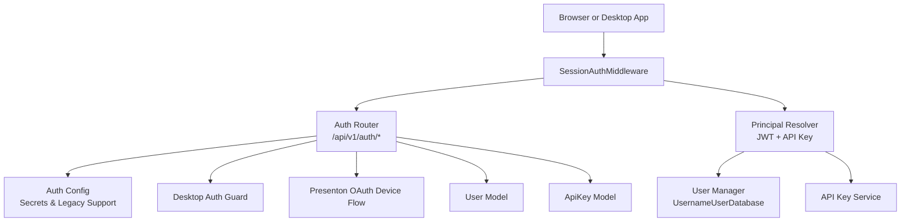
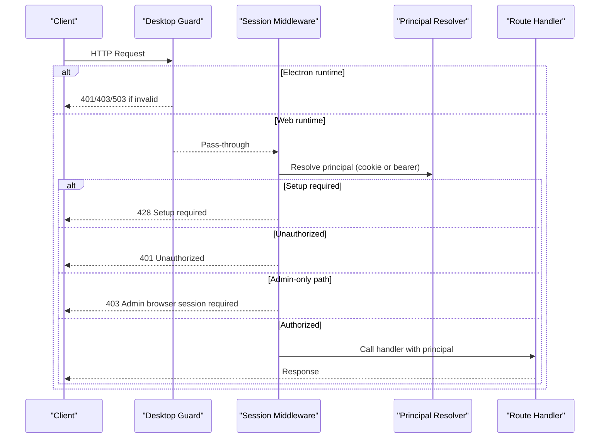
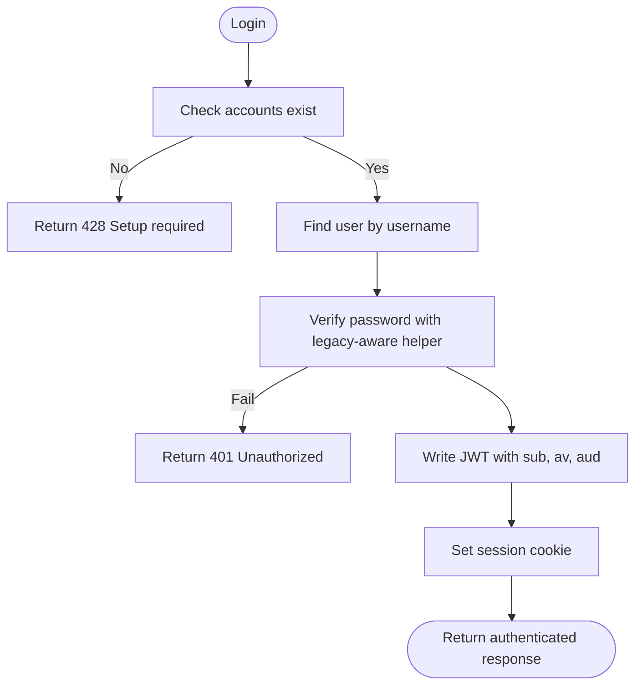
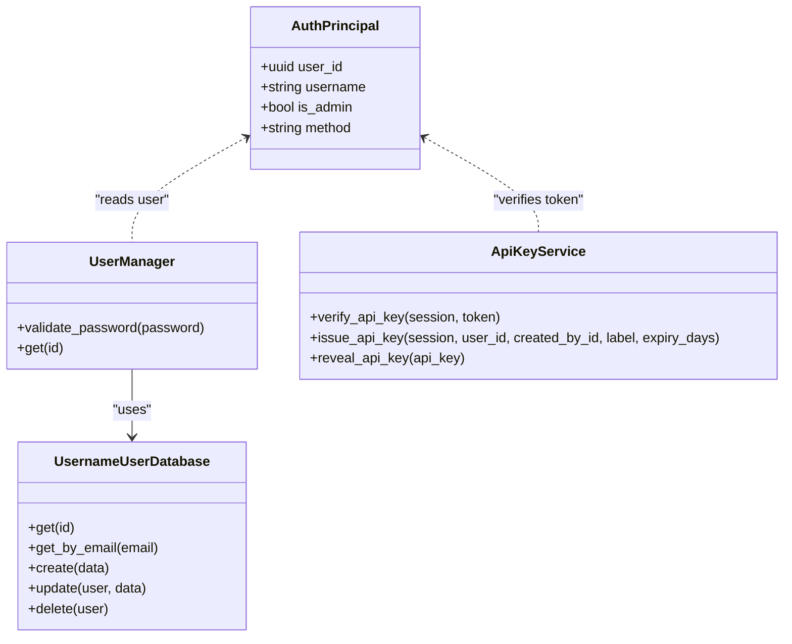
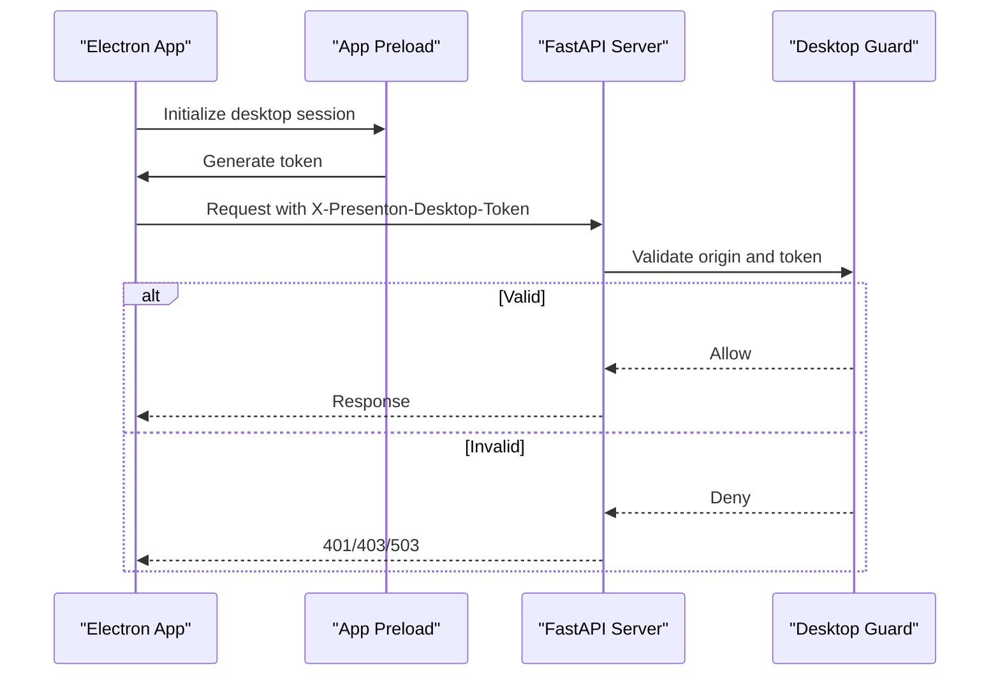
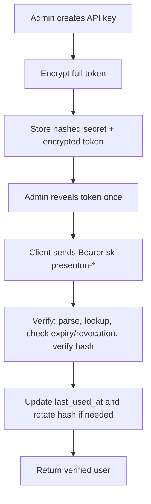
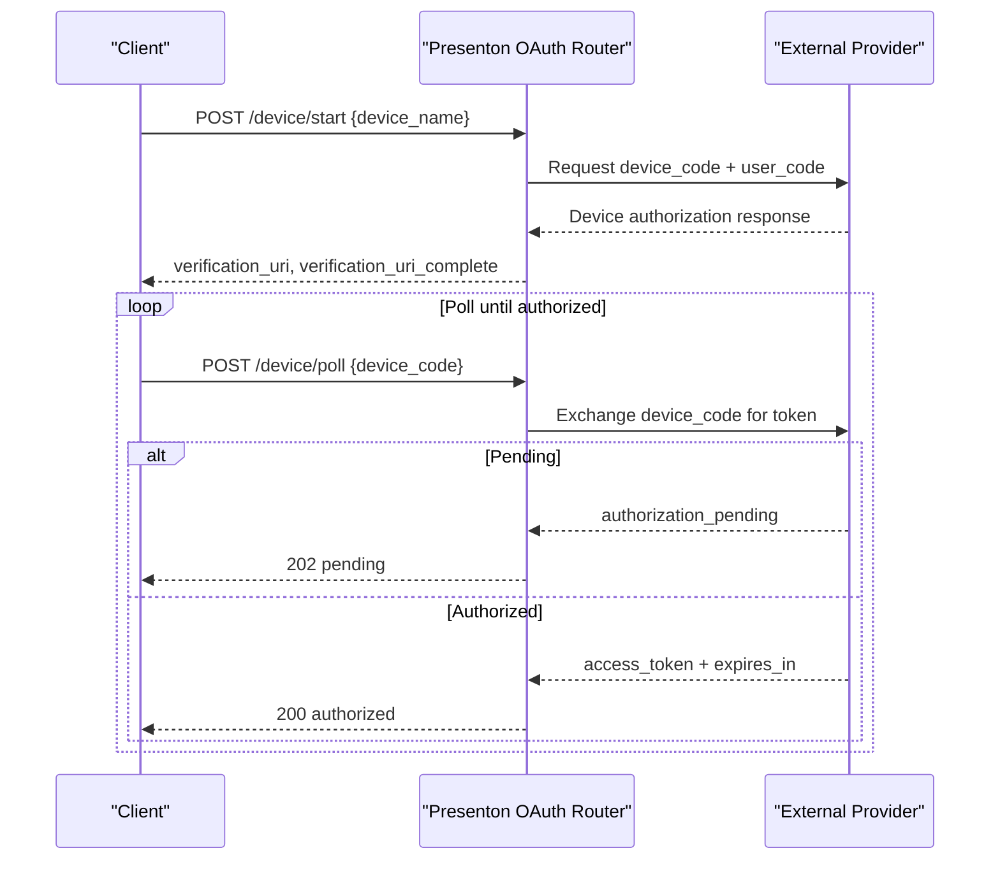
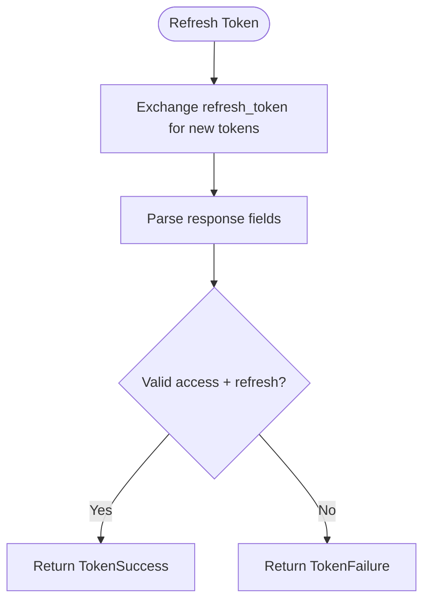
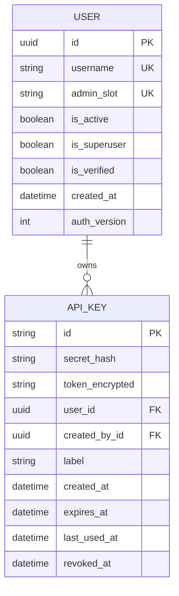
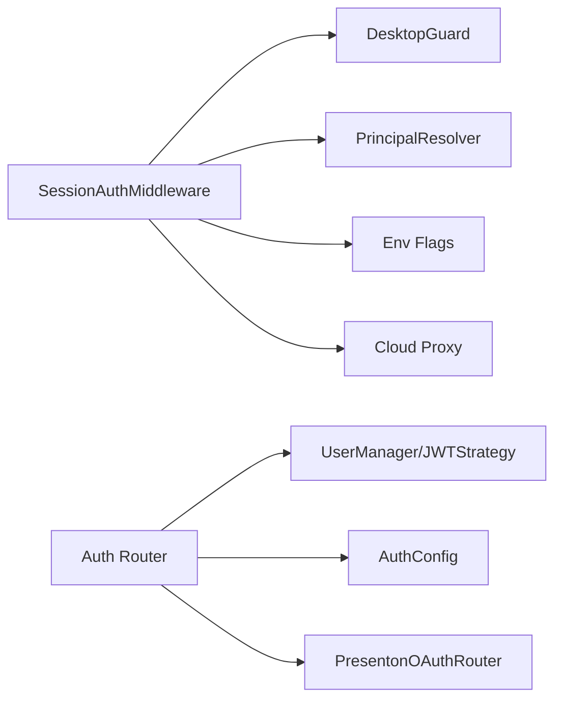

# Authentication & Authorization

<cite>
**Referenced Files in This Document**
- [router.py](file://servers/fastapi/api/v1/auth/router.py)
- [users.py](file://servers/fastapi/api/v1/auth/users.py)
- [config.py](file://servers/fastapi/api/v1/auth/config.py)
- [middlewares.py](file://servers/fastapi/api/middlewares.py)
- [principal.py](file://servers/fastapi/api/v1/auth/principal.py)
- [desktop.py](file://servers/fastapi/api/v1/auth/desktop.py)
- [presenton_oauth.py](file://servers/fastapi/api/v1/auth/presenton_oauth.py)
- [user.py](file://servers/fastapi/models/sql/user.py)
- [api_key.py](file://servers/fastapi/models/sql/api_key.py)
- [api_keys.py](file://servers/fastapi/services/api_keys.py)
- [openai_codex.py](file://servers/fastapi/utils/oauth/openai_codex.py)
- [test_session_auth_middleware.py](file://servers/fastapi/tests/unit/test_session_auth_middleware.py)
- [test_presenton_oauth_login.py](file://servers/fastapi/tests/integration/test_presenton_oauth_login.py)
- [desktop-auth.ts](file://electron/app/utils/desktop-auth.ts)
</cite>

## Table of Contents
1. [Introduction](#introduction)
2. [Project Structure](#project-structure)
3. [Core Components](#core-components)
4. [Architecture Overview](#architecture-overview)
5. [Detailed Component Analysis](#detailed-component-analysis)
6. [Dependency Analysis](#dependency-analysis)
7. [Performance Considerations](#performance-considerations)
8. [Troubleshooting Guide](#troubleshooting-guide)
9. [Conclusion](#conclusion)

## Introduction
This document explains the Presenton authentication and authorization system. It covers multi-layered security for browser sessions, desktop app access, API keys, and OAuth integrations. It also documents user model relationships, role-based access control (RBAC), permission checks, token lifecycle, rate limiting considerations, and operational best practices.

## Project Structure
The authentication system is implemented primarily in the FastAPI backend with supporting Electron desktop integration:

- FastAPI auth routes: `/api/v1/auth/*`
- Session middleware: request-level principal resolution and admin-only enforcement
- User and API key models: SQLModel definitions
- Services: API key issuance and verification
- Desktop auth: secure token injection and origin validation
- OAuth helpers: OpenAI Codex flow utilities and Presenton provider device code flow

**Diagram sources**
- [middlewares.py:29-150](file://servers/fastapi/api/middlewares.py#L29-L150)
- [router.py:27-202](file://servers/fastapi/api/v1/auth/router.py#L27-L202)
- [principal.py:14-57](file://servers/fastapi/api/v1/auth/principal.py#L14-L57)
- [users.py:49-199](file://servers/fastapi/api/v1/auth/users.py#L49-L199)
- [api_keys.py:19-133](file://servers/fastapi/services/api_keys.py#L19-L133)
- [config.py:11-108](file://servers/fastapi/api/v1/auth/config.py#L11-L108)
- [desktop.py:10-48](file://servers/fastapi/api/v1/auth/desktop.py#L10-L48)
- [presenton_oauth.py:29-45](file://servers/fastapi/api/v1/auth/presenton_oauth.py#L29-L45)
- [user.py:16-46](file://servers/fastapi/models/sql/user.py#L16-L46)
- [api_key.py:12-56](file://servers/fastapi/models/sql/api_key.py#L12-L56)

**Section sources**
- [middlewares.py:29-150](file://servers/fastapi/api/middlewares.py#L29-L150)
- [router.py:27-202](file://servers/fastapi/api/v1/auth/router.py#L27-L202)

## Core Components
- JWT session strategy with versioning to invalidate tokens on credential changes
- Cookie transport for browser sessions
- Principal resolver that supports both JWT cookies and Bearer API keys
- Admin-only route protection via method and role checks
- Desktop-origin and token validation for Electron requests
- API key lifecycle: issue, encrypt, reveal, verify, revoke
- Presenton OAuth device code flow for hosted provider integration
- OpenAI Codex OAuth helper utilities for refresh and parsing flows

**Section sources**
- [users.py:136-199](file://servers/fastapi/api/v1/auth/users.py#L136-L199)
- [principal.py:14-57](file://servers/fastapi/api/v1/auth/principal.py#L14-L57)
- [middlewares.py:29-150](file://servers/fastapi/api/middlewares.py#L29-L150)
- [desktop.py:10-48](file://servers/fastapi/api/v1/auth/desktop.py#L10-L48)
- [api_keys.py:19-133](file://servers/fastapi/services/api_keys.py#L19-L133)
- [presenton_oauth.py:29-45](file://servers/fastapi/api/v1/auth/presenton_oauth.py#L29-L45)
- [openai_codex.py:242-275](file://servers/fastapi/utils/oauth/openai_codex.py#L242-L275)

## Architecture Overview
The system enforces authentication at multiple layers:

1. Desktop guard validates Electron origins and a shared secret before any other processing.
2. Session middleware resolves principals from JWT cookies or API keys, enforces setup requirements, and restricts admin routes to browser JWT sessions.
3. Route handlers perform domain-specific authorization using user roles and ownership context.

**Diagram sources**
- [desktop.py:25-48](file://servers/fastapi/api/v1/auth/desktop.py#L25-L48)
- [middlewares.py:55-150](file://servers/fastapi/api/middlewares.py#L55-L150)
- [principal.py:22-57](file://servers/fastapi/api/v1/auth/principal.py#L22-L57)
- [router.py:58-107](file://servers/fastapi/api/v1/auth/router.py#L58-L107)

## Detailed Component Analysis

### JWT Strategy and Session Management
- The JWT strategy reads and writes tokens with an `av` (auth version) claim. Tokens are rejected if the user’s `auth_version` has changed or the user is inactive.
- Cookies are set with HttpOnly and SameSite=Lax; Secure flag is applied when the request is HTTPS.
- Login returns a JSON response and sets the session cookie. Logout deletes the cookie.

**Diagram sources**
- [router.py:155-188](file://servers/fastapi/api/v1/auth/router.py#L155-L188)
- [users.py:136-182](file://servers/fastapi/api/v1/auth/users.py#L136-L182)
- [config.py:11-12](file://servers/fastapi/api/v1/auth/config.py#L11-L12)

**Section sources**
- [users.py:136-199](file://servers/fastapi/api/v1/auth/users.py#L136-L199)
- [router.py:155-202](file://servers/fastapi/api/v1/auth/router.py#L155-L202)
- [config.py:11-12](file://servers/fastapi/api/v1/auth/config.py#L11-L12)

### Principal Resolution and RBAC
- Principal resolution supports two methods:
  - JWT cookie: browser session
  - Bearer API key: programmatic access
- Admin-only paths require a JWT browser session with `is_superuser`. API keys cannot access admin configuration routes.
- Context variables store current owner ID and admin flag for downstream services.

**Diagram sources**
- [principal.py:14-57](file://servers/fastapi/api/v1/auth/principal.py#L14-L57)
- [users.py:49-133](file://servers/fastapi/api/v1/auth/users.py#L49-L133)
- [api_keys.py:79-133](file://servers/fastapi/services/api_keys.py#L79-L133)

**Section sources**
- [principal.py:14-72](file://servers/fastapi/api/v1/auth/principal.py#L14-L72)
- [middlewares.py:100-125](file://servers/fastapi/api/middlewares.py#L100-L125)
- [test_session_auth_middleware.py:162-209](file://servers/fastapi/tests/unit/test_session_auth_middleware.py#L162-L209)

### Desktop App Authentication
- Electron injects a short-lived token header and scoped cookie only for internal app requests. External hosts do not receive these headers.
- Backend validates the host and Origin against configured allowed origins and compares the supplied token securely.

**Diagram sources**
- [desktop-auth.ts:34-50](file://electron/app/utils/desktop-auth.ts#L34-L50)
- [desktop.py:25-48](file://servers/fastapi/api/v1/auth/desktop.py#L25-L48)

**Section sources**
- [desktop-auth.ts:34-50](file://electron/app/utils/desktop-auth.ts#L34-L50)
- [desktop.py:10-48](file://servers/fastapi/api/v1/auth/desktop.py#L10-L48)

### API Key Management
- Keys have a public prefix and a secret part. The full token is encrypted at rest and can be revealed once by an admin.
- Verification checks revocation, expiration, user activity, and performs hash rotation.
- Admin endpoints list, create, reveal, and revoke API keys.

**Diagram sources**
- [api_keys.py:35-76](file://servers/fastapi/services/api_keys.py#L35-L76)
- [api_keys.py:79-133](file://servers/fastapi/services/api_keys.py#L79-L133)
- [api_key.py:12-56](file://servers/fastapi/models/sql/api_key.py#L12-L56)

**Section sources**
- [api_keys.py:19-133](file://servers/fastapi/services/api_keys.py#L19-L133)
- [api_key.py:12-56](file://servers/fastapi/models/sql/api_key.py#L12-L56)

### OAuth Integrations

#### Presenton Provider Device Code Flow
- Supports device authorization grant type for headless clients.
- Poll endpoint returns pending until the user completes device activation on the web.
- On success, stores provider credentials and updates local authentication state.

**Diagram sources**
- [presenton_oauth.py:29-45](file://servers/fastapi/api/v1/auth/presenton_oauth.py#L29-L45)
- [test_presenton_oauth_login.py:165-245](file://servers/fastapi/tests/integration/test_presenton_oauth_login.py#L165-L245)

**Section sources**
- [presenton_oauth.py:29-45](file://servers/fastapi/api/v1/auth/presenton_oauth.py#L29-L45)
- [test_presenton_oauth_login.py:165-245](file://servers/fastapi/tests/integration/test_presenton_oauth_login.py#L165-L245)

#### OpenAI Codex OAuth Utilities
- Provides structures for token success/failure and account profile.
- Implements refresh token exchange and parses various user-pasted inputs for fallback flows.

**Diagram sources**
- [openai_codex.py:242-275](file://servers/fastapi/utils/oauth/openai_codex.py#L242-L275)
- [openai_codex.py:553-574](file://servers/fastapi/utils/oauth/openai_codex.py#L553-L574)

**Section sources**
- [openai_codex.py:242-275](file://servers/fastapi/utils/oauth/openai_codex.py#L242-L275)
- [openai_codex.py:553-574](file://servers/fastapi/utils/oauth/openai_codex.py#L553-L574)

### User Model Relationships and Ownership
- The User model includes identity, role flags, timestamps, and an `auth_version` used for token invalidation.
- Multi-user migrations add `owner_id` foreign keys across owned resources, enabling per-user isolation.

**Diagram sources**
- [user.py:16-46](file://servers/fastapi/models/sql/user.py#L16-L46)
- [api_key.py:12-56](file://servers/fastapi/models/sql/api_key.py#L12-L56)

**Section sources**
- [user.py:16-46](file://servers/fastapi/models/sql/user.py#L16-L46)
- [api_key.py:12-56](file://servers/fastapi/models/sql/api_key.py#L12-L56)

## Dependency Analysis
- Session middleware depends on:
  - Desktop guard for Electron environment checks
  - Principal resolver for JWT/API key resolution
  - Environment config for auth-disabled mode
  - Cloud proxy integration for selected providers
- Auth router depends on:
  - User manager and JWT strategy
  - Config for secrets and legacy support
  - Presenton OAuth router inclusion

**Diagram sources**
- [middlewares.py:23-21](file://servers/fastapi/api/middlewares.py#L23-L21)
- [middlewares.py:55-150](file://servers/fastapi/api/middlewares.py#L55-L150)
- [router.py:27-28](file://servers/fastapi/api/v1/auth/router.py#L27-L28)
- [router.py:19-24](file://servers/fastapi/api/v1/auth/router.py#L19-L24)

**Section sources**
- [middlewares.py:23-21](file://servers/fastapi/api/middlewares.py#L23-L21)
- [middlewares.py:55-150](file://servers/fastapi/api/middlewares.py#L55-L150)
- [router.py:27-28](file://servers/fastapi/api/v1/auth/router.py#L27-L28)

## Performance Considerations
- JWT read/write operations are lightweight; ensure secrets are loaded efficiently.
- API key verification performs DB lookups and hash verification; consider caching active keys if high throughput is expected.
- Avoid unnecessary DB queries in hot paths; reuse sessions where appropriate.
- Rate limiting is not implemented in the analyzed files; apply external rate limiting at the reverse proxy or gateway layer.

[No sources needed since this section provides general guidance]

## Troubleshooting Guide
Common issues and resolutions:

- 428 Setup required: No users exist yet; call the setup endpoint to create the initial admin account.
- 401 Unauthorized: Missing or invalid JWT cookie or API key; verify token validity and user status.
- 403 Admin browser session required: Admin-only routes require a JWT browser session; API keys cannot access them.
- 503 Desktop session unavailable: Electron environment variables or allowed origins are misconfigured.
- Asset not found: App data path authorization failed; ensure the requesting user owns the resource or is admin.

**Section sources**
- [middlewares.py:82-145](file://servers/fastapi/api/middlewares.py#L82-L145)
- [desktop.py:25-48](file://servers/fastapi/api/v1/auth/desktop.py#L25-L48)
- [test_session_auth_middleware.py:162-209](file://servers/fastapi/tests/unit/test_session_auth_middleware.py#L162-L209)

## Conclusion
Presenton implements a robust, multi-layered security model combining JWT sessions, API keys, desktop-origin validation, and selective OAuth integrations. RBAC is enforced through principal method and role checks, while ownership constraints protect user data. For production deployments, add rate limiting at the edge, enforce HTTPS, and manage secrets securely.