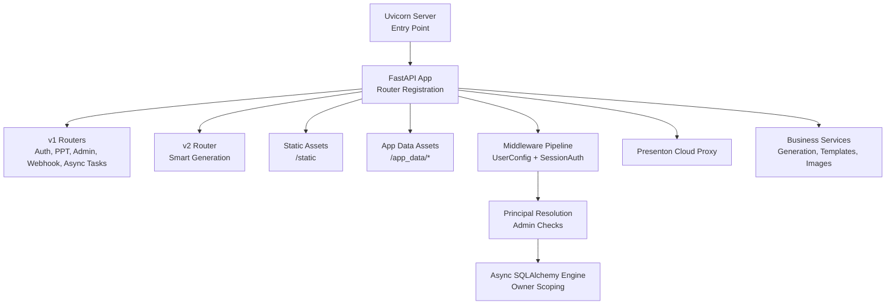
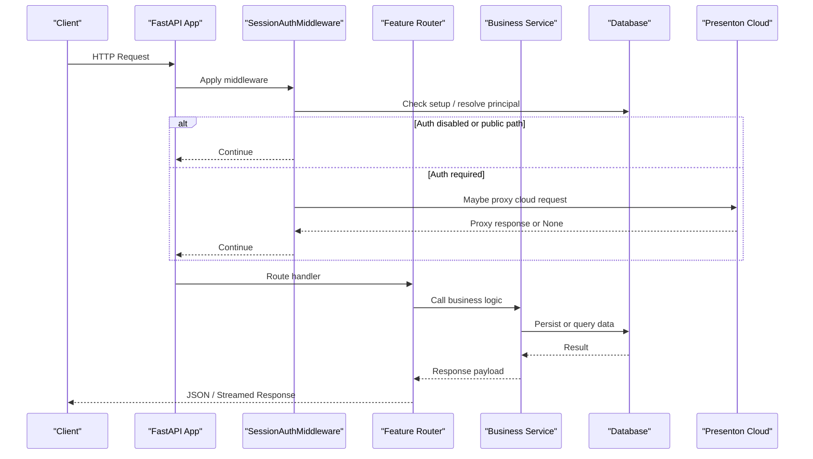
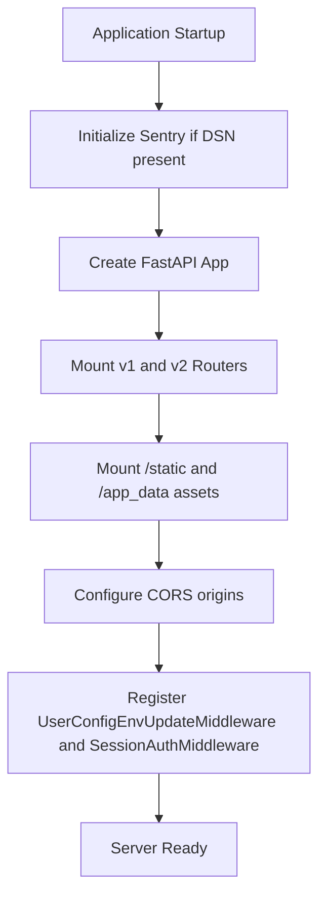
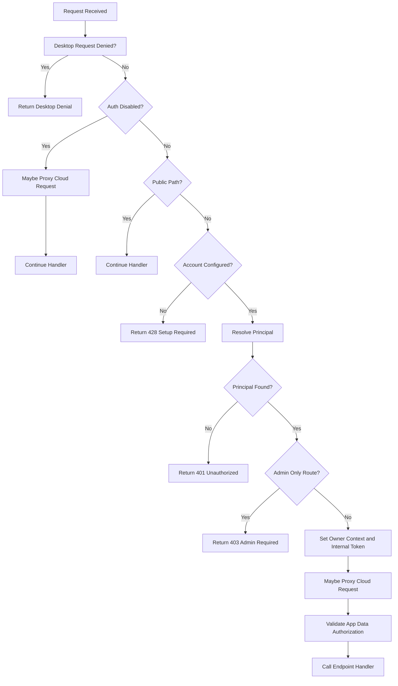
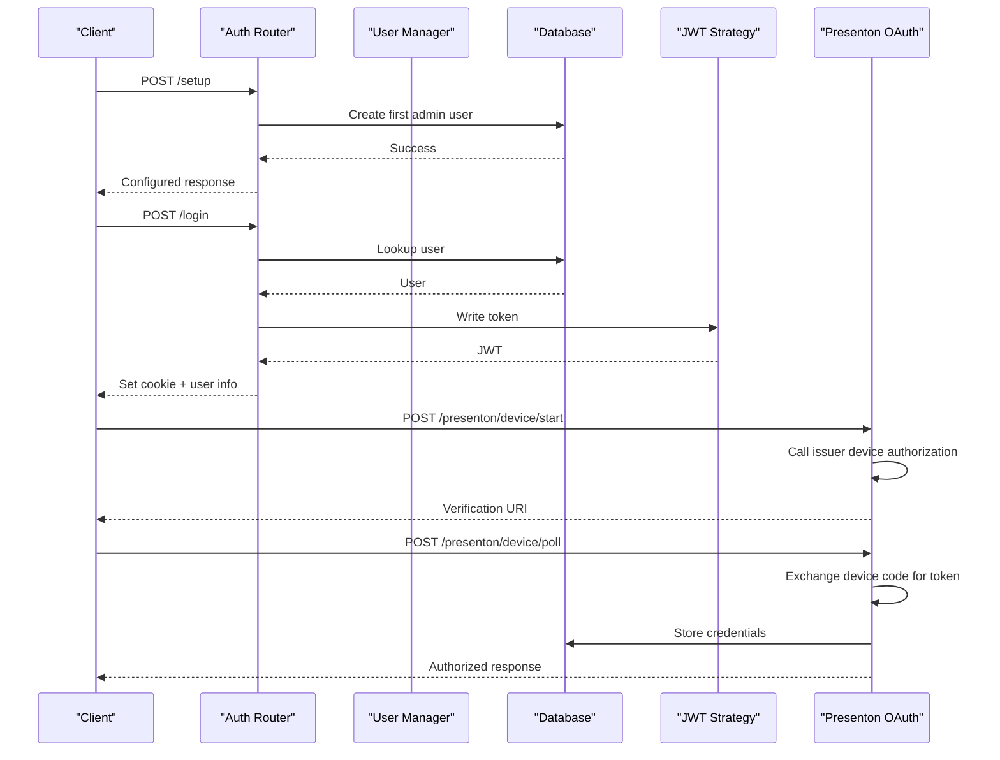
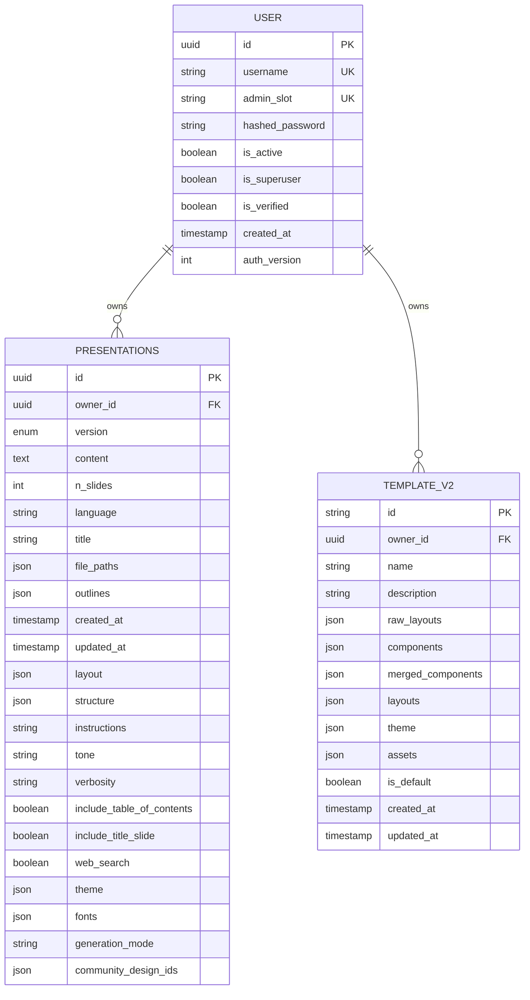
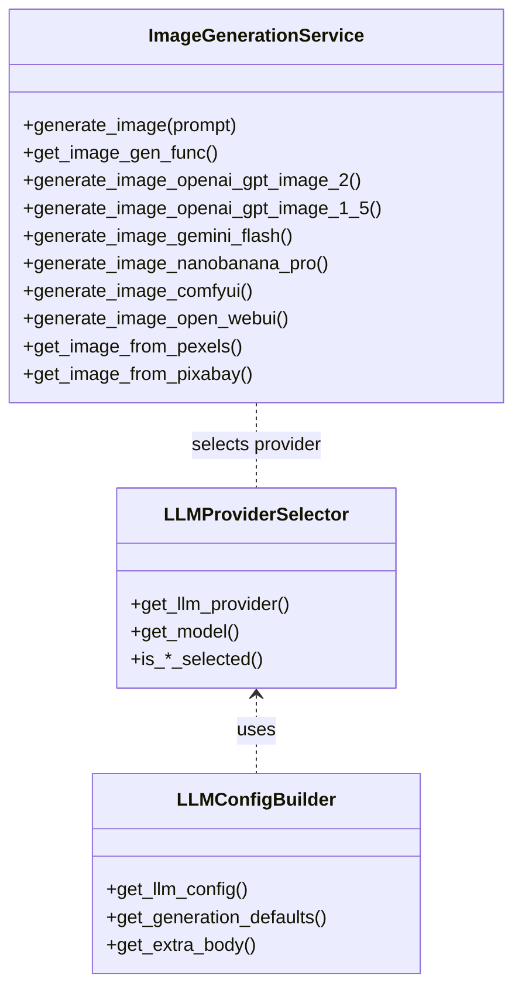
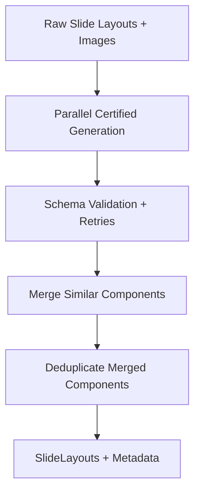
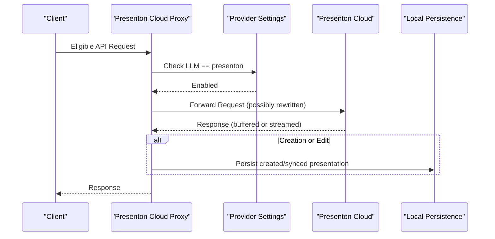
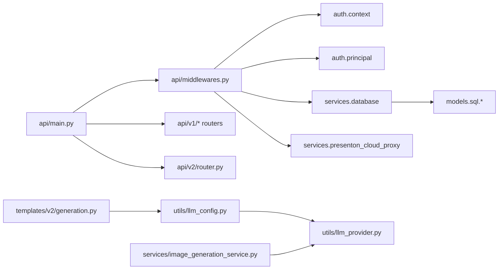

# Backend API

<cite>
**Referenced Files in This Document**
- [server.py](file://servers/fastapi/server.py)
- [main.py](file://servers/fastapi/api/main.py)
- [middlewares.py](file://servers/fastapi/api/middlewares.py)
- [router.py](file://servers/fastapi/api/v1/auth/router.py)
- [users.py](file://servers/fastapi/api/v1/auth/users.py)
- [presenton_oauth.py](file://servers/fastapi/api/v1/auth/presenton_oauth.py)
- [presentation.py](file://servers/fastapi/models/sql/presentation.py)
- [template_v2.py](file://servers/fastapi/models/sql/template_v2.py)
- [database.py](file://servers/fastapi/services/database.py)
- [presenton_cloud_proxy.py](file://servers/fastapi/services/presenton_cloud_proxy.py)
- [llm_provider.py](file://servers/fastapi/utils/llm_provider.py)
- [llm_config.py](file://servers/fastapi/utils/llm_config.py)
- [image_generation_service.py](file://servers/fastapi/services/image_generation_service.py)
- [generation.py](file://servers/fastapi/templates/v2/generation.py)
- [router.py](file://servers/fastapi/api/v1/ppt/router.py)
</cite>

## Table of Contents
1. [Introduction](#introduction)
2. [Project Structure](#project-structure)
3. [Core Components](#core-components)
4. [Architecture Overview](#architecture-overview)
5. [Detailed Component Analysis](#detailed-component-analysis)
6. [Dependency Analysis](#dependency-analysis)
7. [Performance Considerations](#performance-considerations)
8. [Troubleshooting Guide](#troubleshooting-guide)
9. [Conclusion](#conclusion)

## Introduction
This document explains the Presenton backend API built with FastAPI. It covers the application entry point, route organization, middleware pipeline, authentication and session handling, business services for presentation generation and template management, file and image processing, export operations, database schema and ORM design, AI provider abstraction, error handling, validation, API versioning, performance characteristics, caching strategies, and scalability patterns.

The backend is a FastAPI service that:
- Exposes REST endpoints under `/api/v1` and `/api/v2`.
- Enforces authentication, authorization, and tenant isolation through middleware.
- Integrates multiple LLM providers and image generation backends.
- Persists presentations, templates, users, async tasks, and related assets.
- Optionally proxies selected requests to the Presenton Cloud service.

## Project Structure
The FastAPI backend lives under `servers/fastapi`. The most important runtime files are:
- Application server entry point.
- FastAPI application assembly, router registration, static asset mounting, CORS, and middleware configuration.
- Authentication routers, user models, JWT strategy, and OAuth integration.
- Presentation and template SQLModel schemas.
- Database engine, session factory, owner-scoped queries, and startup table creation.
- Presenton Cloud proxy for cloud-backed generation and editing flows.
- LLM provider selection and client configuration.
- Image generation service supporting stock and generative providers.
- Template V2 certified generation logic.

**Diagram sources**
- [server.py:1-30](file://servers/fastapi/server.py#L1-L30)
- [main.py:1-119](file://servers/fastapi/api/main.py#L1-L119)
- [middlewares.py:1-150](file://servers/fastapi/api/middlewares.py#L1-L150)
- [database.py:1-153](file://servers/fastapi/services/database.py#L1-L153)

**Section sources**
- [server.py:1-30](file://servers/fastapi/server.py#L1-L30)
- [main.py:1-119](file://servers/fastapi/api/main.py#L1-L119)

## Core Components
- Application lifecycle and Sentry initialization.
- Router composition for v1 and v2 APIs.
- Static and app data asset serving.
- CORS policy tuned for Electron or Docker deployments.
- User configuration environment update middleware.
- Session-based authentication and admin-only enforcement.
- Owner-scoped database access for multi-user isolation.
- Presenton Cloud request proxy for cloud-backed workflows.
- LLM provider abstraction and client configuration.
- Image generation service with multiple backends.
- Template V2 certified generation pipeline.

Key responsibilities:
- `server.py`: Starts Uvicorn with configurable port, reload, and log level.
- `api/main.py`: Builds the FastAPI app, mounts routers, assets, and middleware.
- `api/middlewares.py`: Applies per-request user config updates, desktop checks, auth gating, admin checks, and cloud proxy routing.
- `services/database.py`: Creates async engine, applies owner scoping hooks, exposes sessions, and creates tables on startup when configured.
- `utils/llm_provider.py` and `utils/llm_config.py`: Resolve active LLM provider, model names, and full client configuration.
- `services/image_generation_service.py`: Dispatches image generation to stock or generative providers.
- `templates/v2/generation.py`: Orchestrates certified slide layout generation with parallelism and validation retries.

**Section sources**
- [server.py:1-30](file://servers/fastapi/server.py#L1-L30)
- [main.py:1-119](file://servers/fastapi/api/main.py#L1-L119)
- [middlewares.py:1-150](file://servers/fastapi/api/middlewares.py#L1-L150)
- [database.py:1-153](file://servers/fastapi/services/database.py#L1-L153)
- [llm_provider.py:1-194](file://servers/fastapi/utils/llm_provider.py#L1-L194)
- [llm_config.py:1-525](file://servers/fastapi/utils/llm_config.py#L1-L525)
- [image_generation_service.py:1-800](file://servers/fastapi/services/image_generation_service.py#L1-L800)
- [generation.py:1-800](file://servers/fastapi/templates/v2/generation.py#L1-L800)

## Architecture Overview
The backend follows a layered architecture:
- HTTP layer: FastAPI routes grouped by feature and API version.
- Middleware layer: Cross-cutting concerns including environment refresh, security, ownership, and cloud proxying.
- Service layer: Business logic for presentation generation, template management, file processing, and exports.
- Data layer: SQLModel ORM models with owner-scoped queries and Alembic migrations.
- Integration layer: LLM providers, image providers, and Presenton Cloud proxy.

**Diagram sources**
- [main.py:65-103](file://servers/fastapi/api/main.py#L65-L103)
- [middlewares.py:29-150](file://servers/fastapi/api/middlewares.py#L29-L150)
- [presenton_cloud_proxy.py:407-709](file://servers/fastapi/services/presenton_cloud_proxy.py#L407-L709)
- [database.py:67-113](file://servers/fastapi/services/database.py#L67-L113)

## Detailed Component Analysis

### API Entry Point and Router Organization
- The server entry point starts Uvicorn with command-line arguments for port, reload, and log level.
- The FastAPI app initializes optional Sentry tracing, includes all routers, mounts app data and static assets, configures CORS, and registers middleware.
- v1 routers include auth, ppt, admin, mock, webhook, and async tasks.
- v2 router supports smart presentation generation endpoints.

**Diagram sources**
- [server.py:5-29](file://servers/fastapi/server.py#L5-L29)
- [main.py:32-103](file://servers/fastapi/api/main.py#L32-L103)

**Section sources**
- [server.py:1-30](file://servers/fastapi/server.py#L1-L30)
- [main.py:1-119](file://servers/fastapi/api/main.py#L1-L119)
- [router.py:1-41](file://servers/fastapi/api/v1/ppt/router.py#L1-L41)

### Middleware Pipeline and Request Handling
- `UserConfigEnvUpdateMiddleware` refreshes runtime environment variables from user configuration before each request.
- `SessionAuthMiddleware`:
  - Blocks unsupported desktop requests.
  - Allows unauthenticated paths for status, verify, setup, login, logout, and specific app data prefixes.
  - When auth is disabled, still proxies eligible Presenton Cloud requests.
  - Requires initial account setup; returns 428 if not configured.
  - Resolves principal via cookie/JWT or API key, enforces admin-only routes, sets request context, and optionally generates internal JWT tokens for API-key sessions.
  - Validates app data path authorization and forwards to handlers.

**Diagram sources**
- [middlewares.py:23-150](file://servers/fastapi/api/middlewares.py#L23-L150)

**Section sources**
- [middlewares.py:1-150](file://servers/fastapi/api/middlewares.py#L1-L150)

### Authentication System
Authentication combines FastAPI Users, custom JWT strategy, cookie transport, and optional Presenton OAuth device flow.

- User model:
  - Username-only account with password hash, admin slot, flags, timestamps, and auth version.
- User database adapter:
  - Maps FastAPI Users methods to SQLModel `User`, including username lookup and CRUD operations.
- Password helper:
  - Legacy-aware hashing supports older hashes and upgrades them on successful verification.
- JWT strategy:
  - Reads and writes versioned JWTs containing user ID and auth version.
  - Rejects inactive users or mismatched auth versions.
- Cookie transport:
  - Secure, HttpOnly, SameSite=Lax cookie named after session configuration.
- Login flow:
  - Setup endpoint creates first admin user.
  - Login verifies credentials, sets cookie, and returns serialized user info.
  - Logout deletes session cookie.
- Status and verify endpoints:
  - Return current auth state and user details.
- Presenton OAuth:
  - Device authorization flow to connect global Presenton Cloud provider.
  - Stores credentials, revokes on logout, and manages provider settings.

**Diagram sources**
- [router.py:58-202](file://servers/fastapi/api/v1/auth/router.py#L58-L202)
- [users.py:27-234](file://servers/fastapi/api/v1/auth/users.py#L27-L234)
- [presenton_oauth.py:120-313](file://servers/fastapi/api/v1/auth/presenton_oauth.py#L120-L313)

**Section sources**
- [user.py:1-46](file://servers/fastapi/models/sql/user.py#L1-L46)
- [users.py:1-234](file://servers/fastapi/api/v1/auth/users.py#L1-L234)
- [router.py:1-202](file://servers/fastapi/api/v1/auth/router.py#L1-L202)
- [presenton_oauth.py:1-313](file://servers/fastapi/api/v1/auth/presenton_oauth.py#L1-L313)

### Database Schema Design and ORM Models
Core entities:
- `User`: Authentication and admin identity.
- `PresentationModel`: Presentation content, metadata, structure, theme, fonts, generation mode, and community design references.
- `TemplateV2`: Template definition with raw layouts, components, merged components, generated layouts, theme, assets, default flag, and timestamps.

Relationships and ownership:
- Presentations and templates reference `User.id` via foreign keys.
- Owner scoping ensures every SELECT automatically filters by `owner_id` for strict models and allows default templates when `owner_id` is null and `is_default` is true.
- New owned rows are stamped with the current owner during flush.

Startup behavior:
- On startup, the application can create tables explicitly for a subset of models when migration on startup is enabled.

**Diagram sources**
- [user.py:16-46](file://servers/fastapi/models/sql/user.py#L16-L46)
- [presentation.py:16-126](file://servers/fastapi/models/sql/presentation.py#L16-L126)
- [template_v2.py:16-61](file://servers/fastapi/models/sql/template_v2.py#L16-L61)
- [database.py:56-113](file://servers/fastapi/services/database.py#L56-L113)

**Section sources**
- [presentation.py:1-126](file://servers/fastapi/models/sql/presentation.py#L1-L126)
- [template_v2.py:1-61](file://servers/fastapi/models/sql/template_v2.py#L1-L61)
- [database.py:1-153](file://servers/fastapi/services/database.py#L1-L153)

### AI Provider Abstraction Layer
The backend abstracts multiple LLM providers and image generation backends:

LLM providers:
- OpenAI, DeepSeek, Google, Vertex, Azure, Bedrock, Anthropic, OpenRouter, Fireworks, Together, Cerebras, LiteLLM, LMStudio, Ollama, Custom, Codex.
- Provider selection reads environment variables and validates configuration.
- Model resolution maps provider to default or configured model names.
- Client configuration builds provider-specific client configs with generation defaults, reasoning options, and provider-specific extra parameters.

Image generation backends:
- Stock providers: Pexels, Pixabay.
- Generative providers: OpenAI GPT Image 1.5 and 2, Gemini Flash, NanoBanana Pro, ComfyUI, Open WebUI, OpenAI-compatible endpoints.
- Parallel execution support and lock-based serialization for single-loop safety.
- Error normalization and fallback sizing for OpenAI image API.

**Diagram sources**
- [llm_provider.py:47-194](file://servers/fastapi/utils/llm_provider.py#L47-L194)
- [llm_config.py:189-525](file://servers/fastapi/utils/llm_config.py#L189-L525)
- [image_generation_service.py:132-800](file://servers/fastapi/services/image_generation_service.py#L132-L800)

**Section sources**
- [llm_provider.py:1-194](file://servers/fastapi/utils/llm_provider.py#L1-L194)
- [llm_config.py:1-525](file://servers/fastapi/utils/llm_config.py#L1-L525)
- [image_generation_service.py:1-800](file://servers/fastapi/services/image_generation_service.py#L1-L800)

### Presentation Generation and Template Management
- Template V2 generation orchestrates certified slide layout creation with:
  - Parallel execution across slides.
  - Validation retries.
  - Duplicate component merging and deduplication.
  - Prompt-driven layout generation using LLM clients.
- Presentation model stores structured content, outline, layout, structure, theme, fonts, generation mode, and community design IDs.
- Endpoints under `/api/v1/ppt` cover files, fonts, outlines, slides, images, icons, LLM integrations, generation, codex auth, presentations, chat, templates, and community features.

**Diagram sources**
- [generation.py:151-210](file://servers/fastapi/templates/v2/generation.py#L151-L210)
- [generation.py:213-317](file://servers/fastapi/templates/v2/generation.py#L213-L317)
- [generation.py:631-693](file://servers/fastapi/templates/v2/generation.py#L631-L693)

**Section sources**
- [generation.py:1-800](file://servers/fastapi/templates/v2/generation.py#L1-L800)
- [presentation.py:16-126](file://servers/fastapi/models/sql/presentation.py#L16-L126)
- [router.py:1-41](file://servers/fastapi/api/v1/ppt/router.py#L1-L41)

### File Processing, Export Operations, and Presenton Cloud Proxy
- File processing and export endpoints are exposed under the PPT router group.
- Presenton Cloud proxy intercepts eligible requests:
  - Determines whether to proxy based on path, method, and provider settings.
  - Rewrites upstream paths for async tasks, chat, community presentations, and smart generation/editing flows.
  - Buffers or streams responses, persists created or completed presentations locally, and syncs edits.
  - Handles community gallery errors and disabled community features gracefully.

**Diagram sources**
- [presenton_cloud_proxy.py:105-119](file://servers/fastapi/services/presenton_cloud_proxy.py#L105-L119)
- [presenton_cloud_proxy.py:407-709](file://servers/fastapi/services/presenton_cloud_proxy.py#L407-L709)

**Section sources**
- [presenton_cloud_proxy.py:1-709](file://servers/fastapi/services/presenton_cloud_proxy.py#L1-L709)

### Error Handling, Validation Strategies, and API Versioning
Error handling:
- HTTP exceptions raised by LLM configuration and provider selection.
- Community endpoint wrappers normalize upstream errors into consistent Presenton error shapes.
- Image generation errors are normalized and re-raised with clear messages.
- Cloud proxy converts upstream failures into JSON responses with appropriate status codes.

Validation strategies:
- Pydantic models for request payloads.
- Strict owner scoping at the ORM level prevents cross-tenant data access.
- Template V2 generation includes schema validation and custom validators.
- Password length and legacy hash compatibility enforced in user manager.

API versioning:
- v1 endpoints for standard presentation generation, chat, templates, and community.
- v2 endpoints for smart presentation generation and updates.
- Cloud proxy rewrites v1 calls to v2 or v3 upstream paths depending on operation.

**Section sources**
- [llm_config.py:189-525](file://servers/fastapi/utils/llm_config.py#L189-L525)
- [image_generation_service.py:165-224](file://servers/fastapi/services/image_generation_service.py#L165-L224)
- [presenton_cloud_proxy.py:422-481](file://servers/fastapi/services/presenton_cloud_proxy.py#L422-L481)
- [database.py:67-113](file://servers/fastapi/services/database.py#L67-L113)

## Dependency Analysis
High-level dependencies:
- FastAPI app depends on routers, lifespan, middlewares, and utilities.
- Middlewares depend on auth context, principal resolution, database session maker, and cloud proxy.
- Database module depends on SQLModel metadata, all core models, and environment configuration.
- LLM configuration depends on provider selection and environment getters.
- Image generation service depends on provider selection and external HTTP clients.
- Template V2 generation depends on LLM client and certified generation helpers.

**Diagram sources**
- [main.py:1-119](file://servers/fastapi/api/main.py#L1-L119)
- [middlewares.py:1-150](file://servers/fastapi/api/middlewares.py#L1-L150)
- [database.py:1-153](file://servers/fastapi/services/database.py#L1-L153)
- [llm_config.py:1-525](file://servers/fastapi/utils/llm_config.py#L1-L525)
- [llm_provider.py:1-194](file://servers/fastapi/utils/llm_provider.py#L1-L194)
- [image_generation_service.py:1-800](file://servers/fastapi/services/image_generation_service.py#L1-L800)
- [generation.py:1-800](file://servers/fastapi/templates/v2/generation.py#L1-L800)

**Section sources**
- [main.py:1-119](file://servers/fastapi/api/main.py#L1-L119)
- [middlewares.py:1-150](file://servers/fastapi/api/middlewares.py#L1-L150)
- [database.py:1-153](file://servers/fastapi/services/database.py#L1-L153)
- [llm_config.py:1-525](file://servers/fastapi/utils/llm_config.py#L1-L525)
- [llm_provider.py:1-194](file://servers/fastapi/utils/llm_provider.py#L1-L194)
- [image_generation_service.py:1-800](file://servers/fastapi/services/image_generation_service.py#L1-L800)
- [generation.py:1-800](file://servers/fastapi/templates/v2/generation.py#L1-L800)

## Performance Considerations
- Asynchronous database access with SQLAlchemy async engine and sessionmaker.
- Connection pool configuration applied for non-SQLite databases.
- SQLite foreign key enforcement enabled at connection time.
- Owner-scoped ORM criteria applied automatically to reduce manual filtering overhead.
- Template V2 generation uses thread pool parallelism bounded by slide count and a maximum worker limit.
- Image generation supports parallel execution controlled by environment flag; otherwise serializes via loop-scoped lock.
- Streaming responses used for long-running generation and chat flows.
- Optional Presenton Cloud proxy buffers only when necessary and streams SSE events while persisting completion events.

Recommendations:
- Tune pool size and connection limits for production databases.
- Monitor thread pool utilization during heavy template generation.
- Enable parallel image generation only when downstream providers allow concurrent requests.
- Use streaming endpoints for large presentations to avoid memory spikes.
- Cache frequently accessed static assets and fonts where possible.

[No sources needed since this section provides general guidance]

## Troubleshooting Guide
Common issues and resolutions:
- Setup required:
  - If no user exists, protected endpoints return 428. Create the first admin user via the setup endpoint.
- Unauthorized or forbidden:
  - Missing or invalid session cookie results in 401.
  - Admin-only routes require an admin browser session; otherwise 403.
- Presenton Cloud unavailable:
  - If LLM provider is set to Presenton but credentials are missing, endpoints return 503.
  - Community features disabled return explicit errors for community endpoints.
- LLM configuration errors:
  - Missing API keys or invalid provider/model values raise 400 or 500 errors.
  - Reasoning and generation profile settings must be valid.
- Image generation failures:
  - Invalid stock provider API keys return 401.
  - Unsupported sizes or malformed responses are normalized and reported clearly.

Debugging steps:
- Verify environment variables for LLM and image providers.
- Check session cookie presence and validity.
- Inspect logs for template generation and image provider calls.
- Confirm Presenton Cloud provider connection status.

**Section sources**
- [middlewares.py:55-150](file://servers/fastapi/api/middlewares.py#L55-L150)
- [router.py:110-188](file://servers/fastapi/api/v1/auth/router.py#L110-L188)
- [presenton_cloud_proxy.py:422-481](file://servers/fastapi/services/presenton_cloud_proxy.py#L422-L481)
- [llm_config.py:189-525](file://servers/fastapi/utils/llm_config.py#L189-L525)
- [image_generation_service.py:478-563](file://servers/fastapi/services/image_generation_service.py#L478-L563)

## Conclusion
The Presenton backend API is a modular FastAPI service that separates concerns across routers, middleware, services, and data layers. It provides robust authentication, tenant isolation, flexible LLM and image provider integration, and scalable presentation generation pipelines. The system supports both local and cloud-backed workflows, with careful attention to error handling, validation, and performance. For production deployments, focus on environment configuration, database tuning, provider availability, and monitoring of long-running generation and streaming endpoints.

[No sources needed since this section summarizes without analyzing specific files]