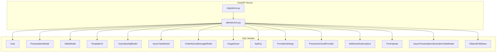
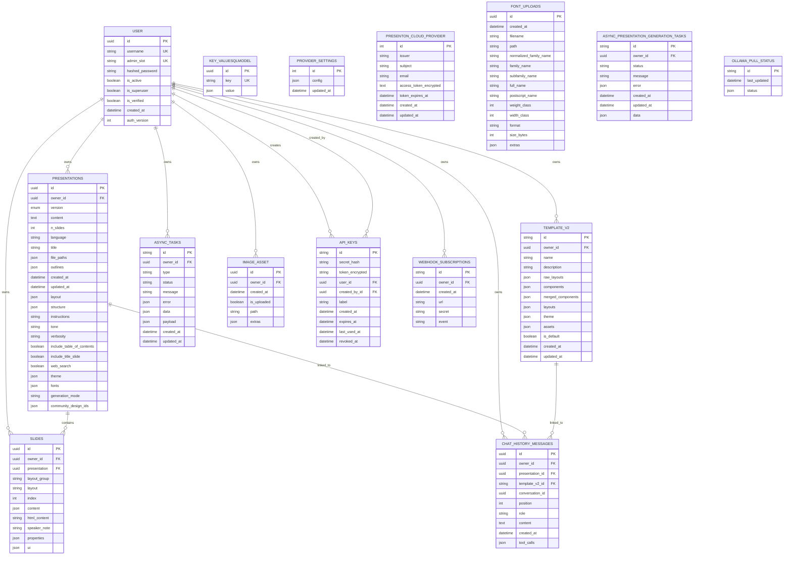
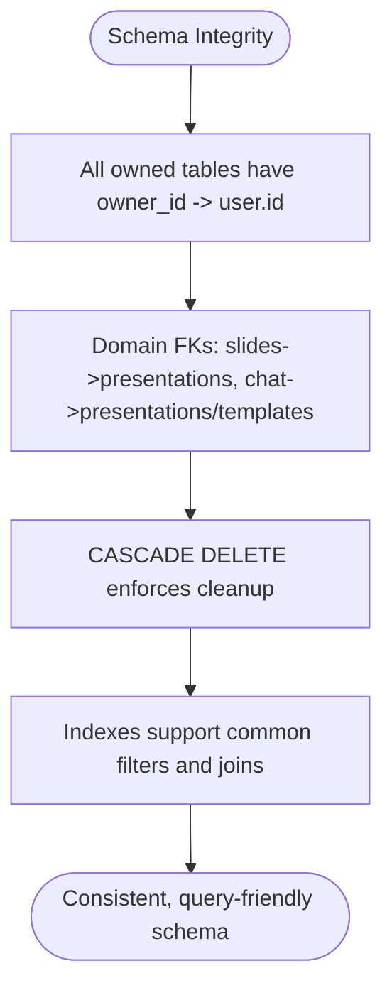

# Database Schema & Models

<cite>
**Referenced Files in This Document**
- [presentation.py](file://servers/fastapi/models/sql/presentation.py)
- [slide.py](file://servers/fastapi/models/sql/slide.py)
- [user.py](file://servers/fastapi/models/sql/user.py)
- [template_v2.py](file://servers/fastapi/models/sql/template_v2.py)
- [key_value.py](file://servers/fastapi/models/sql/key_value.py)
- [async_task.py](file://servers/fastapi/models/sql/async_task.py)
- [chat_history_message.py](file://servers/fastapi/models/sql/chat_history_message.py)
- [image_asset.py](file://servers/fastapi/models/sql/image_asset.py)
- [api_key.py](file://servers/fastapi/models/sql/api_key.py)
- [provider_settings.py](file://servers/fastapi/models/sql/provider_settings.py)
- [presenton_cloud_provider.py](file://servers/fastapi/models/sql/presenton_cloud_provider.py)
- [webhook_subscription.py](file://servers/fastapi/models/sql/webhook_subscription.py)
- [font_upload.py](file://servers/fastapi/models/sql/font_upload.py)
- [async_presentation_generation_status.py](file://servers/fastapi/models/sql/async_presentation_generation_status.py)
- [ollama_pull_status.py](file://servers/fastapi/models/sql/ollama_pull_status.py)
- [env.py](file://servers/fastapi/alembic/env.py)
- [migrations.py](file://servers/fastapi/migrations.py)
</cite>

## Table of Contents
1. [Introduction](#introduction)
2. [Project Structure](#project-structure)
3. [Core Components](#core-components)
4. [Architecture Overview](#architecture-overview)
5. [Detailed Component Analysis](#detailed-component-analysis)
6. [Dependency Analysis](#dependency-analysis)
7. [Performance Considerations](#performance-considerations)
8. [Troubleshooting Guide](#troubleshooting-guide)
9. [Conclusion](#conclusion)
10. [Appendices](#appendices)

## Introduction
This document explains the database schema and SQLAlchemy models used by the application. It covers entity relationships, primary and foreign key constraints, data integrity rules, migration strategy with Alembic, indexing and query optimization patterns, ORM relationship behavior, transaction management considerations, and practical guidance for working with the schema.

## Project Structure
The relational schema is defined using SQLModel (SQLAlchemy-based) models under a single package. Each model maps to a table and declares its columns, constraints, and indexes. Migration configuration and runtime migration helpers live alongside the FastAPI server code.

**Diagram sources**
- [env.py:10-33](file://servers/fastapi/alembic/env.py#L10-L33)
- [migrations.py:40-76](file://servers/fastapi/migrations.py#L40-L76)

**Section sources**
- [env.py:10-33](file://servers/fastapi/alembic/env.py#L10-L33)
- [migrations.py:40-76](file://servers/fastapi/migrations.py#L40-L76)

## Core Components
This section summarizes the main entities and their responsibilities.

- User: Authentication and ownership anchor for most resources.
- PresentationModel: Stores presentation metadata, content references, layout, structure, theme, fonts, generation mode, and timestamps.
- SlideModel: Represents individual slides belonging to a presentation, including JSON content, HTML preview, speaker notes, properties, and UI state.
- TemplateV2: Defines reusable template definitions with layouts, components, theme, assets, and default flags.
- KeyValueSqlModel: Generic key-value store for system or user settings.
- AsyncTaskModel: Tracks background tasks with type, status, payload, error, and timestamps.
- ChatHistoryMessageModel: Persists chat messages scoped to conversations, optionally linked to presentations or templates.
- ImageAsset: Tracks uploaded images and related metadata.
- ApiKey: Revocable API keys scoped to users with expiration and usage tracking.
- ProviderSettings: Singleton provider configuration.
- PresentonCloudProvider: Singleton administrator-managed cloud provider credentials.
- WebhookSubscription: Event-driven webhook endpoints per owner.
- FontUpload: Metadata for uploaded font files.
- AsyncPresentationGenerationTaskModel: Legacy or parallel task status storage for async presentation generation.
- OllamaPullStatus: Status of Ollama model pulls.

**Section sources**
- [user.py:16-46](file://servers/fastapi/models/sql/user.py#L16-L46)
- [presentation.py:21-81](file://servers/fastapi/models/sql/presentation.py#L21-L81)
- [slide.py:9-30](file://servers/fastapi/models/sql/slide.py#L9-L30)
- [template_v2.py:16-47](file://servers/fastapi/models/sql/template_v2.py#L16-L47)
- [key_value.py:5-8](file://servers/fastapi/models/sql/key_value.py#L5-L8)
- [async_task.py:16-41](file://servers/fastapi/models/sql/async_task.py#L16-L41)
- [chat_history_message.py:12-49](file://servers/fastapi/models/sql/chat_history_message.py#L12-L49)
- [image_asset.py:12-28](file://servers/fastapi/models/sql/image_asset.py#L12-L28)
- [api_key.py:12-55](file://servers/fastapi/models/sql/api_key.py#L12-L55)
- [provider_settings.py:10-23](file://servers/fastapi/models/sql/provider_settings.py#L10-L23)
- [presenton_cloud_provider.py:10-33](file://servers/fastapi/models/sql/presenton_cloud_provider.py#L10-L33)
- [webhook_subscription.py:12-31](file://servers/fastapi/models/sql/webhook_subscription.py#L12-L31)
- [font_upload.py:11-31](file://servers/fastapi/models/sql/font_upload.py#L11-L31)
- [async_presentation_generation_status.py:11-30](file://servers/fastapi/models/sql/async_presentation_generation_status.py#L11-L30)
- [ollama_pull_status.py:6-9](file://servers/fastapi/models/sql/ollama_pull_status.py#L6-L9)

## Architecture Overview
The database serves as the source of truth for presentations, slides, templates, users, and auxiliary systems like async tasks, webhooks, and provider settings. Ownership is enforced via an owner_id column on most tables, referencing the User table. Foreign keys use cascading deletes to keep related data consistent.

**Diagram sources**
- [user.py:16-46](file://servers/fastapi/models/sql/user.py#L16-L46)
- [presentation.py:21-81](file://servers/fastapi/models/sql/presentation.py#L21-L81)
- [slide.py:9-30](file://servers/fastapi/models/sql/slide.py#L9-L30)
- [template_v2.py:16-47](file://servers/fastapi/models/sql/template_v2.py#L16-L47)
- [key_value.py:5-8](file://servers/fastapi/models/sql/key_value.py#L5-L8)
- [async_task.py:16-41](file://servers/fastapi/models/sql/async_task.py#L16-L41)
- [chat_history_message.py:12-49](file://servers/fastapi/models/sql/chat_history_message.py#L12-L49)
- [image_asset.py:12-28](file://servers/fastapi/models/sql/image_asset.py#L12-L28)
- [api_key.py:12-55](file://servers/fastapi/models/sql/api_key.py#L12-L55)
- [provider_settings.py:10-23](file://servers/fastapi/models/sql/provider_settings.py#L10-L23)
- [presenton_cloud_provider.py:10-33](file://servers/fastapi/models/sql/presenton_cloud_provider.py#L10-L33)
- [webhook_subscription.py:12-31](file://servers/fastapi/models/sql/webhook_subscription.py#L12-L31)
- [font_upload.py:11-31](file://servers/fastapi/models/sql/font_upload.py#L11-L31)
- [async_presentation_generation_status.py:11-30](file://servers/fastapi/models/sql/async_presentation_generation_status.py#L11-L30)
- [ollama_pull_status.py:6-9](file://servers/fastapi/models/sql/ollama_pull_status.py#L6-L9)

## Detailed Component Analysis

### User Model
- Primary key: UUID.
- Unique constraints: username, admin_slot.
- Indexes: username.
- Boolean flags: is_active, is_superuser, is_verified with server defaults.
- Timestamps: created_at optional; auth_version integer.

Integrity notes:
- Username uniqueness prevents duplicate accounts.
- Admin slot uniqueness ensures at most one primary admin slot per instance.

**Section sources**
- [user.py:16-46](file://servers/fastapi/models/sql/user.py#L16-L46)

### Presentation Model
- Primary key: UUID.
- Owner reference: nullable owner_id with cascade delete and index.
- Version: Enum stored as a constrained string.
- Content fields: JSON for file_paths, outlines, layout, structure, theme, fonts, community_design_ids.
- Generation mode: String field with default.
- Timestamps: created_at and updated_at with timezone-aware defaults.

Constraints and integrity:
- Enum constraint on version ensures valid values.
- Cascade delete on owner_id keeps orphaned presentations from remaining when a user is deleted.

Common queries:
- List presentations by owner: SELECT ... FROM presentations WHERE owner_id = :owner_id ORDER BY updated_at DESC.
- Filter by generation mode: SELECT ... FROM presentations WHERE owner_id = :owner_id AND generation_mode = 'smart'.

**Section sources**
- [presentation.py:21-81](file://servers/fastapi/models/sql/presentation.py#L21-L81)

### Slide Model
- Primary key: UUID.
- Owner reference: nullable owner_id with cascade delete and index.
- Presentation reference: non-null foreign key to presentations.id with cascade delete and index.
- Content fields: JSON content, properties, ui; HTML preview and speaker note as strings.

Relationships:
- Slides belong to a presentation; deleting a presentation cascades to slides.

Common queries:
- Get slides for a presentation: SELECT ... FROM slides WHERE presentation = :presentation_id ORDER BY index.
- Find slide by index: SELECT ... FROM slides WHERE presentation = :presentation_id AND index = :idx.

**Section sources**
- [slide.py:9-30](file://servers/fastapi/models/sql/slide.py#L9-L30)

### Template V2 Model
- Primary key: string ID generated at creation.
- Owner reference: nullable owner_id with cascade delete and index.
- Content fields: JSON for raw_layouts, components, merged_components, layouts, theme, assets.
- Flags: is_default indicates built-in or default templates.
- Timestamps: created_at and updated_at with timezone-aware defaults.

Notes:
- The template ID is a string rather than UUID, which affects how it is referenced elsewhere.

**Section sources**
- [template_v2.py:16-47](file://servers/fastapi/models/sql/template_v2.py#L16-L47)

### Key-Value Store
- Primary key: UUID.
- Key: indexed unique string.
- Value: JSON.

Use cases:
- Storing small configuration blobs keyed by a stable identifier.

**Section sources**
- [key_value.py:5-8](file://servers/fastapi/models/sql/key_value.py#L5-L8)

### Async Task Model
- Primary key: string prefixed with a random token.
- Owner reference: nullable owner_id with cascade delete and index.
- Type: indexed string for filtering by task category.
- Status: indexed string representing task lifecycle.
- Payload and data: JSON fields for structured context.
- Timestamps: created_at and updated_at with timezone-aware defaults.

Serialization:
- Status is serialized consistently even if hydrated as an enum internally.

**Section sources**
- [async_task.py:16-41](file://servers/fastapi/models/sql/async_task.py#L16-L41)

### Chat History Message Model
- Primary key: UUID.
- Owner reference: nullable owner_id with cascade delete and index.
- Presentation link: nullable foreign key to presentations.id with cascade delete and index.
- Template link: nullable foreign key to template_v2.id with cascade delete and index.
- Conversation scoping: conversation_id and position are indexed for ordered retrieval.
- Content: text body with optional tool calls as JSON.

Indexes:
- conversation_id and position enable efficient pagination within a conversation.

**Section sources**
- [chat_history_message.py:12-49](file://servers/fastapi/models/sql/chat_history_message.py#L12-L49)

### Image Asset Model
- Primary key: UUID.
- Owner reference: nullable owner_id with cascade delete and index.
- Path and extras: file path and additional metadata.
- Timestamps: created_at with timezone-aware default.

**Section sources**
- [image_asset.py:12-28](file://servers/fastapi/models/sql/image_asset.py#L12-L28)

### API Key Model
- Primary key: short hex string.
- Secret hash: stores hashed secret.
- Encrypted token: optional encrypted token storage.
- Ownership: user_id and created_by_id both reference user.id with cascade delete and indexes.
- Lifecycle: created_at, expires_at, last_used_at, revoked_at with indexes on expiration and revocation for cleanup.

Security:
- Never expose secret_hash or token_encrypted in normal responses.

**Section sources**
- [api_key.py:12-55](file://servers/fastapi/models/sql/api_key.py#L12-L55)

### Provider Settings Model
- Singleton row with fixed primary key.
- Config: JSON blob for provider configuration.
- Updated timestamp tracks changes.

**Section sources**
- [provider_settings.py:10-23](file://servers/fastapi/models/sql/provider_settings.py#L10-L23)

### Presenton Cloud Provider Model
- Singleton row with fixed primary key.
- Credentials and tokens stored with encryption where applicable.
- Timestamps track creation and updates.

**Section sources**
- [presenton_cloud_provider.py:10-33](file://servers/fastapi/models/sql/presenton_cloud_provider.py#L10-L33)

### Webhook Subscription Model
- Primary key: string prefixed with a random token.
- Owner reference: nullable owner_id with cascade delete and index.
- Endpoint details: URL and optional shared secret.
- Event type: indexed string for routing.

**Section sources**
- [webhook_subscription.py:12-31](file://servers/fastapi/models/sql/webhook_subscription.py#L12-L31)

### Font Upload Model
- Primary key: UUID.
- File metadata: filename, path, sizes, formats, and font metrics.
- Index: normalized_family_name for fast lookup.
- Extras: JSON for additional attributes.

**Section sources**
- [font_upload.py:11-31](file://servers/fastapi/models/sql/font_upload.py#L11-L31)

### Async Presentation Generation Task Model
- Primary key: string prefixed with a random token.
- Owner reference: nullable owner_id with cascade delete and index.
- Status and data: string status and JSON payload.
- Timestamps: created_at and updated_at.

**Section sources**
- [async_presentation_generation_status.py:11-30](file://servers/fastapi/models/sql/async_presentation_generation_status.py#L11-L30)

### Ollama Pull Status Model
- Primary key: string identifier.
- Last updated timestamp.
- Status: JSON object describing pull progress.

**Section sources**
- [ollama_pull_status.py:6-9](file://servers/fastapi/models/sql/ollama_pull_status.py#L6-L9)

## Dependency Analysis
Ownership and referential integrity are central to the design. Most resource tables include owner_id referencing user.id with CASCADE deletion. Some tables also reference other domain entities:

- Slides reference presentations.
- Chat history messages optionally reference presentations and template_v2.
- API keys reference user twice: current owner and creator.

**Diagram sources**
- [presentation.py:24-33](file://servers/fastapi/models/sql/presentation.py#L24-L33)
- [slide.py:12-22](file://servers/fastapi/models/sql/slide.py#L12-L22)
- [chat_history_message.py:15-39](file://servers/fastapi/models/sql/chat_history_message.py#L15-L39)
- [api_key.py:28-37](file://servers/fastapi/models/sql/api_key.py#L28-L37)

**Section sources**
- [presentation.py:24-33](file://servers/fastapi/models/sql/presentation.py#L24-L33)
- [slide.py:12-22](file://servers/fastapi/models/sql/slide.py#L12-L22)
- [chat_history_message.py:15-39](file://servers/fastapi/models/sql/chat_history_message.py#L15-L39)
- [api_key.py:28-37](file://servers/fastapi/models/sql/api_key.py#L28-L37)

## Performance Considerations
Indexing strategy:
- Owner-scoped lookups: owner_id is indexed on most owned tables.
- Presentation list and slide navigation: presentation index on slides.
- Task filtering: type and status are indexed on async tasks.
- Chat pagination: conversation_id and position are indexed.
- API key lifecycle: expires_at and revoked_at are indexed for cleanup jobs.
- Fonts: normalized_family_name is indexed for quick matching.

Query optimization patterns:
- Prefer filtering by owner_id first to leverage indexes and enforce isolation.
- Use explicit ordering on updated_at or created_at for list endpoints.
- Avoid selecting large JSON payloads unless needed; project only required columns.
- For chat history, paginate by conversation_id and position to minimize memory usage.

ORM behavior:
- Relationships are not explicitly declared in these models; they are accessed via IDs and manual joins or service-layer queries.
- Lazy loading is not configured because relationships are not defined; this avoids N+1 issues but requires careful query construction in services.

Transaction management:
- Migrations run inside Alembic transactions.
- Application-level transactions should wrap multi-step writes (e.g., creating a presentation and its initial slides) to ensure atomicity.

**Section sources**
- [async_task.py:23-33](file://servers/fastapi/models/sql/async_task.py#L23-L33)
- [chat_history_message.py:40-41](file://servers/fastapi/models/sql/chat_history_message.py#L40-L41)
- [api_key.py:46-54](file://servers/fastapi/models/sql/api_key.py#L46-L54)
- [font_upload.py:22-22](file://servers/fastapi/models/sql/font_upload.py#L22-L22)

## Troubleshooting Guide
Migration troubleshooting:
- If alembic_version points to a missing revision, migrations.py repairs the state by inferring the correct revision from the live schema and re-stamping before upgrading.
- Legacy databases without alembic_version are stamped to the latest compatible revision based on detected tables and columns.

Common issues:
- Orphaned revisions: The repair logic detects missing revisions and recalculates the target revision automatically.
- Unversioned populated databases: Detected by presence of known app tables without alembic_version; stamped proactively to avoid upgrade failures.

Operational checks:
- Verify that all models are imported in alembic/env.py so autogenerate can detect schema changes.
- Ensure DATABASE_URL is correctly resolved by env.py’s URL helper.

Rollback procedures:
- Downgrade to a specific revision using Alembic after confirming the target revision exists in versions/.
- For legacy stamping scenarios, confirm the inferred revision matches the expected schema state before running upgrades.

**Section sources**
- [migrations.py:79-114](file://servers/fastapi/migrations.py#L79-L114)
- [migrations.py:264-291](file://servers/fastapi/migrations.py#L264-L291)
- [migrations.py:294-329](file://servers/fastapi/migrations.py#L294-L329)
- [env.py:46-58](file://servers/fastapi/alembic/env.py#L46-L58)

## Conclusion
The schema centers around a clear ownership model anchored by the User table, with strong referential integrity through foreign keys and cascading deletes. Indexes are strategically placed to support common access patterns such as owner-scoped queries, slide navigation, task filtering, chat pagination, and API key lifecycle management. Alembic provides robust migration support with safeguards for legacy databases and missing revisions. Because relationships are not explicitly declared in the models, application code must carefully construct queries to maintain performance and correctness.

## Appendices

### Sample Queries
- List presentations for a user:
  - SELECT id, title, n_slides, updated_at FROM presentations WHERE owner_id = :owner_id ORDER BY updated_at DESC;
- Get slides for a presentation:
  - SELECT id, layout, index, html_content FROM slides WHERE presentation = :presentation_id ORDER BY index;
- Query chat history for a conversation:
  - SELECT id, role, content, created_at FROM chat_history_messages WHERE conversation_id = :conversation_id ORDER BY position;
- Find expired API keys:
  - SELECT id, label, expires_at FROM api_keys WHERE expires_at < NOW() AND revoked_at IS NULL;

[No sources needed since this section provides general examples]