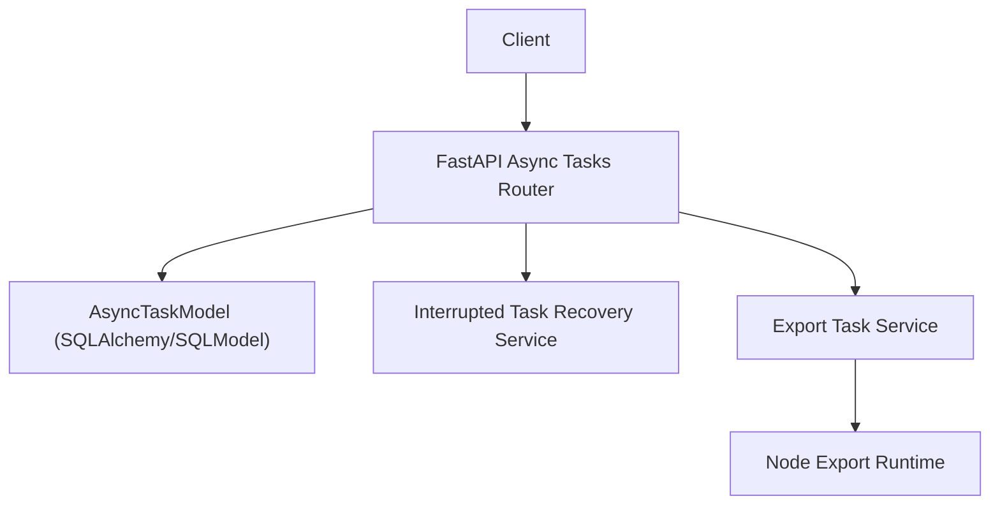
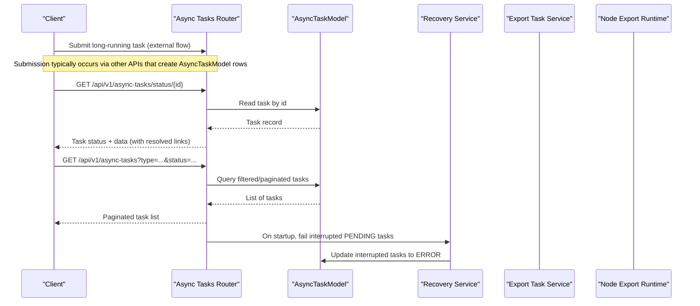
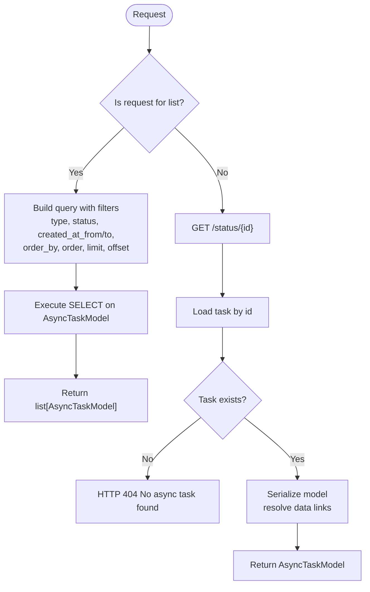
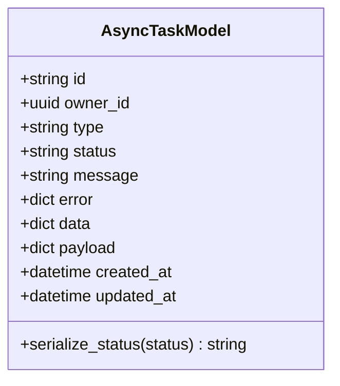
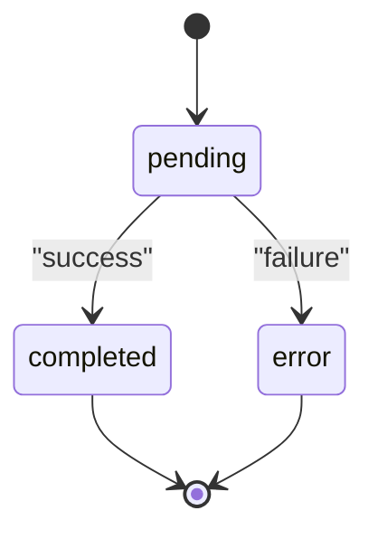
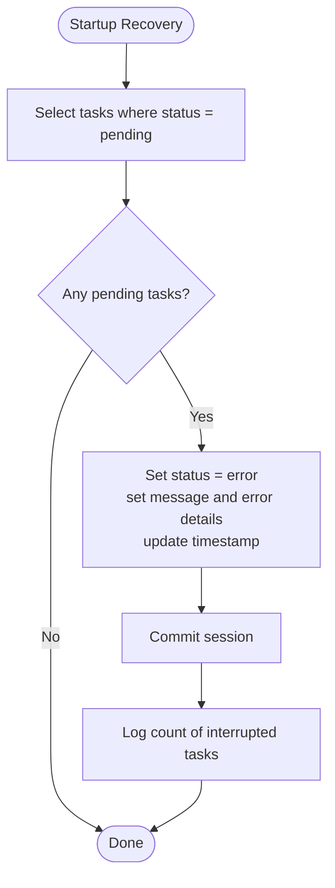
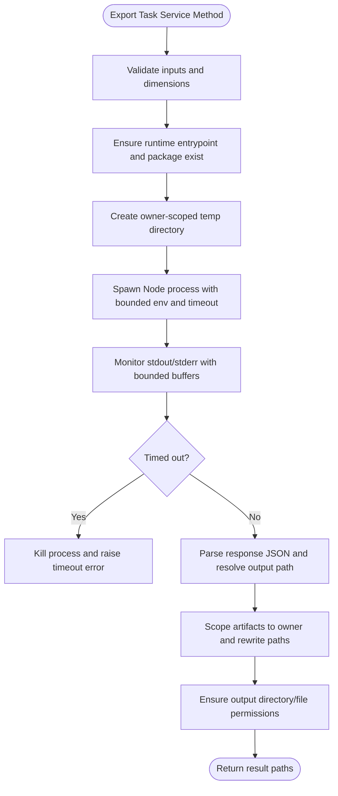
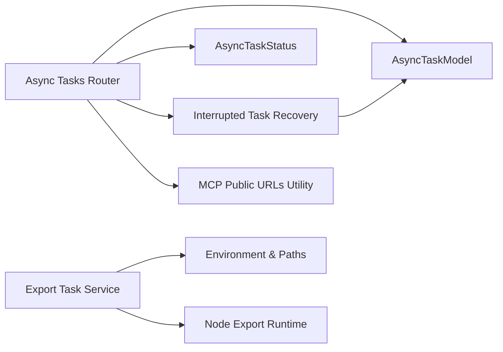

# Asynchronous Task Processing

<cite>
**Referenced Files in This Document**
- [router.py](file://servers/fastapi/api/v1/async_tasks/router.py)
- [async_task.py](file://servers/fastapi/models/sql/async_task.py)
- [async_task_status.py](file://servers/fastapi/enums/async_task_status.py)
- [async_tasks.py](file://servers/fastapi/services/async_tasks.py)
- [export_task_service.py](file://servers/fastapi/services/export_task_service.py)
</cite>

## Table of Contents
1. [Introduction](#introduction)
2. [Project Structure](#project-structure)
3. [Core Components](#core-components)
4. [Architecture Overview](#architecture-overview)
5. [Detailed Component Analysis](#detailed-component-analysis)
6. [Dependency Analysis](#dependency-analysis)
7. [Performance Considerations](#performance-considerations)
8. [Troubleshooting Guide](#troubleshooting-guide)
9. [Conclusion](#conclusion)

## Introduction
This document explains the asynchronous task processing system used for long-running operations such as presentation exports and conversions. It covers the full lifecycle from task submission to completion, including job queuing via database persistence, status tracking, progress monitoring through polling, payload structure and validation, error handling patterns, execution pipeline details, timeout management, resource cleanup, and API endpoints for managing tasks.

## Project Structure
The asynchronous task subsystem is implemented in the FastAPI backend:
- API router exposes endpoints for listing and checking async task status.
- A SQL model persists task metadata and results.
- An enum defines allowed task statuses.
- A service provides recovery logic for interrupted background jobs.
- A dedicated export service orchestrates external Node-based export workloads with strict timeouts and secure path handling.

**Diagram sources**
- [router.py:14-84](file://servers/fastapi/api/v1/async_tasks/router.py#L14-L84)
- [async_task.py:16-61](file://servers/fastapi/models/sql/async_task.py#L16-L61)
- [async_tasks.py:22-52](file://servers/fastapi/services/async_tasks.py#L22-L52)
- [export_task_service.py:122-128](file://servers/fastapi/services/export_task_service.py#L122-L128)

**Section sources**
- [router.py:14-84](file://servers/fastapi/api/v1/async_tasks/router.py#L14-L84)
- [async_task.py:16-61](file://servers/fastapi/models/sql/async_task.py#L16-L61)
- [async_task_status.py:4-7](file://servers/fastapi/enums/async_task_status.py#L4-L7)
- [async_tasks.py:22-52](file://servers/fastapi/services/async_tasks.py#L22-L52)
- [export_task_service.py:122-128](file://servers/fastapi/services/export_task_service.py#L122-L128)

## Core Components
- Async Task API Router: Provides endpoints to list tasks and check a task’s current status.
- Async Task Model: Defines the persistent schema for tasks, including identifiers, owner, type, status, message, error, data, payload, and timestamps.
- Async Task Status Enum: Enumerates allowed statuses for tasks.
- Interrupted Task Recovery Service: Marks pending tasks as failed when the server restarts before they complete.
- Export Task Service: Executes external export/conversion workloads with bounded timeouts, secure path resolution, and output scoping.

Key responsibilities:
- Expose stable REST endpoints for clients to poll task state.
- Persist task metadata and results for durability across restarts.
- Ensure safe execution boundaries for external processes.
- Provide robust error reporting and recovery mechanisms.

**Section sources**
- [router.py:14-84](file://servers/fastapi/api/v1/async_tasks/router.py#L14-L84)
- [async_task.py:16-61](file://servers/fastapi/models/sql/async_task.py#L16-L61)
- [async_task_status.py:4-7](file://servers/fastapi/enums/async_task_status.py#L4-L7)
- [async_tasks.py:22-52](file://servers/fastapi/services/async_tasks.py#L22-L52)
- [export_task_service.py:122-128](file://servers/fastapi/services/export_task_service.py#L122-L128)

## Architecture Overview
The asynchronous task architecture combines a simple polling model with durable persistence and secure process execution:

**Diagram sources**
- [router.py:20-84](file://servers/fastapi/api/v1/async_tasks/router.py#L20-L84)
- [async_task.py:16-61](file://servers/fastapi/models/sql/async_task.py#L16-L61)
- [async_tasks.py:22-52](file://servers/fastapi/services/async_tasks.py#L22-L52)

## Detailed Component Analysis

### Async Task API Router
Responsibilities:
- List tasks with filtering by type, status, creation time range, ordering, pagination.
- Retrieve a single task by ID and return its current state.
- Transform result URLs into absolute MCP links where applicable.

Key behaviors:
- Filtering supports type, status, created_at_from/created_at_to aliases.
- Ordering supports created_at or updated_at, ascending or descending.
- Pagination uses limit and offset with enforced bounds.
- Single-task endpoint returns the serialized model and resolves any embedded data links.

**Diagram sources**
- [router.py:20-84](file://servers/fastapi/api/v1/async_tasks/router.py#L20-L84)

**Section sources**
- [router.py:20-84](file://servers/fastapi/api/v1/async_tasks/router.py#L20-L84)

### Async Task Model
Responsibilities:
- Define the persistent representation of an asynchronous task.
- Provide default values for IDs and timestamps.
- Include fields for task metadata, payload, and result data.
- Serialize status consistently for JSON responses.

Important fields:
- id: Unique task identifier.
- owner_id: Optional owner reference for isolation.
- type: Task category/type string.
- status: Current lifecycle state.
- message: Human-readable status message.
- error: Structured error information.
- data: Result payload (e.g., exported file references).
- payload: Original task input (excluded from serialization).
- created_at/updated_at: Timestamps for lifecycle tracking.

**Diagram sources**
- [async_task.py:16-61](file://servers/fastapi/models/sql/async_task.py#L16-L61)

**Section sources**
- [async_task.py:16-61](file://servers/fastapi/models/sql/async_task.py#L16-L61)

### Async Task Status Enum
Responsibilities:
- Define the canonical set of task states.

States:
- pending: Task has been submitted but not yet started.
- completed: Task finished successfully.
- error: Task failed with recorded error details.

**Diagram sources**
- [async_task_status.py:4-7](file://servers/fastapi/enums/async_task_status.py#L4-L7)

**Section sources**
- [async_task_status.py:4-7](file://servers/fastapi/enums/async_task_status.py#L4-L7)

### Interrupted Task Recovery Service
Responsibilities:
- Detect tasks left in pending state after a server restart.
- Mark them as failed with a specific error detail so clients can stop polling.

Behavior:
- Queries all tasks with status pending.
- Updates each to error with a standardized error object and timestamp.
- Commits changes and logs the number of recovered tasks.

**Diagram sources**
- [async_tasks.py:22-52](file://servers/fastapi/services/async_tasks.py#L22-L52)

**Section sources**
- [async_tasks.py:22-52](file://servers/fastapi/services/async_tasks.py#L22-L52)

### Export Task Service
Responsibilities:
- Orchestrate external Node-based export/conversion workloads securely.
- Enforce timeouts, validate outputs, scope artifacts per owner, and ensure readable permissions.
- Provide high-level methods for URL export, PPTX conversion, HTML/image rendering, and batch image generation.

Key capabilities:
- Timeout enforcement via bounded subprocess execution.
- Secure path resolution to prevent arbitrary filesystem access.
- Owner-scoped artifact directories and URL rewriting.
- Fallback strategies for unsupported runtime features.
- Environment setup for app data, temp directories, and Puppeteer cache.

**Diagram sources**
- [export_task_service.py:294-418](file://servers/fastapi/services/export_task_service.py#L294-L418)
- [export_task_service.py:420-453](file://servers/fastapi/services/export_task_service.py#L420-L453)
- [export_task_service.py:519-576](file://servers/fastapi/services/export_task_service.py#L519-L576)
- [export_task_service.py:578-683](file://servers/fastapi/services/export_task_service.py#L578-L683)
- [export_task_service.py:685-724](file://servers/fastapi/services/export_task_service.py#L685-L724)
- [export_task_service.py:726-857](file://servers/fastapi/services/export_task_service.py#L726-L857)

**Section sources**
- [export_task_service.py:122-128](file://servers/fastapi/services/export_task_service.py#L122-L128)
- [export_task_service.py:294-418](file://servers/fastapi/services/export_task_service.py#L294-L418)
- [export_task_service.py:420-453](file://servers/fastapi/services/export_task_service.py#L420-L453)
- [export_task_service.py:519-576](file://servers/fastapi/services/export_task_service.py#L519-L576)
- [export_task_service.py:578-683](file://servers/fastapi/services/export_task_service.py#L578-L683)
- [export_task_service.py:685-724](file://servers/fastapi/services/export_task_service.py#L685-L724)
- [export_task_service.py:726-857](file://servers/fastapi/services/export_task_service.py#L726-L857)

## Dependency Analysis
The following diagram shows how components depend on each other:

**Diagram sources**
- [router.py:8-11](file://servers/fastapi/api/v1/async_tasks/router.py#L8-L11)
- [async_task.py:16-61](file://servers/fastapi/models/sql/async_task.py#L16-L61)
- [async_task_status.py:4-7](file://servers/fastapi/enums/async_task_status.py#L4-L7)
- [async_tasks.py:22-52](file://servers/fastapi/services/async_tasks.py#L22-L52)
- [export_task_service.py:122-128](file://servers/fastapi/services/export_task_service.py#L122-L128)

**Section sources**
- [router.py:8-11](file://servers/fastapi/api/v1/async_tasks/router.py#L8-L11)
- [async_task.py:16-61](file://servers/fastapi/models/sql/async_task.py#L16-L61)
- [async_task_status.py:4-7](file://servers/fastapi/enums/async_task_status.py#L4-L7)
- [async_tasks.py:22-52](file://servers/fastapi/services/async_tasks.py#L22-L52)
- [export_task_service.py:122-128](file://servers/fastapi/services/export_task_service.py#L122-L128)

## Performance Considerations
- Polling efficiency: Use the list endpoint with appropriate filters (type, status, created_at range) and pagination to minimize payload size and reduce load.
- Timeouts: The export service enforces a configurable timeout for child processes; tune this based on workload expectations.
- Resource scoping: Owner-scoped temporary directories and artifact movement reduce cross-user interference and improve cleanup reliability.
- Output permissions: Ensuring correct file/directory modes avoids I/O errors during subsequent reads.

[No sources needed since this section provides general guidance]

## Troubleshooting Guide
Common issues and resolutions:
- Task remains pending after restart:
  - Cause: Server restarted while a background task was still running.
  - Resolution: The recovery service marks such tasks as error with a specific message; clients should treat these as failed and resubmit if necessary.
- Export task times out:
  - Cause: External Node process exceeded the configured timeout.
  - Resolution: Increase timeout configuration or optimize the workload; inspect stderr/stdout snippets included in error details.
- Invalid or missing output path:
  - Cause: Export runtime did not produce a valid path or produced a path outside allowed roots.
  - Resolution: Verify environment variables (APP_DATA_DIRECTORY, TEMP_DIRECTORY), ensure runtime files are present, and confirm output paths are within allowed directories.
- Permission errors on output:
  - Cause: Unable to set required permissions on output directory/file.
  - Resolution: Ensure the service has write access to the target directories and adjust OS permissions accordingly.

**Section sources**
- [async_tasks.py:13-19](file://servers/fastapi/services/async_tasks.py#L13-L19)
- [async_tasks.py:22-52](file://servers/fastapi/services/async_tasks.py#L22-L52)
- [export_task_service.py:354-418](file://servers/fastapi/services/export_task_service.py#L354-L418)
- [export_task_service.py:243-278](file://servers/fastapi/services/export_task_service.py#L243-L278)

## Conclusion
The asynchronous task system provides a durable, secure, and observable mechanism for long-running operations. Clients submit work through application flows that persist task records, then poll the provided endpoints to track progress. The export service ensures safe execution boundaries, robust error reporting, and proper resource cleanup. With clear status models and recovery logic, the system gracefully handles interruptions and failures, enabling reliable end-to-end workflows.

[No sources needed since this section summarizes without analyzing specific files]