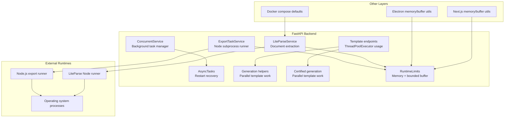
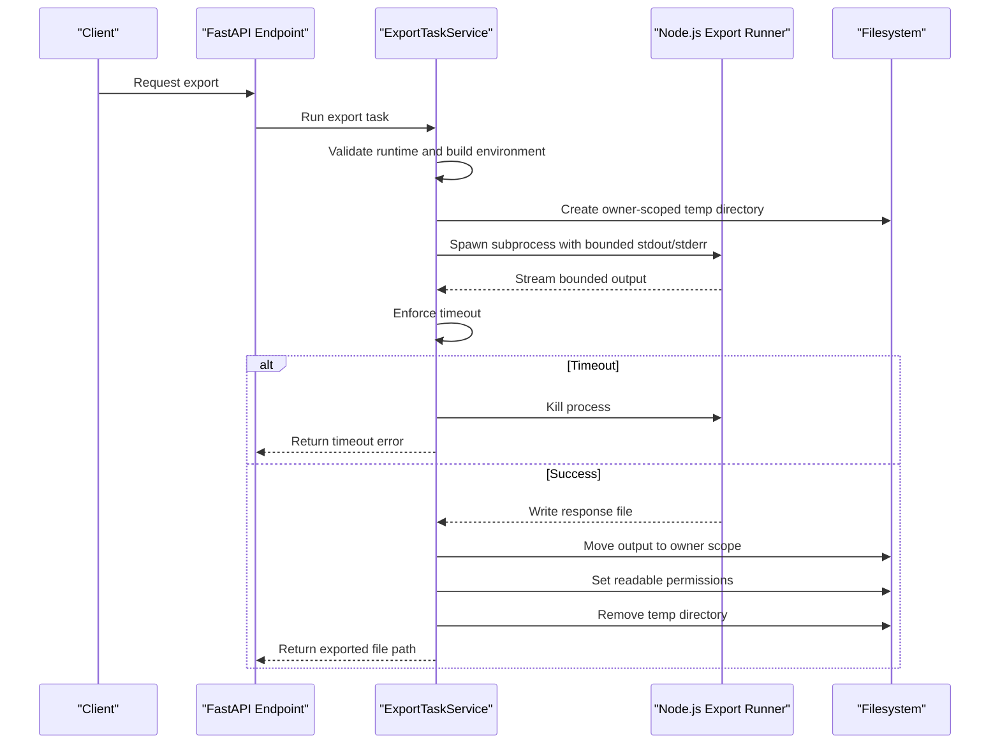
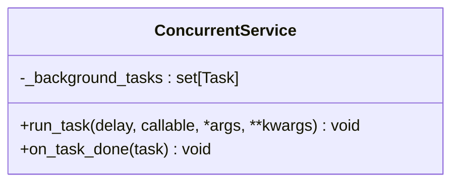
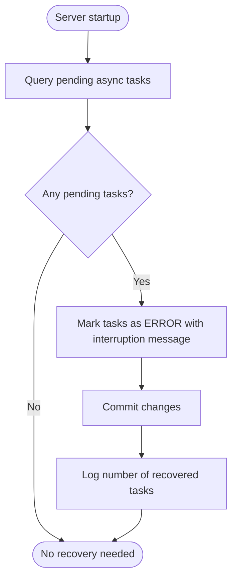
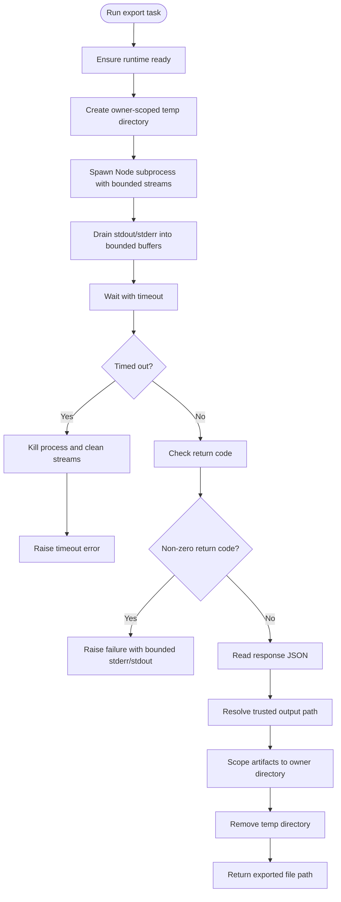
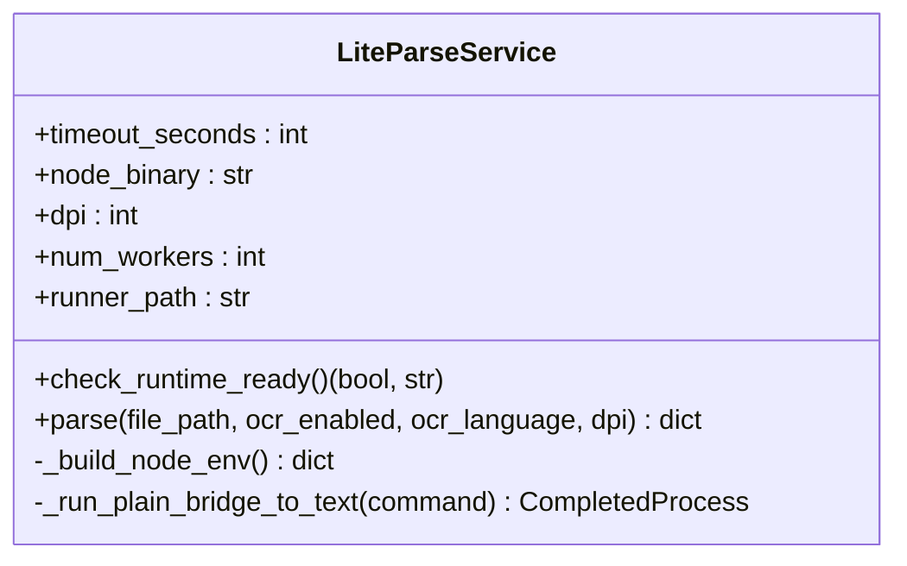
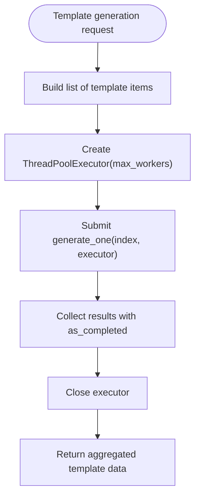
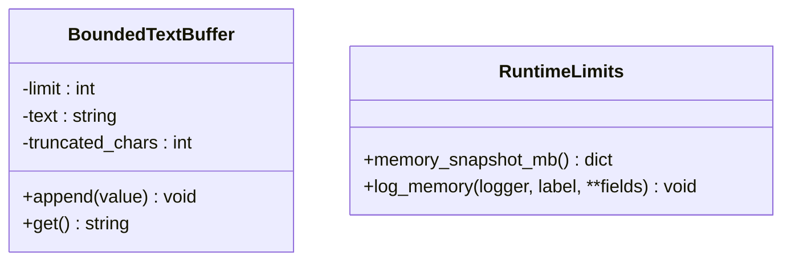
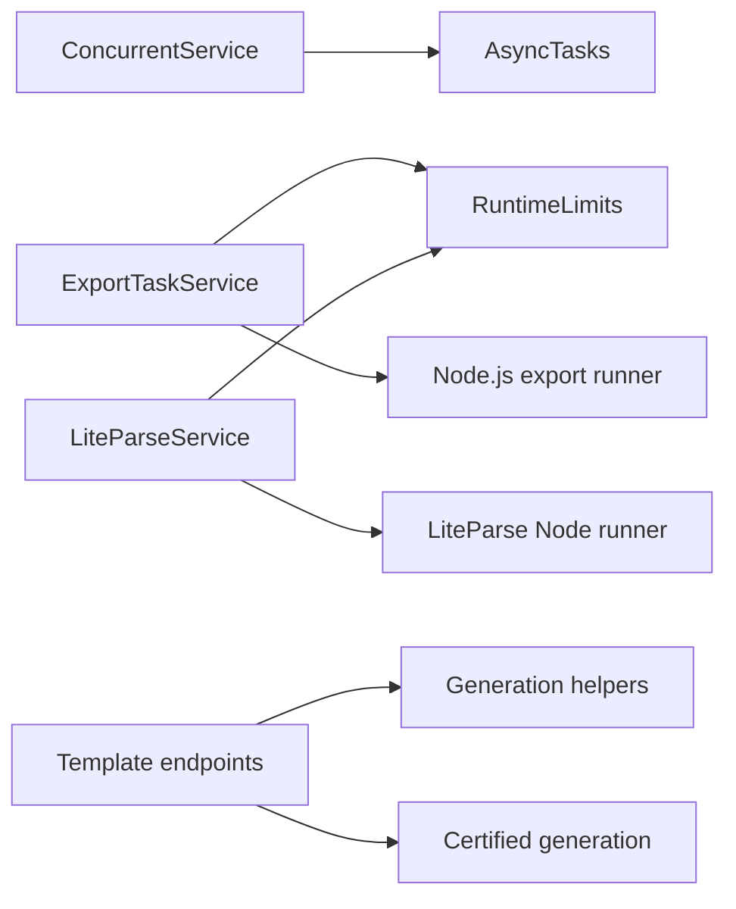

# Concurrent Execution & Resource Management

<cite>
**Referenced Files in This Document**   
- [concurrent_service.py](file://servers/fastapi/services/concurrent_service.py)
- [runtime_limits.py](file://servers/fastapi/utils/runtime_limits.py)
- [async_tasks.py](file://servers/fastapi/services/async_tasks.py)
- [export_task_service.py](file://servers/fastapi/services/export_task_service.py)
- [liteparse_service.py](file://servers/fastapi/services/liteparse_service.py)
- [template.py](file://servers/fastapi/api/v1/ppt/endpoints/template.py)
- [generation.py](file://servers/fastapi/templates/v2/generation.py)
- [certified_generation.py](file://servers/fastapi/templates/v2/certified_generation.py)
- [memory.ts](file://electron/app/utils/memory.ts)
- [runtime-limits.ts](file://servers/nextjs/lib/runtime-limits.ts)
- [docker-compose.yml](file://docker-compose.yml)
- [README.md](file://README.md)
</cite>

## Table of Contents
1. [Introduction](#introduction)
2. [Project Structure](#project-structure)
3. [Core Components](#core-components)
4. [Architecture Overview](#architecture-overview)
5. [Detailed Component Analysis](#detailed-component-analysis)
6. [Dependency Analysis](#dependency-analysis)
7. [Performance Considerations](#performance-considerations)
8. [Troubleshooting Guide](#troubleshooting-guide)
9. [Conclusion](#conclusion)

## Introduction
This document explains the concurrent execution framework and resource management system used by the backend services. It covers:

- Concurrency control mechanisms for background tasks and parallel workloads.
- Worker process management for Node-based export and document extraction runtimes.
- Resource allocation strategies, including bounded text buffers, memory snapshots, and CPU-aware worker counts.
- Subprocess spawning with timeout protection, process isolation, output scoping, and cleanup procedures.
- Runtime limits enforcement, resource quotas, and scaling considerations.
- Practical examples for configuring concurrent workers, monitoring resource usage, and handling resource exhaustion.

The goal is to make these systems understandable for both operators and developers while preserving precise references to the implementation files.

## Project Structure
The relevant concurrency and resource management logic spans several modules:

- FastAPI service layer:
  - Background task coordination.
  - Async task recovery after restarts.
  - Export runtime orchestration.
  - LiteParse document extraction.
  - Template generation concurrency.
- Shared utilities:
  - Memory snapshots and bounded text buffers.
- Electron and Next.js layers:
  - Bounded text buffers and memory snapshots for desktop/browser-side subprocesses.
- Configuration:
  - Environment-driven worker scaling and defaults.

**Diagram sources**
- [concurrent_service.py:6-40](file://servers/fastapi/services/concurrent_service.py#L6-L40)
- [async_tasks.py:22-52](file://servers/fastapi/services/async_tasks.py#L22-L52)
- [export_task_service.py:122-418](file://servers/fastapi/services/export_task_service.py#L122-L418)
- [liteparse_service.py:67-469](file://servers/fastapi/services/liteparse_service.py#L67-L469)
- [template.py:737-811](file://servers/fastapi/api/v1/ppt/endpoints/template.py#L737-L811)
- [generation.py:175-175](file://servers/fastapi/templates/v2/generation.py#L175-L175)
- [certified_generation.py:514-514](file://servers/fastapi/templates/v2/certified_generation.py#L514-L514)
- [runtime_limits.py:10-65](file://servers/fastapi/utils/runtime_limits.py#L10-L65)
- [memory.ts:12-37](file://electron/app/utils/memory.ts#L12-L37)
- [runtime-limits.ts:1-34](file://servers/nextjs/lib/runtime-limits.ts#L1-L34)
- [docker-compose.yml:119-119](file://docker-compose.yml#L119-L119)

**Section sources**
- [concurrent_service.py:1-41](file://servers/fastapi/services/concurrent_service.py#L1-L41)
- [runtime_limits.py:1-66](file://servers/fastapi/utils/runtime_limits.py#L1-L66)
- [async_tasks.py:1-53](file://servers/fastapi/services/async_tasks.py#L1-L53)
- [export_task_service.py:1-860](file://servers/fastapi/services/export_task_service.py#L1-L860)
- [liteparse_service.py:1-470](file://servers/fastapi/services/liteparse_service.py#L1-L470)
- [template.py:737-811](file://servers/fastapi/api/v1/ppt/endpoints/template.py#L737-L811)
- [generation.py:175-175](file://servers/fastapi/templates/v2/generation.py#L175-L175)
- [certified_generation.py:514-514](file://servers/fastapi/templates/v2/certified_generation.py#L514-L514)
- [memory.ts:1-38](file://electron/app/utils/memory.ts#L1-L38)
- [runtime-limits.ts:1-34](file://servers/nextjs/lib/runtime-limits.ts#L1-L34)
- [docker-compose.yml:119-119](file://docker-compose.yml#L119-L119)

## Core Components
This section summarizes the main building blocks that implement concurrency and resource management.

- ConcurrentService: Manages asynchronous background tasks, tracks them, logs completion or failure, and removes completed tasks from tracking.
- AsyncTasks: Recovers interrupted background tasks after server restarts by marking pending tasks as failed.
- ExportTaskService: Spawns Node.js subprocesses for presentation export, enforces timeouts, bounds stdout/stderr, scopes outputs, and cleans up temporary directories.
- LiteParseService: Spawns Node.js document extraction processes, configures DPI, OCR, and worker count, uses bounded stderr, and handles timeouts.
- RuntimeLimits: Provides memory snapshot utilities and a bounded text buffer for controlling memory growth during streaming output.
- Template Generation Concurrency: Uses ThreadPoolExecutor for parallel template-related workloads.
- Electron and Next.js Utilities: Provide bounded text buffers and memory snapshots for non-Python environments.

**Section sources**
- [concurrent_service.py:6-40](file://servers/fastapi/services/concurrent_service.py#L6-L40)
- [async_tasks.py:22-52](file://servers/fastapi/services/async_tasks.py#L22-L52)
- [export_task_service.py:122-418](file://servers/fastapi/services/export_task_service.py#L122-L418)
- [liteparse_service.py:67-469](file://servers/fastapi/services/liteparse_service.py#L67-L469)
- [runtime_limits.py:10-65](file://servers/fastapi/utils/runtime_limits.py#L10-L65)
- [template.py:737-811](file://servers/fastapi/api/v1/ppt/endpoints/template.py#L737-L811)
- [memory.ts:12-37](file://electron/app/utils/memory.ts#L12-L37)
- [runtime-limits.ts:1-34](file://servers/nextjs/lib/runtime-limits.ts#L1-L34)

## Architecture Overview
The architecture separates long-running Python services from isolated Node.js runtimes. Concurrency is implemented at multiple levels:

- In-process concurrency:
  - asyncio tasks for background operations.
  - ThreadPoolExecutor for CPU-bound template work.
- Out-of-process concurrency:
  - Node.js subprocesses for export and document extraction.
  - Configurable worker counts for LiteParse.
- Resource controls:
  - Bounded text buffers prevent unbounded memory growth from subprocess output.
  - Memory snapshots log RSS usage and integrate with observability tools.
  - Timeouts protect against hung or slow subprocesses.
- Isolation and cleanup:
  - Owner-scoped temporary directories.
  - Trusted path validation for outputs.
  - Temporary directory removal after task completion.

**Diagram sources**
- [export_task_service.py:294-418](file://servers/fastapi/services/export_task_service.py#L294-L418)
- [export_task_service.py:770-857](file://servers/fastapi/services/export_task_service.py#L770-L857)

## Detailed Component Analysis

### ConcurrentService: Background Task Coordination
ConcurrentService provides a simple coordinator for asyncio tasks:

- Tracks background tasks in a set.
- Wraps callables to optionally delay execution.
- Adds done callbacks to remove completed tasks and log outcomes.

**Diagram sources**
- [concurrent_service.py:6-40](file://servers/fastapi/services/concurrent_service.py#L6-L40)

**Section sources**
- [concurrent_service.py:6-40](file://servers/fastapi/services/concurrent_service.py#L6-L40)

### AsyncTasks: Restart Recovery
AsyncTasks ensures that background jobs left pending after a server restart are marked as failed so clients do not wait indefinitely.

Key behaviors:
- Queries pending async tasks.
- Marks them as ERROR with an interruption message.
- Commits changes and logs the number of recovered tasks.

**Diagram sources**
- [async_tasks.py:22-52](file://servers/fastapi/services/async_tasks.py#L22-L52)

**Section sources**
- [async_tasks.py:22-52](file://servers/fastapi/services/async_tasks.py#L22-L52)

### ExportTaskService: Subprocess Orchestration and Resource Controls
ExportTaskService manages Node.js export runs with strong resource controls:

- Validates runtime presence and package entrypoint.
- Builds a secure environment for Node processes.
- Creates owner-scoped temporary directories.
- Spawns subprocesses with bounded stdout/stderr streams.
- Enforces timeouts and kills hanging processes.
- Resolves and validates output paths within trusted roots.
- Moves outputs into owner-scoped directories and sets permissions.
- Cleans up temporary directories.

**Diagram sources**
- [export_task_service.py:294-418](file://servers/fastapi/services/export_task_service.py#L294-L418)
- [export_task_service.py:770-857](file://servers/fastapi/services/export_task_service.py#L770-L857)

**Section sources**
- [export_task_service.py:122-418](file://servers/fastapi/services/export_task_service.py#L122-L418)
- [export_task_service.py:770-857](file://servers/fastapi/services/export_task_service.py#L770-L857)

### LiteParseService: Document Extraction Workers
LiteParseService orchestrates document extraction using Node.js:

- Configurable DPI, OCR settings, and worker count.
- Validates Node.js runtime and LiteParse dependencies.
- Spawns subprocesses with bounded stderr and optional plain-text bridge.
- Enforces timeouts and kills hanging processes.
- Parses either plain text or JSON runner output.
- Logs memory snapshots around spawn and exit.

**Diagram sources**
- [liteparse_service.py:67-469](file://servers/fastapi/services/liteparse_service.py#L67-L469)

**Section sources**
- [liteparse_service.py:67-469](file://servers/fastapi/services/liteparse_service.py#L67-L469)

### Template Generation Concurrency: ThreadPoolExecutor Usage
Template generation endpoints use ThreadPoolExecutor to parallelize template-related work:

- Parallel generation functions executed within a bounded thread pool.
- Asynchronous wrappers coordinate executor usage.
- Multiple endpoints demonstrate consistent patterns for controlled parallelism.

**Diagram sources**
- [template.py:737-811](file://servers/fastapi/api/v1/ppt/endpoints/template.py#L737-L811)
- [template.py:1079-1079](file://servers/fastapi/api/v1/ppt/endpoints/template.py#L1079-L1079)
- [generation.py:175-175](file://servers/fastapi/templates/v2/generation.py#L175-L175)
- [certified_generation.py:514-514](file://servers/fastapi/templates/v2/certified_generation.py#L514-L514)

**Section sources**
- [template.py:737-811](file://servers/fastapi/api/v1/ppt/endpoints/template.py#L737-L811)
- [template.py:1079-1079](file://servers/fastapi/api/v1/ppt/endpoints/template.py#L1079-L1079)
- [generation.py:175-175](file://servers/fastapi/templates/v2/generation.py#L175-L175)
- [certified_generation.py:514-514](file://servers/fastapi/templates/v2/certified_generation.py#L514-L514)

### BoundedTextBuffer and Memory Snapshots
BoundedTextBuffer prevents unbounded memory growth when capturing subprocess output:

- Maintains a fixed-size text buffer.
- Tracks truncated character counts.
- Returns trimmed content with truncation metadata.

Memory snapshots provide RSS metrics and can integrate with Sentry breadcrumbs.

**Diagram sources**
- [runtime_limits.py:38-65](file://servers/fastapi/utils/runtime_limits.py#L38-L65)
- [runtime_limits.py:10-35](file://servers/fastapi/utils/runtime_limits.py#L10-L35)
- [memory.ts:12-37](file://electron/app/utils/memory.ts#L12-L37)
- [runtime-limits.ts:1-34](file://servers/nextjs/lib/runtime-limits.ts#L1-L34)

**Section sources**
- [runtime_limits.py:10-65](file://servers/fastapi/utils/runtime_limits.py#L10-L65)
- [memory.ts:12-37](file://electron/app/utils/memory.ts#L12-L37)
- [runtime-limits.ts:1-34](file://servers/nextjs/lib/runtime-limits.ts#L1-L34)

## Dependency Analysis
The following diagram shows how components depend on each other for concurrency and resource management:

**Diagram sources**
- [concurrent_service.py:6-40](file://servers/fastapi/services/concurrent_service.py#L6-L40)
- [async_tasks.py:22-52](file://servers/fastapi/services/async_tasks.py#L22-L52)
- [export_task_service.py:122-418](file://servers/fastapi/services/export_task_service.py#L122-L418)
- [liteparse_service.py:67-469](file://servers/fastapi/services/liteparse_service.py#L67-L469)
- [template.py:737-811](file://servers/fastapi/api/v1/ppt/endpoints/template.py#L737-L811)
- [generation.py:175-175](file://servers/fastapi/templates/v2/generation.py#L175-L175)
- [certified_generation.py:514-514](file://servers/fastapi/templates/v2/certified_generation.py#L514-L514)

**Section sources**
- [concurrent_service.py:6-40](file://servers/fastapi/services/concurrent_service.py#L6-L40)
- [async_tasks.py:22-52](file://servers/fastapi/services/async_tasks.py#L22-L52)
- [export_task_service.py:122-418](file://servers/fastapi/services/export_task_service.py#L122-L418)
- [liteparse_service.py:67-469](file://servers/fastapi/services/liteparse_service.py#L67-L469)
- [template.py:737-811](file://servers/fastapi/api/v1/ppt/endpoints/template.py#L737-L811)
- [generation.py:175-175](file://servers/fastapi/templates/v2/generation.py#L175-L175)
- [certified_generation.py:514-514](file://servers/fastapi/templates/v2/certified_generation.py#L514-L514)

## Performance Considerations
- Worker scaling:
  - LiteParse worker count is configurable via environment variables and clamped between minimum and maximum values.
  - Default worker count is derived from CPU cores minus two, ensuring headroom for the host process.
- Memory pressure:
  - Bounded text buffers cap captured output size, preventing runaway memory growth from large subprocess logs.
  - Memory snapshots record RSS usage and can be sent to observability backends.
- Timeout protection:
  - Both export and LiteParse subprocesses enforce timeouts; hanging processes are killed and cleaned up.
- Output safety:
  - Export outputs are validated against trusted roots and moved into owner-scoped directories.
  - Permissions are adjusted to ensure readability without exposing unintended paths.
- Concurrency model:
  - asyncio tasks handle I/O-bound background work efficiently.
  - ThreadPoolExecutor is used for CPU-bound template generation tasks, with explicit max_workers to avoid oversubscription.

**Section sources**
- [liteparse_service.py:48-77](file://servers/fastapi/services/liteparse_service.py#L48-L77)
- [liteparse_service.py:264-337](file://servers/fastapi/services/liteparse_service.py#L264-L337)
- [export_task_service.py:354-418](file://servers/fastapi/services/export_task_service.py#L354-L418)
- [runtime_limits.py:10-35](file://servers/fastapi/utils/runtime_limits.py#L10-L35)
- [template.py:737-811](file://servers/fastapi/api/v1/ppt/endpoints/template.py#L737-L811)

## Troubleshooting Guide
Common issues and their resolution strategies:

- Subprocess timeout:
  - Symptom: Export or LiteParse operation times out.
  - Cause: Long-running or hung Node.js process.
  - Resolution: Increase timeout configuration if appropriate; inspect bounded stderr/stdout snippets; verify environment and runtime availability.
- Invalid output path:
  - Symptom: Export returns an output outside allowed directories.
  - Cause: Malformed or malicious path returned by the runtime.
  - Resolution: Validate trusted root checks; ensure APP_DATA_DIRECTORY and TEMP_DIRECTORY are correctly configured.
- Missing runtime:
  - Symptom: Export or LiteParse reports missing runner or dependencies.
  - Cause: Incorrect installation or wrong PATH.
  - Resolution: Install required packages; verify node binary and runner paths; check Docker environment variables.
- Resource exhaustion:
  - Symptom: High RSS memory usage or OOM conditions.
  - Cause: Large subprocess output or excessive parallelism.
  - Resolution: Reduce worker count; rely on bounded buffers; monitor memory snapshots; scale horizontally rather than increasing per-process resources.
- Interrupted background tasks:
  - Symptom: Clients poll indefinitely for tasks that never complete.
  - Cause: Server restart before task completion.
  - Resolution: Use async task recovery to mark pending tasks as failed; instruct clients to retry.

**Section sources**
- [export_task_service.py:354-418](file://servers/fastapi/services/export_task_service.py#L354-L418)
- [export_task_service.py:770-857](file://servers/fastapi/services/export_task_service.py#L770-L857)
- [liteparse_service.py:413-469](file://servers/fastapi/services/liteparse_service.py#L413-L469)
- [async_tasks.py:22-52](file://servers/fastapi/services/async_tasks.py#L22-L52)

## Conclusion
The concurrent execution and resource management system combines asyncio-based background tasks, ThreadPoolExecutor-driven parallelism, and isolated Node.js subprocesses. It enforces strict resource controls through bounded text buffers, memory snapshots, and timeouts, while ensuring safe output scoping and cleanup. Operators can tune worker counts and timeouts via environment variables, and developers can extend the system by following established patterns for subprocess spawning, stream draining, and resource logging.