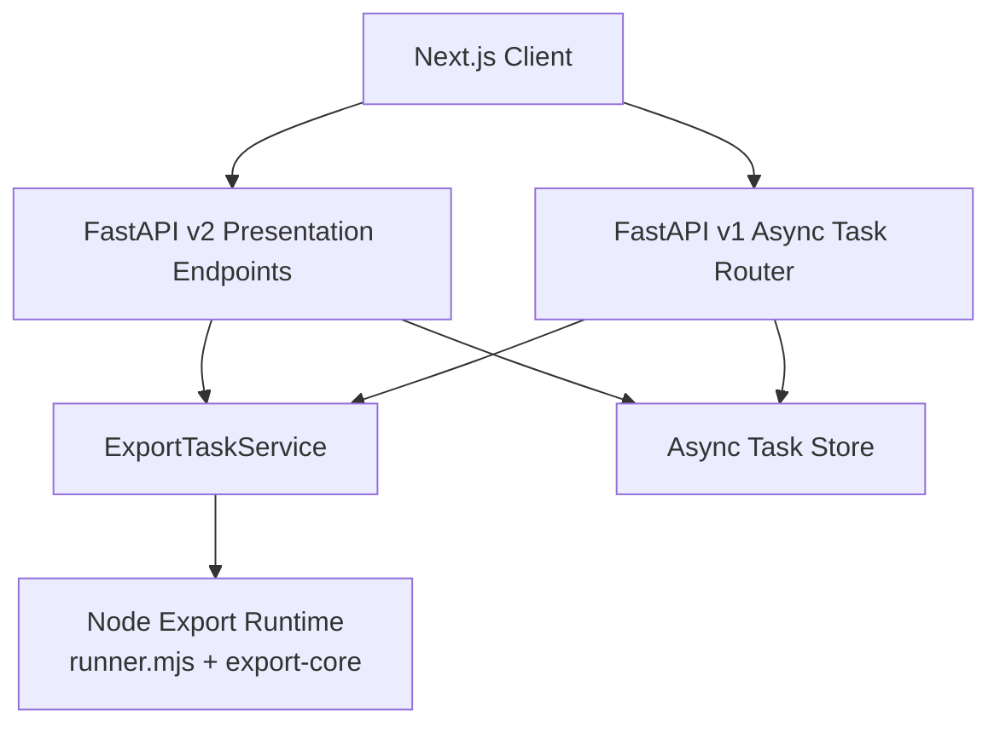
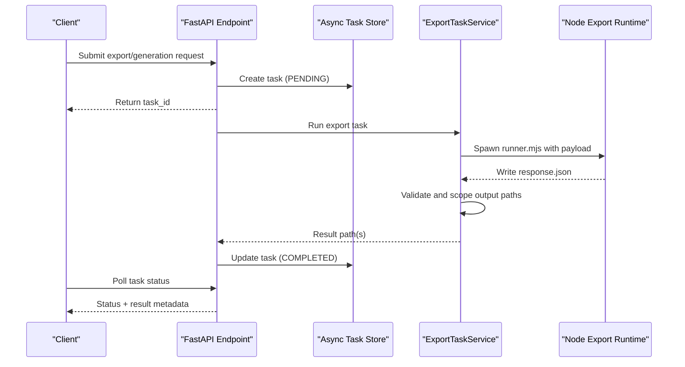
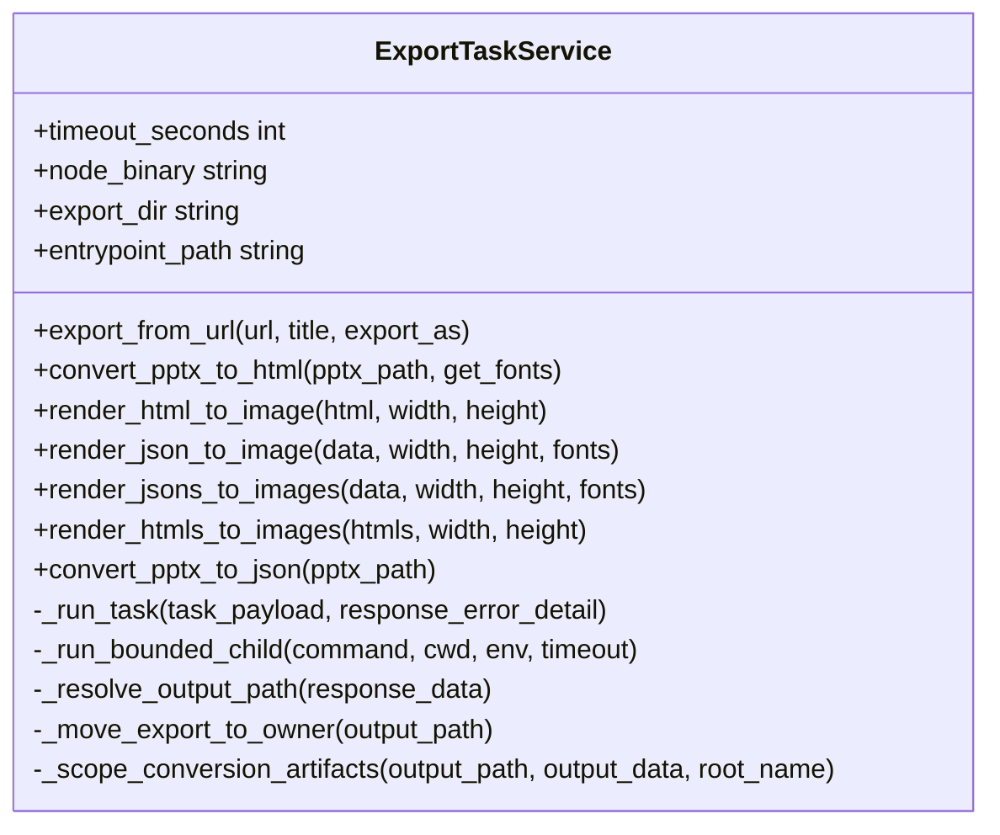
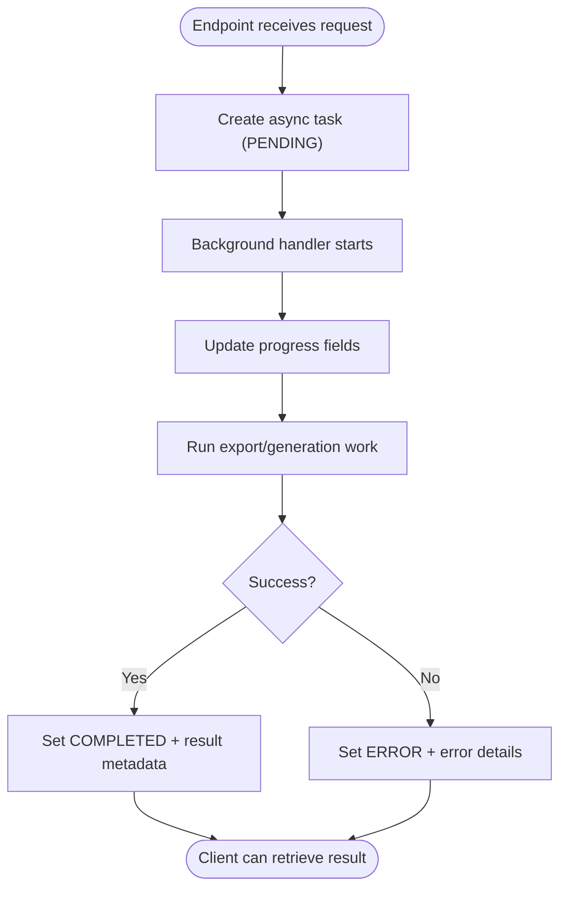
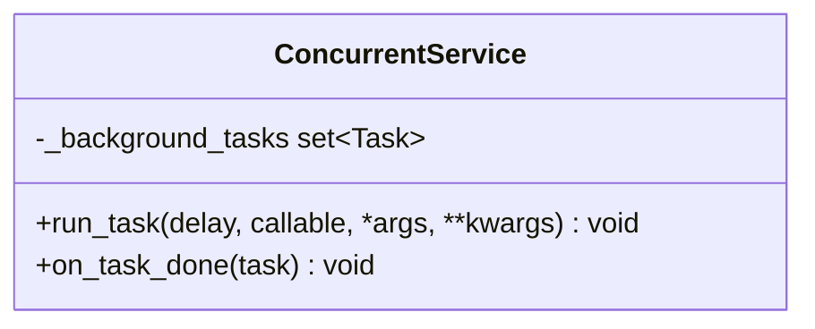
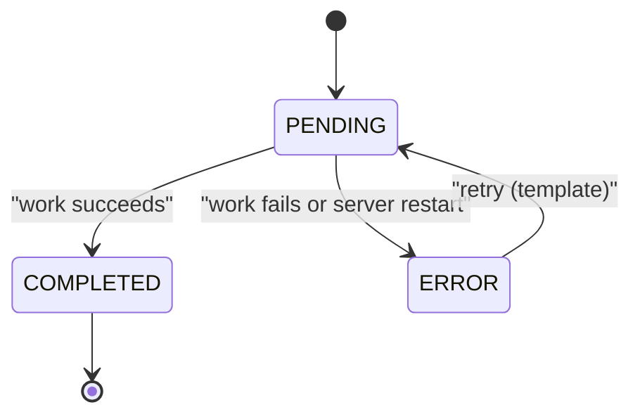
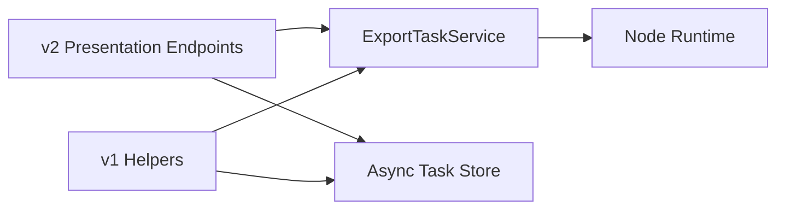

# Export & Generation System

<cite>
**Referenced Files in This Document**
- [export_task_service.py](file://servers/fastapi/services/export_task_service.py)
- [async_tasks.py](file://servers/fastapi/services/async_tasks.py)
- [concurrent_service.py](file://servers/fastapi/services/concurrent_service.py)
- [presentation.py (v2 endpoints)](file://servers/fastapi/api/v2/ppt/endpoints/presentation.py)
- [presentation.py (v1 helpers)](file://servers/fastapi/api/v1/ppt/endpoints/presentation.py)
- [lifespan.py](file://servers/fastapi/api/lifespan.py)
- [template.py](file://servers/fastapi/api/v1/ppt/endpoints/template.py)
- [template.ts (Next.js client)](file://servers/nextjs/app/(presentation-generator)/services/api/template.ts)
</cite>

## Table of Contents
1. [Introduction](#introduction)
2. [Project Structure](#project-structure)
3. [Core Components](#core-components)
4. [Architecture Overview](#architecture-overview)
5. [Detailed Component Analysis](#detailed-component-analysis)
6. [Dependency Analysis](#dependency-analysis)
7. [Performance Considerations](#performance-considerations)
8. [Troubleshooting Guide](#troubleshooting-guide)
9. [Conclusion](#conclusion)

## Introduction
This document explains the export and generation system for PPTX and PDF outputs. It covers how asynchronous jobs are queued, tracked, executed, and completed; how progress is reported; and how failures are recovered. It also documents the concurrent processing framework, resource management, scalability patterns, quality settings, optimization strategies, format-specific processing, batch processing capabilities, resource limits, and performance monitoring. Finally, it provides practical examples of job submission, status polling, and result retrieval workflows.

## Project Structure
The export and generation system spans FastAPI services, API endpoints, and a Next.js client:

- FastAPI services implement the core export pipeline and concurrency primitives.
- API endpoints create async tasks, update progress, and trigger exports.
- The Next.js client submits jobs, polls task status, and retrieves results.

**Diagram sources**
- [presentation.py (v2 endpoints):139-175](file://servers/fastapi/api/v2/ppt/endpoints/presentation.py#L139-L175)
- [presentation.py (v1 helpers):3158-3193](file://servers/fastapi/api/v1/ppt/endpoints/presentation.py#L3158-L3193)
- [export_task_service.py:122-152](file://servers/fastapi/services/export_task_service.py#L122-L152)

**Section sources**
- [export_task_service.py:122-152](file://servers/fastapi/services/export_task_service.py#L122-L152)
- [presentation.py (v2 endpoints):139-175](file://servers/fastapi/api/v2/ppt/endpoints/presentation.py#L139-L175)
- [presentation.py (v1 helpers):3158-3193](file://servers/fastapi/api/v1/ppt/endpoints/presentation.py#L3158-L3193)

## Core Components
- ExportTaskService: Orchestrates all export operations, including URL-based export to PDF/PPTX, PPTX-to-HTML/JSON conversion, HTML-to-image rendering, JSON-to-image rendering, and batch image rendering. It spawns a Node runtime with bounded resources, validates output paths, scopes artifacts per owner, and ensures file permissions.
- ConcurrentService: A lightweight background task manager that tracks asyncio Tasks and logs completion or failure.
- Async Task Utilities: Provide recovery logic for interrupted in-process background tasks by marking stale pending tasks as failed on server startup.
- API Endpoints: Create async tasks, update progress, and trigger presentation generation and export flows.

Key responsibilities:
- Job execution: Spawns isolated Node processes with timeouts and bounded I/O buffers.
- Resource scoping: Moves artifacts into owner-scoped directories under app data and exports.
- Security: Validates trusted paths and prevents path traversal outside allowed roots.
- Observability: Logs memory usage, process lifecycle, and errors.

**Section sources**
- [export_task_service.py:122-152](file://servers/fastapi/services/export_task_service.py#L122-L152)
- [export_task_service.py:294-352](file://servers/fastapi/services/export_task_service.py#L294-L352)
- [export_task_service.py:354-418](file://servers/fastapi/services/export_task_service.py#L354-L418)
- [export_task_service.py:420-453](file://servers/fastapi/services/export_task_service.py#L420-L453)
- [export_task_service.py:455-518](file://servers/fastapi/services/export_task_service.py#L455-L518)
- [export_task_service.py:519-576](file://servers/fastapi/services/export_task_service.py#L519-L576)
- [export_task_service.py:578-683](file://servers/fastapi/services/export_task_service.py#L578-L683)
- [export_task_service.py:685-724](file://servers/fastapi/services/export_task_service.py#L685-L724)
- [export_task_service.py:726-857](file://servers/fastapi/services/export_task_service.py#L726-L857)
- [concurrent_service.py:6-40](file://servers/fastapi/services/concurrent_service.py#L6-L40)
- [async_tasks.py:22-52](file://servers/fastapi/services/async_tasks.py#L22-L52)

## Architecture Overview
The export pipeline uses an asynchronous task model backed by a database. API endpoints enqueue work, update progress, and return task identifiers. Clients poll task status until completion. Heavy work runs in a separate Node process managed by ExportTaskService.

**Diagram sources**
- [presentation.py (v2 endpoints):139-175](file://servers/fastapi/api/v2/ppt/endpoints/presentation.py#L139-L175)
- [presentation.py (v1 helpers):3158-3193](file://servers/fastapi/api/v1/ppt/endpoints/presentation.py#L3158-L3193)
- [export_task_service.py:294-352](file://servers/fastapi/services/export_task_service.py#L294-L352)
- [export_task_service.py:420-453](file://servers/fastapi/services/export_task_service.py#L420-L453)

## Detailed Component Analysis

### ExportTaskService
ExportTaskService encapsulates the entire export pipeline. It resolves the Node runtime entrypoint, builds environment variables, enforces timeouts, and manages temporary files. It supports multiple export modes:

- URL-based export to PDF or PPTX
- PPTX-to-HTML conversion
- PPTX-to-JSON conversion
- HTML-to-image rendering
- JSON-to-image rendering
- Batch HTML-to-images and JSON-to-images

Resource management and security:
- Bounded child process execution with stdout/stderr tailing via BoundedTextBuffer.
- Timeout enforcement with process kill on timeout.
- Trusted path validation ensuring outputs remain within allowed roots (app data and temp directories).
- Owner-scoped artifact movement and URL rewriting for safe multi-user access.
- File permission normalization for exported files.

Quality and optimization:
- Image assets are localized to data URIs when rendering JSON slides to images to avoid external dependencies during headless rendering.
- Conversion artifacts are scoped and rewritten to backend-served URLs for reliable asset resolution.
- Fallback strategy for HTML-to-images if the runtime does not support batch mode.

Scalability:
- Each export runs in an isolated Node process, enabling horizontal scaling across workers.
- Timeouts and bounded buffers prevent runaway processes from consuming resources.

**Diagram sources**
- [export_task_service.py:122-152](file://servers/fastapi/services/export_task_service.py#L122-L152)
- [export_task_service.py:294-352](file://servers/fastapi/services/export_task_service.py#L294-L352)
- [export_task_service.py:354-418](file://servers/fastapi/services/export_task_service.py#L354-L418)
- [export_task_service.py:420-453](file://servers/fastapi/services/export_task_service.py#L420-L453)
- [export_task_service.py:455-518](file://servers/fastapi/services/export_task_service.py#L455-L518)
- [export_task_service.py:519-576](file://servers/fastapi/services/export_task_service.py#L519-L576)
- [export_task_service.py:578-683](file://servers/fastapi/services/export_task_service.py#L578-L683)
- [export_task_service.py:685-724](file://servers/fastapi/services/export_task_service.py#L685-L724)
- [export_task_service.py:726-857](file://servers/fastapi/services/export_task_service.py#L726-L857)

**Section sources**
- [export_task_service.py:122-152](file://servers/fastapi/services/export_task_service.py#L122-L152)
- [export_task_service.py:294-352](file://servers/fastapi/services/export_task_service.py#L294-L352)
- [export_task_service.py:354-418](file://servers/fastapi/services/export_task_service.py#L354-L418)
- [export_task_service.py:420-453](file://servers/fastapi/services/export_task_service.py#L420-L453)
- [export_task_service.py:455-518](file://servers/fastapi/services/export_task_service.py#L455-L518)
- [export_task_service.py:519-576](file://servers/fastapi/services/export_task_service.py#L519-L576)
- [export_task_service.py:578-683](file://servers/fastapi/services/export_task_service.py#L578-L683)
- [export_task_service.py:685-724](file://servers/fastapi/services/export_task_service.py#L685-L724)
- [export_task_service.py:726-857](file://servers/fastapi/services/export_task_service.py#L726-L857)

### Asynchronous Task Processing Pipeline
The pipeline integrates API endpoints, async task persistence, and background execution:

- Task creation: Endpoints create an async task record with type, status, message, and payload.
- Progress updates: Background handlers update created_slides, remaining_slides, and other fields.
- Completion: On success, endpoints store result paths and set COMPLETED status.
- Recovery: On server restart, stale PENDING tasks are marked ERROR to unblock clients.

**Diagram sources**
- [presentation.py (v1 helpers):3158-3193](file://servers/fastapi/api/v1/ppt/endpoints/presentation.py#L3158-L3193)
- [presentation.py (v2 endpoints):139-175](file://servers/fastapi/api/v2/ppt/endpoints/presentation.py#L139-L175)
- [async_tasks.py:22-52](file://servers/fastapi/services/async_tasks.py#L22-L52)

**Section sources**
- [presentation.py (v1 helpers):3158-3193](file://servers/fastapi/api/v1/ppt/endpoints/presentation.py#L3158-L3193)
- [presentation.py (v2 endpoints):139-175](file://servers/fastapi/api/v2/ppt/endpoints/presentation.py#L139-L175)
- [async_tasks.py:22-52](file://servers/fastapi/services/async_tasks.py#L22-L52)

### Concurrent Processing Framework
ConcurrentService provides a simple mechanism to run background coroutines, track them, and log outcomes. It is suitable for lightweight background work where full queueing is unnecessary.

**Diagram sources**
- [concurrent_service.py:6-40](file://servers/fastapi/services/concurrent_service.py#L6-L40)

**Section sources**
- [concurrent_service.py:6-40](file://servers/fastapi/services/concurrent_service.py#L6-L40)

### Format-Specific Processing and Quality Settings
- URL-based export: Supports PDF and PPTX formats with optional cookie headers and FastAPI base URL configuration.
- PPTX-to-HTML: Converts presentations to HTML with optional font extraction and asset directory handling.
- PPTX-to-JSON: Extracts layout metadata and converts assets to backend-served URLs.
- HTML-to-image: Renders single HTML to image with explicit dimensions.
- JSON-to-image: Renders slide JSON to image with embedded image assets and optional fonts.
- Batch rendering: Supports batch HTML-to-images and JSON-to-images with fallback to single rendering if batch mode is unavailable.

Quality and optimization strategies:
- Localize image assets to data URIs for robust headless rendering.
- Scope and rewrite asset URLs to ensure reliable asset resolution.
- Use bounded text buffers to limit memory usage for large stdout/stderr streams.
- Enforce strict path validation to prevent unauthorized file access.

**Section sources**
- [export_task_service.py:420-453](file://servers/fastapi/services/export_task_service.py#L420-L453)
- [export_task_service.py:455-518](file://servers/fastapi/services/export_task_service.py#L455-L518)
- [export_task_service.py:519-576](file://servers/fastapi/services/export_task_service.py#L519-L576)
- [export_task_service.py:578-683](file://servers/fastapi/services/export_task_service.py#L578-L683)
- [export_task_service.py:685-724](file://servers/fastapi/services/export_task_service.py#L685-L724)
- [export_task_service.py:726-857](file://servers/fastapi/services/export_task_service.py#L726-L857)

### Task Status Management, Retry Mechanisms, and Failure Recovery
- Status management: Tasks transition through PENDING, COMPLETED, and ERROR states. Progress fields include created_slides and remaining_slides.
- Failure recovery: On server startup, any lingering PENDING tasks are marked ERROR with a clear message indicating interruption due to restart.
- Retry mechanisms: Template creation exposes a retry endpoint for failed template tasks.

**Diagram sources**
- [async_tasks.py:22-52](file://servers/fastapi/services/async_tasks.py#L22-L52)
- [template.ts (Next.js client):237-254](file://servers/nextjs/app/(presentation-generator)/services/api/template.ts#L237-L254)

**Section sources**
- [async_tasks.py:22-52](file://servers/fastapi/services/async_tasks.py#L22-L52)
- [template.ts (Next.js client):237-254](file://servers/nextjs/app/(presentation-generator)/services/api/template.ts#L237-L254)

### Batch Processing Capabilities and Resource Limits
- Batch rendering: render_htmls_to_images and render_jsons_to_images accept arrays of inputs and return corresponding arrays of output paths.
- Resource limits: Child processes are killed after a configurable timeout; stdout/stderr are captured in bounded buffers to prevent memory growth.
- Scalability: Each export runs in an isolated Node process, allowing multiple concurrent exports without shared state contention.

**Section sources**
- [export_task_service.py:578-683](file://servers/fastapi/services/export_task_service.py#L578-L683)
- [export_task_service.py:354-418](file://servers/fastapi/services/export_task_service.py#L354-L418)

### Performance Monitoring
- Memory logging around spawn and exit events helps monitor resource consumption.
- Process lifecycle logging records PID, command, and return code for diagnostics.

**Section sources**
- [export_task_service.py:305-321](file://servers/fastapi/services/export_task_service.py#L305-L321)
- [export_task_service.py:373-413](file://servers/fastapi/services/export_task_service.py#L373-L413)

## Dependency Analysis
The export system depends on:
- FastAPI endpoints for orchestration and persistence.
- Database models for async task tracking.
- Node runtime for heavy lifting (headless rendering, PPTX parsing).
- Environment configuration for app data and temp directories.

**Diagram sources**
- [presentation.py (v2 endpoints):139-175](file://servers/fastapi/api/v2/ppt/endpoints/presentation.py#L139-L175)
- [presentation.py (v1 helpers):3158-3193](file://servers/fastapi/api/v1/ppt/endpoints/presentation.py#L3158-L3193)
- [export_task_service.py:122-152](file://servers/fastapi/services/export_task_service.py#L122-L152)

**Section sources**
- [presentation.py (v2 endpoints):139-175](file://servers/fastapi/api/v2/ppt/endpoints/presentation.py#L139-L175)
- [presentation.py (v1 helpers):3158-3193](file://servers/fastapi/api/v1/ppt/endpoints/presentation.py#L3158-L3193)
- [export_task_service.py:122-152](file://servers/fastapi/services/export_task_service.py#L122-L152)

## Performance Considerations
- Prefer batch rendering APIs when exporting many slides to reduce process overhead.
- Tune timeout_seconds based on expected workload size and hardware capacity.
- Monitor memory usage via log entries around spawn and exit events.
- Ensure adequate disk space for app data and temp directories to avoid I/O bottlenecks.
- Use owner-scoped directories to isolate workloads and improve cache locality.

[No sources needed since this section provides general guidance]

## Troubleshooting Guide
Common issues and resolutions:
- Export runtime not found: Verify EXPORT_PACKAGE_ROOT or default discovery paths and ensure runner.mjs and export-core are installed.
- Invalid output path: Check trusted path validation; ensure outputs are within allowed roots.
- Permission errors: Confirm file and directory permissions are normalized after export.
- Timeout errors: Increase timeout_seconds or optimize workload; inspect stderr/stdout snippets for underlying errors.
- Stale pending tasks: On server restart, pending tasks are marked ERROR; resubmit or retry where supported.

Operational checks:
- Inspect logs for "[export_runtime]" messages to trace process lifecycle.
- Validate APP_DATA_DIRECTORY and TEMP_DIRECTORY environment variables.
- For Electron environments, ensure pinned Chromium executable is available.

**Section sources**
- [export_task_service.py:203-221](file://servers/fastapi/services/export_task_service.py#L203-L221)
- [export_task_service.py:243-267](file://servers/fastapi/services/export_task_service.py#L243-L267)
- [export_task_service.py:270-278](file://servers/fastapi/services/export_task_service.py#L270-L278)
- [export_task_service.py:396-407](file://servers/fastapi/services/export_task_service.py#L396-L407)
- [async_tasks.py:22-52](file://servers/fastapi/services/async_tasks.py#L22-L52)

## Conclusion
The export and generation system provides a robust, scalable pipeline for producing PPTX and PDF exports. It combines asynchronous task management, secure resource scoping, and isolated Node runtime execution to deliver reliable results. With built-in progress tracking, failure recovery, and observability, it supports both interactive and batch workflows while maintaining strong security and performance characteristics.

[No sources needed since this section summarizes without analyzing specific files]