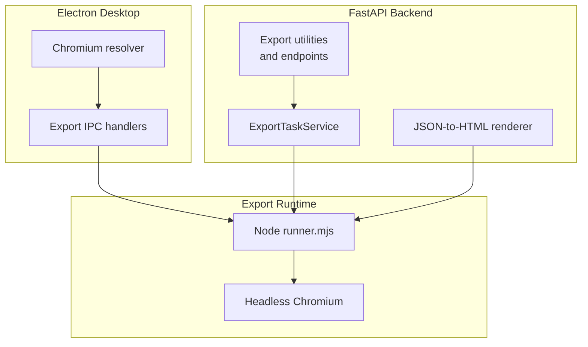
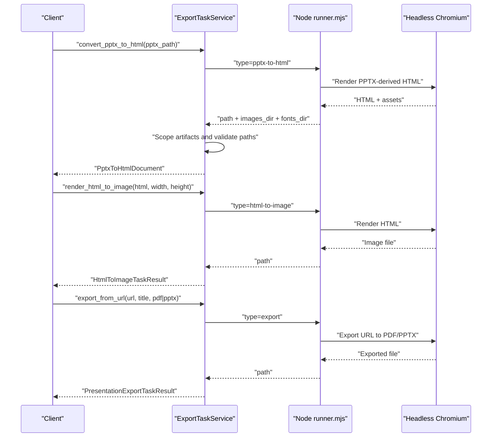
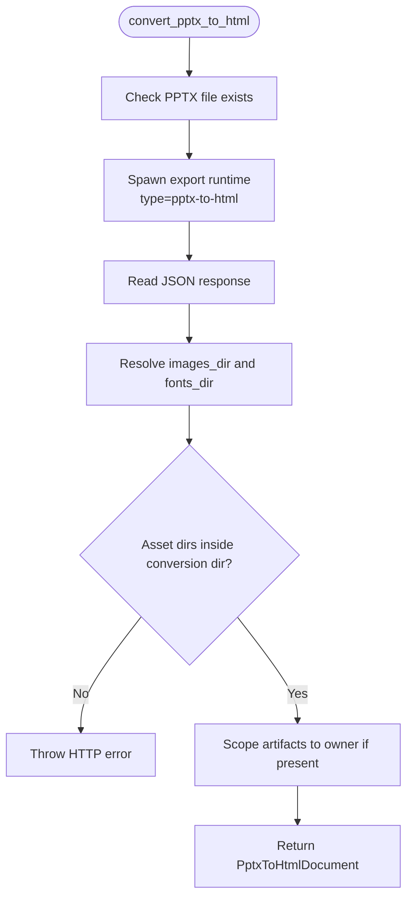
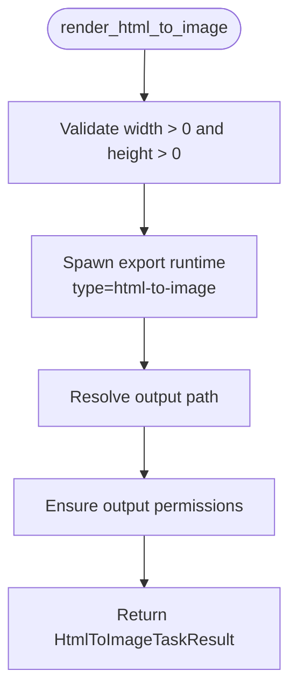
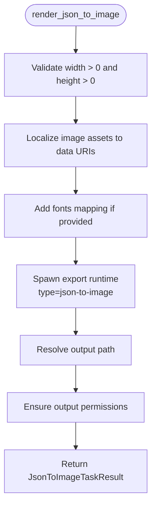
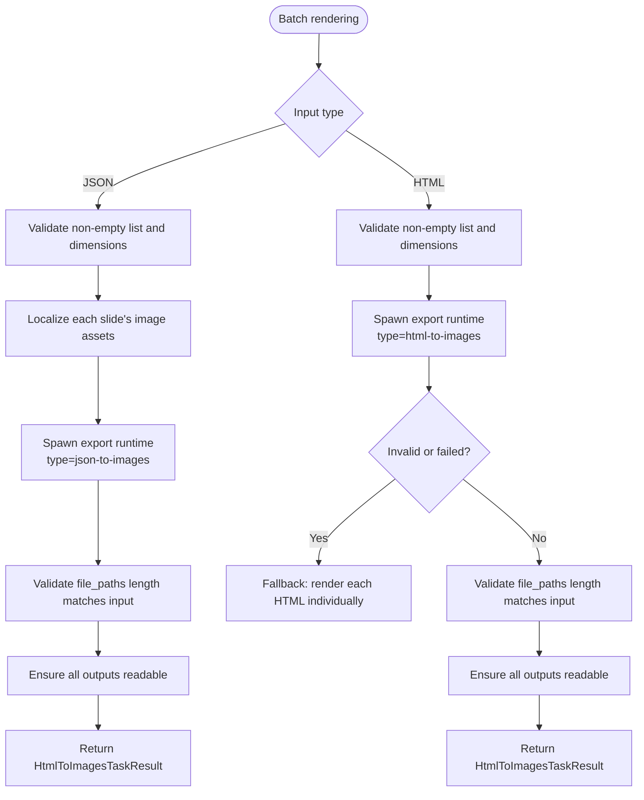
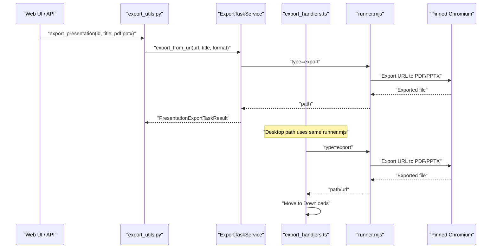
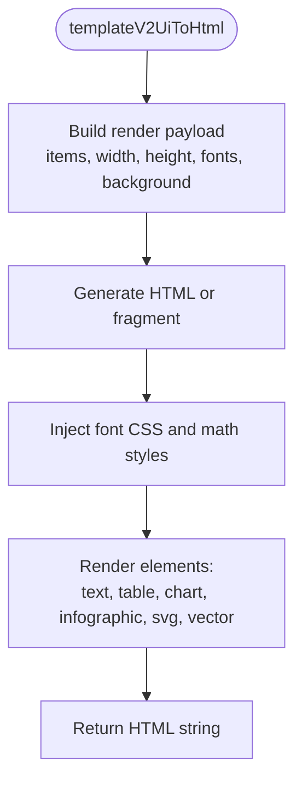
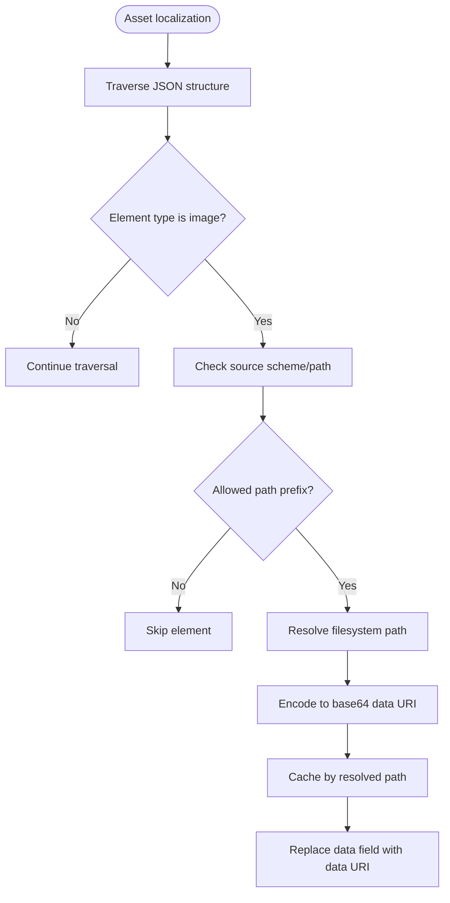
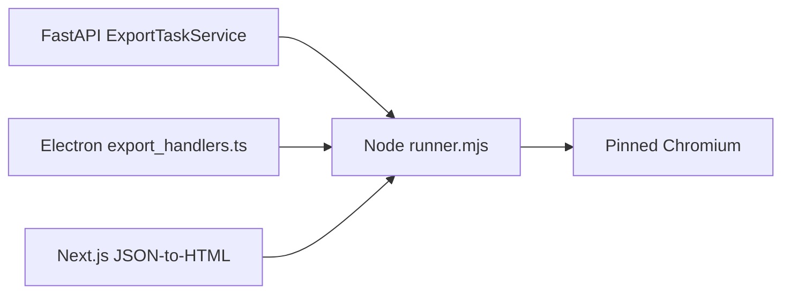

# Export Format Processing

<cite>
**Referenced Files in This Document**
- [export_task_service.py](file://servers/fastapi/services/export_task_service.py)
- [export_utils.py](file://servers/fastapi/utils/export_utils.py)
- [export_handlers.ts](file://electron/app/ipc/export_handlers.ts)
- [export-chromium.ts](file://electron/app/utils/export-chromium.ts)
- [template-v2-json-to-html.ts](file://servers/nexjs/lib/template-v2-json-to-html.ts)
- [fonts_and_slides_preview.py](file://servers/fastapi/templates/fonts_and_slides_preview.py)
</cite>

## Table of Contents
1. [Introduction](#introduction)
2. [Project Structure](#project-structure)
3. [Core Components](#core-components)
4. [Architecture Overview](#architecture-overview)
5. [Detailed Component Analysis](#detailed-component-analysis)
6. [Dependency Analysis](#dependency-analysis)
7. [Performance Considerations](#performance-considerations)
8. [Troubleshooting Guide](#troubleshooting-guide)
9. [Conclusion](#conclusion)

## Introduction
This document explains the export format processing pipeline used by Presenton to convert presentations into multiple output formats. It covers:
- PPTX to HTML conversion and asset scoping
- Image rendering workflows for HTML and JSON slide models
- PDF generation via a headless browser runtime
- Batch rendering, asset localization, font embedding, and quality controls
- Configuration options, validation rules, and troubleshooting guidance

The system is split between:
- A FastAPI backend service that orchestrates export tasks
- An Electron desktop handler that launches the export runtime with a pinned Chromium binary
- A Next.js renderer that converts template JSON into renderable HTML

## Project Structure
The export pipeline spans three main layers:
- Backend orchestration: `ExportTaskService` runs Node-based export tasks, validates outputs, scopes artifacts, and manages timeouts and permissions.
- Desktop integration: Electron IPC handlers prepare environment variables, locate a pinned Chromium executable, spawn the export runtime, and move results to user downloads.
- Rendering layer: Next.js transforms template JSON into HTML; the backend can also convert PPTX files to intermediate JSON or HTML structures.

**Diagram sources**
- [export_task_service.py:122-152](file://servers/fastapi/services/export_task_service.py#L122-L152)
- [export_handlers.ts:57-179](file://electron/app/ipc/export_handlers.ts#L57-L179)
- [export-chromium.ts:34-67](file://electron/app/utils/export-chromium.ts#L34-L67)
- [template-v2-json-to-html.ts:156-170](file://servers/nexjs/lib/template-v2-json-to-html.ts#L156-L170)

**Section sources**
- [export_task_service.py:122-152](file://servers/fastapi/services/export_task_service.py#L122-L152)
- [export_handlers.ts:57-179](file://electron/app/ipc/export_handlers.ts#L57-L179)
- [export-chromium.ts:34-67](file://electron/app/utils/export-chromium.ts#L34-L67)
- [template-v2-json-to-html.ts:156-170](file://servers/nexjs/lib/template-v2-json-to-html.ts#L156-L170)

## Core Components
- ExportTaskService: Central orchestrator for all export operations. It spawns the Node export runtime, validates task responses, scopes assets per owner, and enforces timeouts and permissions.
- Electron export handlers: Prepare presentation URLs, cookie headers, and Chromium paths, then launch the export runtime and move exported files to the user’s Downloads folder.
- JSON-to-HTML renderer: Converts template UI JSON into HTML fragments or full pages, including charts, tables, images, fonts, and layout logic.
- Fonts and slides preview utilities: Extract embedded fonts from PPTX, generate previews, and prepare localized assets for headless rendering.

Key responsibilities:
- Convert PPTX to HTML or JSON
- Render HTML or JSON slides to images
- Generate PDFs from a URL through the headless browser runtime
- Localize image assets and embed fonts
- Validate dimensions, output paths, and artifact directories

**Section sources**
- [export_task_service.py:93-124](file://servers/fastapi/services/export_task_service.py#L93-L124)
- [export_handlers.ts:57-179](file://electron/app/ipc/export_handlers.ts#L57-L179)
- [template-v2-json-to-html.ts:156-170](file://servers/nexjs/lib/template-v2-json-to-html.ts#L156-L170)
- [fonts_and_slides_preview.py:763-795](file://servers/fastapi/templates/fonts_and_slides_preview.py#L763-L795)

## Architecture Overview
The export pipeline supports several flows:

- PPTX to HTML: The backend invokes the export runtime with a PPTX path. The runtime writes an HTML manifest and asset directories. The backend resolves and scopes those directories under the app data area.
- HTML to image: The backend sends HTML content and dimensions to the runtime, which renders a single image.
- JSON to image: The backend localizes image assets inside the JSON model, then asks the runtime to render one image.
- Batch rendering: The backend can batch-render multiple HTML documents or JSON slides into multiple images, with fallback behavior when batch mode is unavailable.
- PDF generation: The backend or Electron layer builds a presentation URL and asks the runtime to export it as PDF or PPTX using the pinned Chromium executable.

**Diagram sources**
- [export_task_service.py:455-517](file://servers/fastapi/services/export_task_service.py#L455-L517)
- [export_task_service.py:519-544](file://servers/fastapi/services/export_task_service.py#L519-L544)
- [export_task_service.py:420-453](file://servers/fastapi/services/export_task_service.py#L420-L453)

## Detailed Component Analysis

### PPTX to HTML Conversion
- Input validation ensures the PPTX file exists.
- The backend spawns the export runtime with a task payload specifying `type=pptx-to-html`.
- The runtime returns a JSON response containing the output path and asset directories.
- The backend resolves relative asset directories against the conversion directory and verifies they remain within the expected scope.
- Asset directories are scoped to the current owner when applicable, and URLs are rewritten accordingly.

**Diagram sources**
- [export_task_service.py:455-517](file://servers/fastapi/services/export_task_service.py#L455-L517)
- [export_task_service.py:804-857](file://servers/fastapi/services/export_task_service.py#L804-L857)

**Section sources**
- [export_task_service.py:455-517](file://servers/fastapi/services/export_task_service.py#L455-L517)
- [export_task_service.py:804-857](file://servers/fastapi/services/export_task_service.py#L804-L857)

### HTML-to-Image Rendering
- Validates positive width and height.
- Spawns the export runtime with `type=html-to-image`.
- Resolves and secures the output path, ensuring readable permissions.

**Diagram sources**
- [export_task_service.py:519-544](file://servers/fastapi/services/export_task_service.py#L519-L544)

**Section sources**
- [export_task_service.py:519-544](file://servers/fastapi/services/export_task_service.py#L519-L544)

### JSON-to-Image Rendering
- Validates positive dimensions.
- Localizes image assets inside the JSON model by converting supported local or static paths to base64 data URIs.
- Optionally passes custom fonts to the runtime.
- Returns a single rendered image path.

**Diagram sources**
- [export_task_service.py:546-576](file://servers/fastapi/services/export_task_service.py#L546-L576)
- [export_task_service.py:34-84](file://servers/fastapi/services/export_task_service.py#L34-L84)

**Section sources**
- [export_task_service.py:546-576](file://servers/fastapi/services/export_task_service.py#L546-L576)
- [export_task_service.py:34-84](file://servers/fastapi/services/export_task_service.py#L34-L84)

### Batch Rendering (HTML and JSON)
- JSON-to-images:
  - Requires at least one slide and positive dimensions.
  - Localizes each slide’s image assets.
  - Expects a list of file paths matching the input count.
- HTML-to-images:
  - Requires at least one HTML document and positive dimensions.
  - Attempts batch rendering first.
  - Falls back to one task per HTML document when the runtime reports an invalid task type or fails.

**Diagram sources**
- [export_task_service.py:578-622](file://servers/fastapi/services/export_task_service.py#L578-L622)
- [export_task_service.py:624-683](file://servers/fastapi/services/export_task_service.py#L624-L683)

**Section sources**
- [export_task_service.py:578-622](file://servers/fastapi/services/export_task_service.py#L578-L622)
- [export_task_service.py:624-683](file://servers/fastapi/services/export_task_service.py#L624-L683)

### PDF Generation and Desktop Integration
- Backend flow:
  - Builds a presentation URL with optional FastAPI URL and cookie header.
  - Calls `export_from_url` with the target format (`pdf` or `pptx`).
  - Moves the exported file to the owner-scoped exports directory and ensures permissions.
- Desktop flow:
  - Validates Chromium availability.
  - Prepares environment variables and temp/cache directories.
  - Spawns the export runtime with a pinned Chromium executable.
  - Reads the response file, moves the exported file to the user’s Downloads folder, and shows a download notification.

**Diagram sources**
- [export_utils.py:27-75](file://servers/fastapi/utils/export_utils.py#L27-L75)
- [export_task_service.py:420-453](file://servers/fastapi/services/export_task_service.py#L420-L453)
- [export_handlers.ts:57-179](file://electron/app/ipc/export_handlers.ts#L57-L179)

**Section sources**
- [export_utils.py:27-75](file://servers/fastapi/utils/export_utils.py#L27-L75)
- [export_task_service.py:420-453](file://servers/fastapi/services/export_task_service.py#L420-L453)
- [export_handlers.ts:57-179](file://electron/app/ipc/export_handlers.ts#L57-L179)

### JSON-to-HTML Rendering and Template Support
- The Next.js renderer converts template UI JSON into HTML fragments or full pages.
- It handles text, lists, tables, containers, flex/grid layouts, charts, infographics, SVG, and vector elements.
- It injects font CSS, math rendering styles, and chart scripts when needed.
- Image sources are normalized to backend asset URLs before rendering.

**Diagram sources**
- [template-v2-json-to-html.ts:156-170](file://servers/nexjs/lib/template-v2-json-to-html.ts#L156-L170)
- [template-v2-json-to-html.ts:246-266](file://servers/nexjs/lib/template-v2-json-to-html.ts#L246-L266)
- [template-v2-json-to-html.ts:301-306](file://servers/nexjs/lib/template-v2-json-to-html.ts#L301-L306)

**Section sources**
- [template-v2-json-to-html.ts:156-170](file://servers/nexjs/lib/template-v2-json-to-html.ts#L156-L170)
- [template-v2-json-to-html.ts:246-266](file://servers/nexjs/lib/template-v2-json-to-html.ts#L246-L266)
- [template-v2-json-to-html.ts:301-306](file://servers/nexjs/lib/template-v2-json-to-html.ts#L301-L306)

### Asset Localization and Font Embedding
- Asset localization:
  - For JSON-to-image tasks, image references pointing to `/app_data/...` or `/static/...` are converted to base64 data URIs so headless rendering does not depend on external URLs.
  - A cache prevents repeated encoding of the same file.
- Font embedding:
  - The renderer injects `@font-face` CSS based on provided font mappings.
  - PPTX preview utilities extract embedded fonts, normalize names, and prepare them for delivery during slide previews and conversions.

**Diagram sources**
- [export_task_service.py:34-84](file://servers/fastapi/services/export_task_service.py#L34-L84)
- [template-v2-json-to-html.ts:301-306](file://servers/nexjs/lib/template-v2-json-to-html.ts#L301-L306)
- [fonts_and_slides_preview.py:763-795](file://servers/fastapi/templates/fonts_and_slides_preview.py#L763-L795)

**Section sources**
- [export_task_service.py:34-84](file://servers/fastapi/services/export_task_service.py#L34-L84)
- [template-v2-json-to-html.ts:301-306](file://servers/nexjs/lib/template-v2-json-to-html.ts#L301-L306)
- [fonts_and_slides_preview.py:763-795](file://servers/fastapi/templates/fonts_and_slides_preview.py#L763-L795)

### Quality Optimization Settings
- Image generation quality settings exist for AI image providers and do not directly control PDF or screenshot quality.
- Screenshot and PDF quality are primarily controlled by the headless browser runtime and the resolution/dimensions passed to the export tasks.
- DPI and worker configuration for document extraction tools are available in related services but are separate from the export pipeline.

Recommendations:
- Use larger width and height values for higher-resolution images.
- Prefer batch rendering when supported to reduce overhead.
- Avoid unnecessary remote assets; localize images to improve reliability and speed.

**Section sources**
- [README.md:504-510](file://README.md#L504-L510)
- [liteparse_service.py:21-22](file://servers/fastapi/services/liteparse_service.py#L21-L22)

## Dependency Analysis
The export pipeline has clear boundaries:
- FastAPI backend depends on the Node export runtime for heavy lifting.
- Electron desktop depends on a pinned Chromium version for consistent rendering.
- Next.js renderer provides high-fidelity HTML generation for template JSON.

**Diagram sources**
- [export_task_service.py:122-152](file://servers/fastapi/services/export_task_service.py#L122-L152)
- [export_handlers.ts:57-179](file://electron/app/ipc/export_handlers.ts#L57-L179)
- [export-chromium.ts:34-67](file://electron/app/utils/export-chromium.ts#L34-L67)
- [template-v2-json-to-html.ts:156-170](file://servers/nexjs/lib/template-v2-json-to-html.ts#L156-L170)

**Section sources**
- [export_task_service.py:122-152](file://servers/fastapi/services/export_task_service.py#L122-L152)
- [export_handlers.ts:57-179](file://electron/app/ipc/export_handlers.ts#L57-L179)
- [export-chromium.ts:34-67](file://electron/app/utils/export-chromium.ts#L34-L67)
- [template-v2-json-to-html.ts:156-170](file://servers/nexjs/lib/template-v2-json-to-html.ts#L156-L170)

## Performance Considerations
- Timeouts: Export tasks are bounded by a configurable timeout. Long-running jobs may be terminated to protect the server.
- Memory logging: The service logs memory usage around task start and exit to help diagnose memory pressure.
- Bounded streams: Child process stdout/stderr are drained with bounded buffers to prevent unbounded memory growth.
- Batch vs. per-slide: Batch rendering reduces process overhead; fallback to per-slide rendering ensures robustness when batch mode is unavailable.
- Asset caching: Data URI caching avoids re-encoding identical images during JSON localization.

[No sources needed since this section provides general guidance]

## Troubleshooting Guide
Common issues and resolutions:
- Missing export runtime:
  - Ensure the export package entrypoint exists and the runner script is present.
  - In Electron, verify the pinned Chromium is installed and launchable.
- Invalid dimensions:
  - Width and height must be positive for HTML-to-image and JSON-to-image tasks.
- Asset path escaping:
  - If exported assets appear outside the expected directory, the backend rejects the response to prevent path traversal.
- Permission errors:
  - The backend adjusts output directory and file modes after successful export.
- Chromium cache corruption:
  - Electron removes broken Puppeteer caches and retries. On Windows Store installs, it materializes a writable copy of Chromium.
- Batch rendering failures:
  - When batch mode is unavailable or fails, the backend falls back to rendering each HTML document individually.

Action checklist:
- Verify `APP_DATA_DIRECTORY` and `TEMP_DIRECTORY` are set.
- Confirm the export runtime directory contains `runner.mjs` and the required package entrypoint.
- Check that the pinned Chromium executable exists and can start in headless mode.
- Inspect task payloads for valid dimensions and non-empty slide lists.
- Review logs for child process return codes and stderr snippets.

**Section sources**
- [export_task_service.py:154-201](file://servers/fastapi/services/export_task_service.py#L154-L201)
- [export_task_service.py:203-221](file://servers/fastapi/services/export_task_service.py#L203-L221)
- [export_task_service.py:223-278](file://servers/fastapi/services/export_task_service.py#L223-L278)
- [export_task_service.py:294-352](file://servers/fastapi/services/export_task_service.py#L294-L352)
- [export_task_service.py:354-418](file://servers/fastapi/services/export_task_service.py#L354-L418)
- [export_handlers.ts:221-329](file://electron/app/ipc/export_handlers.ts#L221-L329)
- [export-chromium.ts:446-505](file://electron/app/utils/export-chromium.ts#L446-L505)

## Conclusion
Presenton’s export format processing pipeline combines a secure backend orchestrator, a reliable desktop integration, and a high-fidelity renderer. It supports PPTX-to-HTML conversion, HTML-to-image rendering, JSON-to-image rendering, batch processing, PDF generation, asset localization, and font embedding. By validating inputs, scoping artifacts, enforcing timeouts, and providing fallback behaviors, the system delivers consistent and robust export results across environments.

[No sources needed since this section summarizes without analyzing specific files]