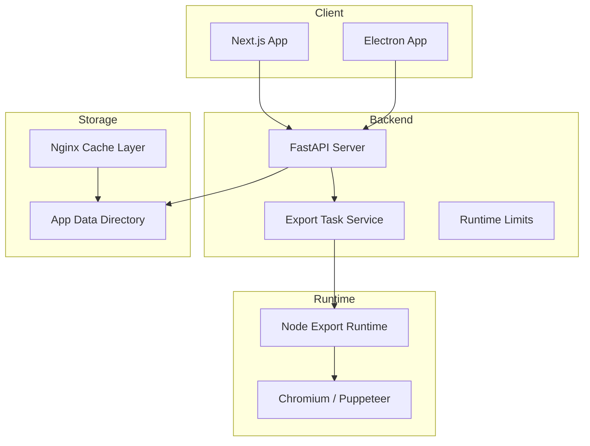
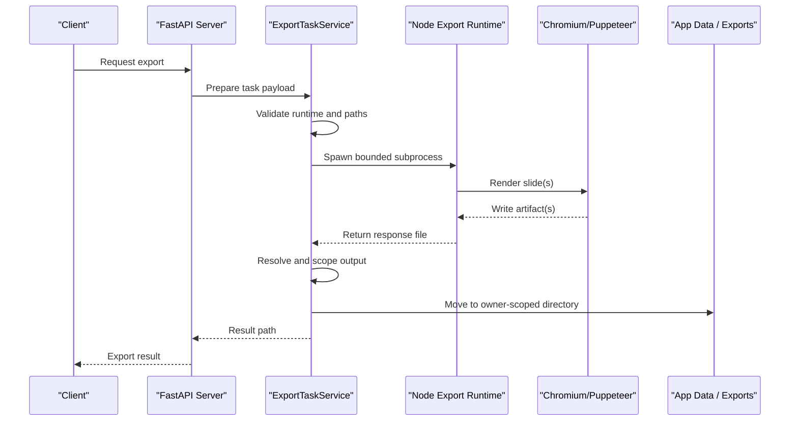
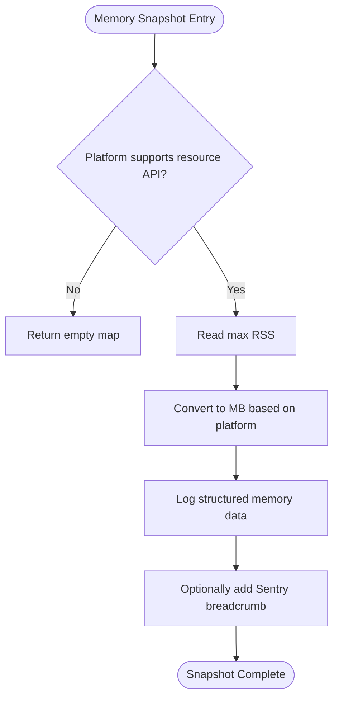
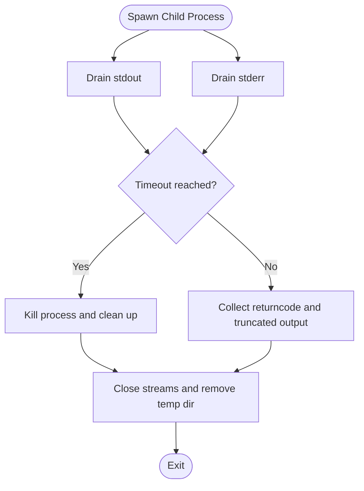
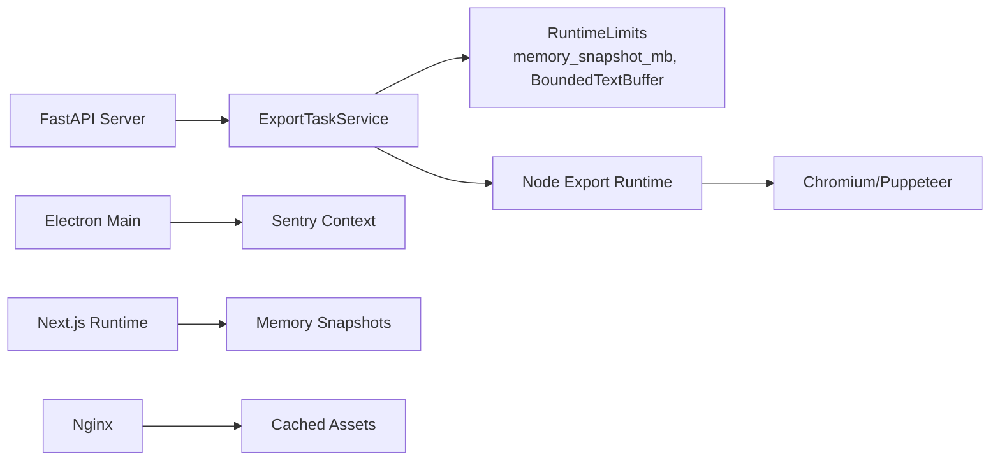

# Performance Monitoring & Optimization

<cite>
**Referenced Files in This Document**
- [presenton-resource-usage.md](file://docs/presenton-resource-usage.md)
- [runtime_limits.py](file://servers/fastapi/utils/runtime_limits.py)
- [export_task_service.py](file://servers/fastapi/services/export_task_service.py)
- [concurrent_service.py](file://servers/fastapi/services/concurrent_service.py)
- [memory.ts](file://electron/app/utils/memory.ts)
- [runtime-limits.ts](file://servers/nextjs/lib/runtime-limits.ts)
- [chromium-cache-recovery.ts](file://electron/app/utils/chromium-cache-recovery.ts)
- [sentry-main.ts](file://electron/app/sentry/main.ts)
- [nginx.conf](file://nginx.conf)
</cite>

## Table of Contents
1. [Introduction](#introduction)
2. [Project Structure](#project-structure)
3. [Core Components](#core-components)
4. [Architecture Overview](#architecture-overview)
5. [Detailed Component Analysis](#detailed-component-analysis)
6. [Dependency Analysis](#dependency-analysis)
7. [Performance Considerations](#performance-considerations)
8. [Troubleshooting Guide](#troubleshooting-guide)
9. [Conclusion](#conclusion)
10. [Appendices](#appendices)

## Introduction
This document explains performance monitoring and optimization strategies for the Presenton system, focusing on memory usage tracking, CPU utilization monitoring, process performance metrics, resource limits, timeouts, profiling, export optimization, caching, scalability, dashboards, alerting, and tuning guidelines. It synthesizes observed telemetry from a controlled load test with implementation details from the FastAPI backend, Next.js frontend, Electron desktop runtime, and nginx configuration.

The goal is to help operators and developers:
- Understand how Presenton measures and constrains resources during presentation generation and export.
- Identify where memory spikes and CPU bursts occur.
- Configure timeouts, concurrency, and caching safely.
- Build monitoring dashboards and alerting rules.
- Optimize large-presentation exports without sacrificing stability.

## Project Structure
Presenton’s performance-related behavior spans several layers:
- Backend (FastAPI): process-level memory snapshots, bounded text buffers, and export task orchestration.
- Frontend (Next.js): browser-side memory snapshots and bounded text buffering utilities.
- Desktop (Electron): Chromium cache recovery, Sentry context tagging, and Node memory snapshots.
- Reverse proxy (nginx): long-lived asset caching headers for images, exports, uploads, fonts, templates, and conversion artifacts.
- Load testing report: container-level CPU, queue, memory, and heap observations across a multi-wave workload.

**Diagram sources**
- [export_task_service.py:122-201](file://servers/fastapi/services/export_task_service.py#L122-L201)
- [runtime_limits.py:10-24](file://servers/fastapi/utils/runtime_limits.py#L10-L24)
- [memory.ts:1-10](file://electron/app/utils/memory.ts#L1-L10)
- [runtime-limits.ts:25-34](file://servers/nextjs/lib/runtime-limits.ts#L25-L34)
- [chromium-cache-recovery.ts:184-211](file://electron/app/utils/chromium-cache-recovery.ts#L184-L211)
- [nginx.conf:156-213](file://nginx.conf#L156-L213)

**Section sources**
- [presenton-resource-usage.md:1-14](file://docs/presenton-resource-usage.md#L1-L14)
- [export_task_service.py:122-201](file://servers/fastapi/services/export_task_service.py#L122-L201)
- [runtime_limits.py:10-24](file://servers/fastapi/utils/runtime_limits.py#L10-L24)
- [memory.ts:1-10](file://electron/app/utils/memory.ts#L1-L10)
- [runtime-limits.ts:25-34](file://servers/nextjs/lib/runtime-limits.ts#L25-L34)
- [chromium-cache-recovery.ts:184-211](file://electron/app/utils/chromium-cache-recovery.ts#L184-L211)
- [nginx.conf:156-213](file://nginx.conf#L156-L213)

## Core Components
- Memory snapshot utilities:
  - FastAPI: process RSS measurement and optional Sentry breadcrumb logging.
  - Next.js and Electron: Node `process.memoryUsage` exposure as MB values.
- Bounded text buffers:
  - Prevent unbounded log accumulation by truncating output streams.
- Export task service:
  - Spawns a bounded Node export runtime with environment scoping, timeout enforcement, safe path resolution, and output permission handling.
- Concurrent background tasks:
  - Simple async task tracker for background work with completion callbacks.
- Chromium cache recovery:
  - Clears shared dictionary and code caches to reduce stale state and memory pressure.
- Nginx caching:
  - Long-lived immutable or private cache headers for static assets and generated content.

**Section sources**
- [runtime_limits.py:10-35](file://servers/fastapi/utils/runtime_limits.py#L10-L35)
- [runtime_limits.py:38-66](file://servers/fastapi/utils/runtime_limits.py#L38-L66)
- [memory.ts:1-39](file://electron/app/utils/memory.ts#L1-L39)
- [runtime-limits.ts:1-34](file://servers/nextjs/lib/runtime-limits.ts#L1-L34)
- [export_task_service.py:122-201](file://servers/fastapi/services/export_task_service.py#L122-L201)
- [export_task_service.py:294-418](file://servers/fastapi/services/export_task_service.py#L294-L418)
- [concurrent_service.py:6-40](file://servers/fastapi/services/concurrent_service.py#L6-L40)
- [chromium-cache-recovery.ts:184-211](file://electron/app/utils/chromium-cache-recovery.ts#L184-L211)
- [nginx.conf:156-213](file://nginx.conf#L156-L213)

## Architecture Overview
The export pipeline is intentionally isolated:
- The FastAPI server validates requests and prepares scoped temporary directories.
- It spawns a separate Node process running the export runtime.
- The export runtime renders HTML/PPTX content using Chromium/Puppeteer.
- Outputs are validated, moved into owner-scoped locations, and served through nginx with appropriate cache headers.

**Diagram sources**
- [export_task_service.py:294-418](file://servers/fastapi/services/export_task_service.py#L294-L418)
- [export_task_service.py:420-453](file://servers/fastapi/services/export_task_service.py#L420-L453)
- [export_task_service.py:770-800](file://servers/fastapi/services/export_task_service.py#L770-L800)

## Detailed Component Analysis

### Memory Usage Tracking
- FastAPI memory snapshot:
  - Uses OS-level resource API to read maximum resident set size.
  - Converts platform-specific units to megabytes.
  - Logs structured memory data and optionally emits a Sentry breadcrumb.
- Next.js and Electron memory snapshot:
  - Reads Node `process.memoryUsage`.
  - Returns RSS, heap used, heap total, external, and array buffer sizes in MB.

**Diagram sources**
- [runtime_limits.py:10-35](file://servers/fastapi/utils/runtime_limits.py#L10-L35)
- [memory.ts:1-10](file://electron/app/utils/memory.ts#L1-L10)
- [runtime-limits.ts:25-34](file://servers/nextjs/lib/runtime-limits.ts#L25-L34)

**Section sources**
- [runtime_limits.py:10-35](file://servers/fastapi/utils/runtime_limits.py#L10-L35)
- [memory.ts:1-10](file://electron/app/utils/memory.ts#L1-L10)
- [runtime-limits.ts:25-34](file://servers/nextjs/lib/runtime-limits.ts#L25-L34)

### CPU Utilization Monitoring
- The load test report provides container-level CPU utilization, processor queue length, and sampling intervals.
- CPU readings above 100% represent combined utilization across logical processors.
- Typical median CPU was low; short bursts occurred during heavy processing.

Key guidance:
- Treat high instantaneous CPU as expected during rendering/export.
- Investigate sustained high CPU alongside rising queue lengths and memory growth.
- Correlate CPU spikes with specific workflow stages using request markers and logs.

**Section sources**
- [presenton-resource-usage.md:23-32](file://docs/presenton-resource-usage.md#L23-L32)
- [presenton-resource-usage.md:100-117](file://docs/presenton-resource-usage.md#L100-L117)

### Process Performance Metrics Collection
- Export task service logs child process start and exit events, including PID and command snippet.
- Output streams are drained asynchronously and truncated via bounded buffers.
- Memory snapshots are recorded around spawn and exit points.

**Diagram sources**
- [export_task_service.py:354-418](file://servers/fastapi/services/export_task_service.py#L354-L418)

**Section sources**
- [export_task_service.py:354-418](file://servers/fastapi/services/export_task_service.py#L354-L418)

### Resource Limit Enforcement and Timeouts
- Export subprocess execution is wrapped with an explicit timeout.
- On timeout, the child process is killed and cleaned up.
- Bounded text buffers prevent excessive log memory growth.
- Environment variables isolate app data and temporary directories per owner.

Recommendations:
- Tune export timeout based on average slide count and media complexity.
- Keep bounded buffer limits small enough to protect memory but large enough to retain useful diagnostics.
- Ensure APP_DATA_DIRECTORY and TEMP_DIRECTORY are configured correctly.

**Section sources**
- [export_task_service.py:354-418](file://servers/fastapi/services/export_task_service.py#L354-L418)
- [runtime_limits.py:38-66](file://servers/fastapi/utils/runtime_limits.py#L38-L66)
- [export_task_service.py:154-201](file://servers/fastapi/services/export_task_service.py#L154-L201)

### Performance Profiling Tools
- Sentry integration:
  - Electron main process initializes Sentry and sets runtime context tags.
  - FastAPI memory logger can emit breadcrumbs when Sentry is available.
- Chromium cache recovery:
  - Clears shared dictionary and code caches to reduce stale state.
  - Reports skipped clears and final status.

Guidance:
- Use Sentry breadcrumbs and tags to correlate memory events with user sessions and export types.
- Monitor cache recovery outcomes to detect repeated crashes or corrupted caches.

**Section sources**
- [sentry-main.ts:89-131](file://electron/app/sentry/main.ts#L89-L131)
- [runtime_limits.py:23-35](file://servers/fastapi/utils/runtime_limits.py#L23-L35)
- [chromium-cache-recovery.ts:184-211](file://electron/app/utils/chromium-cache-recovery.ts#L184-L211)

### Export Performance Optimization Techniques
- Safe path resolution:
  - Only allows outputs under trusted roots (app data and temp directories).
- Owner scoping:
  - Moves exported files into per-owner directories after validation.
- Asset localization:
  - Embeds local image assets as data URIs for headless rendering.
- Fallback rendering:
  - Falls back to single-document rendering if batched HTML-to-images is unavailable.

Optimization tips:
- Pre-bundle frequently used assets to reduce I/O overhead.
- Reuse font and image caches between slides.
- Avoid excessively large inline images; prefer external references where possible.

**Section sources**
- [export_task_service.py:223-267](file://servers/fastapi/services/export_task_service.py#L223-L267)
- [export_task_service.py:770-800](file://servers/fastapi/services/export_task_service.py#L770-L800)
- [export_task_service.py:34-84](file://servers/fastapi/services/export_task_service.py#L34-L84)
- [export_task_service.py:624-683](file://servers/fastapi/services/export_task_service.py#L624-L683)

### Caching Strategies
- Nginx caching:
  - Static assets and generated content use long-lived cache headers.
  - Images, exports, uploads, fonts, templates, and conversion artifacts are cached with appropriate privacy scopes.

Best practices:
- Use immutable cache headers for versioned assets.
- Separate public and private caches based on authentication requirements.
- Invalidate caches selectively when templates or assets change.

**Section sources**
- [nginx.conf:156-213](file://nginx.conf#L156-L213)

### Scalability Considerations
- Concurrency model:
  - Background tasks are tracked and logged, but there is no global worker pool limiter visible in the referenced code.
- Export isolation:
  - Each export runs in a separate Node process with bounded output and timeouts.
- Resource pressure:
  - Load test shows gradual memory growth before a late burst, indicating potential retention or delayed cleanup.

Scalability recommendations:
- Introduce a bounded concurrency limit for concurrent exports.
- Add per-request tracing IDs to correlate logs and metrics.
- Implement graceful shutdown hooks to flush and release resources.
- Monitor process counts and memory trends over time.

**Section sources**
- [concurrent_service.py:6-40](file://servers/fastapi/services/concurrent_service.py#L6-L40)
- [export_task_service.py:294-418](file://servers/fastapi/services/export_task_service.py#L294-L418)
- [presenton-resource-usage.md:119-149](file://docs/presenton-resource-usage.md#L119-L149)

## Dependency Analysis
The following diagram maps key dependencies among performance-critical components.

**Diagram sources**
- [export_task_service.py:23-26](file://servers/fastapi/services/export_task_service.py#L23-L26)
- [runtime_limits.py:10-35](file://servers/fastapi/utils/runtime_limits.py#L10-L35)
- [memory.ts:1-10](file://electron/app/utils/memory.ts#L1-L10)
- [runtime-limits.ts:25-34](file://servers/nextjs/lib/runtime-limits.ts#L25-L34)
- [sentry-main.ts:89-131](file://electron/app/sentry/main.ts#L89-L131)
- [nginx.conf:156-213](file://nginx.conf#L156-L213)

**Section sources**
- [export_task_service.py:23-26](file://servers/fastapi/services/export_task_service.py#L23-L26)
- [runtime_limits.py:10-35](file://servers/fastapi/utils/runtime_limits.py#L10-L35)
- [memory.ts:1-10](file://electron/app/utils/memory.ts#L1-L10)
- [runtime-limits.ts:25-34](file://servers/nextjs/lib/runtime-limits.ts#L25-L34)
- [sentry-main.ts:89-131](file://electron/app/sentry/main.ts#L89-L131)
- [nginx.conf:156-213](file://nginx.conf#L156-L213)

## Performance Considerations
- CPU:
  - Expect short bursts during slide rendering and export.
  - Use request markers to attribute CPU spikes to specific endpoints or workflows.
- Memory:
  - Watch for gradual growth followed by spikes; investigate retained objects and delayed cleanup.
  - Use memory snapshots at key lifecycle points (spawn, render, exit).
- I/O:
  - Prefer streaming and bounded buffers for logs and output capture.
  - Validate and scope all file paths to avoid leaks and security issues.
- Concurrency:
  - Bound background tasks and exports to prevent resource exhaustion.
  - Add circuit breakers or backpressure for downstream services.
- Caching:
  - Leverage nginx cache headers for static and generated assets.
  - Clear stale Chromium caches when encountering repeated failures.

[No sources needed since this section provides general guidance]

## Troubleshooting Guide
Common symptoms and actions:
- Export timeout:
  - Check child process logs and truncated stdout/stderr.
  - Increase timeout only after confirming the workload justifies it.
- High memory usage:
  - Inspect memory snapshots and Sentry breadcrumbs.
  - Verify that temporary directories are cleaned up after export.
- Stale Chromium state:
  - Run cache recovery and monitor cleared caches.
- Permission errors on outputs:
  - Confirm output paths are within allowed roots and permissions are applied.

Diagnostic steps:
- Enable memory logging around export spawn and exit.
- Add request correlation IDs to trace full export flows.
- Capture container-level CPU, queue, memory, and heap metrics alongside application logs.

**Section sources**
- [export_task_service.py:354-418](file://servers/fastapi/services/export_task_service.py#L354-L418)
- [runtime_limits.py:23-35](file://servers/fastapi/utils/runtime_limits.py#L23-L35)
- [chromium-cache-recovery.ts:184-211](file://electron/app/utils/chromium-cache-recovery.ts#L184-L211)

## Conclusion
Presenton isolates expensive export workloads in bounded subprocesses, enforces timeouts, and uses memory snapshots and bounded buffers to protect stability. Load test telemetry indicates typical low CPU and moderate memory usage, with notable late-stage spikes that warrant further investigation. Operators should combine application-level metrics with container-level telemetry, enforce strict path scoping, tune timeouts and concurrency, and leverage nginx caching for improved throughput. For large presentations, focus on reducing per-slide memory pressure, reusing assets, and validating cleanup behavior after export completion.

[No sources needed since this section summarizes without analyzing specific files]

## Appendices

### Example: Setting Up Performance Monitoring
- Instrument memory snapshots at key points:
  - Before spawning export tasks.
  - After successful export completion.
  - On error paths.
- Attach request correlation IDs to logs and Sentry breadcrumbs.
- Collect container-level CPU, queue, memory, and heap metrics at regular intervals.
- Store metrics and logs in a centralized observability stack.

[No sources needed since this section provides general guidance]

### Example: Analyzing Resource Usage Patterns
- Compare median vs. average CPU to identify burstiness.
- Track processor queue length alongside CPU to detect contention.
- Monitor available/free memory inversely with utilization.
- Investigate post-workload spikes to determine delayed cleanup or background jobs.

**Section sources**
- [presenton-resource-usage.md:74-98](file://docs/presenton-resource-usage.md#L74-L98)
- [presenton-resource-usage.md:119-149](file://docs/presenton-resource-usage.md#L119-L149)

### Example: Optimizing Export Performance for Large Presentations
- Reduce per-slide image sizes and reuse shared assets.
- Batch rendering where supported; fall back gracefully otherwise.
- Pre-warm font and image caches.
- Tune export timeout and concurrency limits based on measured slide counts.
- Validate output paths and ensure ownership scoping is enforced.

**Section sources**
- [export_task_service.py:34-84](file://servers/fastapi/services/export_task_service.py#L34-L84)
- [export_task_service.py:624-683](file://servers/fastapi/services/export_task_service.py#L624-L683)
- [export_task_service.py:223-267](file://servers/fastapi/services/export_task_service.py#L223-L267)