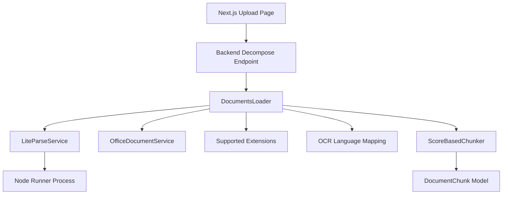
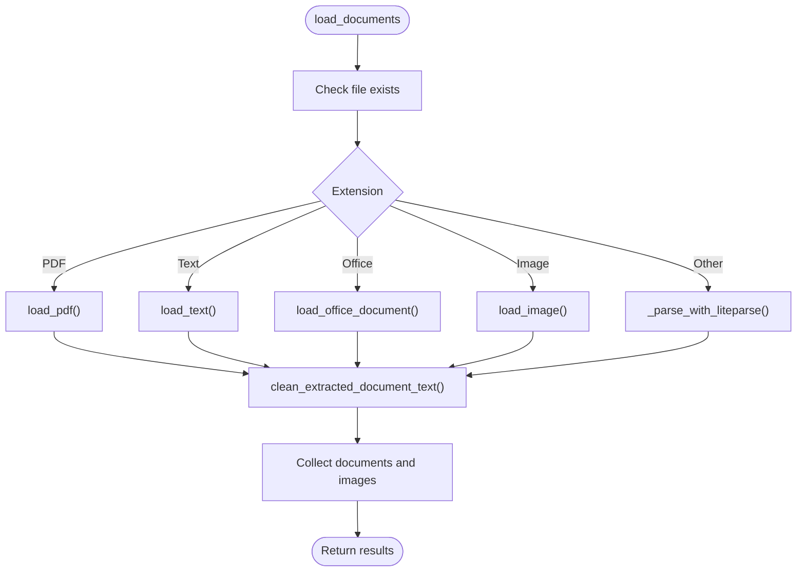
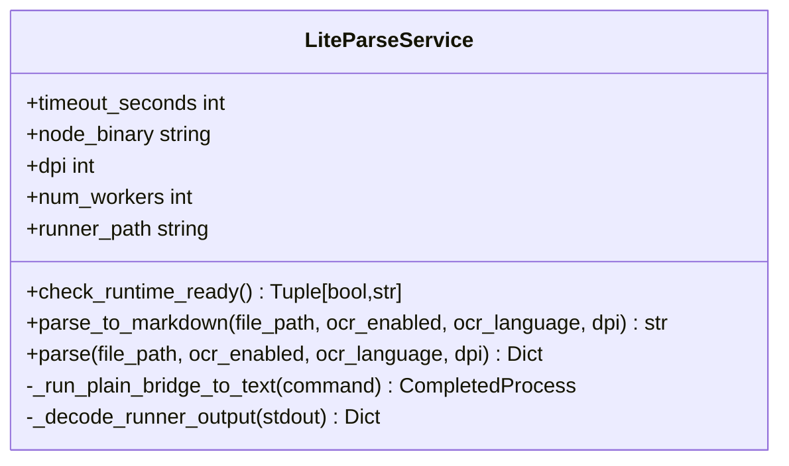
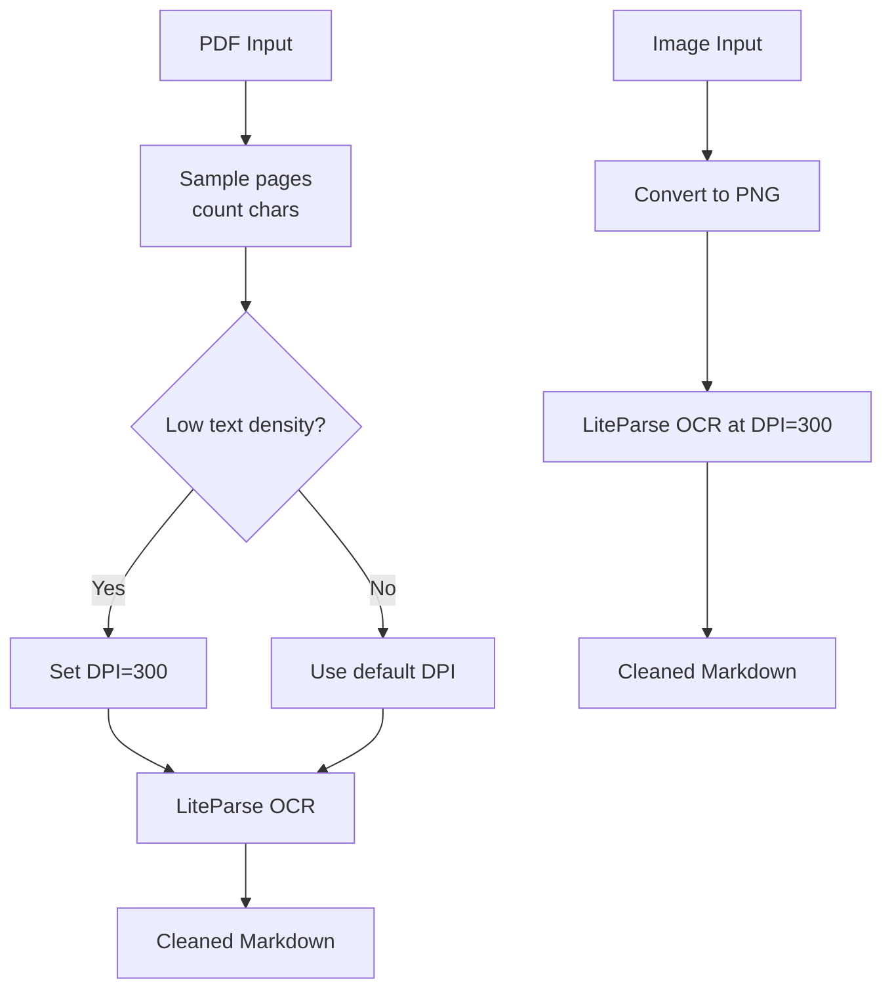
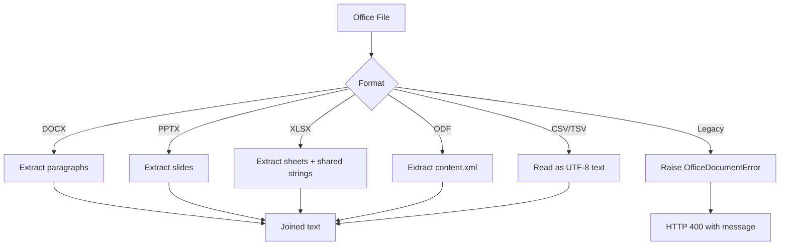
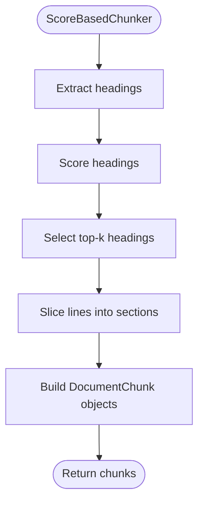
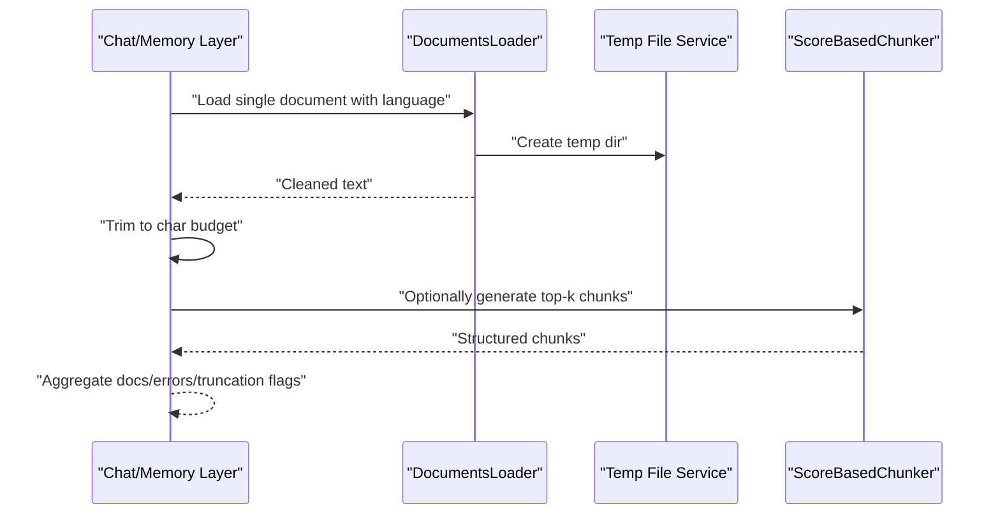
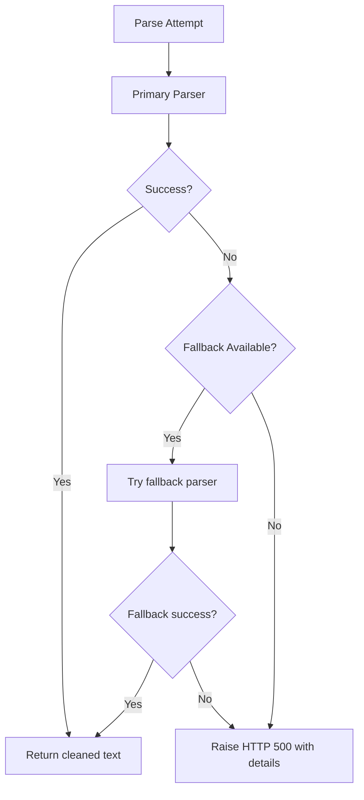
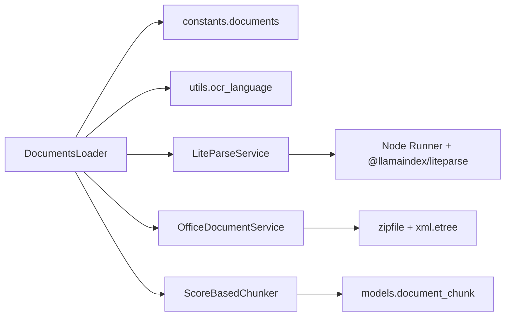

# Document Parsing & Extraction

<cite>
**Referenced Files in This Document**
- [documents_loader.py](file://servers/fastapi/services/documents_loader.py)
- [liteparse_service.py](file://servers/fastapi/services/liteparse_service.py)
- [office_document_service.py](file://servers/fastapi/services/office_document_service.py)
- [score_based_chunker.py](file://servers/fastapi/services/score_based_chunker.py)
- [document_chunk.py](file://servers/fastapi/models/document_chunk.py)
- [documents.py](file://servers/fastapi/constants/documents.py)
- [ocr_language.py](file://servers/fastapi/utils/ocr_language.py)
- [memory_layer.py](file://servers/fastapi/services/chat/memory_layer.py)
- [UploadPage.tsx](file://servers/nextjs/app/(presentation-generator)/upload/components/UploadPage.tsx)
- [DocumentPreviewPage.tsx](file://servers/nextjs/app/(presentation-generator)/documents-preview/components/DocumentPreviewPage.tsx)
</cite>

## Table of Contents
1. [Introduction](#introduction)
2. [Project Structure](#project-structure)
3. [Core Components](#core-components)
4. [Architecture Overview](#architecture-overview)
5. [Detailed Component Analysis](#detailed-component-analysis)
6. [Dependency Analysis](#dependency-analysis)
7. [Performance Considerations](#performance-considerations)
8. [Troubleshooting Guide](#troubleshooting-guide)
9. [Conclusion](#conclusion)

## Introduction
This document explains the document parsing and content extraction system that turns uploaded files into structured, presentation-ready content. It covers how different formats are routed through the `DocumentsLoader` service, how PDF text extraction and image OCR work, how Office documents are parsed, how LiteParse is integrated for enhanced understanding, how large documents are chunked, and how multilingual OCR is supported. It also describes the content analysis pipeline from raw extracted text to structured chunks and outlines, including error handling for corrupted or unsupported files and performance strategies for large document processing.

## Project Structure
The parsing and extraction logic lives primarily in the FastAPI backend under `servers/fastapi/services`. The key modules are:

- `DocumentsLoader`: Entry point for loading and routing documents by file type.
- `LiteParseService`: Subprocess bridge to a Node-based document parser with OCR support.
- `OfficeDocumentService`: Pure-Python extractor for modern Office and OpenDocument formats.
- `ScoreBasedChunker`: Heading-aware chunking algorithm for large documents.
- `DocumentChunk`: Structured model representing a heading and its content.
- `constants.documents`: Supported extensions and MIME types.
- `utils.ocr_language`: Mapping from UI language labels to Tesseract OCR codes.
- Frontend components trigger upload and decomposition flows that eventually call these services.



**Diagram sources**
- [UploadPage.tsx:444-486](file://servers/nextjs/app/(presentation-generator)/upload/components/UploadPage.tsx#L444-L486)
- [documents_loader.py:163-244](file://servers/fastapi/services/documents_loader.py#L163-L244)
- [liteparse_service.py:67-309](file://servers/fastapi/services/liteparse_service.py#L67-L309)
- [office_document_service.py:144-171](file://servers/fastapi/services/office_document_service.py#L144-L171)
- [score_based_chunker.py:7-163](file://servers/fastapi/services/score_based_chunker.py#L7-L163)
- [document_chunk.py:6-13](file://servers/fastapi/models/document_chunk.py#L6-L13)
- [documents.py:1-24](file://servers/fastapi/constants/documents.py#L1-L24)
- [ocr_language.py:113-126](file://servers/fastapi/utils/ocr_language.py#L113-L126)

**Section sources**
- [documents_loader.py:163-244](file://servers/fastapi/services/documents_loader.py#L163-L244)
- [documents.py:1-24](file://servers/fastapi/constants/documents.py#L1-L24)
- [UploadPage.tsx:444-486](file://servers/nextjs/app/(presentation-generator)/upload/components/UploadPage.tsx#L444-L486)

## Core Components
- DocumentsLoader routes each file by extension and delegates to specialized extractors.
- LiteParseService orchestrates a Node-based runner with configurable DPI, workers, and OCR settings.
- OfficeDocumentService parses modern Office and OpenDocument archives without external tools.
- ScoreBasedChunker extracts headings, scores them, and builds top-k sections as chunks.
- DocumentChunk models a heading plus content and can be converted into slide outline structures.
- OCR language mapping translates UI language choices into Tesseract codes.

**Section sources**
- [documents_loader.py:163-340](file://servers/fastapi/services/documents_loader.py#L163-L340)
- [liteparse_service.py:67-309](file://servers/fastapi/services/liteparse_service.py#L67-L309)
- [office_document_service.py:144-171](file://servers/fastapi/services/office_document_service.py#L144-L171)
- [score_based_chunker.py:7-163](file://servers/fastapi/services/score_based_chunker.py#L7-L163)
- [document_chunk.py:6-13](file://servers/fastapi/models/document_chunk.py#L6-L13)
- [ocr_language.py:113-126](file://servers/fastapi/utils/ocr_language.py#L113-L126)

## Architecture Overview
The end-to-end flow starts when users upload documents in the Next.js frontend. The frontend calls an upload endpoint and then triggers document decomposition. On the backend, `DocumentsLoader` determines the file type and applies the appropriate extraction strategy. For PDFs and images, it uses LiteParse with OCR; for Office files, it uses the built-in Office extractor; for plain text, it reads directly. Extracted text is cleaned and passed downstream to chunking and presentation generation.

```mermaid
sequenceDiagram
participant FE as "Frontend"
participant API as "Decompose API"
participant Loader as "DocumentsLoader"
participant LP as "LiteParseService"
participant OFF as "OfficeDocumentService"
participant CH as "ScoreBasedChunker"
FE->>API : "Upload + decompose documents"
API->>Loader : "load_documents(file_paths, language)"
alt PDF or Image
Loader->>LP : "parse_to_markdown(ocr_enabled, ocr_language, dpi)"
LP-->>Loader : "markdown text"
else Office or ODF
Loader->>OFF : "extract_office_document_text()"
OFF-->>Loader : "text"
else Text
Loader-->>Loader : "read text"
end
Loader-->>API : "cleaned text per file"
API->>CH : "get_n_chunks(text, n)"
CH-->>API : "DocumentChunk list"
API-->>FE : "structured chunks / outline"
```

**Diagram sources**
- [UploadPage.tsx:444-486](file://servers/nextjs/app/(presentation-generator)/upload/components/UploadPage.tsx#L444-L486)
- [documents_loader.py:192-244](file://servers/fastapi/services/documents_loader.py#L192-L244)
- [liteparse_service.py:249-309](file://servers/fastapi/services/liteparse_service.py#L249-L309)
- [office_document_service.py:144-171](file://servers/fastapi/services/office_document_service.py#L144-L171)
- [score_based_chunker.py:155-163](file://servers/fastapi/services/score_based_chunker.py#L155-L163)

## Detailed Component Analysis

### DocumentsLoader: Format Routing and Orchestration
`DocumentsLoader` normalizes input paths, resolves OCR language, and initializes supporting services. Its main entry point `load_documents` iterates over files, checks existence, selects a handler based on extension, and collects both text and optional page images.

Key behaviors:
- PDFs: Detect scanned vs text-based PDFs using sampled page text. Scanned PDFs use higher DPI for OCR.
- Images: Convert to PNG via `DocumentConversionService`, then parse with LiteParse at fixed DPI.
- Office files: Parse via `OfficeDocumentService`; errors become HTTP 400 responses.
- Unknown formats: Fall back to LiteParse.
- Cleanup: Strips LiteParse JSON wrappers and malformed payloads before returning clean text.



**Diagram sources**
- [documents_loader.py:192-244](file://servers/fastapi/services/documents_loader.py#L192-L244)
- [documents_loader.py:246-340](file://servers/fastapi/services/documents_loader.py#L246-L340)

**Section sources**
- [documents_loader.py:163-244](file://servers/fastapi/services/documents_loader.py#L163-L244)
- [documents_loader.py:246-340](file://servers/fastapi/services/documents_loader.py#L246-L340)
- [documents_loader.py:146-160](file://servers/fastapi/services/documents_loader.py#L146-L160)

### LiteParse Integration: Enhanced Document Understanding
`LiteParseService` launches a Node-based runner process configured with:
- DPI (default 120, environment-configurable).
- Number of workers (default CPU count minus two, bounded between 1 and 64).
- OCR enabled/disabled and OCR language code.
- Optional remote OCR server URL and Tesseract data path.

It supports two output modes:
- Plain text mode: Streams stdout to a temporary file to handle very large outputs safely.
- JSON mode: Parses one JSON line payload.

Runtime readiness checks ensure Node, the runner script, and the LiteParse npm package are available. Errors are wrapped in `LiteParseError`.



**Diagram sources**
- [liteparse_service.py:67-309](file://servers/fastapi/services/liteparse_service.py#L67-L309)
- [liteparse_service.py:387-411](file://servers/fastapi/services/liteparse_service.py#L387-L411)
- [liteparse_service.py:413-464](file://servers/fastapi/services/liteparse_service.py#L413-L464)

**Section sources**
- [liteparse_service.py:67-309](file://servers/fastapi/services/liteparse_service.py#L67-L309)
- [liteparse_service.py:387-464](file://servers/fastapi/services/liteparse_service.py#L387-L464)

### PDF Text Extraction and Image OCR
PDF handling includes:
- Scanned detection: Samples up to five pages and counts total characters. If below a threshold, treats the PDF as scanned and sets DPI to 300 for OCR.
- Text extraction: Uses LiteParse with OCR enabled and the mapped OCR language.
- Image extraction: Optionally exports each page as a PNG at resolution 150 for downstream visual processing.

Image handling includes:
- Conversion to PNG via `DocumentConversionService`.
- OCR parsing at fixed DPI 300.

Multilingual OCR is driven by `presentation_language_to_ocr_code`, which maps UI language strings to Tesseract codes, defaulting to English if unknown or invalid.



**Diagram sources**
- [documents_loader.py:246-282](file://servers/fastapi/services/documents_loader.py#L246-L282)
- [documents_loader.py:295-310](file://servers/fastapi/services/documents_loader.py#L295-L310)
- [ocr_language.py:113-126](file://servers/fastapi/utils/ocr_language.py#L113-L126)

**Section sources**
- [documents_loader.py:246-282](file://servers/fastapi/services/documents_loader.py#L246-L282)
- [documents_loader.py:295-310](file://servers/fastapi/services/documents_loader.py#L295-L310)
- [ocr_language.py:113-126](file://servers/fastapi/utils/ocr_language.py#L113-L126)

### Office Document Parsing
`OfficeDocumentService` supports:
- Modern Office formats: `.docx`, `.pptx`, `.xlsx` (and macro-enabled variants).
- OpenDocument formats: `.odt`, `.odp`, `.ods`.
- CSV/TSV: Read as plain text.
- Legacy formats like `.doc`, `.ppt`, `.xls`, `.rtf`: Explicitly rejected with guidance to convert to modern formats.

Parsing strategies:
- DOCX: Extract paragraph text nodes.
- PPTX: Iterate sorted slide XML members and join text nodes.
- XLSX: Resolve shared strings and cell values across sheets.
- ODF: Traverse content XML for paragraphs and headings.

Errors include unreadable archives, missing members, and unsupported legacy formats.



**Diagram sources**
- [office_document_service.py:47-141](file://servers/fastapi/services/office_document_service.py#L47-L141)
- [office_document_service.py:144-171](file://servers/fastapi/services/office_document_service.py#L144-L171)

**Section sources**
- [office_document_service.py:47-141](file://servers/fastapi/services/office_document_service.py#L47-L141)
- [office_document_service.py:144-171](file://servers/fastapi/services/office_document_service.py#L144-L171)

### Chunking Algorithms for Large Documents
`ScoreBasedChunker` implements a heading-driven chunking approach:
- Extracts headings (lines starting with `#`).
- Scores headings based on level, position, and spacing.
- Selects top-k headings and slices document lines into chunks.
- Produces `DocumentChunk` objects with heading, content, index, and score.
- Provides async convenience method `get_n_chunks` to request exactly `n` chunks.



**Diagram sources**
- [score_based_chunker.py:9-163](file://servers/fastapi/services/score_based_chunker.py#L9-L163)
- [document_chunk.py:6-13](file://servers/fastapi/models/document_chunk.py#L6-L13)

**Section sources**
- [score_based_chunker.py:9-163](file://servers/fastapi/services/score_based_chunker.py#L9-L163)
- [document_chunk.py:6-13](file://servers/fastapi/models/document_chunk.py#L6-L13)

### Content Analysis Pipeline: From Raw Text to Presentation-Ready Structure
After extraction, the system cleans and standardizes text, then transforms it into structured chunks suitable for presentation generation. In chat and memory workflows, source documents are loaded, trimmed to a character budget, and aggregated with metadata such as truncation flags and error summaries.



**Diagram sources**
- [memory_layer.py:560-632](file://servers/fastapi/services/chat/memory_layer.py#L560-L632)
- [documents_loader.py:163-244](file://servers/fastapi/services/documents_loader.py#L163-L244)
- [score_based_chunker.py:155-163](file://servers/fastapi/services/score_based_chunker.py#L155-L163)

**Section sources**
- [memory_layer.py:560-632](file://servers/fastapi/services/chat/memory_layer.py#L560-L632)

### Examples of Parsing Workflows

#### Example 1: PDF with Mixed Text and Scanned Pages
- The loader samples a few pages to detect whether the PDF is mostly image-based.
- If scanned, it increases DPI for better OCR accuracy.
- LiteParse extracts markdown text with OCR enabled and the selected language.
- Optional page images are exported for visual context.

**Section sources**
- [documents_loader.py:246-282](file://servers/fastapi/services/documents_loader.py#L246-L282)
- [documents_loader.py:342-357](file://servers/fastapi/services/documents_loader.py#L342-L357)

#### Example 2: PowerPoint Slide Deck
- Office extractor opens the ZIP archive and iterates slide XML files in natural order.
- Text nodes are joined per slide and separated by blank lines.
- Unsupported legacy formats raise explicit errors guiding users to save in modern formats.

**Section sources**
- [office_document_service.py:59-69](file://servers/fastapi/services/office_document_service.py#L59-L69)
- [office_document_service.py:144-171](file://servers/fastapi/services/office_document_service.py#L144-L171)

#### Example 3: Image OCR
- Image is converted to PNG.
- LiteParse runs OCR at DPI 300 with the configured language.
- Result is cleaned to remove any embedded JSON wrapper.

**Section sources**
- [documents_loader.py:295-310](file://servers/fastapi/services/documents_loader.py#L295-L310)
- [documents_loader.py:146-160](file://servers/fastapi/services/documents_loader.py#L146-L160)

### Error Handling for Corrupted Files
- Missing files: HTTP 404 during document iteration.
- Office parsing failures: Wrapped in `OfficeDocumentError` and returned as HTTP 400.
- LiteParse failures: Wrapped in `LiteParseError` with stderr/stdout snippets; may attempt fallback parser if available; otherwise returns HTTP 500.
- Legacy office formats: Explicitly rejected with instructions to convert to modern formats.
- Empty or truncated LiteParse output: Robust cleanup functions unwrap JSON wrappers and recover text even from malformed payloads.



**Diagram sources**
- [documents_loader.py:312-340](file://servers/fastapi/services/documents_loader.py#L312-L340)
- [office_document_service.py:144-171](file://servers/fastapi/services/office_document_service.py#L144-L171)
- [liteparse_service.py:345-385](file://servers/fastapi/services/liteparse_service.py#L345-L385)

**Section sources**
- [documents_loader.py:203-207](file://servers/fastapi/services/documents_loader.py#L203-L207)
- [documents_loader.py:288-293](file://servers/fastapi/services/documents_loader.py#L288-L293)
- [documents_loader.py:312-340](file://servers/fastapi/services/documents_loader.py#L312-L340)
- [office_document_service.py:144-171](file://servers/fastapi/services/office_document_service.py#L144-L171)
- [liteparse_service.py:345-385](file://servers/fastapi/services/liteparse_service.py#L345-L385)

### Performance Optimization Strategies
- Asynchronous I/O: Heavy operations are offloaded to threads using `asyncio.to_thread` to avoid blocking the event loop.
- Bounded memory usage: LiteParse’s plain text mode writes stdout to a temporary file and drains stderr in a thread, preventing unbounded memory growth.
- Configurable concurrency: Worker count is environment-controlled and clamped to safe bounds.
- DPI tuning: Default DPI balances quality and speed; scanned PDFs use higher DPI only when necessary.
- Chunk selection: Top-k heading scoring reduces downstream processing load by focusing on important sections.
- Character budgets: Memory layer trims documents to a maximum character budget to control LLM input size.

**Section sources**
- [documents_loader.py:220-237](file://servers/fastapi/services/documents_loader.py#L220-L237)
- [liteparse_service.py:22-23](file://servers/fastapi/services/liteparse_service.py#L22-L23)
- [liteparse_service.py:48-77](file://servers/fastapi/services/liteparse_service.py#L48-L77)
- [liteparse_service.py:413-464](file://servers/fastapi/services/liteparse_service.py#L413-L464)
- [score_based_chunker.py:49-153](file://servers/fastapi/services/score_based_chunker.py#L49-L153)
- [memory_layer.py:569-617](file://servers/fastapi/services/chat/memory_layer.py#L569-L617)

## Dependency Analysis
The following diagram shows core dependencies among parsing components:



**Diagram sources**
- [documents_loader.py:13-28](file://servers/fastapi/services/documents_loader.py#L13-L28)
- [liteparse_service.py:122-142](file://servers/fastapi/services/liteparse_service.py#L122-L142)
- [office_document_service.py:1-6](file://servers/fastapi/services/office_document_service.py#L1-L6)
- [score_based_chunker.py:4](file://servers/fastapi/services/score_based_chunker.py#L4)
- [document_chunk.py:6-13](file://servers/fastapi/models/document_chunk.py#L6-L13)

**Section sources**
- [documents_loader.py:13-28](file://servers/fastapi/services/documents_loader.py#L13-L28)
- [liteparse_service.py:122-142](file://servers/fastapi/services/liteparse_service.py#L122-L142)
- [office_document_service.py:1-6](file://servers/fastapi/services/office_document_service.py#L1-L6)
- [score_based_chunker.py:4](file://servers/fastapi/services/score_based_chunker.py#L4)
- [document_chunk.py:6-13](file://servers/fastapi/models/document_chunk.py#L6-L13)

## Performance Considerations
- Prefer plain text output mode for large PDFs to avoid buffering entire outputs in memory.
- Tune `LITEPARSE_NUM_WORKERS` according to CPU capacity; keep within the enforced minimum and maximum.
- Adjust `LITEPARSE_DPI` to balance OCR accuracy and processing time.
- Use scanned PDF detection to apply high DPI selectively.
- Limit chunk requests to realistic top-k values to reduce downstream processing.
- Apply character budgets in higher-level pipelines to constrain LLM inputs.

[No sources needed since this section provides general guidance]

## Troubleshooting Guide
Common issues and resolutions:
- File not found: Ensure paths are resolved through the temp file service and exist on disk.
- Office format unsupported: Save legacy `.doc/.ppt/.xls` files as modern `.docx/.pptx/.xlsx` or OpenDocument formats.
- LiteParse runtime unavailable: Verify Node binary, runner path, and npm package installation; check environment variables for custom paths.
- OCR language mismatch: Confirm UI language selection matches available Tesseract traineddata; defaults to English if unknown.
- Corrupted archives: Expect explicit errors indicating unreadable ZIP/XML content; validate file integrity.
- Excessive memory usage: Switch to plain text output mode and monitor worker/DPI settings.

**Section sources**
- [documents_loader.py:203-207](file://servers/fastapi/services/documents_loader.py#L203-L207)
- [office_document_service.py:150-154](file://servers/fastapi/services/office_document_service.py#L150-L154)
- [liteparse_service.py:197-242](file://servers/fastapi/services/liteparse_service.py#L197-L242)
- [ocr_language.py:113-126](file://servers/fastapi/utils/ocr_language.py#L113-L126)

## Conclusion
The document parsing and extraction system combines robust format routing, powerful OCR-enabled parsing, and intelligent chunking to transform diverse inputs into structured, presentation-ready content. By leveraging LiteParse for enhanced understanding, pure-Python Office parsing for reliability, and configurable performance controls, it scales from small text files to large scanned PDFs while maintaining resilience against corrupted or unsupported inputs.

[No sources needed since this section summarizes without analyzing specific files]