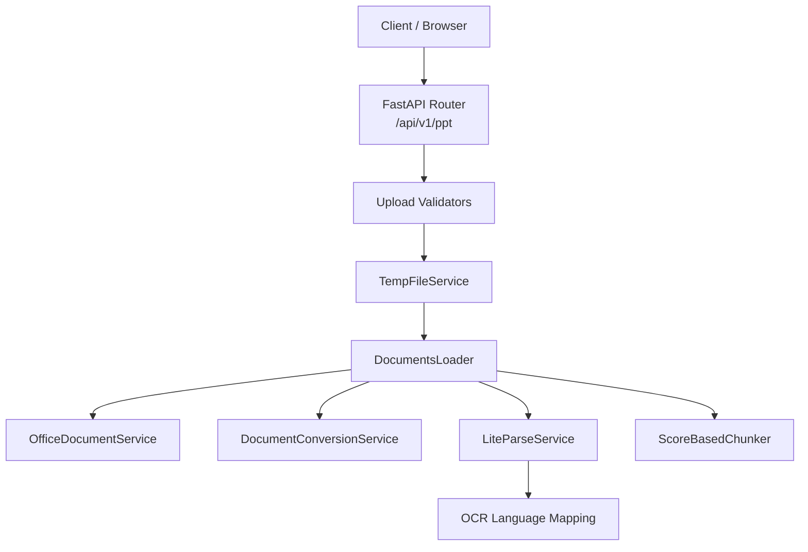
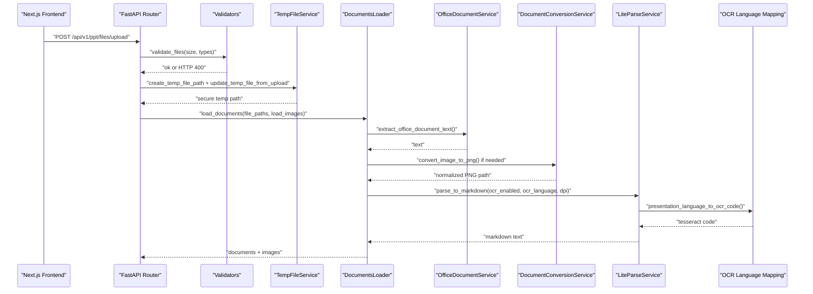
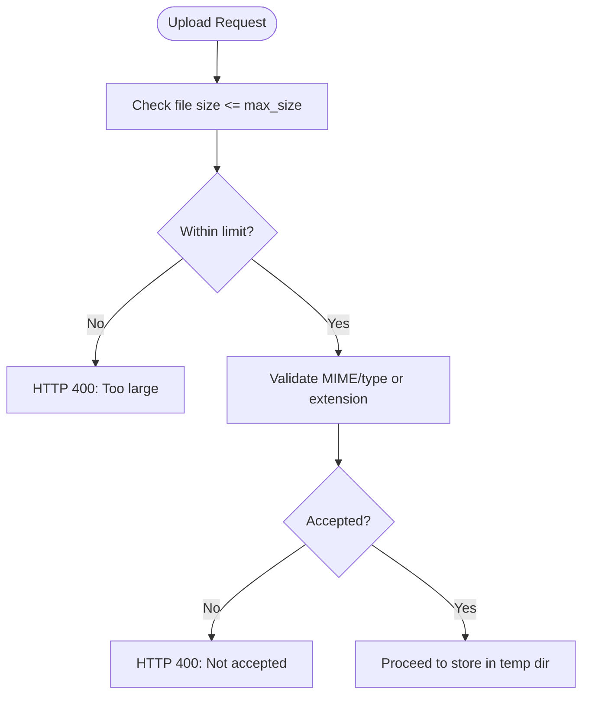
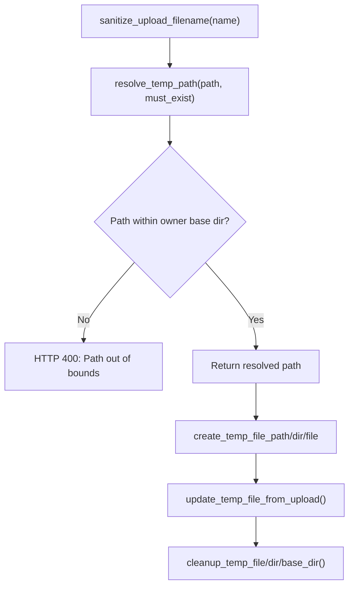
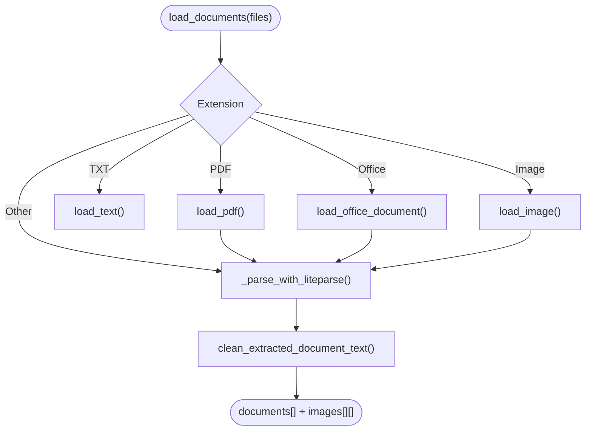
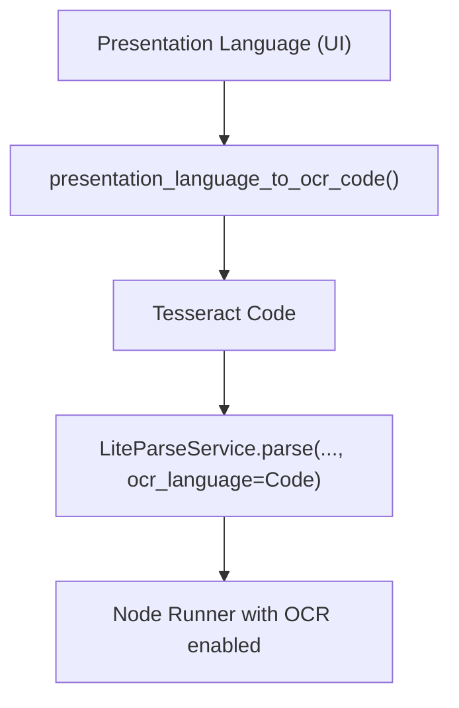
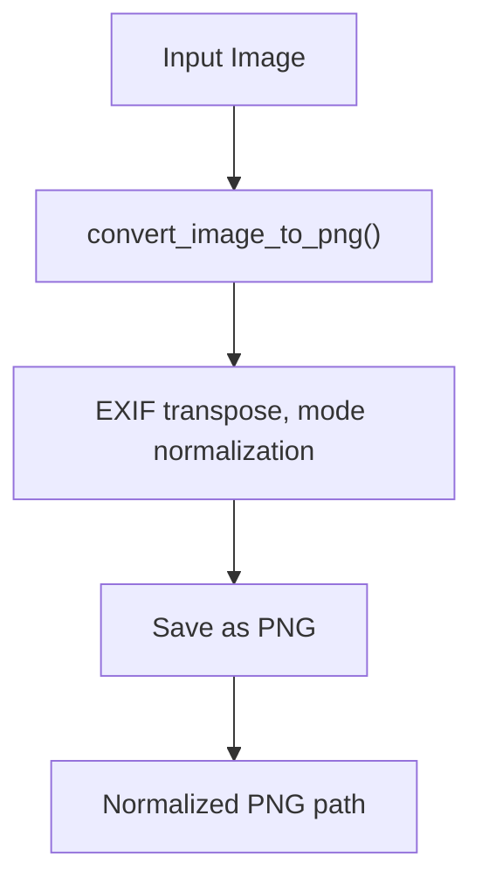
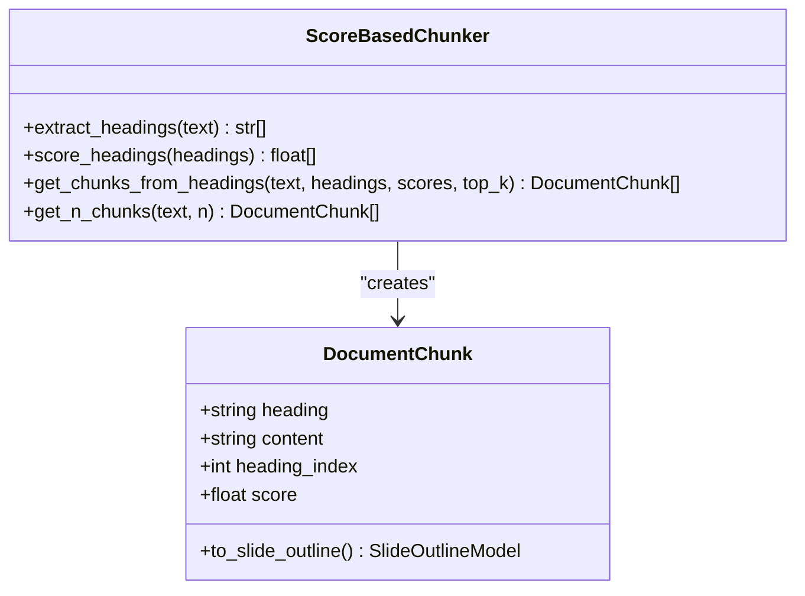
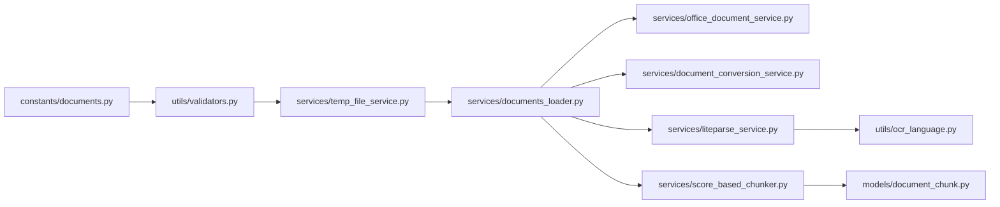

# File Processing & Upload API

<cite>
**Referenced Files in This Document**
- [documents.py](file://servers/fastapi/constants/documents.py)
- [validators.py](file://servers/fastapi/utils/validators.py)
- [temp_file_service.py](file://servers/fastapi/services/temp_file_service.py)
- [document_conversion_service.py](file://servers/fastapi/services/document_conversion_service.py)
- [documents_loader.py](file://servers/fastapi/services/documents_loader.py)
- [liteparse_service.py](file://servers/fastapi/services/liteparse_service.py)
- [office_document_service.py](file://servers/fastapi/services/office_document_service.py)
- [ocr_language.py](file://servers/fastapi/utils/ocr_language.py)
- [score_based_chunker.py](file://servers/fastapi/services/score_based_chunker.py)
- [document_chunk.py](file://servers/fastapi/models/document_chunk.py)
- [router.py](file://servers/fastapi/api/v1/ppt/router.py)
- [SupportingDoc.tsx](file://servers/nextjs/app/(presentation-generator)/upload/components/SupportingDoc.tsx)
</cite>

## Table of Contents
1. [Introduction](#introduction)
2. [Project Structure](#project-structure)
3. [Core Components](#core-components)
4. [Architecture Overview](#architecture-overview)
5. [Detailed Component Analysis](#detailed-component-analysis)
6. [Dependency Analysis](#dependency-analysis)
7. [Performance Considerations](#performance-considerations)
8. [Troubleshooting Guide](#troubleshooting-guide)
9. [Conclusion](#conclusion)

## Introduction
This document explains the file processing and upload pipeline that transforms uploaded documents into presentation-ready content. It covers supported formats, validation and security, parsing and OCR, image handling, chunking, storage and cleanup, and error handling patterns. The system supports PDFs, Word documents (DOCX and related), PowerPoint files (PPTX and related), spreadsheets, plain text, and a broad set of image formats.

## Project Structure
The upload and processing logic spans FastAPI services, constants, utilities, and a Next.js frontend component:
- Constants define accepted MIME types and extensions for uploads.
- Validators enforce size and type constraints.
- TempFileService manages secure temporary storage with owner isolation and path validation.
- DocumentsLoader orchestrates parsing across PDFs, Office documents, images, and text.
- LiteParseService runs an external Node-based parser with OCR support.
- OfficeDocumentService extracts text from modern Office/OpenDocument archives.
- DocumentConversionService normalizes images to PNG for consistent downstream processing.
- OCR language mapping connects UI language choices to Tesseract codes.
- ScoreBasedChunker segments extracted content into structured chunks for slide generation.
- The Next.js SupportingDoc component enforces client-side allowed types and counts.

**Diagram sources**
- [router.py:1-41](file://servers/fastapi/api/v1/ppt/router.py#L1-L41)
- [validators.py:1-48](file://servers/fastapi/utils/validators.py#L1-L48)
- [temp_file_service.py:1-192](file://servers/fastapi/services/temp_file_service.py#L1-L192)
- [documents_loader.py:1-358](file://servers/fastapi/services/documents_loader.py#L1-L358)
- [office_document_service.py:1-172](file://servers/fastapi/services/office_document_service.py#L1-L172)
- [document_conversion_service.py:1-90](file://servers/fastapi/services/document_conversion_service.py#L1-L90)
- [liteparse_service.py:1-470](file://servers/fastapi/services/liteparse_service.py#L1-L470)
- [ocr_language.py:1-127](file://servers/fastapi/utils/ocr_language.py#L1-L127)
- [score_based_chunker.py:1-163](file://servers/fastapi/services/score_based_chunker.py#L1-L163)

**Section sources**
- [documents.py:1-89](file://servers/fastapi/constants/documents.py#L1-L89)
- [router.py:1-41](file://servers/fastapi/api/v1/ppt/router.py#L1-L41)

## Core Components
- Supported formats and acceptance rules are centralized in constants.
- Validators gate uploads by size and type.
- TempFileService provides secure, isolated temp directories and safe path operations.
- DocumentsLoader coordinates parsing strategies per extension.
- LiteParseService invokes the Node-based extractor with OCR and DPI control.
- OfficeDocumentService parses modern Office/OpenDocument archives without external tools.
- DocumentConversionService converts images to normalized PNGs.
- OCR language mapping translates UI language selections to Tesseract codes.
- ScoreBasedChunker builds heading-scoped chunks for slide outlines.

**Section sources**
- [documents.py:1-89](file://servers/fastapi/constants/documents.py#L1-L89)
- [validators.py:1-48](file://servers/fastapi/utils/validators.py#L1-L48)
- [temp_file_service.py:1-192](file://servers/fastapi/services/temp_file_service.py#L1-L192)
- [documents_loader.py:1-358](file://servers/fastapi/services/documents_loader.py#L1-L358)
- [liteparse_service.py:1-470](file://servers/fastapi/services/liteparse_service.py#L1-L470)
- [office_document_service.py:1-172](file://servers/fastapi/services/office_document_service.py#L1-L172)
- [document_conversion_service.py:1-90](file://servers/fastapi/services/document_conversion_service.py#L1-L90)
- [ocr_language.py:1-127](file://servers/fastapi/utils/ocr_language.py#L1-L127)
- [score_based_chunker.py:1-163](file://servers/fastapi/services/score_based_chunker.py#L1-L163)

## Architecture Overview
End-to-end flow from upload to parsed content:

**Diagram sources**
- [router.py:1-41](file://servers/fastapi/api/v1/ppt/router.py#L1-L41)
- [validators.py:1-48](file://servers/fastapi/utils/validators.py#L1-L48)
- [temp_file_service.py:1-192](file://servers/fastapi/services/temp_file_service.py#L1-L192)
- [documents_loader.py:1-358](file://servers/fastapi/services/documents_loader.py#L1-L358)
- [office_document_service.py:1-172](file://servers/fastapi/services/office_document_service.py#L1-L172)
- [document_conversion_service.py:1-90](file://servers/fastapi/services/document_conversion_service.py#L1-L90)
- [liteparse_service.py:1-470](file://servers/fastapi/services/liteparse_service.py#L1-L470)
- [ocr_language.py:1-127](file://servers/fastapi/utils/ocr_language.py#L1-L127)

## Detailed Component Analysis

### Supported Formats and Upload Validation
- Accepted extensions include PDF, TXT, DOC/DOCX/DOCM/ODT/RTF, PPT/PPTX/PPTM/ODP, XLS/XLSX/XLSM/ODS/CSV/TSV, and images (JPEG, PNG, GIF, BMP, TIFF, WEBP).
- Accepted MIME types mirror these categories; legacy office files may be accepted via extension fallback.
- Validators enforce:
  - Maximum file size (configurable per endpoint).
  - Allowed MIME types or extensions.
  - Required presence when not nullable.
- Frontend also restricts selection to the same list and warns on unsupported files.

**Diagram sources**
- [validators.py:1-48](file://servers/fastapi/utils/validators.py#L1-L48)
- [documents.py:1-89](file://servers/fastapi/constants/documents.py#L1-L89)
- [SupportingDoc.tsx:18-25](file://servers/nextjs/app/(presentation-generator)/upload/components/SupportingDoc.tsx#L18-L25)

**Section sources**
- [documents.py:1-89](file://servers/fastapi/constants/documents.py#L1-L89)
- [validators.py:1-48](file://servers/fastapi/utils/validators.py#L1-L48)
- [SupportingDoc.tsx:18-25](file://servers/nextjs/app/(presentation-generator)/upload/components/SupportingDoc.tsx#L18-L25)

### Secure Temporary File Management and Cleanup
- TempFileService:
  - Isolates uploads under an owner-specific directory derived from the current owner context.
  - Sanitizes filenames and resolves paths to prevent traversal outside the base temp directory.
  - Provides helpers to create directories/files, write uploads, read files, and clean up single files or entire directories.
  - Enforces path containment checks at every operation.

**Diagram sources**
- [temp_file_service.py:43-115](file://servers/fastapi/services/temp_file_service.py#L43-L115)
- [temp_file_service.py:142-188](file://servers/fastapi/services/temp_file_service.py#L142-L188)

**Section sources**
- [temp_file_service.py:1-192](file://servers/fastapi/services/temp_file_service.py#L1-L192)

### Document Parsing Pipeline
DocumentsLoader routes each file by extension:
- PDFs:
  - Detects scanned PDFs by sampling pages for text density.
  - Uses LiteParseService to extract markdown; sets higher DPI for scanned PDFs.
  - Optionally extracts page images to a provided temp directory.
- Text:
  - Reads UTF-8 text directly.
- Office documents (DOCX, PPTX, XLSX, ODT, ODP, ODS, CSV, TSV):
  - Extracts text using OfficeDocumentService.
  - Legacy binary formats (DOC, PPT, XLS, RTF) raise errors requiring conversion to modern formats.
- Images:
  - Converts to normalized PNG via DocumentConversionService.
  - Parses converted PNG with LiteParseService at high DPI for OCR.
- Fallback:
  - If primary parse fails, attempts optional lightweight fallback parser before raising an error.

**Diagram sources**
- [documents_loader.py:192-244](file://servers/fastapi/services/documents_loader.py#L192-L244)
- [documents_loader.py:246-358](file://servers/fastapi/services/documents_loader.py#L246-L358)
- [office_document_service.py:144-172](file://servers/fastapi/services/office_document_service.py#L144-L172)
- [document_conversion_service.py:39-90](file://servers/fastapi/services/document_conversion_service.py#L39-L90)

**Section sources**
- [documents_loader.py:1-358](file://servers/fastapi/services/documents_loader.py#L1-L358)
- [office_document_service.py:1-172](file://servers/fastapi/services/office_document_service.py#L1-L172)
- [document_conversion_service.py:1-90](file://servers/fastapi/services/document_conversion_service.py#L1-L90)

### OCR Integration and Multilingual Support
- OCR is enabled by default during parsing.
- OCR language is mapped from the presentation UI language to Tesseract codes via a comprehensive map.
- LiteParseService passes OCR settings to the Node runner, including optional remote OCR server URL and Tesseract data path.

**Diagram sources**
- [ocr_language.py:15-127](file://servers/fastapi/utils/ocr_language.py#L15-L127)
- [liteparse_service.py:249-300](file://servers/fastapi/services/liteparse_service.py#L249-L300)

**Section sources**
- [ocr_language.py:1-127](file://servers/fastapi/utils/ocr_language.py#L1-L127)
- [liteparse_service.py:1-470](file://servers/fastapi/services/liteparse_service.py#L1-L470)

### Image Processing and Conversion
- Images are normalized to PNG to ensure consistent downstream processing.
- Conversion handles EXIF orientation, alpha channels, and palette modes.
- Output naming avoids collisions and prevents overwriting input files.

**Diagram sources**
- [document_conversion_service.py:19-90](file://servers/fastapi/services/document_conversion_service.py#L19-L90)

**Section sources**
- [document_conversion_service.py:1-90](file://servers/fastapi/services/document_conversion_service.py#L1-L90)

### Content Chunking for Slide Generation
- ScoreBasedChunker analyzes headings (Markdown-style) and scores them based on level, position, and spacing.
- Selects top-k headings and slices content into chunks suitable for slide outlines.
- Each chunk can be converted to a slide outline model.

**Diagram sources**
- [score_based_chunker.py:7-163](file://servers/fastapi/services/score_based_chunker.py#L7-L163)
- [document_chunk.py:1-13](file://servers/fastapi/models/document_chunk.py#L1-L13)

**Section sources**
- [score_based_chunker.py:1-163](file://servers/fastapi/services/score_based_chunker.py#L1-L163)
- [document_chunk.py:1-13](file://servers/fastapi/models/document_chunk.py#L1-L13)

### File Storage Strategies and Cleanup Procedures
- All uploads are written into an owner-scoped temp directory managed by TempFileService.
- Paths are validated to remain within the base directory to prevent traversal attacks.
- Cleanup methods remove individual files or recursively delete directories created for a session.
- Base directory cleanup is available for full resets.

**Section sources**
- [temp_file_service.py:1-192](file://servers/fastapi/services/temp_file_service.py#L1-L192)

### Conversion Services for Presentation-Ready Content
- OfficeDocumentService extracts text from modern Office/OpenDocument archives without external dependencies.
- LiteParseService drives the Node-based extraction pipeline with OCR and configurable DPI/workers.
- DocumentConversionService ensures images are normalized to PNG for reliable OCR and rendering.

**Section sources**
- [office_document_service.py:1-172](file://servers/fastapi/services/office_document_service.py#L1-L172)
- [liteparse_service.py:1-470](file://servers/fastapi/services/liteparse_service.py#L1-L470)
- [document_conversion_service.py:1-90](file://servers/fastapi/services/document_conversion_service.py#L1-L90)

## Dependency Analysis
Key relationships among core modules:

**Diagram sources**
- [documents.py:1-89](file://servers/fastapi/constants/documents.py#L1-L89)
- [validators.py:1-48](file://servers/fastapi/utils/validators.py#L1-L48)
- [temp_file_service.py:1-192](file://servers/fastapi/services/temp_file_service.py#L1-L192)
- [documents_loader.py:1-358](file://servers/fastapi/services/documents_loader.py#L1-L358)
- [office_document_service.py:1-172](file://servers/fastapi/services/office_document_service.py#L1-L172)
- [document_conversion_service.py:1-90](file://servers/fastapi/services/document_conversion_service.py#L1-L90)
- [liteparse_service.py:1-470](file://servers/fastapi/services/liteparse_service.py#L1-L470)
- [ocr_language.py:1-127](file://servers/fastapi/utils/ocr_language.py#L1-L127)
- [score_based_chunker.py:1-163](file://servers/fastapi/services/score_based_chunker.py#L1-L163)
- [document_chunk.py:1-13](file://servers/fastapi/models/document_chunk.py#L1-L13)

**Section sources**
- [documents.py:1-89](file://servers/fastapi/constants/documents.py#L1-L89)
- [documents_loader.py:1-358](file://servers/fastapi/services/documents_loader.py#L1-L358)

## Performance Considerations
- LiteParseService:
  - Configurable DPI and worker count via environment variables.
  - Plain-text bridge writes large outputs to a temporary file to avoid memory spikes.
  - Timeout enforcement protects against long-running processes.
- OCR:
  - Scanned PDFs trigger higher DPI for better recognition quality.
  - Optional remote OCR server can offload heavy workloads.
- Office parsing:
  - Pure Python ZIP/XML parsing avoids external tool overhead.
- Image conversion:
  - Normalization to PNG reduces variability and improves OCR accuracy.

[No sources needed since this section provides general guidance]

## Troubleshooting Guide
Common issues and resolutions:
- Invalid or disallowed file type:
  - Ensure the file extension or MIME type is in the accepted lists.
  - For legacy office formats (DOC, PPT, XLS, RTF), convert to modern formats first.
- File too large:
  - Reduce file size or adjust endpoint max-size configuration.
- Path out of bounds:
  - Verify that all paths resolve within the owner-scoped temp directory.
- Parse failures:
  - Check LiteParse runtime readiness and Node availability.
  - Inspect stderr/stdout snippets logged by LiteParseService.
  - Confirm OCR language mapping matches installed Tesseract data.
- Image conversion errors:
  - Validate image integrity and format compatibility.
  - Review conversion logs for unsupported modes or corrupted inputs.

**Section sources**
- [validators.py:1-48](file://servers/fastapi/utils/validators.py#L1-L48)
- [office_document_service.py:144-172](file://servers/fastapi/services/office_document_service.py#L144-L172)
- [temp_file_service.py:35-72](file://servers/fastapi/services/temp_file_service.py#L35-L72)
- [liteparse_service.py:197-242](file://servers/fastapi/services/liteparse_service.py#L197-L242)
- [liteparse_service.py:310-385](file://servers/fastapi/services/liteparse_service.py#L310-L385)
- [document_conversion_service.py:81-90](file://servers/fastapi/services/document_conversion_service.py#L81-L90)

## Conclusion
The file processing and upload API provides a robust, secure pipeline for ingesting diverse document and image formats, extracting text and images, applying OCR with multilingual support, and preparing structured content for presentation generation. Centralized validation, strict temp directory isolation, and clear error handling make it resilient and maintainable. The modular design allows scaling OCR and parsing through LiteParseService while keeping Office parsing efficient and dependency-light.