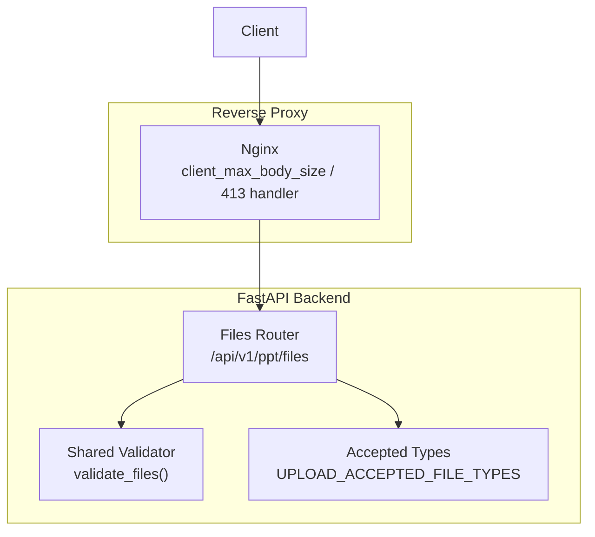
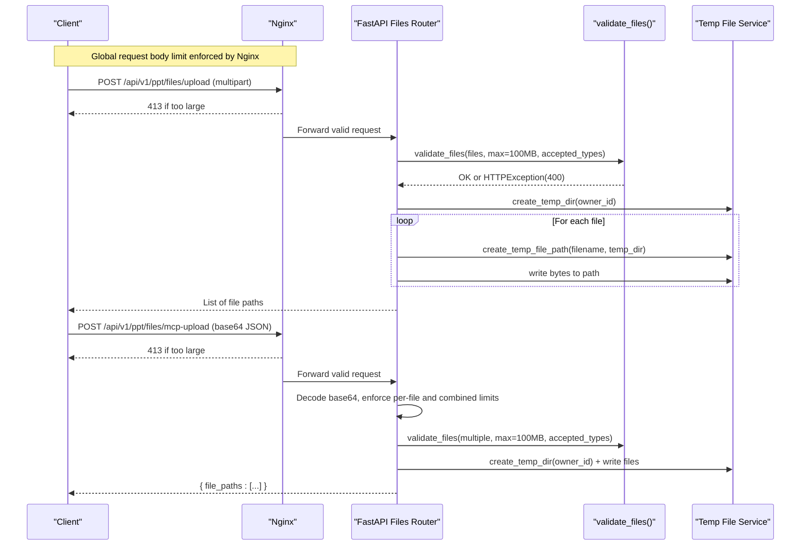
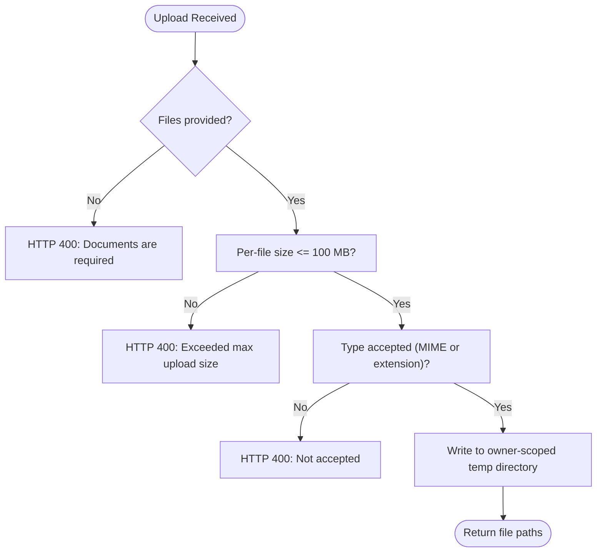
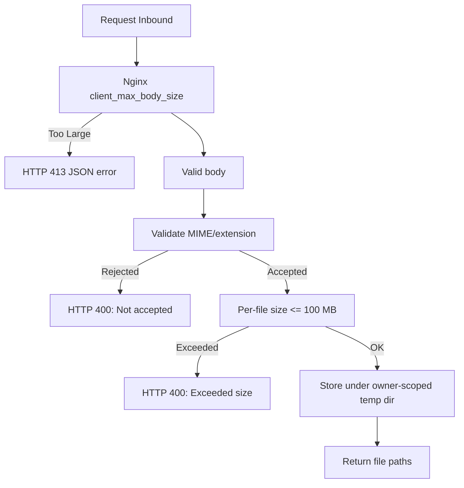
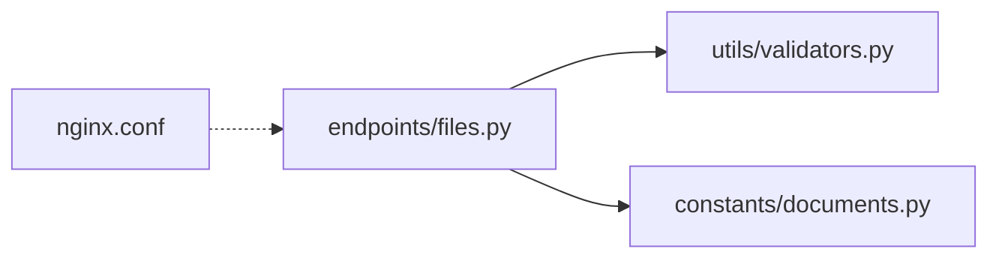

# File Upload & Validation

<cite>
**Referenced Files in This Document**
- [files.py](file://servers/fastapi/api/v1/ppt/endpoints/files.py)
- [validators.py](file://servers/fastapi/utils/validators.py)
- [documents.py](file://servers/fastapi/constants/documents.py)
- [nginx.conf](file://nginx.conf)
- [test_mcp_files_api.py](file://servers/fastapi/tests/unit/test_mcp_files_api.py)
</cite>

## Table of Contents
1. [Introduction](#introduction)
2. [Project Structure](#project-structure)
3. [Core Components](#core-components)
4. [Architecture Overview](#architecture-overview)
5. [Detailed Component Analysis](#detailed-component-analysis)
6. [Dependency Analysis](#dependency-analysis)
7. [Performance Considerations](#performance-considerations)
8. [Troubleshooting Guide](#troubleshooting-guide)
9. [Conclusion](#conclusion)

## Introduction
This document explains the file upload and validation system used by the application. It covers supported formats, validation rules, security measures, and the two primary upload endpoints:
- Standard multipart upload at `/upload`
- MCP base64-encoded upload at `/mcp-upload`

The system enforces per-file size limits, combined payload limits for MCP uploads, strict file type checks, and safe temporary storage paths scoped to the current owner.

## Project Structure
The upload functionality is implemented in the FastAPI backend under the files router. Supporting utilities include a shared validator and a constants module that defines accepted MIME types and extensions. The reverse proxy configuration adds an additional global size guard for large requests.

**Diagram sources**
- [files.py:16-100](file://servers/fastapi/api/v1/ppt/endpoints/files.py#L16-L100)
- [validators.py:23-48](file://servers/fastapi/utils/validators.py#L23-L48)
- [documents.py:65-80](file://servers/fastapi/constants/documents.py#L65-L80)
- [nginx.conf:71-74](file://nginx.conf#L71-L74)

**Section sources**
- [files.py:16-100](file://servers/fastapi/api/v1/ppt/endpoints/files.py#L16-L100)
- [validators.py:23-48](file://servers/fastapi/utils/validators.py#L23-L48)
- [documents.py:65-80](file://servers/fastapi/constants/documents.py#L65-L80)
- [nginx.conf:71-74](file://nginx.conf#L71-L74)

## Core Components
- Files Router: Defines the `/upload` and `/mcp-upload` endpoints, decodes MCP payloads, validates inputs, and writes files into owner-scoped temporary directories.
- Shared Validator: Enforces per-file size limits and accepted file types (MIME or extension).
- Accepted Types Constants: Centralizes allowed MIME types and file extensions for documents, office files, spreadsheets, images, PDFs, and text.
- Reverse Proxy Guard: Nginx rejects oversized requests early with a JSON error.

Key responsibilities:
- Accept multiple files via multipart or base64-encoded payloads
- Validate file types and sizes
- Store files safely under owner-scoped temporary directories
- Return file paths for subsequent processing steps

**Section sources**
- [files.py:16-130](file://servers/fastapi/api/v1/ppt/endpoints/files.py#L16-L130)
- [validators.py:8-48](file://servers/fastapi/utils/validators.py#L8-L48)
- [documents.py:1-80](file://servers/fastapi/constants/documents.py#L1-L80)
- [nginx.conf:71-74](file://nginx.conf#L71-L74)

## Architecture Overview
The upload flow has two entry points but shares validation and storage logic.

**Diagram sources**
- [files.py:18-130](file://servers/fastapi/api/v1/ppt/endpoints/files.py#L18-L130)
- [validators.py:23-48](file://servers/fastapi/utils/validators.py#L23-L48)
- [nginx.conf:71-74](file://nginx.conf#L71-L74)

## Detailed Component Analysis

### Supported File Formats
The system accepts both MIME types and file extensions. Allowed categories include:
- PDF: `.pdf`
- Text: `.txt`, plus Markdown where applicable
- Word documents: `.doc`, `.docx`, `.docm`, `.odt`, `.rtf`
- PowerPoint presentations: `.ppt`, `.pptx`, `.pptm`, `.odp`
- Spreadsheets: `.xls`, `.xlsx`, `.xlsm`, `.ods`, `.csv`, `.tsv`
- Images: `.jpg`, `.jpeg`, `.png`, `.gif`, `.bmp`, `.tiff`, `.tif`, `.webp`, `.svg`

Validation matches either the client-provided `content_type` or the file extension against the centralized allowlist.

**Section sources**
- [documents.py:1-80](file://servers/fastapi/constants/documents.py#L1-L80)
- [validators.py:8-20](file://servers/fastapi/utils/validators.py#L8-L20)

### Validation Pipeline
The validation pipeline performs these checks:
1. Presence check: Reject empty uploads when required.
2. Per-file size limit: Each file must not exceed 100 MB.
3. File type check: Reject files whose MIME type or extension is not in the accepted list.
4. Combined payload limit (MCP only): Total decoded bytes across all files must not exceed 100 MB; base64 length is also constrained.

**Diagram sources**
- [files.py:79-100](file://servers/fastapi/api/v1/ppt/endpoints/files.py#L79-L100)
- [validators.py:23-48](file://servers/fastapi/utils/validators.py#L23-L48)

**Section sources**
- [files.py:79-100](file://servers/fastapi/api/v1/ppt/endpoints/files.py#L79-L100)
- [validators.py:23-48](file://servers/fastapi/utils/validators.py#L23-L48)

### Security Measures
- Early size enforcement at the reverse proxy level prevents extremely large bodies from reaching the application.
- Strict file type validation using both MIME types and extensions reduces risk of executing unexpected content.
- Base64 decoding is performed with strict validation; invalid base64 returns a clear error.
- Decoded content size is checked before writing to disk.
- Files are stored under owner-scoped temporary directories, preventing cross-user access.
- MCP endpoint enforces both per-file and combined payload limits.

**Diagram sources**
- [nginx.conf:71-74](file://nginx.conf#L71-L74)
- [files.py:18-76](file://servers/fastapi/api/v1/ppt/endpoints/files.py#L18-L76)
- [validators.py:23-48](file://servers/fastapi/utils/validators.py#L23-L48)

**Section sources**
- [nginx.conf:71-74](file://nginx.conf#L71-L74)
- [files.py:18-76](file://servers/fastapi/api/v1/ppt/endpoints/files.py#L18-L76)
- [validators.py:23-48](file://servers/fastapi/utils/validators.py#L23-L48)

### Endpoint: Standard Multipart Upload (`/upload`)
- Path: `/api/v1/ppt/files/upload`
- Method: `POST`
- Content-Type: `multipart/form-data`
- Request Body: Multiple `files` fields
- Behavior:
  - Requires at least one file
  - Validates each file’s size (max 100 MB) and type
  - Writes each file to a new owner-scoped temporary directory
  - Returns a list of absolute file paths

Response format:
- Success: Array of file path strings
- Errors:
  - Missing files: HTTP 400
  - Too large: HTTP 400
  - Unsupported type: HTTP 400

Example success response:
- `[ "/app_data/uploads/users/<owner-id>/temp/<uuid>/<filename>" ]`

Example failure responses:
- `{"detail": "Documents are required"}`
- `{"detail": "File 'example.exe' exceeded max upload size of 100 MB"}`
- `{"detail": "File 'script.sh' not accepted. Accepted types: [...]"}`

**Section sources**
- [files.py:79-100](file://servers/fastapi/api/v1/ppt/endpoints/files.py#L79-L100)
- [validators.py:23-48](file://servers/fastapi/utils/validators.py#L23-L48)

### Endpoint: MCP Base64-Encoded Upload (`/mcp-upload`)
- Path: `/api/v1/ppt/files/mcp-upload`
- Method: `POST`
- Content-Type: `application/json`
- Request Body:
  - `files`: array of objects with:
    - `filename`: string (1–255 characters)
    - `content_base64`: standard base64-encoded file contents
  - Constraints:
    - Up to 32 files
    - Combined base64 length limited
    - Combined decoded bytes limited to 100 MB
- Behavior:
  - Decodes each base64 field strictly
  - Checks per-file decoded size
  - Aggregates total decoded bytes and enforces 100 MB combined limit
  - Reuses the same validation and storage logic as the standard endpoint
  - Returns the same file path structure

Response format:
- Success: `{ "file_paths": ["..."] }`
- Errors:
  - Invalid base64: HTTP 400
  - Per-file too large: HTTP 413
  - Combined too large: HTTP 413
  - Unsupported type or missing files: HTTP 400

Example success response:
- `{ "file_paths": ["/app_data/uploads/users/<owner-id>/temp/<uuid>/<filename>"] }`

Example failure responses:
- `{"detail": "Invalid base64 content for 'payload.txt'"}`
- `{"detail": "'payload.bin' exceeds the allowed upload size"}`
- `{"detail": "Combined file upload exceeds 100 MiB"}`

**Section sources**
- [files.py:18-130](file://servers/fastapi/api/v1/ppt/endpoints/files.py#L18-L130)
- [test_mcp_files_api.py:47-71](file://servers/fastapi/tests/unit/test_mcp_files_api.py#L47-L71)

### Validation Rules Summary
- Presence: At least one file is required on both endpoints.
- Per-file size: Maximum 100 MB per file.
- Combined size (MCP only): Maximum 100 MB total decoded bytes across all files.
- File types: Must match either MIME type or extension in the accepted list.
- Base64 integrity: MCP endpoint validates base64 encoding strictly.

**Section sources**
- [validators.py:23-48](file://servers/fastapi/utils/validators.py#L23-L48)
- [files.py:18-76](file://servers/fastapi/api/v1/ppt/endpoints/files.py#L18-L76)
- [documents.py:65-80](file://servers/fastapi/constants/documents.py#L65-L80)

### Error Handling Patterns
- HTTP 400:
  - Missing files
  - File exceeds per-file size limit
  - File type not accepted
  - Invalid base64 content (MCP)
- HTTP 413:
  - Per-file decoded size exceeds limit (MCP)
  - Combined decoded size exceeds limit (MCP)
  - Global request body too large (Nginx)

Error responses follow FastAPI’s default JSON error shape with a `detail` field.

**Section sources**
- [files.py:63-76](file://servers/fastapi/api/v1/ppt/endpoints/files.py#L63-L76)
- [files.py:79-130](file://servers/fastapi/api/v1/ppt/endpoints/files.py#L79-L130)
- [validators.py:23-48](file://servers/fastapi/utils/validators.py#L23-L48)
- [nginx.conf:71-74](file://nginx.conf#L71-L74)

### Response Formats
- Standard upload: Array of file path strings.
- MCP upload: Object containing `file_paths`.
- All paths point to owner-scoped temporary locations intended for internal processing.

**Section sources**
- [files.py:53-60](file://servers/fastapi/api/v1/ppt/endpoints/files.py#L53-L60)
- [files.py:79-130](file://servers/fastapi/api/v1/ppt/endpoints/files.py#L79-L130)

## Dependency Analysis
The following diagram shows how the endpoints depend on shared components and constants.

**Diagram sources**
- [files.py:9-14](file://servers/fastapi/api/v1/ppt/endpoints/files.py#L9-L14)
- [validators.py:23-48](file://servers/fastapi/utils/validators.py#L23-L48)
- [documents.py:65-80](file://servers/fastapi/constants/documents.py#L65-L80)
- [nginx.conf:71-74](file://nginx.conf#L71-L74)

**Section sources**
- [files.py:9-14](file://servers/fastapi/api/v1/ppt/endpoints/files.py#L9-L14)
- [validators.py:23-48](file://servers/fastapi/utils/validators.py#L23-L48)
- [documents.py:65-80](file://servers/fastapi/constants/documents.py#L65-L80)
- [nginx.conf:71-74](file://nginx.conf#L71-L74)

## Performance Considerations
- Use the standard multipart endpoint for typical clients; it streams files directly without base64 overhead.
- Avoid sending excessively large files; both endpoints enforce 100 MB limits.
- For MCP clients, keep the number and size of files small to stay within the combined 100 MB decoded limit.
- Prefer modern MIME types to avoid ambiguity during validation.

[No sources needed since this section provides general guidance]

## Troubleshooting Guide
Common issues and resolutions:
- “Documents are required”: Ensure at least one file is attached in the multipart form or provide at least one file object in the MCP JSON payload.
- “Exceeded max upload size”: Reduce individual file size to 100 MB or less.
- “Not accepted”: Confirm the file’s MIME type or extension is in the accepted list.
- “Invalid base64 content”: Verify the MCP payload uses standard base64 encoding without extra metadata.
- “Combined file upload exceeds 100 MiB”: Reduce the total decoded size of all files in the MCP request.
- Global 413 errors: The reverse proxy may reject very large requests before they reach the application; adjust client behavior or split uploads.

**Section sources**
- [files.py:79-130](file://servers/fastapi/api/v1/ppt/endpoints/files.py#L79-L130)
- [validators.py:23-48](file://servers/fastapi/utils/validators.py#L23-L48)
- [nginx.conf:71-74](file://nginx.conf#L71-L74)
- [test_mcp_files_api.py:47-71](file://servers/fastapi/tests/unit/test_mcp_files_api.py#L47-L71)

## Conclusion
The upload system provides secure, validated ingestion of documents, office files, spreadsheets, images, PDFs, and text. It supports both standard multipart uploads and MCP base64-encoded uploads, enforcing consistent size and type constraints. Files are stored in owner-scoped temporary directories and returned as paths for downstream processing. Proper client usage—respecting limits, MIME types, and base64 encoding—ensures reliable operation.

[No sources needed since this section summarizes without analyzing specific files]