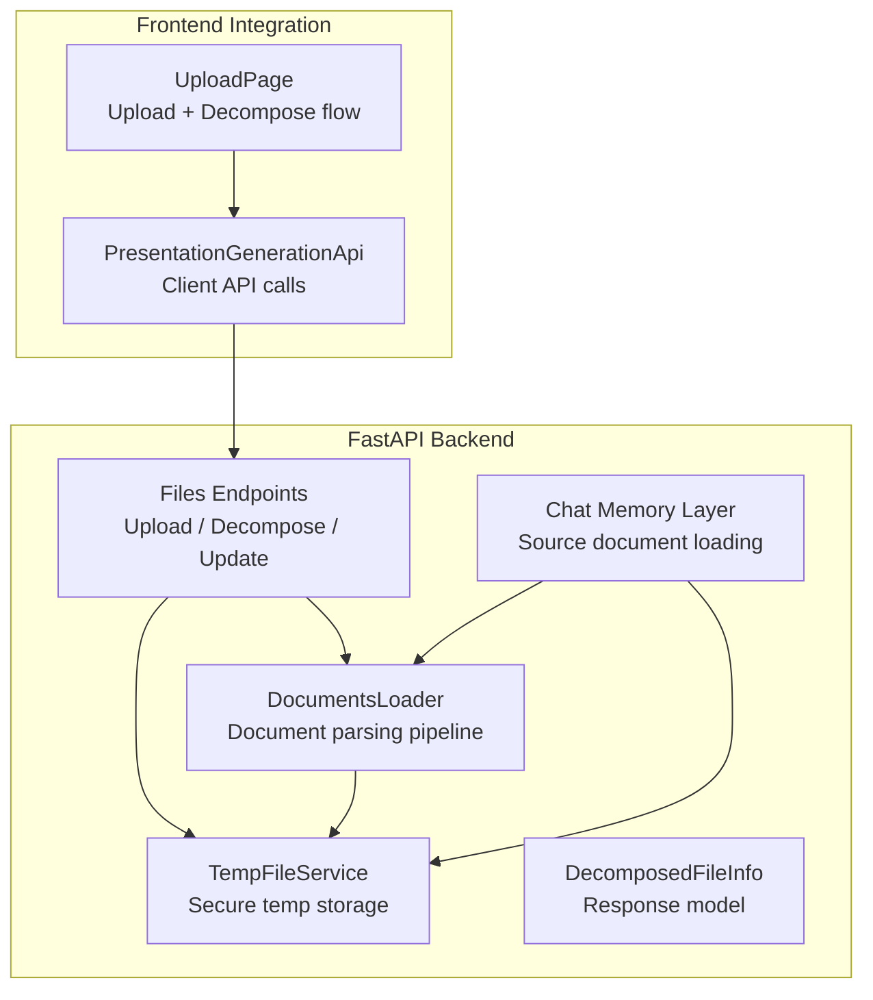
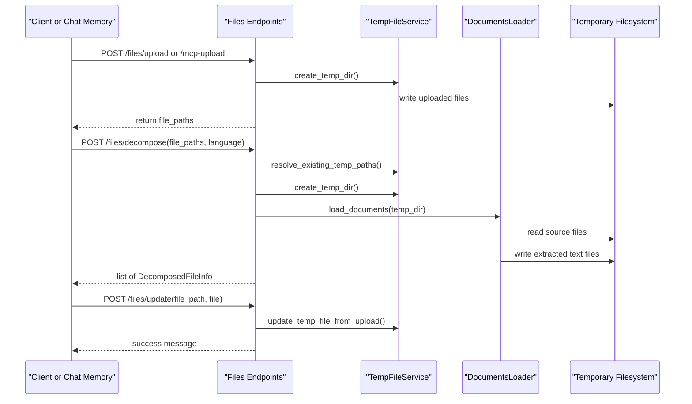
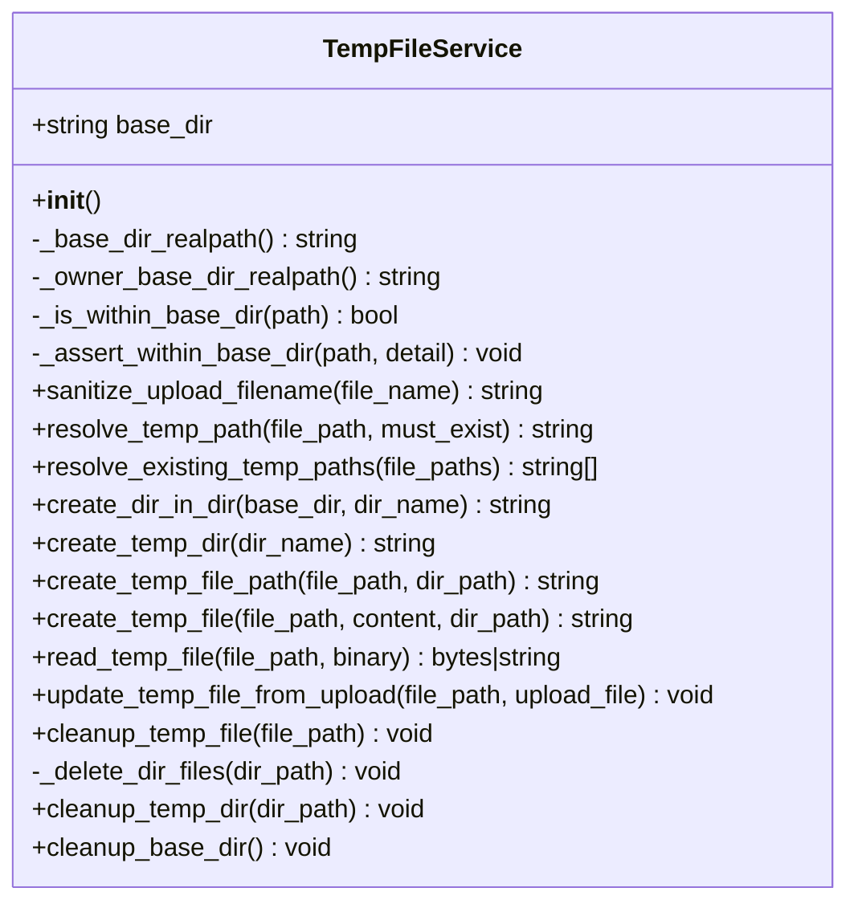
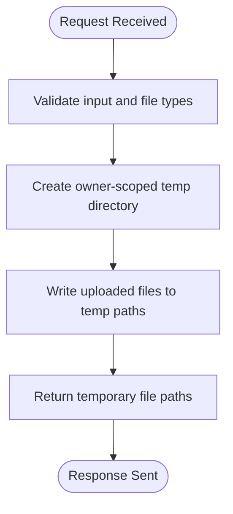
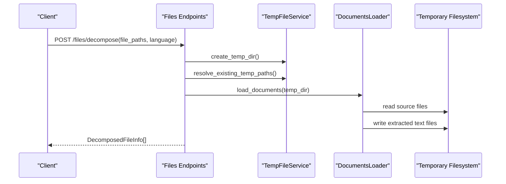
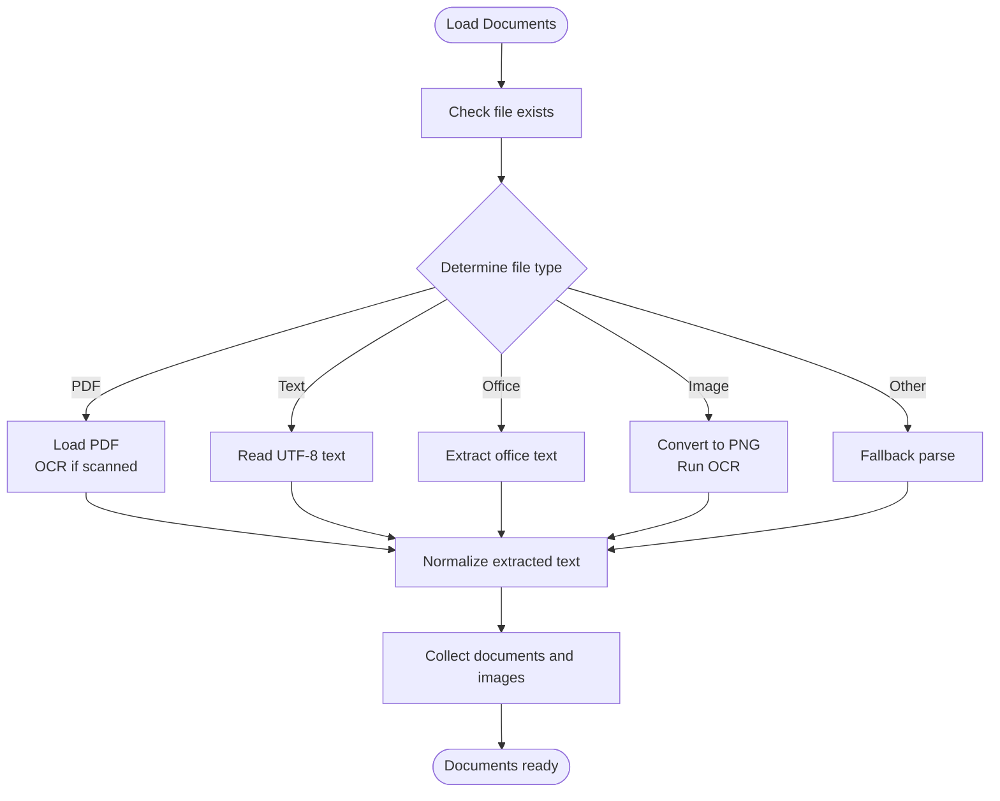
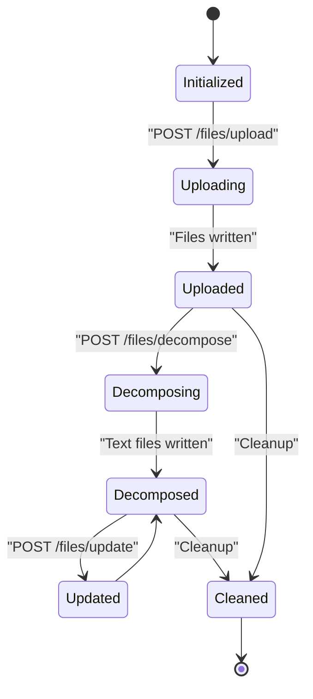
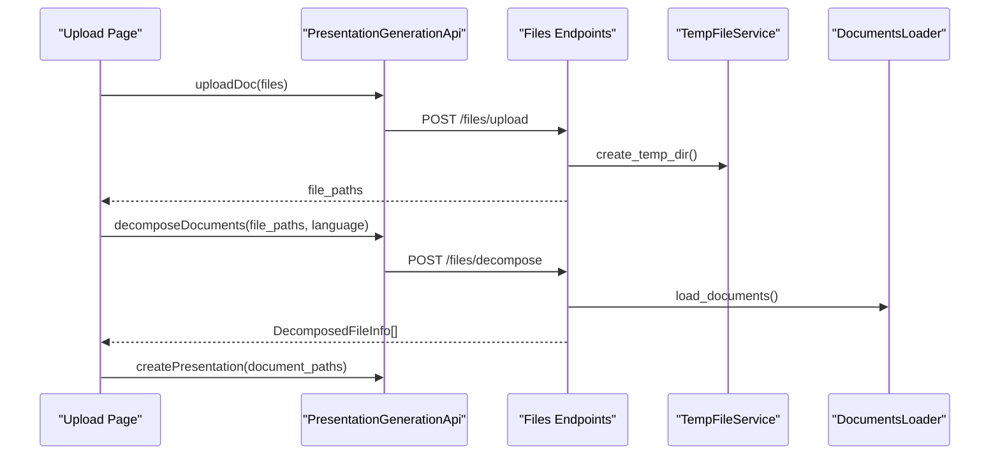
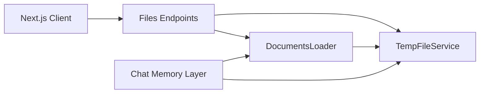

# Temporary File Management

<cite>
**Referenced Files in This Document**
- [temp_file_service.py](file://servers/fastapi/services/temp_file_service.py)
- [files.py](file://servers/fastapi/api/v1/ppt/endpoints/files.py)
- [decomposed_file_info.py](file://servers/fastapi/models/decomposed_file_info.py)
- [documents_loader.py](file://servers/fastapi/services/documents_loader.py)
- [test_temp_file_service_security.py](file://servers/fastapi/tests/unit/test_temp_file_service_security.py)
- [memory_layer.py](file://servers/fastapi/services/chat/memory_layer.py)
- [presentation-generation.ts](file://servers/nextjs/app/(presentation-generator)/services/api/presentation-generation.ts)
- [UploadPage.tsx](file://servers/nextjs/app/(presentation-generator)/upload/components/UploadPage.tsx)
</cite>

## Table of Contents
1. [Introduction](#introduction)
2. [Project Structure](#project-structure)
3. [Core Components](#core-components)
4. [Architecture Overview](#architecture-overview)
5. [Detailed Component Analysis](#detailed-component-analysis)
6. [Dependency Analysis](#dependency-analysis)
7. [Performance Considerations](#performance-considerations)
8. [Troubleshooting Guide](#troubleshooting-guide)
9. [Conclusion](#conclusion)

## Introduction
This document explains the temporary file management system used by the presentation generation workflow. It focuses on how uploaded files are stored, validated, processed, and cleaned up, with special attention to:

- The `TempFileService` architecture for secure temporary directory isolation and path resolution.
- The temporary directory structure and owner-scoped storage layout.
- File path generation and lifecycle management for uploads, updates, decompose outputs, and cleanup.
- The `/api/v1/ppt/files/decompose` endpoint that converts documents into extracted text content.
- How temporary files integrate with presentation generation and chat memory retrieval.
- Practical examples, cleanup procedures, and storage optimization strategies.

The goal is to make the system understandable for both developers integrating with it and operators managing its runtime behavior.

## Project Structure
The temporary file management system spans backend services, API endpoints, models, tests, and frontend integration points:

**Diagram sources**
- [temp_file_service.py:11-191](file://servers/fastapi/services/temp_file_service.py#L11-L191)
- [files.py:79-184](file://servers/fastapi/api/v1/ppt/endpoints/files.py#L79-L184)
- [documents_loader.py:163-358](file://servers/fastapi/services/documents_loader.py#L163-L358)
- [decomposed_file_info.py:4-6](file://servers/fastapi/models/decomposed_file_info.py#L4-L6)
- [memory_layer.py:560-598](file://servers/fastapi/services/chat/memory_layer.py#L560-L598)
- [presentation-generation.ts:49-67](file://servers/nextjs/app/(presentation-generator)/services/api/presentation-generation.ts#L49-L67)
- [UploadPage.tsx:441-486](file://servers/nextjs/app/(presentation-generator)/upload/components/UploadPage.tsx#L441-L486)

**Section sources**
- [temp_file_service.py:11-191](file://servers/fastapi/services/temp_file_service.py#L11-L191)
- [files.py:79-184](file://servers/fastapi/api/v1/ppt/endpoints/files.py#L79-L184)
- [documents_loader.py:163-358](file://servers/fastapi/services/documents_loader.py#L163-L358)
- [decomposed_file_info.py:4-6](file://servers/fastapi/models/decomposed_file_info.py#L4-L6)
- [memory_layer.py:560-598](file://servers/fastapi/services/chat/memory_layer.py#L560-L598)
- [presentation-generation.ts:49-67](file://servers/nextjs/app/(presentation-generator)/services/api/presentation-generation.ts#L49-L67)
- [UploadPage.tsx:441-486](file://servers/nextjs/app/(presentation-generator)/upload/components/UploadPage.tsx#L441-L486)

## Core Components
- **TempFileService**: Central service for creating, resolving, reading, updating, and cleaning temporary files under an owner-scoped base directory. It enforces path containment, sanitizes filenames, and provides safe operations for uploads and processing pipelines.
- **Files Endpoints**: HTTP routes for uploading files, MCP-style encoded uploads, decomposing documents into text, and updating existing temporary files.
- **DocumentsLoader**: Processing pipeline that reads supported formats (PDFs, Office documents, images, text), extracts text via OCR and parsers, and writes normalized text back into temporary files.
- **DecomposedFileInfo**: Response schema returned by the decompose endpoint, containing the original filename and the new temporary text file path.
- **Chat Memory Layer**: Uses TempFileService and DocumentsLoader to load source documents from stored paths when building chat context.
- **Frontend Integration**: Next.js client code that uploads files, calls decompose, and passes resulting document paths into presentation generation.

**Section sources**
- [temp_file_service.py:11-191](file://servers/fastapi/services/temp_file_service.py#L11-L191)
- [files.py:79-184](file://servers/fastapi/api/v1/ppt/endpoints/files.py#L79-L184)
- [documents_loader.py:163-358](file://servers/fastapi/services/documents_loader.py#L163-L358)
- [decomposed_file_info.py:4-6](file://servers/fastapi/models/decomposed_file_info.py#L4-L6)
- [memory_layer.py:560-598](file://servers/fastapi/services/chat/memory_layer.py#L560-L598)

## Architecture Overview
The temporary file management architecture follows a layered design:

- **Security Layer**: Path validation and owner scoping ensure all operations remain within the managed temporary directory.
- **Storage Layer**: TempFileService manages directories per owner and creates isolated workspaces for each operation.
- **Processing Layer**: DocumentsLoader orchestrates format-specific extraction and normalization.
- **API Layer**: Files endpoints expose upload, decompose, and update operations.
- **Integration Layer**: Frontend and chat memory components consume these APIs and reuse temporary file paths across workflows.

**Diagram sources**
- [files.py:79-184](file://servers/fastapi/api/v1/ppt/endpoints/files.py#L79-L184)
- [temp_file_service.py:81-188](file://servers/fastapi/services/temp_file_service.py#L81-L188)
- [documents_loader.py:192-244](file://servers/fastapi/services/documents_loader.py#L192-L244)

## Detailed Component Analysis

### TempFileService: Secure Temporary Storage
TempFileService is responsible for:

- Initializing a base temporary directory, optionally configured through environment variables.
- Isolating user data by owner ID, creating per-owner subdirectories under the base directory.
- Sanitizing filenames to prevent path traversal and invalid names.
- Resolving and validating file paths to ensure they stay within the owner-scoped base directory.
- Creating directories and files safely, including nested directories.
- Reading files in binary or text mode.
- Updating existing temporary files from multipart uploads.
- Cleaning individual files, directories, and the entire base directory.

Key behaviors include:

- Owner-scoped base directory resolution using current owner context.
- Strict path containment checks after real path resolution to prevent symlink escapes.
- Safe filename handling that strips directory components and rejects dangerous names.
- Idempotent cleanup methods that ignore missing files/directories.

**Diagram sources**
- [temp_file_service.py:11-191](file://servers/fastapi/services/temp_file_service.py#L11-L191)

**Section sources**
- [temp_file_service.py:11-191](file://servers/fastapi/services/temp_file_service.py#L11-L191)
- [test_temp_file_service_security.py:17-86](file://servers/fastapi/tests/unit/test_temp_file_service_security.py#L17-L86)

### Files Endpoints: Upload, Decompose, Update
The files router exposes three main operations:

- **Upload**: Accepts multipart files, validates them, creates a temporary directory, writes files, and returns their absolute temporary paths.
- **MCP Encoded Upload**: Accepts base64-encoded files for clients that cannot send multipart bodies, decodes them, and delegates to the standard upload logic.
- **Decompose**: Validates provided file paths, separates `.txt` files from other formats, processes non-text files through DocumentsLoader, writes extracted text into new temporary files, and returns a list of `DecomposedFileInfo`.
- **Update**: Replaces an existing temporary file with new content after validation.

**Diagram sources**
- [files.py:79-100](file://servers/fastapi/api/v1/ppt/endpoints/files.py#L79-L100)

**Section sources**
- [files.py:79-184](file://servers/fastapi/api/v1/ppt/endpoints/files.py#L79-L184)

### Decompose Endpoint: Document Processing Pipeline
The decompose endpoint transforms uploaded documents into normalized text content:

1. Creates a dedicated temporary directory for decomposition output.
2. Resolves and validates the requested file paths.
3. Separates plain text files from other formats.
4. Initializes DocumentsLoader with non-text files and optional language configuration.
5. Loads and parses documents, extracting text and images where applicable.
6. Writes extracted text into new temporary files under the decomposition directory.
7. Returns a list of `DecomposedFileInfo`, mapping original filenames to generated text file paths.

**Diagram sources**
- [files.py:133-173](file://servers/fastapi/api/v1/ppt/endpoints/files.py#L133-L173)
- [documents_loader.py:192-244](file://servers/fastapi/services/documents_loader.py#L192-L244)

**Section sources**
- [files.py:133-173](file://servers/fastapi/api/v1/ppt/endpoints/files.py#L133-L173)
- [documents_loader.py:163-358](file://servers/fastapi/services/documents_loader.py#L163-L358)
- [decomposed_file_info.py:4-6](file://servers/fastapi/models/decomposed_file_info.py#L4-L6)

### DocumentsLoader: Parsing and Normalization
DocumentsLoader handles multiple document formats:

- PDFs: Detects scanned vs text-based PDFs and uses OCR when necessary.
- Text files: Reads UTF-8 text directly.
- Office documents: Extracts text using office document utilities.
- Images: Converts to PNG and runs OCR via LiteParse.
- Other formats: Falls back to LiteParse parsing.

It also normalizes extracted text by stripping JSON wrappers and malformed payloads produced by parsing tools.

**Diagram sources**
- [documents_loader.py:192-244](file://servers/fastapi/services/documents_loader.py#L192-L244)
- [documents_loader.py:246-358](file://servers/fastapi/services/documents_loader.py#L246-L358)

**Section sources**
- [documents_loader.py:163-358](file://servers/fastapi/services/documents_loader.py#L163-L358)

### Temporary Directory Structure and Lifecycle
The temporary directory structure is organized as follows:

- Base directory: Configurable via environment variable; defaults to a system temporary location.
- Owner directory: Per-user isolation under the base directory using the current owner ID.
- Operation directories: Each upload or decompose operation creates a unique subdirectory.
- File paths: Generated by sanitizing filenames and ensuring containment within the owner-scoped base directory.

Lifecycle stages:

1. Initialization: Service cleans the base directory and ensures it exists.
2. Upload: Create operation directory, validate and write files, return paths.
3. Decompose: Create output directory, process files, write extracted text, return metadata.
4. Update: Replace existing file content after validation.
5. Cleanup: Remove files, directories, or entire base directory as needed.

**Diagram sources**
- [temp_file_service.py:13-16](file://servers/fastapi/services/temp_file_service.py#L13-L16)
- [files.py:79-184](file://servers/fastapi/api/v1/ppt/endpoints/files.py#L79-L184)

**Section sources**
- [temp_file_service.py:13-16](file://servers/fastapi/services/temp_file_service.py#L13-L16)
- [files.py:79-184](file://servers/fastapi/api/v1/ppt/endpoints/files.py#L79-L184)

### Integration with Presentation Generation Workflow
Temporary files are integrated into the presentation generation workflow through the following steps:

- Frontend uploads documents and receives temporary file paths.
- Frontend calls decompose to obtain normalized text files.
- Generated document paths are passed into presentation creation APIs.
- Chat memory layer can re-read source documents using stored paths and DocumentsLoader to build context.

**Diagram sources**
- [UploadPage.tsx:441-486](file://servers/nextjs/app/(presentation-generator)/upload/components/UploadPage.tsx#L441-L486)
- [presentation-generation.ts:49-67](file://servers/nextjs/app/(presentation-generator)/services/api/presentation-generation.ts#L49-L67)
- [files.py:79-173](file://servers/fastapi/api/v1/ppt/endpoints/files.py#L79-L173)

**Section sources**
- [UploadPage.tsx:441-486](file://servers/nextjs/app/(presentation-generator)/upload/components/UploadPage.tsx#L441-L486)
- [presentation-generation.ts:49-67](file://servers/nextjs/app/(presentation-generator)/services/api/presentation-generation.ts#L49-L67)
- [memory_layer.py:560-598](file://servers/fastapi/services/chat/memory_layer.py#L560-L598)

## Dependency Analysis
The temporary file management system has clear dependencies:

- Files endpoints depend on TempFileService for path safety and DocumentsLoader for parsing.
- DocumentsLoader depends on TempFileService for path validation and external services for parsing and conversion.
- Chat memory layer depends on TempFileService and DocumentsLoader to reconstruct source document content.
- Frontend depends on backend APIs to manage temporary files and decompose documents.

**Diagram sources**
- [files.py:79-184](file://servers/fastapi/api/v1/ppt/endpoints/files.py#L79-L184)
- [documents_loader.py:163-358](file://servers/fastapi/services/documents_loader.py#L163-L358)
- [memory_layer.py:560-598](file://servers/fastapi/services/chat/memory_layer.py#L560-L598)

**Section sources**
- [files.py:79-184](file://servers/fastapi/api/v1/ppt/endpoints/files.py#L79-L184)
- [documents_loader.py:163-358](file://servers/fastapi/services/documents_loader.py#L163-L358)
- [memory_layer.py:560-598](file://servers/fastapi/services/chat/memory_layer.py#L560-L598)

## Performance Considerations
- **I/O Bound Operations**: Document parsing and OCR are I/O intensive; the system uses asynchronous helpers to avoid blocking event loops.
- **Timeouts**: Decompose operations have explicit timeouts to prevent long-running tasks from hanging.
- **Memory Usage**: Large files are streamed or processed in chunks where possible; text normalization avoids unnecessary duplication.
- **Directory Isolation**: Owner-scoped directories reduce contention and improve cleanup efficiency.
- **Fallback Parsers**: When primary parsing fails, a lightweight fallback parser may be attempted to improve robustness.

[No sources needed since this section provides general guidance]

## Troubleshooting Guide
Common issues and resolutions:

- **Invalid Filename**: Ensure filenames do not contain path traversal sequences or reserved names. TempFileService sanitizes inputs and raises errors for unsafe names.
- **Path Outside Temp Directory**: All resolved paths must remain within the owner-scoped base directory. Symlink escapes are rejected.
- **File Not Found**: Resolve methods require existence when specified; missing files result in 404 responses.
- **Upload Size Limits**: Combined uploads are limited to 100 MiB; base64-encoded uploads enforce equivalent limits.
- **Parsing Failures**: If parsing fails, check document format support, OCR configuration, and fallback parser availability.

Relevant security tests demonstrate expected behavior for path containment and symlink escape prevention.

**Section sources**
- [temp_file_service.py:43-72](file://servers/fastapi/services/temp_file_service.py#L43-L72)
- [test_temp_file_service_security.py:17-86](file://servers/fastapi/tests/unit/test_temp_file_service_security.py#L17-L86)
- [files.py:45-76](file://servers/fastapi/api/v1/ppt/endpoints/files.py#L45-L76)

## Conclusion
The temporary file management system provides a secure, scalable foundation for handling file uploads, processing, and cleanup in the presentation generation workflow. TempFileService enforces strict path containment and owner isolation, while the Files endpoints and DocumentsLoader coordinate document ingestion and text extraction. The decompose endpoint bridges raw uploads and normalized text, enabling downstream presentation generation and chat memory features. Proper cleanup and storage optimization strategies ensure efficient resource usage and maintain system reliability.

[No sources needed since this section summarizes without analyzing specific files]