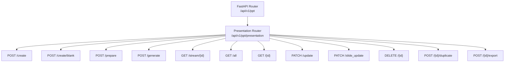
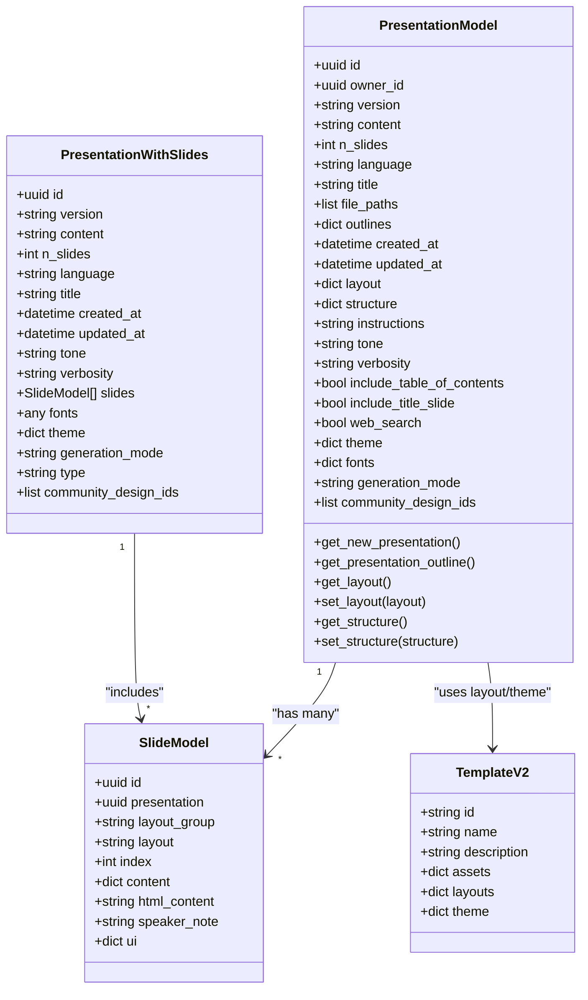
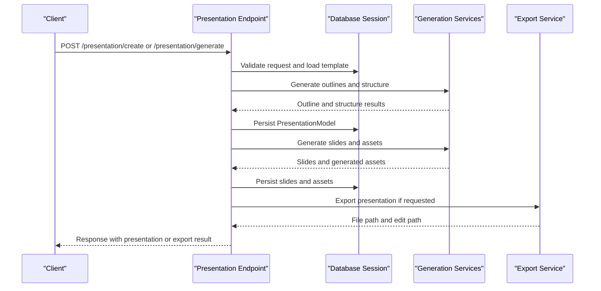
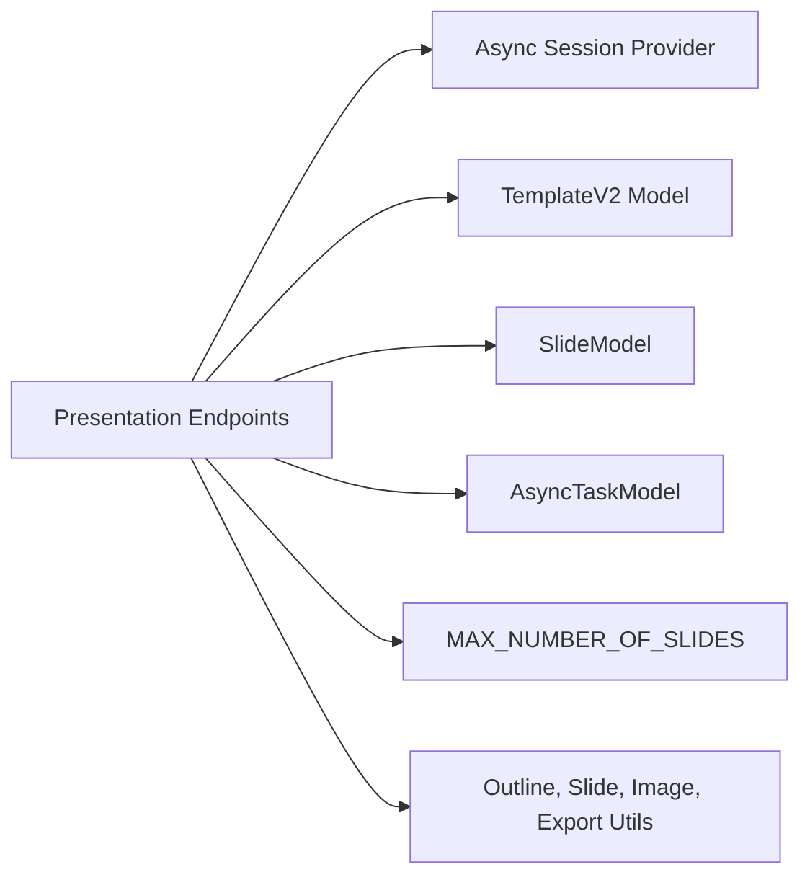

# Presentation CRUD Operations

<cite>
**Referenced Files in This Document**
- [presentation.py](file://servers/fastapi/api/v1/ppt/endpoints/presentation.py)
- [router.py](file://servers/fastapi/api/v1/ppt/router.py)
- [presentation_model.py](file://servers/fastapi/models/sql/presentation.py)
- [presentation_with_slides_model.py](file://servers/fastapi/models/presentation_with_slides.py)
- [presentation_and_path_model.py](file://servers/fastapi/models/presentation_and_path.py)
- [generate_presentation_request_model.py](file://servers/fastapi/models/generate_presentation_request.py)
- [slide_model.py](file://servers/fastapi/models/sql/slide.py)
- [template_v2_model.py](file://servers/fastapi/models/sql/template_v2.py)
- [async_task_model.py](file://servers/fastapi/models/sql/async_task.py)
- [constants_presentation.py](file://servers/fastapi/constants/presentation.py)
</cite>

## Table of Contents
1. [Introduction](#introduction)
2. [Project Structure](#project-structure)
3. [Core Components](#core-components)
4. [Architecture Overview](#architecture-overview)
5. [Detailed Component Analysis](#detailed-component-analysis)
6. [Dependency Analysis](#dependency-analysis)
7. [Performance Considerations](#performance-considerations)
8. [Troubleshooting Guide](#troubleshooting-guide)
9. [Conclusion](#conclusion)

## Introduction
This document describes the presentation CRUD operations exposed by the FastAPI backend under `/api/v1/ppt`. It covers:
- Creating presentations through direct creation and generation endpoints.
- Retrieving presentations via list and single-item endpoints.
- Updating presentation metadata and slides.
- Deleting presentations.
- The presentation data model, required fields, optional parameters, validation rules, metadata handling, versioning, and status management.
- Examples for creating from templates, generating from prompts, and managing properties.
- Error responses, authentication considerations, and rate-limiting guidance.

The presentation API is mounted under the prefix `/api/v1/ppt`, so a full endpoint path is typically `/api/v1/ppt/presentation/<operation>`.

## Project Structure
The presentation endpoints are defined in a dedicated router module and include multiple related routers such as slide, template, generation, and community routes. The main presentation router is included into the parent `ppt` router.

**Diagram sources**
- [router.py:22-40](file://servers/fastapi/api/v1/ppt/router.py#L22-L40)
- [presentation.py:134-134](file://servers/fastapi/api/v1/ppt/endpoints/presentation.py#L134-L134)
- [presentation.py:1487-1599](file://servers/fastapi/api/v1/ppt/endpoints/presentation.py#L1487-L1599)
- [presentation.py:1642-1799](file://servers/fastapi/api/v1/ppt/endpoints/presentation.py#L1642-L1799)
- [presentation.py:1801-1889](file://servers/fastapi/api/v1/ppt/endpoints/presentation.py#L1801-L1889)
- [presentation.py:2242-2485](file://servers/fastapi/api/v1/ppt/endpoints/presentation.py#L2242-L2485)
- [presentation.py:2488-2578](file://servers/fastapi/api/v1/ppt/endpoints/presentation.py#L2488-L2578)
- [presentation.py:3130-3156](file://servers/fastapi/api/v1/ppt/endpoints/presentation.py#L3130-L3156)

**Section sources**
- [router.py:22-40](file://servers/fastapi/api/v1/ppt/router.py#L22-L40)
- [presentation.py:134-134](file://servers/fastapi/api/v1/ppt/endpoints/presentation.py#L134-L134)

## Core Components
The core components involved in presentation CRUD are:
- Presentation database model with versioning, content, layout, structure, theme, fonts, and generation metadata.
- Response models for listing and retrieving presentations with slides.
- Request models for generation and editing.
- Endpoints for create, read, update, delete, duplicate, export, prepare, stream, and generate.

**Diagram sources**
- [presentation_model.py:16-126](file://servers/fastapi/models/sql/presentation.py#L16-L126)
- [presentation_with_slides_model.py:10-27](file://servers/fastapi/models/presentation_with_slides.py#L10-L27)
- [slide_model.py:1-200](file://servers/fastapi/models/sql/slide.py#L1-L200)
- [template_v2_model.py:1-200](file://servers/fastapi/models/sql/template_v2.py#L1-L200)

**Section sources**
- [presentation_model.py:16-126](file://servers/fastapi/models/sql/presentation.py#L16-L126)
- [presentation_with_slides_model.py:10-27](file://servers/fastapi/models/presentation_with_slides.py#L10-L27)

## Architecture Overview
The presentation lifecycle flows through these stages:
1. Creation or generation creates a `PresentationModel` row.
2. Optional preparation resolves template layout, generates outline-to-slide mapping, and stores structure.
3. Streaming or synchronous generation produces slides and assets.
4. Retrieval returns presentation metadata plus slides.
5. Updates modify presentation metadata and/or replace slides.
6. Deletion removes the presentation record.
7. Duplication copies presentation and slides.
8. Export converts the presentation to a downloadable artifact.

**Diagram sources**
- [presentation.py:1642-1741](file://servers/fastapi/api/v1/ppt/endpoints/presentation.py#L1642-L1741)
- [presentation.py:3130-3156](file://servers/fastapi/api/v1/ppt/endpoints/presentation.py#L3130-L3156)
- [presentation.py:2645-3101](file://servers/fastapi/api/v1/ppt/endpoints/presentation.py#L2645-L3101)

## Detailed Component Analysis

### Data Model and Versioning
The presentation data model defines:
- Primary key `id`.
- Ownership field `owner_id`.
- Version enum `version` with values `v1-standard` and `v2-standard`.
- Content string, slide count `n_slides`, language, optional title.
- JSON fields for file paths, outlines, layout, structure, theme, fonts, and community design IDs.
- Generation metadata including tone, verbosity, instructions, table-of-content flag, title-slide flag, web search flag, generation mode (`standard` or `smart`).

Versioning strategy:
- Presentations store a version string indicating schema compatibility.
- New presentations default to `v2-standard`.
- List endpoint supports filtering by version.

Validation helpers:
- `get_new_presentation` clones a presentation into a new instance.
- `get_presentation_outline`, `get_layout`, `set_layout`, `get_structure`, `set_structure` provide typed accessors and mutators for nested JSON structures.

**Section sources**
- [presentation_model.py:16-126](file://servers/fastapi/models/sql/presentation.py#L16-L126)

### Create Presentation
There are two primary creation entry points:

#### Direct Creation
`POST /presentation/create`
- Required body:
  - `content`: prompt or source text.
- Optional body:
  - `n_slides`: integer slide count; validated against minimum and maximum limits.
  - `language`: stored language string.
  - `file_paths`: list of temporary file paths resolved by the temp file service.
  - `tone`: enumerated tone value.
  - `verbosity`: enumerated verbosity value.
  - `instructions`: additional generation instructions.
  - `include_table_of_contents`: boolean; requires at least three slides when enabled.
  - `include_title_slide`: boolean.
  - `web_search`: boolean enabling web search context.
  - `generation_mode`: `standard` or `smart`; smart mode requires prompt, documents, or community references.
  - `community_design_ids`: list of community design identifiers; only allowed in smart mode and when community feature is enabled.

Validation rules:
- `n_slides` must be greater than zero and not exceed the configured maximum.
- If `include_table_of_contents` is true, `n_slides` must be at least three.
- Community references require smart mode and an enabled community feature.
- Smart mode without prompt, files, or community references is rejected.

Response:
- Returns the persisted `PresentationModel`.

Example usage patterns:
- Create a standard presentation with a prompt and explicit slide count.
- Create a smart presentation with web search and community references.

**Section sources**
- [presentation.py:1642-1741](file://servers/fastapi/api/v1/ppt/endpoints/presentation.py#L1642-L1741)
- [constants_presentation.py:1-200](file://servers/fastapi/constants/presentation.py#L1-L200)

#### Blank Presentation Creation
`POST /presentation/create/blank`
- Optional body:
  - `template_id`: optional template identifier used to initialize fonts and layout group.
- Behavior:
  - Creates a presentation with one blank slide.
  - Sets language to English and title to an untitled value.
  - Optionally extracts template fonts and sets layout group based on template.

Response:
- Returns `PresentationWithSlides` containing the newly created presentation and its initial slide.

**Section sources**
- [presentation.py:1744-1799](file://servers/fastapi/api/v1/ppt/endpoints/presentation.py#L1744-L1799)

### Prepare Presentation
`POST /presentation/prepare`
- Purpose:
  - Resolves a template layout, validates outline count, computes slide structure, optionally inserts table-of-content slides, and persists prepared presentation metadata.
- Required body:
  - `presentation_id`: UUID of an existing presentation.
  - `outlines`: array of slide outline objects.
  - `layout`: template identifier string.
- Optional body:
  - `title`: optional override for presentation title.

Validation rules:
- Outlines must be non-empty and not exceed the maximum slide limit.
- Layout must resolve to a valid template with at least one slide layout.
- If table-of-content is enabled, the structure is adjusted accordingly.

Response:
- Returns `PresentationPrepareResponse` with the presentation ID.

Use cases:
- After generating outlines externally, call prepare to lock in layout and structure before streaming final slides.

**Section sources**
- [presentation.py:1801-1889](file://servers/fastapi/api/v1/ppt/endpoints/presentation.py#L1801-L1889)

### Generate Presentation
`POST /presentation/generate`
- Purpose:
  - Validates request, loads template, generates outlines (or uses provided markdown slides), builds structure, generates slides and assets, persists everything, exports if requested, and returns export paths.
- Request model:
  - Defined by `GeneratePresentationRequest`.
  - Supports content, optional slides markdown, optional files, tone, verbosity, instructions, template, export format, and other generation options.

Flow highlights:
- Validates presence of content, slides markdown, or files.
- Enforces slide count limits and table-of-content constraints.
- Resolves template by ID or bundled alias.
- Generates outlines using LLM calls and normalizes them.
- Builds structure either from ordered template layouts or LLM-selected layouts.
- Batches slide content generation and asset fetching.
- Persists presentation, slides, and generated assets.
- Exports presentation and triggers webhook events.

Response:
- Returns `PresentationPathAndEditPath` with exported file path and editor link.

Error handling:
- Converts exceptions to HTTP errors.
- Emits failure webhooks and updates async task status when applicable.

**Section sources**
- [generate_presentation_request_model.py:1-200](file://servers/fastapi/models/generate_presentation_request.py#L1-L200)
- [presentation.py:2581-3101](file://servers/fastapi/api/v1/ppt/endpoints/presentation.py#L2581-L3101)
- [presentation.py:3130-3156](file://servers/fastapi/api/v1/ppt/endpoints/presentation.py#L3130-L3156)

### Stream Presentation
`GET /presentation/stream/{id}`
- Purpose:
  - Streams slide generation progress and final presentation data.
- Behavior:
  - For smart presentations, streams HTML slides and metrics while persisting checkpoints.
  - For standard presentations, requires prepared structure and outlines; streams slide chunks and asset updates.

Response:
- Server-sent events with slide chunks, asset updates, metrics, and completion payload.

Error handling:
- Returns SSE error events and rolls back session state on failures.

**Section sources**
- [presentation.py:2242-2485](file://servers/fastapi/api/v1/ppt/endpoints/presentation.py#L2242-L2485)

### Retrieve Presentations
List all presentations:
`GET /presentation/all`
- Query parameters:
  - `version`: filter by presentation version.
  - `include_slides`: include first slide for dashboard previews; set false for metadata-only lists.
- Response:
  - Array of `PresentationWithSlides`.

Get single presentation:
`GET /presentation/{id}`
- Path parameter:
  - `id`: UUID of the presentation.
- Response:
  - `PresentationWithSlides` with slides ordered by index.

**Section sources**
- [presentation.py:1487-1557](file://servers/fastapi/api/v1/ppt/endpoints/presentation.py#L1487-L1557)

### Update Presentations
Update presentation metadata and slides:
`PATCH /presentation/update`
- Body:
  - `id`: UUID of the presentation.
  - `n_slides`: optional new slide count with validation.
  - `title`: optional title update.
  - `slides`: optional array of slide objects; replaces all slides for the presentation after ownership check.

Validation:
- `n_slides` must be within allowed range.
- Slide array length must not exceed maximum.
- Slide IDs and presentation IDs are coerced to UUIDs.

Response:
- Returns `PresentationWithSlides` with updated presentation and slides.

Update individual slide:
`PATCH /presentation/slide_update`
- Body:
  - Embedded `SlideModel` with `id` and `presentation`.
- Validation:
  - Ensures slide exists and belongs to the supplied presentation.
- Response:
  - Updated `SlideModel`.

**Section sources**
- [presentation.py:2488-2578](file://servers/fastapi/api/v1/ppt/endpoints/presentation.py#L2488-L2578)

### Delete Presentation
`DELETE /presentation/{id}`
- Path parameter:
  - `id`: UUID of the presentation.
- Behavior:
  - Returns 404 if not found.
  - Deletes the presentation record.
- Response:
  - 204 No Content on success.

**Section sources**
- [presentation.py:1560-1570](file://servers/fastapi/api/v1/ppt/endpoints/presentation.py#L1560-L1570)

### Duplicate Presentation
`POST /presentation/{id}/duplicate`
- Behavior:
  - Loads presentation and slides.
  - Clones presentation and slides with new IDs.
  - Appends “(Copy)” to the title if present.
- Response:
  - `PresentationWithSlides` for the duplicated presentation.

**Section sources**
- [presentation.py:1572-1599](file://servers/fastapi/api/v1/ppt/endpoints/presentation.py#L1572-L1599)

### Export Presentation
`POST /presentation/{id}/export`
- Purpose:
  - Exports an existing presentation to a file format.
- Body:
  - `export_as`: `pptx` or `pdf`.
- Behavior:
  - Returns 404 if presentation not found.
  - Uses export helper with cookie header for renderer authentication.
- Response:
  - `PresentationPathAndEditPath` with file path and editor link.

**Section sources**
- [presentation.py:1603-1639](file://servers/fastapi/api/v1/ppt/endpoints/presentation.py#L1603-L1639)

### Authentication and Authorization
Authentication and ownership are handled through FastAPI dependencies and context utilities:
- Owner ID resolution is injected into models and services.
- Slide updates enforce ownership checks before replacing slides.
- Export endpoint preserves session cookies for renderer authentication.

Rate limiting:
- The repository does not define explicit rate-limiting middleware in the referenced files.
- Clients should implement client-side retry/backoff strategies for long-running generation and streaming endpoints.

**Section sources**
- [presentation_model.py:21-33](file://servers/fastapi/models/sql/presentation.py#L21-L33)
- [presentation.py:2529-2537](file://servers/fastapi/api/v1/ppt/endpoints/presentation.py#L2529-L2537)
- [presentation.py:1461-1484](file://servers/fastapi/api/v1/ppt/endpoints/presentation.py#L1461-L1484)

## Dependency Analysis
The presentation endpoints depend on several internal modules:
- Database session provider for async SQLAlchemy operations.
- Template model for layout and theme resolution.
- Slide model for slide persistence and retrieval.
- Async task model for background job tracking.
- Constants for slide count limits.
- Utilities for outline normalization, slide processing, image generation, and export.

**Diagram sources**
- [presentation.py:66-128](file://servers/fastapi/api/v1/ppt/endpoints/presentation.py#L66-L128)
- [presentation.py:2581-3101](file://servers/fastapi/api/v1/ppt/endpoints/presentation.py#L2581-L3101)

**Section sources**
- [presentation.py:66-128](file://servers/fastapi/api/v1/ppt/endpoints/presentation.py#L66-L128)
- [constants_presentation.py:1-200](file://servers/fastapi/constants/presentation.py#L1-L200)

## Performance Considerations
- Batched slide generation improves throughput by processing slides in groups.
- Concurrent asset fetching runs alongside slide content generation.
- Streaming endpoints checkpoint progress to allow resumption after interruptions.
- Large source contexts are truncated to prevent excessive memory usage.
- Avoid including slides in list endpoints unless necessary; use `include_slides=false` for metadata-only queries.

[No sources needed since this section provides general guidance]

## Troubleshooting Guide
Common issues and resolutions:
- Invalid template: Ensure template ID or bundled alias is valid; otherwise receive a 400 error.
- Slide count out of range: Adjust `n_slides` to be within allowed limits.
- Missing outlines for streaming: Call `/presentation/prepare` before streaming standard presentations.
- Smart mode requirements: Provide prompt, documents, or community references when using smart generation.
- Community references disabled: Enable community feature or remove community design IDs.
- Not found errors: Verify presentation and slide IDs exist and belong to the current owner.

Error response patterns:
- HTTP 400 for validation failures.
- HTTP 404 for missing resources.
- HTTP 422 for invalid input types.
- HTTP 500 for unexpected server errors.

Webhook notifications:
- Success and failure events are emitted for presentation generation tasks.

**Section sources**
- [presentation.py:2581-2642](file://servers/fastapi/api/v1/ppt/endpoints/presentation.py#L2581-L2642)
- [presentation.py:3103-3127](file://servers/fastapi/api/v1/ppt/endpoints/presentation.py#L3103-L3127)

## Conclusion
The presentation CRUD system provides a comprehensive API for creating, preparing, generating, retrieving, updating, duplicating, exporting, and deleting presentations. It supports both standard and smart generation modes, template-driven layouts, structured slide mapping, and streaming progress. Proper validation, versioning, and ownership checks ensure robust behavior. Clients should handle long-running operations with retries and respect validation constraints to avoid common errors.

[No sources needed since this section summarizes without analyzing specific files]