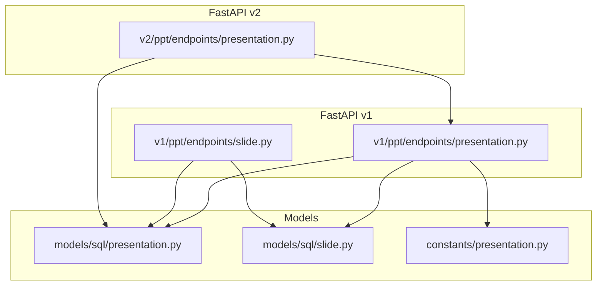
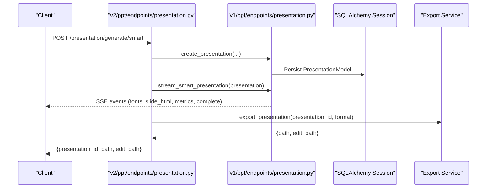
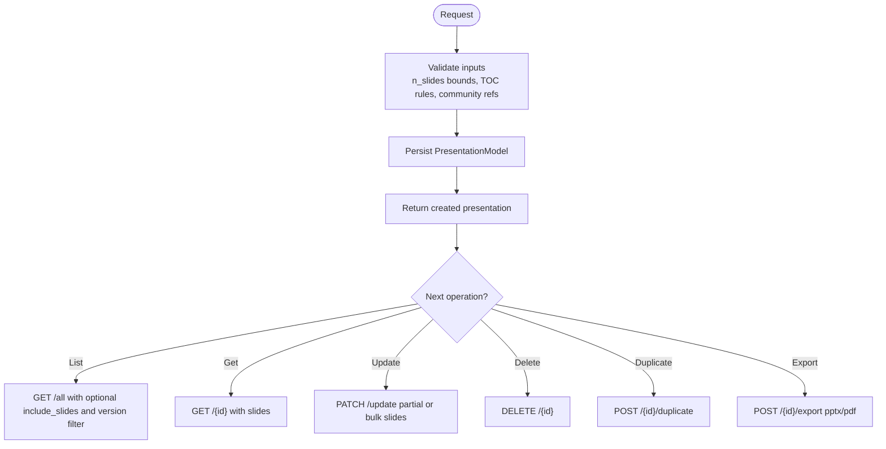
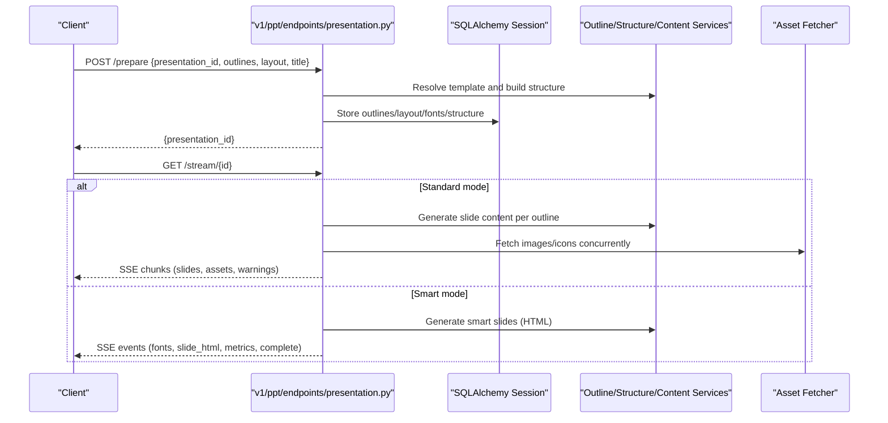
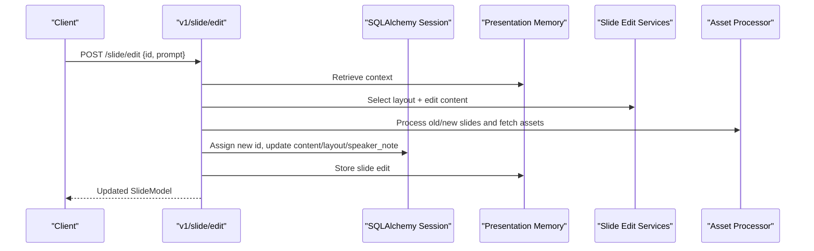
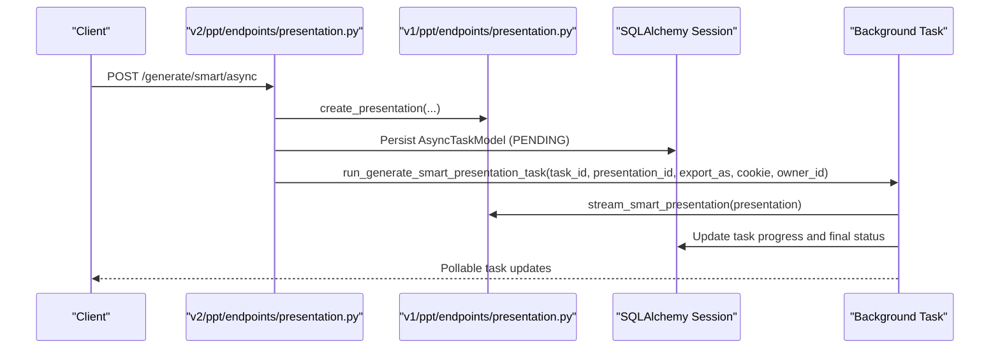
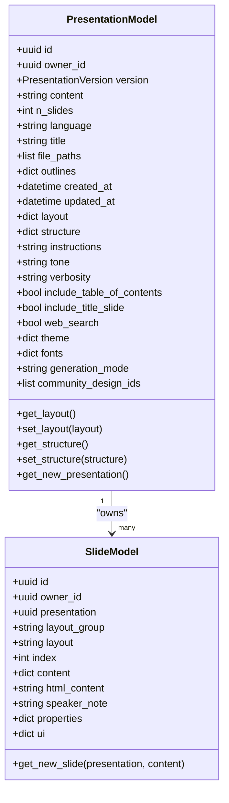
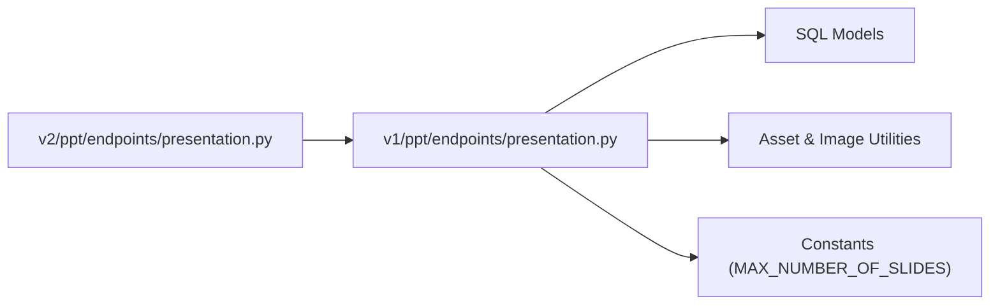

# Presentation Management API

<cite>
**Referenced Files in This Document**
- [presentation.py](file://servers/fastapi/api/v1/ppt/endpoints/presentation.py)
- [slide.py](file://servers/fastapi/api/v1/ppt/endpoints/slide.py)
- [presentation.py](file://servers/fastapi/api/v2/ppt/endpoints/presentation.py)
- [presentation.py](file://servers/fastapi/models/sql/presentation.py)
- [slide.py](file://servers/fastapi/models/sql/slide.py)
- [presentation.py](file://servers/fastapi/constants/presentation.py)
</cite>

## Table of Contents
1. [Introduction](#introduction)
2. [Project Structure](#project-structure)
3. [Core Components](#core-components)
4. [Architecture Overview](#architecture-overview)
5. [Detailed Component Analysis](#detailed-component-analysis)
6. [Dependency Analysis](#dependency-analysis)
7. [Performance Considerations](#performance-considerations)
8. [Troubleshooting Guide](#troubleshooting-guide)
9. [Conclusion](#conclusion)

## Introduction
This document describes the presentation management API for creating, retrieving, updating, and deleting presentations; managing slides; streaming generation; bulk operations; search and filtering; sharing via export; versioning; conflict resolution; and data consistency patterns. It focuses on the FastAPI endpoints under v1 and v2, the database models, and the processing logic that powers slide generation and layout hydration.

## Project Structure
The presentation management functionality is implemented primarily in:
- v1 presentation endpoints: CRUD, prepare, stream, generate, export, duplicate
- v1 slide endpoints: AI-assisted slide editing
- v2 presentation endpoints: Smart generation synchronous and asynchronous flows
- SQL models: Presentation and Slide entities with metadata and relationships
- Constants: Limits and defaults such as maximum number of slides

**Diagram sources**
- [presentation.py](file://servers/fastapi/api/v1/ppt/endpoints/presentation.py)
- [slide.py](file://servers/fastapi/api/v1/ppt/endpoints/slide.py)
- [presentation.py](file://servers/fastapi/api/v2/ppt/endpoints/presentation.py)
- [presentation.py](file://servers/fastapi/models/sql/presentation.py)
- [slide.py](file://servers/fastapi/models/sql/slide.py)
- [presentation.py](file://servers/fastapi/constants/presentation.py)

**Section sources**
- [presentation.py](file://servers/fastapi/api/v1/ppt/endpoints/presentation.py)
- [slide.py](file://servers/fastapi/api/v1/ppt/endpoints/slide.py)
- [presentation.py](file://servers/fastapi/api/v2/ppt/endpoints/presentation.py)
- [presentation.py](file://servers/fastapi/models/sql/presentation.py)
- [slide.py](file://servers/fastapi/models/sql/slide.py)
- [presentation.py](file://servers/fastapi/constants/presentation.py)

## Core Components
- Presentation model: Stores metadata (version, content, language, title), generation options (tone, verbosity, instructions), structure and layout references, theme/fonts, and flags like table-of-contents and web search.
- Slide model: Represents individual slides with layout group and id, index ordering, JSON content, optional HTML rendering, speaker notes, properties, and UI state.
- Endpoints:
  - v1: Full CRUD, prepare, stream, generate, export, duplicate
  - v1 slide: Edit slide content and HTML
  - v2: Smart generation sync/async wrappers
- Constants: Maximum number of slides and related limits.

Key responsibilities:
- Validation and normalization of requests
- Template and layout resolution
- Outline and structure generation
- Slide content generation and asset fetching
- Streaming SSE responses for real-time progress
- Export to PPTX/PDF

**Section sources**
- [presentation.py](file://servers/fastapi/models/sql/presentation.py)
- [slide.py](file://servers/fastapi/models/sql/slide.py)
- [presentation.py](file://servers/fastapi/api/v1/ppt/endpoints/presentation.py)
- [slide.py](file://servers/fastapi/api/v1/ppt/endpoints/slide.py)
- [presentation.py](file://servers/fastapi/api/v2/ppt/endpoints/presentation.py)
- [presentation.py](file://servers/fastapi/constants/presentation.py)

## Architecture Overview
The API exposes REST endpoints for presentation lifecycle and slide editing, plus streaming endpoints for real-time generation. The v2 Smart generation endpoints delegate to v1 helpers while adding async task support.

**Diagram sources**
- [presentation.py](file://servers/fastapi/api/v2/ppt/endpoints/presentation.py)
- [presentation.py](file://servers/fastapi/api/v1/ppt/endpoints/presentation.py)
- [presentation.py](file://servers/fastapi/models/sql/presentation.py)

## Detailed Component Analysis

### Presentation CRUD and Lifecycle
- Create presentation: Validates slide count, community references, and mode constraints; persists a new PresentationModel with default version and generation options.
- Get all presentations: Supports filtering by version and optionally including the first slide for previews.
- Get presentation by id: Returns presentation with all slides ordered by index.
- Update presentation: Partial update of n_slides/title; bulk replacement of slides with validation and owner-scoped deletion before insert.
- Delete presentation: Deletes presentation record; cascades to slides via foreign key.
- Duplicate presentation: Copies presentation and all slides into a new presentation with appended title suffix.
- Export existing presentation: Re-exports an already generated presentation without regenerating content.

**Diagram sources**
- [presentation.py](file://servers/fastapi/api/v1/ppt/endpoints/presentation.py)
- [presentation.py](file://servers/fastapi/models/sql/presentation.py)

**Section sources**
- [presentation.py](file://servers/fastapi/api/v1/ppt/endpoints/presentation.py)
- [presentation.py](file://servers/fastapi/models/sql/presentation.py)

### Prepare and Stream Generation
- Prepare presentation: Accepts outlines and template layout; resolves template; generates or uses ordered structure; inserts TOC layouts when requested; normalizes structure indexes; stores outlines, layout, fonts, and structure.
- Stream presentation: For standard mode, streams slide content and assets per outline; for smart mode, streams HTML slides, fonts, metrics, and completion. Includes checkpointing and retry handling for resilience.

**Diagram sources**
- [presentation.py](file://servers/fastapi/api/v1/ppt/endpoints/presentation.py)

**Section sources**
- [presentation.py](file://servers/fastapi/api/v1/ppt/endpoints/presentation.py)

### Slide Management
- Edit slide: Uses memory context, selects appropriate layout, edits content via LLM, processes assets, assigns new slide id, updates content/layout/speaker note, persists changes, and records edit history.
- Edit slide HTML: Edits HTML directly using LLM, assigns new id, persists updated HTML, and records edit history.

**Diagram sources**
- [slide.py](file://servers/fastapi/api/v1/ppt/endpoints/slide.py)

**Section sources**
- [slide.py](file://servers/fastapi/api/v1/ppt/endpoints/slide.py)

### Smart Generation (v2)
- Synchronous smart generation: Creates presentation, streams generation, exports result, returns paths.
- Asynchronous smart generation: Queues background task, returns AsyncTaskModel for polling; updates task status and data during generation.

**Diagram sources**
- [presentation.py](file://servers/fastapi/api/v2/ppt/endpoints/presentation.py)
- [presentation.py](file://servers/fastapi/api/v1/ppt/endpoints/presentation.py)

**Section sources**
- [presentation.py](file://servers/fastapi/api/v2/ppt/endpoints/presentation.py)
- [presentation.py](file://servers/fastapi/api/v1/ppt/endpoints/presentation.py)

### Data Model and Metadata Handling
- PresentationModel fields:
  - Identity and ownership: id, owner_id
  - Versioning: version enum (V1_STANDARD, V2_STANDARD)
  - Content and generation: content, n_slides, language, tone, verbosity, instructions
  - Structure and layout: outlines, layout, structure
  - Theme and fonts: theme, fonts
  - Flags: include_table_of_contents, include_title_slide, web_search, generation_mode
  - Community references: community_design_ids
- SlideModel fields:
  - Identity and ownership: id, owner_id
  - Association: presentation (FK)
  - Layout: layout_group, layout
  - Ordering: index
  - Content: content (JSON), html_content (optional)
  - Extras: speaker_note, properties, ui (JSON)

**Diagram sources**
- [presentation.py](file://servers/fastapi/models/sql/presentation.py)
- [slide.py](file://servers/fastapi/models/sql/slide.py)

**Section sources**
- [presentation.py](file://servers/fastapi/models/sql/presentation.py)
- [slide.py](file://servers/fastapi/models/sql/slide.py)

### Bulk Operations, Search, and Filtering
- Bulk slide replacement: PATCH /update accepts a list of slides; validates total count against MAX_NUMBER_OF_SLIDES; deletes existing slides scoped by owner before inserting new ones.
- Listing with filters: GET /all supports version filter and optional inclusion of the first slide for dashboard previews.
- No dedicated full-text search endpoint is exposed; clients can filter by version and use client-side search over returned metadata.

**Section sources**
- [presentation.py](file://servers/fastapi/api/v1/ppt/endpoints/presentation.py)
- [presentation.py](file://servers/fastapi/constants/presentation.py)

### Sharing Features
- Export: Both newly generated and existing presentations can be exported to PPTX or PDF. The export endpoint reuses the same export helper used by generation flows, enabling recovery after interrupted connections.
- Edit path: Responses include an edit_path for direct navigation to the editor.

**Section sources**
- [presentation.py](file://servers/fastapi/api/v1/ppt/endpoints/presentation.py)

### Versioning Strategies
- PresentationVersion enum distinguishes between V1_STANDARD and V2_STANDARD.
- New presentations are created with V2_STANDARD by default.
- Listing supports filtering by version to isolate datasets across versions.

**Section sources**
- [presentation.py](file://servers/fastapi/models/sql/presentation.py)
- [presentation.py](file://servers/fastapi/api/v1/ppt/endpoints/presentation.py)

### Conflict Resolution and Data Consistency
- Owner-scoped operations: Bulk slide updates and deletions are scoped by current owner to prevent cross-user conflicts.
- Transactional safety: Streams wrap work in sessions with rollback on error; checkpoints persist intermediate slides for resiliency.
- Idempotency hints: Slide edits assign new unique ids to avoid stale references; duplicate presentation creates a fresh copy with a modified title.
- Normalization: Structure indexes are normalized to valid ranges to protect streaming from invalid layout selections.

**Section sources**
- [presentation.py](file://servers/fastapi/api/v1/ppt/endpoints/presentation.py)

## Dependency Analysis
- v2 Smart endpoints depend on v1 helpers for presentation creation and streaming.
- All endpoints rely on SQLAlchemy async sessions for persistence.
- Asset processing and image generation are integrated into slide workflows.
- Constants define hard limits (e.g., maximum slides).

**Diagram sources**
- [presentation.py](file://servers/fastapi/api/v2/ppt/endpoints/presentation.py)
- [presentation.py](file://servers/fastapi/api/v1/ppt/endpoints/presentation.py)
- [presentation.py](file://servers/fastapi/constants/presentation.py)

**Section sources**
- [presentation.py](file://servers/fastapi/api/v2/ppt/endpoints/presentation.py)
- [presentation.py](file://servers/fastapi/api/v1/ppt/endpoints/presentation.py)
- [presentation.py](file://servers/fastapi/constants/presentation.py)

## Performance Considerations
- Batched generation: Slide content and asset tasks are processed in batches to balance throughput and resource usage.
- Concurrent asset fetching: Images and icons are fetched asynchronously alongside content generation.
- Streaming: SSE enables progressive delivery of slides and assets, improving perceived latency.
- Limits: Enforced maximum slide counts prevent excessive resource consumption.

[No sources needed since this section provides general guidance]

## Troubleshooting Guide
Common issues and resolutions:
- Invalid slide count: Ensure n_slides is within allowed range and meets TOC constraints.
- Missing outlines or structure: Prepare must succeed before streaming; verify templates and layouts.
- Asset generation failures: Check image provider configuration and network access; warnings are included in slide asset events.
- Export not reachable after interruption: Use export endpoint with the presentation id to retrieve previously generated files.
- Smart generation errors: Inspect task status and error metadata; retry if marked retryable.

**Section sources**
- [presentation.py](file://servers/fastapi/api/v1/ppt/endpoints/presentation.py)
- [presentation.py](file://servers/fastapi/api/v2/ppt/endpoints/presentation.py)

## Conclusion
The presentation management API provides comprehensive capabilities for creating, organizing, and exporting presentations, with robust slide editing, streaming generation, and clear versioning. It emphasizes data consistency through owner scoping, transactional safety, and normalization, while offering performance optimizations via batching and concurrency. Clients can leverage both synchronous and asynchronous flows, along with streaming for real-time feedback.