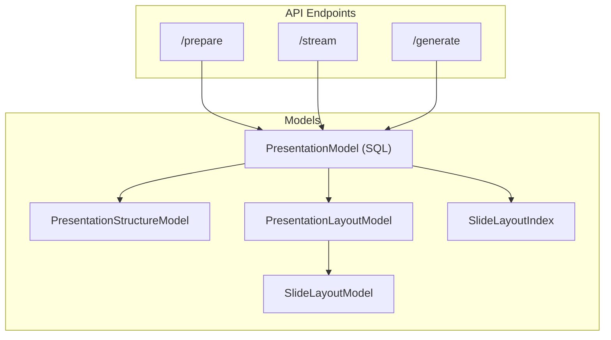
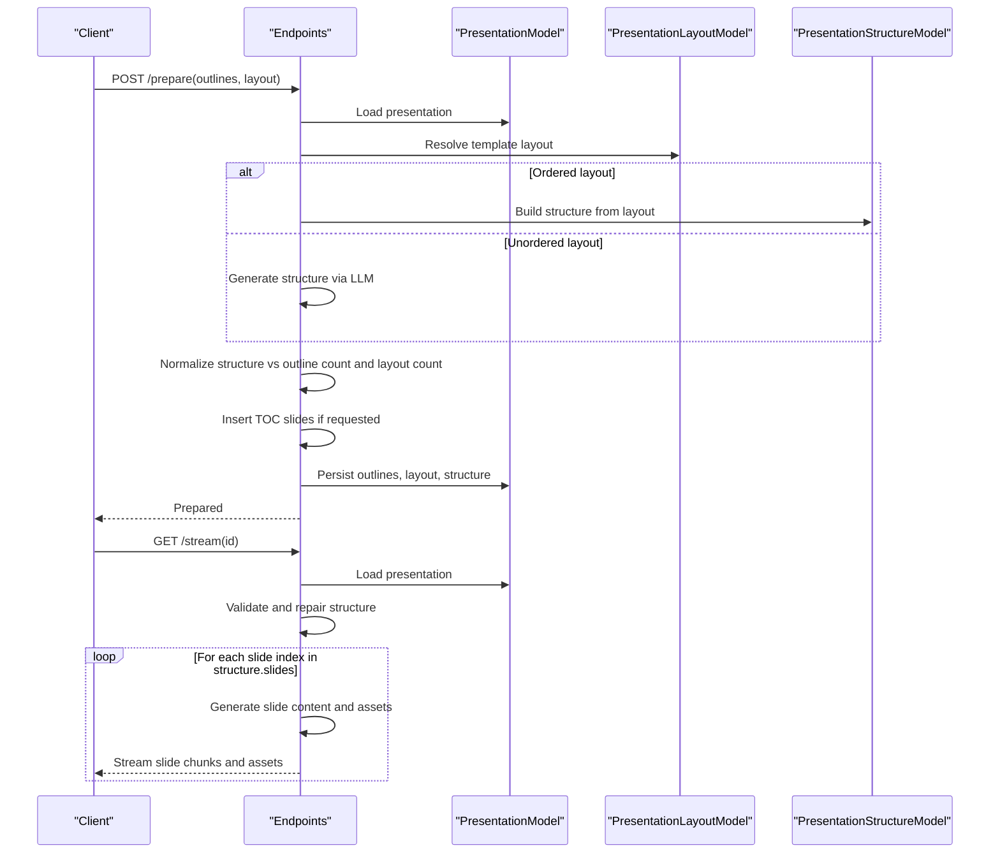
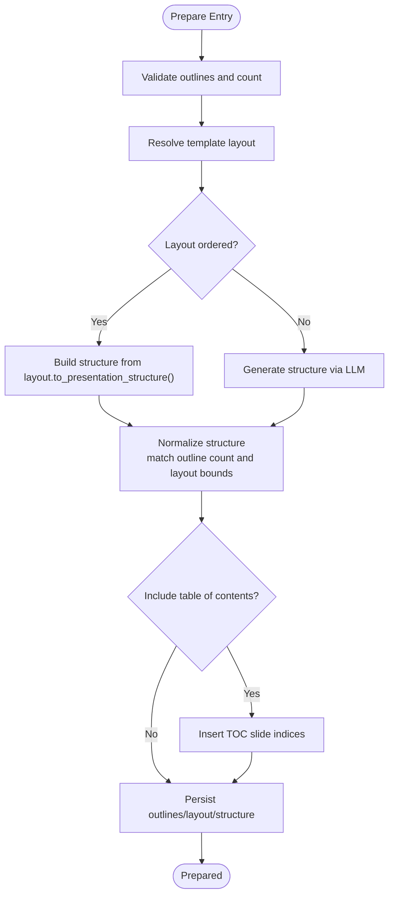
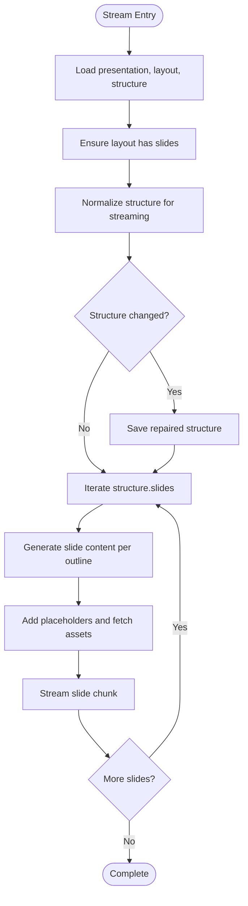
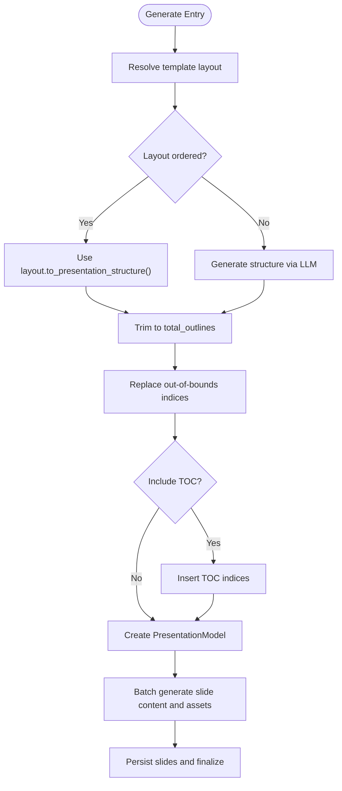
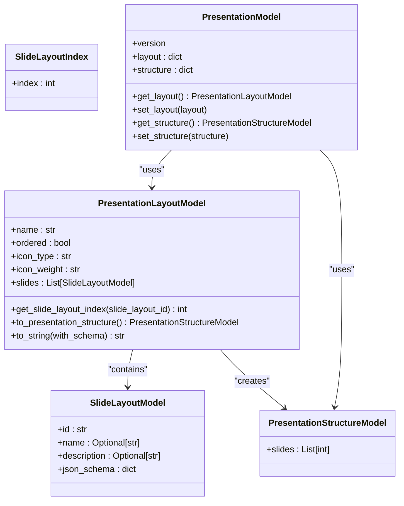

# Presentation Structure & Hierarchy

<cite>
**Referenced Files in This Document**
- [presentation_structure_model.py](file://servers/fastapi/models/presentation_structure_model.py)
- [presentation_layout.py](file://servers/fastapi/templates/presentation_layout.py)
- [presentation_layout.py](file://servers/fastapi/models/presentation_layout.py)
- [slide_layout_index.py](file://servers/fastapi/models/slide_layout_index.py)
- [presentation.py](file://servers/fastapi/models/sql/presentation.py)
- [presentation.py](file://servers/fastapi/api/v1/ppt/endpoints/presentation.py)
</cite>

## Table of Contents
1. [Introduction](#introduction)
2. [Project Structure](#project-structure)
3. [Core Components](#core-components)
4. [Architecture Overview](#architecture-overview)
5. [Detailed Component Analysis](#detailed-component-analysis)
6. [Dependency Analysis](#dependency-analysis)
7. [Performance Considerations](#performance-considerations)
8. [Troubleshooting Guide](#troubleshooting-guide)
9. [Conclusion](#conclusion)

## Introduction
This document explains how presentations are structured and how slide hierarchy is managed. It focuses on:
- The presentation structure model that defines slide ordering and layout assignments.
- The presentation layout model and slide layout model that define available layouts and their JSON schemas.
- Validation, normalization, and integrity checks applied to the structure.
- Practical manipulation patterns for structure updates, layout assignment strategies, and hierarchy optimization.
- Versioning and migration considerations across different presentation versions.

The goal is to make the structure and hierarchy concepts accessible while providing precise references to the implementation.

## Project Structure
The relevant code lives primarily under the FastAPI backend:
- Models define the core data structures for structure and layout.
- SQL models persist presentation metadata including structure and layout payloads.
- API endpoints orchestrate preparation, streaming, and generation workflows that consume and update the structure.

**Diagram sources**
- [presentation_structure_model.py:5-6](file://servers/fastapi/models/presentation_structure_model.py#L5-L6)
- [presentation_layout.py:11-62](file://servers/fastapi/templates/presentation_layout.py#L11-L62)
- [slide_layout_index.py:4-5](file://servers/fastapi/models/slide_layout_index.py#L4-L5)
- [presentation.py:21-125](file://servers/fastapi/models/sql/presentation.py#L21-L125)
- [presentation.py:1801-1889](file://servers/fastapi/api/v1/ppt/endpoints/presentation.py#L1801-L1889)
- [presentation.py:2250-2449](file://servers/fastapi/api/v1/ppt/endpoints/presentation.py#L2250-L2449)
- [presentation.py:2830-3029](file://servers/fastapi/api/v1/ppt/endpoints/presentation.py#L2830-L3029)

**Section sources**
- [presentation_structure_model.py:5-6](file://servers/fastapi/models/presentation_structure_model.py#L5-L6)
- [presentation_layout.py:11-62](file://servers/fastapi/templates/presentation_layout.py#L11-L62)
- [slide_layout_index.py:4-5](file://servers/fastapi/models/slide_layout_index.py#L4-L5)
- [presentation.py:21-125](file://servers/fastapi/models/sql/presentation.py#L21-L125)
- [presentation.py:1801-1889](file://servers/fastapi/api/v1/ppt/endpoints/presentation.py#L1801-L1889)
- [presentation.py:2250-2449](file://servers/fastapi/api/v1/ppt/endpoints/presentation.py#L2250-L2449)
- [presentation.py:2830-3029](file://servers/fastapi/api/v1/ppt/endpoints/presentation.py#L2830-L3029)

## Core Components
- PresentationStructureModel: Represents the ordered list of slide layout indexes for a presentation. Each integer points into the layout’s slides array.
- SlideLayoutModel: Describes an individual slide layout with an id, optional name/description, and a JSON schema defining editable content fields.
- PresentationLayoutModel: Defines a named collection of slide layouts, whether they are ordered or not, icon settings, and provides helpers to map between layout and structure.
- SlideLayoutIndex: A simple index wrapper used by some APIs to reference a specific slide layout index.
- PresentationModel (SQL): Persists the presentation, including layout and structure as JSON, and exposes typed getters/setters for both.

Key responsibilities:
- Structure holds slide order and layout indices.
- Layouts define what slide types exist and what content each can accept.
- The SQL model bridges raw JSON storage with typed Pydantic models.

**Section sources**
- [presentation_structure_model.py:5-6](file://servers/fastapi/models/presentation_structure_model.py#L5-L6)
- [presentation_layout.py:11-62](file://servers/fastapi/templates/presentation_layout.py#L11-L62)
- [slide_layout_index.py:4-5](file://servers/fastapi/models/slide_layout_index.py#L4-L5)
- [presentation.py:21-125](file://servers/fastapi/models/sql/presentation.py#L21-L125)

## Architecture Overview
The presentation lifecycle uses three main flows:
- Prepare: Accept outlines and a template layout, generate or derive a structure, normalize it, optionally insert table-of-content slides, and persist.
- Stream: Load prepared structure and layout, validate and repair if needed, then stream slide content and assets per structure order.
- Generate: Create a new presentation from scratch using templates, build structure, apply TOC logic, create slides, and persist.

**Diagram sources**
- [presentation.py:1801-1889](file://servers/fastapi/api/v1/ppt/endpoints/presentation.py#L1801-L1889)
- [presentation.py:2250-2449](file://servers/fastapi/api/v1/ppt/endpoints/presentation.py#L2250-L2449)
- [presentation.py:2830-3029](file://servers/fastapi/api/v1/ppt/endpoints/presentation.py#L2830-L3029)

## Detailed Component Analysis

### PresentationStructureModel
Purpose:
- Encodes the final slide order as a list of integers, where each integer is an index into the selected layout’s slides array.

Behavior:
- Used throughout prepare/stream/generate flows to determine which layout to apply for each outline item.
- Normalized to match the number of outlines and to ensure all indices are within bounds.

Complexity:
- Accessing a slide layout by index is O(1).
- Iterating over the structure is O(n), where n is the number of slides.

Integrity constraints:
- Indices must be valid for the current layout; invalid values are repaired during normalization.

**Section sources**
- [presentation_structure_model.py:5-6](file://servers/fastapi/models/presentation_structure_model.py#L5-L6)
- [presentation.py:372-395](file://servers/fastapi/api/v1/ppt/endpoints/presentation.py#L372-L395)

### SlideLayoutModel
Purpose:
- Represents one available slide layout with:
  - id: stable identifier for the layout.
  - name/description: human-readable metadata.
  - json_schema: schema describing editable content fields for this slide type.

Role:
- Provides the contract for slide content generation.
- Used to select appropriate content generation based on the slide type.

**Section sources**
- [presentation_layout.py:11-15](file://servers/fastapi/templates/presentation_layout.py#L11-L15)

### PresentationLayoutModel
Purpose:
- Groups multiple SlideLayoutModel entries under a single layout set.
- Declares whether the layout is ordered (fixed sequence) or unordered (LLM-assigned).
- Provides helper methods:
  - get_slide_layout_index: resolve a slide layout id to its index.
  - to_presentation_structure: convert an ordered layout into a default structure (sequential indices).
  - to_string: serialize layout info for debugging or prompts.

Validation:
- Icon type normalization ensures consistent icon settings.
- Missing slide layout ids raise explicit errors when resolving indices.

**Section sources**
- [presentation_layout.py:18-62](file://servers/fastapi/templates/presentation_layout.py#L18-L62)
- [presentation_layout.py:1-5](file://servers/fastapi/models/presentation_layout.py#L1-L5)

### SlideLayoutIndex
Purpose:
- Simple wrapper around an integer index, used by certain APIs to request operations on a specific slide layout index.

Usage:
- Often paired with layout selection or reordering operations.

**Section sources**
- [slide_layout_index.py:4-5](file://servers/fastapi/models/slide_layout_index.py#L4-L5)

### PresentationModel (SQL)
Purpose:
- Persists presentation metadata, including:
  - version: distinguishes v1-standard and v2-standard presentations.
  - layout: stores the resolved layout payload as JSON.
  - structure: stores the normalized structure as JSON.
- Exposes typed accessors:
  - get_layout: returns PresentationLayoutModel.
  - set_layout: persists a PresentationLayoutModel.
  - get_structure: returns PresentationStructureModel.
  - set_structure: persists a PresentationStructureModel.

Versioning:
- V1 vs V2 affects defaults and behavior in generation flows.

**Section sources**
- [presentation.py:16-125](file://servers/fastapi/models/sql/presentation.py#L16-L125)

### Structure Preparation Flow

**Diagram sources**
- [presentation.py:1801-1889](file://servers/fastapi/api/v1/ppt/endpoints/presentation.py#L1801-L1889)
- [presentation.py:349-395](file://servers/fastapi/api/v1/ppt/endpoints/presentation.py#L349-L395)

**Section sources**
- [presentation.py:1801-1889](file://servers/fastapi/api/v1/ppt/endpoints/presentation.py#L1801-L1889)
- [presentation.py:349-395](file://servers/fastapi/api/v1/ppt/endpoints/presentation.py#L349-L395)

### Structure Streaming Flow

**Diagram sources**
- [presentation.py:2250-2449](file://servers/fastapi/api/v1/ppt/endpoints/presentation.py#L2250-L2449)

**Section sources**
- [presentation.py:2250-2449](file://servers/fastapi/api/v1/ppt/endpoints/presentation.py#L2250-L2449)

### Structure Generation Flow

**Diagram sources**
- [presentation.py:2830-3029](file://servers/fastapi/api/v1/ppt/endpoints/presentation.py#L2830-L3029)

**Section sources**
- [presentation.py:2830-3029](file://servers/fastapi/api/v1/ppt/endpoints/presentation.py#L2830-L3029)

## Dependency Analysis

**Diagram sources**
- [presentation_structure_model.py:5-6](file://servers/fastapi/models/presentation_structure_model.py#L5-L6)
- [presentation_layout.py:11-62](file://servers/fastapi/templates/presentation_layout.py#L11-L62)
- [slide_layout_index.py:4-5](file://servers/fastapi/models/slide_layout_index.py#L4-L5)
- [presentation.py:21-125](file://servers/fastapi/models/sql/presentation.py#L21-L125)

**Section sources**
- [presentation_structure_model.py:5-6](file://servers/fastapi/models/presentation_structure_model.py#L5-L6)
- [presentation_layout.py:11-62](file://servers/fastapi/templates/presentation_layout.py#L11-L62)
- [slide_layout_index.py:4-5](file://servers/fastapi/models/slide_layout_index.py#L4-L5)
- [presentation.py:21-125](file://servers/fastapi/models/sql/presentation.py#L21-L125)

## Performance Considerations
- Structure normalization is linear in the number of slides and ensures safe indices before persistence or streaming.
- Streaming generates slide content and assets concurrently per slide, improving throughput while maintaining order.
- Batching in generation reduces memory pressure and improves responsiveness for large presentations.

Recommendations:
- Keep layout counts reasonable to avoid excessive randomization and boundary repairs.
- Prefer ordered layouts when slide order is fixed to reduce LLM overhead and improve determinism.
- Use batch sizes tuned to resource limits to balance concurrency and stability.

[No sources needed since this section provides general guidance]

## Troubleshooting Guide
Common issues and resolutions:
- Invalid structure indices:
  - Symptom: Errors during streaming or generation due to out-of-range indices.
  - Resolution: Ensure normalization runs after any manual edits to structure.slides.
- Missing slide layouts:
  - Symptom: HTTP 404 when resolving a slide layout id.
  - Resolution: Verify layout contains the referenced id; use get_slide_layout_index to confirm mapping.
- Empty or malformed layout:
  - Symptom: Errors indicating no usable layouts or invalid template layout JSON.
  - Resolution: Provide at least one layout with a valid schema; check template payload structure.
- TOC insertion conflicts:
  - Symptom: Unexpected slide order when TOC is enabled.
  - Resolution: Confirm include_table_of_contents and title slide flags; verify toc_slide_layout_index selection.

Operational tips:
- Always call _normalize_presentation_structure after modifying structure.slides.
- When editing layouts, ensure unique slide layout ids to avoid collisions.
- Log repaired structures to detect upstream data issues early.

**Section sources**
- [presentation_layout.py:36-42](file://servers/fastapi/templates/presentation_layout.py#L36-L42)
- [presentation.py:372-395](file://servers/fastapi/api/v1/ppt/endpoints/presentation.py#L372-L395)
- [presentation.py:1801-1889](file://servers/fastapi/api/v1/ppt/endpoints/presentation.py#L1801-L1889)
- [presentation.py:2250-2449](file://servers/fastapi/api/v1/ppt/endpoints/presentation.py#L2250-L2449)

## Conclusion
The presentation structure and hierarchy are defined by a clear separation of concerns:
- PresentationStructureModel encodes slide order as indices into a layout’s slides array.
- PresentationLayoutModel and SlideLayoutModel define the available slide types and their content contracts.
- The SQL PresentationModel persists these structures and provides typed accessors.
- API endpoints enforce validation, normalization, and integrity constraints during prepare, stream, and generate flows.
- Versioning supports evolution across presentation formats, while layout ordering and TOC insertion provide flexible hierarchy management.

Adhering to these patterns ensures robust, predictable presentation generation and editing experiences.

[No sources needed since this section summarizes without analyzing specific files]