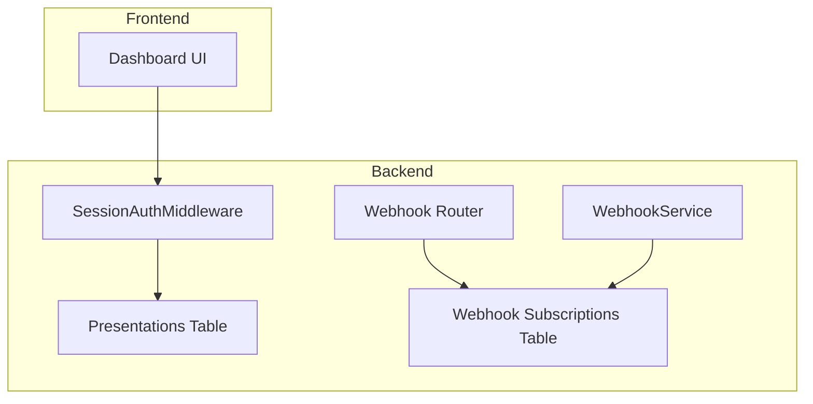
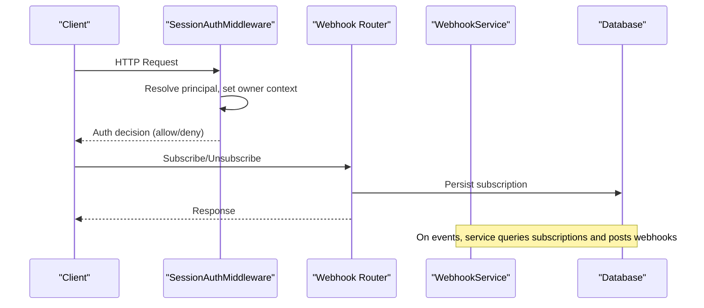
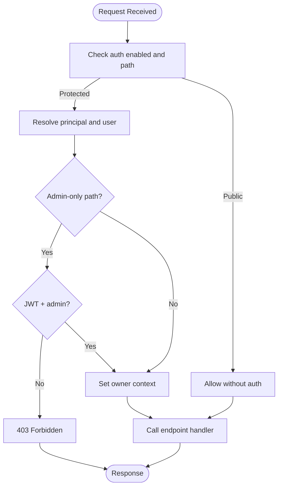
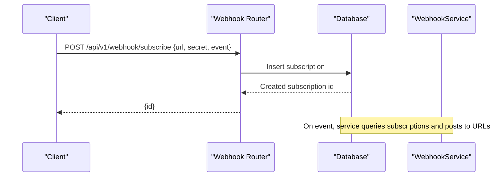
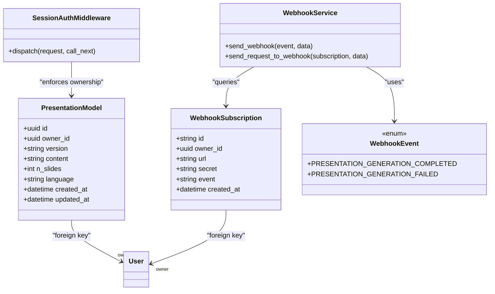

# Sharing & Collaboration Features

<cite>
**Referenced Files in This Document**
- [presentation.py](file://servers/fastapi/models/sql/presentation.py)
- [context.py](file://servers/fastapi/api/v1/auth/context.py)
- [middlewares.py](file://servers/fastapi/api/middlewares.py)
- [router.py](file://servers/fastapi/api/v1/webhook/router.py)
- [webhook_service.py](file://servers/fastapi/services/webhook_service.py)
- [webhook_subscription.py](file://servers/fastapi/models/sql/webhook_subscription.py)
- [webhook_event.py](file://servers/fastapi/enums/webhook_event.py)
- [dashboard.ts](file://servers/nextjs/app/(presentation-generator)/services/api/dashboard.ts)
- [PresentationCard.tsx](file://servers/nextjs/app/(presentation-generator)/(dashboard)/dashboard/components/PresentationCard.tsx)
</cite>

## Table of Contents
1. [Introduction](#introduction)
2. [Project Structure](#project-structure)
3. [Core Components](#core-components)
4. [Architecture Overview](#architecture-overview)
5. [Detailed Component Analysis](#detailed-component-analysis)
6. [Dependency Analysis](#dependency-analysis)
7. [Performance Considerations](#performance-considerations)
8. [Troubleshooting Guide](#troubleshooting-guide)
9. [Conclusion](#conclusion)

## Introduction
This document explains the sharing and collaboration capabilities for presentations in the project. It covers:
- Presentation ownership and access control
- Permission management and authorization flows
- Webhook integrations for external tools and notifications
- Security considerations, audit logging, and state synchronization
- Limitations, scalability considerations, and best practices

The system uses a FastAPI backend with an authentication middleware that resolves the current owner context per request. Presentations are owned by users via an owner_id field. External integrations can subscribe to webhook events such as presentation generation completion or failure.

## Project Structure
Key areas relevant to sharing and collaboration:
- Backend models define ownership and persistence (presentations, webhook subscriptions).
- Authentication middleware enforces access control and sets the current owner context.
- Webhook router exposes subscription endpoints; webhook service dispatches events.
- Frontend dashboard calls APIs to manage presentations (delete/duplicate), which are part of the broader sharing workflow.

**Diagram sources**
- [middlewares.py:29-149](file://servers/fastapi/api/middlewares.py#L29-L149)
- [router.py:10-53](file://servers/fastapi/api/v1/webhook/router.py#L10-L53)
- [webhook_service.py:9-55](file://servers/fastapi/services/webhook_service.py#L9-L55)
- [presentation.py:21-81](file://servers/fastapi/models/sql/presentation.py#L21-L81)
- [webhook_subscription.py:12-31](file://servers/fastapi/models/sql/webhook_subscription.py#L12-L31)

**Section sources**
- [presentation.py:21-81](file://servers/fastapi/models/sql/presentation.py#L21-L81)
- [context.py:5-35](file://servers/fastapi/api/v1/auth/context.py#L5-L35)
- [middlewares.py:29-149](file://servers/fastapi/api/middlewares.py#L29-L149)
- [router.py:10-53](file://servers/fastapi/api/v1/webhook/router.py#L10-L53)
- [webhook_service.py:9-55](file://servers/fastapi/services/webhook_service.py#L9-L55)
- [webhook_subscription.py:12-31](file://servers/fastapi/models/sql/webhook_subscription.py#L12-L31)

## Core Components
- Ownership model: Presentations include an owner_id foreign key to users, enabling per-user isolation.
- Contextual identity: A context variable holds the current owner id and admin flag during request processing.
- Authorization middleware: Validates requests, resolves principal, enforces admin-only routes, and sets context variables.
- Webhook subsystem: Subscription model stores target URL, optional secret, event type, and owner context; service sends HTTP POSTs to subscribers.

**Section sources**
- [presentation.py:21-81](file://servers/fastapi/models/sql/presentation.py#L21-L81)
- [context.py:5-35](file://servers/fastapi/api/v1/auth/context.py#L5-L35)
- [middlewares.py:29-149](file://servers/fastapi/api/middlewares.py#L29-L149)
- [webhook_subscription.py:12-31](file://servers/fastapi/models/sql/webhook_subscription.py#L12-L31)
- [webhook_service.py:9-55](file://servers/fastapi/services/webhook_service.py#L9-L55)

## Architecture Overview
The sharing and collaboration architecture centers on:
- Request lifecycle: Middleware authenticates, authorizes, and sets the current owner context.
- Data isolation: Presentations are tied to owner_id; only authorized owners can act on them.
- Event-driven integration: Webhooks notify external systems about presentation generation outcomes.

**Diagram sources**
- [middlewares.py:29-149](file://servers/fastapi/api/middlewares.py#L29-L149)
- [router.py:10-53](file://servers/fastapi/api/v1/webhook/router.py#L10-L53)
- [webhook_service.py:9-55](file://servers/fastapi/services/webhook_service.py#L9-L55)

## Detailed Component Analysis

### Ownership and Access Control
- Presentations store owner_id as a nullable foreign key to users, allowing both user-owned and unowned resources (e.g., desktop mode).
- The current owner is injected into request context via middleware, making it available to services and models.
- Admin-only paths are enforced at the middleware layer.

**Diagram sources**
- [middlewares.py:29-149](file://servers/fastapi/api/middlewares.py#L29-L149)
- [context.py:5-35](file://servers/fastapi/api/v1/auth/context.py#L5-L35)

**Section sources**
- [presentation.py:21-81](file://servers/fastapi/models/sql/presentation.py#L21-L81)
- [middlewares.py:29-149](file://servers/fastapi/api/middlewares.py#L29-L149)
- [context.py:5-35](file://servers/fastapi/api/v1/auth/context.py#L5-L35)

### Permission Management
- Owner-based isolation: Resources carry owner_id; operations should check ownership before mutating.
- Role-based restrictions: Certain endpoints require admin privileges; middleware enforces this.
- Desktop vs browser modes: When auth is disabled, desktop-owned rows use existing nullable owner_id semantics.

Best practices:
- Always derive owner from context when creating/updating resources.
- Validate ownership at each write operation.
- Restrict sensitive endpoints to admin JWT sessions.

**Section sources**
- [presentation.py:21-81](file://servers/fastapi/models/sql/presentation.py#L21-L81)
- [middlewares.py:29-149](file://servers/fastapi/api/middlewares.py#L29-L149)

### Webhook Integrations
- Subscription model: Stores webhook URL, optional secret, event type, and owner context.
- Router endpoints:
  - POST /api/v1/webhook/subscribe: Create a subscription and return its ID.
  - DELETE /api/v1/webhook/unsubscribe: Remove a subscription by ID.
- Events:
  - presentation.generation.completed
  - presentation.generation.failed
- Delivery:
  - Service queries all active subscriptions for the event and posts JSON payloads concurrently.
  - Optional Authorization header with Bearer secret if provided.

**Diagram sources**
- [router.py:10-53](file://servers/fastapi/api/v1/webhook/router.py#L10-L53)
- [webhook_service.py:9-55](file://servers/fastapi/services/webhook_service.py#L9-L55)
- [webhook_event.py:1-6](file://servers/fastapi/enums/webhook_event.py#L1-L6)

**Section sources**
- [router.py:10-53](file://servers/fastapi/api/v1/webhook/router.py#L10-L53)
- [webhook_service.py:9-55](file://servers/fastapi/services/webhook_service.py#L9-L55)
- [webhook_subscription.py:12-31](file://servers/fastapi/models/sql/webhook_subscription.py#L12-L31)
- [webhook_event.py:1-6](file://servers/fastapi/enums/webhook_event.py#L1-L6)

### Real-time Collaboration Capabilities
- Concurrent editing: Not implemented in the analyzed codebase. There is no presence detection, conflict resolution, or live sync mechanism for collaborative edits.
- Chat-assisted editing: The frontend includes chat components and streaming adapters for AI-assisted slide edits, but these are not multi-user real-time collaboration features.

Implications:
- Collaborative editing must be built on top of the existing presentation model and ownership checks.
- For concurrency, consider adding optimistic locking, versioning, or CRDT-based structures.

**Section sources**
- [chat-adapter.ts:1-23](file://servers/nextjs/app/(presentation-generator)/presentation/components/chat/chat-adapter.ts#L1-L23)
- [chat-activity.ts:1-46](file://servers/nextjs/app/(presentation-generator)/presentation/components/chat/chat-activity.ts#L1-L46)

### Examples

- Share a presentation with a specific user:
  - Update the presentation’s owner_id to the target user’s id (ownership transfer).
  - Ensure the caller has permission (e.g., admin or current owner) before updating.
  - Reference: [presentation.py:21-81](file://servers/fastapi/models/sql/presentation.py#L21-L81)

- Set permissions:
  - Use admin-only endpoints to configure global settings or restrict access to sensitive operations.
  - Reference: [middlewares.py:100-116](file://servers/fastapi/api/middlewares.py#L100-L116)

- Handle collaborative edits:
  - Implement client-side conflict resolution (e.g., last-write-wins with version checks) and server-side validation using presentation version fields.
  - Integrate with the chat-assisted editing flow for AI-driven changes.
  - References: [chat-adapter.ts:1-23](file://servers/nextjs/app/(presentation-generator)/presentation/components/chat/chat-adapter.ts#L1-L23), [presentation.py:34-45](file://servers/fastapi/models/sql/presentation.py#L34-L45)

### Security Considerations
- Authentication:
  - SessionAuthMiddleware enforces authentication for protected paths and supports admin-only routes.
  - Reference: [middlewares.py:29-149](file://servers/fastapi/api/middlewares.py#L29-L149)
- Authorization:
  - Owner context is set per request; ensure all mutations validate ownership.
  - Reference: [context.py:5-35](file://servers/fastapi/api/v1/auth/context.py#L5-L35)
- Webhook security:
  - Optionally sign webhook requests with a secret passed as Authorization Bearer token.
  - Reference: [webhook_service.py:38-49](file://servers/fastapi/services/webhook_service.py#L38-L49)

### Audit Logging
- Application logging is configured at startup.
- No dedicated audit log table or structured audit events were found for presentation actions.
- Recommendation: Add explicit audit entries for ownership changes, permission updates, and webhook deliveries.

**Section sources**
- [lifespan.py:16-41](file://servers/fastapi/api/lifespan.py#L16-L41)

### Collaboration State Synchronization
- Not implemented: No presence, cursor, or live-sync mechanisms are present.
- Recommended approach:
  - Use WebSocket or SSE to broadcast presence and edits.
  - Apply operational transforms or CRDTs for conflict-free merges.
  - Persist deltas with versioning and enforce server-side validation.

[No sources needed since this section provides general guidance]

## Dependency Analysis
The following diagram shows how core components depend on each other for sharing and collaboration:

**Diagram sources**
- [presentation.py:21-81](file://servers/fastapi/models/sql/presentation.py#L21-L81)
- [webhook_subscription.py:12-31](file://servers/fastapi/models/sql/webhook_subscription.py#L12-L31)
- [webhook_event.py:1-6](file://servers/fastapi/enums/webhook_event.py#L1-L6)
- [webhook_service.py:9-55](file://servers/fastapi/services/webhook_service.py#L9-L55)
- [middlewares.py:29-149](file://servers/fastapi/api/middlewares.py#L29-L149)

**Section sources**
- [presentation.py:21-81](file://servers/fastapi/models/sql/presentation.py#L21-L81)
- [webhook_subscription.py:12-31](file://servers/fastapi/models/sql/webhook_subscription.py#L12-L31)
- [webhook_event.py:1-6](file://servers/fastapi/enums/webhook_event.py#L1-L6)
- [webhook_service.py:9-55](file://servers/fastapi/services/webhook_service.py#L9-L55)
- [middlewares.py:29-149](file://servers/fastapi/api/middlewares.py#L29-L149)

## Performance Considerations
- Webhook delivery:
  - Concurrent posting to multiple subscribers using gather reduces latency but increases outbound load.
  - Consider rate limiting, retries with backoff, and dead-letter queues for failed deliveries.
- Database queries:
  - Fetching all subscriptions per event may scale poorly; add indexes and pagination if needed.
- Ownership checks:
  - Ensure efficient filtering by owner_id and avoid N+1 queries in list endpoints.

[No sources needed since this section provides general guidance]

## Troubleshooting Guide
- Unauthorized access:
  - Verify that the request passes SessionAuthMiddleware and that the principal is resolved correctly.
  - Check admin-only route requirements.
  - Reference: [middlewares.py:29-149](file://servers/fastapi/api/middlewares.py#L29-L149)
- Webhook not received:
  - Confirm subscription exists and event matches.
  - Validate target URL and optional secret configuration.
  - Check service logs for errors during POST attempts.
  - References: [router.py:10-53](file://servers/fastapi/api/v1/webhook/router.py#L10-L53), [webhook_service.py:9-55](file://servers/fastapi/services/webhook_service.py#L9-L55)
- Presentation deletion/duplication issues:
  - Ensure the client calls the correct endpoints and handles responses properly.
  - References: [dashboard.ts:92-127](file://servers/nextjs/app/(presentation-generator)/services/api/dashboard.ts#L92-L127), [PresentationCard.tsx:79-115](file://servers/nextjs/app/(presentation-generator)/(dashboard)/dashboard/components/PresentationCard.tsx#L79-L115)

**Section sources**
- [middlewares.py:29-149](file://servers/fastapi/api/middlewares.py#L29-L149)
- [router.py:10-53](file://servers/fastapi/api/v1/webhook/router.py#L10-L53)
- [webhook_service.py:9-55](file://servers/fastapi/services/webhook_service.py#L9-L55)
- [dashboard.ts:92-127](file://servers/nextjs/app/(presentation-generator)/services/api/dashboard.ts#L92-L127)
- [PresentationCard.tsx:79-115](file://servers/nextjs/app/(presentation-generator)/(dashboard)/dashboard/components/PresentationCard.tsx#L79-L115)

## Conclusion
The system provides strong foundations for sharing and collaboration through ownership-based isolation and webhook integrations. While real-time collaboration features like concurrent editing and presence detection are not implemented, the architecture allows extension via additional services. To enhance collaboration:
- Implement presence and live-edit protocols (WebSocket/SSE).
- Add conflict resolution strategies (CRDTs or OT).
- Expand audit logging for compliance and observability.
- Harden webhook delivery with retries, signatures, and monitoring.

[No sources needed since this section summarizes without analyzing specific files]