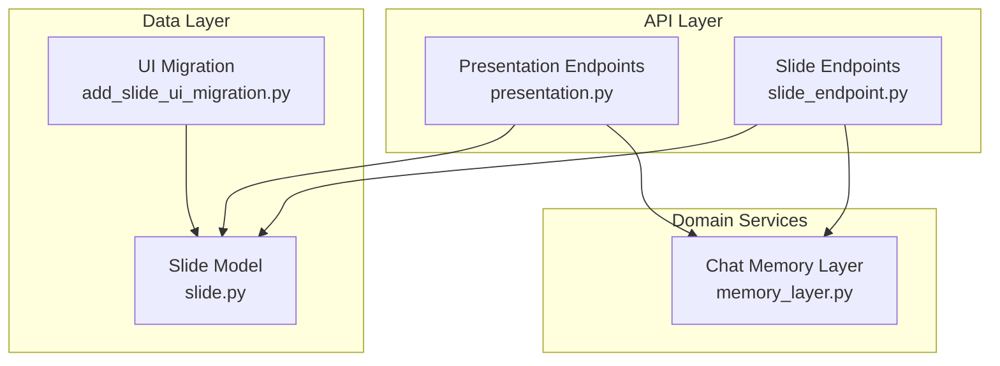
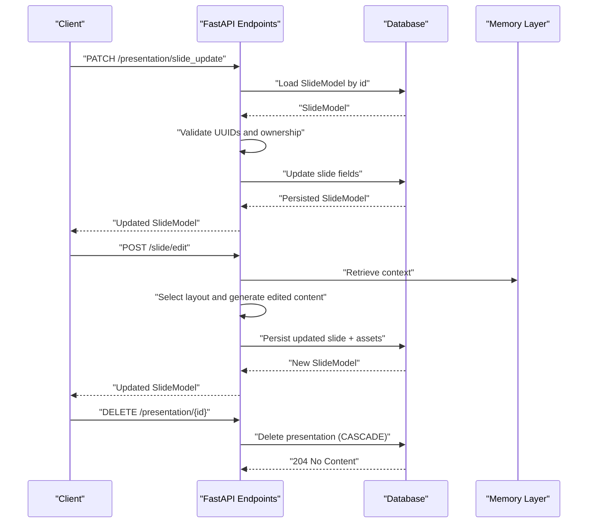
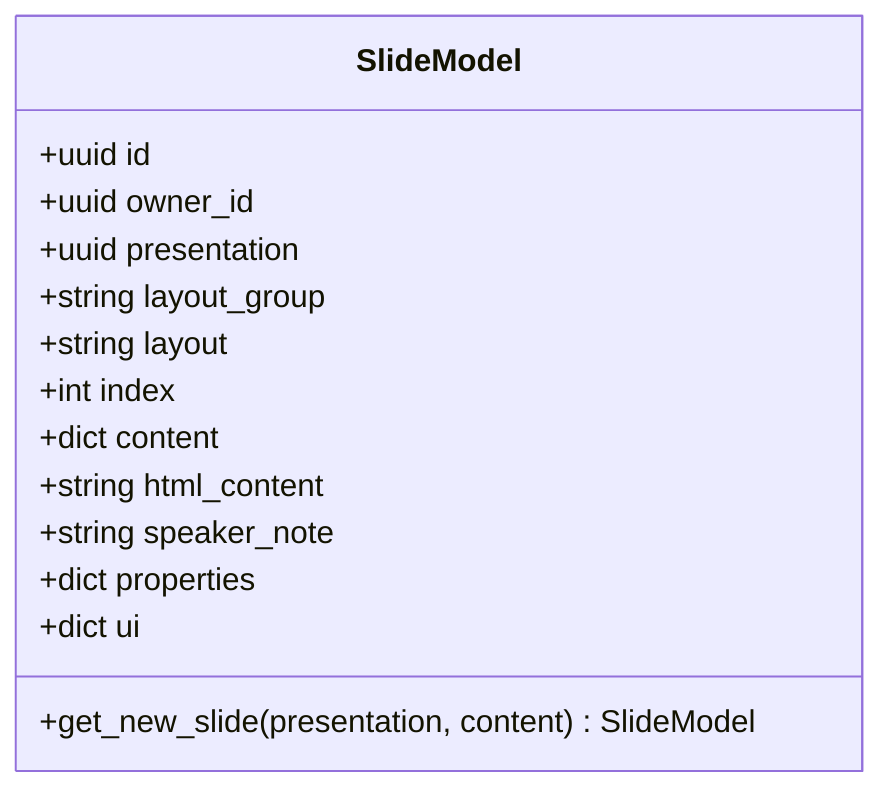
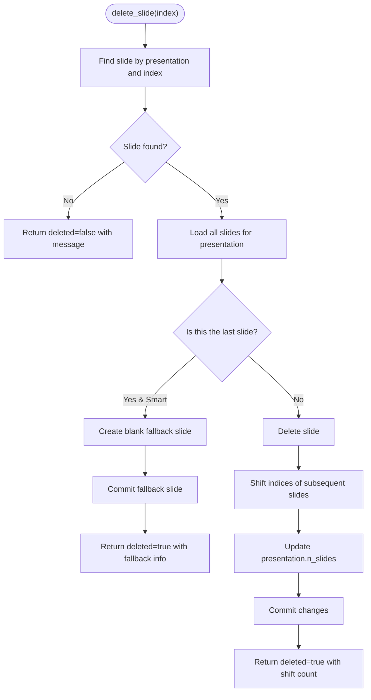
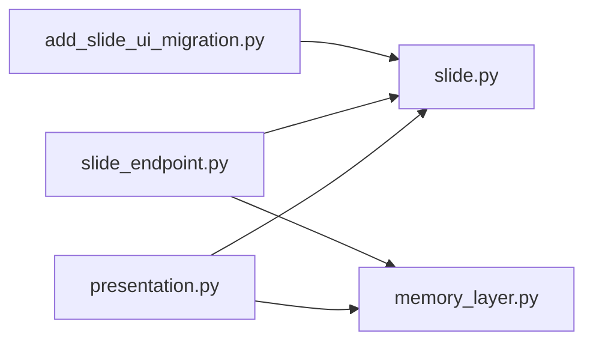

# Slide CRUD Operations

<cite>
**Referenced Files in This Document**
- [slide.py](file://servers/fastapi/models/sql/slide.py)
- [presentation.py](file://servers/fastapi/api/v1/ppt/endpoints/presentation.py)
- [slide_endpoint.py](file://servers/fastapi/api/v1/ppt/endpoints/slide.py)
- [memory_layer.py](file://servers/fastapi/services/chat/memory_layer.py)
- [add_slide_ui_migration.py](file://servers/fastapi/alembic/versions/7f5b2c3d4e6a_add_slide_ui.py)
</cite>

## Table of Contents
1. [Introduction](#introduction)
2. [Project Structure](#project-structure)
3. [Core Components](#core-components)
4. [Architecture Overview](#architecture-overview)
5. [Detailed Component Analysis](#detailed-component-analysis)
6. [Dependency Analysis](#dependency-analysis)
7. [Performance Considerations](#performance-considerations)
8. [Troubleshooting Guide](#troubleshooting-guide)
9. [Conclusion](#conclusion)

## Introduction
This document explains the slide Create, Read, Update, and Delete (CRUD) operations exposed by the presentation API. It covers:
- Creating slides with content and layout assignment
- Reading slide data including content structure and metadata
- Updating slide properties and content
- Deleting slides from presentations
It also documents validation rules, default values, relationship establishment with presentations and layouts, UI state handling, cascade effects, and cleanup processes. Practical examples include request/response schemas, error handling, and common use cases.

## Project Structure
Slide-related functionality is implemented across a small set of backend modules:
- Data model for slides
- Presentation endpoints that read/update/delete slides as part of presentation operations
- Dedicated slide endpoints for AI-assisted editing
- Chat memory layer for index-based slide deletion and fallback behavior
- Database migration adding UI field to slides

**Diagram sources**
- [presentation.py:1539-1557](file://servers/fastapi/api/v1/ppt/endpoints/presentation.py#L1539-L1557)
- [presentation.py:2546-2578](file://servers/fastapi/api/v1/ppt/endpoints/presentation.py#L2546-L2578)
- [slide_endpoint.py:36-124](file://servers/fastapi/api/v1/ppt/endpoints/slide.py#L36-L124)
- [memory_layer.py:1160-1253](file://servers/fastapi/services/chat/memory_layer.py#L1160-L1253)
- [slide.py:9-45](file://servers/fastapi/models/sql/slide.py#L9-L45)
- [add_slide_ui_migration.py:30-32](file://servers/fastapi/alembic/versions/7f5b2c3d4e6a_add_slide_ui.py#L30-L32)

**Section sources**
- [slide.py:9-45](file://servers/fastapi/models/sql/slide.py#L9-L45)
- [presentation.py:1539-1557](file://servers/fastapi/api/v1/ppt/endpoints/presentation.py#L1539-L1557)
- [slide_endpoint.py:36-124](file://servers/fastapi/api/v1/ppt/endpoints/slide.py#L36-L124)
- [memory_layer.py:1160-1253](file://servers/fastapi/services/chat/memory_layer.py#L1160-L1253)
- [add_slide_ui_migration.py:30-32](file://servers/fastapi/alembic/versions/7f5b2c3d4e6a_add_slide_ui.py#L30-L32)

## Core Components
- SlideModel: Persistent representation of a slide with fields for id, owner_id, presentation link, layout_group, layout, index, content, html_content, speaker_note, properties, and ui.
- Presentation endpoints: Provide reading slides via presentation retrieval, updating slides via patch endpoints, and deleting presentations (which cascades to slides).
- Slide endpoints: Provide AI-assisted editing of slide content and HTML, which effectively updates slides.
- Chat memory layer: Provides index-based slide deletion with fallback logic for smart presentations.
- Migration: Adds the ui JSON column to slides.

Key responsibilities:
- SlideModel defines schema and helper to clone slides.
- Presentation endpoints implement:
  - GET presentation (includes slides)
  - PATCH /update (bulk replace slides)
  - PATCH /slide_update (single slide update)
  - DELETE presentation (cascade deletes slides)
- Slide endpoints implement:
  - POST /edit (AI-driven content/layout update)
  - POST /edit-html (HTML-only edit)
- Memory layer implements:
  - delete_slide(index) with index shifting and fallback slide creation for smart presentations

**Section sources**
- [slide.py:9-45](file://servers/fastapi/models/sql/slide.py#L9-L45)
- [presentation.py:1539-1557](file://servers/fastapi/api/v1/ppt/endpoints/presentation.py#L1539-L1557)
- [presentation.py:2488-2543](file://servers/fastapi/api/v1/ppt/endpoints/presentation.py#L2488-L2543)
- [presentation.py:2546-2578](file://servers/fastapi/api/v1/ppt/endpoints/presentation.py#L2546-L2578)
- [presentation.py:1560-1569](file://servers/fastapi/api/v1/ppt/endpoints/presentation.py#L1560-L1569)
- [slide_endpoint.py:36-124](file://servers/fastapi/api/v1/ppt/endpoints/slide.py#L36-L124)
- [slide_endpoint.py:127-172](file://servers/fastapi/api/v1/ppt/endpoints/slide.py#L127-L172)
- [memory_layer.py:1160-1253](file://servers/fastapi/services/chat/memory_layer.py#L1160-L1253)
- [add_slide_ui_migration.py:30-32](file://servers/fastapi/alembic/versions/7f5b2c3d4e6a_add_slide_ui.py#L30-L32)

## Architecture Overview
The slide lifecycle flows through FastAPI endpoints into SQLAlchemy models and services. Slides are always tied to a presentation via a foreign key. Layouts are referenced by layout_group and layout identifiers. The UI state is stored in a JSON column and can be hydrated from template payloads.

**Diagram sources**
- [presentation.py:2546-2578](file://servers/fastapi/api/v1/ppt/endpoints/presentation.py#L2546-L2578)
- [slide_endpoint.py:36-124](file://servers/fastapi/api/v1/ppt/endpoints/slide.py#L36-L124)
- [presentation.py:1560-1569](file://servers/fastapi/api/v1/ppt/endpoints/presentation.py#L1560-L1569)

## Detailed Component Analysis

### Slide Data Model
SlideModel defines the persistent shape of a slide and its relationships:
- Primary key id (UUID)
- owner_id (optional, cascading delete on user)
- presentation (foreign key to presentations, cascading delete)
- layout_group and layout (layout references)
- index (ordering within presentation)
- content (JSON payload)
- html_content (optional HTML)
- speaker_note (optional text)
- properties (optional JSON)
- ui (optional JSON; added via migration)

Helper method get_new_slide clones a slide with a new id and optional content override.

**Diagram sources**
- [slide.py:9-45](file://servers/fastapi/models/sql/slide.py#L9-L45)

**Section sources**
- [slide.py:9-45](file://servers/fastapi/models/sql/slide.py#L9-L45)
- [add_slide_ui_migration.py:30-32](file://servers/fastapi/alembic/versions/7f5b2c3d4e6a_add_slide_ui.py#L30-L32)

### Read Slides
Reading slides is typically done by retrieving a presentation, which includes all slides ordered by index.

- Endpoint: GET /presentation/{id}
- Behavior:
  - Loads presentation
  - Loads slides for that presentation ordered by index
  - Returns presentation plus slides array

Request/Response Schema:
- Request: Path parameter id (UUID)
- Response: PresentationWithSlides containing presentation metadata and an array of SlideModel objects

Error Handling:
- 404 if presentation not found

Common Use Cases:
- Fetching full presentation with slides for editor rendering
- Listing slides for thumbnail generation

**Section sources**
- [presentation.py:1539-1557](file://servers/fastapi/api/v1/ppt/endpoints/presentation.py#L1539-L1557)

### Create Slides
There are two primary ways to create or effectively create slides:

1) Bulk creation via presentation update
- Endpoint: PATCH /presentation/update
- Behavior:
  - Validates n_slides bounds
  - Accepts an array of SlideModel objects representing the desired final slide set
  - Deletes existing slides for the presentation (owner-scoped)
  - Inserts provided slides
  - Updates presentation title/n_slides if provided
- Validation Rules:
  - n_slides must be > 0 and <= MAX_NUMBER_OF_SLIDES
  - Number of slides in payload must be <= MAX_NUMBER_OF_SLIDES
- Relationship Establishment:
  - Each slide’s presentation is coerced to UUID and linked to the target presentation
- Default Values:
  - If slides are omitted, only presentation-level fields are updated
- Error Handling:
  - 404 if presentation not found
  - 400 if slide count exceeds limits

2) AI-assisted slide creation/edit via slide endpoint
- Endpoint: POST /slide/edit
- Behavior:
  - Loads slide and presentation
  - Retrieves memory context
  - Selects appropriate layout based on prompt
  - Generates edited content
  - Processes images/assets
  - Assigns a new unique slide id
  - Persists updated slide and assets
  - Stores edit history in memory service
- Validation Rules:
  - Slide and presentation must exist
- Relationship Establishment:
  - Slide remains associated with the same presentation
- Default Values:
  - Speaker note extracted from generated content
- Error Handling:
  - 404 if slide or presentation not found

Practical Examples:
- Bulk replace slides: Send PATCH /presentation/update with slides array containing SlideModel entries with content and layout fields.
- AI-driven edit: Send POST /slide/edit with slide id and prompt; server returns updated SlideModel.

**Section sources**
- [presentation.py:2488-2543](file://servers/fastapi/api/v1/ppt/endpoints/presentation.py#L2488-L2543)
- [slide_endpoint.py:36-124](file://servers/fastapi/api/v1/ppt/endpoints/slide.py#L36-L124)

### Update Slides
Two mechanisms exist for updating slides:

1) Single-slide update
- Endpoint: PATCH /presentation/slide_update
- Behavior:
  - Validates slide.id and slide.presentation as UUIDs
  - Loads stored slide
  - Ensures slide belongs to supplied presentation
  - Updates mutable fields excluding id, presentation, and index
  - Commits and refreshes slide
- Validation Rules:
  - UUID format validation
  - Ownership check (slide belongs to presentation)
- Error Handling:
  - 422 for invalid UUIDs
  - 404 if slide not found
  - 400 if slide does not belong to presentation

2) AI-assisted content update
- Endpoint: POST /slide/edit
- Behavior:
  - As described under Create Slides, this effectively updates the slide’s content and layout selection
- Notes:
  - A new unique id is assigned to the slide to enable client-side tracking

3) HTML-only update
- Endpoint: POST /slide/edit-html
- Behavior:
  - Loads slide and presentation
  - Uses provided or existing html_content
  - Generates edited HTML
  - Assigns a new unique id
  - Persists updated html_content
- Error Handling:
  - 404 if slide or presentation not found
  - 400 if no HTML to edit

Practical Examples:
- Update slide content: Send PATCH /presentation/slide_update with SlideModel body containing updated content, properties, or ui.
- Update slide HTML: Send POST /slide/edit-html with id, prompt, and optional html.

**Section sources**
- [presentation.py:2546-2578](file://servers/fastapi/api/v1/ppt/endpoints/presentation.py#L2546-L2578)
- [slide_endpoint.py:36-124](file://servers/fastapi/api/v1/ppt/endpoints/slide.py#L36-L124)
- [slide_endpoint.py:127-172](file://servers/fastapi/api/v1/ppt/endpoints/slide.py#L127-L172)

### Delete Slides
Slide deletion occurs in two contexts:

1) Index-based deletion via chat memory layer
- Method: delete_slide(index)
- Behavior:
  - Finds slide at target index within the presentation
  - If no slide exists, returns a non-deleted response with message
  - If it is the last slide and presentation type is smart, creates a blank fallback slide
  - Otherwise, deletes the slide and shifts indices of subsequent slides down by one
  - Updates presentation.n_slides to reflect remaining count
- Cascade Effects:
  - No database cascade; explicit index shifting performed
- Cleanup Processes:
  - Adjusts indices to maintain contiguous ordering
- Error Handling:
  - Returns deleted=false when slide not found

2) Presentation deletion (cascades to slides)
- Endpoint: DELETE /presentation/{id}
- Behavior:
  - Deletes presentation record
  - Due to foreign key constraints, slides are cascaded and removed
- Status Code:
  - 204 No Content on success

Practical Examples:
- Remove slide at index 2: Call memory layer delete_slide(2); expect shifted indices and updated n_slides.
- Remove entire presentation: Call DELETE /presentation/{id}; slides are automatically removed.

**Diagram sources**
- [memory_layer.py:1160-1253](file://servers/fastapi/services/chat/memory_layer.py#L1160-L1253)

**Section sources**
- [memory_layer.py:1160-1253](file://servers/fastapi/services/chat/memory_layer.py#L1160-L1253)
- [presentation.py:1560-1569](file://servers/fastapi/api/v1/ppt/endpoints/presentation.py#L1560-L1569)

### Slide Creation Process Details
- Validation Rules:
  - When using PATCH /presentation/update, slide counts are validated against MAX_NUMBER_OF_SLIDES
  - UUID coercion ensures integrity of slide and presentation identifiers
- Default Values:
  - SlideModel defaults include auto-generated id, owner_id via context, and optional fields like ui, properties, html_content, speaker_note
- Relationship Establishment:
  - Slides are linked to presentations via presentation foreign key
  - Layouts are referenced by layout_group and layout strings
- UI State Hydration:
  - Template payloads can hydrate slide.ui based on template layout definitions

**Section sources**
- [presentation.py:2488-2543](file://servers/fastapi/api/v1/ppt/endpoints/presentation.py#L2488-L2543)
- [slide.py:9-45](file://servers/fastapi/models/sql/slide.py#L9-L45)

### Slide Update Mechanisms
- Content Modification:
  - PATCH /presentation/slide_update allows partial updates to content, properties, and ui
  - POST /slide/edit regenerates content based on prompt and selected layout
- Property Changes:
  - Properties and ui fields can be updated directly via single-slide update
- UI State Updates:
  - UI state is persisted in the ui JSON column and can be hydrated from template payloads during bulk updates

**Section sources**
- [presentation.py:2546-2578](file://servers/fastapi/api/v1/ppt/endpoints/presentation.py#L2546-L2578)
- [slide_endpoint.py:36-124](file://servers/fastapi/api/v1/ppt/endpoints/slide.py#L36-L124)

### Slide Deletion Operations
- Cascade Effects:
  - Deleting a presentation removes associated slides via foreign key cascade
- Cleanup Processes:
  - Index-based deletion adjusts indices to keep slides contiguous
  - For smart presentations, a blank fallback slide is created if deletion would leave zero slides

**Section sources**
- [presentation.py:1560-1569](file://servers/fastapi/api/v1/ppt/endpoints/presentation.py#L1560-L1569)
- [memory_layer.py:1160-1253](file://servers/fastapi/services/chat/memory_layer.py#L1160-L1253)

## Dependency Analysis
Slide operations depend on:
- SlideModel for persistence
- Presentation endpoints for orchestration
- Chat memory layer for index-based deletion
- Migration for enabling ui field

**Diagram sources**
- [presentation.py:1539-1557](file://servers/fastapi/api/v1/ppt/endpoints/presentation.py#L1539-L1557)
- [presentation.py:2546-2578](file://servers/fastapi/api/v1/ppt/endpoints/presentation.py#L2546-L2578)
- [slide_endpoint.py:36-124](file://servers/fastapi/api/v1/ppt/endpoints/slide.py#L36-L124)
- [memory_layer.py:1160-1253](file://servers/fastapi/services/chat/memory_layer.py#L1160-L1253)
- [slide.py:9-45](file://servers/fastapi/models/sql/slide.py#L9-L45)
- [add_slide_ui_migration.py:30-32](file://servers/fastapi/alembic/versions/7f5b2c3d4e6a_add_slide_ui.py#L30-L32)

**Section sources**
- [presentation.py:1539-1557](file://servers/fastapi/api/v1/ppt/endpoints/presentation.py#L1539-L1557)
- [presentation.py:2546-2578](file://servers/fastapi/api/v1/ppt/endpoints/presentation.py#L2546-L2578)
- [slide_endpoint.py:36-124](file://servers/fastapi/api/v1/ppt/endpoints/slide.py#L36-L124)
- [memory_layer.py:1160-1253](file://servers/fastapi/services/chat/memory_layer.py#L1160-L1253)
- [slide.py:9-45](file://servers/fastapi/models/sql/slide.py#L9-L45)
- [add_slide_ui_migration.py:30-32](file://servers/fastapi/alembic/versions/7f5b2c3d4e6a_add_slide_ui.py#L30-L32)

## Performance Considerations
- Bulk slide replacement via PATCH /presentation/update performs a delete-all followed by insert-all; ensure clients send minimal necessary payloads to reduce network overhead.
- AI-assisted edits involve LLM calls and image processing; consider batching edits and caching assets where possible.
- Index shifting on deletion is O(n) over remaining slides; avoid frequent deletions in large presentations.

## Troubleshooting Guide
Common errors and resolutions:
- Invalid UUIDs in slide update: Ensure slide.id and slide.presentation are valid UUIDs; otherwise, a 422 error is returned.
- Slide not found: Verify slide id exists; otherwise, a 404 error is returned.
- Slide does not belong to presentation: Ensure the slide’s presentation matches the supplied presentation id; otherwise, a 400 error is returned.
- Slide count exceeds limit: Ensure number of slides does not exceed MAX_NUMBER_OF_SLIDES; otherwise, a 400 error is returned.
- No HTML to edit: When using POST /slide/edit-html, provide either html or ensure html_content exists; otherwise, a 400 error is returned.

**Section sources**
- [presentation.py:2546-2578](file://servers/fastapi/api/v1/ppt/endpoints/presentation.py#L2546-L2578)
- [slide_endpoint.py:127-172](file://servers/fastapi/api/v1/ppt/endpoints/slide.py#L127-L172)

## Conclusion
Slide CRUD operations are centered around robust validation, clear relationship management with presentations and layouts, and flexible update mechanisms supporting both direct property changes and AI-assisted content generation. Deletion supports both index-based removal with index shifting and cascade deletion via presentation removal. The presence of a ui JSON column enables rich UI state persistence and hydration from templates.