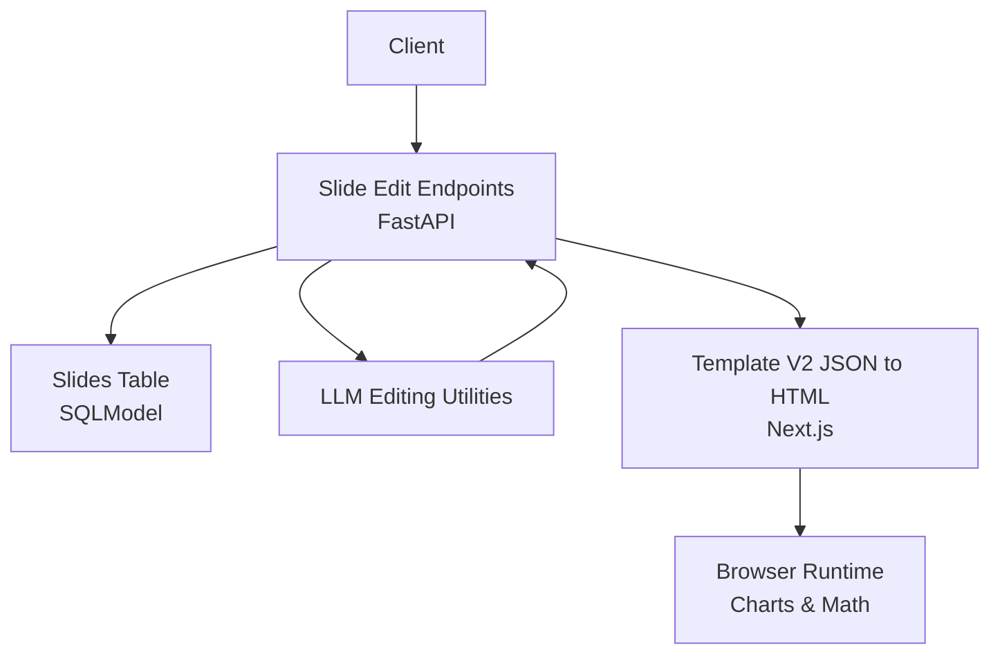
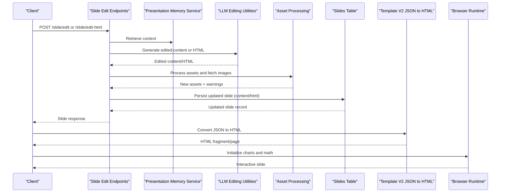
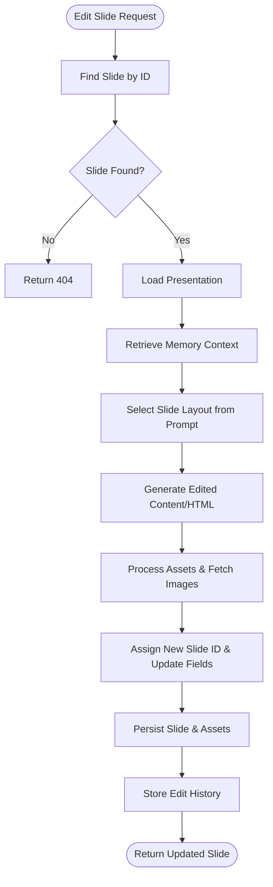
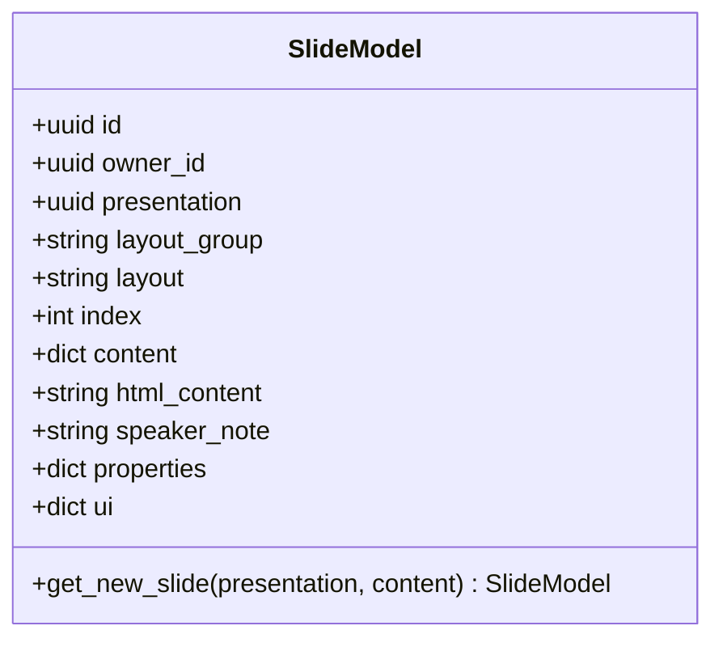
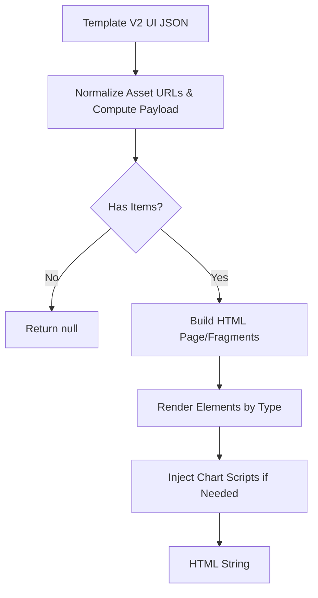
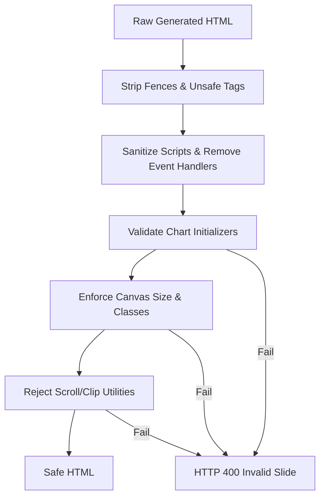
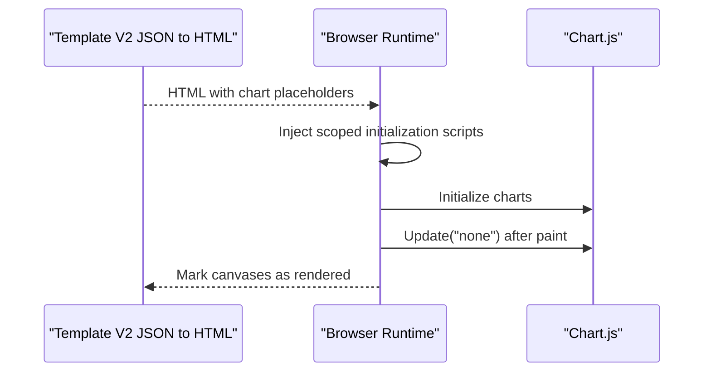
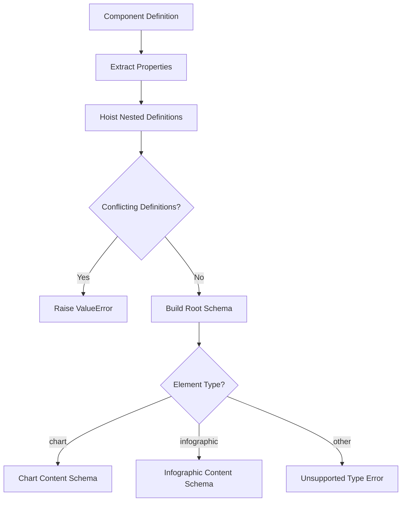
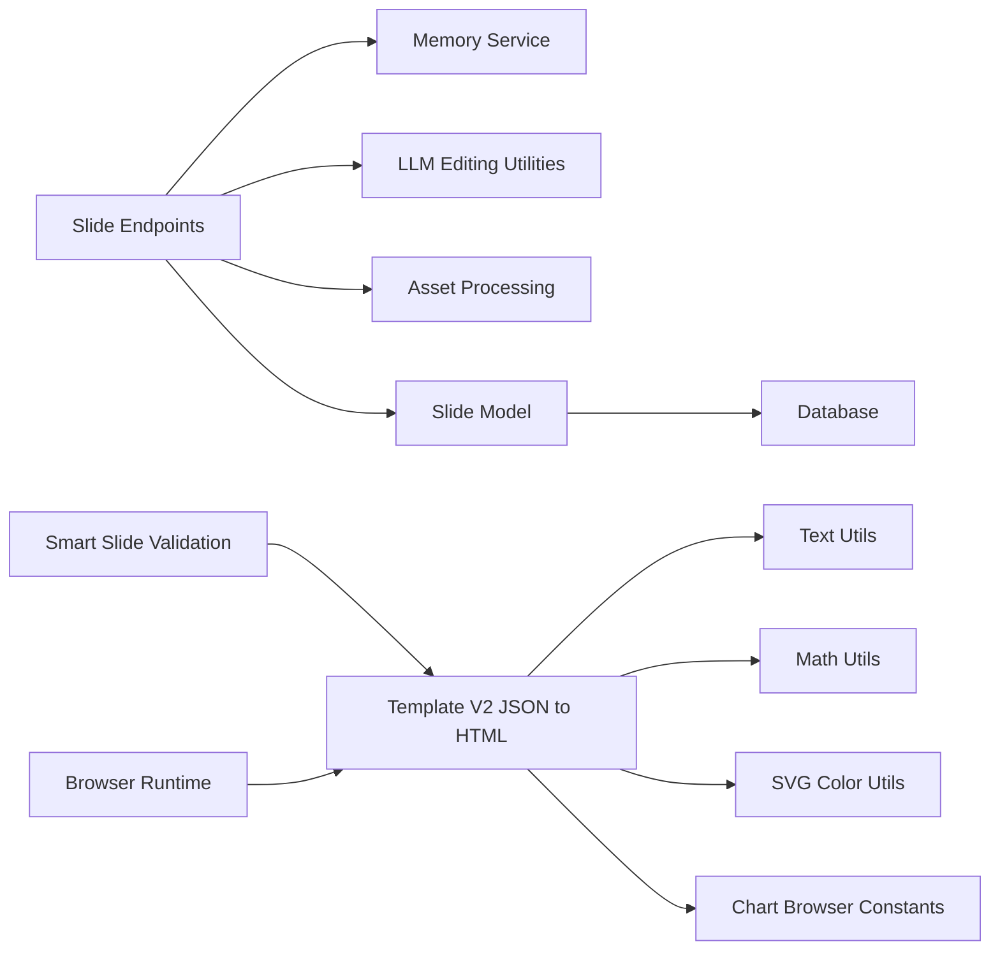

# Slide Content Manipulation

<cite>
**Referenced Files in This Document**
- [slide.py](file://servers/fastapi/api/v1/ppt/endpoints/slide.py)
- [presentation_from_template.py](file://servers/fastapi/models/presentation_from_template.py)
- [slide_model.py](file://servers/fastapi/models/sql/slide.py)
- [template-v2-json-to-html.ts](file://servers/nex tjs/lib/template-v2-json-to-html.ts)
- [generate_smart_presentation.py](file://servers/fastapi/utils/llm_calls/generate_smart_presentation.py)
- [useSmartChartInjection.ts](file://servers/nex tjs/app/(presentation-generator)/components/useSmartChartInjection.ts)
- [schema.py](file://servers/fastapi/templates/v2/schema.py)
</cite>

## Table of Contents
1. [Introduction](#introduction)
2. [Project Structure](#project-structure)
3. [Core Components](#core-components)
4. [Architecture Overview](#architecture-overview)
5. [Detailed Component Analysis](#detailed-component-analysis)
6. [Dependency Analysis](#dependency-analysis)
7. [Performance Considerations](#performance-considerations)
8. [Troubleshooting Guide](#troubleshooting-guide)
9. [Conclusion](#conclusion)

## Introduction
This document explains how slide content is structured, validated, updated, serialized, and rendered across the system. It covers text elements, images, charts, infographics, tables, containers, flex/grid layouts, and interactive components. It also documents validation rules, formatting options, data transformation processes, update mechanisms (text edits, media replacement, chart data updates, component state), serialization/deserialization with JSON schema validation and HTML generation, programmatic update patterns, rich text handling, dynamic content, versioning considerations, conflict resolution strategies, and optimization techniques for large content blocks.

## Project Structure
The slide content pipeline spans backend APIs and models, LLM-assisted editing utilities, and frontend rendering logic:
- Backend API endpoints expose slide editing operations and persist slide content and HTML.
- Models define slide storage structure and request schemas for bulk slide updates.
- Template V2 JSON-to-HTML conversion renders slide content into safe, styled HTML.
- Smart slide HTML normalization enforces safety and layout constraints.
- Frontend chart injection initializes interactive charts within generated HTML.

**Diagram sources**
- [slide.py:36-124](file://servers/fastapi/api/v1/ppt/endpoints/slide.py#L36-L124)
- [slide_model.py:9-30](file://servers/fastapi/models/sql/slide.py#L9-L30)
- [template-v2-json-to-html.ts:156-169](file://servers/nex tjs/lib/template-v2-json-to-html.ts#L156-L169)
- [useSmartChartInjection.ts:93-128](file://servers/nex tjs/app/(presentation-generator)/components/useSmartChartInjection.ts#L93-L128)

**Section sources**
- [slide.py:36-124](file://servers/fastapi/api/v1/ppt/endpoints/slide.py#L36-L124)
- [slide_model.py:9-30](file://servers/fastapi/models/sql/slide.py#L9-L30)
- [template-v2-json-to-html.ts:156-169](file://servers/nex tjs/lib/template-v2-json-to-html.ts#L156-L169)
- [useSmartChartInjection.ts:93-128](file://servers/nex tjs/app/(presentation-generator)/components/useSmartChartInjection.ts#L93-L128)

## Core Components
- Slide edit endpoints: Provide natural-language or HTML-based editing flows that return updated slides.
- Slide model: Stores slide content, computed HTML, speaker notes, properties, and UI metadata.
- Template V2 JSON-to-HTML: Converts slide JSON structures into fully styled HTML fragments or full pages.
- Smart slide HTML normalization: Validates and sanitizes generated HTML for safety and layout compliance.
- Chart injection runtime: Initializes charts inside generated HTML safely.

Key responsibilities:
- Validate incoming requests and payloads.
- Transform slide content via LLM tools and asset processing.
- Persist normalized content and HTML.
- Render slide content as HTML for preview/export.
- Initialize interactive elements like charts.

**Section sources**
- [slide.py:36-173](file://servers/fastapi/api/v1/ppt/endpoints/slide.py#L36-L173)
- [slide_model.py:9-46](file://servers/fastapi/models/sql/slide.py#L9-L46)
- [template-v2-json-to-html.ts:156-169](file://servers/nex tjs/lib/template-v2-json-to-html.ts#L156-L169)
- [generate_smart_presentation.py:417-435](file://servers/fastapi/utils/llm_calls/generate_smart_presentation.py#L417-L435)
- [useSmartChartInjection.ts:93-128](file://servers/nex tjs/app/(presentation-generator)/components/useSmartChartInjection.ts#L93-L128)

## Architecture Overview
The end-to-end flow for slide content manipulation:

**Diagram sources**
- [slide.py:36-173](file://servers/fastapi/api/v1/ppt/endpoints/slide.py#L36-L173)
- [template-v2-json-to-html.ts:156-169](file://servers/nex tjs/lib/template-v2-json-to-html.ts#L156-L169)
- [useSmartChartInjection.ts:93-128](file://servers/nex tjs/app/(presentation-generator)/components/useSmartChartInjection.ts#L93-L128)

## Detailed Component Analysis

### Slide Edit Endpoints
Responsibilities:
- Accept slide ID and prompt; optionally accept raw HTML for HTML-based edits.
- Retrieve presentation context and memory.
- Determine appropriate slide layout based on prompt.
- Generate edited slide content or HTML using LLM utilities.
- Process image targets and fetch assets; collect warnings.
- Assign a new unique slide ID to ensure client-side tracking.
- Persist updated content, layout, speaker notes, and HTML.
- Store edit history in presentation memory.

Validation and error handling:
- Return 404 if slide or presentation not found.
- Return 400 when no HTML is provided for HTML editing.

Update mechanisms:
- Text edits: Handled by LLM-generated content updates.
- Media replacement: Asset processing resolves and attaches new images/icons.
- Chart data updates: Embedded in edited content; later rendered by JSON-to-HTML and browser initialization.
- Component states: Managed through template V2 UI fields and persisted in slide content/UI.

**Diagram sources**
- [slide.py:36-173](file://servers/fastapi/api/v1/ppt/endpoints/slide.py#L36-L173)

**Section sources**
- [slide.py:36-173](file://servers/fastapi/api/v1/ppt/endpoints/slide.py#L36-L173)

### Slide Model and Storage
Structure:
- Unique slide identifier and owner linkage.
- Presentation association and layout metadata.
- Content payload (JSON).
- Computed HTML content string.
- Speaker notes and additional properties.
- UI metadata for editor state.

New slide creation helper:
- Deep copies content and properties to avoid shared references.

Versioning and conflict resolution:
- New unique IDs are assigned on edits to support optimistic concurrency and client-side tracking.
- For bulk updates, request schema defines index/content pairs for targeted slide modifications.

**Diagram sources**
- [slide_model.py:9-46](file://servers/fastapi/models/sql/slide.py#L9-L46)

**Section sources**
- [slide_model.py:9-46](file://servers/fastapi/models/sql/slide.py#L9-L46)
- [presentation_from_template.py:6-14](file://servers/fastapi/models/presentation_from_template.py#L6-L14)

### Template V2 JSON-to-HTML Rendering
Capabilities:
- Renders supported element types including text, text-list, table, container, vector, svg, image, chart, infographic, flex, grid, group, list-view, grid-view.
- Normalizes asset URLs and applies theme fonts.
- Generates complete HTML pages or fragments with styles and scripts.
- Handles math rendering and local font faces.
- Computes intrinsic sizes and flow layouts for responsive rendering.

Data transformation:
- Reads root elements/components, normalizes asset URLs, computes width/height/background.
- Maps each item to specific renderers per type.
- Injects chart scripts conditionally when charts are present.

Formatting options:
- Alignment, padding, overflow, clip paths, transforms, colors, and sizing.
- Flex/grid layout controls including direction, gaps, wrap, alignment, and column/row templates.

**Diagram sources**
- [template-v2-json-to-html.ts:156-169](file://servers/nex tjs/lib/template-v2-json-to-html.ts#L156-L169)
- [template-v2-json-to-html.ts:246-284](file://servers/nex tjs/lib/template-v2-json-to-html.ts#L246-L284)
- [template-v2-json-to-html.ts:308-349](file://servers/nex tjs/lib/template-v2-json-to-html.ts#L308-L349)

**Section sources**
- [template-v2-json-to-html.ts:156-169](file://servers/nex tjs/lib/template-v2-json-to-html.ts#L156-L169)
- [template-v2-json-to-html.ts:246-284](file://servers/nex tjs/lib/template-v2-json-to-html.ts#L246-L284)
- [template-v2-json-to-html.ts:308-349](file://servers/nex tjs/lib/template-v2-json-to-html.ts#L308-L349)

### Smart Slide HTML Validation and Safety
Normalization steps:
- Strip fenced code blocks and unsafe document tags.
- Sanitize script tags and remove event handler attributes and JavaScript URLs.
- Validate required inline Chart.js initializers.
- Enforce canvas dimensions and required classes.
- Reject scrolling or clipping utilities to prevent overflow.

Error handling:
- Returns HTTP 400 for invalid Smart slide HTML or missing initializers.

**Diagram sources**
- [generate_smart_presentation.py:417-435](file://servers/fastapi/utils/llm_calls/generate_smart_presentation.py#L417-L435)
- [generate_smart_presentation.py:438-452](file://servers/fastapi/utils/llm_calls/generate_smart_presentation.py#L438-L452)

**Section sources**
- [generate_smart_presentation.py:417-435](file://servers/fastapi/utils/llm_calls/generate_smart_presentation.py#L417-L435)
- [generate_smart_presentation.py:438-452](file://servers/fastapi/utils/llm_calls/generate_smart_presentation.py#L438-L452)

### Frontend Chart Initialization
Runtime behavior:
- Injects scoped scripts to initialize Chart.js instances within generated HTML.
- Updates charts without re-rendering entire DOM.
- Cleans up listeners and scripts on unmount.

Interaction:
- Marks canvases as rendered and handles errors gracefully.

**Diagram sources**
- [useSmartChartInjection.ts:93-128](file://servers/nex tjs/app/(presentation-generator)/components/useSmartChartInjection.ts#L93-L128)

**Section sources**
- [useSmartChartInjection.ts:93-128](file://servers/nex tjs/app/(presentation-generator)/components/useSmartChartInjection.ts#L93-L128)

### JSON Schema Generation for Template V2 Components
Schema construction:
- Builds JSON Schema definitions for component properties.
- Hoists nested definitions to the root level and detects conflicts.
- Supports arrays with min/max items and item constraints.
- Specialized schemas for charts and infographics.

Validation implications:
- Ensures generated content adheres to expected structure and constraints.
- Prevents unsupported element types.

**Diagram sources**
- [schema.py:202-215](file://servers/fastapi/templates/v2/schema.py#L202-L215)
- [schema.py:218-239](file://servers/fastapi/templates/v2/schema.py#L218-L239)
- [schema.py:400-423](file://servers/fastapi/templates/v2/schema.py#L400-L423)

**Section sources**
- [schema.py:202-215](file://servers/fastapi/templates/v2/schema.py#L202-L215)
- [schema.py:218-239](file://servers/fastapi/templates/v2/schema.py#L218-L239)
- [schema.py:400-423](file://servers/fastapi/templates/v2/schema.py#L400-L423)

## Dependency Analysis
Inter-component relationships:
- Slide endpoints depend on memory service, LLM editing utilities, and asset processing.
- Slide model persists content and HTML used by renderer.
- Template V2 JSON-to-HTML depends on text normalization, math rendering, SVG color utilities, and chart browser constants.
- Smart slide validation ensures safe HTML before saving.
- Frontend chart injection relies on generated HTML structure and Chart.js availability.

**Diagram sources**
- [slide.py:36-173](file://servers/fastapi/api/v1/ppt/endpoints/slide.py#L36-L173)
- [template-v2-json-to-html.ts:1-24](file://servers/nex tjs/lib/template-v2-json-to-html.ts#L1-L24)
- [generate_smart_presentation.py:417-435](file://servers/fastapi/utils/llm_calls/generate_smart_presentation.py#L417-L435)

**Section sources**
- [slide.py:36-173](file://servers/fastapi/api/v1/ppt/endpoints/slide.py#L36-L173)
- [template-v2-json-to-html.ts:1-24](file://servers/nex tjs/lib/template-v2-json-to-html.ts#L1-L24)
- [generate_smart_presentation.py:417-435](file://servers/fastapi/utils/llm_calls/generate_smart_presentation.py#L417-L435)

## Performance Considerations
- Avoid unnecessary re-renders by updating charts with minimal changes.
- Use HTML fragments for partial updates instead of full page regeneration.
- Normalize asset URLs once during payload preparation to reduce repeated work.
- Limit large text blocks; prefer lists and tables for structured content.
- Precompute intrinsic sizes for layout containers to minimize reflows.
- Defer heavy computations until necessary; leverage requestAnimationFrame for chart updates.

[No sources needed since this section provides general guidance]

## Troubleshooting Guide
Common issues and resolutions:
- Slide not found: Ensure valid slide ID and correct presentation association.
- No HTML to edit: Provide HTML payload when using HTML editing endpoint.
- Invalid Smart slide HTML: Fix missing Chart.js initializers, enforce canvas size/classes, and remove scroll/clip utilities.
- Unsupported content element type: Verify template V2 schema and element definitions.
- Chart initialization failures: Confirm generated HTML includes required scripts and that Chart.js is available in the runtime.

Operational tips:
- Inspect warnings returned during asset processing to identify image fallbacks.
- Validate JSON against generated schemas before saving component content.
- Monitor memory context retrieval and LLM call outcomes for edit prompts.

**Section sources**
- [slide.py:36-173](file://servers/fastapi/api/v1/ppt/endpoints/slide.py#L36-L173)
- [generate_smart_presentation.py:417-435](file://servers/fastapi/utils/llm_calls/generate_smart_presentation.py#L417-L435)
- [schema.py:400-423](file://servers/fastapi/templates/v2/schema.py#L400-L423)

## Conclusion
Slide content manipulation in this system integrates robust backend editing workflows, strict validation and safety checks, and comprehensive frontend rendering capabilities. The architecture supports rich text, media, charts, infographics, and interactive components while ensuring safe and performant output. By following the documented update mechanisms, validation rules, and optimization strategies, developers can programmatically manipulate slide content reliably and efficiently.

[No sources needed since this section summarizes without analyzing specific files]