# Slide Layout Management

<cite>
**Referenced Files in This Document**
- [presentation_layout.py](file://servers/fastapi/templates/presentation_layout.py)
- [presentation_layout.py](file://servers/fastapi/models/presentation_layout.py)
- [slide_layout_index.py](file://servers/fastapi/models/slide_layout_index.py)
- [select_slide_type_on_edit.py](file://servers/fastapi/utils/llm_calls/select_slide_type_on_edit.py)
- [slide.py](file://servers/fastapi/api/v1/ppt/endpoints/slide.py)
- [template.py](file://servers/fastapi/api/v1/ppt/endpoints/template.py)
- [smart_slide_layout.py](file://servers/fastapi/utils/smart_slide_layout.py)
- [certified_generation.py](file://servers/fastapi/templates/v2/certified_generation.py)
- [schema.py](file://servers/fastapi/templates/v2/schema.py)
- [template_v2.py](file://servers/fastapi/models/sql/template_v2.py)
- [make_template_v2_layouts_nullable.py](file://servers/fastapi/alembic/versions/2c8f4a1b9d7e_make_template_v2_layouts_nullable.py)
- [template.json](file://templates/general/template.json)
- [layouts.json](file://layouts.json)
- [NewSlide.tsx](file://servers/nextjs/app/(presentation-generator)/presentation/components/NewSlide.tsx)
- [useTemplateCreation.ts](file://servers/nextjs/app/(presentation-generator)/custom-template/hooks/useTemplateCreation.ts)
- [templatePreviewUtils.ts](file://servers/nextjs/app/(presentation-generator)/template-preview/components/editor/templatePreviewUtils.ts)
</cite>

## Table of Contents
1. [Introduction](#introduction)
2. [Project Structure](#project-structure)
3. [Core Components](#core-components)
4. [Architecture Overview](#architecture-overview)
5. [Detailed Component Analysis](#detailed-component-analysis)
6. [Dependency Analysis](#dependency-analysis)
7. [Performance Considerations](#performance-considerations)
8. [Troubleshooting Guide](#troubleshooting-guide)
9. [Conclusion](#conclusion)

## Introduction
This document explains the slide layout management system that connects presentation templates, slide layouts, and runtime slide rendering. It covers how layouts define slide structure and component placement, how slides are assigned to layouts during creation or editing, validation and compatibility checks, data models for layout groups and definitions, template integration, rendering behavior, responsive considerations, versioning and migration strategies, and performance guidance for complex layouts.

## Project Structure
The layout system spans backend models, API endpoints, template processing utilities, and frontend preview/editing components:

- Backend models define presentation-level and slide-level layout schemas.
- API endpoints orchestrate slide editing with layout selection and assignment.
- Template utilities generate and validate compiled slide layouts from JSON definitions.
- Frontend components render layout previews and integrate generated layouts into slides.

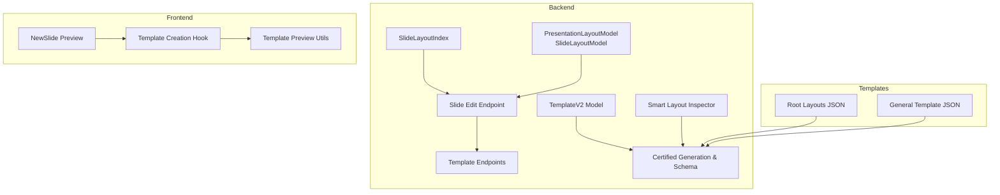

**Diagram sources**
- [presentation_layout.py:11-47](file://servers/fastapi/templates/presentation_layout.py#L11-L47)
- [slide_layout_index.py:1-5](file://servers/fastapi/models/slide_layout_index.py#L1-L5)
- [slide.py:36-124](file://servers/fastapi/api/v1/ppt/endpoints/slide.py#L36-L124)
- [template.py:586-832](file://servers/fastapi/api/v1/ppt/endpoints/template.py#L586-L832)
- [smart_slide_layout.py:230-289](file://servers/fastapi/utils/smart_slide_layout.py#L230-L289)
- [certified_generation.py:462-488](file://servers/fastapi/templates/v2/certified_generation.py#L462-L488)
- [schema.py:607-639](file://servers/fastapi/templates/v2/schema.py#L607-L639)
- [template_v2.py:16-40](file://servers/fastapi/models/sql/template_v2.py#L16-L40)
- [template.json:1-800](file://templates/general/template.json#L1-L800)
- [layouts.json:1-800](file://layouts.json#L1-L800)
- [NewSlide.tsx:44-70](file://servers/nextjs/app/(presentation-generator)/presentation/components/NewSlide.tsx#L44-L70)
- [useTemplateCreation.ts:558-585](file://servers/nextjs/app/(presentation-generator)/custom-template/hooks/useTemplateCreation.ts#L558-L585)
- [templatePreviewUtils.ts:888-906](file://servers/nextjs/app/(presentation-generator)/template-preview/components/editor/templatePreviewUtils.ts#L888-L906)

**Section sources**
- [presentation_layout.py:11-47](file://servers/fastapi/templates/presentation_layout.py#L11-L47)
- [slide_layout_index.py:1-5](file://servers/fastapi/models/slide_layout_index.py#L1-L5)
- [slide.py:36-124](file://servers/fastapi/api/v1/ppt/endpoints/slide.py#L36-L124)
- [template.py:586-832](file://servers/fastapi/api/v1/ppt/endpoints/template.py#L586-L832)
- [smart_slide_layout.py:230-289](file://servers/fastapi/utils/smart_slide_layout.py#L230-L289)
- [certified_generation.py:462-488](file://servers/fastapi/templates/v2/certified_generation.py#L462-L488)
- [schema.py:607-639](file://servers/fastapi/templates/v2/schema.py#L607-L639)
- [template_v2.py:16-40](file://servers/fastapi/models/sql/template_v2.py#L16-L40)
- [template.json:1-800](file://templates/general/template.json#L1-L800)
- [layouts.json:1-800](file://layouts.json#L1-L800)
- [NewSlide.tsx:44-70](file://servers/nextjs/app/(presentation-generator)/presentation/components/NewSlide.tsx#L44-L70)
- [useTemplateCreation.ts:558-585](file://servers/nextjs/app/(presentation-generator)/custom-template/hooks/useTemplateCreation.ts#L558-L585)
- [templatePreviewUtils.ts:888-906](file://servers/nextjs/app/(presentation-generator)/template-preview/components/editor/templatePreviewUtils.ts#L888-L906)

## Core Components
- Presentation-level layout model defines a named set of slide layouts with optional ordering and icon settings. Each slide layout includes an identifier, optional name/description, and a JSON schema describing required content fields.
- Slide layout index model is used by the LLM-driven layout selector to return a numeric index within the presentation’s slide layout list.
- Slide edit endpoint orchestrates layout selection via prompt, updates slide content, assigns the selected layout ID, and persists changes.
- Template endpoints handle generation, coercion, uniqueness enforcement, and randomization of layout IDs for both async and synchronous flows.
- Smart layout inspector analyzes HTML-based layouts to detect risky positioning, overflow, and overlap conditions.
- Certified generation validates compiled slide layouts and ensures unique IDs; schema utilities derive per-layout JSON schemas for content validation.
- TemplateV2 database model stores raw and merged layout definitions along with theme and assets.
- Frontend components create preview slides from layouts and integrate generated layouts into the editor state.

**Section sources**
- [presentation_layout.py:11-47](file://servers/fastapi/templates/presentation_layout.py#L11-L47)
- [slide_layout_index.py:1-5](file://servers/fastapi/models/slide_layout_index.py#L1-L5)
- [slide.py:36-124](file://servers/fastapi/api/v1/ppt/endpoints/slide.py#L36-L124)
- [template.py:586-832](file://servers/fastapi/api/v1/ppt/endpoints/template.py#L586-L832)
- [smart_slide_layout.py:230-289](file://servers/fastapi/utils/smart_slide_layout.py#L230-L289)
- [certified_generation.py:462-488](file://servers/fastapi/templates/v2/certified_generation.py#L462-L488)
- [schema.py:607-639](file://servers/fastapi/templates/v2/schema.py#L607-L639)
- [template_v2.py:16-40](file://servers/fastapi/models/sql/template_v2.py#L16-L40)
- [NewSlide.tsx:44-70](file://servers/nextjs/app/(presentation-generator)/presentation/components/NewSlide.tsx#L44-L70)

## Architecture Overview
The layout system integrates three layers:

- Data layer: TemplateV2 model and template JSON files store layout definitions and merged components.
- Processing layer: Template endpoints and certified generation transform raw layouts into validated, unique, and randomized structures; schema utilities produce JSON schemas for each slide layout.
- Runtime layer: Slide edit endpoint selects a layout based on user prompts and current slide context, then assigns it to the slide. Frontend preview components render layouts and integrate them into slide editors.

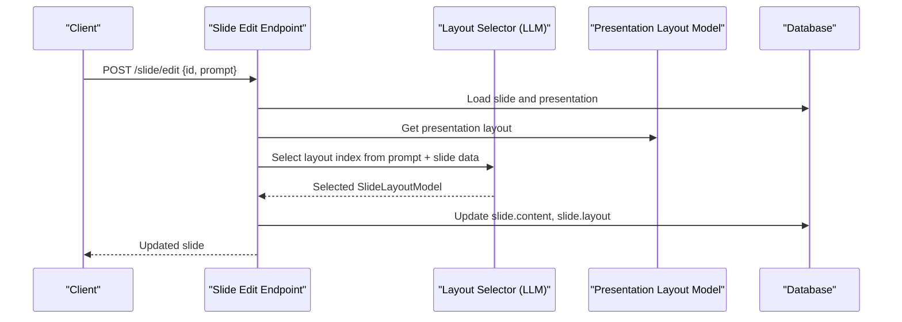

**Diagram sources**
- [slide.py:36-124](file://servers/fastapi/api/v1/ppt/endpoints/slide.py#L36-L124)
- [select_slide_type_on_edit.py:50-89](file://servers/fastapi/utils/llm_calls/select_slide_type_on_edit.py#L50-L89)
- [presentation_layout.py:36-47](file://servers/fastapi/templates/presentation_layout.py#L36-L47)

## Detailed Component Analysis

### Layout Data Models
- PresentationLayoutModel: Represents a presentation’s collection of slide layouts with metadata such as ordering and icon configuration. Provides methods to find a slide layout by ID and convert to a simple presentation structure.
- SlideLayoutModel: Represents an individual slide layout with id, optional name/description, and a JSON schema defining required content fields.
- SlideLayoutIndex: Used by the LLM selector to return a numeric index within the presentation’s slide layout list.

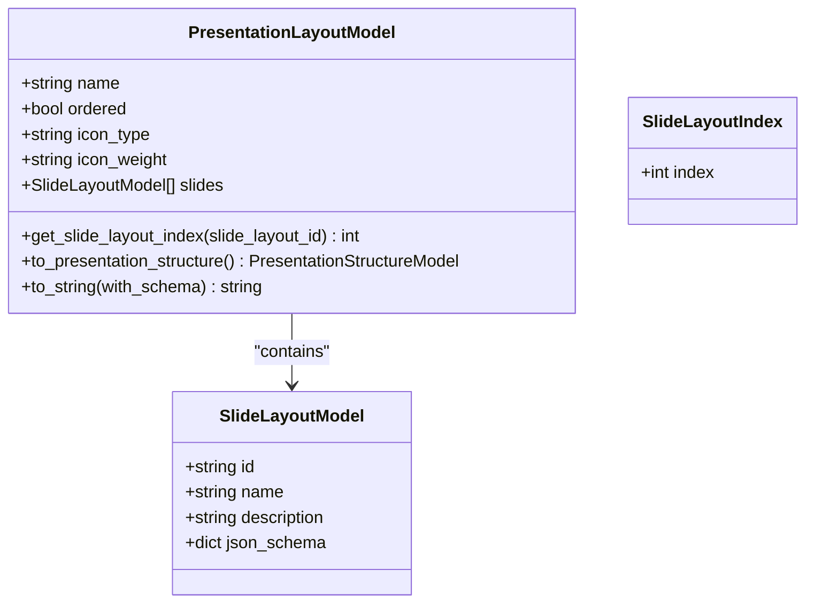

**Diagram sources**
- [presentation_layout.py:11-47](file://servers/fastapi/templates/presentation_layout.py#L11-L47)
- [slide_layout_index.py:1-5](file://servers/fastapi/models/slide_layout_index.py#L1-L5)

**Section sources**
- [presentation_layout.py:11-47](file://servers/fastapi/templates/presentation_layout.py#L11-L47)
- [slide_layout_index.py:1-5](file://servers/fastapi/models/slide_layout_index.py#L1-L5)

### Layout Assignment During Slide Editing
When editing a slide:
- The endpoint loads the slide and its presentation.
- It retrieves the presentation’s layout model.
- It calls the LLM-based selector to choose a slide layout index based on the user prompt, current slide content, and memory context.
- It processes image targets and asset handling, then assigns the selected layout ID to the slide and persists changes.

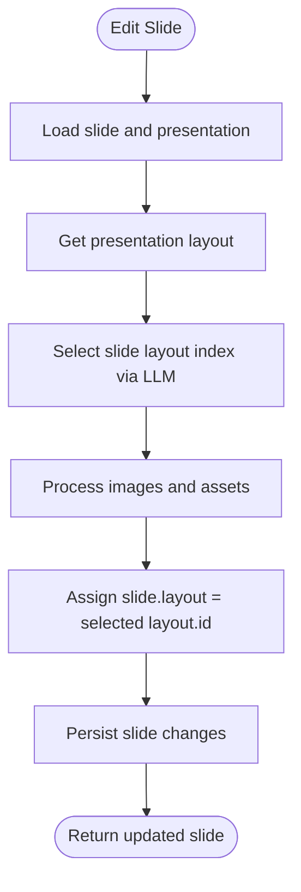

**Diagram sources**
- [slide.py:36-124](file://servers/fastapi/api/v1/ppt/endpoints/slide.py#L36-L124)
- [select_slide_type_on_edit.py:50-89](file://servers/fastapi/utils/llm_calls/select_slide_type_on_edit.py#L50-L89)

**Section sources**
- [slide.py:36-124](file://servers/fastapi/api/v1/ppt/endpoints/slide.py#L36-L124)
- [select_slide_type_on_edit.py:50-89](file://servers/fastapi/utils/llm_calls/select_slide_type_on_edit.py#L50-L89)

### Template Integration and Generated Layouts
- Template endpoints coerce and validate generated layouts, ensure unique IDs, and optionally randomize IDs for stability.
- Certified generation enforces constraints on compiled slide layouts, including non-empty components and finite positions, and repairs duplicate IDs.
- Schema utilities derive per-slide JSON schemas from layout definitions, enabling structured content validation.

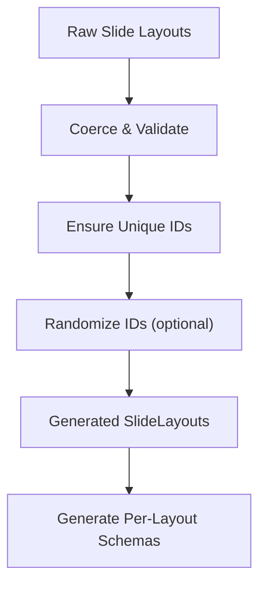

**Diagram sources**
- [template.py:586-832](file://servers/fastapi/api/v1/ppt/endpoints/template.py#L586-L832)
- [certified_generation.py:462-488](file://servers/fastapi/templates/v2/certified_generation.py#L462-L488)
- [schema.py:607-639](file://servers/fastapi/templates/v2/schema.py#L607-L639)

**Section sources**
- [template.py:586-832](file://servers/fastapi/api/v1/ppt/endpoints/template.py#L586-L832)
- [certified_generation.py:462-488](file://servers/fastapi/templates/v2/certified_generation.py#L462-L488)
- [schema.py:607-639](file://servers/fastapi/templates/v2/schema.py#L607-L639)

### Layout Validation and Compatibility Checks
- Smart layout inspector analyzes HTML-based layouts to detect negative margins/translations, hidden overflow with visible text, invalid geometry, off-canvas positioning, and sibling overlaps.
- Certified generation validates compiled layouts, ensuring at least one component per layout, non-empty components, finite positions, and valid element trees.

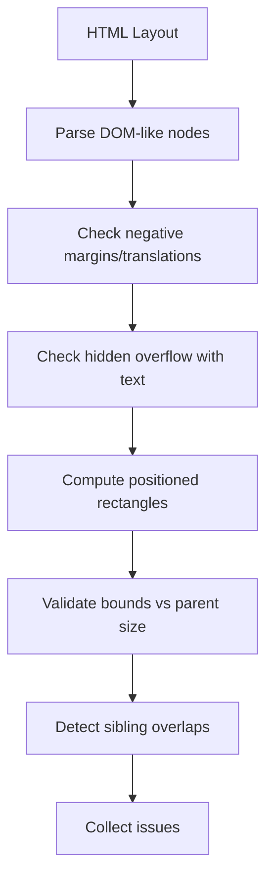

**Diagram sources**
- [smart_slide_layout.py:230-289](file://servers/fastapi/utils/smart_slide_layout.py#L230-L289)
- [certified_generation.py:3491-3503](file://servers/fastapi/templates/v2/certified_generation.py#L3491-L3503)

**Section sources**
- [smart_slide_layout.py:230-289](file://servers/fastapi/utils/smart_slide_layout.py#L230-L289)
- [certified_generation.py:3491-3503](file://servers/fastapi/templates/v2/certified_generation.py#L3491-L3503)

### Rendering Behavior and Responsive Considerations
- Layouts define component placement using position and size properties within components and elements.
- Template JSON files include merged components with variants, establishing reusable visual building blocks across layouts.
- Frontend preview utilities assess whether layouts have density targets and can adjust repeated children based on content density.

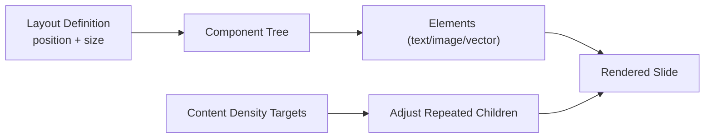

**Diagram sources**
- [template.json:1-800](file://templates/general/template.json#L1-L800)
- [templatePreviewUtils.ts:888-906](file://servers/nextjs/app/(presentation-generator)/template-preview/components/editor/templatePreviewUtils.ts#L888-L906)

**Section sources**
- [template.json:1-800](file://templates/general/template.json#L1-L800)
- [templatePreviewUtils.ts:888-906](file://servers/nextjs/app/(presentation-generator)/template-preview/components/editor/templatePreviewUtils.ts#L888-L906)

### Examples: Assigning Different Layouts to Slides
- Creating a preview slide from a layout sets the slide’s ui to the layout object and assigns a layout group identifier.
- When generating custom templates, created layouts are mapped to slides and integrated into the editor state.

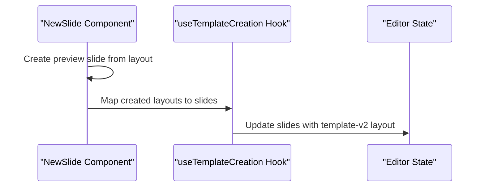

**Diagram sources**
- [NewSlide.tsx:44-70](file://servers/nextjs/app/(presentation-generator)/presentation/components/NewSlide.tsx#L44-L70)
- [useTemplateCreation.ts:558-585](file://servers/nextjs/app/(presentation-generator)/custom-template/hooks/useTemplateCreation.ts#L558-L585)

**Section sources**
- [NewSlide.tsx:44-70](file://servers/nextjs/app/(presentation-generator)/presentation/components/NewSlide.tsx#L44-L70)
- [useTemplateCreation.ts:558-585](file://servers/nextjs/app/(presentation-generator)/custom-template/hooks/useTemplateCreation.ts#L558-L585)

### Layout Inheritance and Groups
- Templates define merged components that act as reusable building blocks; layouts reference these components to compose slide structures.
- The root layouts JSON file contains multiple layout definitions with descriptive metadata and nested components.

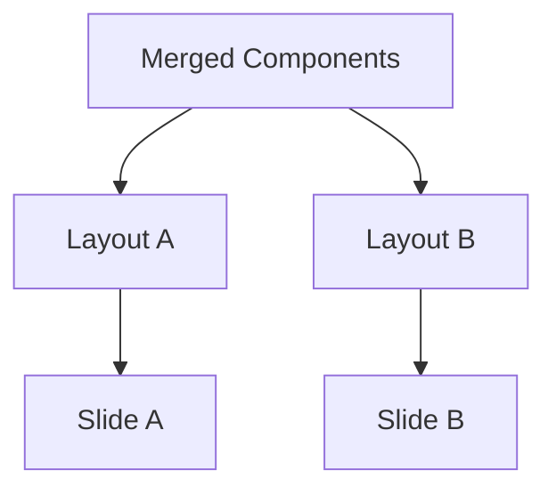

**Diagram sources**
- [template.json:1-800](file://templates/general/template.json#L1-L800)
- [layouts.json:1-800](file://layouts.json#L1-L800)

**Section sources**
- [template.json:1-800](file://templates/general/template.json#L1-L800)
- [layouts.json:1-800](file://layouts.json#L1-L800)

### Versioning and Migration Strategies
- TemplateV2 model stores raw and merged layout definitions alongside theme and assets, supporting evolution of layout structures.
- Alembic migration makes the layouts column nullable to allow backward-compatible transitions.

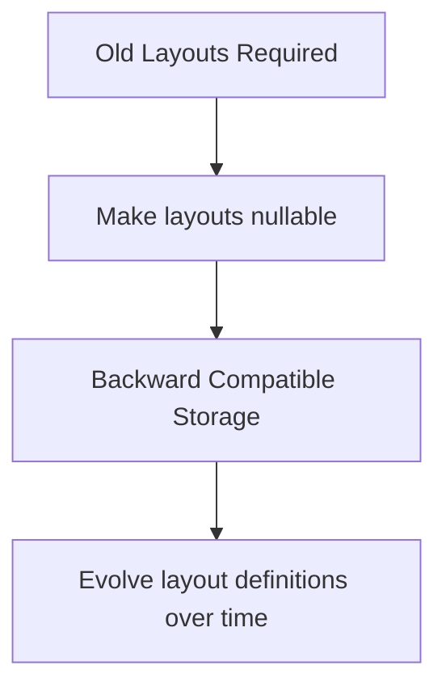

**Diagram sources**
- [template_v2.py:16-40](file://servers/fastapi/models/sql/template_v2.py#L16-L40)
- [make_template_v2_layouts_nullable.py:30-56](file://servers/fastapi/alembic/versions/2c8f4a1b9d7e_make_template_v2_layouts_nullable.py#L30-L56)

**Section sources**
- [template_v2.py:16-40](file://servers/fastapi/models/sql/template_v2.py#L16-L40)
- [make_template_v2_layouts_nullable.py:30-56](file://servers/fastapi/alembic/versions/2c8f4a1b9d7e_make_template_v2_layouts_nullable.py#L30-L56)

## Dependency Analysis
Key dependencies between components:

- Slide edit endpoint depends on presentation layout model and LLM selector to determine layout assignment.
- Template endpoints depend on certified generation and schema utilities to validate and prepare layouts.
- Smart layout inspector provides feedback for HTML-based layouts to prevent rendering issues.
- Frontend components depend on layout definitions to render previews and integrate into editor state.

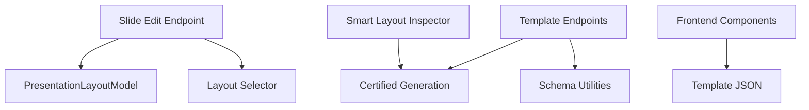

**Diagram sources**
- [slide.py:36-124](file://servers/fastapi/api/v1/ppt/endpoints/slide.py#L36-L124)
- [select_slide_type_on_edit.py:50-89](file://servers/fastapi/utils/llm_calls/select_slide_type_on_edit.py#L50-L89)
- [template.py:586-832](file://servers/fastapi/api/v1/ppt/endpoints/template.py#L586-L832)
- [smart_slide_layout.py:230-289](file://servers/fastapi/utils/smart_slide_layout.py#L230-L289)
- [template.json:1-800](file://templates/general/template.json#L1-L800)

**Section sources**
- [slide.py:36-124](file://servers/fastapi/api/v1/ppt/endpoints/slide.py#L36-L124)
- [select_slide_type_on_edit.py:50-89](file://servers/fastapi/utils/llm_calls/select_slide_type_on_edit.py#L50-L89)
- [template.py:586-832](file://servers/fastapi/api/v1/ppt/endpoints/template.py#L586-L832)
- [smart_slide_layout.py:230-289](file://servers/fastapi/utils/smart_slide_layout.py#L230-L289)
- [template.json:1-800](file://templates/general/template.json#L1-L800)

## Performance Considerations
- Avoid excessive absolute positioning and overlapping siblings; prefer flex/grid layouts with explicit gaps to reduce overlap detection costs.
- Minimize negative margins and translations that require additional geometric checks.
- Keep component trees shallow where possible to reduce parsing and validation overhead.
- Use merged components to reuse visual building blocks and avoid duplicating heavy element trees.
- For large presentations, batch layout generation and caching of derived schemas to reduce repeated computation.

[No sources needed since this section provides general guidance]

## Troubleshooting Guide
Common issues and resolutions:

- Clipped or overlapping content:
  - Inspect HTML layouts for negative margins/translations and hidden overflow with visible text.
  - Ensure absolutely positioned meaningful content has complete pixel boxes and stays within parent boundaries.
  - Resolve sibling overlaps by refactoring to flex/grid with explicit gaps.

- Invalid layout structure:
  - Ensure compiled layouts contain at least one component and all components have non-empty element lists.
  - Verify positions and sizes are finite numbers.

- Duplicate layout IDs:
  - Automated repair appends suffixes to duplicates; review generated IDs to maintain clarity.

- Missing layout assignment:
  - Confirm slide.edit flow returns a valid SlideLayoutModel and assigns slide.layout accordingly.

**Section sources**
- [smart_slide_layout.py:230-289](file://servers/fastapi/utils/smart_slide_layout.py#L230-L289)
- [certified_generation.py:3491-3503](file://servers/fastapi/templates/v2/certified_generation.py#L3491-L3503)
- [certified_generation.py:462-488](file://servers/fastapi/templates/v2/certified_generation.py#L462-L488)
- [slide.py:36-124](file://servers/fastapi/api/v1/ppt/endpoints/slide.py#L36-L124)

## Conclusion
The slide layout management system integrates robust data models, template processing, validation, and runtime assignment to provide consistent slide structure and visual organization. By leveraging merged components, schema-driven content validation, and smart layout inspection, the system supports flexible yet reliable layout inheritance, responsive behavior, and scalable performance. Versioning and migrations ensure backward compatibility while allowing evolution of layout definitions over time.