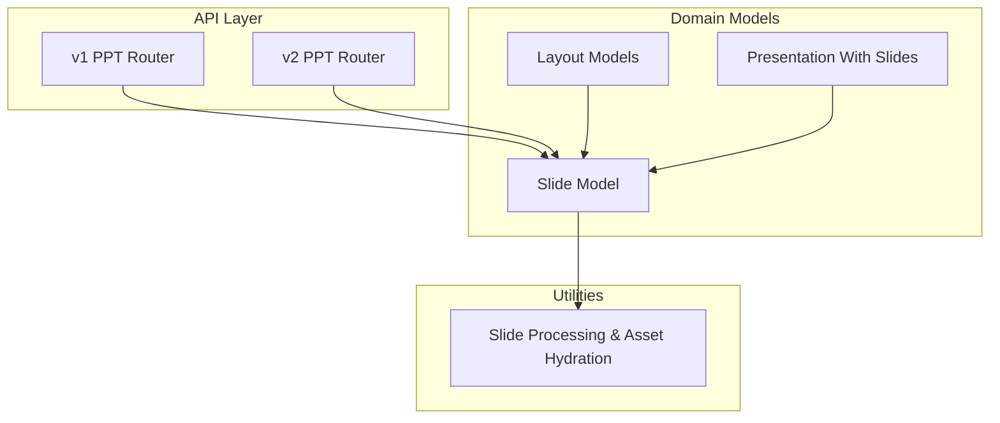
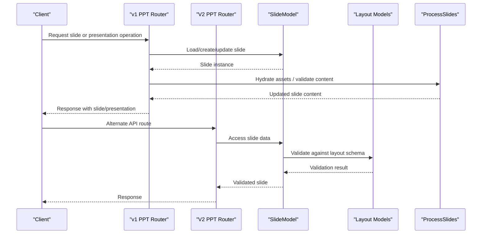
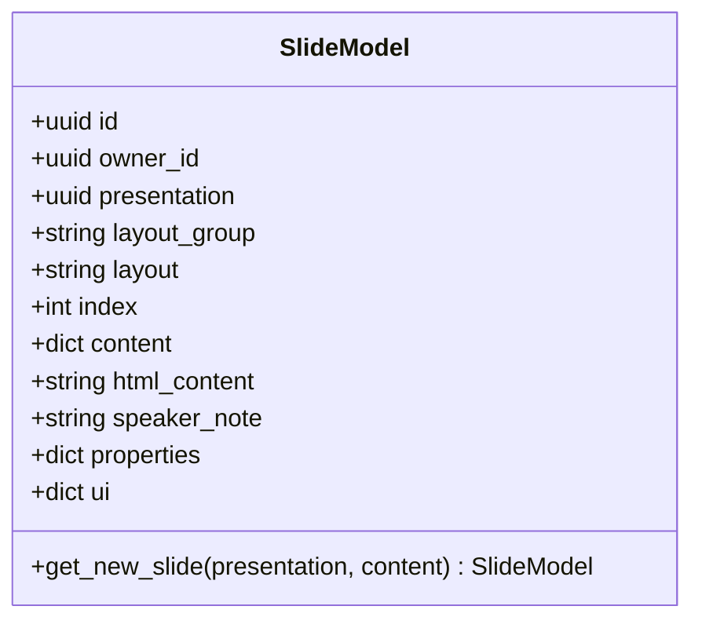
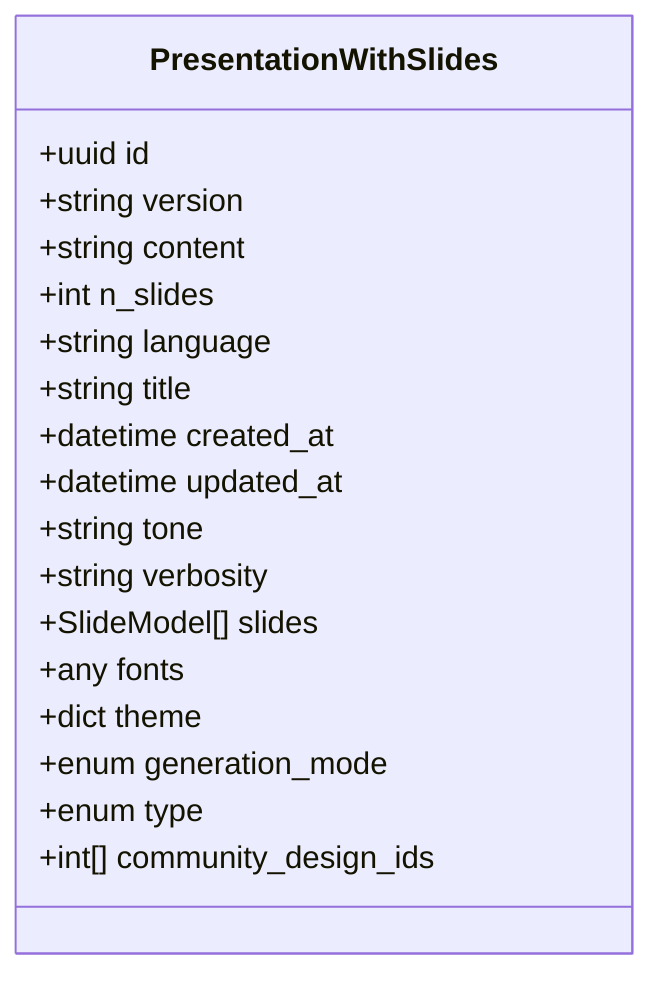
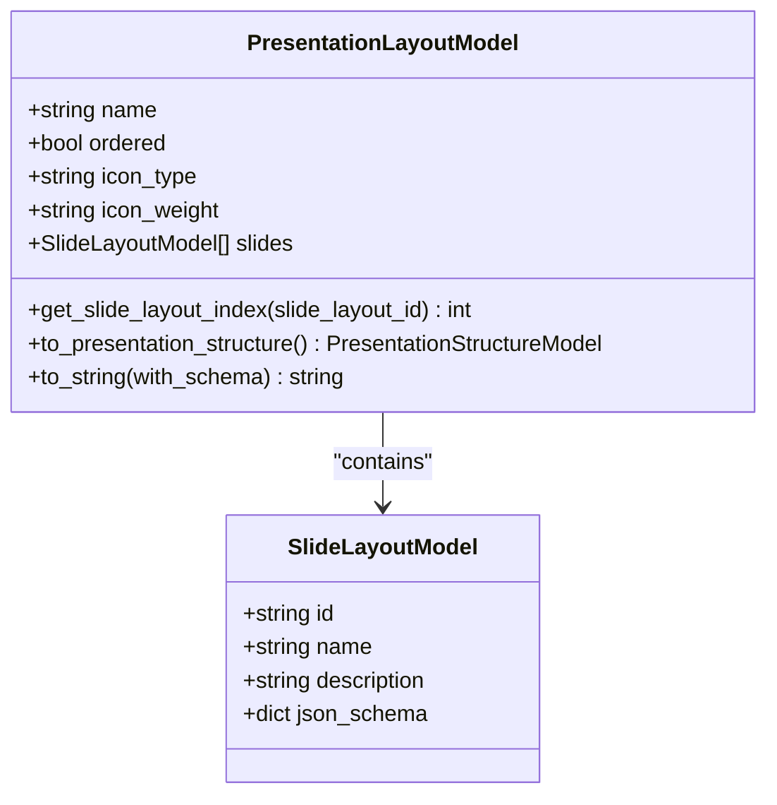
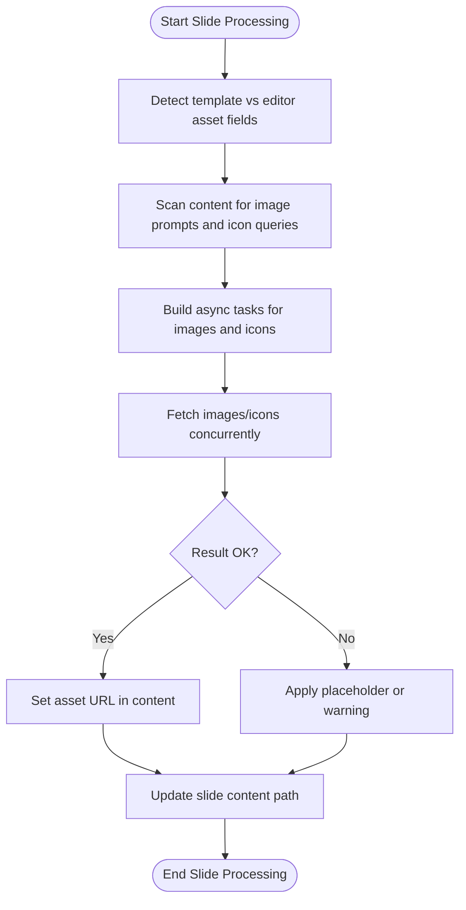
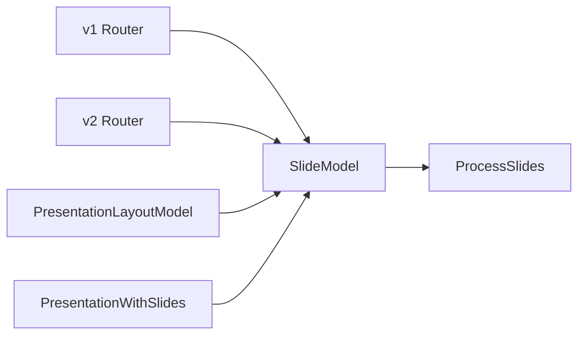

# Slide Management System

<cite>
**Referenced Files in This Document**
- [slide.py](file://servers/fastapi/models/sql/slide.py)
- [presentation_with_slides.py](file://servers/fastapi/models/presentation_with_slides.py)
- [presentation_layout.py](file://servers/fastapi/templates/presentation_layout.py)
- [process_slides.py](file://servers/fastapi/utils/process_slides.py)
- [router_v1_ppt.py](file://servers/fastapi/api/v1/ppt/router.py)
- [router_v2_ppt.py](file://servers/fastapi/api/v2/ppt/router.py)
</cite>

## Table of Contents
1. [Introduction](#introduction)
2. [Project Structure](#project-structure)
3. [Core Components](#core-components)
4. [Architecture Overview](#architecture-overview)
5. [Detailed Component Analysis](#detailed-component-analysis)
6. [Dependency Analysis](#dependency-analysis)
7. [Performance Considerations](#performance-considerations)
8. [Troubleshooting Guide](#troubleshooting-guide)
9. [Conclusion](#conclusion)

## Introduction
This document explains the slide management system used by the application to create, order, update, and render slides within presentations. It covers:
- The slide data model and its relationship with layouts and templates
- Slide manipulation operations such as reordering, duplicating, deleting, and updating content
- Layout assignment and template integration
- Validation rules for slide content and layout compatibility
- Versioning, conflict resolution, and performance considerations for large presentations

The goal is to make slide management understandable for both developers and product users while providing precise references to the source code that implements these behaviors.

## Project Structure
The slide management system spans several layers:
- Data models define how slides are stored and represented
- Template/layout definitions describe available slide layouts and their JSON schemas
- Utilities process slide content, resolve assets (images/icons), and hydrate layouts
- API routers expose endpoints for presentation and slide operations

**Diagram sources**
- [router_v1_ppt.py:1-41](file://servers/fastapi/api/v1/ppt/router.py#L1-L41)
- [router_v2_ppt.py:1-8](file://servers/fastapi/api/v2/ppt/router.py#L1-L8)
- [slide.py:1-46](file://servers/fastapi/models/sql/slide.py#L1-L46)
- [presentation_with_slides.py:1-27](file://servers/fastapi/models/presentation_with_slides.py#L1-L27)
- [presentation_layout.py:1-63](file://servers/fastapi/templates/presentation_layout.py#L1-L63)
- [process_slides.py:1-454](file://servers/fastapi/utils/process_slides.py#L1-L454)

**Section sources**
- [router_v1_ppt.py:1-41](file://servers/fastapi/api/v1/ppt/router.py#L1-L41)
- [router_v2_ppt.py:1-8](file://servers/fastapi/api/v2/ppt/router.py#L1-L8)

## Core Components
This section documents the core components involved in slide management:
- Slide data model
- Presentation container with slides
- Layout definitions and schema validation
- Slide processing utilities for asset hydration and rendering support

Key responsibilities:
- SlideModel stores slide identity, ordering, layout references, content, speaker notes, properties, and UI state
- PresentationWithSlides aggregates metadata and a list of SlideModel instances
- Layout models define slide layout schemas and helper methods for mapping layouts to structures
- ProcessSlides handles image/icon generation, placeholder insertion, and safe mutation of slide content

**Section sources**
- [slide.py:1-46](file://servers/fastapi/models/sql/slide.py#L1-L46)
- [presentation_with_slides.py:1-27](file://servers/fastapi/models/presentation_with_slides.py#L1-L27)
- [presentation_layout.py:1-63](file://servers/fastapi/templates/presentation_layout.py#L1-L63)
- [process_slides.py:1-454](file://servers/fastapi/utils/process_slides.py#L1-L454)

## Architecture Overview
The slide management architecture connects API routes to domain models and utilities:
- v1 and v2 routers register endpoints for presentation and slide operations
- SlideModel persists slide data and provides helpers for duplication
- PresentationWithSlides represents a full presentation including slides and metadata
- Layout models provide schema-driven validation and conversion utilities
- ProcessSlides hydrates slide content with generated images and icons, and supports placeholders

**Diagram sources**
- [router_v1_ppt.py:1-41](file://servers/fastapi/api/v1/ppt/router.py#L1-L41)
- [router_v2_ppt.py:1-8](file://servers/fastapi/api/v2/ppt/router.py#L1-L8)
- [slide.py:1-46](file://servers/fastapi/models/sql/slide.py#L1-L46)
- [presentation_layout.py:1-63](file://servers/fastapi/templates/presentation_layout.py#L1-L63)
- [process_slides.py:1-454](file://servers/fastapi/utils/process_slides.py#L1-L454)

## Detailed Component Analysis

### Slide Data Model
The slide data model defines the persistent representation of a slide:
- Identity and ownership: unique ID and owner reference
- Presentation linkage: foreign key to the parent presentation
- Ordering and layout: index position, layout group, and layout identifier
- Content and rendering: structured content dictionary, optional HTML content, speaker notes
- Metadata and UI: properties and UI state for editor interactions

**Diagram sources**
- [slide.py:1-46](file://servers/fastapi/models/sql/slide.py#L1-L46)

**Section sources**
- [slide.py:1-46](file://servers/fastapi/models/sql/slide.py#L1-L46)

### Presentation Container with Slides
A presentation object aggregates metadata and a list of slides:
- Identification and versioning: UUID and optional version string
- Generation metadata: title, language, tone, verbosity, generation mode, type
- Slide collection: ordered list of SlideModel instances
- Theme and fonts: optional theme configuration and font settings
- Community design references: optional IDs linking to community designs

**Diagram sources**
- [presentation_with_slides.py:1-27](file://servers/fastapi/models/presentation_with_slides.py#L1-L27)

**Section sources**
- [presentation_with_slides.py:1-27](file://servers/fastapi/models/presentation_with_slides.py#L1-L27)

### Layout Definitions and Schema Validation
Layout models define slide layout schemas and provide utilities:
- SlideLayoutModel: identifies a layout with name, description, and JSON schema
- PresentationLayoutModel: groups multiple slide layouts and normalizes icon settings
- Helper methods:
  - get_slide_layout_index: finds the index of a specific layout
  - to_presentation_structure: converts layout to a simple structure
  - to_string: serializes layout information for debugging or prompts

**Diagram sources**
- [presentation_layout.py:1-63](file://servers/fastapi/templates/presentation_layout.py#L1-L63)

**Section sources**
- [presentation_layout.py:1-63](file://servers/fastapi/templates/presentation_layout.py#L1-L63)

### Slide Processing Utilities
Slide processing utilities handle asset hydration and safe content mutation:
- Image target sizing from template and content
- Detection of template asset fields vs editor asset fields
- Setting and retrieving asset URLs consistently across template and editor contexts
- Scanning content for image prompts and icon queries
- Generating images and icons concurrently with fallback handling
- Inserting placeholder assets when generation fails or is skipped

**Diagram sources**
- [process_slides.py:1-454](file://servers/fastapi/utils/process_slides.py#L1-L454)

**Section sources**
- [process_slides.py:1-454](file://servers/fastapi/utils/process_slides.py#L1-L454)

### Slide Manipulation APIs
The API layer exposes endpoints for slide and presentation operations:
- v1 router includes slide-related endpoints alongside other presentation features
- v2 router provides an alternate route prefix for newer presentation endpoints

Typical operations supported by the slide subsystem:
- Add new slides: create SlideModel instances linked to a presentation and assign layout
- Reorder slides: adjust index values and persist ordering
- Duplicate slides: use SlideModel.get_new_slide to clone content and UI state
- Delete slides: remove SlideModel entries from the database
- Update slide content: mutate content dict and hydrate assets via ProcessSlides
- Change slide layout: update layout_group and layout fields and re-validate against schema

Note: The exact endpoint paths and request/response formats are defined in the slide endpoints included by the routers; this document focuses on the data model and processing logic that those endpoints operate on.

**Section sources**
- [router_v1_ppt.py:1-41](file://servers/fastapi/api/v1/ppt/router.py#L1-L41)
- [router_v2_ppt.py:1-8](file://servers/fastapi/api/v2/ppt/router.py#L1-L8)
- [slide.py:1-46](file://servers/fastapi/models/sql/slide.py#L1-L46)
- [presentation_layout.py:1-63](file://servers/fastapi/templates/presentation_layout.py#L1-L63)
- [process_slides.py:1-454](file://servers/fastapi/utils/process_slides.py#L1-L454)

## Dependency Analysis
The slide management system has clear dependencies between layers:
- Routers depend on domain models and utilities
- SlideModel depends on SQLAlchemy/SQLModel infrastructure and references owners and presentations
- Layout models depend on Pydantic validation and helper functions
- ProcessSlides depends on services for image generation and icon discovery

**Diagram sources**
- [router_v1_ppt.py:1-41](file://servers/fastapi/api/v1/ppt/router.py#L1-L41)
- [router_v2_ppt.py:1-8](file://servers/fastapi/api/v2/ppt/router.py#L1-L8)
- [slide.py:1-46](file://servers/fastapi/models/sql/slide.py#L1-L46)
- [presentation_layout.py:1-63](file://servers/fastapi/templates/presentation_layout.py#L1-L63)
- [process_slides.py:1-454](file://servers/fastapi/utils/process_slides.py#L1-L454)

**Section sources**
- [router_v1_ppt.py:1-41](file://servers/fastapi/api/v1/ppt/router.py#L1-L41)
- [router_v2_ppt.py:1-8](file://servers/fastapi/api/v2/ppt/router.py#L1-L8)
- [slide.py:1-46](file://servers/fastapi/models/sql/slide.py#L1-L46)
- [presentation_layout.py:1-63](file://servers/fastapi/templates/presentation_layout.py#L1-L63)
- [process_slides.py:1-454](file://servers/fastapi/utils/process_slides.py#L1-L454)

## Performance Considerations
- Concurrent asset fetching: Images and icons are fetched asynchronously to reduce latency during slide processing
- Fallback handling: Optional allow_image_fallback prevents failures from blocking entire slide updates
- Placeholder insertion: When assets cannot be generated, placeholders ensure UI remains functional
- Target size optimization: Image target sizes derived from layout improve generation quality and reduce unnecessary resizing
- Large presentations: For decks with many slides, batch operations should minimize repeated hydration and leverage existing asset URLs to avoid redundant generation

[No sources needed since this section provides general guidance]

## Troubleshooting Guide
Common issues and resolutions:
- Missing or invalid layout schema: Ensure the slide’s layout exists in the presentation layout and matches the expected JSON schema
- Asset generation errors: Check provider configuration and rate limits; enable fallback to placeholders if appropriate
- Incorrect asset keys: Verify whether template or editor asset fields are being used and ensure consistent URL keys
- Ordering inconsistencies: Confirm that slide index values are unique and correctly persisted after reorder operations
- Version conflicts: Use the presentation version field to detect concurrent edits and apply conflict resolution strategies at the API layer

**Section sources**
- [presentation_layout.py:1-63](file://servers/fastapi/templates/presentation_layout.py#L1-L63)
- [process_slides.py:1-454](file://servers/fastapi/utils/process_slides.py#L1-L454)
- [presentation_with_slides.py:1-27](file://servers/fastapi/models/presentation_with_slides.py#L1-L27)

## Conclusion
The slide management system combines robust data modeling, schema-driven layout validation, and efficient asset hydration to support flexible slide creation, editing, and rendering. By leveraging SlideModel for persistence and duplication, PresentationLayoutModel for schema validation, and ProcessSlides for asset processing, the system provides a solid foundation for building scalable presentation workflows. Proper use of versioning, fallback mechanisms, and concurrent processing ensures reliability and performance even for large presentations.

[No sources needed since this section summarizes without analyzing specific files]