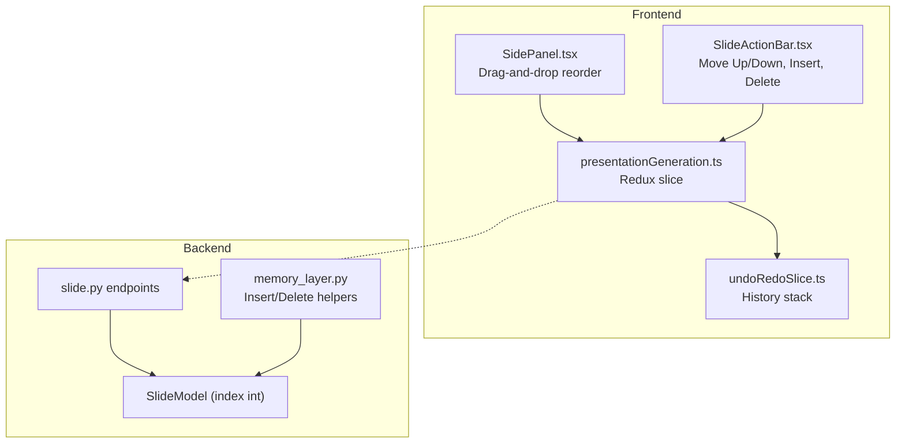
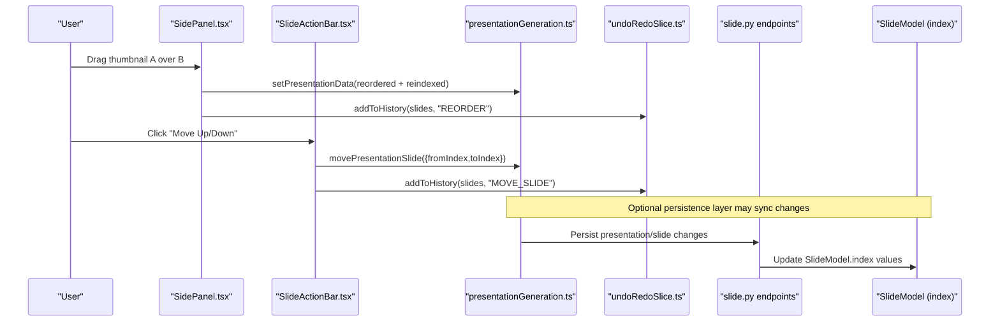
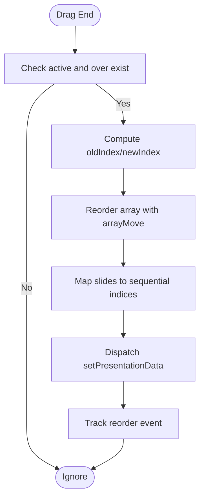
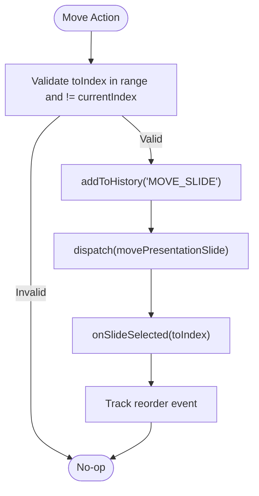
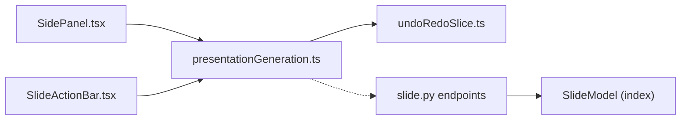

# Slide Ordering and Reordering

<cite>
**Referenced Files in This Document**
- [SidePanel.tsx](file://servers/nex tjs/app/(presentation-generator)/presentation/components/SidePanel.tsx)
- [SlideActionBar.tsx](file://servers/nex tjs/app/(presentation-generator)/presentation/components/SlideActionBar.tsx)
- [presentationGeneration.ts](file://servers/nex tjs/store/slices/presentationGeneration.ts)
- [undoRedoSlice.ts](file://servers/nex tjs/store/slices/undoRedoSlice.ts)
- [slide.py (SQL model)](file://servers/fastapi/models/sql/slide.py)
- [slide.py (API endpoints)](file://servers/fastapi/api/v1/ppt/endpoints/slide.py)
- [memory_layer.py](file://servers/fastapi/services/chat/memory_layer.py)
</cite>

## Table of Contents
1. [Introduction](#introduction)
2. [Project Structure](#project-structure)
3. [Core Components](#core-components)
4. [Architecture Overview](#architecture-overview)
5. [Detailed Component Analysis](#detailed-component-analysis)
6. [Dependency Analysis](#dependency-analysis)
7. [Performance Considerations](#performance-considerations)
8. [Troubleshooting Guide](#troubleshooting-guide)
9. [Conclusion](#conclusion)

## Introduction
This document explains how slide ordering and reordering work across the application, focusing on:
- The slide index system and how positions are managed in both the frontend state and backend storage.
- Reordering APIs and UI flows for moving slides up/down, inserting at specific positions, and bulk reorder operations.
- Index calculation algorithms, position validation, and consistency maintenance during reordering.
- Real-time synchronization considerations, conflict resolution strategies, undo/redo support, and performance optimizations for large presentations.

## Project Structure
The slide ordering feature spans two layers:
- Frontend (Next.js): User interactions (drag-and-drop, menu actions) update a Redux store that maintains an ordered array of slides with sequential indices.
- Backend (FastAPI): Slides are persisted with an integer index field; services handle insertion/deletion and maintain consistent indices when necessary.

**Diagram sources**
- [SidePanel.tsx:156-195](file://servers/nex tjs/app/(presentation-generator)/presentation/components/SidePanel.tsx#L156-L195)
- [SlideActionBar.tsx:203-219](file://servers/nex tjs/app/(presentation-generator)/presentation/components/SlideActionBar.tsx#L203-L219)
- [presentationGeneration.ts:252-276](file://servers/nex tjs/store/slices/presentationGeneration.ts#L252-L276)
- [undoRedoSlice.ts:31-86](file://servers/nex tjs/store/slices/undoRedoSlice.ts#L31-L86)
- [slide.py (SQL model):9-30](file://servers/fastapi/models/sql/slide.py#L9-L30)
- [slide.py (API endpoints):36-124](file://servers/fastapi/api/v1/ppt/endpoints/slide.py#L36-L124)
- [memory_layer.py:1160-1181](file://servers/fastapi/services/chat/memory_layer.py#L1160-L1181)

**Section sources**
- [SidePanel.tsx:156-195](file://servers/nex tjs/app/(presentation-generator)/presentation/components/SidePanel.tsx#L156-L195)
- [SlideActionBar.tsx:203-219](file://servers/nex tjs/app/(presentation-generator)/presentation/components/SlideActionBar.tsx#L203-L219)
- [presentationGeneration.ts:168-276](file://servers/nex tjs/store/slices/presentationGeneration.ts#L168-L276)
- [slide.py (SQL model):9-30](file://servers/fastapi/models/sql/slide.py#L9-L30)
- [memory_layer.py:1160-1181](file://servers/fastapi/services/chat/memory_layer.py#L1160-L1181)

## Core Components
- Frontend drag-and-drop reorder: SidePanel uses DnD to compute old/new indices, reorders the array, and reassigns sequential indices before dispatching a store update.
- Programmatic move: SlideActionBar triggers Move Up/Down by calling a Redux action with fromIndex/toIndex; the reducer validates bounds and updates indices.
- Insertion: Both SidePanel and SlideActionBar insert new slides at a given index and then recompute all indices sequentially.
- Deletion: SlideActionBar deletes a slide and ensures at least one slide remains; reducers recompute indices after deletion.
- Undo/Redo: Actions push snapshots into a history stack; undo/redo swaps present/past/future states and suppresses intermediate history entries.

Key responsibilities:
- Validate indices before mutation.
- Maintain sequential indices after any structural change.
- Track user actions for undo/redo.

**Section sources**
- [SidePanel.tsx:156-195](file://servers/nex tjs/app/(presentation-generator)/presentation/components/SidePanel.tsx#L156-L195)
- [SlideActionBar.tsx:203-219](file://servers/nex tjs/app/(presentation-generator)/presentation/components/SlideActionBar.tsx#L203-L219)
- [presentationGeneration.ts:168-276](file://servers/nex tjs/store/slices/presentationGeneration.ts#L168-L276)
- [undoRedoSlice.ts:31-86](file://servers/nex tjs/store/slices/undoRedoSlice.ts#L31-L86)

## Architecture Overview
The slide ordering flow integrates UI events, Redux state mutations, and optional persistence via backend services.

**Diagram sources**
- [SidePanel.tsx:156-195](file://servers/nex tjs/app/(presentation-generator)/presentation/components/SidePanel.tsx#L156-L195)
- [SlideActionBar.tsx:203-219](file://servers/nex tjs/app/(presentation-generator)/presentation/components/SlideActionBar.tsx#L203-L219)
- [presentationGeneration.ts:252-276](file://servers/nex tjs/store/slices/presentationGeneration.ts#L252-L276)
- [undoRedoSlice.ts:31-86](file://servers/nex tjs/store/slices/undoRedoSlice.ts#L31-L86)
- [slide.py (API endpoints):36-124](file://servers/fastapi/api/v1/ppt/endpoints/slide.py#L36-L124)
- [slide.py (SQL model):9-30](file://servers/fastapi/models/sql/slide.py#L9-L30)

## Detailed Component Analysis

### Slide Index System
- Frontend: Each slide object carries an integer index. After any structural operation (insert, delete, move), the entire slides array is remapped so indices remain contiguous starting at 0.
- Backend: SlideModel stores an integer index per slide within a presentation. Queries order by this index to preserve sequence.

Complexity:
- Reindexing after each operation is O(n) due to mapping over the slides array.
- Database queries use ORDER BY index to retrieve slides in correct order.

Consistency:
- All mutating operations ensure indices are recalculated immediately after the structural change.

**Section sources**
- [presentationGeneration.ts:168-276](file://servers/nex tjs/store/slices/presentationGeneration.ts#L168-L276)
- [slide.py (SQL model):9-30](file://servers/fastapi/models/sql/slide.py#L9-L30)

### Drag-and-Drop Reordering (SidePanel)
Behavior:
- Detects active and over items, computes oldIndex/newIndex.
- Uses arrayMove to reorder.
- Remaps indices sequentially.
- Dispatches a full presentation data update.
- Records an analytics event.

Validation:
- Guards against missing data or identical active/over IDs.

**Diagram sources**
- [SidePanel.tsx:156-195](file://servers/nex tjs/app/(presentation-generator)/presentation/components/SidePanel.tsx#L156-L195)

**Section sources**
- [SidePanel.tsx:156-195](file://servers/nex tjs/app/(presentation-generator)/presentation/components/SidePanel.tsx#L156-L195)

### Programmatic Move Up/Down (SlideActionBar)
Behavior:
- Validates target index within bounds and not equal to current index.
- Pushes a snapshot to history.
- Dispatches movePresentationSlide with fromIndex/toIndex.
- Selects the new slide index and tracks analytics.

Validation:
- Rejects invalid targets (out-of-range or same index).

**Diagram sources**
- [SlideActionBar.tsx:203-219](file://servers/nex tjs/app/(presentation-generator)/presentation/components/SlideActionBar.tsx#L203-L219)
- [presentationGeneration.ts:252-276](file://servers/nex tjs/store/slices/presentationGeneration.ts#L252-L276)

**Section sources**
- [SlideActionBar.tsx:203-219](file://servers/nex tjs/app/(presentation-generator)/presentation/components/SlideActionBar.tsx#L203-L219)
- [presentationGeneration.ts:252-276](file://servers/nex tjs/store/slices/presentationGeneration.ts#L252-L276)

### Insertion at Specific Positions
Behavior:
- Inserts a new slide at a specified index.
- Ensures maximum slide count is respected.
- Recalculates all indices sequentially.

Edge cases:
- Prevents insertion beyond MAX_NUMBER_OF_SLIDES.
- Handles template-free vs template-based blank slides.

**Section sources**
- [SidePanel.tsx:91-133](file://servers/nex tjs/app/(presentation-generator)/presentation/components/SidePanel.tsx#L91-L133)
- [SlideActionBar.tsx:131-175](file://servers/nex tjs/app/(presentation-generator)/presentation/components/SlideActionBar.tsx#L131-L175)
- [presentationGeneration.ts:168-189](file://servers/nex tjs/store/slices/presentationGeneration.ts#L168-L189)

### Deletion and Fallback Behavior
Behavior:
- If only one slide remains, replaces it with a blank fallback slide rather than deleting entirely.
- Otherwise, removes the slide at the given index.
- Recalculates indices and selects an appropriate next slide.

Validation:
- Prevents deletion if slides.length <= 1 unless fallback logic applies.

**Section sources**
- [SlideActionBar.tsx:221-258](file://servers/nex tjs/app/(presentation-generator)/presentation/components/SlideActionBar.tsx#L221-L258)
- [presentationGeneration.ts:191-221](file://servers/nex tjs/store/slices/presentationGeneration.ts#L191-L221)
- [memory_layer.py:1160-1181](file://servers/fastapi/services/chat/memory_layer.py#L1160-L1181)

### Undo/Redo Support
Behavior:
- Before mutating slides, components call addToHistory with the current slides array and an action type.
- History maintains past/present/future stacks with a max size.
- Undo/redo toggles between states and prevents duplicate history entries during transitions.

Implementation notes:
- Uses original() to compare immutable Redux snapshots efficiently.
- Skips intermediate history entries while undo/redo is in progress.

**Section sources**
- [undoRedoSlice.ts:31-86](file://servers/nex tjs/store/slices/undoRedoSlice.ts#L31-L86)
- [SlideActionBar.tsx:111-122](file://servers/nex tjs/app/(presentation-generator)/presentation/components/SlideActionBar.tsx#L111-L122)

### Backend Index Management
- SlideModel includes an integer index field used to order slides.
- Services query slides ordered by index to maintain sequence.
- When deleting slides, services sort by index and handle edge cases (e.g., smart mode fallback).

Persistence note:
- Slide edit endpoints update content and metadata but do not directly expose a dedicated “reorder” endpoint in the referenced files. Reordering is primarily a frontend concern; persistence of index changes can be integrated through existing presentation/slide update flows.

**Section sources**
- [slide.py (SQL model):9-30](file://servers/fastapi/models/sql/slide.py#L9-L30)
- [memory_layer.py:1160-1181](file://servers/fastapi/services/chat/memory_layer.py#L1160-L1181)
- [slide.py (API endpoints):36-124](file://servers/fastapi/api/v1/ppt/endpoints/slide.py#L36-L124)

## Dependency Analysis
- SidePanel depends on Redux actions to update presentationData and on analytics tracking.
- SlideActionBar depends on Redux actions for move/duplicate/delete and on undo/redo history.
- Redux slice centralizes slide manipulation logic and index recalculation.
- Backend SlideModel provides persistent indexing; services rely on index ordering.

**Diagram sources**
- [SidePanel.tsx:156-195](file://servers/nex tjs/app/(presentation-generator)/presentation/components/SidePanel.tsx#L156-L195)
- [SlideActionBar.tsx:203-219](file://servers/nex tjs/app/(presentation-generator)/presentation/components/SlideActionBar.tsx#L203-L219)
- [presentationGeneration.ts:252-276](file://servers/nex tjs/store/slices/presentationGeneration.ts#L252-L276)
- [undoRedoSlice.ts:31-86](file://servers/nex tjs/store/slices/undoRedoSlice.ts#L31-L86)
- [slide.py (API endpoints):36-124](file://servers/fastapi/api/v1/ppt/endpoints/slide.py#L36-L124)
- [slide.py (SQL model):9-30](file://servers/fastapi/models/sql/slide.py#L9-L30)

**Section sources**
- [SidePanel.tsx:156-195](file://servers/nex tjs/app/(presentation-generator)/presentation/components/SidePanel.tsx#L156-L195)
- [SlideActionBar.tsx:203-219](file://servers/nex tjs/app/(presentation-generator)/presentation/components/SlideActionBar.tsx#L203-L219)
- [presentationGeneration.ts:252-276](file://servers/nex tjs/store/slices/presentationGeneration.ts#L252-L276)
- [undoRedoSlice.ts:31-86](file://servers/nex tjs/store/slices/undoRedoSlice.ts#L31-L86)
- [slide.py (SQL model):9-30](file://servers/fastapi/models/sql/slide.py#L9-L30)

## Performance Considerations
- Reindexing cost: O(n) per structural change due to mapping over slides. For very large decks, consider:
  - Batched updates: group multiple moves into a single operation and reindex once.
  - Virtualization: render only visible thumbnails in the side panel to reduce DOM overhead.
  - Debounced persistence: coalesce frequent index updates before sending to the backend.
- Memory usage: Avoid deep cloning entire slide arrays; prefer reference updates where possible (already leveraged by Redux Toolkit/Immer).
- Analytics: Throttle or batch telemetry events for high-frequency reorder actions.

[No sources needed since this section provides general guidance]

## Troubleshooting Guide
Common issues and resolutions:
- Invalid target index: Ensure toIndex is within [0, n-1] and not equal to fromIndex.
- Boundary conditions:
  - Moving first slide up or last slide down should be disabled or ignored.
  - Deleting the last remaining slide triggers fallback behavior instead of empty deck.
- Index inconsistency: Always recompute indices after insert/delete/move.
- Undo/redo anomalies: Verify addToHistory is called before mutation and that undo/redo flags prevent duplicate history entries.

Operational checks:
- Confirm Redux actions return early for invalid inputs.
- Verify backend queries order slides by index.
- Validate that UI reflects selected slide index after operations.

**Section sources**
- [SlideActionBar.tsx:203-219](file://servers/nex tjs/app/(presentation-generator)/presentation/components/SlideActionBar.tsx#L203-L219)
- [presentationGeneration.ts:191-276](file://servers/nex tjs/store/slices/presentationGeneration.ts#L191-L276)
- [undoRedoSlice.ts:31-86](file://servers/nex tjs/store/slices/undoRedoSlice.ts#L31-L86)
- [memory_layer.py:1160-1181](file://servers/fastapi/services/chat/memory_layer.py#L1160-L1181)

## Conclusion
Slide ordering and reordering are implemented primarily in the frontend through Redux-managed state, ensuring sequential indices after every structural change. The backend persists slides with an index field and orders results accordingly. Undo/redo is supported via a history stack, and robust validation guards against invalid operations. For large presentations, batching and virtualization can improve performance, while careful index recalculation guarantees consistency across operations.