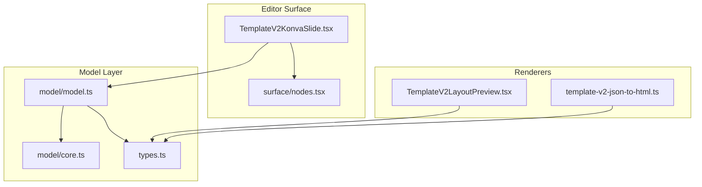
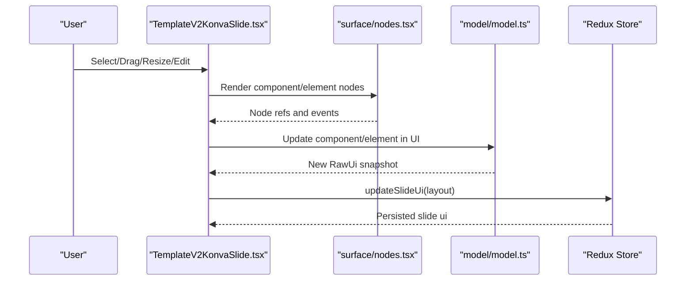
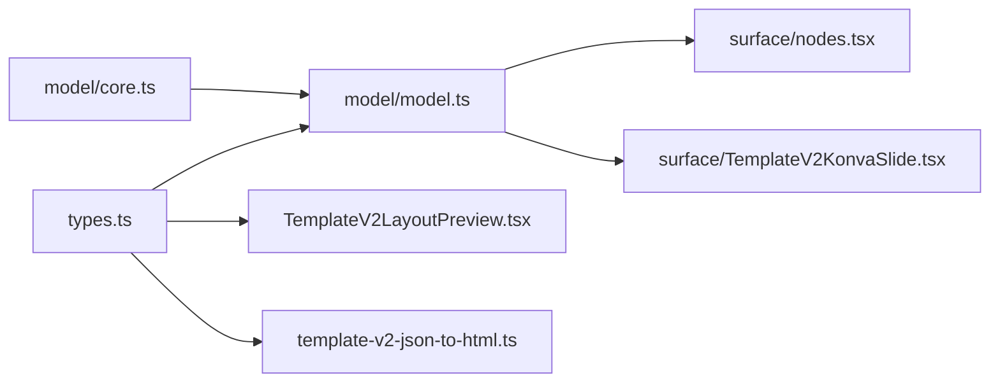

# Component-Based Design System

<cite>
**Referenced Files in This Document**
- [README.md](file://servers/nextjs/components/slide-editor/README.md)
- [types.ts](file://servers/nextjs/components/slide-editor/types.ts)
- [core.ts](file://servers/nextjs/components/slide-editor/model/core.ts)
- [model.ts](file://servers/nextjs/components/slide-editor/model/model.ts)
- [nodes.tsx](file://servers/nextjs/components/slide-editor/surface/nodes.tsx)
- [TemplateV2KonvaSlide.tsx](file://servers/nextjs/components/slide-editor/surface/TemplateV2KonvaSlide.tsx)
</cite>

## Table of Contents
1. [Introduction](#introduction)
2. [Project Structure](#project-structure)
3. [Core Components](#core-components)
4. [Architecture Overview](#architecture-overview)
5. [Detailed Component Analysis](#detailed-component-analysis)
6. [Dependency Analysis](#dependency-analysis)
7. [Performance Considerations](#performance-considerations)
8. [Troubleshooting Guide](#troubleshooting-guide)
9. [Conclusion](#conclusion)
10. [Appendices](#appendices)

## Introduction
This document explains the component-based design system used by the Template V2 slide editor and renderer. It focuses on the element hierarchy, including text, image, chart, infographic, and container components; their properties, styling options, and layout behaviors; composition patterns and nesting rules; inheritance mechanisms through shared base types; the rendering pipeline for both interactive editing and HTML preview/export; state management; and interaction handling. It also provides guidance for creating custom components, building component libraries, and implementing dynamic content insertion workflows.

The system is JSON-driven: a slide has a `ui` layout object that can be edited in the browser with a Konva canvas and rendered to HTML for previews and exports. The editor owns editable Konva nodes, while separate renderers handle non-editable HTML previews and export strings.

## Project Structure
The design system lives primarily under the slide editor package and related utilities:

- `components/slide-editor`: Editor surface, model helpers, selection, toolbars, text, tables, charts, images, shapes, layout, clipboard, events, state, and utilities.
- `lib/template-v2-json-to-html.ts`: HTML export renderer.
- `app/(presentation-generator)/custom-template/components/EachSlide/TemplateV2LayoutPreview.tsx`: HTML preview renderer.

**Diagram sources**
- [TemplateV2KonvaSlide.tsx:391-478](file://servers/nextjs/components/slide-editor/surface/TemplateV2KonvaSlide.tsx#L391-L478)
- [nodes.tsx:771-800](file://servers/nextjs/components/slide-editor/surface/nodes.tsx#L771-L800)
- [model.ts:156-239](file://servers/nextjs/components/slide-editor/model/model.ts#L156-L239)
- [core.ts:1-29](file://servers/nextjs/components/slide-editor/model/core.ts#L1-L29)
- [types.ts:431-649](file://servers/nextjs/components/slide-editor/types.ts#L431-L649)

**Section sources**
- [README.md:13-35](file://servers/nextjs/components/slide-editor/README.md#L13-L35)
- [README.md:62-81](file://servers/nextjs/components/slide-editor/README.md#L62-L81)

## Core Components
The design system defines a typed element hierarchy under `SlideElement`. Base properties are inherited from `ElementBase`, which includes positioning, sizing, rotation, flips, opacity, shadow, component metadata, design variables, and layout hints.

Supported visual elements include:
- Text and text-list
- Image and SVG
- Chart
- Infographic
- Container, Flex, Grid, Group
- Vector shapes and lines
- Tables

Key type families:
- `TextElement`, `TextListElement`
- `ImageElement`, `SvgElement`
- `ChartElement`
- `InfographicElement`
- `ContainerElement`, `FlexElement`, `GridElement`, `GroupElement`
- `VectorElement` (includes line-like vector paths)
- `TableElement`

Common base attributes:
- `position`, `size`, `rotation`, `flip_h`, `flip_v`, `opacity`, `shadow`
- `component_id`, `component_instance_id`, `component_description`, `component_slot`
- `design_variables`, `layout`

Styling primitives:
- `Font`, `Fill`, `Stroke`, `BorderRadius`, `Shadow`
- Alignment (`horizontal`, `vertical`)
- Layout item constraints (`grow`, `shrink`, `basis`, spans, alignment)

Complex data models:
- `InfographicData` union covering progress bars, gauges, timelines, roadmaps, funnels, matrices, org charts, decision trees, mind maps, etc.
- `ChartType` union covering area, bar, bubble, donut, line, pie, radar, scatter, stacked variants, etc.

**Section sources**
- [types.ts:431-649](file://servers/nextjs/components/slide-editor/types.ts#L431-L649)
- [types.ts:27-67](file://servers/nextjs/components/slide-editor/types.ts#L27-L67)
- [types.ts:333-386](file://servers/nextjs/components/slide-editor/types.ts#L333-L386)
- [types.ts:388-429](file://servers/nextjs/components/slide-editor/types.ts#L388-L429)

## Architecture Overview
The system has two primary rendering paths:

1. Editor rendering: `TemplateV2KonvaSlide.tsx` renders editable Konva nodes via `surface/nodes.tsx`.
2. HTML rendering/export: `TemplateV2LayoutPreview.tsx` and `lib/template-v2-json-to-html.ts` render the same slide data as React DOM or HTML strings.

The editor flow:
- Load slide layout into `TemplateV2KonvaSlide`.
- Normalize and store local `uiDraft`.
- Render Konva nodes from `uiDraft`.
- Selection determines toolbar/editor visibility.
- Toolbars produce partial changes.
- `commitUi()` writes next layout to local state, undo history, and Redux.
- Redux keeps current slide `ui` in presentation state.

**Diagram sources**
- [TemplateV2KonvaSlide.tsx:391-478](file://servers/nextjs/components/slide-editor/surface/TemplateV2KonvaSlide.tsx#L391-L478)
- [nodes.tsx:771-800](file://servers/nextjs/components/slide-editor/surface/nodes.tsx#L771-L800)
- [model.ts:156-239](file://servers/nextjs/components/slide-editor/model/model.ts#L156-L239)

**Section sources**
- [README.md:19-35](file://servers/nextjs/components/slide-editor/README.md#L19-L35)
- [README.md:130-199](file://servers/nextjs/components/slide-editor/README.md#L130-L199)

## Detailed Component Analysis

### Element Hierarchy and Composition
- Root elements: Elements stored directly under slide `elements`, treated as a virtual component index `-1`.
- Components: Top-level movable groups with `position`, `size`, and usually an `elements` array.
- Nesting: Elements may contain children via `children`, `elements`, or single `child` depending on element type.
- Inheritance: All elements extend `ElementBase`; layout containers extend common alignment/fill/stroke/border-radius/padding patterns.

Composition patterns:
- Containers hold one child with padding and alignment.
- Flex and Grid manage multiple children with direction, gap, alignment, and span constraints.
- Groups group arbitrary children without layout logic.
- Charts and infographics carry rich data structures for visualization.

Nesting rules:
- Child arrays vary per element type: `child` for containers, `children` for flex/grid/group, `columns` and `rows` for tables.
- Layout algorithms compute boxes for managed children and persist normalized positions/sizes when appropriate.

**Section sources**
- [README.md:37-58](file://servers/nextjs/components/slide-editor/README.md#L37-L58)
- [types.ts:460-635](file://servers/nextjs/components/slide-editor/types.ts#L460-L635)
- [model.ts:598-653](file://servers/nextjs/components/slide-editor/model/model.ts#L598-L653)

### Text and Rich Text
Properties:
- `runs`: Array of plain text or LaTeX runs with optional font overrides.
- `alignment`, `fill`, `stroke`, `max_length`, `min_length`.
- Font supports family, size, color, bold, italic, underline, line height, letter spacing, ellipsis, opacity.

Rendering:
- Editor uses tokenized text layout and Konva text nodes.
- HTML preview/export renders text runs into spans or HTML.

Editing:
- Inline editor buffers live runs to avoid typing lag.
- Toolbar edits font, styles, alignment, list settings.

**Section sources**
- [types.ts:402-458](file://servers/nextjs/components/slide-editor/types.ts#L402-L458)
- [README.md:614-670](file://servers/nextjs/components/slide-editor/README.md#L614-L670)

### Images and Icons
Properties:
- `data`, `fit`, `focus_x`, `focus_y`, `crop_scale`, `border_radius`, `clippath`, `color`, `prompt`, `is_icon`, `icon_type`.

Rendering:
- Loads images, supports fit modes, crop focus, flip, opacity, border radius clipping, icon masking.

Editing:
- Crop overlay with fixed window and draggable/scalable source image.
- Replace image workflow uploads asset and normalizes URL.
- Icon replacement searches icons and updates SVG URL path or color.

**Section sources**
- [types.ts:470-485](file://servers/nextjs/components/slide-editor/types.ts#L470-L485)
- [README.md:672-759](file://servers/nextjs/components/slide-editor/README.md#L672-L759)

### Charts
Properties:
- `chart_type`, `data`, `title`, axis colors, grid colors, categories, series, labels, legend, source.

Rendering:
- Delegated to Chart.js-backed element in Konva scene.

Editing:
- Chart editor popover updates selected chart data and style.

**Section sources**
- [types.ts:567-591](file://servers/nextjs/components/slide-editor/types.ts#L567-L591)
- [README.md:463](file://servers/nextjs/components/slide-editor/README.md#L463)

### Infographics
Properties:
- `data`: Union of infographic schemas (progress bar, gauge, timeline, roadmap, funnel, matrix, org chart, decision tree, mind map, etc.).
- Optional card/background text colors and palette.

Rendering:
- Specialized infographic canvas targets and edit flows.
- Supports grouped vs ungrouped main/item editing contexts.

Editing:
- Canvas target resolution for text/icon/image/shape.
- Insert/remove items, replace icons/images, adjust offsets.

**Section sources**
- [types.ts:69-294](file://servers/nextjs/components/slide-editor/types.ts#L69-L294)
- [types.ts:593-598](file://servers/nextjs/components/slide-editor/types.ts#L593-L598)
- [nodes.tsx:542-759](file://servers/nextjs/components/slide-editor/surface/nodes.tsx#L542-L759)

### Containers, Flex, Grid, Group
Properties:
- Container: alignment, fill, stroke, border radius, padding, single child.
- Flex: direction, wrap, align items, justify content, padding, gap, column/row gaps, children constraints.
- Grid: columns, rows, gap, alignment, padding, children constraints.
- Group: children constraints only.

Layout behavior:
- Container centers or aligns child within padded content box.
- Flex/Grid compute child boxes using flow layout and placement algorithms.
- Group does not impose layout; children retain their own positioning/sizing.

**Section sources**
- [types.ts:460-635](file://servers/nextjs/components/slide-editor/types.ts#L460-L635)
- [model.ts:598-727](file://servers/nextjs/components/slide-editor/model/model.ts#L598-L727)

### Vector Shapes and Lines
Properties:
- Vector: shape, points, closed, curve, corner radii, markers, fill, stroke.
- Line: stroke with dash, caps, joins, markers.

Rendering:
- Vector endpoints draw markers based on marker type and size.
- Lines use signed size deltas and hit stroke width for easier selection.

Editing:
- Vertex handles for adding/moving/deleting points.
- Marker style and size controls.

**Section sources**
- [types.ts:528-560](file://servers/nextjs/components/slide-editor/types.ts#L528-L560)
- [nodes.tsx:218-312](file://servers/nextjs/components/slide-editor/surface/nodes.tsx#L218-L312)

### Tables
Properties:
- Columns and rows of cells with font, alignment, borders, and text runs.

Rendering:
- Dedicated table renderer with cell selection and inline editing.

Editing:
- Table toolbar and inline cell editor integrate with text toolbar and Tiptap editor.

**Section sources**
- [types.ts:502-526](file://servers/nextjs/components/slide-editor/types.ts#L502-L526)
- [README.md:462](file://servers/nextjs/components/slide-editor/README.md#L462)

## Dependency Analysis
The editor surface depends on:
- Model layer for geometry, selection, raw UI updates, and style helpers.
- Types contract for all element definitions.
- Rendering primitives for Konva nodes and HTML renderers.

**Diagram sources**
- [types.ts:431-649](file://servers/nextjs/components/slide-editor/types.ts#L431-L649)
- [model.ts:156-239](file://servers/nextjs/components/slide-editor/model/model.ts#L156-L239)
- [core.ts:1-29](file://servers/nextjs/components/slide-editor/model/core.ts#L1-L29)
- [nodes.tsx:771-800](file://servers/nextjs/components/slide-editor/surface/nodes.tsx#L771-L800)
- [TemplateV2KonvaSlide.tsx:391-478](file://servers/nextjs/components/slide-editor/surface/TemplateV2KonvaSlide.tsx#L391-L478)

**Section sources**
- [README.md:83-128](file://servers/nextjs/components/slide-editor/README.md#L83-L128)

## Performance Considerations
- Inline text editing buffers live runs and commits on close to avoid typing lag.
- Viewport culling enables rendering only near-visible slides.
- Scene pixel ratio sync avoids unnecessary redraws.
- Memoization of computed selections and toolbar targets reduces re-renders.
- Batch drawing for Konva layers improves performance during transforms.

Recommendations:
- Prefer batched updates for multi-element changes.
- Use viewport culling for large decks.
- Avoid committing every keystroke; buffer and commit on blur/close.
- Reuse memoized computations for selection and layout.

[No sources needed since this section provides general guidance]

## Troubleshooting Guide
Common issues and resolutions:
- Selection not updating: Ensure node refs are registered and keys match selection.
- Crop overlay misaligned: Verify focus coordinates and crop scale normalization.
- Chart editor not opening: Confirm chart toolbar target detection and event wiring.
- Infographic editing stuck: Check grouped vs ungrouped context and canvas target resolution.
- Undo/redo not working: Only `commitUi(..., true)` pushes history; verify call site.

Operational checks:
- Validate selection kind and component/index/path.
- Confirm element path traversal functions return expected nodes.
- Ensure keyboard shortcuts ignore editable targets.

**Section sources**
- [README.md:469-559](file://servers/nextjs/components/slide-editor/README.md#L469-L559)
- [README.md:585-612](file://servers/nextjs/components/slide-editor/README.md#L585-L612)

## Conclusion
The Template V2 design system provides a robust, JSON-driven component model with clear separation between editor rendering and HTML preview/export. Its typed element hierarchy supports rich composition through containers, flex/grid layouts, and specialized components like charts and infographics. State management is centralized around `uiDraft`, selection, and Redux persistence, with comprehensive interaction handling for drag, resize, inline editing, and clipboard operations. Extending the system involves defining new element types in the types contract, adapting import/normalization logic, and ensuring both Konva and HTML renderers support the new features.

[No sources needed since this section summarizes without analyzing specific files]

## Appendices

### Custom Component Creation Workflow
Steps:
1. Define new element type in `types.ts` extending `ElementBase` with required properties.
2. Add adapter logic in import/normalization to convert backend payloads into editor shape.
3. Implement Konva rendering branch in `surface/nodes.tsx`.
4. Implement HTML preview/export branches in `TemplateV2LayoutPreview.tsx` and `template-v2-json-to-html.ts`.
5. Add toolbar controls and model helpers for editing and layout if needed.
6. Wire selection, clipboard, and undo/redo integration.

**Section sources**
- [README.md:127-128](file://servers/nextjs/components/slide-editor/README.md#L127-L128)
- [README.md:321-434](file://servers/nextjs/components/slide-editor/README.md#L321-L434)

### Dynamic Content Insertion Workflows
Patterns:
- Use custom insert events to add blocks/components/elements to active slide.
- Convert inserted palette/block content into raw top-level components via model helpers.
- Normalize geometry and text collections before insertion.

**Section sources**
- [README.md:219-277](file://servers/nextjs/components/slide-editor/README.md#L219-L277)
- [README.md:585-612](file://servers/nextjs/components/slide-editor/README.md#L585-L612)