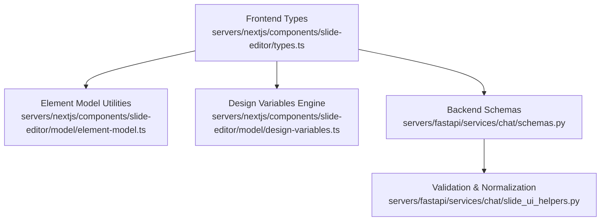
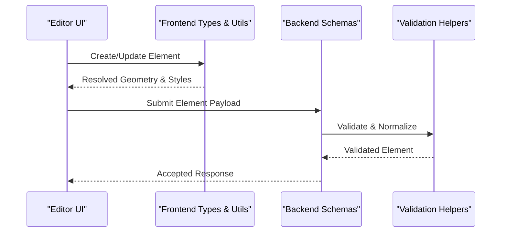
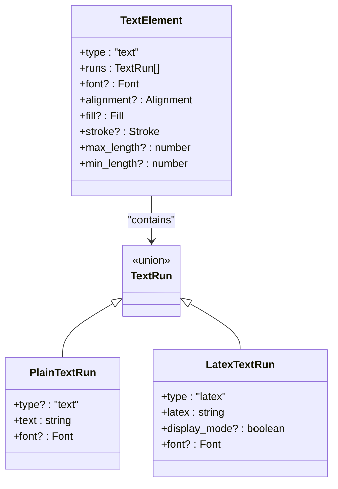
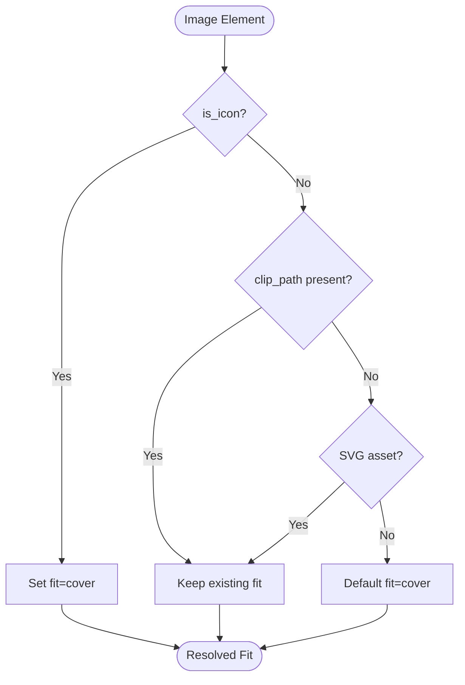
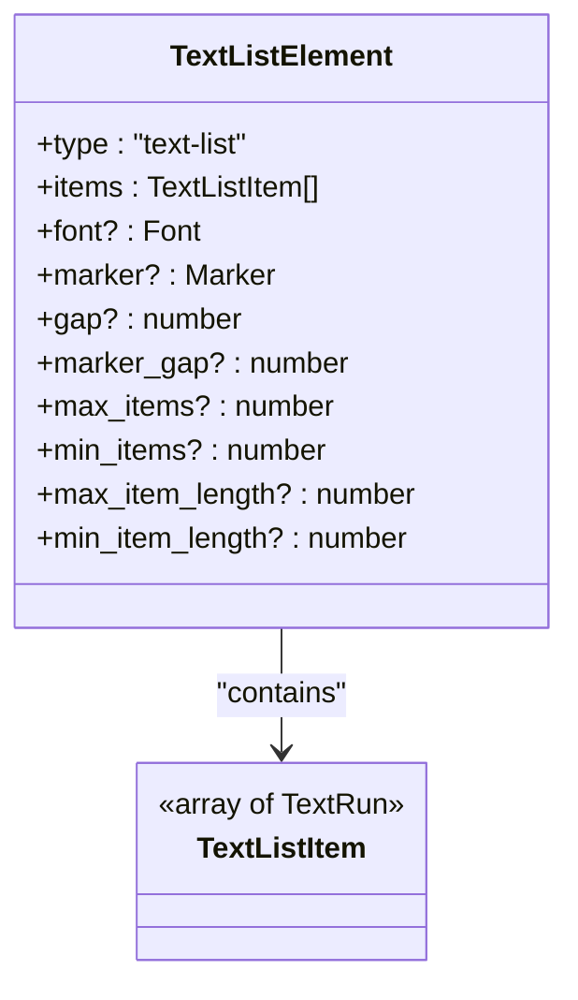
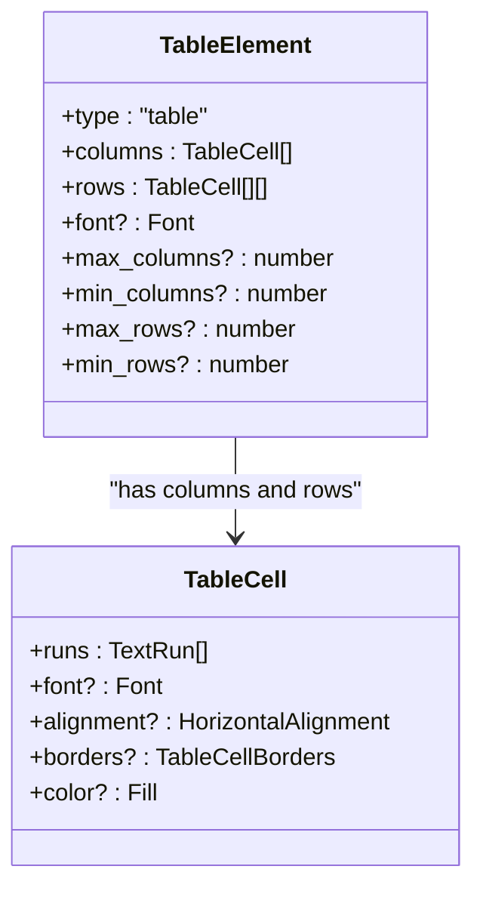
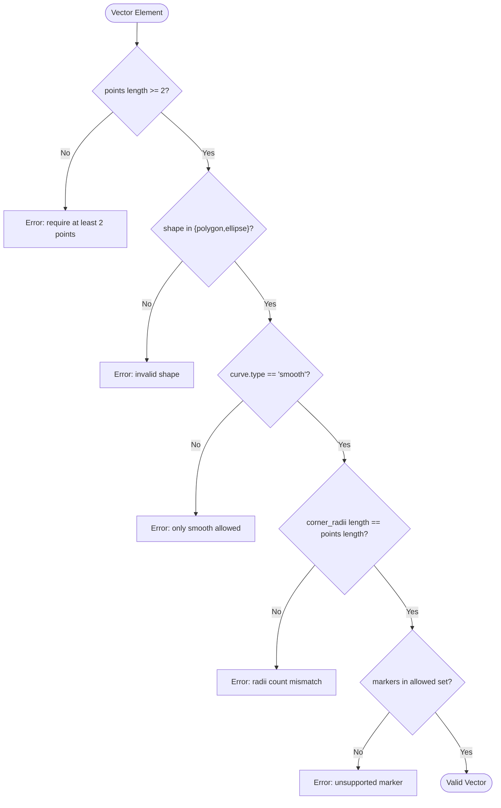
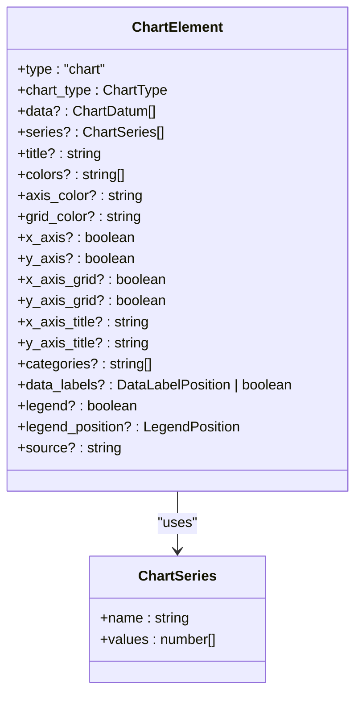
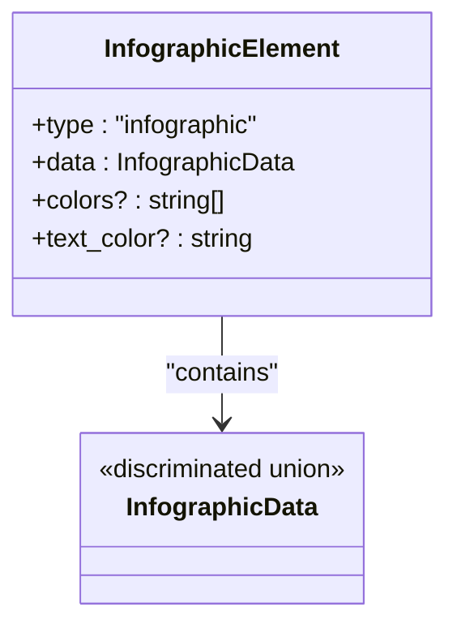
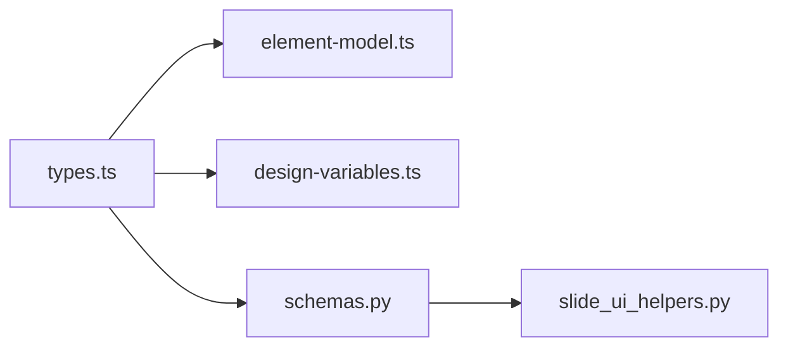

# Element Types and Properties

<cite>
**Referenced Files in This Document**
- [types.ts](file://servers/nextjs/components/slide-editor/types.ts)
- [element-model.ts](file://servers/nextjs/components/slide-editor/model/element-model.ts)
- [design-variables.ts](file://servers/nextjs/components/slide-editor/model/design-variables.ts)
- [schemas.py](file://servers/fastapi/services/chat/schemas.py)
- [slide_ui_helpers.py](file://servers/fastapi/services/chat/slide_ui_helpers.py)
</cite>

## Table of Contents
1. [Introduction](#introduction)
2. [Project Structure](#project-structure)
3. [Core Components](#core-components)
4. [Architecture Overview](#architecture-overview)
5. [Detailed Component Analysis](#detailed-component-analysis)
6. [Dependency Analysis](#dependency-analysis)
7. [Performance Considerations](#performance-considerations)
8. [Troubleshooting Guide](#troubleshooting-guide)
9. [Conclusion](#conclusion)

## Introduction
This document describes all slide element types in the component system, their shared properties, styling options, validation rules, and schema constraints. It covers Text, Image, Container, TextList, Table, Vector, Chart, Infographic, Flex, Grid, and Group elements. It also explains common properties such as position, size, rotation, alignment, fill, stroke, and shadow, and details element-specific features like text runs, image fitting modes, chart configurations, infographic data structures, and layout behaviors.

## Project Structure
The element model is defined primarily in TypeScript for the editor and validated on the backend using Python schemas and helpers. The frontend defines the canonical shape of each element type, while the backend enforces input constraints and normalizes values before rendering or persistence.

**Diagram sources**
- [types.ts:431-649](file://servers/nextjs/components/slide-editor/types.ts#L431-L649)
- [element-model.ts:1-250](file://servers/nextjs/components/slide-editor/model/element-model.ts#L1-L250)
- [design-variables.ts:1-264](file://servers/nextjs/components/slide-editor/model/design-variables.ts#L1-L264)
- [schemas.py:318-670](file://servers/fastapi/services/chat/schemas.py#L318-L670)
- [slide_ui_helpers.py:290-489](file://servers/fastapi/services/chat/slide_ui_helpers.py#L290-L489)

**Section sources**
- [types.ts:1-746](file://servers/nextjs/components/slide-editor/types.ts#L1-L746)
- [element-model.ts:1-250](file://servers/nextjs/components/slide-editor/model/element-model.ts#L1-L250)
- [design-variables.ts:1-264](file://servers/nextjs/components/slide-editor/model/design-variables.ts#L1-L264)
- [schemas.py:318-670](file://servers/fastapi/services/chat/schemas.py#L318-L670)
- [slide_ui_helpers.py:290-489](file://servers/fastapi/services/chat/slide_ui_helpers.py#L290-L489)

## Core Components
All slide elements share a base set of properties that control geometry, appearance, composition, and layout behavior. These are defined once and extended by specific element types.

- Shared base properties
  - Decorative flag, name, component metadata, design variables
  - Position (x, y), Size (width, height), Rotation, Flip horizontal/vertical
  - Opacity, Shadow, Layout item hints
- Common styling
  - Fill (color, opacity), Stroke (color, width, dash, line caps/joins, markers), Border radius
- Alignment and layout
  - Horizontal and vertical alignment, flex/grid alignment controls per container
- Data models
  - Font, TextRun, ChartDatum/Series, InfographicData variants

Key definitions and utilities:
- Base element and union of all element types
- Helpers for box conversion, resizing, moving, font resolution, table/text manipulation
- Design variable engine to apply dynamic effects across nested children

**Section sources**
- [types.ts:296-447](file://servers/nextjs/components/slide-editor/types.ts#L296-L447)
- [types.ts:449-649](file://servers/nextjs/components/slide-editor/types.ts#L449-L649)
- [element-model.ts:43-147](file://servers/nextjs/components/slide-editor/model/element-model.ts#L43-L147)
- [element-model.ts:167-249](file://servers/nextjs/components/slide-editor/model/element-model.ts#L167-L249)
- [design-variables.ts:10-27](file://servers/nextjs/components/slide-editor/model/design-variables.ts#L10-L27)

## Architecture Overview
The element system follows a layered approach:
- Frontend types define the canonical structure of every element.
- Editor utilities transform and manipulate elements (e.g., resize, move, merge fonts).
- Backend schemas validate incoming requests and normalize fields.
- Validation helpers enforce structural integrity for complex elements like vectors and infographics.

**Diagram sources**
- [types.ts:431-649](file://servers/nextjs/components/slide-editor/types.ts#L431-L649)
- [element-model.ts:43-147](file://servers/nextjs/components/slide-editor/model/element-model.ts#L43-L147)
- [schemas.py:318-670](file://servers/fastapi/services/chat/schemas.py#L318-L670)
- [slide_ui_helpers.py:299-360](file://servers/fastapi/services/chat/slide_ui_helpers.py#L299-L360)

## Detailed Component Analysis

### Text Element
- Purpose: Displays styled text with support for mixed runs including plain text and LaTeX.
- Key properties
  - Runs: array of TextRun (plain or latex)
  - Font, Alignment, Fill, Stroke
  - Length constraints: max_length, min_length
- Styling
  - Font family, size, color, bold, italic, underline, line_height, letter_spacing, ellipsis, opacity
  - Fill and Stroke for background/outlines
- Validation
  - Backend font normalization supports multiple aliases and ranges
  - Text length constraints enforced at the element level

**Diagram sources**
- [types.ts:402-458](file://servers/nextjs/components/slide-editor/types.ts#L402-L458)
- [schemas.py:597-637](file://servers/fastapi/services/chat/schemas.py#L597-L637)

**Section sources**
- [types.ts:402-458](file://servers/nextjs/components/slide-editor/types.ts#L402-L458)
- [element-model.ts:90-147](file://servers/nextjs/components/slide-editor/model/element-model.ts#L90-L147)
- [schemas.py:597-637](file://servers/fastapi/services/chat/schemas.py#L597-L637)

### Image Element
- Purpose: Renders images, icons, or generated imagery with flexible fitting and cropping.
- Key properties
  - data: asset URL or inline content
  - fit: contain, cover, fill
  - focus_x, focus_y, crop_scale
  - border_radius, clip_path variants, color, prompt, is_icon, icon_type
- Behavior
  - Icon mode and SVG assets influence default fit behavior
  - Clip paths can override automatic fitting

**Diagram sources**
- [slide_ui_helpers.py:412-440](file://servers/fastapi/services/chat/slide_ui_helpers.py#L412-L440)
- [types.ts:470-485](file://servers/nextjs/components/slide-editor/types.ts#L470-L485)

**Section sources**
- [types.ts:470-485](file://servers/nextjs/components/slide-editor/types.ts#L470-L485)
- [slide_ui_helpers.py:383-440](file://servers/fastapi/services/chat/slide_ui_helpers.py#L383-L440)

### Container Element
- Purpose: Holds a single child element with optional padding and visual styling.
- Key properties
  - child: SlideElement
  - alignment, fill, stroke, border_radius, padding
- Use cases
  - Framing content with consistent spacing and borders

**Section sources**
- [types.ts:460-468](file://servers/nextjs/components/slide-editor/types.ts#L460-L468)

### TextList Element
- Purpose: Renders lists of items where each item is an array of TextRun.
- Key properties
  - items: TextListItem[]
  - font, marker, gap, marker_gap
  - max_items, min_items, max_item_length, min_item_length
- Utilities
  - Convert between strings and TextRun arrays
  - Merge font styles across runs

**Diagram sources**
- [types.ts:487-500](file://servers/nextjs/components/slide-editor/types.ts#L487-L500)
- [element-model.ts:149-165](file://servers/nextjs/components/slide-editor/model/element-model.ts#L149-L165)

**Section sources**
- [types.ts:487-500](file://servers/nextjs/components/slide-editor/types.ts#L487-L500)
- [element-model.ts:149-165](file://servers/nextjs/components/slide-editor/model/element-model.ts#L149-L165)

### Table Element
- Purpose: Displays structured tabular data with header columns and body rows.
- Key properties
  - columns: TableCell[]
  - rows: TableCell[][]
  - font, max_columns, min_columns, max_rows, min_rows
- Cell styling
  - Each cell has runs, font, alignment, borders, and optional fill
- Utilities
  - Convert table to/from strings
  - Update cells and rows programmatically

**Diagram sources**
- [types.ts:502-526](file://servers/nextjs/components/slide-editor/types.ts#L502-L526)
- [element-model.ts:193-235](file://servers/nextjs/components/slide-editor/model/element-model.ts#L193-L235)

**Section sources**
- [types.ts:502-526](file://servers/nextjs/components/slide-editor/types.ts#L502-L526)
- [element-model.ts:193-235](file://servers/nextjs/components/slide-editor/model/element-model.ts#L193-L235)

### Vector Element
- Purpose: Draws vector shapes and lines with configurable endpoints and curves.
- Key properties
  - shape: polygon or ellipse
  - points: array of Position
  - closed, curve (smooth with tension and segments), corner_radii
  - start_marker, end_marker
  - fill, stroke
- Validation
  - Requires at least two numeric points
  - Shape must be one of supported values
  - Curve only supports type smooth
  - Corner radii count must match points
  - Markers must be from allowed set

**Diagram sources**
- [slide_ui_helpers.py:313-340](file://servers/fastapi/services/chat/slide_ui_helpers.py#L313-L340)
- [types.ts:528-560](file://servers/nextjs/components/slide-editor/types.ts#L528-L560)

**Section sources**
- [types.ts:528-560](file://servers/nextjs/components/slide-editor/types.ts#L528-L560)
- [slide_ui_helpers.py:313-340](file://servers/fastapi/services/chat/slide_ui_helpers.py#L313-L340)

### Chart Element
- Purpose: Visualizes numerical data with multiple chart types and configuration options.
- Key properties
  - chart_type: area, bar, bubble, donut, horizontal_bar, horizontal_stacked_bar, line, pie, polar_area, radar, scatter, stacked_bar
  - data: legacy ChartDatum[] or series: ChartSeries[]
  - title, colors, axis_color, grid_color, x_axis/y_axis toggles, titles, categories
  - data_labels placement, legend toggle and position, source
- Validation
  - Backend requires chart_type and either normalized series or legacy data
  - Series names/values constrained; categories limited in length

**Diagram sources**
- [types.ts:388-397](file://servers/nextjs/components/slide-editor/types.ts#L388-L397)
- [types.ts:567-591](file://servers/nextjs/components/slide-editor/types.ts#L567-L591)
- [schemas.py:355-434](file://servers/fastapi/services/chat/schemas.py#L355-L434)

**Section sources**
- [types.ts:388-397](file://servers/nextjs/components/slide-editor/types.ts#L388-L397)
- [types.ts:567-591](file://servers/nextjs/components/slide-editor/types.ts#L567-L591)
- [schemas.py:355-434](file://servers/fastapi/services/chat/schemas.py#L355-L434)

### Infographic Element
- Purpose: Renders rich infographic diagrams with strongly typed data structures.
- Key properties
  - data: InfographicData (discriminated by type)
  - colors, text_color
- Supported infographic types include progress_bar, gauge, gantt, timeline, roadmap, milestone_timeline, staircase, supply_chain, stair_step_blocks, maturity_model, diagonal_circles, pillar_framework, transformation_hub, risk_matrix, chevron_process, radial_cycle, conversion_funnel, vertical_funnel, pyramid, segmented_wheel, customer_journey, before_after, impact_effort_matrix, comparison_matrix, org_chart, decision_tree, mind_map
- Validation
  - data must be a dict with a valid type
  - Colors must be a non-empty string array

**Diagram sources**
- [types.ts:69-294](file://servers/nextjs/components/slide-editor/types.ts#L69-L294)
- [types.ts:593-598](file://servers/nextjs/components/slide-editor/types.ts#L593-L598)
- [slide_ui_helpers.py:342-360](file://servers/fastapi/services/chat/slide_ui_helpers.py#L342-L360)

**Section sources**
- [types.ts:69-294](file://servers/nextjs/components/slide-editor/types.ts#L69-L294)
- [types.ts:593-598](file://servers/nextjs/components/slide-editor/types.ts#L593-L598)
- [slide_ui_helpers.py:342-360](file://servers/fastapi/services/chat/slide_ui_helpers.py#L342-L360)

### Flex Element
- Purpose: Arranges children in a flex layout with direction, wrapping, gaps, and alignment.
- Key properties
  - direction: row | column
  - wrap, align_items, justify_content
  - padding, gap, column_gap, row_gap
  - children: SlideElement[]
  - max_children, min_children

**Section sources**
- [types.ts:600-613](file://servers/nextjs/components/slide-editor/types.ts#L600-L613)

### Grid Element
- Purpose: Arranges children in a grid with explicit columns and optional rows, plus alignment and gaps.
- Key properties
  - columns: number
  - rows: number?
  - gap, column_gap, row_gap
  - align_items, justify_items
  - padding
  - children: SlideElement[]
  - max_children, min_children

**Section sources**
- [types.ts:615-628](file://servers/nextjs/components/slide-editor/types.ts#L615-L628)

### Group Element
- Purpose: Groups multiple elements without additional layout behavior.
- Key properties
  - children: SlideElement[]
  - max_children, min_children

**Section sources**
- [types.ts:630-635](file://servers/nextjs/components/slide-editor/types.ts#L630-L635)

## Dependency Analysis
- Frontend types define the canonical element model used throughout the editor and exported to the backend via APIs.
- Backend schemas constrain inputs and normalize field names and values.
- Validation helpers ensure structural correctness for complex elements (vector, infographic).
- Design variables engine applies dynamic effects to nested children based on expressions.

**Diagram sources**
- [types.ts:431-649](file://servers/nextjs/components/slide-editor/types.ts#L431-L649)
- [element-model.ts:1-250](file://servers/nextjs/components/slide-editor/model/element-model.ts#L1-L250)
- [design-variables.ts:1-264](file://servers/nextjs/components/slide-editor/model/design-variables.ts#L1-L264)
- [schemas.py:318-670](file://servers/fastapi/services/chat/schemas.py#L318-L670)
- [slide_ui_helpers.py:290-489](file://servers/fastapi/services/chat/slide_ui_helpers.py#L290-L489)

**Section sources**
- [types.ts:431-649](file://servers/nextjs/components/slide-editor/types.ts#L431-L649)
- [element-model.ts:1-250](file://servers/nextjs/components/slide-editor/model/element-model.ts#L1-L250)
- [design-variables.ts:1-264](file://servers/nextjs/components/slide-editor/model/design-variables.ts#L1-L264)
- [schemas.py:318-670](file://servers/fastapi/services/chat/schemas.py#L318-L670)
- [slide_ui_helpers.py:290-489](file://servers/fastapi/services/chat/slide_ui_helpers.py#L290-L489)

## Performance Considerations
- Prefer minimal point counts for vector elements to reduce rendering cost.
- Limit series length and category counts for charts to avoid heavy computations.
- Avoid excessive nesting in Flex/Grid containers; use max/min children constraints to bound complexity.
- Reuse fills/strokes rather than duplicating style objects when possible.

## Troubleshooting Guide
Common validation errors and resolutions:
- Vector elements
  - Error: missing or insufficient points
    - Ensure at least two points with numeric x and y values
  - Error: invalid shape
    - Use polygon or ellipse
  - Error: unsupported curve type
    - Only smooth is supported
  - Error: corner_radii count mismatch
    - Match the number of points
  - Error: unsupported marker
    - Use allowed markers (none, arrow, stealth, triangle, circle, square, diamond)
- Infographic elements
  - Error: invalid data.type
    - Use a supported infographic type
  - Error: colors not a non-empty string array
    - Provide at least one color string
- Charts
  - Error: missing or malformed series/data
    - Provide series with name and values, or legacy data format
  - Error: invalid chart_type
    - Use one of the supported chart types
- Tables
  - Error: missing columns/headers or rows
    - Provide columns or headers along with rows

**Section sources**
- [slide_ui_helpers.py:313-360](file://servers/fastapi/services/chat/slide_ui_helpers.py#L313-L360)
- [schemas.py:355-434](file://servers/fastapi/services/chat/schemas.py#L355-L434)

## Conclusion
The element system provides a robust, type-safe foundation for building slides with diverse content types. Shared properties standardize positioning, sizing, and styling, while element-specific features enable rich text, images, tables, vectors, charts, infographics, and layouts. Backend schemas and validation helpers ensure data integrity and predictable rendering. By following the documented properties, constraints, and examples, you can create, configure, and validate slide elements reliably.