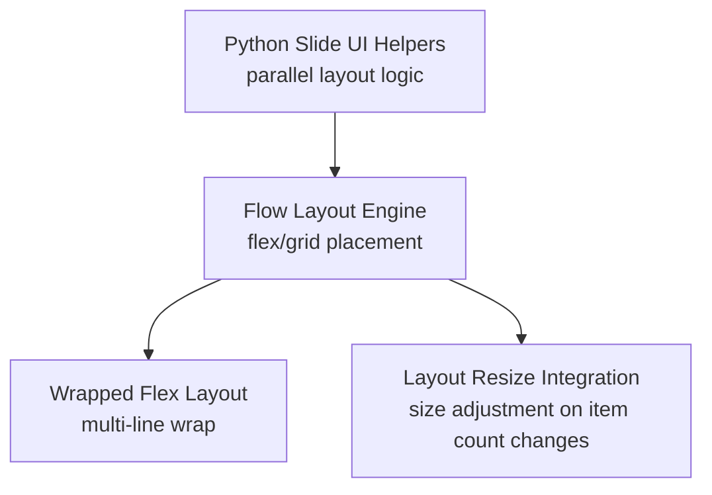
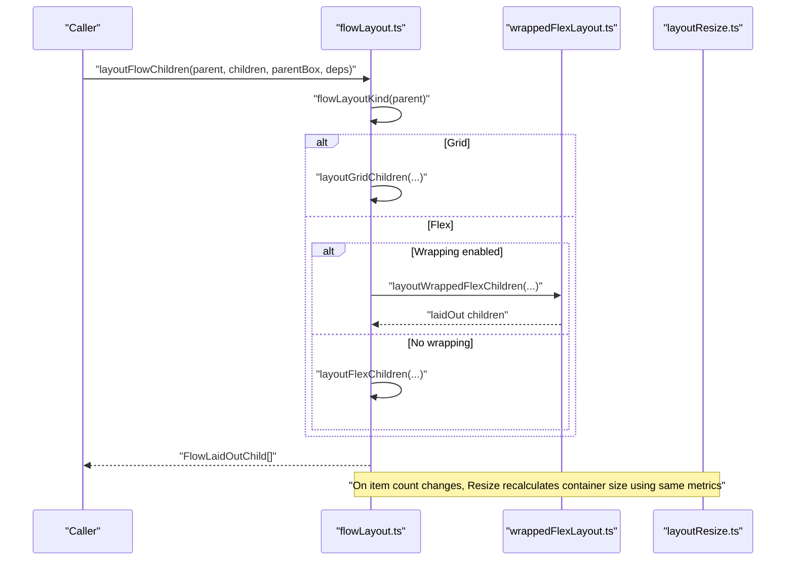
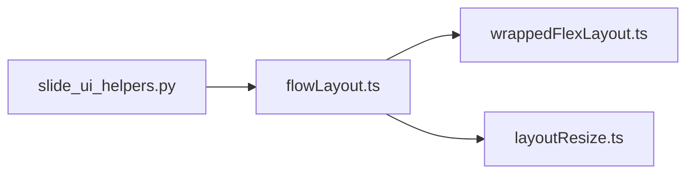

# Layout and Positioning System

<cite>
**Referenced Files in This Document**
- [flowLayout.ts](file://servers/nex tjs/components/slide-editor/layout/flowLayout.ts)
- [wrappedFlexLayout.ts](file://servers/nex tjs/components/slide-editor/layout/wrappedFlexLayout.ts)
- [layoutResize.ts](file://servers/nex tjs/components/slide-editor/layout/layoutResize.ts)
- [slide_ui_helpers.py](file://servers/fastapi/services/chat/slide_ui_helpers.py)
</cite>

## Table of Contents
1. [Introduction](#introduction)
2. [Project Structure](#project-structure)
3. [Core Components](#core-components)
4. [Architecture Overview](#architecture-overview)
5. [Detailed Component Analysis](#detailed-component-analysis)
6. [Dependency Analysis](#dependency-analysis)
7. [Performance Considerations](#performance-considerations)
8. [Troubleshooting Guide](#troubleshooting-guide)
9. [Conclusion](#conclusion)

## Introduction
This document explains the layout and positioning system used to compute child element boxes inside flow-based containers (Flexbox and Grid). It covers:
- Coordinate system and sizing model
- Absolute vs relative positioning behavior
- Flexbox and Grid layout algorithms, including alignment, spacing, wrapping, and distribution
- Inheritance and override rules for layout properties from parent to children
- Validation and constraints applied during layout
- How resizing interacts with layout calculations

The implementation is split between a TypeScript engine (Next.js slide editor) and a Python helper (FastAPI chat UI helpers), both following the same layout semantics.

## Project Structure
The layout system centers on three core modules:
- Flow layout engine (Flex/Grid): computes child boxes based on container properties
- Wrapped Flex layout: handles multi-line wrapping for flex containers
- Resize integration: adjusts container sizes when item counts change

**Diagram sources**
- [flowLayout.ts:56-103](file://servers/nex tjs/components/slide-editor/layout/flowLayout.ts#L56-L103)
- [wrappedFlexLayout.ts:52-217](file://servers/nex tjs/components/slide-editor/layout/wrappedFlexLayout.ts#L52-L217)
- [layoutResize.ts:128-358](file://servers/nex tjs/components/slide-editor/layout/layoutResize.ts#L128-L358)
- [slide_ui_helpers.py:889-963](file://servers/fastapi/services/chat/slide_ui_helpers.py#L889-L963)

**Section sources**
- [flowLayout.ts:56-103](file://servers/nex tjs/components/slide-editor/layout/flowLayout.ts#L56-L103)
- [wrappedFlexLayout.ts:52-217](file://servers/nex tjs/components/slide-editor/layout/wrappedFlexLayout.ts#L52-L217)
- [layoutResize.ts:128-358](file://servers/nex tjs/components/slide-editor/layout/layoutResize.ts#L128-L358)
- [slide_ui_helpers.py:889-963](file://servers/fastapi/services/chat/slide_ui_helpers.py#L889-L963)

## Core Components
- Flow layout engine: Determines whether a container is Flex or Grid, then lays out children accordingly. It reads padding, gaps, direction, alignment, justification, and per-child overrides.
- Wrapped Flex layout: Extends Flex to support wrapping across multiple lines, distributing cross-space evenly and respecting per-line alignment.
- Layout resize integration: Adjusts container size when items are added or removed, using the same Flex/Grid metrics as the layout engine.
- Python slide UI helpers: Provide equivalent layout computations for server-side rendering paths.

Key responsibilities:
- Compute intrinsic sizes for text and decorative shapes
- Respect min/max constraints via clamping
- Handle manual positioning overrides
- Apply alignment offsets along main and cross axes
- Distribute free space according to grow and stretch behaviors

**Section sources**
- [flowLayout.ts:56-103](file://servers/nex tjs/components/slide-editor/layout/flowLayout.ts#L56-L103)
- [flowLayout.ts:105-159](file://servers/nex tjs/components/slide-editor/layout/flowLayout.ts#L105-L159)
- [flowLayout.ts:210-418](file://servers/nex tjs/components/slide-editor/layout/flowLayout.ts#L210-L418)
- [wrappedFlexLayout.ts:52-217](file://servers/nex tjs/components/slide-editor/layout/wrappedFlexLayout.ts#L52-L217)
- [layoutResize.ts:128-358](file://servers/nex tjs/components/slide-editor/layout/layoutResize.ts#L128-L358)
- [slide_ui_helpers.py:889-963](file://servers/fastapi/services/chat/slide_ui_helpers.py#L889-L963)

## Architecture Overview
The layout pipeline proceeds through these stages:
1. Identify container kind (Flex or Grid)
2. Read container properties (padding, gap, direction, alignment, justify, columns/rows)
3. Compute available main/cross space after padding
4. Determine child basis and cross-size (respecting explicit sizes, inferred sizes, text measurement, and special shapes)
5. Place children:
   - Flex: single-line or wrapped lines; distribute free space by grow/stretch; apply alignment offsets
   - Grid: place into grid cells with columnSpan/rowSpan; compute cell sizes and align within cells
6. Return laid-out child boxes and metadata indicating whether each box was layout-managed

**Diagram sources**
- [flowLayout.ts:69-88](file://servers/nex tjs/components/slide-editor/layout/flowLayout.ts#L69-L88)
- [flowLayout.ts:210-418](file://servers/nex tjs/components/slide-editor/layout/flowLayout.ts#L210-L418)
- [wrappedFlexLayout.ts:52-217](file://servers/nex tjs/components/slide-editor/layout/wrappedFlexLayout.ts#L52-L217)
- [layoutResize.ts:128-358](file://servers/nex tjs/components/slide-editor/layout/layoutResize.ts#L128-L358)

## Detailed Component Analysis

### Coordinate System and Sizing Model
- Coordinates: Origin at top-left; x increases rightward, y increases downward. Child boxes are expressed as {x, y, width, height}.
- Padding: Applied to the parent’s content area before placing children. Supports numeric shorthand and object forms with top/right/bottom/left or horizontal/vertical.
- Main/Cross Axes: For row direction, main is horizontal and cross is vertical; for column direction, they swap.
- Available Space: Computed by subtracting padding from the parent box dimensions.
- Clamping: All computed sizes are clamped to min/max constraints defined per child dimension.

Validation rules:
- Dimensions must be positive; invalid values fall back to minimal defaults.
- Text and decorative shapes have specialized sizing heuristics.

**Section sources**
- [flowLayout.ts:677-713](file://servers/nex tjs/components/slide-editor/layout/flowLayout.ts#L677-L713)
- [flowLayout.ts:621-637](file://servers/nex tjs/components/slide-editor/layout/flowLayout.ts#L621-L637)
- [flowLayout.ts:549-581](file://servers/nex tjs/components/slide-editor/layout/flowLayout.ts#L549-L581)

### Positioning Models: Absolute vs Relative
- Relative (layout-managed): Children placed by Flex/Grid algorithms. Their boxes are computed from container properties and child layout hints.
- Absolute (manual-positioned): Children with explicit positions bypass layout management. The engine preserves their original boxes and does not adjust them.

Detection and handling:
- Manual positioning is determined via a dependency function that returns true for elements with absolute positioning.
- Manual children are skipped during basis calculation and placement, but still participate in cursor advancement where applicable.

**Section sources**
- [flowLayout.ts:39-43](file://servers/nex tjs/components/slide-editor/layout/flowLayout.ts#L39-L43)
- [flowLayout.ts:309-335](file://servers/nex tjs/components/slide-editor/layout/flowLayout.ts#L309-L335)
- [wrappedFlexLayout.ts:77-112](file://servers/nex tjs/components/slide-editor/layout/wrappedFlexLayout.ts#L77-L112)

### Flexbox Layout
Properties and behavior:
- Direction: row or column
- Gap: mainGap and crossGap derived from gap, column_gap, row_gap depending on direction
- Alignment:
  - align_items / alignItems controls cross-axis alignment for all children
  - align_self / alignSelf allows per-child override
- Justification: justify_content / justifyContent controls main-axis distribution
- Grow: Per-child grow distributes free space proportionally
- Stretch: If no grow is set and free space exists, children may stretch along main axis
- Basis: Determined by explicit basis, size, text measurement, or inferred element size
- Wrapping: When enabled, children wrap into multiple lines; cross-space distributed evenly among lines

Algorithm highlights:
- Single-line Flex:
  - Compute bases and total gap
  - Distribute free space by grow or stretch
  - Compute cross-size per child and apply alignment offsets
- Wrapped Flex:
  - Partition children into lines based on availableMain
  - Compute natural line cross-sizes and distribute extra cross-space evenly
  - Apply grow/stretch per line and position each child with alignment offsets

Complex layout example pattern:
- A row Flex container with wrap enabled, mixed explicit sizes and text children, different align-self values, and non-zero gaps produces multi-line layouts where each line stretches to fill available cross-space and children align individually.

**Section sources**
- [flowLayout.ts:210-336](file://servers/nex tjs/components/slide-editor/layout/flowLayout.ts#L210-L336)
- [wrappedFlexLayout.ts:52-217](file://servers/nex tjs/components/slide-editor/layout/wrappedFlexLayout.ts#L52-L217)

### Grid Layout
Properties and behavior:
- Columns: number or array defining explicit columns
- Rows: number or array defining explicit rows
- Gap: global gap, column_gap, row_gap
- Placement: Each child can specify columnSpan and rowSpan
- Cell sizing: Cells are sized uniformly based on available space minus gaps
- Alignment:
  - justify_items / justifyItems and align_items / alignItems control how children align within their assigned areas
  - Per-child align_self / alignSelf overrides container-level alignment

Algorithm highlights:
- Place children into grid cells using a first-fit algorithm that respects spans
- Compute cell width and height after accounting for gaps
- Align children within their areas based on alignment properties

Complex layout example pattern:
- A grid with fixed columns and varying row/column spans creates a masonry-like arrangement where larger items span multiple cells and smaller items fill remaining spaces.

**Section sources**
- [flowLayout.ts:161-208](file://servers/nex tjs/components/slide-editor/layout/flowLayout.ts#L161-L208)
- [flowLayout.ts:338-418](file://servers/nex tjs/components/slide-editor/layout/flowLayout.ts#L338-L418)

### Inheritance and Override Rules
Property precedence:
- Container-level properties: align_items/alignItems, justify_content/justifyContent, padding, gap/column_gap/row_gap, direction, columns/rows
- Child-level overrides:
  - align_self/alignSelf
  - size (width/height)
  - basis
  - minWidth/minHeight/maxWidth/maxHeight
  - grow
  - columnSpan/rowSpan
- Manual positioning takes precedence over layout-managed placement

Inheritance summary:
- Children inherit container alignment unless overridden by align_self/alignSelf
- Children inherit container gaps and padding
- Children can override sizing via size, basis, and min/max constraints
- Manual-positioned children ignore layout placement entirely

**Section sources**
- [flowLayout.ts:226-231](file://servers/nex tjs/components/slide-editor/layout/flowLayout.ts#L226-L231)
- [flowLayout.ts:317-319](file://servers/nex tjs/components/slide-editor/layout/flowLayout.ts#L317-L319)
- [flowLayout.ts:386-405](file://servers/nex tjs/components/slide-editor/layout/flowLayout.ts#L386-L405)
- [flowLayout.ts:621-637](file://servers/nex tjs/components/slide-editor/layout/flowLayout.ts#L621-L637)

### Transformations and Visual Utilities
- Rotation and flip: Not part of the layout engine; transformations are handled elsewhere in the rendering pipeline. The layout system focuses on geometry (position and size).
- Border radius and visual styling: Not computed by the layout engine; these are presentation concerns outside layout math.
- Alignment utilities: alignmentOffset maps alignment keywords to pixel offsets along an axis.

Note: While rotation and flip affect visual appearance, they do not alter the computed layout boxes in this system.

[No sources needed since this section clarifies scope without analyzing specific files]

### Resizing and Item Count Changes
When children are added or removed:
- Flex containers:
  - If wrapping is enabled, required main and cross space are recomputed; container size adjusts accordingly
  - Otherwise, main-axis size adjusts based on sum of bases and gaps
- Grid containers:
  - Recompute row count based on placements; adjust height by rowDelta times (rowHeight + rowGap)

Integration points:
- updateComponentLayoutElement merges changes, computes item count delta, and calls adjustedFlexSize or adjustedGridSize
- normalizeLayoutChildren re-normalizes nested children with updated render bounds

**Section sources**
- [layoutResize.ts:52-100](file://servers/nex tjs/components/slide-editor/layout/layoutResize.ts#L52-L100)
- [layoutResize.ts:128-163](file://servers/nex tjs/components/slide-editor/layout/layoutResize.ts#L128-L163)
- [layoutResize.ts:171-257](file://servers/nex tjs/components/slide-editor/layout/layoutResize.ts#L171-L257)
- [layoutResize.ts:316-358](file://servers/nex tjs/components/slide-editor/layout/layoutResize.ts#L316-L358)

### Server-Side Parallel Implementation
The FastAPI slide UI helpers implement equivalent layout logic:
- Flex child boxes: compute padding, direction, gap, and child sizes
- Grid child boxes: compute padding, gap, columns, rows, cell sizes, and align children within areas

This ensures consistent layout behavior between client and server rendering paths.

**Section sources**
- [slide_ui_helpers.py:889-963](file://servers/fastapi/services/chat/slide_ui_helpers.py#L889-L963)

## Dependency Analysis
The layout modules depend on shared utilities and each other:
- flowLayout.ts depends on:
  - text measurement utilities for intrinsic text sizing
  - wrappedFlexLayout.ts for wrapping behavior
  - layoutResize.ts indirectly via shared functions (flexBasis, childCrossSize, placeGridChildren)
- wrappedFlexLayout.ts depends on:
  - alignmentOffset and clampLayoutSize provided by flowLayout.ts
- layoutResize.ts depends on:
  - flowLayout.ts for core layout primitives

**Diagram sources**
- [flowLayout.ts:1-8](file://servers/nex tjs/components/slide-editor/layout/flowLayout.ts#L1-L8)
- [wrappedFlexLayout.ts:52-217](file://servers/nex tjs/components/slide-editor/layout/wrappedFlexLayout.ts#L52-L217)
- [layoutResize.ts:1-8](file://servers/nex tjs/components/slide-editor/layout/layoutResize.ts#L1-L8)
- [slide_ui_helpers.py:889-963](file://servers/fastapi/services/chat/slide_ui_helpers.py#L889-L963)

**Section sources**
- [flowLayout.ts:1-8](file://servers/nex tjs/components/slide-editor/layout/flowLayout.ts#L1-L8)
- [layoutResize.ts:1-8](file://servers/nex tjs/components/slide-editor/layout/layoutResize.ts#L1-L8)

## Performance Considerations
- Complexity:
  - Flex single-line: O(n) for basis computation and placement
  - Flex wrapping: O(n) to partition into lines plus O(n) to compute per-line metrics
  - Grid placement: O(n * r * c) worst-case due to occupied area checks, but typically much lower in practice
- Optimization opportunities:
  - Cache intrinsic text measurements when possible
  - Avoid recomputing padding/gap if unchanged
  - Minimize repeated readNumber/readString calls by normalizing inputs once
- Memory:
  - Occupied grid area uses a Set of strings; ensure spans are bounded to avoid excessive memory usage

[No sources needed since this section provides general guidance]

## Troubleshooting Guide
Common issues and resolutions:
- Children not stretching:
  - Ensure align_items/alignItems is set to stretch and children do not override with align_self/alignSelf
  - Verify no explicit size or basis prevents stretching
- Unexpected wrapping:
  - Check wrap flag and availableMain; large bases or gaps can force wrapping
- Grid misalignment:
  - Confirm columnSpan/rowSpan values are within bounds
  - Validate justify_items/justifyItems and align_items/alignItems settings
- Manual positioning conflicts:
  - Manual-positioned children bypass layout; remove manual positioning to let layout manage placement
- Size adjustments on item changes:
  - For Flex with wrap, verify wrappedFlexRequiredSpace results match expectations
  - For Grid, confirm row count changes align with item additions/removals

**Section sources**
- [flowLayout.ts:226-231](file://servers/nex tjs/components/slide-editor/layout/flowLayout.ts#L226-L231)
- [flowLayout.ts:317-319](file://servers/nex tjs/components/slide-editor/layout/flowLayout.ts#L317-L319)
- [flowLayout.ts:386-405](file://servers/nex tjs/components/slide-editor/layout/flowLayout.ts#L386-L405)
- [layoutResize.ts:171-257](file://servers/nex tjs/components/slide-editor/layout/layoutResize.ts#L171-L257)
- [layoutResize.ts:316-358](file://servers/nex tjs/components/slide-editor/layout/layoutResize.ts#L316-L358)

## Conclusion
The layout and positioning system provides a robust, consistent mechanism for arranging child elements in Flex and Grid containers. It supports advanced features like wrapping, per-child overrides, and responsive resizing while maintaining clear separation between layout-managed and manually positioned elements. The parallel implementations in TypeScript and Python ensure consistent behavior across client and server rendering paths. By understanding the coordinate system, property inheritance, and validation rules, developers can build complex, responsive layouts with predictable outcomes.