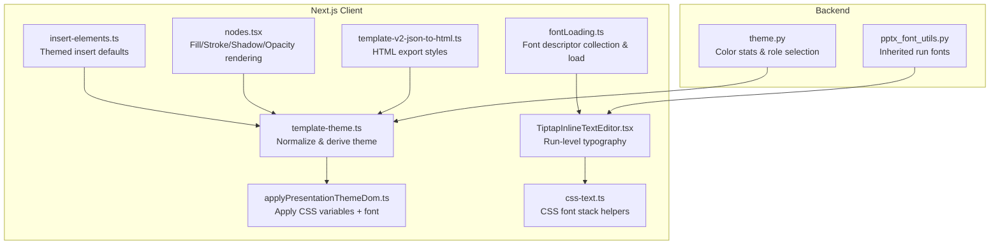
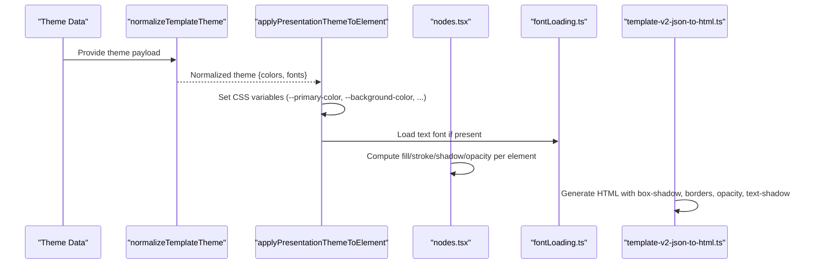
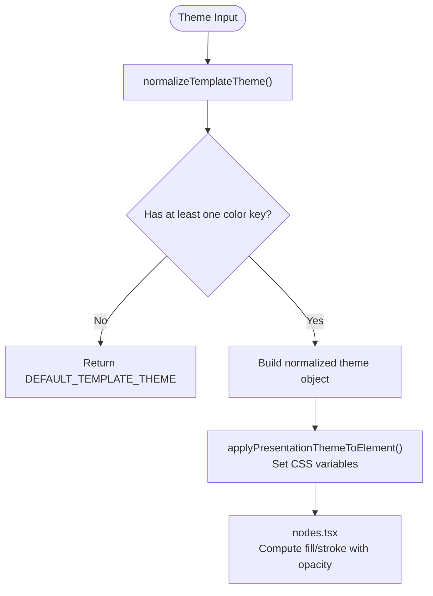
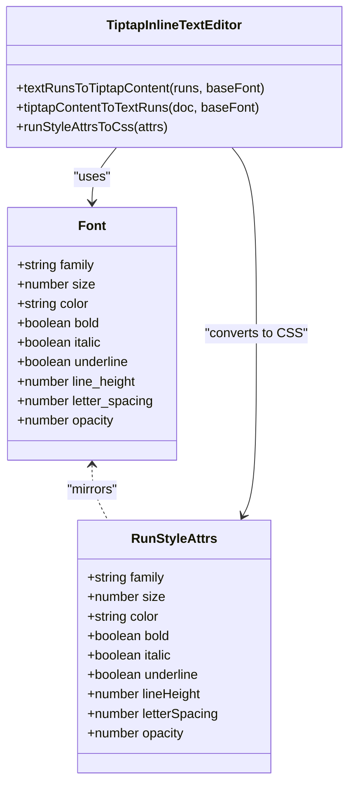
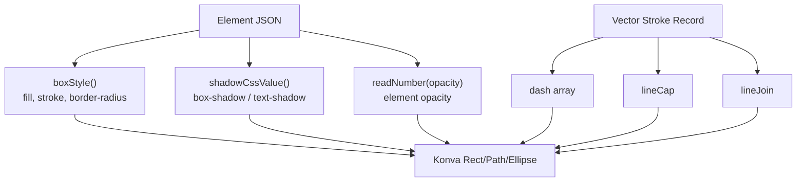
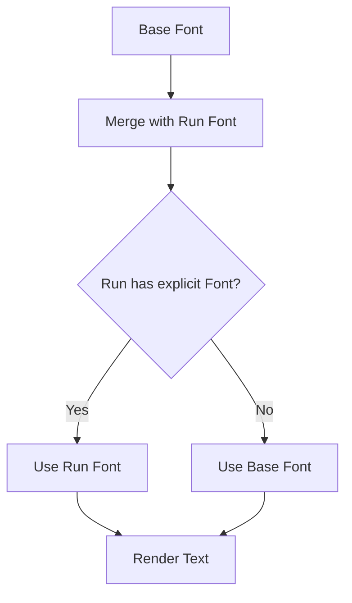
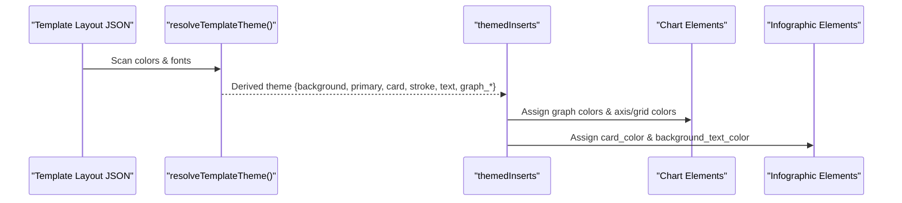
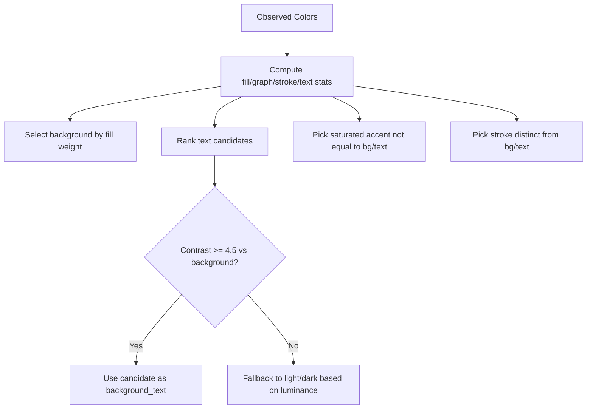
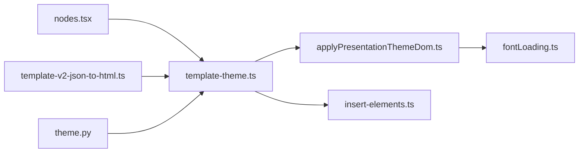

# Styling and Visual Properties

<cite>
**Referenced Files in This Document**
- [template-theme.ts](file://servers/nexjs/lib/template-theme.ts)
- [applyPresentationThemeDom.ts](file://servers/nextjs/app/(presentation-generator)/presentation/utils/applyPresentationThemeDom.ts)
- [insert-elements.ts](file://servers/nextjs/components/slide-editor/insert/insert-elements.ts)
- [nodes.tsx](file://servers/nextjs/components/slide-editor/surface/nodes.tsx)
- [color.ts](file://servers/nextjs/components/slide-editor/utils/color.ts)
- [fontLoading.ts](file://servers/nextjs/components/slide-editor/surface/fontLoading.ts)
- [TiptapInlineTextEditor.tsx](file://servers/nextjs/components/slide-editor/text/TiptapInlineTextEditor.tsx)
- [css-text.ts](file://servers/nextjs/components/slide-editor/text/css-text.ts)
- [template-v2-json-to-html.ts](file://servers/nextjs/lib/template-v2-json-to-html.ts)
- [template-v2-import.ts](file://servers/nextjs/components/slide-editor/importing/template-v2-import.ts)
- [ShapeToolbar.tsx](file://servers/nextjs/components/slide-editor/shapes/ShapeToolbar.tsx)
- [theme.py](file://servers/fastapi/templates/v2/theme.py)
- [pptx_font_utils.py](file://servers/fastapi/templates/pptx_font_utils.py)
</cite>

## Table of Contents
1. [Introduction](#introduction)
2. [Project Structure](#project-structure)
3. [Core Components](#core-components)
4. [Architecture Overview](#architecture-overview)
5. [Detailed Component Analysis](#detailed-component-analysis)
6. [Dependency Analysis](#dependency-analysis)
7. [Performance Considerations](#performance-considerations)
8. [Troubleshooting Guide](#troubleshooting-guide)
9. [Conclusion](#conclusion)

## Introduction
This document explains the styling system across all element types, focusing on:
- Color management for Fill, Stroke, and theme integration
- Typography system with Font properties, text formatting, and Text Run styling
- Advanced visual effects including Shadow, opacity, gradients, and border treatments
- Styling inheritance, cascading rules, and style precedence
- Custom themes, dynamic styling based on data, and accessibility considerations

The system spans editor rendering (Konva), HTML export, theme normalization, font loading, and backend theme derivation.

## Project Structure
Styling is implemented across several layers:
- Theme normalization and CSS variable application in the Next.js client
- Element rendering and visual property application in the slide editor surface
- HTML generation for exports and previews
- Backend theme analysis and materialization
- Font discovery and loading for accurate text layout

**Diagram sources**
- [template-theme.ts:1-110](file://servers/nexjs/lib/template-theme.ts#L1-L110)
- [applyPresentationThemeDom.ts:1-72](file://servers/nextjs/app/(presentation-generator)/presentation/utils/applyPresentationThemeDom.ts#L1-L72)
- [insert-elements.ts:1-25](file://servers/nextjs/components/slide-editor/insert/insert-elements.ts#L1-L25)
- [nodes.tsx:82-148](file://servers/nextjs/components/slide-editor/surface/nodes.tsx#L82-L148)
- [fontLoading.ts:25-135](file://servers/nextjs/components/slide-editor/surface/fontLoading.ts#L25-L135)
- [TiptapInlineTextEditor.tsx:37-84](file://servers/nextjs/components/slide-editor/text/TiptapInlineTextEditor.tsx#L37-L84)
- [css-text.ts:1-8](file://servers/nextjs/components/slide-editor/text/css-text.ts#L1-L8)
- [template-v2-json-to-html.ts:391-413](file://servers/nextjs/lib/template-v2-json-to-html.ts#L391-L413)
- [theme.py:131-379](file://servers/fastapi/templates/v2/theme.py#L131-L379)
- [pptx_font_utils.py:599-629](file://servers/fastapi/templates/pptx_font_utils.py#L599-L629)

**Section sources**
- [template-theme.ts:1-110](file://servers/nexjs/lib/template-theme.ts#L1-L110)
- [applyPresentationThemeDom.ts:1-72](file://servers/nextjs/app/(presentation-generator)/presentation/utils/applyPresentationThemeDom.ts#L1-L72)
- [insert-elements.ts:1-25](file://servers/nextjs/components/slide-editor/insert/insert-elements.ts#L1-L25)
- [nodes.tsx:82-148](file://servers/nextjs/components/slide-editor/surface/nodes.tsx#L82-L148)
- [fontLoading.ts:25-135](file://servers/nextjs/components/slide-editor/surface/fontLoading.ts#L25-L135)
- [TiptapInlineTextEditor.tsx:37-84](file://servers/nextjs/components/slide-editor/text/TiptapInlineTextEditor.tsx#L37-L84)
- [css-text.ts:1-8](file://servers/nextjs/components/slide-editor/text/css-text.ts#L1-L8)
- [template-v2-json-to-html.ts:391-413](file://servers/nextjs/lib/template-v2-json-to-html.ts#L391-L413)
- [theme.py:131-379](file://servers/fastapi/templates/v2/theme.py#L131-L379)
- [pptx_font_utils.py:599-629](file://servers/fastapi/templates/pptx_font_utils.py#L599-L629)

## Core Components
- Theme normalization and application:
  - Normalizes API, presentation, and legacy flat theme payloads into a consistent set of semantic color keys and optional text font metadata.
  - Applies CSS custom properties to DOM subtrees and loads the theme’s text font.
- Editor element styling:
  - Renders Fill, Stroke, Border Radius, Shadow, and Opacity for shapes, vectors, images, containers, charts, and infographics.
  - Uses Konva primitives with computed stroke dash, line cap/join, and corner radius.
- Typography and runs:
  - Base Font properties cascade into Text Runs; inline editor supports per-run overrides.
  - HTML export applies font stacks, sizes, colors, weights, decoration, line height, letter spacing, and opacity.
- Font loading:
  - Collects font descriptors from UI elements, components, lists, tables, and runs; ensures template and local fonts are loaded before final render.
- Backend theme derivation:
  - Analyzes template layouts to infer semantic roles (background, primary, card, stroke, text colors, graph palette) and dominant font.

**Section sources**
- [template-theme.ts:1-110](file://servers/nexjs/lib/template-theme.ts#L1-L110)
- [applyPresentationThemeDom.ts:1-72](file://servers/nextjs/app/(presentation-generator)/presentation/utils/applyPresentationThemeDom.ts#L1-L72)
- [nodes.tsx:2250-2287](file://servers/nextjs/components/slide-editor/surface/nodes.tsx#L2250-L2287)
- [TiptapInlineTextEditor.tsx:939-974](file://servers/nextjs/components/slide-editor/text/TiptapInlineTextEditor.tsx#L939-L974)
- [fontLoading.ts:153-268](file://servers/nextjs/components/slide-editor/surface/fontLoading.ts#L153-L268)
- [theme.py:131-379](file://servers/fastapi/templates/v2/theme.py#L131-L379)

## Architecture Overview
The styling pipeline integrates theme normalization, CSS variable application, element rendering, and font loading.

**Diagram sources**
- [template-theme.ts:77-110](file://servers/nexjs/lib/template-theme.ts#L77-L110)
- [applyPresentationThemeDom.ts:38-72](file://servers/nextjs/app/(presentation-generator)/presentation/utils/applyPresentationThemeDom.ts#L38-L72)
- [nodes.tsx:2250-2287](file://servers/nextjs/components/slide-editor/surface/nodes.tsx#L2250-L2287)
- [fontLoading.ts:25-135](file://servers/nextjs/components/slide-editor/surface/fontLoading.ts#L25-L135)
- [template-v2-json-to-html.ts:3436-3470](file://servers/nextjs/lib/template-v2-json-to-html.ts#L3436-L3470)

## Detailed Component Analysis

### Color Management: Fill, Stroke, and Theme Integration
- Semantic theme keys include background, primary, card, stroke, primary_text, background_text, and graph_0..graph_9.
- Normalization accepts nested or flat payloads and fills missing values with defaults.
- CSS variables are applied to a container element to propagate theme colors throughout the subtree.
- Editor rendering computes effective colors using helper utilities that combine base color and opacity.

**Diagram sources**
- [template-theme.ts:1-110](file://servers/nexjs/lib/template-theme.ts#L1-L110)
- [applyPresentationThemeDom.ts:1-72](file://servers/nextjs/app/(presentation-generator)/presentation/utils/applyPresentationThemeDom.ts#L1-L72)
- [nodes.tsx:82-148](file://servers/nextjs/components/slide-editor/surface/nodes.tsx#L82-L148)

**Section sources**
- [template-theme.ts:1-110](file://servers/nexjs/lib/template-theme.ts#L1-L110)
- [applyPresentationThemeDom.ts:1-72](file://servers/nextjs/app/(presentation-generator)/presentation/utils/applyPresentationThemeDom.ts#L1-L72)
- [nodes.tsx:82-148](file://servers/nextjs/components/slide-editor/surface/nodes.tsx#L82-L148)
- [color.ts:1-13](file://servers/nextjs/components/slide-editor/utils/color.ts#L1-L13)

### Typography System: Font Properties, Text Formatting, and Text Run Styling
- Base Font properties include family, size, color, bold, italic, underline, line_height, letter_spacing, and opacity.
- Inline editor defines a RunStyle mark with attributes mirroring Font properties and converts them to CSS.
- HTML export composes font-family stacks, sizes, colors, weights, decorations, line-height, letter-spacing, and opacity.
- Font loading collects descriptors from text, text-list, table cells, and runs to ensure correct rendering.

**Diagram sources**
- [TiptapInlineTextEditor.tsx:37-84](file://servers/nextjs/components/slide-editor/text/TiptapInlineTextEditor.tsx#L37-L84)
- [TiptapInlineTextEditor.tsx:939-974](file://servers/nextjs/components/slide-editor/text/TiptapInlineTextEditor.tsx#L939-L974)
- [css-text.ts:1-8](file://servers/nextjs/components/slide-editor/text/css-text.ts#L1-L8)
- [fontLoading.ts:153-268](file://servers/nextjs/components/slide-editor/surface/fontLoading.ts#L153-L268)

**Section sources**
- [TiptapInlineTextEditor.tsx:37-84](file://servers/nextjs/components/slide-editor/text/TiptapInlineTextEditor.tsx#L37-L84)
- [TiptapInlineTextEditor.tsx:939-974](file://servers/nextjs/components/slide-editor/text/TiptapInlineTextEditor.tsx#L939-L974)
- [css-text.ts:1-8](file://servers/nextjs/components/slide-editor/text/css-text.ts#L1-L8)
- [fontLoading.ts:153-268](file://servers/nextjs/components/slide-editor/surface/fontLoading.ts#L153-L268)

### Advanced Visual Effects: Shadow, Opacity, Gradients, and Borders
- Box shadow and text shadow are generated via dedicated functions and applied to elements and text nodes.
- Opacity is supported globally per element and per fill/stroke.
- Border radius is clamped and applied to containers and shapes.
- Vector strokes support dash arrays, line caps, and line joins.

**Diagram sources**
- [template-v2-json-to-html.ts:3436-3470](file://servers/nextjs/lib/template-v2-json-to-html.ts#L3436-L3470)
- [nodes.tsx:2250-2287](file://servers/nextjs/components/slide-editor/surface/nodes.tsx#L2250-L2287)
- [template-v2-import.ts:1854-1888](file://servers/nextjs/components/slide-editor/importing/template-v2-import.ts#L1854-L1888)

**Section sources**
- [template-v2-json-to-html.ts:3436-3470](file://servers/nextjs/lib/template-v2-json-to-html.ts#L3436-L3470)
- [nodes.tsx:2250-2287](file://servers/nextjs/components/slide-editor/surface/nodes.tsx#L2250-L2287)
- [template-v2-import.ts:1854-1888](file://servers/nextjs/components/slide-editor/importing/template-v2-import.ts#L1854-L1888)

### Styling Inheritance, Cascading Rules, and Style Precedence
- Base Font cascades into Text Runs; per-run Font overrides take precedence.
- For list items and table cells, base Font is inherited and overridden by cell/run-specific properties.
- Backend PPTX font extraction shows explicit direct-font precedence over default paragraph/run styles.

**Diagram sources**
- [TiptapInlineTextEditor.tsx:939-974](file://servers/nextjs/components/slide-editor/text/TiptapInlineTextEditor.tsx#L939-L974)
- [pptx_font_utils.py:599-629](file://servers/fastapi/templates/pptx_font_utils.py#L599-L629)

**Section sources**
- [TiptapInlineTextEditor.tsx:939-974](file://servers/nextjs/components/slide-editor/text/TiptapInlineTextEditor.tsx#L939-L974)
- [pptx_font_utils.py:599-629](file://servers/fastapi/templates/pptx_font_utils.py#L599-L629)

### Custom Themes and Dynamic Styling Based on Data
- Template theme normalization derives semantic roles from stored layout JSON when no explicit theme is provided.
- Graph colors are derived from observed chart/infographic usage and contrast checks.
- Inserted elements receive themed defaults (e.g., chart series colors, infographic card and text colors).

**Diagram sources**
- [template-theme.ts:282-354](file://servers/nexjs/lib/template-theme.ts#L282-L354)
- [insert-elements.ts:2644-2687](file://servers/nextjs/components/slide-editor/insert/insert-elements.ts#L2644-L2687)

**Section sources**
- [template-theme.ts:282-354](file://servers/nexjs/lib/template-theme.ts#L282-L354)
- [insert-elements.ts:2644-2687](file://servers/nextjs/components/slide-editor/insert/insert-elements.ts#L2644-L2687)

### Accessibility Considerations for Visual Properties
- Contrast-aware theme derivation selects text colors that meet contrast thresholds against backgrounds.
- Primary text color is chosen based on contrast with the primary color.
- Graph colors are selected to maintain saturation and distinction while avoiding background/text collisions.

**Diagram sources**
- [template-theme.ts:151-178](file://servers/nexjs/lib/template-theme.ts#L151-L178)
- [template-theme.ts:282-354](file://servers/nexjs/lib/template-theme.ts#L282-L354)

**Section sources**
- [template-theme.ts:151-178](file://servers/nexjs/lib/template-theme.ts#L151-L178)
- [template-theme.ts:282-354](file://servers/nexjs/lib/template-theme.ts#L282-L354)

## Dependency Analysis
Key dependencies between styling components:
- Theme normalization depends on color parsing, contrast, and luminance utilities.
- DOM theme application depends on normalized theme and font loader hook.
- Editor rendering depends on model utilities for fill/stroke/shadow/opacity and Konva primitives.
- HTML export depends on font asset injection and style builders for shadows/borders/opacity.
- Backend theme derivation depends on color statistics and contrast calculations.

**Diagram sources**
- [template-theme.ts:1-110](file://servers/nexjs/lib/template-theme.ts#L1-L110)
- [applyPresentationThemeDom.ts:1-72](file://servers/nextjs/app/(presentation-generator)/presentation/utils/applyPresentationThemeDom.ts#L1-L72)
- [insert-elements.ts:1-25](file://servers/nextjs/components/slide-editor/insert/insert-elements.ts#L1-L25)
- [nodes.tsx:82-148](file://servers/nextjs/components/slide-editor/surface/nodes.tsx#L82-L148)
- [template-v2-json-to-html.ts:301-306](file://servers/nextjs/lib/template-v2-json-to-html.ts#L301-L306)
- [theme.py:131-379](file://servers/fastapi/templates/v2/theme.py#L131-L379)

**Section sources**
- [template-theme.ts:1-110](file://servers/nexjs/lib/template-theme.ts#L1-L110)
- [applyPresentationThemeDom.ts:1-72](file://servers/nextjs/app/(presentation-generator)/presentation/utils/applyPresentationThemeDom.ts#L1-L72)
- [insert-elements.ts:1-25](file://servers/nextjs/components/slide-editor/insert/insert-elements.ts#L1-L25)
- [nodes.tsx:82-148](file://servers/nextjs/components/slide-editor/surface/nodes.tsx#L82-L148)
- [template-v2-json-to-html.ts:301-306](file://servers/nextjs/lib/template-v2-json-to-html.ts#L301-L306)
- [theme.py:131-379](file://servers/fastapi/templates/v2/theme.py#L131-L379)

## Performance Considerations
- Font loading uses requestAnimationFrame probes and MutationObserver to avoid indefinite waits, with a fallback timeout to unblock rendering.
- CSS variable application is batched per element subtree to minimize reflows.
- Shadow and opacity computations are performed once per element during render; vector stroke dash/cap/join are validated to reduce invalid attribute errors.
- Theme derivation avoids expensive operations by ranking colors with simple scoring functions and early exits when explicit themes exist.

[No sources needed since this section provides general guidance]

## Troubleshooting Guide
- Colors not applying:
  - Verify theme normalization returns a valid theme with at least one color key.
  - Ensure CSS variables are set on the target element subtree.
- Fonts not loading:
  - Confirm font descriptors are collected from all text-like elements and runs.
  - Check that template and local font promises resolve within the fallback timeout.
- Shadows or borders missing:
  - Validate shadow opacity and color; ensure shadow value is non-empty.
  - Confirm stroke width > 0 and stroke color is defined for visible borders.
- Text formatting inconsistencies:
  - Check per-run Font overrides and ensure they merge correctly with Base Font.
  - Validate CSS font stack escaping and family names.

**Section sources**
- [fontLoading.ts:25-135](file://servers/nextjs/components/slide-editor/surface/fontLoading.ts#L25-L135)
- [template-v2-json-to-html.ts:3436-3470](file://servers/nextjs/lib/template-v2-json-to-html.ts#L3436-L3470)
- [TiptapInlineTextEditor.tsx:939-974](file://servers/nextjs/components/slide-editor/text/TiptapInlineTextEditor.tsx#L939-L974)

## Conclusion
The styling system provides a cohesive approach to color, typography, and advanced visual effects across editor and export contexts. Theme normalization and CSS variable application enable consistent branding, while robust font loading and run-level typography ensure accurate text rendering. Backend theme derivation complements frontend logic by inferring semantic roles from templates, supporting accessible and visually coherent presentations.

[No sources needed since this section summarizes without analyzing specific files]