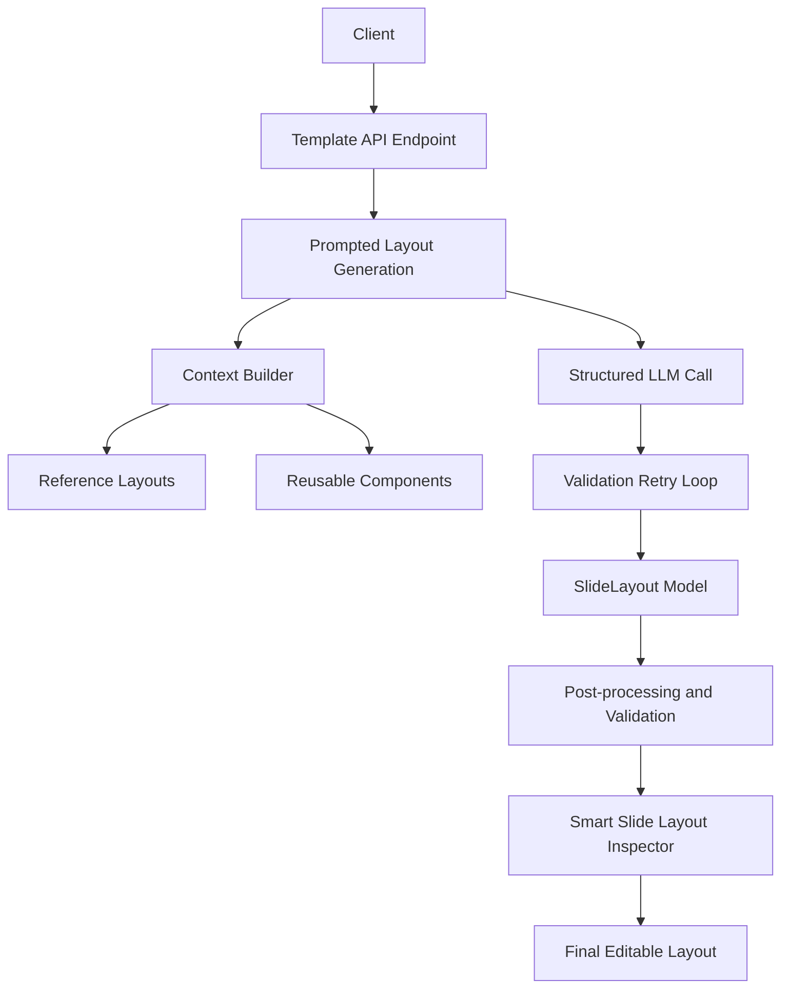
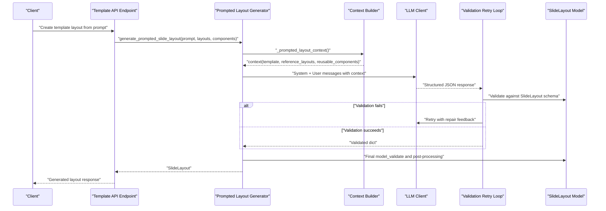
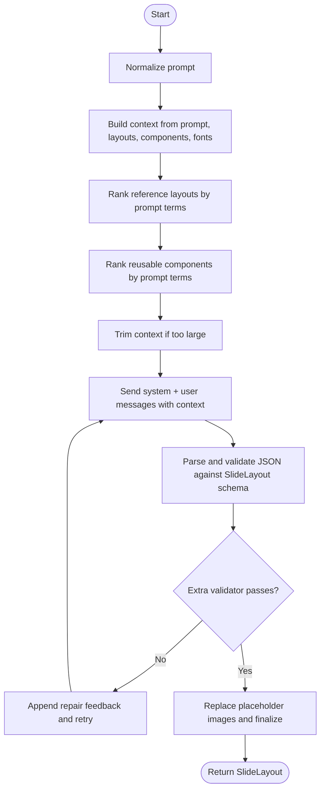
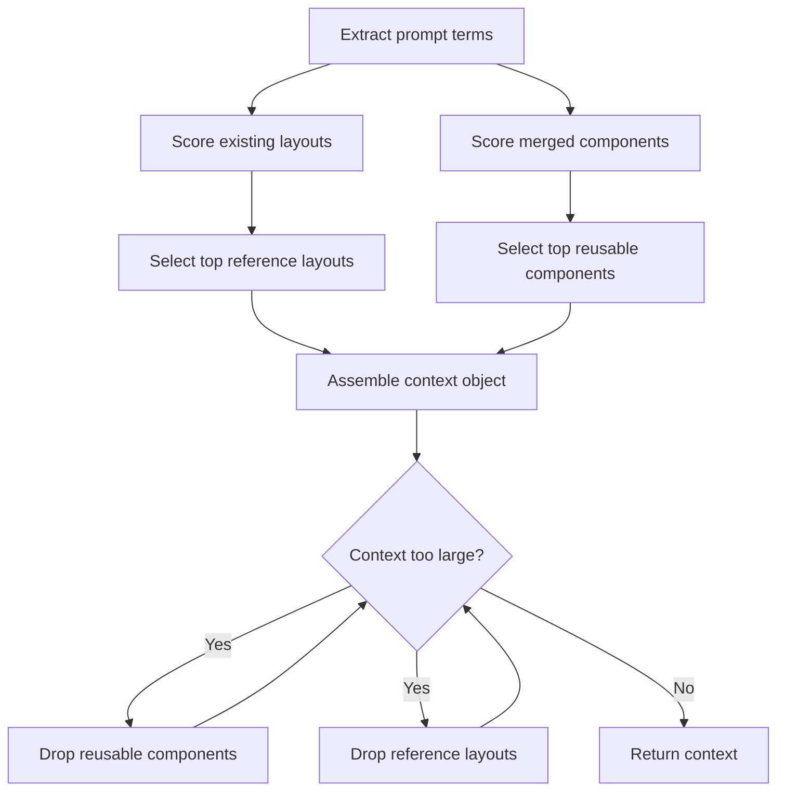
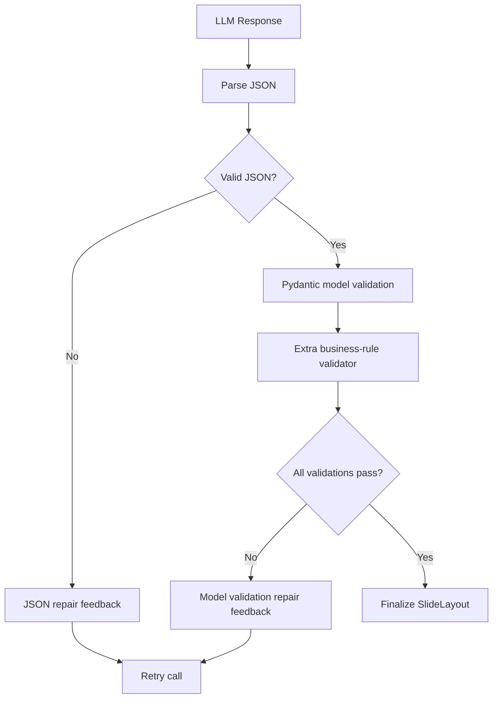
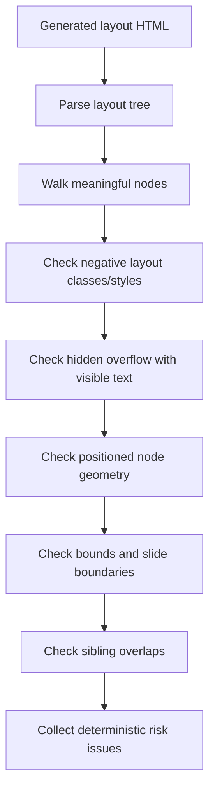
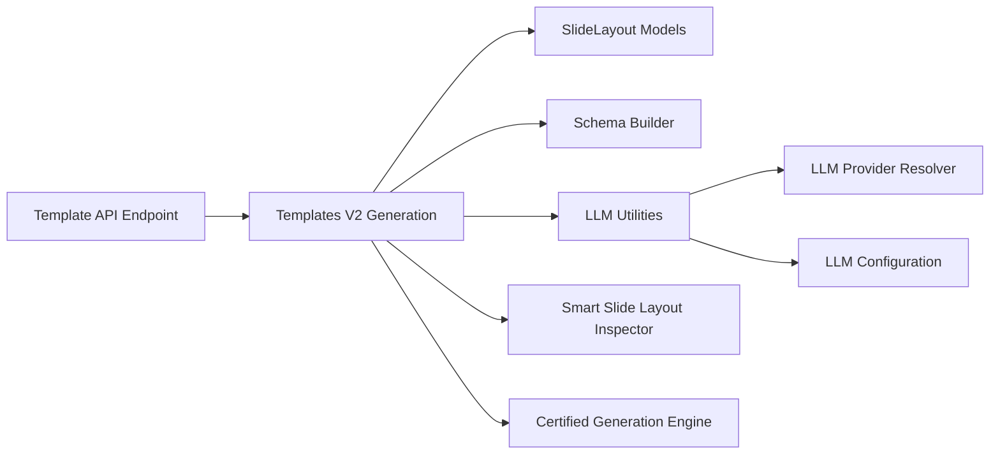

# AI-Powered Layout Generation

<cite>
**Referenced Files in This Document**
- [generation.py](file://servers/fastapi/templates/v2/generation.py)
- [certified_generation.py](file://servers/fastapi/templates/v2/certified_generation.py)
- [schema.py](file://servers/fastapi/templates/v2/schema.py)
- [llm_utils.py](file://servers/fastapi/utils/llm_utils.py)
- [llm_provider.py](file://servers/fastapi/utils/llm_provider.py)
- [llm_config.py](file://servers/fastapi/utils/llm_config.py)
- [smart_slide_layout.py](file://servers/fastapi/utils/smart_slide_layout.py)
- [template.py](file://servers/fastapi/api/v1/ppt/endpoints/template.py)
</cite>

## Table of Contents
1. [Introduction](#introduction)
2. [Project Structure](#project-structure)
3. [Core Components](#core-components)
4. [Architecture Overview](#architecture-overview)
5. [Detailed Component Analysis](#detailed-component-analysis)
6. [Dependency Analysis](#dependency-analysis)
7. [Performance Considerations](#performance-considerations)
8. [Troubleshooting Guide](#troubleshooting-guide)
9. [Conclusion](#conclusion)

## Introduction
This document explains the AI-powered layout generation system that turns user prompts into editable slide layouts for template-based presentations. The system combines prompt engineering, context selection from existing templates and reusable components, structured LLM calls with JSON schema validation, and a robust retry loop to produce high-quality SlideLayout objects. It also documents how different LLM providers are configured, how validation feedback is returned to models, and how quality assurance checks prevent clipped or overlapping slides.

## Project Structure
The relevant implementation lives primarily under the FastAPI backend:

- Template V2 generation logic orchestrates prompt-driven layout creation and certified multi-pass generation.
- Schema utilities derive editable content schemas from template layouts.
- LLM utilities provide structured generation, streaming, retries, and validation feedback.
- Provider configuration resolves model names and client settings across many LLM backends.
- Smart slide layout inspection detects rendering risks such as negative margins, overflow, and absolute positioning issues.
- API endpoints expose template layout generation to clients.

**Diagram sources**
- [template.py:1700-1781](file://servers/fastapi/api/v1/ppt/endpoints/template.py#L1700-L1781)
- [generation.py:631-693](file://servers/fastapi/templates/v2/generation.py#L631-L693)
- [generation.py:696-775](file://servers/fastapi/templates/v2/generation.py#L696-L775)
- [generation.py:1092-1196](file://servers/fastapi/templates/v2/generation.py#L1092-L1196)
- [smart_slide_layout.py:230-289](file://servers/fastapi/utils/smart_slide_layout.py#L230-L289)

**Section sources**
- [template.py:1700-1781](file://servers/fastapi/api/v1/ppt/endpoints/template.py#L1700-L1781)
- [generation.py:631-693](file://servers/fastapi/templates/v2/generation.py#L631-L693)
- [generation.py:696-775](file://servers/fastapi/templates/v2/generation.py#L696-L775)
- [smart_slide_layout.py:230-289](file://servers/fastapi/utils/smart_slide_layout.py#L230-L289)

## Core Components
- Prompted layout generator: Builds a constrained context from the user prompt, existing template layouts, merged reusable components, and font metadata, then asks the LLM to return one SlideLayout.
- Certified generation engine: Handles multi-pass semantic analysis, component clustering, flexible flow planning, text capacity planning, and similar component merging.
- Schema builder: Converts raw layout elements into JSON Schema definitions for editable content fields.
- LLM orchestration: Streams structured responses, parses JSON, validates against Pydantic models, and applies extra validators.
- Provider resolver: Selects the active LLM provider and builds client configuration.
- Smart layout inspector: Analyzes generated HTML-like layout structures for risky positioning and overflow patterns.

**Section sources**
- [generation.py:631-693](file://servers/fastapi/templates/v2/generation.py#L631-L693)
- [certified_generation.py:111-459](file://servers/fastapi/templates/v2/certified_generation.py#L111-L459)
- [schema.py:183-215](file://servers/fastapi/templates/v2/schema.py#L183-L215)
- [llm_utils.py:310-389](file://servers/fastapi/utils/llm_utils.py#L310-L389)
- [llm_provider.py:126-174](file://servers/fastapi/utils/llm_provider.py#L126-L174)
- [smart_slide_layout.py:230-289](file://servers/fastapi/utils/smart_slide_layout.py#L230-L289)

## Architecture Overview
The end-to-end flow starts at the template API endpoint, which loads the template’s layouts and optional merged components, then delegates to the prompted layout generator. The generator constructs a compact context, sends a system prompt plus user message to the LLM, and uses structured JSON schema output to enforce SlideLayout structure. A validation retry loop repairs invalid JSON and schema mismatches. After successful validation, image placeholders are normalized and smart layout inspection can be used to detect rendering risks.

**Diagram sources**
- [template.py:1700-1781](file://servers/fastapi/api/v1/ppt/endpoints/template.py#L1700-L1781)
- [generation.py:631-693](file://servers/fastapi/templates/v2/generation.py#L631-L693)
- [generation.py:696-775](file://servers/fastapi/templates/v2/generation.py#L696-L775)
- [generation.py:1092-1196](file://servers/fastapi/templates/v2/generation.py#L1092-L1196)

## Detailed Component Analysis

### Prompted Layout Generation Pipeline
The prompted pipeline normalizes the user prompt, builds a context, enforces uniqueness constraints on generated layout identifiers, and calls the LLM with a strict system prompt and JSON schema.

Key responsibilities:
- Normalize and validate the prompt.
- Rank and select reference layouts and reusable components by relevance to the prompt.
- Trim context size when it exceeds limits.
- Send a system prompt defining canvas size, asset rules, decorative semantics, and schema expectations.
- Use structured JSON schema output and validation retries.
- Replace placeholder image URLs and ensure at least one semantic element is editable.

**Diagram sources**
- [generation.py:631-693](file://servers/fastapi/templates/v2/generation.py#L631-L693)
- [generation.py:696-775](file://servers/fastapi/templates/v2/generation.py#L696-L775)
- [generation.py:1092-1196](file://servers/fastapi/templates/v2/generation.py#L1092-L1196)

**Section sources**
- [generation.py:631-693](file://servers/fastapi/templates/v2/generation.py#L631-L693)
- [generation.py:696-775](file://servers/fastapi/templates/v2/generation.py#L696-L775)
- [generation.py:1092-1196](file://servers/fastapi/templates/v2/generation.py#L1092-L1196)

### Context Building with Templates and Reusable Components
Context construction balances relevance and token budget:
- Extract search terms from the prompt.
- Score existing layout IDs, descriptions, and component descriptions.
- Select up to a fixed number of reference layouts and reusable components.
- Include template name, description, available fonts, and existing layout IDs.
- Reduce reusable components first, then reference layouts until the JSON context fits within the character limit.

**Diagram sources**
- [generation.py:696-775](file://servers/fastapi/templates/v2/generation.py#L696-L775)

**Section sources**
- [generation.py:696-775](file://servers/fastapi/templates/v2/generation.py#L696-L775)

### System Prompt Structure and Rules
The system prompt defines the contract for generating a new SlideLayout:
- Canvas size is 1280x720.
- Positions are canvas-relative; element positions are local to their component.
- Prefer adapting supplied layouts and reusable components rather than inventing structure.
- Decorative assets must come from the supplied template JSON.
- Semantic replaceable elements are marked `decorative=false`; backgrounds, logos, frames, dividers, and ornaments remain fixed.
- Placeholder URLs are used for new replaceable images and icons.
- Realistic neutral preview content and valid schema limits are required.
- Scratch-built shapes use vector type.
- Topic-specific wording from reference layouts must not be copied.

These rules guide the model toward stable, reusable, and visually consistent layouts.

**Section sources**
- [generation.py:88-117](file://servers/fastapi/templates/v2/generation.py#L88-L117)

### Schema Validation and Error Handling Patterns
The system uses multiple layers of validation:
- JSON parsing: Raw LLM content is parsed into a dictionary.
- Pydantic model validation: The parsed dictionary is validated against the SlideLayout model.
- Extra validators: Additional business rules check layout ID format, uniqueness, presence of components, and editable content.
- Retry loop: On JSON parse errors, schema validation errors, or extra validator failures, the system appends targeted repair messages and retries.
- Feedback messages: Errors are formatted and included in the conversation so the model can self-correct.

**Diagram sources**
- [generation.py:1092-1196](file://servers/fastapi/templates/v2/generation.py#L1092-L1196)
- [generation.py:1236-1343](file://servers/fastapi/templates/v2/generation.py#L1236-L1343)

**Section sources**
- [generation.py:1092-1196](file://servers/fastapi/templates/v2/generation.py#L1092-L1196)
- [generation.py:1236-1343](file://servers/fastapi/templates/v2/generation.py#L1236-L1343)

### Validation Retry Mechanism
The retry mechanism supports:
- Multiple attempts per request.
- Different repair strategies for JSON parse errors, schema validation errors, and extra validator failures.
- Logging of attempt counts, durations, and error summaries.
- Optional preview tool usage for visual review during candidate generation.

For prompted layouts, the retry loop ensures that even imperfect initial outputs can converge to a valid SlideLayout.

**Section sources**
- [generation.py:1092-1196](file://servers/fastapi/templates/v2/generation.py#L1092-L1196)
- [generation.py:852-1059](file://servers/fastapi/templates/v2/generation.py#L852-L1059)

### Smart Slide Layout Inspection
After layout generation, the smart slide layout inspector analyzes rendered HTML-like structures to detect common rendering risks:
- Negative margins or translations that overlap meaningful content.
- Hidden overflow containers that clip visible text.
- Absolutely positioned meaningful content missing complete pixel boxes.
- Off-canvas geometry or crossing slide boundaries.
- Overlapping absolutely positioned sibling content.

This helps catch layout defects before they reach the renderer.

**Diagram sources**
- [smart_slide_layout.py:230-289](file://servers/fastapi/utils/smart_slide_layout.py#L230-L289)

**Section sources**
- [smart_slide_layout.py:230-289](file://servers/fastapi/utils/smart_slide_layout.py#L230-L289)

### Certified Multi-Pass Generation and Component Merging
Beyond prompted layouts, the certified generation engine performs focused passes:
- Semantic manifest generation to identify reusable components and editable candidates.
- Visual data region detection for charts, infographics, tables, and lists.
- Flexible region planning for fixed flows and repeated items.
- Text capacity planning for safe growth without changing design.
- Similar component clustering and deduplication to merge interchangeable components.

This pipeline produces robust, reusable, and semantically rich layouts suitable for editing.

**Section sources**
- [certified_generation.py:111-459](file://servers/fastapi/templates/v2/certified_generation.py#L111-L459)
- [certified_generation.py:491-597](file://servers/fastapi/templates/v2/certified_generation.py#L491-L597)

### Schema Builder for Editable Content
The schema builder converts template layouts into JSON Schema definitions:
- Identifies editable elements by `decorative=false`.
- Generates property schemas for text, images, lists, tables, charts, and infographics.
- Computes table text capacity based on cell dimensions and typography.
- Normalizes repeated child groups and strips metadata keys.
- Produces per-layout and per-component schemas for downstream editors.

**Section sources**
- [schema.py:183-215](file://servers/fastapi/templates/v2/schema.py#L183-L215)
- [schema.py:361-423](file://servers/fastapi/templates/v2/schema.py#L361-L423)
- [schema.py:585-639](file://servers/fastapi/templates/v2/schema.py#L585-L639)

### LLM Provider Integration and Configuration
Provider integration is centralized:
- Provider selection reads environment variables and returns an enum value.
- Model resolution maps providers to default or configured model names.
- Client configuration builds provider-specific client configs with authentication, base URLs, regions, projects, and reasoning settings.
- Extra body parameters allow provider-specific options such as OpenRouter provider ordering and data collection flags.

Supported providers include OpenAI, DeepSeek, Google, Vertex, Azure, Bedrock, Anthropic, OpenRouter, Fireworks, Together, Cerebras, LiteLLM, LMStudio, Ollama, Custom, and Codex.

**Section sources**
- [llm_provider.py:47-174](file://servers/fastapi/utils/llm_provider.py#L47-L174)
- [llm_config.py:189-244](file://servers/fastapi/utils/llm_config.py#L189-L244)
- [llm_config.py:247-486](file://servers/fastapi/utils/llm_config.py#L247-L486)
- [llm_config.py:489-524](file://servers/fastapi/utils/llm_config.py#L489-L524)

## Dependency Analysis
The following diagram shows key dependencies between modules involved in AI-powered layout generation.

**Diagram sources**
- [template.py:1700-1781](file://servers/fastapi/api/v1/ppt/endpoints/template.py#L1700-L1781)
- [generation.py:631-693](file://servers/fastapi/templates/v2/generation.py#L631-L693)
- [schema.py:183-215](file://servers/fastapi/templates/v2/schema.py#L183-L215)
- [llm_utils.py:310-389](file://servers/fastapi/utils/llm_utils.py#L310-L389)
- [llm_provider.py:126-174](file://servers/fastapi/utils/llm_provider.py#L126-L174)
- [llm_config.py:247-486](file://servers/fastapi/utils/llm_config.py#L247-L486)
- [smart_slide_layout.py:230-289](file://servers/fastapi/utils/smart_slide_layout.py#L230-L289)
- [certified_generation.py:491-597](file://servers/fastapi/templates/v2/certified_generation.py#L491-L597)

**Section sources**
- [template.py:1700-1781](file://servers/fastapi/api/v1/ppt/endpoints/template.py#L1700-L1781)
- [generation.py:631-693](file://servers/fastapi/templates/v2/generation.py#L631-L693)
- [llm_utils.py:310-389](file://servers/fastapi/utils/llm_utils.py#L310-L389)
- [llm_provider.py:126-174](file://servers/fastapi/utils/llm_provider.py#L126-L174)
- [llm_config.py:247-486](file://servers/fastapi/utils/llm_config.py#L247-L486)

## Performance Considerations
- Parallel slide layout generation: Certified generation uses a thread pool to process multiple slides concurrently, capped by a maximum worker count.
- Context trimming: The prompted layout context is reduced by dropping reusable components and reference layouts to stay within token limits.
- Streaming structured generation: LLM calls stream events to avoid long blocking requests and support disconnect handling.
- Token estimation: When provider usage is unavailable, token metrics are estimated from message and content lengths.
- Preview tool limits: Preview slide rendering is limited to a small number of calls to balance quality and cost.

[No sources needed since this section provides general guidance]

## Troubleshooting Guide
Common issues and resolutions:

- Invalid prompt: Ensure the prompt is non-empty after normalization.
- Missing template layouts: The API requires template layouts to be available before generating prompted layouts.
- Invalid merged components: If merged components cannot be validated, they are ignored with a warning.
- JSON parse failures: The retry loop adds JSON repair feedback and retries.
- Schema validation failures: The retry loop includes validation errors and the required schema to help the model correct its output.
- Extra validator failures: Business rules such as unique layout IDs and presence of editable content are enforced; failures trigger repair feedback.
- Provider configuration errors: Missing API keys, ambiguous Vertex configuration, or invalid provider values raise explicit errors.
- Rendering risks: Use the smart slide layout inspector to detect negative margins, overflow clipping, off-canvas geometry, and overlapping positioned content.

**Section sources**
- [generation.py:631-693](file://servers/fastapi/templates/v2/generation.py#L631-L693)
- [template.py:1700-1781](file://servers/fastapi/api/v1/ppt/endpoints/template.py#L1700-L1781)
- [llm_config.py:247-486](file://servers/fastapi/utils/llm_config.py#L247-L486)
- [smart_slide_layout.py:230-289](file://servers/fastapi/utils/smart_slide_layout.py#L230-L289)

## Conclusion
The AI-powered layout generation system combines strong prompt engineering, context-aware template selection, structured LLM output, and rigorous validation to produce reliable, editable slide layouts. Its retry mechanisms, provider abstraction, and smart layout inspection make it resilient across different LLM backends while maintaining visual consistency and editability. For best results, craft clear prompts, supply representative reference layouts and reusable components, and monitor validation feedback to improve future generations.