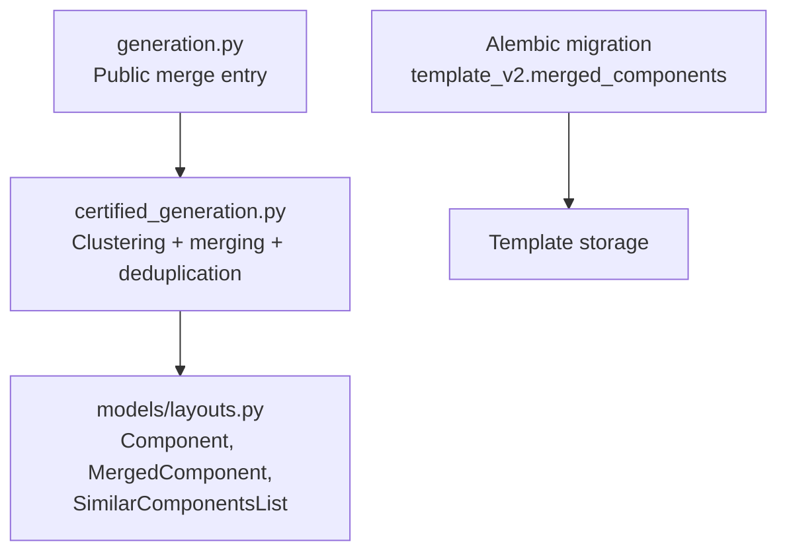
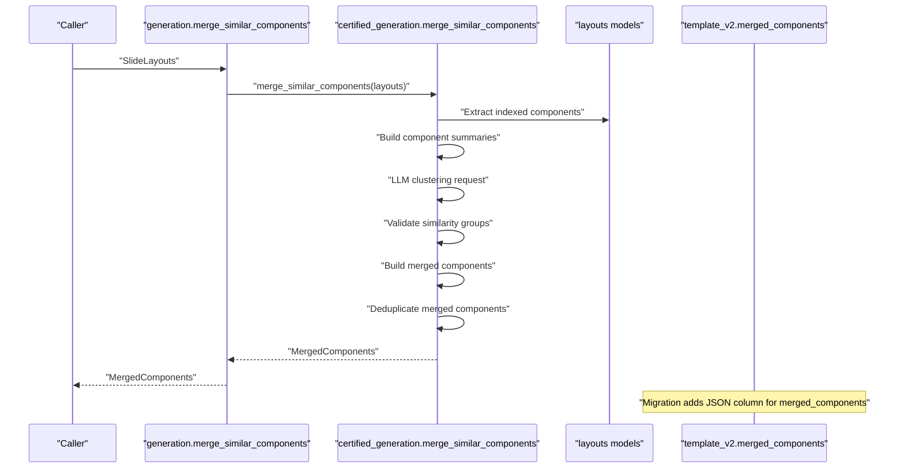
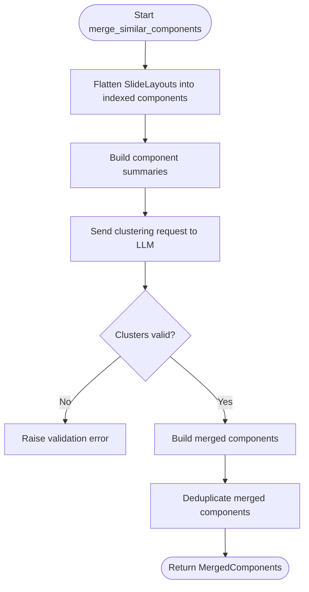
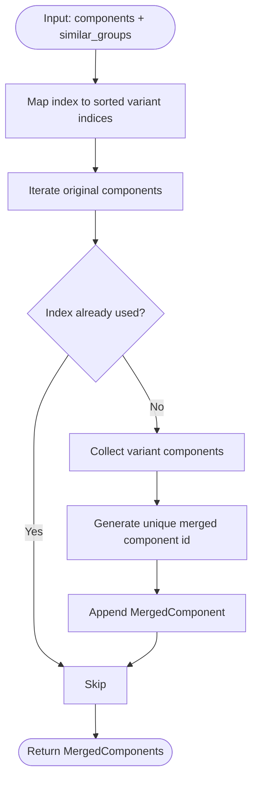
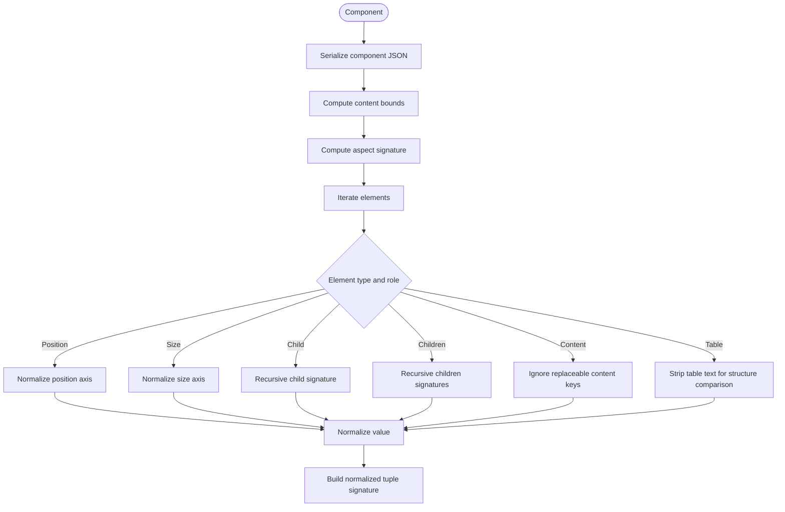
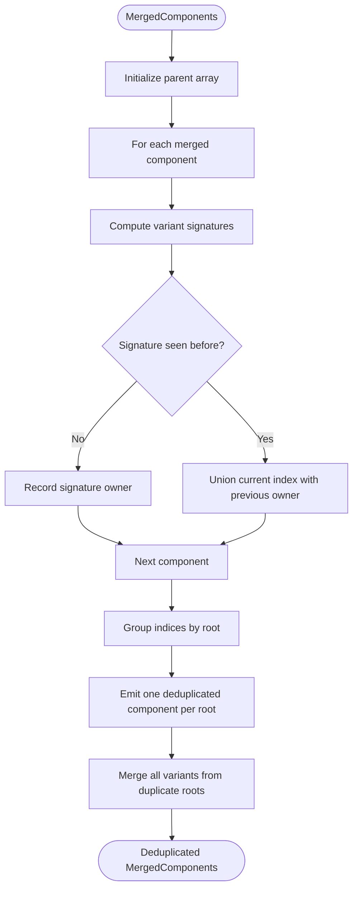
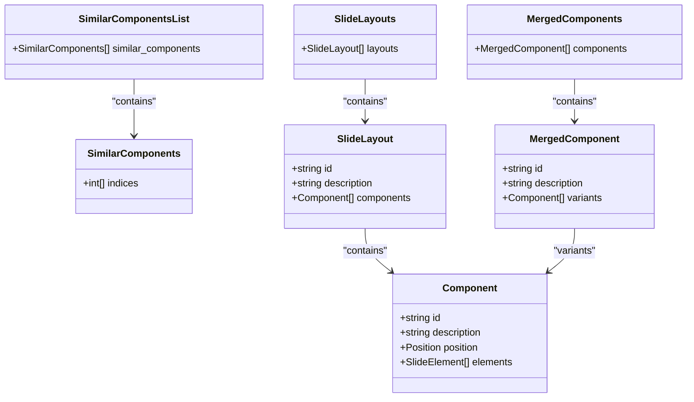
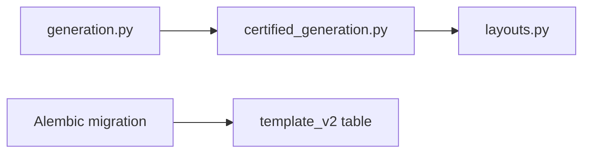

# Component Merging System

<cite>
**Referenced Files in This Document**   
- [generation.py](file://servers/fastapi/templates/v2/generation.py)
- [certified_generation.py](file://servers/fastapi/templates/v2/certified_generation.py)
- [layouts.py](file://servers/fastapi/templates/v2/models/layouts.py)
- [8a6c4d2e1f30_add_merged_components_to_template_v2.py](file://servers/fastapi/alembic/versions/8a6c4d2e1f30_add_merged_components_to_template_v2.py)
</cite>

## Table of Contents
1. [Introduction](#introduction)
2. [Project Structure](#project-structure)
3. [Core Components](#core-components)
4. [Architecture Overview](#architecture-overview)
5. [Detailed Component Analysis](#detailed-component-analysis)
6. [Dependency Analysis](#dependency-analysis)
7. [Performance Considerations](#performance-considerations)
8. [Troubleshooting Guide](#troubleshooting-guide)
9. [Conclusion](#conclusion)

## Introduction
This document explains the component merging and deduplication system used by the Template V2 pipeline. The system identifies similar slide components, groups interchangeable variants, merges them into reusable component groups, and then removes structural duplicates using signature-based duplicate detection and a union-find algorithm.

The goal is to reduce template redundancy while preserving visual structure, editable content semantics, and generated layout behavior. Similarity is not purely textual: it considers element hierarchy, geometry, aspect ratio, position normalization, size normalization, decorative vs content fields, and schema compatibility.

## Project Structure
The merging logic lives primarily in two Python modules under the FastAPI server:

- `templates/v2/generation.py` exposes a public `merge_similar_components` entry point that delegates to the certified implementation.
- `templates/v2/certified_generation.py` contains the full clustering, merging, deduplication, and signature computation pipeline.
- `templates/v2/models/layouts.py` defines the data models for components, merged components, similarity clusters, and slide layouts.
- An Alembic migration adds a JSON column for storing merged components in the `template_v2` table.

**Diagram sources**
- [generation.py:213-214](file://servers/fastapi/templates/v2/generation.py#L213-L214)
- [certified_generation.py:550-597](file://servers/fastapi/templates/v2/certified_generation.py#L550-L597)
- [layouts.py:54-88](file://servers/fastapi/templates/v2/models/layouts.py#L54-L88)
- [8a6c4d2e1f30_add_merged_components_to_template_v2.py:30-37](file://servers/fastapi/alembic/versions/8a6c4d2e1f30_add_merged_components_to_template_v2.py#L30-L37)

**Section sources**
- [generation.py:213-214](file://servers/fastapi/templates/v2/generation.py#L213-L214)
- [certified_generation.py:550-597](file://servers/fastapi/templates/v2/certified_generation.py#L550-L597)
- [layouts.py:54-88](file://servers/fastapi/templates/v2/models/layouts.py#L54-L88)
- [8a6c4d2e1f30_add_merged_components_to_template_v2.py:30-37](file://servers/fastapi/alembic/versions/8a6c4d2e1f30_add_merged_components_to_template_v2.py#L30-L37)

## Core Components
The merging system operates on these core concepts:

| Concept | Purpose | Key Model or Function |
|---|---|---|
| Component | A reusable visual region with an id, description, position, and elements | `Component` |
| Similar cluster | A group of component indices considered structurally interchangeable | `SimilarComponents`, `SimilarComponentsList` |
| Merged component | One logical component grouping multiple variant instances | `MergedComponent`, `MergedComponents` |
| Signature | A normalized tuple representation used to detect structural duplicates | `_component_duplicate_signature`, `_element_duplicate_signature` |
| Union-find | Data structure used to merge duplicate merged components | `_deduplicate_merged_components` |

**Section sources**
- [layouts.py:54-88](file://servers/fastapi/templates/v2/models/layouts.py#L54-L88)
- [certified_generation.py:740-807](file://servers/fastapi/templates/v2/certified_generation.py#L740-L807)
- [certified_generation.py:670-723](file://servers/fastapi/templates/v2/certified_generation.py#L670-L723)

## Architecture Overview
The end-to-end flow starts from all generated slide layouts, extracts every component, builds a lightweight summary per component, asks an LLM to propose similarity clusters, validates those clusters, builds merged components, and finally deduplicates merged components by signature.

**Diagram sources**
- [generation.py:213-214](file://servers/fastapi/templates/v2/generation.py#L213-L214)
- [certified_generation.py:550-597](file://servers/fastapi/templates/v2/certified_generation.py#L550-L597)
- [8a6c4d2e1f30_add_merged_components_to_template_v2.py:30-37](file://servers/fastapi/alembic/versions/8a6c4d2e1f30_add_merged_components_to_template_v2.py#L30-L37)

## Detailed Component Analysis

### Similar Component Clustering
The system first flattens all components across all slide layouts into a single indexed list. For each component, it computes a clustering summary including:

- Index and id
- Description
- Position
- Content bounds derived from element geometry
- Element type hierarchy
- Editable schema

These summaries are sent to an LLM through a structured prompt asking it to group only components that can safely substitute for one another without changing generated content shape. The returned clusters must be valid: indices must be non-negative, unique within each group, and each index may appear in at most one group.

**Diagram sources**
- [certified_generation.py:550-597](file://servers/fastapi/templates/v2/certified_generation.py#L550-L597)
- [certified_generation.py:623-640](file://servers/fastapi/templates/v2/certified_generation.py#L623-L640)

**Section sources**
- [certified_generation.py:550-597](file://servers/fastapi/templates/v2/certified_generation.py#L550-L597)
- [certified_generation.py:600-620](file://servers/fastapi/templates/v2/certified_generation.py#L600-L620)
- [certified_generation.py:623-640](file://servers/fastapi/templates/v2/certified_generation.py#L623-L640)

### Variant Grouping and Merging Strategy
After clustering, the system builds merged components. Each original component index maps to its similarity group. If a component belongs to a group, all variant indices in that group are collected as variants. If a component has no group, it becomes a single-variant merged component.

Important behaviors:

- Variants are sorted by index.
- Original component ids are made unique across merged components.
- Descriptions are preserved from the representative component.
- Every variant retains its full component definition.

**Diagram sources**
- [certified_generation.py:642-667](file://servers/fastapi/templates/v2/certified_generation.py#L642-L667)
- [generation.py:236-261](file://servers/fastapi/templates/v2/generation.py#L236-L261)

**Section sources**
- [certified_generation.py:642-667](file://servers/fastapi/templates/v2/certified_generation.py#L642-L667)
- [generation.py:236-261](file://servers/fastapi/templates/v2/generation.py#L236-L261)

### Duplicate Detection via Signature Normalization
Merged components can still be structural duplicates if different similarity groups produce identical component structures. To remove these duplicates, the system computes a signature for each variant inside a merged component.

Signature construction rules:

1. Convert the component to JSON with excluded null values.
2. Compute root content size from element bounds.
3. Include component-level metadata such as aspect ratio.
4. Recursively compute element signatures.
5. Ignore schema-only keys like `name`, `max_length`, `min_length`, `max_items`, `min_items`, `max_item_length`, `min_item_length`, `max_columns`, `min_columns`, `max_rows`, `min_rows`, `max_children`, `min_children`.
6. Normalize position and size relative to root content size.
7. Ignore content values for replaceable elements unless they affect structure.
8. Normalize numeric values to fixed precision.
9. Normalize strings by trimming whitespace.
10. Normalize nested dicts and lists into ordered tuples.

**Diagram sources**
- [certified_generation.py:740-807](file://servers/fastapi/templates/v2/certified_generation.py#L740-L807)
- [certified_generation.py:810-855](file://servers/fastapi/templates/v2/certified_generation.py#L810-L855)
- [certified_generation.py:970-1028](file://servers/fastapi/templates/v2/certified_generation.py#L970-L1028)

**Section sources**
- [certified_generation.py:740-807](file://servers/fastapi/templates/v2/certified_generation.py#L740-L807)
- [certified_generation.py:810-855](file://servers/fastapi/templates/v2/certified_generation.py#L810-L855)
- [certified_generation.py:970-1028](file://servers/fastapi/templates/v2/certified_generation.py#L970-L1028)

### Union-Find Algorithm for Grouping Duplicate Merged Components
Once merged components have variant signatures, the system uses union-find to group merged components that share any signature.

Algorithm steps:

1. Initialize parent array where each merged component points to itself.
2. For each merged component, compute all unique variant signatures.
3. Maintain a map from signature to the first merged component index that produced it.
4. When a signature repeats, union the current merged component index with the previous owner.
5. After processing all components, group indices by their root.
6. Emit one deduplicated merged component per root.
7. Merge all variants from all duplicate merged components into the emitted component.

**Diagram sources**
- [certified_generation.py:670-723](file://servers/fastapi/templates/v2/certified_generation.py#L670-L723)
- [generation.py:264-317](file://servers/fastapi/templates/v2/generation.py#L264-L317)

**Section sources**
- [certified_generation.py:670-723](file://servers/fastapi/templates/v2/certified_generation.py#L670-L723)
- [generation.py:264-317](file://servers/fastapi/templates/v2/generation.py#L264-L317)

### Data Model Relationships
The merging system relies on several Pydantic models that enforce uniqueness and structural constraints.

**Diagram sources**
- [layouts.py:54-88](file://servers/fastapi/templates/v2/models/layouts.py#L54-L88)
- [layouts.py:98-119](file://servers/fastapi/templates/v2/models/layouts.py#L98-L119)

**Section sources**
- [layouts.py:54-88](file://servers/fastapi/templates/v2/models/layouts.py#L54-L88)
- [layouts.py:98-119](file://servers/fastapi/templates/v2/models/layouts.py#L98-L119)

### Examples of Component Matching and Merging Results

#### Example 1: Two Identical Cards
Suppose two slide layouts each contain a card component with the same structure:

- Same element types
- Same hierarchy
- Same position and size after normalization
- Same aspect ratio
- Replaceable text ignored during signature comparison

Result:

- Both components may be grouped by the LLM similarity clustering.
- Even if clustering misses them, signature-based deduplication will detect identical variant signatures.
- The final result is one merged component whose variants include both original cards.

#### Example 2: Different Text Content but Same Layout
Two components represent title cards with different sample titles:

- Titles are content values for text elements.
- Content values are ignored when computing duplicate signatures.
- The components are treated as structurally equivalent.

Result:

- They can be merged into one reusable component.
- Generated presentations can choose either variant depending on context.

#### Example 3: Different Geometry
Two components have the same element hierarchy but different positions or sizes:

- Position and size are normalized relative to root content size.
- Small differences are rounded to a grid.
- Significant geometric differences remain distinct.

Result:

- They are not merged unless geometry is sufficiently similar.

#### Example 4: Schema Outliers
Two components look similar but expose different editable schemas:

- The clustering prompt explicitly requires compatible editable-field hierarchies.
- Schema differences prevent unsafe substitution.

Result:

- They remain separate merged components.

**Section sources**
- [certified_generation.py:445-459](file://servers/fastapi/templates/v2/certified_generation.py#L445-L459)
- [certified_generation.py:740-807](file://servers/fastapi/templates/v2/certified_generation.py#L740-L807)
- [certified_generation.py:670-723](file://servers/fastapi/templates/v2/certified_generation.py#L670-L723)

## Dependency Analysis
The merging system has clear layering:

- Public API layer: `generation.merge_similar_components`
- Implementation layer: `certified_generation.merge_similar_components`
- Data model layer: `layouts.Component`, `MergedComponent`, `MergedComponents`, `SimilarComponentsList`
- Persistence layer: Alembic migration adding `template_v2.merged_components`

**Diagram sources**
- [generation.py:213-214](file://servers/fastapi/templates/v2/generation.py#L213-L214)
- [certified_generation.py:550-597](file://servers/fastapi/templates/v2/certified_generation.py#L550-L597)
- [layouts.py:54-88](file://servers/fastapi/templates/v2/models/layouts.py#L54-L88)
- [8a6c4d2e1f30_add_merged_components_to_template_v2.py:30-37](file://servers/fastapi/alembic/versions/8a6c4d2e1f30_add_merged_components_to_template_v2.py#L30-L37)

**Section sources**
- [generation.py:213-214](file://servers/fastapi/templates/v2/generation.py#L213-L214)
- [certified_generation.py:550-597](file://servers/fastapi/templates/v2/certified_generation.py#L550-L597)
- [layouts.py:54-88](file://servers/fastapi/templates/v2/models/layouts.py#L54-L88)
- [8a6c4d2e1f30_add_merged_components_to_template_v2.py:30-37](file://servers/fastapi/alembic/versions/8a6c4d2e1f30_add_merged_components_to_template_v2.py#L30-L37)

## Performance Considerations
The system balances accuracy and performance through several mechanisms:

| Area | Current Behavior | Optimization Implication |
|---|---|---|
| Early exit | Returns immediately when fewer than two components exist | Avoids unnecessary LLM calls and processing |
| Clustering input | Uses compact summaries instead of full component payloads | Reduces LLM token usage |
| Signature computation | Normalizes numbers, trims strings, ignores schema-only keys | Improves matching stability without expensive string comparisons |
| Grid rounding | Rounds normalized position values to fixed grid units | Treats small coordinate differences as equivalent |
| Union-find | Near-constant-time find and union operations | Efficiently groups duplicate merged components |
| Validation | Rejects invalid similarity groups early | Prevents downstream errors |

For large templates:

- Limiting clustering summaries helps control LLM cost.
- Signature normalization avoids deep semantic analysis for every pair.
- Union-find reduces duplicate detection complexity compared to pairwise comparison.
- Keeping geometry tolerance coarse enough prevents over-fragmentation while avoiding unsafe merges.

[No sources needed since this section provides general guidance]

## Troubleshooting Guide

### Invalid Similarity Groups
If similarity groups contain out-of-range indices or repeat indices, the system raises a validation error.

Common causes:

- LLM returns invalid indices.
- Input component count changes between clustering and validation.
- External code modifies component indices incorrectly.

Resolution:

- Inspect the returned `SimilarComponentsList`.
- Ensure every index is less than the total component count.
- Ensure each index appears in exactly one group.

**Section sources**
- [certified_generation.py:623-640](file://servers/fastapi/templates/v2/certified_generation.py#L623-L640)
- [generation.py:217-234](file://servers/fastapi/templates/v2/generation.py#L217-L234)

### Duplicate Merged Component Ids
The `MergedComponents` model enforces unique ids. If ids collide, validation fails.

Common causes:

- Multiple original components share the same id.
- Manual creation of merged components without id normalization.

Resolution:

- Use the internal unique id generation helper when constructing merged components.
- Ensure ids are unique across all merged components.

**Section sources**
- [layouts.py:90-95](file://servers/fastapi/templates/v2/models/layouts.py#L90-L95)
- [certified_generation.py:1039-1046](file://servers/fastapi/templates/v2/certified_generation.py#L1039-L1046)

### Over-Merged Components
If unrelated components are merged, check:

- Whether the LLM clustering was too broad.
- Whether signature normalization treats important differences as noise.
- Whether geometry tolerance is too high.

Resolution:

- Review component descriptions and element hierarchies.
- Adjust expectations around positional tolerance.
- Prefer stricter clustering prompts or manual correction of similarity groups.

**Section sources**
- [certified_generation.py:445-459](file://servers/fastapi/templates/v2/certified_generation.py#L445-L459)
- [certified_generation.py:740-807](file://servers/fastapi/templates/v2/certified_generation.py#L740-L807)

### Under-Duplicated Components
If duplicate merged components remain, check:

- Whether variant signatures differ due to content values that should have been ignored.
- Whether table text stripping is working correctly.
- Whether nested child/children structures differ.

Resolution:

- Inspect component JSON before signature computation.
- Verify that replaceable content keys are ignored.
- Confirm that table rows/columns are compared structurally rather than by cell text.

**Section sources**
- [certified_generation.py:740-807](file://servers/fastapi/templates/v2/certified_generation.py#L740-L807)
- [certified_generation.py:958-967](file://servers/fastapi/templates/v2/certified_generation.py#L958-L967)

## Conclusion
The component merging system combines three complementary stages:

1. **Semantic clustering**: An LLM proposes groups of structurally interchangeable components based on summaries including role, geometry, hierarchy, and editable schema.
2. **Variant merging**: Similar components are grouped into merged components with multiple variants.
3. **Signature-based deduplication**: Structural signatures and union-find remove redundant merged components.

This design preserves template flexibility while reducing duplication. It tolerates small coordinate and numeric differences, ignores replaceable content where appropriate, and enforces strict validation to avoid unsafe substitutions. For large templates, the approach scales reasonably by limiting LLM payload size, normalizing signatures efficiently, and using near-constant-time union-find operations.

[No sources needed since this section summarizes without analyzing specific files]