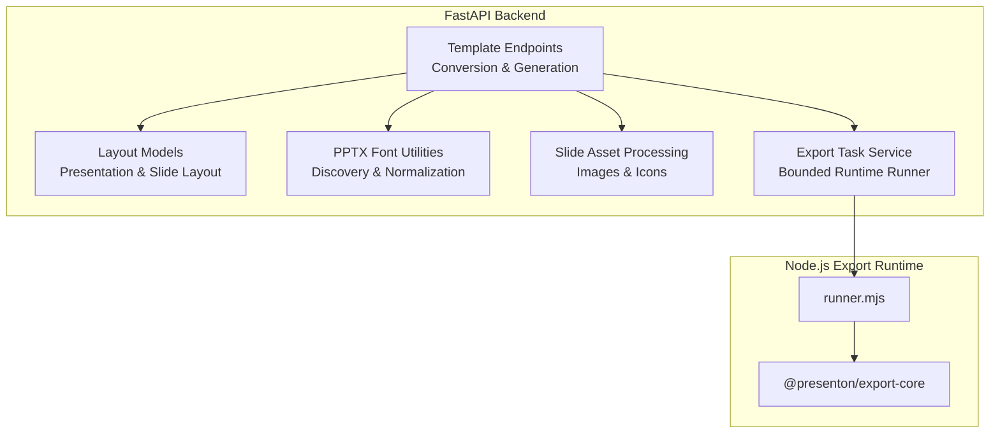
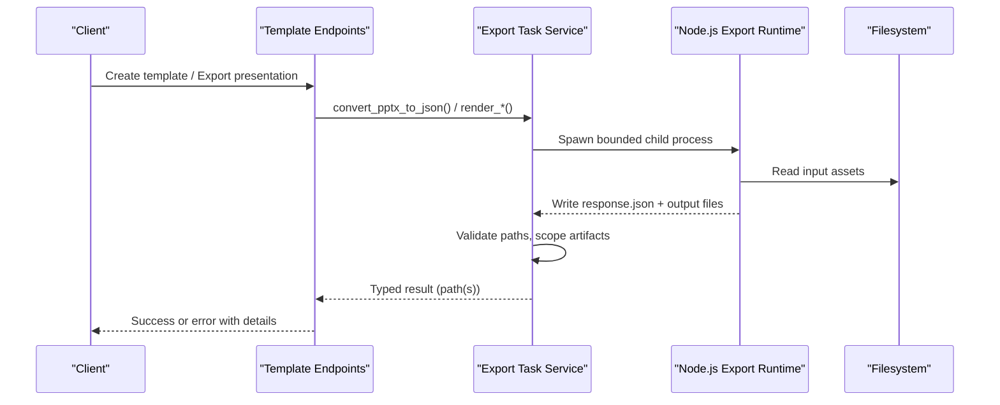
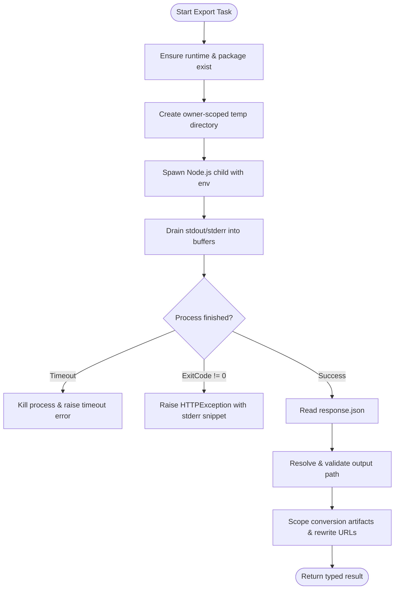
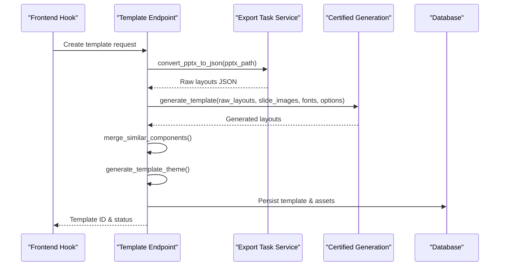
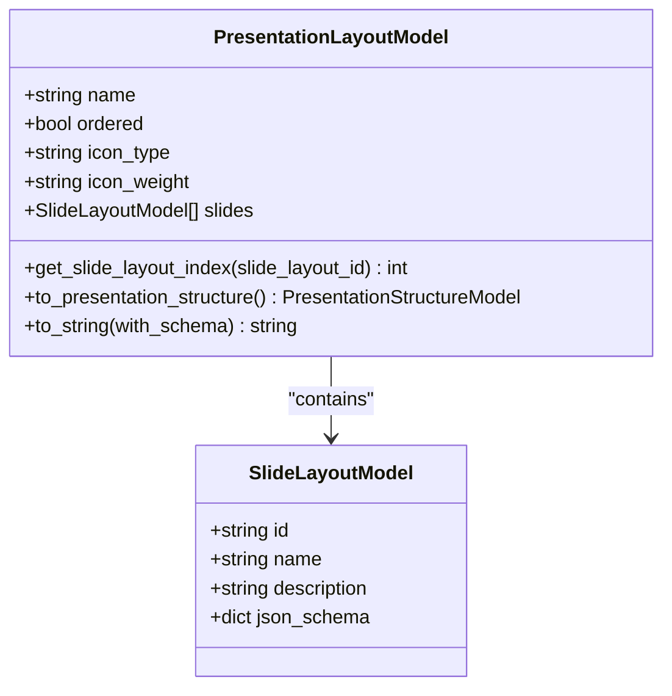
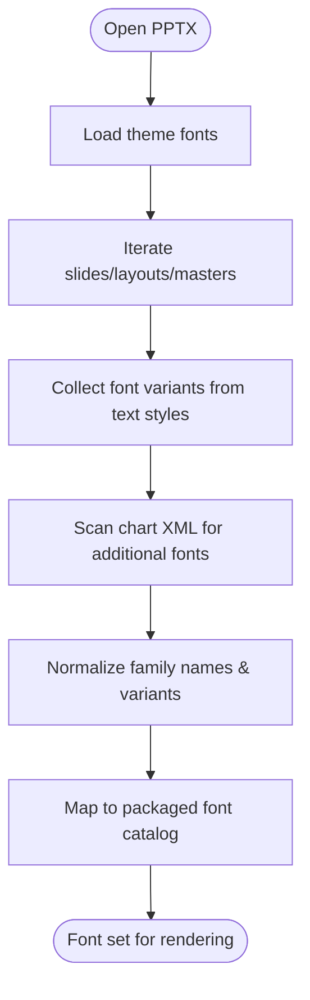
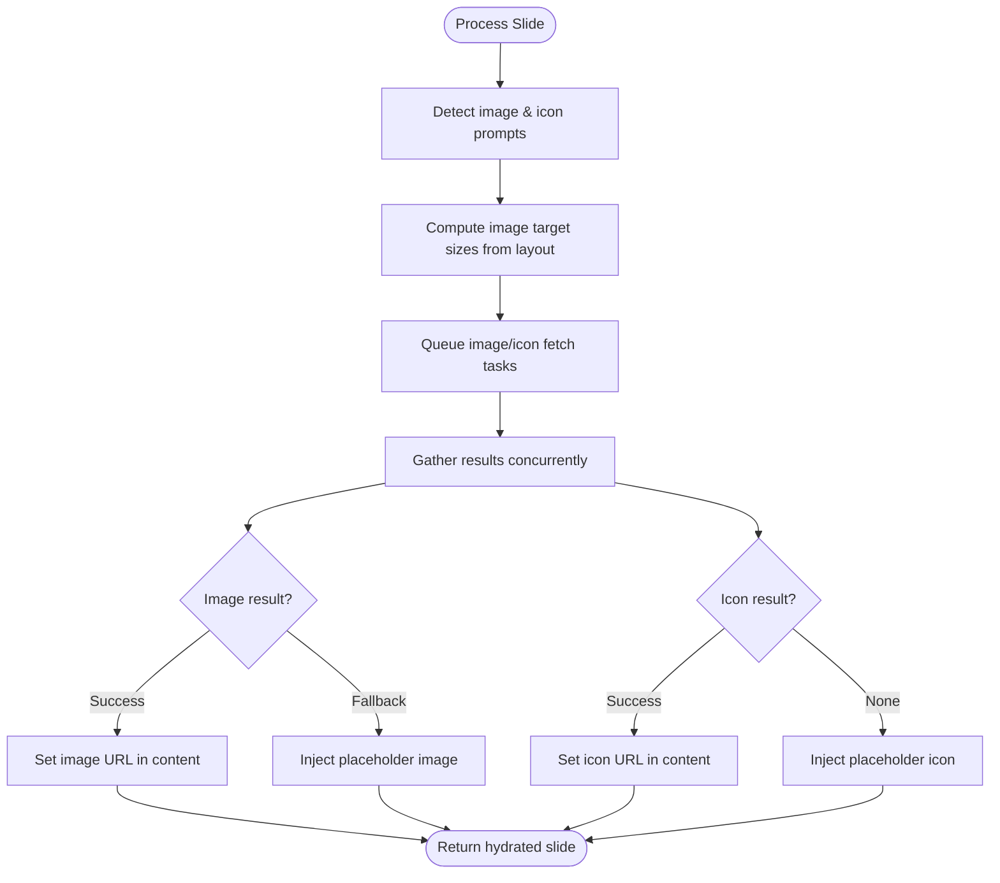
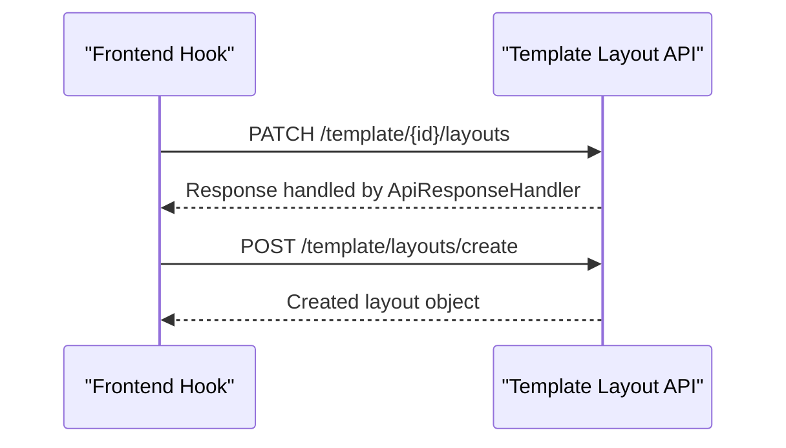
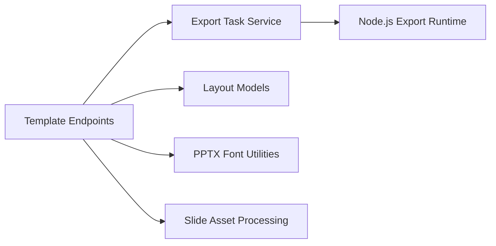

# Export Integration

<cite>
**Referenced Files in This Document**
- [export_task_service.py](file://servers/fastapi/services/export_task_service.py)
- [presentation_layout.py](file://servers/fastapi/templates/presentation_layout.py)
- [pptx_font_utils.py](file://servers/fastapi/templates/pptx_font_utils.py)
- [process_slides.py](file://servers/fastapi/utils/process_slides.py)
- [template.py](file://servers/fastapi/api/v1/ppt/endpoints/template.py)
- [template-v2.md](file://docs/template-v2.md)
- [useTemplateCreation.ts](file://servers/nextjs/app/(presentation-generator)/custom-template/hooks/useTemplateCreation.ts)
</cite>

## Table of Contents
1. [Introduction](#introduction)
2. [Project Structure](#project-structure)
3. [Core Components](#core-components)
4. [Architecture Overview](#architecture-overview)
5. [Detailed Component Analysis](#detailed-component-analysis)
6. [Dependency Analysis](#dependency-analysis)
7. [Performance Considerations](#performance-considerations)
8. [Troubleshooting Guide](#troubleshooting-guide)
9. [Conclusion](#conclusion)

## Introduction
This document explains the export integration layer that connects template generation with the export pipeline. It covers how generated layouts are processed, optimized, and prepared for PPTX and PDF export; how batch rendering is performed; how quality assurance and fallbacks work; and how the system integrates with the export task service, reports progress, and handles errors.

The integration spans:
- Backend template creation and certification of slide layouts.
- Conversion of source PPTX into structured layout data.
- Asset hydration, font handling, and image/icon resolution.
- Rendering to images or final exports through a bounded Node.js runtime.
- Progress reporting and error handling across asynchronous tasks.

## Project Structure
The export integration is centered around a Python FastAPI backend and a Node.js export runtime. The key responsibilities are:

- Template orchestration and persistence: API endpoints coordinate conversion, generation, merging, theme extraction, and saving.
- Layout models: Pydantic models define presentation and slide layout structures used by generation and export.
- Font utilities: PPTX font discovery, normalization, and variant analysis support accurate rendering.
- Slide asset processing: Image and icon resolution, placeholder injection, and target sizing for generated assets.
- Export task service: A bounded subprocess runner that invokes the Node.js export runtime for HTML/PDF/PPTX/image operations.

**Diagram sources**
- [template.py:1369-1409](file://servers/fastapi/api/v1/ppt/endpoints/template.py#L1369-L1409)
- [presentation_layout.py:11-47](file://servers/fastapi/templates/presentation_layout.py#L11-L47)
- [pptx_font_utils.py:130-180](file://servers/fastapi/templates/pptx_font_utils.py#L130-L180)
- [process_slides.py:35-99](file://servers/fastapi/utils/process_slides.py#L35-L99)
- [export_task_service.py:122-152](file://servers/fastapi/services/export_task_service.py#L122-L152)

**Section sources**
- [template.py:1369-1409](file://servers/fastapi/api/v1/ppt/endpoints/template.py#L1369-L1409)
- [presentation_layout.py:11-47](file://servers/fastapi/templates/presentation_layout.py#L11-L47)
- [pptx_font_utils.py:130-180](file://servers/fastapi/templates/pptx_font_utils.py#L130-L180)
- [process_slides.py:35-99](file://servers/fastapi/utils/process_slides.py#L35-L99)
- [export_task_service.py:122-152](file://servers/fastapi/services/export_task_service.py#L122-L152)

## Core Components
- Export Task Service: Orchestrates all heavy rendering and conversion workloads by spawning a bounded Node.js process. It validates inputs, scopes artifacts securely, enforces timeouts, and returns typed results.
- Template Endpoints: Convert source PPTX to JSON, generate certified layouts, merge similar components, extract themes, and persist templates. They also expose progress-aware async task flows.
- Layout Models: Define validated structures for presentations and slides, including schema normalization and helper methods for downstream processing.
- PPTX Font Utilities: Extract fonts from PPTX XML, normalize family names, infer variants, and map to packaged fonts for consistent rendering.
- Slide Asset Processing: Resolves image prompts and icon queries, hydrates content with URLs, supports target sizing based on layout boxes, and injects placeholders when needed.

Key capabilities:
- Batch rendering of multiple slides to images.
- Fallback strategies when optional features are unavailable.
- Owner-scoped artifact directories and URL rewriting.
- Strict path validation to prevent unsafe file access.

**Section sources**
- [export_task_service.py:122-152](file://servers/fastapi/services/export_task_service.py#L122-L152)
- [template.py:1369-1409](file://servers/fastapi/api/v1/ppt/endpoints/template.py#L1369-L1409)
- [presentation_layout.py:11-47](file://servers/fastapi/templates/presentation_layout.py#L11-L47)
- [pptx_font_utils.py:130-180](file://servers/fastapi/templates/pptx_font_utils.py#L130-L180)
- [process_slides.py:173-288](file://servers/fastapi/utils/process_slides.py#L173-L288)

## Architecture Overview
The export integration follows a layered architecture:

- API Layer: Receives requests to create templates or export presentations.
- Orchestration Layer: Coordinates conversion, generation, merging, theme extraction, and asset hydration.
- Export Runtime Layer: Executes rendering jobs in a bounded Node.js process with strict environment and path controls.
- Persistence Layer: Saves templates, layouts, and exported files under owner-scoped directories.

**Diagram sources**
- [template.py:1369-1409](file://servers/fastapi/api/v1/ppt/endpoints/template.py#L1369-L1409)
- [export_task_service.py:294-352](file://servers/fastapi/services/export_task_service.py#L294-L352)
- [export_task_service.py:420-453](file://servers/fastapi/services/export_task_service.py#L420-L453)

## Detailed Component Analysis

### Export Task Service
Responsibilities:
- Resolve and validate the Node.js runtime entrypoint and package.
- Build a secure environment for the child process, including app data and temp directories.
- Execute rendering tasks with bounded memory and time limits.
- Validate and scope output paths to trusted roots.
- Provide specialized converters for PPTX-to-HTML, PPTX-to-JSON, HTML-to-image, JSON-to-image, and batch variants.

Important behaviors:
- Timeout enforcement kills long-running processes and logs truncated stdout/stderr.
- Output path resolution accepts `path`, `file_path`, or `url` fields and normalizes them safely.
- Owner scoping moves conversion artifacts under `/app_data/{root}/users/{owner_id}/{session}` and rewrites URLs accordingly.
- Graceful fallback for HTML-to-images when the batch endpoint is unavailable.

**Diagram sources**
- [export_task_service.py:203-221](file://servers/fastapi/services/export_task_service.py#L203-L221)
- [export_task_service.py:294-352](file://servers/fastapi/services/export_task_service.py#L294-L352)
- [export_task_service.py:354-418](file://servers/fastapi/services/export_task_service.py#L354-L418)
- [export_task_service.py:726-768](file://servers/fastapi/services/export_task_service.py#L726-L768)
- [export_task_service.py:804-857](file://servers/fastapi/services/export_task_service.py#L804-L857)

**Section sources**
- [export_task_service.py:122-152](file://servers/fastapi/services/export_task_service.py#L122-L152)
- [export_task_service.py:203-221](file://servers/fastapi/services/export_task_service.py#L203-L221)
- [export_task_service.py:294-352](file://servers/fastapi/services/export_task_service.py#L294-L352)
- [export_task_service.py:420-453](file://servers/fastapi/services/export_task_service.py#L420-L453)
- [export_task_service.py:455-512](file://servers/fastapi/services/export_task_service.py#L455-L512)
- [export_task_service.py:519-576](file://servers/fastapi/services/export_task_service.py#L519-L576)
- [export_task_service.py:578-683](file://servers/fastapi/services/export_task_service.py#L578-L683)
- [export_task_service.py:685-724](file://servers/fastapi/services/export_task_service.py#L685-L724)
- [export_task_service.py:726-768](file://servers/fastapi/services/export_task_service.py#L726-L768)
- [export_task_service.py:804-857](file://servers/fastapi/services/export_task_service.py#L804-L857)

### Template Creation and Certification Flow
Responsibilities:
- Convert source PPTX to raw layout JSON via the export service.
- Generate certified layouts using multi-pass vision analysis.
- Merge similar components and generate semantic theme data.
- Persist the created template and report progress per slide.

Quality assurance:
- Schema validation at each pass.
- Fallback layouts when optional passes fail.
- Parallel processing up to ten slides concurrently.

**Diagram sources**
- [template.py:1369-1409](file://servers/fastapi/api/v1/ppt/endpoints/template.py#L1369-L1409)
- [template-v2.md:51-84](file://docs/template-v2.md#L51-L84)
- [export_task_service.py:685-724](file://servers/fastapi/services/export_task_service.py#L685-L724)

**Section sources**
- [template.py:1369-1409](file://servers/fastapi/api/v1/ppt/endpoints/template.py#L1369-L1409)
- [template-v2.md:51-84](file://docs/template-v2.md#L51-L84)

### Layout Models and Presentation Structure
Responsibilities:
- Define validated structures for presentation and slide layouts.
- Normalize icon types and weights.
- Provide helpers to build presentation structure and string representations.

Complexity considerations:
- Linear lookup for slide layout index by ID.
- Simple transformation to presentation structure model.

**Diagram sources**
- [presentation_layout.py:11-47](file://servers/fastapi/templates/presentation_layout.py#L11-L47)

**Section sources**
- [presentation_layout.py:11-47](file://servers/fastapi/templates/presentation_layout.py#L11-L47)

### PPTX Font Utilities
Responsibilities:
- Extract used fonts from PPTX XML, including theme-based typefaces.
- Normalize font family names and infer style variants.
- Map families to packaged static fonts for consistent rendering.

Optimization techniques:
- Caching of static font catalog.
- Efficient traversal of slide/layout/master XML trees.
- Handling of embedded fonts and chart XML.

**Diagram sources**
- [pptx_font_utils.py:130-180](file://servers/fastapi/templates/pptx_font_utils.py#L130-L180)
- [pptx_font_utils.py:365-800](file://servers/fastapi/templates/pptx_font_utils.py#L365-L800)

**Section sources**
- [pptx_font_utils.py:130-180](file://servers/fastapi/templates/pptx_font_utils.py#L130-L180)
- [pptx_font_utils.py:365-800](file://servers/fastapi/templates/pptx_font_utils.py#L365-L800)

### Slide Asset Processing
Responsibilities:
- Detect image prompts and icon queries within slide content.
- Resolve image targets using layout hydration to determine optimal sizes.
- Fetch images and icons asynchronously, with fallback placeholders.
- Inject resolved URLs back into slide content for rendering.

Batching and resilience:
- Concurrent gathering of image/icon tasks.
- Optional allow_image_fallback mode to continue despite failures.
- Placeholder injection for missing assets.

**Diagram sources**
- [process_slides.py:35-99](file://servers/fastapi/utils/process_slides.py#L35-L99)
- [process_slides.py:173-288](file://servers/fastapi/utils/process_slides.py#L173-L288)

**Section sources**
- [process_slides.py:35-99](file://servers/fastapi/utils/process_slides.py#L35-L99)
- [process_slides.py:173-288](file://servers/fastapi/utils/process_slides.py#L173-L288)

### Frontend Integration for Template Layouts
Responsibilities:
- Save generated template layouts to the backend.
- Trigger per-slide layout creation and handle responses.

Integration points:
- Calls to template layout APIs for patching and creating layouts.
- Error handling via a shared response handler.

**Diagram sources**
- [useTemplateCreation.ts:333-368](file://servers/nextjs/app/(presentation-generator)/custom-template/hooks/useTemplateCreation.ts#L333-L368)

**Section sources**
- [useTemplateCreation.ts:333-368](file://servers/nextjs/app/(presentation-generator)/custom-template/hooks/useTemplateCreation.ts#L333-L368)

## Dependency Analysis
The export integration has clear boundaries between orchestration, rendering, and persistence:

- Template endpoints depend on the export service for conversion and rendering.
- Layout models are consumed by generation and export logic.
- Font utilities provide normalized font sets for consistent rendering.
- Slide asset processing depends on image/icon services and layout hydration.
- The export service depends on a Node.js runtime and scoped filesystem paths.

**Diagram sources**
- [template.py:1369-1409](file://servers/fastapi/api/v1/ppt/endpoints/template.py#L1369-L1409)
- [export_task_service.py:122-152](file://servers/fastapi/services/export_task_service.py#L122-L152)
- [presentation_layout.py:11-47](file://servers/fastapi/templates/presentation_layout.py#L11-L47)
- [pptx_font_utils.py:130-180](file://servers/fastapi/templates/pptx_font_utils.py#L130-L180)
- [process_slides.py:173-288](file://servers/fastapi/utils/process_slides.py#L173-L288)

**Section sources**
- [template.py:1369-1409](file://servers/fastapi/api/v1/ppt/endpoints/template.py#L1369-L1409)
- [export_task_service.py:122-152](file://servers/fastapi/services/export_task_service.py#L122-L152)
- [presentation_layout.py:11-47](file://servers/fastapi/templates/presentation_layout.py#L11-L47)
- [pptx_font_utils.py:130-180](file://servers/fastapi/templates/pptx_font_utils.py#L130-L180)
- [process_slides.py:173-288](file://servers/fastapi/utils/process_slides.py#L173-L288)

## Performance Considerations
- Bounded subprocess execution: All export tasks run in a child process with explicit timeouts and buffered I/O to prevent resource exhaustion.
- Batch rendering: HTML-to-images and JSON-to-images accept multiple documents, reducing process spawn overhead.
- Fallback strategy: When batch endpoints are unavailable, the service falls back to one task per document without failing the whole batch.
- Asset localization: Images referenced in JSON are converted to data URIs before rendering to avoid network calls during headless rendering.
- Owner-scoped artifacts: Moving outputs to owner-specific directories avoids contention and improves isolation.
- Font catalog caching: Static font metadata is cached to reduce repeated parsing overhead.

[No sources needed since this section provides general guidance]

## Troubleshooting Guide
Common issues and resolutions:

- Export runtime not found:
  - Cause: Missing `runner.mjs` or `@presenton/export-core` package.
  - Resolution: Ensure the export package is installed and the runtime path is resolvable.

- Invalid output path:
  - Cause: Child process returned a path outside allowed roots.
  - Resolution: Verify APP_DATA_DIRECTORY and TEMP_DIRECTORY configuration; ensure the runtime writes within trusted directories.

- JSON decode or validation errors:
  - Cause: Export task produced malformed or invalid output.
  - Resolution: Inspect stderr snippets in error messages; check child process logs.

- Timeout exceeded:
  - Cause: Rendering took longer than configured timeout.
  - Resolution: Reduce batch size, optimize assets, or increase timeout if appropriate.

- Permission errors on output:
  - Cause: Unable to set file/directory permissions.
  - Resolution: Check filesystem permissions and ownership; ensure the process can write to the destination.

**Section sources**
- [export_task_service.py:203-221](file://servers/fastapi/services/export_task_service.py#L203-L221)
- [export_task_service.py:243-278](file://servers/fastapi/services/export_task_service.py#L243-L278)
- [export_task_service.py:323-350](file://servers/fastapi/services/export_task_service.py#L323-L350)
- [export_task_service.py:396-407](file://servers/fastapi/services/export_task_service.py#L396-L407)
- [export_task_service.py:726-768](file://servers/fastapi/services/export_task_service.py#L726-L768)
- [export_task_service.py:804-857](file://servers/fastapi/services/export_task_service.py#L804-L857)

## Conclusion
The export integration layer cleanly separates orchestration, rendering, and persistence. It converts source PPTX into structured layouts, certifies and optimizes those layouts, hydrates assets, and renders them through a secure, bounded Node.js runtime. Batch processing, fallback strategies, owner-scoped artifacts, and robust error handling make the pipeline resilient and scalable. For template creation, the system reports progress per slide and persists generated layouts and themes, while frontend hooks integrate smoothly with backend APIs to complete the workflow.

[No sources needed since this section summarizes without analyzing specific files]