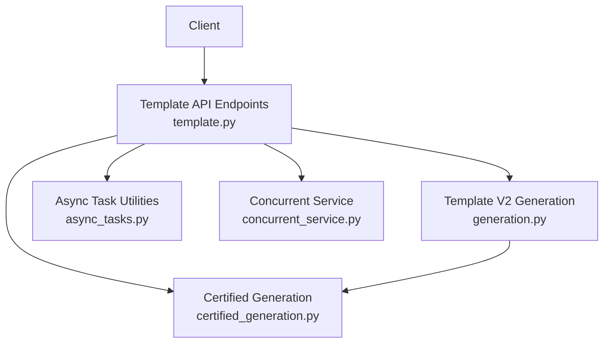
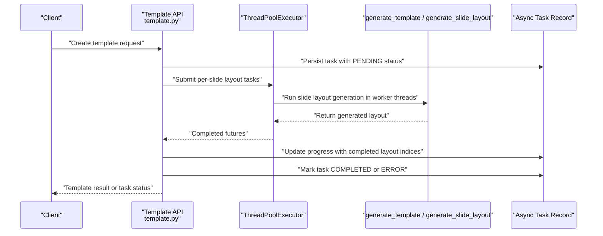
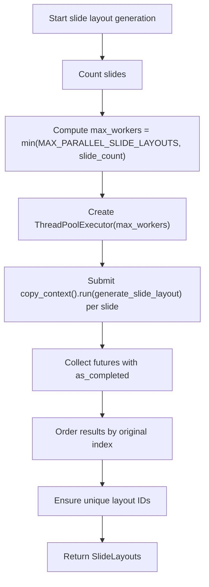
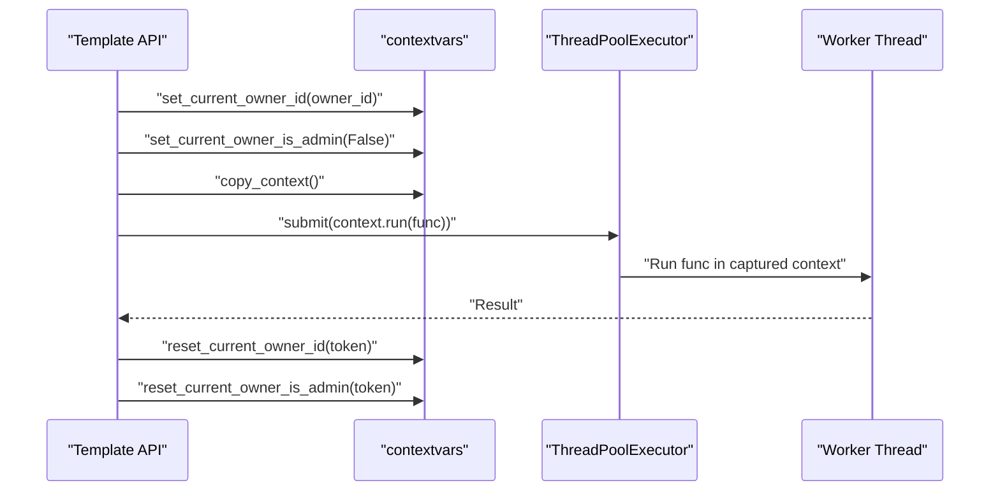
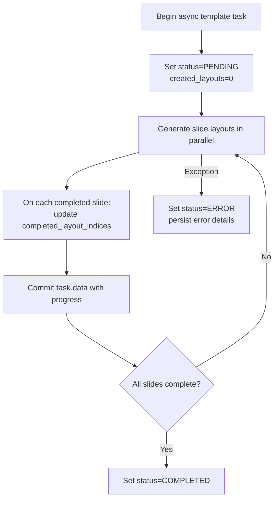
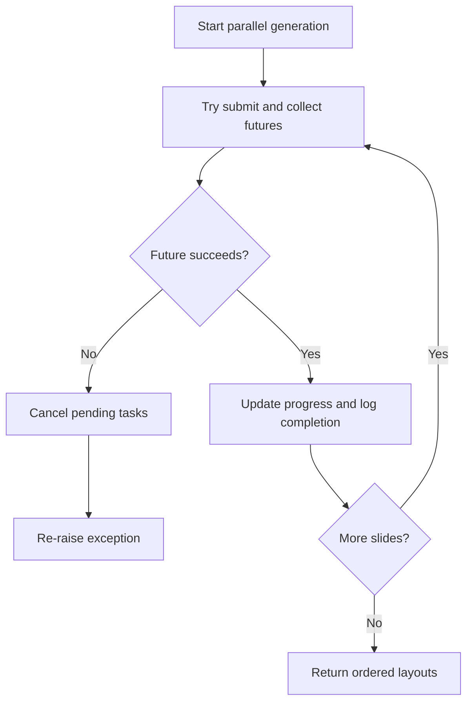
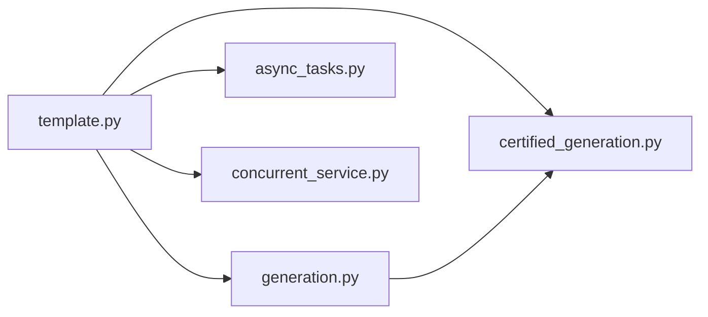

# Parallel Processing Architecture

<cite>
**Referenced Files in This Document**   
- [template.py](file://servers/fastapi/api/v1/ppt/endpoints/template.py)
- [generation.py](file://servers/fastapi/templates/v2/generation.py)
- [certified_generation.py](file://servers/fastapi/templates/v2/certified_generation.py)
- [concurrent_service.py](file://servers/fastapi/services/concurrent_service.py)
- [async_tasks.py](file://servers/fastapi/services/async_tasks.py)
</cite>

## Table of Contents
1. [Introduction](#introduction)
2. [Project Structure](#project-structure)
3. [Core Components](#core-components)
4. [Architecture Overview](#architecture-overview)
5. [Detailed Component Analysis](#detailed-component-analysis)
6. [Dependency Analysis](#dependency-analysis)
7. [Performance Considerations](#performance-considerations)
8. [Troubleshooting Guide](#troubleshooting-guide)
9. [Conclusion](#conclusion)

## Introduction
This document explains the parallel processing architecture used for template generation. It focuses on how slide layout generation is executed concurrently, how worker pools are created and managed, how context variables are propagated into worker threads, how progress is tracked, and how failures and resource limits are handled. The goal is to make the concurrent design understandable for both developers and operators who need to monitor, tune, or extend the system.

The implementation uses Python’s `ThreadPoolExecutor` to run CPU-bound template generation work outside the FastAPI event loop. Slide layouts are generated in parallel up to a fixed maximum concurrency limit. Progress updates are persisted to an asynchronous task record so clients can poll or stream status during long-running template creation.

## Project Structure
The relevant code lives under the FastAPI backend:

- Template API endpoints orchestrate request validation, background task setup, and progress persistence.
- Template V2 generation modules implement the actual slide layout generation logic and define concurrency constants.
- A small concurrent service manages lightweight async background tasks.
- An async task utility handles recovery of interrupted background jobs after server restarts.

**Diagram sources**
- [template.py:58-68](file://servers/fastapi/api/v1/ppt/endpoints/template.py#L58-L68)
- [generation.py:151-210](file://servers/fastapi/templates/v2/generation.py#L151-L210)
- [certified_generation.py:491-547](file://servers/fastapi/templates/v2/certified_generation.py#L491-L547)
- [async_tasks.py:22-52](file://servers/fastapi/services/async_tasks.py#L22-L52)
- [concurrent_service.py:6-40](file://servers/fastapi/services/concurrent_service.py#L6-L40)

**Section sources**
- [template.py:1-100](file://servers/fastapi/api/v1/ppt/endpoints/template.py#L1-L100)
- [generation.py:1-52](file://servers/fastapi/templates/v2/generation.py#L1-L52)
- [certified_generation.py:1-66](file://servers/fastapi/templates/v2/certified_generation.py#L1-L66)
- [async_tasks.py:1-53](file://servers/fastapi/services/async_tasks.py#L1-L53)
- [concurrent_service.py:1-41](file://servers/fastapi/services/concurrent_service.py#L1-L41)

## Core Components
- **Template API endpoint layer**: Validates requests, prepares PPTX-derived slide layouts, coordinates parallel generation, merges reusable components, generates theme data, and persists results. It also exposes synchronous and asynchronous template creation flows.
- **Template V2 generation module**: Defines the main parallel generation entry point, concurrency limits, and delegates per-slide layout generation to certified logic.
- **Certified generation module**: Implements the detailed multi-pass slide layout pipeline and component clustering/deduplication. It also defines its own concurrency constant and parallel execution path.
- **Concurrent service**: Provides a simple mechanism to start and track lightweight async background tasks.
- **Async task utilities**: Mark stale pending background tasks as failed when the server restarts, preventing clients from waiting forever.

Key responsibilities:
- Concurrency control through `ThreadPoolExecutor`.
- Context propagation using `contextvars.copy_context`.
- Per-slide progress tracking via database-backed async task records.
- Failure handling with cancellation of pending tasks and error state persistence.
- Resource limits through maximum parallel workers and token caps.

**Section sources**
- [template.py:586-815](file://servers/fastapi/api/v1/ppt/endpoints/template.py#L586-L815)
- [generation.py:151-210](file://servers/fastapi/templates/v2/generation.py#L151-L210)
- [certified_generation.py:491-547](file://servers/fastapi/templates/v2/certified_generation.py#L491-L547)
- [concurrent_service.py:6-40](file://servers/fastapi/services/concurrent_service.py#L6-L40)
- [async_tasks.py:22-52](file://servers/fastapi/services/async_tasks.py#L22-L52)

## Architecture Overview
At a high level, template generation has two major paths:

1. **Synchronous template creation**: The endpoint runs the full pipeline in-process, including parallel slide layout generation.
2. **Asynchronous template creation**: The endpoint creates a background task, persists initial status, then executes the same pipeline while updating progress.

Both paths use thread pools to run blocking template generation functions concurrently. The maximum number of concurrent slide layout generators is bounded by a shared constant.

**Diagram sources**
- [template.py:1402-1478](file://servers/fastapi/api/v1/ppt/endpoints/template.py#L1402-L1478)
- [template.py:1481-1565](file://servers/fastapi/api/v1/ppt/endpoints/template.py#L1481-L1565)
- [template.py:708-805](file://servers/fastapi/api/v1/ppt/endpoints/template.py#L708-L805)
- [generation.py:151-210](file://servers/fastapi/templates/v2/generation.py#L151-L210)

## Detailed Component Analysis

### ThreadPoolExecutor Usage and Worker Management
The template endpoint and generation modules create `ThreadPoolExecutor` instances to run blocking template generation work. There are three primary patterns:

- **Per-slide parallel generation**: Creates one executor per batch of slides, submits one future per slide index, and collects results in order.
- **Async-safe single-thread wrapper**: Wraps a function in a single-worker executor so blocking work does not block the event loop.
- **Context-aware submission**: Uses `copy_context().run` to propagate context variables into worker threads.

**Diagram sources**
- [template.py:708-805](file://servers/fastapi/api/v1/ppt/endpoints/template.py#L708-L805)
- [template.py:1070-1109](file://servers/fastapi/api/v1/ppt/endpoints/template.py#L1070-L1109)
- [generation.py:151-210](file://servers/fastapi/templates/v2/generation.py#L151-L210)
- [certified_generation.py:491-547](file://servers/fastapi/templates/v2/certified_generation.py#L491-L547)

**Section sources**
- [template.py:708-815](file://servers/fastapi/api/v1/ppt/endpoints/template.py#L708-L815)
- [template.py:1070-1109](file://servers/fastapi/api/v1/ppt/endpoints/template.py#L1070-L1109)
- [generation.py:151-210](file://servers/fastapi/templates/v2/generation.py#L151-L210)
- [certified_generation.py:491-547](file://servers/fastapi/templates/v2/certified_generation.py#L491-L547)

### Context Variable Propagation
Context variables such as current owner identity and admin flag are set before running template generation. Because template generation may call blocking LLM or file I/O code, it must run in a thread pool. To preserve context across threads, the code captures the current context with `copy_context()` and executes the target function inside that context.

Patterns observed:
- Single-worker executor wrapper captures context once and runs the function inside it.
- Per-slide futures capture context before submitting each slide generation job.
- Owner identity is reset after background task completion.

**Diagram sources**
- [template.py:808-815](file://servers/fastapi/api/v1/ppt/endpoints/template.py#L808-L815)
- [template.py:1070-1109](file://servers/fastapi/api/v1/ppt/endpoints/template.py#L1070-L1109)
- [template.py:1481-1565](file://servers/fastapi/api/v1/ppt/endpoints/template.py#L1481-L1565)

**Section sources**
- [template.py:808-815](file://servers/fastapi/api/v1/ppt/endpoints/template.py#L808-L815)
- [template.py:1070-1109](file://servers/fastapi/api/v1/ppt/endpoints/template.py#L1070-L1109)
- [template.py:1481-1565](file://servers/fastapi/api/v1/ppt/endpoints/template.py#L1481-L1565)

### Progress Tracking Mechanisms
For asynchronous template creation, progress is tracked by persisting structured task data:

- Initial task status is set to `PENDING` with zero completed layouts.
- As each slide layout completes, the endpoint updates the task record with the set of completed layout indices.
- Final status is set to `COMPLETED` with total layout counts, or `ERROR` if an exception occurs.
- Clients can inspect `created_layouts`, `remaining_layouts`, and per-index status arrays to build UI progress indicators.

**Diagram sources**
- [template.py:395-426](file://servers/fastapi/api/v1/ppt/endpoints/template.py#L395-L426)
- [template.py:663-682](file://servers/fastapi/api/v1/ppt/endpoints/template.py#L663-L682)
- [template.py:708-805](file://servers/fastapi/api/v1/ppt/endpoints/template.py#L708-L805)
- [template.py:1481-1565](file://servers/fastapi/api/v1/ppt/endpoints/template.py#L1481-L1565)

**Section sources**
- [template.py:395-426](file://servers/fastapi/api/v1/ppt/endpoints/template.py#L395-L426)
- [template.py:663-682](file://servers/fastapi/api/v1/ppt/endpoints/template.py#L663-L682)
- [template.py:708-805](file://servers/fastapi/api/v1/ppt/endpoints/template.py#L708-L805)
- [template.py:1481-1565](file://servers/fastapi/api/v1/ppt/endpoints/template.py#L1481-L1565)

### Maximum Parallel Limits and Task Queuing
Concurrency is controlled by `MAX_PARALLEL_SLIDE_LAYOUTS`:

- Both the template endpoint and the generation modules cap parallel workers at this constant.
- The effective worker count is `min(MAX_PARALLEL_SLIDE_LAYOUTS, slide_count)` or `min(MAX_PARALLEL_SLIDE_LAYOUTS, requested_indices_count)`.
- Request validation rejects batch layout creation requests that exceed the maximum allowed parallel slide layouts.
- Each slide layout generation is submitted as a separate future; there is no explicit queue manager beyond `ThreadPoolExecutor`’s internal queue.

Important constants:
- `MAX_PARALLEL_SLIDE_LAYOUTS = 10`
- `SLIDE_LAYOUT_GENERATION_MAX_TOKENS = 16000`

**Section sources**
- [generation.py:47-49](file://servers/fastapi/templates/v2/generation.py#L47-L49)
- [certified_generation.py:60-64](file://servers/fastapi/templates/v2/certified_generation.py#L60-L64)
- [template.py:100-100](file://servers/fastapi/api/v1/ppt/endpoints/template.py#L100-L100)
- [template.py:240-259](file://servers/fastapi/api/v1/ppt/endpoints/template.py#L240-L259)
- [template.py:724-732](file://servers/fastapi/api/v1/ppt/endpoints/template.py#L724-L732)
- [template.py:1077-1094](file://servers/fastapi/api/v1/ppt/endpoints/template.py#L1077-L1094)

### Resource Allocation Strategies
Resource allocation is conservative and focused on protecting the event loop and downstream services:

- Blocking template generation is moved off the event loop using `ThreadPoolExecutor`.
- Single-worker executors are used for operations that should not be parallelized within a given scope.
- Token limits are applied to slide layout generation calls to prevent excessive LLM payload sizes.
- Layout IDs are randomized and deduplicated to avoid collisions and ensure stable ordering.
- Background tasks are isolated with owner identity and admin flags, which are reset after completion.

**Section sources**
- [template.py:808-815](file://servers/fastapi/api/v1/ppt/endpoints/template.py#L808-L815)
- [template.py:1070-1109](file://servers/fastapi/api/v1/ppt/endpoints/template.py#L1070-L1109)
- [template.py:832-843](file://servers/fastapi/api/v1/ppt/endpoints/template.py#L832-L843)
- [template.py:1481-1565](file://servers/fastapi/api/v1/ppt/endpoints/template.py#L1481-L1565)

### Error Handling and Failure Recovery
Error handling covers several layers:

- **Per-slide failure**: Exceptions during slide layout generation cause pending asyncio tasks to be cancelled and the exception re-raised.
- **Validation failures**: Invalid generated output raises HTTP exceptions with clear messages.
- **Background task interruption**: On server restart, pending async tasks are marked as `ERROR` with a specific message so clients do not wait indefinitely.
- **Owner context cleanup**: Owner identity and admin flags are reset in a `finally` block to avoid leaking context between requests.

**Diagram sources**
- [template.py:767-793](file://servers/fastapi/api/v1/ppt/endpoints/template.py#L767-L793)
- [template.py:1446-1478](file://servers/fastapi/api/v1/ppt/endpoints/template.py#L1446-L1478)
- [template.py:1547-1565](file://servers/fastapi/api/v1/ppt/endpoints/template.py#L1547-L1565)
- [async_tasks.py:22-52](file://servers/fastapi/services/async_tasks.py#L22-L52)

**Section sources**
- [template.py:767-793](file://servers/fastapi/api/v1/ppt/endpoints/template.py#L767-L793)
- [template.py:1446-1478](file://servers/fastapi/api/v1/ppt/endpoints/template.py#L1446-L1478)
- [template.py:1547-1565](file://servers/fastapi/api/v1/ppt/endpoints/template.py#L1547-L1565)
- [async_tasks.py:22-52](file://servers/fastapi/services/async_tasks.py#L22-L52)

### Monitoring Concurrent Operations
Monitoring relies on logs and task state:

- Log entries include task ID, slide count, component count, completed count, and duration where available.
- Async task records expose:
  - `status`: `PENDING`, `COMPLETED`, or `ERROR`.
  - `message`: human-readable stage description.
  - `data`: structured progress including `created_layouts`, `remaining_layouts`, and per-index statuses.
  - `error`: serialized API error model when the task fails.

Recommended monitoring approach:
- Poll or subscribe to async task endpoints to observe `status` and `data`.
- Watch logs for `[template.create]`, `[template.create.async]`, and `[templates.v2.generate]` prefixes.
- Track `completed_layout_indices` growth to estimate throughput and latency per slide.

**Section sources**
- [template.py:780-805](file://servers/fastapi/api/v1/ppt/endpoints/template.py#L780-L805)
- [template.py:1512-1565](file://servers/fastapi/api/v1/ppt/endpoints/template.py#L1512-L1565)
- [generation.py:166-209](file://servers/fastapi/templates/v2/generation.py#L166-L209)

### Scaling Considerations
Scaling decisions should consider:

- **CPU vs I/O bound work**: If template generation is mostly CPU-bound, increasing `MAX_PARALLEL_SLIDE_LAYOUTS` may improve throughput until CPU saturation. If it is I/O-bound, external rate limits or provider quotas may become the bottleneck.
- **LLM provider limits**: Token caps and provider rate limits constrain safe concurrency.
- **Memory usage**: Each worker holds generated layout objects and possibly large intermediate structures.
- **Database write frequency**: Progress updates commit after each completed slide; very high concurrency can increase write pressure.
- **Process restart resilience**: Stale pending tasks are recovered, but long-running background work cannot survive process restarts.

Practical scaling guidance:
- Keep `MAX_PARALLEL_SLIDE_LAYOUTS` at or below the default unless load testing shows headroom.
- Monitor error rates and latency as concurrency increases.
- Use asynchronous template creation for long-running batches so clients can track progress.
- Avoid submitting more than `MAX_PARALLEL_SLIDE_LAYOUTS` slide layouts in a single batch.

[No sources needed since this section provides general guidance]

## Dependency Analysis
The parallel processing flow depends on several modules:

**Diagram sources**
- [template.py:58-68](file://servers/fastapi/api/v1/ppt/endpoints/template.py#L58-L68)
- [generation.py:26-44](file://servers/fastapi/templates/v2/generation.py#L26-L44)
- [certified_generation.py:26-57](file://servers/fastapi/templates/v2/certified_generation.py#L26-L57)
- [async_tasks.py:6-8](file://servers/fastapi/services/async_tasks.py#L6-L8)
- [concurrent_service.py:6-40](file://servers/fastapi/services/concurrent_service.py#L6-L40)

**Section sources**
- [template.py:58-68](file://servers/fastapi/api/v1/ppt/endpoints/template.py#L58-L68)
- [generation.py:26-44](file://servers/fastapi/templates/v2/generation.py#L26-L44)
- [certified_generation.py:26-57](file://servers/fastapi/templates/v2/certified_generation.py#L26-L57)
- [async_tasks.py:6-8](file://servers/fastapi/services/async_tasks.py#L6-L8)
- [concurrent_service.py:6-40](file://servers/fastapi/services/concurrent_service.py#L6-L40)

## Performance Considerations
- **Parallelism ceiling**: The default maximum parallel slide layouts is 10. Do not exceed this without benchmarking.
- **Token limits**: Slide layout generation uses a token cap to reduce LLM payload size and cost.
- **Ordered result collection**: Results are collected by index to preserve slide order despite concurrent completion.
- **ID uniqueness**: Duplicate layout IDs are repaired deterministically to avoid schema conflicts.
- **Single-worker wrappers**: Some operations intentionally run in a single worker to avoid uncontrolled parallelism.
- **Progress commits**: Frequent commits provide visibility but add database overhead; balance with workload size.

[No sources needed since this section provides general guidance]

## Troubleshooting Guide
Common issues and resolutions:

- **Stale pending tasks after restart**: Pending async tasks are marked as failed with a specific error. Restart the client workflow and resubmit.
- **Invalid generated output**: Validation errors indicate malformed slide layout JSON. Check input slide images, fonts, and generation options.
- **Too many parallel layouts**: Batch creation requests exceeding the maximum are rejected. Reduce the number of indices or split into multiple requests.
- **Missing owner context**: Ensure owner identity is set before background task execution and reset afterward.
- **High memory usage**: Reduce concurrency or batch size if workers consume too much memory.

Operational checks:
- Inspect async task `status`, `message`, `data`, and `error`.
- Review logs for template generation stages and component merging.
- Verify that slide image URLs match raw layout counts.
- Confirm that PPTX files are accessible through the expected app-data path.

**Section sources**
- [async_tasks.py:13-19](file://servers/fastapi/services/async_tasks.py#L13-L19)
- [async_tasks.py:22-52](file://servers/fastapi/services/async_tasks.py#L22-L52)
- [template.py:605-614](file://servers/fastapi/api/v1/ppt/endpoints/template.py#L605-L614)
- [template.py:240-259](file://servers/fastapi/api/v1/ppt/endpoints/template.py#L240-L259)
- [template.py:1481-1565](file://servers/fastapi/api/v1/ppt/endpoints/template.py#L1481-L1565)

## Conclusion
The template generation pipeline uses `ThreadPoolExecutor` to safely run blocking work outside the event loop while preserving context variables. Concurrency is capped by `MAX_PARALLEL_SLIDE_LAYOUTS`, and progress is persisted through async task records. Errors are handled at multiple levels: per-slide cancellation, validation failures, background task interruption, and owner context cleanup. For reliable operation, monitor task status and logs, respect concurrency and token limits, and use asynchronous template creation for long-running workloads.

[No sources needed since this section summarizes without analyzing specific files]