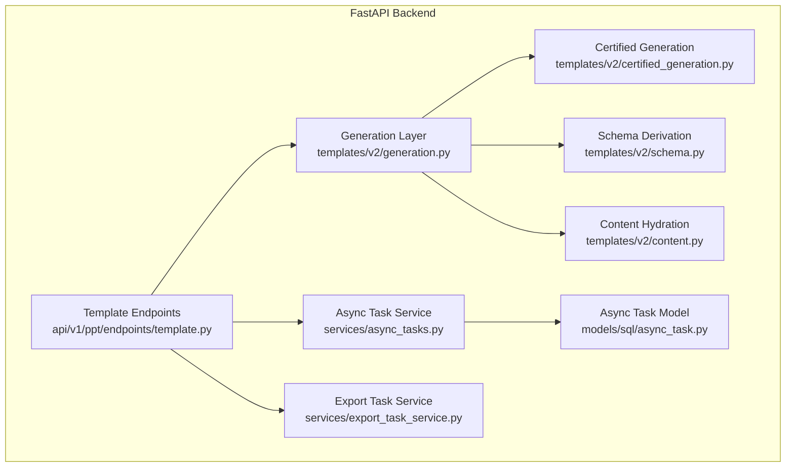
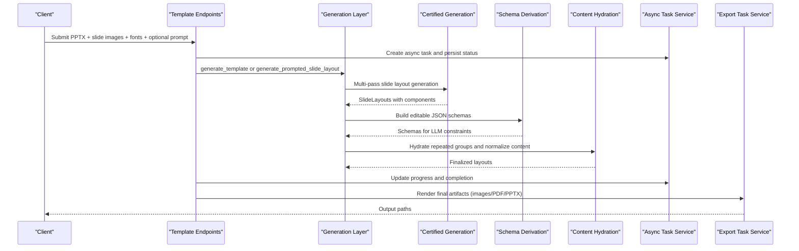
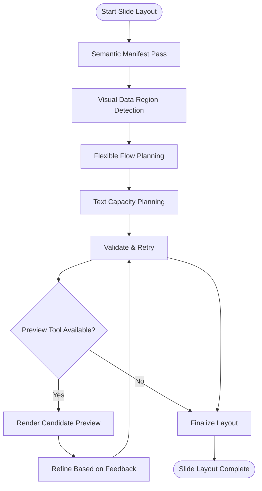
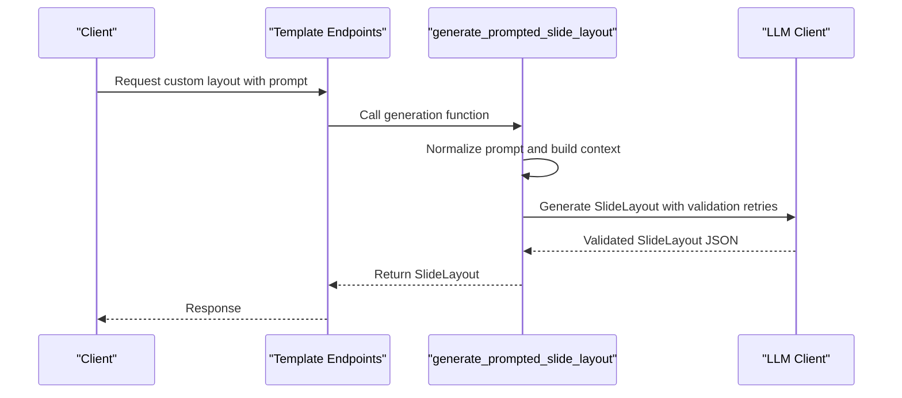
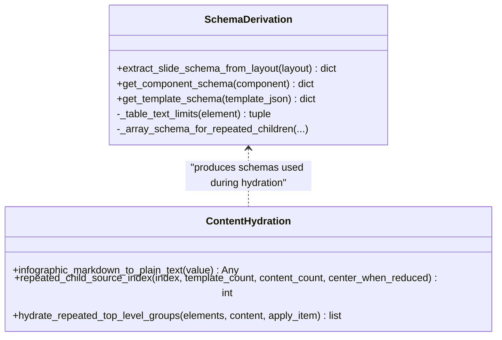
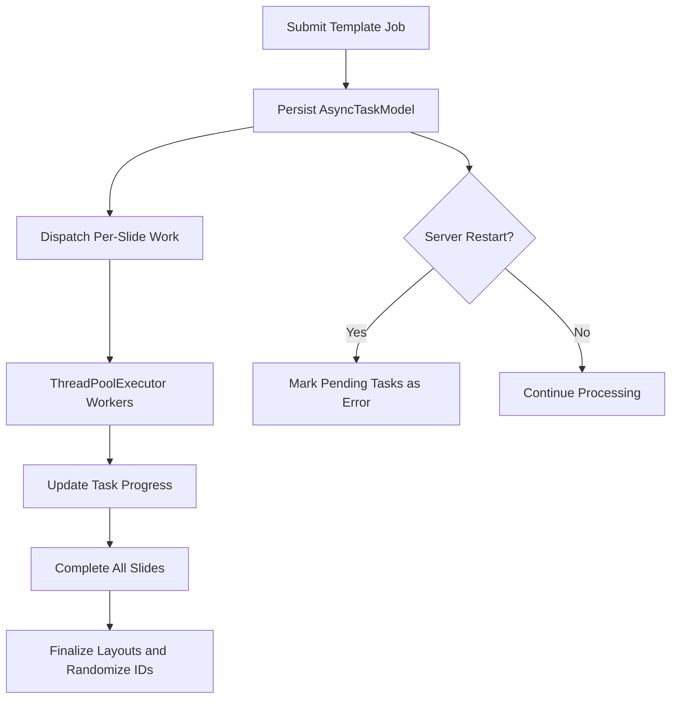
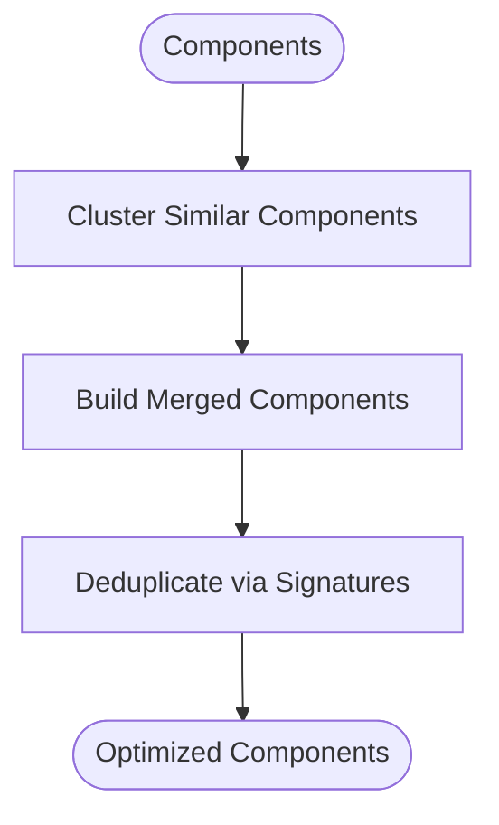
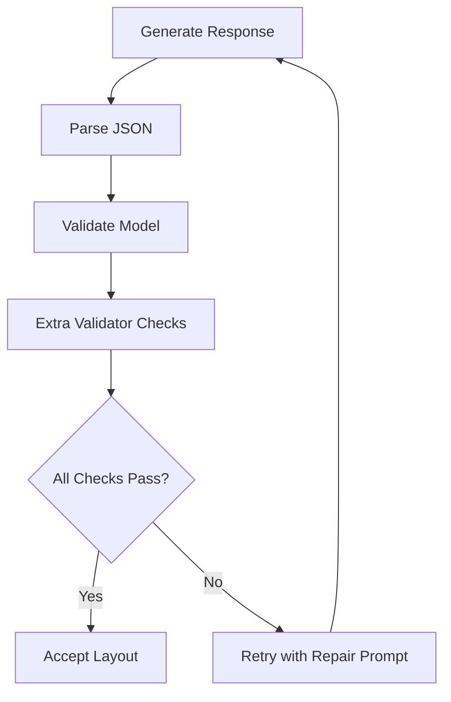
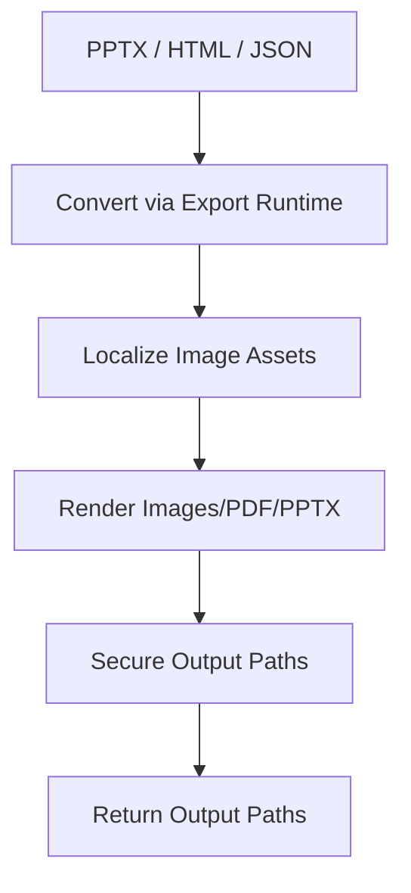
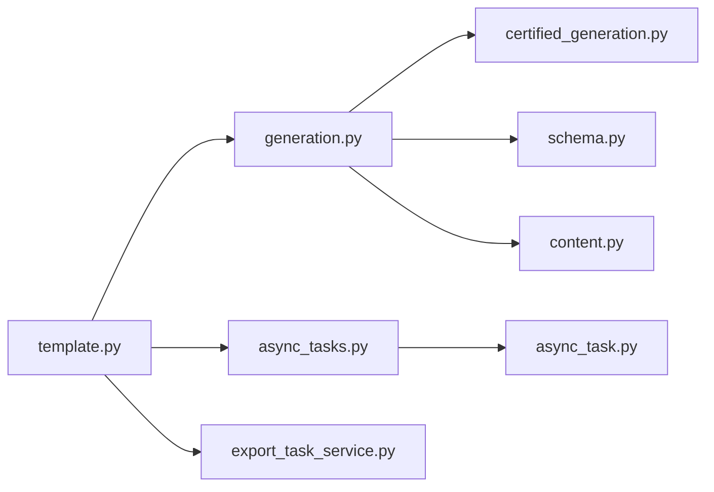

# Template Generation Engine

<cite>
**Referenced Files in This Document**
- [generation.py](file://servers/fastapi/templates/v2/generation.py)
- [certified_generation.py](file://servers/fastapi/templates/v2/certified_generation.py)
- [schema.py](file://servers/fastapi/templates/v2/schema.py)
- [content.py](file://servers/fastapi/templates/v2/content.py)
- [template.py](file://servers/fastapi/api/v1/ppt/endpoints/template.py)
- [async_tasks.py](file://servers/fastapi/services/async_tasks.py)
- [async_task.py](file://servers/fastapi/models/sql/async_task.py)
- [export_task_service.py](file://servers/fastapi/services/export_task_service.py)
</cite>

## Table of Contents
1. [Introduction](#introduction)
2. [Project Structure](#project-structure)
3. [Core Components](#core-components)
4. [Architecture Overview](#architecture-overview)
5. [Detailed Component Analysis](#detailed-component-analysis)
6. [Dependency Analysis](#dependency-analysis)
7. [Performance Considerations](#performance-considerations)
8. [Troubleshooting Guide](#troubleshooting-guide)
9. [Conclusion](#conclusion)

## Introduction
This document explains the template generation engine that converts slide images and source layouts into editable, AI-generated Template V2 slide layouts. It covers:
- AI-powered slide layout generation through focused semantic passes
- Prompt processing for custom layout creation
- Intelligent content structuring via JSON schema derivation
- Parallel processing architecture, task queuing, and progress tracking
- Template optimization algorithms including component merging and deduplication
- Quality assurance with validation retries, preview feedback, and structural checks
- Export pipeline integration, batch processing, and performance techniques
- Examples of custom generation logic, error handling patterns, and monitoring approaches

## Project Structure
The template generation engine is centered around a FastAPI backend with dedicated modules for generation, schema derivation, content hydration, API orchestration, asynchronous task persistence, and export runtime integration.

**Diagram sources**
- [template.py:685-805](file://servers/fastapi/api/v1/ppt/endpoints/template.py#L685-L805)
- [generation.py:151-210](file://servers/fastapi/templates/v2/generation.py#L151-L210)
- [certified_generation.py:491-547](file://servers/fastapi/templates/v2/certified_generation.py#L491-L547)
- [schema.py:183-279](file://servers/fastapi/templates/v2/schema.py#L183-L279)
- [content.py:27-87](file://servers/fastapi/templates/v2/content.py#L27-L87)
- [async_tasks.py:22-52](file://servers/fastapi/services/async_tasks.py#L22-L52)
- [async_task.py:16-62](file://servers/fastapi/models/sql/async_task.py#L16-L62)
- [export_task_service.py:294-352](file://servers/fastapi/services/export_task_service.py#L294-L352)

**Section sources**
- [template.py:685-805](file://servers/fastapi/api/v1/ppt/endpoints/template.py#L685-L805)
- [generation.py:151-210](file://servers/fastapi/templates/v2/generation.py#L151-L210)
- [certified_generation.py:491-547](file://servers/fastapi/templates/v2/certified_generation.py#L491-L547)
- [schema.py:183-279](file://servers/fastapi/templates/v2/schema.py#L183-L279)
- [content.py:27-87](file://servers/fastapi/templates/v2/content.py#L27-L87)
- [async_tasks.py:22-52](file://servers/fastapi/services/async_tasks.py#L22-L52)
- [async_task.py:16-62](file://servers/fastapi/models/sql/async_task.py#L16-L62)
- [export_task_service.py:294-352](file://servers/fastapi/services/export_task_service.py#L294-L352)

## Core Components
- Generation layer: orchestrates parallel slide layout generation, prompt-driven layout creation, and component merging.
- Certified generation: implements multi-pass AI analysis (semantic manifest, visual data regions, flexible flow, text capacity), clustering, and deduplication.
- Schema derivation: builds editable JSON schemas from generated layouts to constrain LLM output and guide content population.
- Content hydration: maps generated arrays to repeated groups and normalizes infographic markdown.
- API orchestration: coordinates async tasks, progress updates, batching, and export integration.
- Async task service and model: persist background jobs, handle interruptions, and serialize status.
- Export task service: runs Node-based rendering pipelines, manages timeouts, and secures outputs.

**Section sources**
- [generation.py:151-210](file://servers/fastapi/templates/v2/generation.py#L151-L210)
- [certified_generation.py:491-547](file://servers/fastapi/templates/v2/certified_generation.py#L491-L547)
- [schema.py:183-279](file://servers/fastapi/templates/v2/schema.py#L183-L279)
- [content.py:27-87](file://servers/fastapi/templates/v2/content.py#L27-L87)
- [template.py:685-805](file://servers/fastapi/api/v1/ppt/endpoints/template.py#L685-L805)
- [async_tasks.py:22-52](file://servers/fastapi/services/async_tasks.py#L22-L52)
- [async_task.py:16-62](file://servers/fastapi/models/sql/async_task.py#L16-L62)
- [export_task_service.py:294-352](file://servers/fastapi/services/export_task_service.py#L294-L352)

## Architecture Overview
The engine uses a layered architecture:
- API endpoints accept PPTX assets, slide images, fonts, and prompts.
- The generation layer dispatches per-slide work across threads while preserving context.
- Certified generation performs structured AI passes to produce semantic manifests, detect visual data regions, plan flexible flows, and compute text capacity adjustments.
- Schema derivation produces JSON schemas that constrain LLM responses and enable repeatable content mapping.
- Content hydration applies generated content to template structures.
- Async task persistence tracks job state and progress; export services render final artifacts.

**Diagram sources**
- [template.py:685-805](file://servers/fastapi/api/v1/ppt/endpoints/template.py#L685-L805)
- [generation.py:151-210](file://servers/fastapi/templates/v2/generation.py#L151-L210)
- [certified_generation.py:491-547](file://servers/fastapi/templates/v2/certified_generation.py#L491-L547)
- [schema.py:183-279](file://servers/fastapi/templates/v2/schema.py#L183-L279)
- [content.py:27-87](file://servers/fastapi/templates/v2/content.py#L27-L87)
- [async_tasks.py:22-52](file://servers/fastapi/services/async_tasks.py#L22-L52)
- [export_task_service.py:294-352](file://servers/fastapi/services/export_task_service.py#L294-L352)

## Detailed Component Analysis

### AI-Powered Slide Layout Generation
The certified generation pipeline performs multiple focused passes:
- Semantic slide manifest: partitions elements into reusable components and classifies editable candidates.
- Visual data region detection: identifies charts, tables, infographics, and text lists within image-rendered regions.
- Flexible flow planning: defines fixed flow groups and repeatable regions for robust reflow.
- Text capacity planning: computes safe growth for editable text boxes without altering design.

Parallelization:
- Slides are processed concurrently using a thread pool bounded by a maximum worker count.
- Context variables are preserved per worker to maintain request-scoped state.

Quality assurance:
- Structured LLM responses are validated against Pydantic models.
- Validation retries feed repair instructions back to the model when JSON or schema validation fails.
- Optional preview tool renders candidate layouts and asks the model to refine them based on visual feedback.

**Diagram sources**
- [certified_generation.py:111-459](file://servers/fastapi/templates/v2/certified_generation.py#L111-L459)
- [generation.py:852-1059](file://servers/fastapi/templates/v2/generation.py#L852-L1059)

**Section sources**
- [certified_generation.py:111-459](file://servers/fastapi/templates/v2/certified_generation.py#L111-L459)
- [generation.py:852-1059](file://servers/fastapi/templates/v2/generation.py#L852-L1059)

### Prompt Processing and Custom Layout Creation
Custom layout generation accepts a natural language prompt and existing template layouts/components:
- Normalizes and validates the prompt.
- Builds contextual information by ranking reference layouts and reusable components based on prompt terms.
- Constrains context size to prevent oversized payloads.
- Calls the LLM with a system prompt and user message containing the prompt and template context.
- Validates generated layout IDs, uniqueness, presence of editable content, and schema compliance.

**Diagram sources**
- [generation.py:631-693](file://servers/fastapi/templates/v2/generation.py#L631-L693)
- [generation.py:696-775](file://servers/fastapi/templates/v2/generation.py#L696-L775)

**Section sources**
- [generation.py:631-693](file://servers/fastapi/templates/v2/generation.py#L631-L693)
- [generation.py:696-775](file://servers/fastapi/templates/v2/generation.py#L696-L775)

### Intelligent Content Structuring and Schema Derivation
Schema derivation transforms generated layouts into editable JSON schemas:
- Identifies editable elements and content types (text, image, list, table, chart, infographic).
- Computes table cell typography and capacity limits to constrain generated text lengths.
- Detects repeated top-level groups and merges their item schemas.
- Produces component schemas and template-level schemas with required properties.

Content hydration then maps generated arrays to template children:
- Determines the correct child index for repeated items.
- Centers reduced sets when fewer items are provided than template slots.
- Recursively strips inline Markdown from infographic labels.

**Diagram sources**
- [schema.py:57-125](file://servers/fastapi/templates/v2/schema.py#L57-L125)
- [schema.py:183-279](file://servers/fastapi/templates/v2/schema.py#L183-L279)
- [schema.py:426-452](file://servers/fastapi/templates/v2/schema.py#L426-L452)
- [content.py:27-87](file://servers/fastapi/templates/v2/content.py#L27-L87)

**Section sources**
- [schema.py:57-125](file://servers/fastapi/templates/v2/schema.py#L57-L125)
- [schema.py:183-279](file://servers/fastapi/templates/v2/schema.py#L183-L279)
- [schema.py:426-452](file://servers/fastapi/templates/v2/schema.py#L426-L452)
- [content.py:27-87](file://servers/fastapi/templates/v2/content.py#L27-L87)

### Parallel Processing Architecture, Task Queuing, and Progress Tracking
Parallel processing:
- Uses ThreadPoolExecutor to process slides concurrently with a bounded worker count.
- Preserves context variables per worker to avoid cross-request contamination.
- Aggregates results by original index to maintain order.

Task queuing and persistence:
- Background tasks are persisted with unique IDs, owner scoping, status, messages, errors, and payload metadata.
- On server restart, pending tasks are marked as failed to prevent client hangs.

Progress tracking:
- Asynchronous generation updates task data incrementally after each completed slide.
- Progress includes created layout indices, remaining counts, and identity fields.

**Diagram sources**
- [template.py:708-805](file://servers/fastapi/api/v1/ppt/endpoints/template.py#L708-L805)
- [async_tasks.py:22-52](file://servers/fastapi/services/async_tasks.py#L22-L52)
- [async_task.py:16-62](file://servers/fastapi/models/sql/async_task.py#L16-L62)

**Section sources**
- [template.py:708-805](file://servers/fastapi/api/v1/ppt/endpoints/template.py#L708-L805)
- [async_tasks.py:22-52](file://servers/fastapi/services/async_tasks.py#L22-L52)
- [async_task.py:16-62](file://servers/fastapi/models/sql/async_task.py#L16-L62)

### Template Optimization Algorithms and Component Merging Strategies
Component merging:
- Clusters similar components using LLM-assisted analysis of role, schema, geometry, and hierarchy.
- Builds merged components grouping interchangeable variants.
- Deduplicates merged components using union-find over variant signatures to collapse structural duplicates.

Duplicate signature computation:
- Ignores decorative content and schema-only keys.
- Normalizes positions and sizes relative to root bounds.
- Strips table text for stable comparison.

**Diagram sources**
- [certified_generation.py:550-597](file://servers/fastapi/templates/v2/certified_generation.py#L550-L597)
- [certified_generation.py:642-723](file://servers/fastapi/templates/v2/certified_generation.py#L642-L723)
- [certified_generation.py:740-807](file://servers/fastapi/templates/v2/certified_generation.py#L740-L807)

**Section sources**
- [certified_generation.py:550-597](file://servers/fastapi/templates/v2/certified_generation.py#L550-L597)
- [certified_generation.py:642-723](file://servers/fastapi/templates/v2/certified_generation.py#L642-L723)
- [certified_generation.py:740-807](file://servers/fastapi/templates/v2/certified_generation.py#L740-L807)

### Quality Assurance Processes
Validation and retry mechanisms:
- JSON parsing and Pydantic model validation ensure strict structure.
- Extra validators enforce business rules such as unique IDs and presence of editable content.
- Repair prompts provide detailed error feedback to the model for correction.

Preview feedback loop:
- Optional preview tool renders candidate layouts and returns an image.
- The model receives feedback and can call the preview tool again up to a limit.
- After exhausting preview calls, the model must return a complete layout without further tool usage.

**Diagram sources**
- [generation.py:1092-1196](file://servers/fastapi/templates/v2/generation.py#L1092-L1196)
- [generation.py:852-1059](file://servers/fastapi/templates/v2/generation.py#L852-L1059)

**Section sources**
- [generation.py:1092-1196](file://servers/fastapi/templates/v2/generation.py#L1092-L1196)
- [generation.py:852-1059](file://servers/fastapi/templates/v2/generation.py#L852-L1059)

### Export Pipeline Integration and Batch Processing
Export pipeline:
- Converts PPTX to JSON/HTML via a Node-based runtime.
- Localizes image assets to data URIs for headless rendering.
- Runs bounded child processes with timeouts and captures stdout/stderr.
- Resolves and scopes output paths securely under allowed directories.

Batch processing:
- Supports rendering multiple HTML documents or JSON slides in one task when available.
- Falls back to single-document rendering if batch mode is unsupported or fails.

**Diagram sources**
- [export_task_service.py:34-84](file://servers/fastapi/services/export_task_service.py#L34-L84)
- [export_task_service.py:294-352](file://servers/fastapi/services/export_task_service.py#L294-L352)
- [export_task_service.py:624-683](file://servers/fastapi/services/export_task_service.py#L624-L683)

**Section sources**
- [export_task_service.py:34-84](file://servers/fastapi/services/export_task_service.py#L34-L84)
- [export_task_service.py:294-352](file://servers/fastapi/services/export_task_service.py#L294-L352)
- [export_task_service.py:624-683](file://servers/fastapi/services/export_task_service.py#L624-L683)

### Performance Optimization Techniques
- Bounded parallelism: Limits concurrent slide generation to a maximum worker count.
- Context preservation: Uses context variables to isolate request-scoped state across threads.
- Token budgeting: Caps LLM completion tokens to control cost and latency.
- Retry efficiency: Limits validation retries and preview tool calls to reduce unnecessary round-trips.
- Asset localization: Caches data URIs for repeated image assets to avoid redundant I/O.
- Process isolation: Runs export tasks in separate Node processes with bounded memory and timeout controls.

**Section sources**
- [generation.py:151-210](file://servers/fastapi/templates/v2/generation.py#L151-L210)
- [generation.py:1092-1196](file://servers/fastapi/templates/v2/generation.py#L1092-L1196)
- [export_task_service.py:34-84](file://servers/fastapi/services/export_task_service.py#L34-L84)
- [export_task_service.py:354-418](file://servers/fastapi/services/export_task_service.py#L354-L418)

## Dependency Analysis
Key dependencies and relationships:
- API endpoints depend on generation functions and async task persistence.
- Generation layer depends on certified generation for multi-pass analysis and schema/content utilities.
- Schema derivation depends on element type definitions and infographic catalog mappings.
- Export service depends on Node runtime and environment configuration for secure rendering.

**Diagram sources**
- [template.py:685-805](file://servers/fastapi/api/v1/ppt/endpoints/template.py#L685-L805)
- [generation.py:151-210](file://servers/fastapi/templates/v2/generation.py#L151-L210)
- [certified_generation.py:491-547](file://servers/fastapi/templates/v2/certified_generation.py#L491-L547)
- [schema.py:183-279](file://servers/fastapi/templates/v2/schema.py#L183-L279)
- [content.py:27-87](file://servers/fastapi/templates/v2/content.py#L27-L87)
- [async_tasks.py:22-52](file://servers/fastapi/services/async_tasks.py#L22-L52)
- [async_task.py:16-62](file://servers/fastapi/models/sql/async_task.py#L16-L62)
- [export_task_service.py:294-352](file://servers/fastapi/services/export_task_service.py#L294-L352)

**Section sources**
- [template.py:685-805](file://servers/fastapi/api/v1/ppt/endpoints/template.py#L685-L805)
- [generation.py:151-210](file://servers/fastapi/templates/v2/generation.py#L151-L210)
- [certified_generation.py:491-547](file://servers/fastapi/templates/v2/certified_generation.py#L491-L547)
- [schema.py:183-279](file://servers/fastapi/templates/v2/schema.py#L183-L279)
- [content.py:27-87](file://servers/fastapi/templates/v2/content.py#L27-L87)
- [async_tasks.py:22-52](file://servers/fastapi/services/async_tasks.py#L22-L52)
- [async_task.py:16-62](file://servers/fastapi/models/sql/async_task.py#L16-L62)
- [export_task_service.py:294-352](file://servers/fastapi/services/export_task_service.py#L294-L352)

## Performance Considerations
- Tune MAX_PARALLEL_SLIDE_LAYOUTS based on CPU cores and LLM provider rate limits.
- Adjust DEFAULT_VALIDATION_RETRIES to balance quality vs. latency.
- Monitor token usage and cap max_tokens appropriately for large layouts.
- Use batch export modes where supported to reduce overhead.
- Cache asset localizations and reuse font mappings across generations.

[No sources needed since this section provides general guidance]

## Troubleshooting Guide
Common issues and resolutions:
- Invalid JSON response: Ensure repair prompts are included and retry logic is active.
- Schema validation failures: Verify generated content matches expected types and constraints.
- Missing editable content: Confirm decorative=false is set for replaceable elements.
- Duplicate layout IDs: Rely on post-processing uniqueness enforcement.
- Export runtime failures: Check Node binary availability, environment variables, and output path scoping.
- Server restart interrupts: Pending tasks are marked as error; clients should start new jobs.

**Section sources**
- [generation.py:1092-1196](file://servers/fastapi/templates/v2/generation.py#L1092-L1196)
- [async_tasks.py:22-52](file://servers/fastapi/services/async_tasks.py#L22-L52)
- [export_task_service.py:294-352](file://servers/fastapi/services/export_task_service.py#L294-L352)

## Conclusion
The template generation engine combines AI-powered analysis, structured validation, and robust parallel processing to convert slide images into editable templates. Its modular architecture supports prompt-driven customization, intelligent content structuring, and reliable export workflows. By tuning parallelism, retries, and export configurations, teams can achieve high-quality, scalable template generation suitable for both interactive and batch scenarios.

[No sources needed since this section summarizes without analyzing specific files]