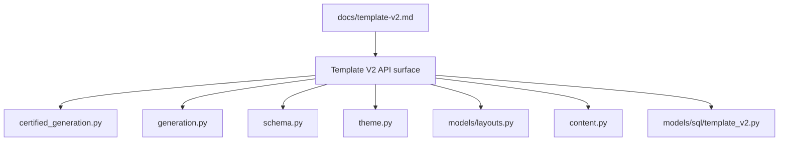
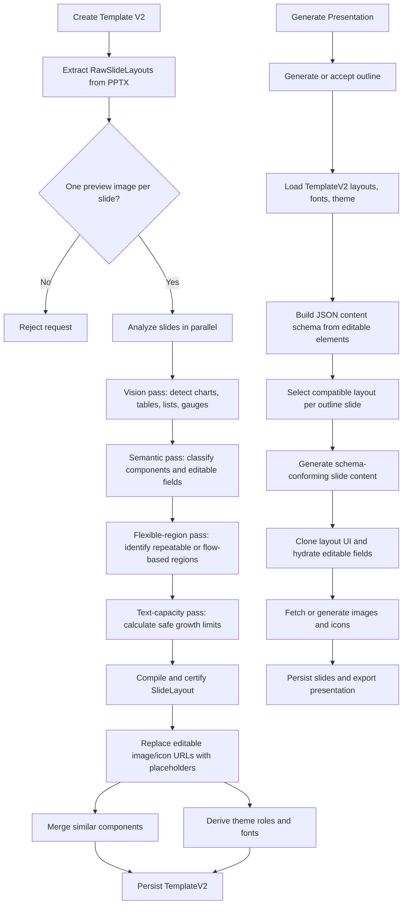
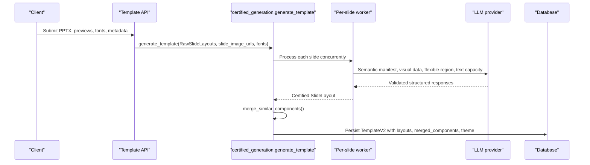
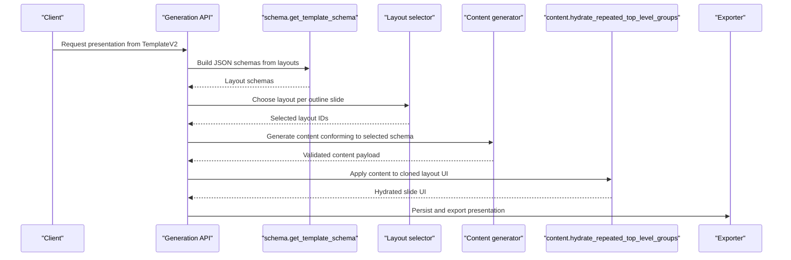
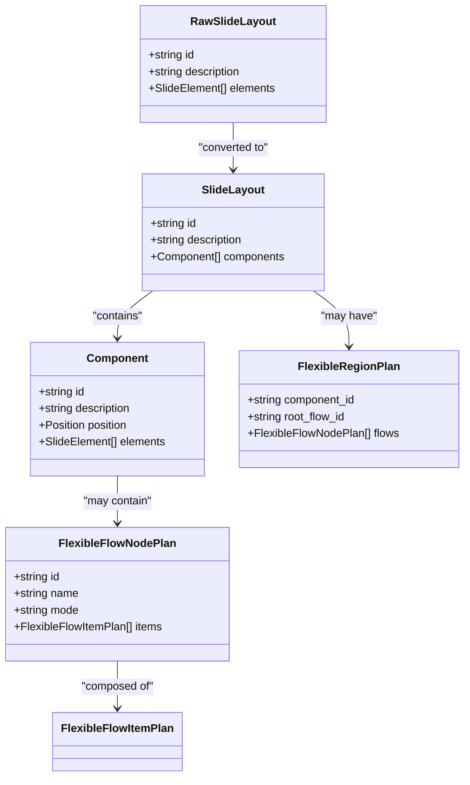
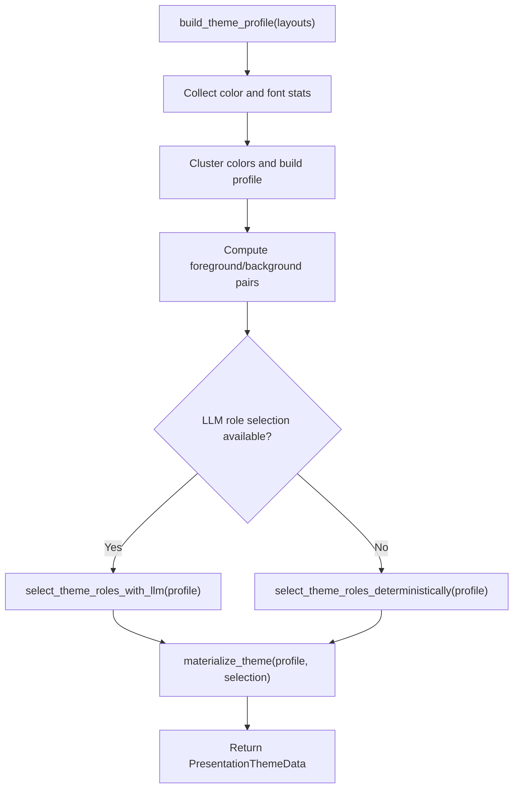
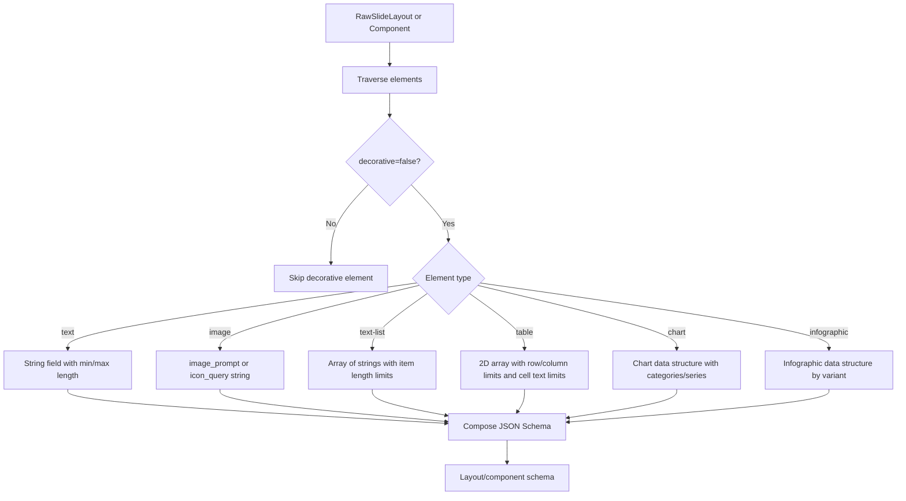
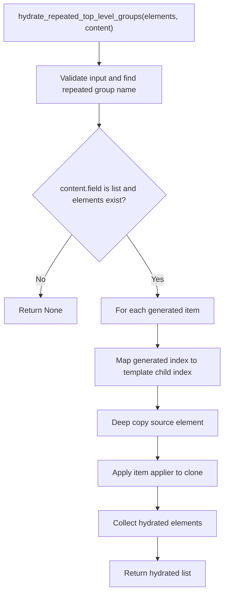
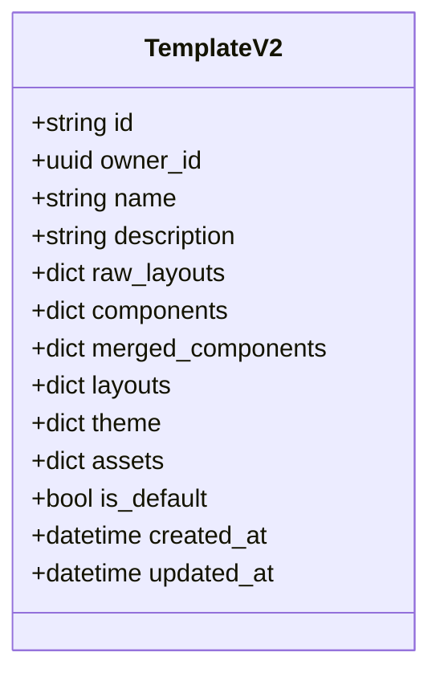
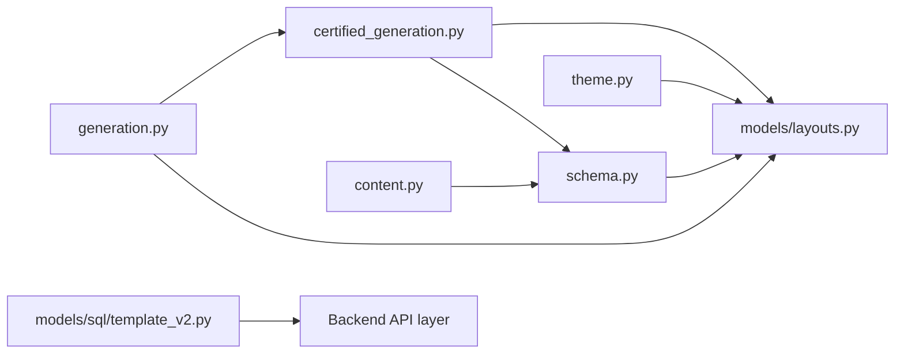

# Template Management API

<cite>
**Referenced Files in This Document**   
- [template-v2.md](file://docs/template-v2.md)
- [certified_generation.py](file://servers/fastapi/templates/v2/certified_generation.py)
- [generation.py](file://servers/fastapi/templates/v2/generation.py)
- [schema.py](file://servers/fastapi/templates/v2/schema.py)
- [theme.py](file://servers/fastapi/templates/v2/theme.py)
- [layouts.py](file://servers/fastapi/templates/v2/models/layouts.py)
- [content.py](file://servers/fastapi/templates/v2/content.py)
- [template_v2.py](file://servers/fastapi/models/sql/template_v2.py)
</cite>

## Table of Contents
1. [Introduction](#introduction)
2. [Project Structure](#project-structure)
3. [Core Components](#core-components)
4. [Architecture Overview](#architecture-overview)
5. [Detailed Component Analysis](#detailed-component-analysis)
6. [Dependency Analysis](#dependency-analysis)
7. [Performance Considerations](#performance-considerations)
8. [Troubleshooting Guide](#troubleshooting-guide)
9. [Conclusion](#conclusion)
10. [Appendices](#appendices)

## Introduction
This document explains the Template Management API with a focus on Template V2. Template V2 converts an existing PowerPoint deck into reusable, editable slide layouts while preserving the source design. It then uses those certified layouts to generate new presentations by selecting compatible layouts, producing schema-conforming content, hydrating layout UI, and exporting the final deck.

The system supports:
- Component-based template architecture
- Layout definitions with semantic components and flexible regions
- Theme systems derived from colors, fonts, and visual roles
- Template creation and presentation generation workflows
- JSON Schema enforcement for generated content
- Versioned persistence through the TemplateV2 model
- Community marketplace readiness via theme and template metadata

## Project Structure
Template V2 is implemented primarily under the FastAPI backend:
- Documentation and end-to-end flow are described in `docs/template-v2.md`.
- Certified multi-pass template analysis lives in `templates/v2/certified_generation.py`.
- Public generation helpers and prompted layout creation live in `templates/v2/generation.py`.
- Editable content JSON Schema derivation lives in `templates/v2/schema.py`.
- Theme profiling and role selection live in `templates/v2/theme.py`.
- Core data models for layouts, components, flows, and replacements live in `templates/v2/models/layouts.py`.
- Content hydration helpers live in `templates/v2/content.py`.
- Database persistence model lives in `models/sql/template_v2.py`.

**Diagram sources**
- [template-v2.md:1-177](file://docs/template-v2.md#L1-L177)
- [certified_generation.py:491-547](file://servers/fastapi/templates/v2/certified_generation.py#L491-L547)
- [generation.py:151-210](file://servers/fastapi/templates/v2/generation.py#L151-L210)
- [schema.py:183-279](file://servers/fastapi/templates/v2/schema.py#L183-L279)
- [theme.py:145-258](file://servers/fastapi/templates/v2/theme.py#L145-L258)
- [layouts.py:44-119](file://servers/fastapi/templates/v2/models/layouts.py#L44-L119)
- [content.py:27-87](file://servers/fastapi/templates/v2/content.py#L27-L87)
- [template_v2.py:16-61](file://servers/fastapi/models/sql/template_v2.py#L16-L61)

**Section sources**
- [template-v2.md:1-177](file://docs/template-v2.md#L1-L177)

## Core Components
- TemplateV2 database model stores raw layouts, certified layouts, merged components, theme, assets, ownership, timestamps, and default flags.
- Certified generation performs multi-pass vision and semantic analysis to produce SlideLayout objects.
- Generation exposes public entry points for creating layouts from PPTX previews and for generating prompted layouts from text prompts.
- Schema derives JSON Schema definitions for editable content per component and per layout.
- Theme profiles colors and fonts, selects semantic roles, and materializes a PresentationThemeData object.
- Content helpers apply generated content to repeated groups and clean markdown artifacts.
- Layout models define strict Pydantic contracts for raw layouts, components, semantic annotations, visual replacements, flexible flows, and text capacity plans.

Key responsibilities:
- Validation: All LLM outputs are validated against Pydantic models and JSON Schema where applicable.
- Determinism: Fallbacks preserve geometry when AI passes fail.
- Reusability: Similar components are clustered and deduplicated.
- Safety: Decorative elements remain fixed; only editable fields are hydrated.

**Section sources**
- [template_v2.py:16-61](file://servers/fastapi/models/sql/template_v2.py#L16-L61)
- [certified_generation.py:491-547](file://servers/fastapi/templates/v2/certified_generation.py#L491-L547)
- [generation.py:151-210](file://servers/fastapi/templates/v2/generation.py#L151-L210)
- [schema.py:183-279](file://servers/fastapi/templates/v2/schema.py#L183-L279)
- [theme.py:145-258](file://servers/fastapi/templates/v2/theme.py#L145-L258)
- [content.py:27-87](file://servers/fastapi/templates/v2/content.py#L27-L87)
- [layouts.py:44-119](file://servers/fastapi/templates/v2/models/layouts.py#L44-L119)

## Architecture Overview
Template V2 has two main workflows: template creation and presentation generation.

**Diagram sources**
- [template-v2.md:14-49](file://docs/template-v2.md#L14-L49)
- [certified_generation.py:491-547](file://servers/fastapi/templates/v2/certified_generation.py#L491-L547)
- [schema.py:183-279](file://servers/fastapi/templates/v2/schema.py#L183-L279)
- [theme.py:145-258](file://servers/fastapi/templates/v2/theme.py#L145-L258)

## Detailed Component Analysis

### Template Creation Pipeline
Template creation converts a source deck into certified layouts using focused, schema-validated passes. Each slide is processed concurrently, up to ten at a time. The pipeline includes:
- Visual-data detection for charts, tables, lists, and gauges.
- Semantic analysis grouping elements into reusable components and marking editable versus decorative content.
- Flexible-region analysis identifying repeatable or flow-based structures.
- Text-capacity analysis calculating safe growth constraints.
- Compilation and certification combining source elements with model decisions.
- Placeholder replacement for editable images and icons.
- Merging structurally interchangeable components.
- Deriving theme colors, fonts, and semantic roles.

**Diagram sources**
- [template-v2.md:51-108](file://docs/template-v2.md#L51-L108)
- [certified_generation.py:491-547](file://servers/fastapi/templates/v2/certified_generation.py#L491-L547)
- [certified_generation.py:550-597](file://servers/fastapi/templates/v2/certified_generation.py#L550-L597)
- [template_v2.py:16-61](file://servers/fastapi/models/sql/template_v2.py#L16-L61)

**Section sources**
- [template-v2.md:51-108](file://docs/template-v2.md#L51-L108)
- [certified_generation.py:491-547](file://servers/fastapi/templates/v2/certified_generation.py#L491-L547)
- [certified_generation.py:550-597](file://servers/fastapi/templates/v2/certified_generation.py#L550-L597)

### Presentation Generation Pipeline
Presentation generation consumes already-certified Template V2 layouts:
- Generate or accept slide outlines.
- Load TemplateV2 layouts, fonts, and theme.
- Convert every layout into a JSON content schema based on editable elements.
- Select a compatible layout for each outline slide.
- Generate schema-conforming content including text, lists, tables, charts, image prompts, and icon queries.
- Deep-copy layout UI and hydrate editable elements.
- Expand or contract repeated groups within certified limits.
- Fetch or generate images and icons.
- Persist slides and export the presentation.

**Diagram sources**
- [template-v2.md:109-126](file://docs/template-v2.md#L109-L126)
- [schema.py:257-279](file://servers/fastapi/templates/v2/schema.py#L257-L279)
- [content.py:57-87](file://servers/fastapi/templates/v2/content.py#L57-L87)

**Section sources**
- [template-v2.md:109-126](file://docs/template-v2.md#L109-L126)
- [schema.py:257-279](file://servers/fastapi/templates/v2/schema.py#L257-L279)
- [content.py:57-87](file://servers/fastapi/templates/v2/content.py#L57-L87)

### Component-Based Design and Layout Definitions
Template V2 represents slides as collections of reusable components. Each component contains:
- A stable identifier and description.
- Canvas-relative position.
- One or more slide elements forming a coherent visual region.

Components can be grouped into flexible flows such as rows, columns, grids, or irregular groups. The flexible pass defines nested flow trees that preserve alignment and spacing while allowing repeated items to expand or contract.

**Diagram sources**
- [layouts.py:44-119](file://servers/fastapi/templates/v2/models/layouts.py#L44-L119)
- [layouts.py:601-693](file://servers/fastapi/templates/v2/models/layouts.py#L601-L693)

**Section sources**
- [layouts.py:44-119](file://servers/fastapi/templates/v2/models/layouts.py#L44-L119)
- [layouts.py:601-693](file://servers/fastapi/templates/v2/models/layouts.py#L601-L693)

### Theme System
The theme system profiles colors and fonts across all layouts, clusters similar colors, computes contrast-aware pairs, and selects semantic roles. It can use an LLM-assisted role selection with deterministic fallback.

Key steps:
- Collect fill, stroke, text, chart, and infographic color statistics.
- Cluster near colors and build a compact profile.
- Compute foreground/background pairs and contrast ratios.
- Select primary, background, card, stroke, text colors, graph palette, and dominant font.
- Materialize a PresentationThemeData object suitable for presentation themes.

**Diagram sources**
- [theme.py:145-258](file://servers/fastapi/templates/v2/theme.py#L145-L258)
- [theme.py:305-402](file://servers/fastapi/templates/v2/theme.py#L305-L402)

**Section sources**
- [theme.py:145-258](file://servers/fastapi/templates/v2/theme.py#L145-L258)
- [theme.py:305-402](file://servers/fastapi/templates/v2/theme.py#L305-L402)

### Schema Enforcement and Validation Rules
Editable content is represented as JSON Schema derived from template layouts and components. Only elements marked as non-decorative become generated content fields. Supported content types include text, image, text-list, table, chart, and infographic.

Validation rules include:
- Required properties per component and per layout.
- Array length constraints for lists, tables, and repeated children.
- Cell-level text limits computed from typography and cell dimensions.
- Chart series values matching category counts.
- Infographic item visibility requirements.
- Unique paths and disjoint consumed paths for visual replacements.
- Flow tree integrity for flexible regions.

**Diagram sources**
- [schema.py:15-51](file://servers/fastapi/templates/v2/schema.py#L15-L51)
- [schema.py:310-423](file://servers/fastapi/templates/v2/schema.py#L310-L423)
- [layouts.py:488-527](file://servers/fastapi/templates/v2/models/layouts.py#L488-L527)

**Section sources**
- [schema.py:15-51](file://servers/fastapi/templates/v2/schema.py#L15-L51)
- [schema.py:310-423](file://servers/fastapi/templates/v2/schema.py#L310-L423)
- [layouts.py:488-527](file://servers/fastapi/templates/v2/models/layouts.py#L488-L527)

### Dynamic Content Insertion and Rendering Pipeline
Dynamic content insertion applies generated payloads to cloned layout UI:
- Markdown artifacts are stripped from infographic labels.
- Repeated top-level groups map generated array items to complete positioned groups.
- Source indices are selected to center content when reducing item count.
- Generated content is deep-copied and applied through a caller-provided item applier.

**Diagram sources**
- [content.py:27-87](file://servers/fastapi/templates/v2/content.py#L27-L87)

**Section sources**
- [content.py:27-87](file://servers/fastapi/templates/v2/content.py#L27-L87)

### Template Inheritance, Customization, and Extension Points
Template V2 emphasizes reuse rather than inheritance:
- Components are grouped and de-duplicated into merged variants.
- Layouts reference components by stable identifiers.
- Flexible flows allow repeated items to adapt without changing shared scaffolding.
- Prompts can generate new layouts that reuse existing templates’ visual language and components.

Extension points include:
- Adding new content element types in schema derivation.
- Extending infographic variants in the catalog used by schema and generation.
- Providing custom font mappings during template creation.
- Supplying additional validation logic through extra validators in structured generation calls.

**Section sources**
- [generation.py:631-693](file://servers/fastapi/templates/v2/generation.py#L631-L693)
- [certified_generation.py:550-597](file://servers/fastapi/templates/v2/certified_generation.py#L550-L597)
- [schema.py:257-279](file://servers/fastapi/templates/v2/schema.py#L257-L279)

### Template CRUD Operations, Versioning, and Marketplace Integration
Persistence model:
- TemplateV2 stores owner, name, description, raw layouts, components, merged components, layouts, theme, assets, default flag, and timestamps.
- IDs are UUID strings; owner isolation is supported through foreign key linkage.

Versioning strategy:
- Templates are persisted as records with created_at and updated_at timestamps.
- New versions can be represented by separate TemplateV2 records or by updating existing records depending on application policy.
- The presence of raw_layouts, layouts, merged_components, and theme enables reproducible regeneration and auditability.

Community marketplace integration:
- Themes can be materialized with template metadata, enabling theme listings tied to template origins.
- Template names, descriptions, and theme data provide useful metadata for discovery and attribution.

**Diagram sources**
- [template_v2.py:16-61](file://servers/fastapi/models/sql/template_v2.py#L16-L61)
- [theme.py:405-420](file://servers/fastapi/templates/v2/theme.py#L405-L420)

**Section sources**
- [template_v2.py:16-61](file://servers/fastapi/models/sql/template_v2.py#L16-L61)
- [theme.py:405-420](file://servers/fastapi/templates/v2/theme.py#L405-L420)

## Dependency Analysis
The following diagram shows how core modules depend on each other:

**Diagram sources**
- [certified_generation.py:26-53](file://servers/fastapi/templates/v2/certified_generation.py#L26-L53)
- [generation.py:26-44](file://servers/fastapi/templates/v2/generation.py#L26-L44)
- [schema.py:10-12](file://servers/fastapi/templates/v2/schema.py#L10-L12)
- [theme.py:15-23](file://servers/fastapi/templates/v2/theme.py#L15-L23)
- [content.py:10-10](file://servers/fastapi/templates/v2/content.py#L10-L10)
- [template_v2.py:1-9](file://servers/fastapi/models/sql/template_v2.py#L1-L9)

**Section sources**
- [certified_generation.py:26-53](file://servers/fastapi/templates/v2/certified_generation.py#L26-L53)
- [generation.py:26-44](file://servers/fastapi/templates/v2/generation.py#L26-L44)
- [schema.py:10-12](file://servers/fastapi/templates/v2/schema.py#L10-L12)
- [theme.py:15-23](file://servers/fastapi/templates/v2/theme.py#L15-L23)
- [content.py:10-10](file://servers/fastapi/templates/v2/content.py#L10-L10)
- [template_v2.py:1-9](file://servers/fastapi/models/sql/template_v2.py#L1-L9)

## Performance Considerations
- Template creation processes up to ten slides concurrently.
- Structured LLM responses are retried and validated before use.
- Output token budgets are significant: template creation recommends up to 16,000 completion tokens.
- Theme role selection falls back deterministically if LLM selection fails.
- Font mappings should be supplied for non-standard fonts to avoid rendering issues.
- Image and icon asset handling occurs after layout hydration.

[No sources needed since this section provides general guidance]

## Troubleshooting Guide
Common issues and resolutions:
- Missing preview images: Template creation requires exactly one rendered preview image per raw slide. If fewer previews are supplied, raw slides are capped; if more previews are supplied, the request is rejected.
- Invalid structured responses: The pipeline retries and validates LLM outputs against Pydantic models. Review logs for validation failures and adjust model capabilities or prompts.
- Duplicate IDs: Duplicate slide layout IDs are repaired automatically; duplicate merged component IDs are normalized.
- Theme contrast problems: The theme system repairs low-contrast text colors and generates graph color palettes.
- Unsupported content types: Schema derivation raises errors for unsupported element types; ensure elements are classified correctly.

Operational checks:
- Verify vision-capable model configuration for template creation.
- Confirm JSON Schema output compatibility with downstream generators.
- Validate that decorative elements remain unchanged during hydration.

**Section sources**
- [template-v2.md:57-66](file://docs/template-v2.md#L57-L66)
- [template-v2.md:154-164](file://docs/template-v2.md#L154-L164)
- [certified_generation.py:462-488](file://servers/fastapi/templates/v2/certified_generation.py#L462-L488)
- [schema.py:461-465](file://servers/fastapi/templates/v2/schema.py#L461-L465)

## Conclusion
Template V2 provides a robust, component-based architecture for converting PowerPoint decks into reusable, editable layouts and generating new presentations from them. Its multi-pass vision and semantic analysis, strict JSON Schema enforcement, theme derivation, and flexible flow modeling enable reliable, scalable template management. The system balances AI-driven creativity with deterministic safety, making it suitable for both internal template pipelines and community marketplace distribution.

[No sources needed since this section summarizes without analyzing specific files]

## Appendices

### Example Workflows

#### Creating a Template V2 Template
- Prepare a PPTX file and render one preview image per slide.
- Optionally supply font mappings for non-standard fonts.
- Call the template creation endpoint with PPTX URL, preview URLs, fonts, and metadata.
- The backend extracts raw layouts, runs certified multi-pass analysis, merges similar components, derives theme, and persists TemplateV2.

**Section sources**
- [template-v2.md:51-108](file://docs/template-v2.md#L51-L108)
- [certified_generation.py:491-547](file://servers/fastapi/templates/v2/certified_generation.py#L491-L547)
- [theme.py:145-258](file://servers/fastapi/templates/v2/theme.py#L145-L258)
- [template_v2.py:16-61](file://servers/fastapi/models/sql/template_v2.py#L16-L61)

#### Defining a Component
- Define a component with a stable id, description, position, and elements.
- Ensure elements include at least one editable field (decorative=false).
- Use consistent naming for repeated fields across equivalent items.
- Include realistic preview content and valid schema limits.

**Section sources**
- [layouts.py:54-58](file://servers/fastapi/templates/v2/models/layouts.py#L54-L58)
- [schema.py:310-423](file://servers/fastapi/templates/v2/schema.py#L310-L423)

#### Generating a Template-Based Presentation
- Provide topic, files, instructions, and desired slide count.
- Backend loads TemplateV2, builds JSON schemas, selects layouts, generates content, hydrates UI, fetches assets, and exports.

**Section sources**
- [template-v2.md:109-126](file://docs/template-v2.md#L109-L126)
- [schema.py:257-279](file://servers/fastapi/templates/v2/schema.py#L257-L279)
- [content.py:57-87](file://servers/fastapi/templates/v2/content.py#L57-L87)