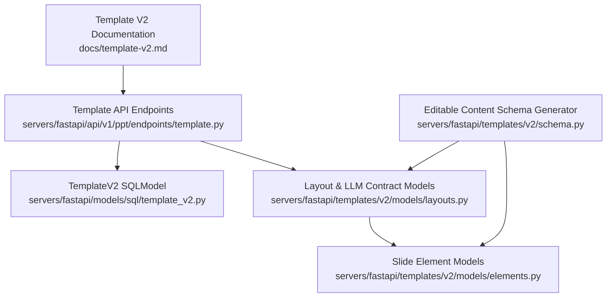
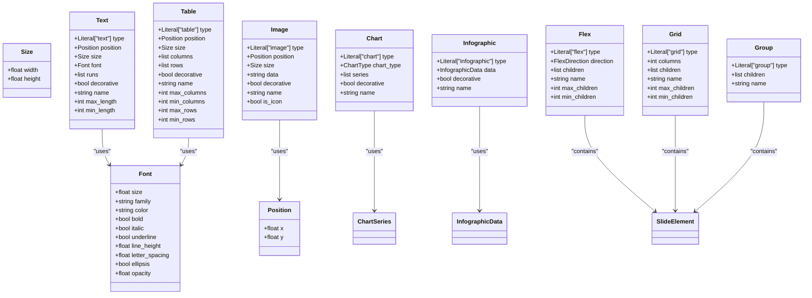
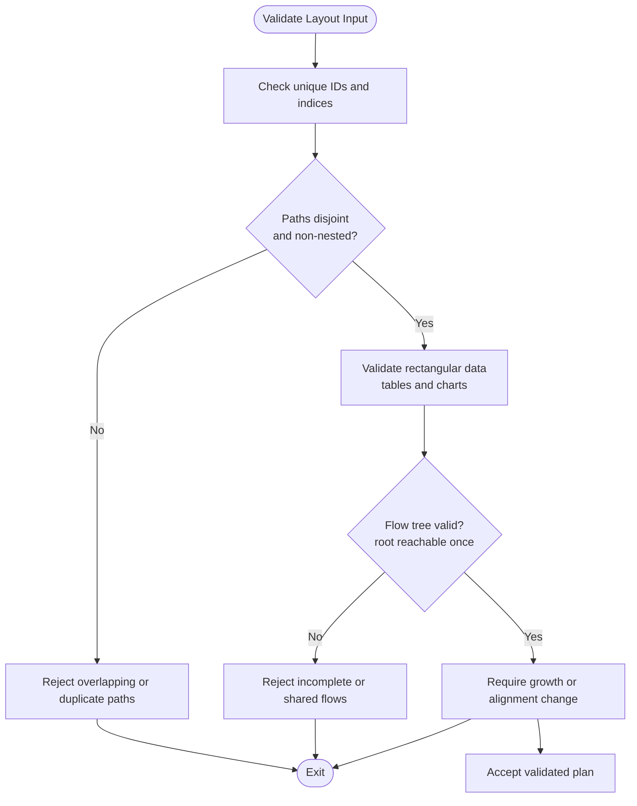
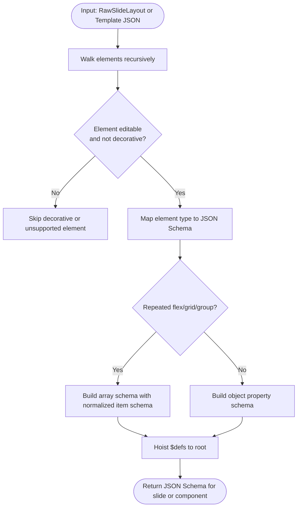
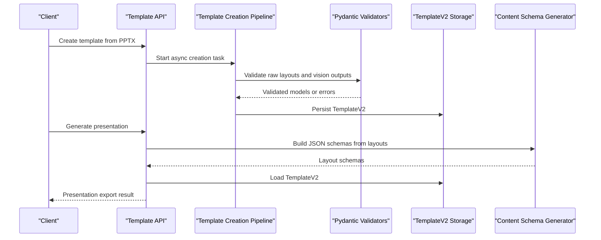
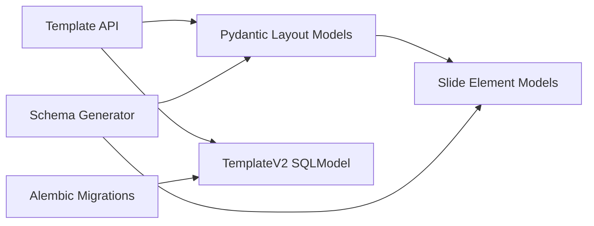

# Template Schema & Validation

<cite>
**Referenced Files in This Document**   
- [template_v2.py](file://servers/fastapi/models/sql/template_v2.py)
- [elements.py](file://servers/fastapi/templates/v2/models/elements.py)
- [layouts.py](file://servers/fastapi/templates/v2/models/layouts.py)
- [schema.py](file://servers/fastapi/templates/v2/schema.py)
- [template-v2.md](file://docs/template-v2.md)
- [template.py](file://servers/fastapi/api/v1/ppt/endpoints/template.py)
- [6e4a1b2c3d5f_add_template_v2_and_presentation_version.py](file://servers/fastapi/alembic/versions/6e4a1b2c3d5f_add_template_v2_and_presentation_version.py)
- [3f2a1b4c5d6e_template_v2_ids_to_strings.py](file://servers/fastapi/alembic/versions/3f2a1b4c5d6e_template_v2_ids_to_strings.py)
- [4b7c9d0e1f2a_add_is_default_to_template_v2.py](file://servers/fastapi/alembic/versions/4b7c9d0e1f2a_add_is_default_to_template_v2.py)
- [test_migrations.py](file://servers/fastapi/tests/unit/test_migrations.py)
</cite>

## Table of Contents
1. [Introduction](#introduction)
2. [Project Structure](#project-structure)
3. [Core Components](#core-components)
4. [Architecture Overview](#architecture-overview)
5. [Detailed Component Analysis](#detailed-component-analysis)
6. [Dependency Analysis](#dependency-analysis)
7. [Performance Considerations](#performance-considerations)
8. [Troubleshooting Guide](#troubleshooting-guide)
9. [Conclusion](#conclusion)
10. [Appendices](#appendices)

## Introduction
This document explains the template schema and validation system used by Template V2. It covers:
- The `TemplateV2` database model structure, required fields, and data types.
- Pydantic models for slide elements, layouts, semantic annotations, visual replacements, flexible flows, and text capacity plans.
- Custom validators, business constraints, and error handling.
- Data transformation from certified slide layouts into editable JSON content schemas.
- Template lifecycle states, versioning strategy, backward compatibility, and migration patterns.
- Practical examples of valid template structures, validation failure scenarios, and schema evolution guidance.

The system separates two workflows:
- **Template creation**: Converts a source PowerPoint deck into certified, reusable slide layouts with validated metadata.
- **Presentation generation**: Uses those layouts to generate schema-conforming content, hydrate the layout UI, and export the final presentation.

**Section sources**
- [template-v2.md:1-177](file://docs/template-v2.md#L1-L177)

## Project Structure
Template V2 lives primarily under the FastAPI server:
- Database model: `servers/fastapi/models/sql/template_v2.py`
- Slide element and layout models: `servers/fastapi/templates/v2/models/elements.py`, `servers/fastapi/templates/v2/models/layouts.py`
- Editable content schema generator: `servers/fastapi/templates/v2/schema.py`
- API endpoints that validate and update templates: `servers/fastapi/api/v1/ppt/endpoints/template.py`
- Documentation and migrations: `docs/template-v2.md`, `servers/fastapi/alembic/versions/*`

**Diagram sources**
- [template_v2.py:16-61](file://servers/fastapi/models/sql/template_v2.py#L16-L61)
- [elements.py:104-639](file://servers/fastapi/templates/v2/models/elements.py#L104-L639)
- [layouts.py:44-119](file://servers/fastapi/templates/v2/models/layouts.py#L44-L119)
- [schema.py:183-279](file://servers/fastapi/templates/v2/schema.py#L183-L279)
- [template.py:1995-2030](file://servers/fastapi/api/v1/ppt/endpoints/template.py#L1995-L2030)
- [template-v2.md:1-177](file://docs/template-v2.md#L1-L177)

**Section sources**
- [template_v2.py:16-61](file://servers/fastapi/models/sql/template_v2.py#L16-L61)
- [elements.py:104-639](file://servers/fastapi/templates/v2/models/elements.py#L104-L639)
- [layouts.py:44-119](file://servers/fastapi/templates/v2/models/layouts.py#L44-L119)
- [schema.py:183-279](file://servers/fastapi/templates/v2/schema.py#L183-L279)
- [template.py:1995-2030](file://servers/fastapi/api/v1/ppt/endpoints/template.py#L1995-L2030)
- [template-v2.md:1-177](file://docs/template-v2.md#L1-L177)

## Core Components
### TemplateV2 Database Model
`TemplateV2` is a SQLModel table representing a persisted Template V2 record.

| Field | Type | Nullable | Default / Behavior | Purpose |
|---|---|---:|---|---|
| `id` | `str` | No | Auto-generated UUID string | Primary key |
| `owner_id` | `uuid.UUID` | Yes | Current owner context | Ownership and isolation |
| `name` | `str` | No | Required | Human-readable template name |
| `description` | `str` | Yes | Optional | Template description |
| `raw_layouts` | `dict` | Yes | JSON column | Faithful raw element extraction from source PPTX |
| `components` | `dict` | Yes | JSON column | Semantic component definitions |
| `merged_components` | `dict` | Yes | JSON column | De-duplicated interchangeable components |
| `layouts` | `dict` | Yes | JSON column | Certified reusable slide layouts |
| `theme` | `dict` | Yes | JSON column | Semantic colors and typography |
| `assets` | `dict` | Yes | JSON column | Source assets, fonts, icons, image references |
| `is_default` | `bool` | No | `False` | Marks default templates |
| `created_at` | `datetime` | No | UTC timestamp | Creation time |
| `updated_at` | `datetime` | No | UTC timestamp on update | Last modification time |

Required business constraints:
- A template must have a non-empty `name`.
- The primary key is a string UUID.
- Many structural fields are optional at the database level but must be present and valid when used by template creation or generation.

**Section sources**
- [template_v2.py:12-61](file://servers/fastapi/models/sql/template_v2.py#L12-L61)

### Slide Element Models
Slide elements define the visual building blocks of a slide layout. They use Pydantic models with discriminators, enums, and custom validators.

Key element categories:
- Textual content: `Text`, `TextList`, `TextRun`, `LatexTextRun`
- Containers and layout groups: `Container`, `Flex`, `Grid`, `Group`
- Visual media: `Image`, `Vector`
- Structured data: `Table`, `Chart`, `Infographic`
- Shared geometry and styling: `Position`, `Size`, `Padding`, `Alignment`, `Font`, `Fill`, `Stroke`, `Shadow`, `BorderRadius`

Important validation rules:
- `TextRun` rejects non-text run types.
- `Chart` enforces pie/donut single-series behavior, coerces legacy boolean `data_labels`, and requires a minimum visible size.
- Infographic data uses a discriminator union and normalizes structural infographic payloads through an external catalog.
- `SlideElement` is a discriminated union over all supported element types.

**Diagram sources**
- [elements.py:104-137](file://servers/fastapi/templates/v2/models/elements.py#L104-L137)
- [elements.py:181-223](file://servers/fastapi/templates/v2/models/elements.py#L181-L223)
- [elements.py:240-263](file://servers/fastapi/templates/v2/models/elements.py#L240-L263)
- [elements.py:302-319](file://servers/fastapi/templates/v2/models/elements.py#L302-L319)
- [elements.py:361-425](file://servers/fastapi/templates/v2/models/elements.py#L361-L425)
- [elements.py:549-565](file://servers/fastapi/templates/v2/models/elements.py#L549-L565)
- [elements.py:567-639](file://servers/fastapi/templates/v2/models/elements.py#L567-L639)

**Section sources**
- [elements.py:104-639](file://servers/fastapi/templates/v2/models/elements.py#L104-L639)

### Layout and LLM Contract Models
Layout models describe raw slide layouts, semantic manifests, visual replacement plans, flexible flow trees, and text capacity plans. These models are strict contracts for both runtime processing and LLM-generated output.

Key models:
- `RawSlideLayout`, `RawSlideLayouts`: Raw extracted slide data.
- `Component`, `SimilarComponents`, `MergedComponent`, `MergedComponents`: Reusable component grouping.
- `SlideLayout`, `SlideLayouts`: Certified slide layouts with unique IDs.
- `SemanticElementAnnotation`, `SemanticSlideManifest`, `SemanticComponentManifest`: LLM-authored intent referencing source elements.
- `VisualDataReplacementPlan`, `VisualChartReplacement`, `VisualTableReplacement`, `VisualInfographicReplacement`, `VisualTextListReplacement`: Vision-pass decisions.
- `FlexibleFlowItemPlan`, `FlexibleFlowNodePlan`, `FlexibleRegionPlan`, `FlexibleSlidePlan`: Repeatable and nested flow regions.
- `TextCapacityAdjustment`, `TextCapacityPlan`: Growth and alignment adjustments for editable text.

Validation highlights:
- Unique IDs and indices across components, layouts, and flows.
- Disjoint and non-nested visual replacement paths.
- Rectangular table and chart data.
- Non-empty repeated items and mandatory root flow references.
- Text capacity adjustments must request growth or alignment changes.

**Diagram sources**
- [layouts.py:61-119](file://servers/fastapi/templates/v2/models/layouts.py#L61-L119)
- [layouts.py:497-527](file://servers/fastapi/templates/v2/models/layouts.py#L497-L527)
- [layouts.py:530-598](file://servers/fastapi/templates/v2/models/layouts.py#L530-L598)
- [layouts.py:601-713](file://servers/fastapi/templates/v2/models/layouts.py#L601-L713)
- [layouts.py:716-793](file://servers/fastapi/templates/v2/models/layouts.py#L716-L793)

**Section sources**
- [layouts.py:44-119](file://servers/fastapi/templates/v2/models/layouts.py#L44-L119)
- [layouts.py:497-527](file://servers/fastapi/templates/v2/models/layouts.py#L497-L527)
- [layouts.py:530-598](file://servers/fastapi/templates/v2/models/layouts.py#L530-L598)
- [layouts.py:601-713](file://servers/fastapi/templates/v2/models/layouts.py#L601-L713)
- [layouts.py:716-793](file://servers/fastapi/templates/v2/models/layouts.py#L716-L793)

### Editable Content Schema Generator
The schema generator converts certified slide layouts into JSON content schemas suitable for LLM-driven content generation.

Core responsibilities:
- Traverse slide elements and ignore decorative elements.
- Map element types to JSON Schema properties:
  - `text` → string with length limits.
  - `image` → object with `image_prompt` or `icon_query`.
  - `text-list` → array of strings with item count and length limits.
  - `table` → nested arrays with header/body limits derived from cell geometry.
  - `chart` → structured chart data with categories and series.
  - `infographic` → typed data schema based on infographic variant.
- Normalize repeated child groups into arrays.
- Hoist nested `$defs` to the schema root.
- Strip internal metadata such as element paths from generated template schemas.

**Diagram sources**
- [schema.py:53-55](file://servers/fastapi/templates/v2/schema.py#L53-L55)
- [schema.py:183-189](file://servers/fastapi/templates/v2/schema.py#L183-L189)
- [schema.py:361-423](file://servers/fastapi/templates/v2/schema.py#L361-L423)
- [schema.py:426-452](file://servers/fastapi/templates/v2/schema.py#L426-L452)
- [schema.py:585-639](file://servers/fastapi/templates/v2/schema.py#L585-L639)
- [schema.py:218-248](file://servers/fastapi/templates/v2/schema.py#L218-L248)

**Section sources**
- [schema.py:15-51](file://servers/fastapi/templates/v2/schema.py#L15-L51)
- [schema.py:183-279](file://servers/fastapi/templates/v2/schema.py#L183-L279)
- [schema.py:361-423](file://servers/fastapi/templates/v2/schema.py#L361-L423)
- [schema.py:426-452](file://servers/fastapi/templates/v2/schema.py#L426-L452)
- [schema.py:585-639](file://servers/fastapi/templates/v2/schema.py#L585-L639)
- [schema.py:801-978](file://servers/fastapi/templates/v2/schema.py#L801-L978)
- [schema.py:1200-1549](file://servers/fastapi/templates/v2/schema.py#L1200-L1549)

## Architecture Overview
Template V2 follows a two-phase architecture:

1. **Creation phase**:
   - Extract raw slide layouts from a PPTX.
   - Run vision passes to detect charts, tables, lists, gauges, and semantic components.
   - Compile and certify layouts with deterministic validation and fallbacks.
   - Merge interchangeable components and derive theme metadata.
   - Persist `TemplateV2`.

2. **Generation phase**:
   - Load `TemplateV2` layouts, fonts, and theme.
   - Convert layouts into JSON content schemas.
   - Select compatible layouts for each outline slide.
   - Generate schema-conforming content.
   - Hydrate layout UI, fetch/generate assets, persist slides, and export.

**Diagram sources**
- [template-v2.md:14-49](file://docs/template-v2.md#L14-L49)
- [template_v2.py:16-61](file://servers/fastapi/models/sql/template_v2.py#L16-L61)
- [schema.py:183-279](file://servers/fastapi/templates/v2/schema.py#L183-L279)
- [template.py:1995-2030](file://servers/fastapi/api/v1/ppt/endpoints/template.py#L1995-L2030)

**Section sources**
- [template-v2.md:14-177](file://docs/template-v2.md#L14-L177)

## Detailed Component Analysis

### TemplateV2 Lifecycle States
Template V2 does not use an explicit state enum in its model; lifecycle is expressed through field presence and API usage:

| Phase | Expected State | Constraints |
|---|---|---|
| Draft creation | `name` provided; `layouts` may be empty or partial | Name required; other fields optional until certification completes |
| Certified | `layouts` contains validated slide layouts | Layout IDs unique; components valid; theme and assets populated |
| Default template | `is_default = True` | Only one default template should be selected per scope |
| Updated | `updated_at` refreshed | Updates validated before persistence |
| Deleted | Record removed or ownership revoked | Foreign key cascade applies to related records |

Business constraints enforced during updates:
- Template name must be provided.
- Description is trimmed and can be null.
- `merged_components` and `layouts` are validated through Pydantic models before being stored.

**Section sources**
- [template_v2.py:16-61](file://servers/fastapi/models/sql/template_v2.py#L16-L61)
- [template.py:1995-2030](file://servers/fastapi/api/v1/ppt/endpoints/template.py#L1995-L2030)

### Pydantic Validation Rules and Custom Validators
Custom validators enforce domain-specific correctness beyond basic type checking.

Examples:
- `_validate_min_max`: Ensures symmetric min/max relationships where required.
- `TextRun._reject_non_text_run_types`: Rejects invalid run types.
- `Chart._pie_and_donut_use_only_first_series`: Normalizes pie/donut charts to a single series.
- `Chart._coerce_legacy_data_labels`: Handles legacy boolean values for data labels.
- `Chart._size_must_be_visible_when_explicit`: Enforces minimum chart dimensions.
- `VisualDataReplacementPlan._paths_must_be_unique_and_disjoint`: Prevents overlapping or duplicate visual replacement regions.
- `FlexibleFlowItemPlan._must_reference_one_item_kind`: Requires exactly one of `indices` or `flow_id`.
- `TextCapacityAdjustment._must_change_capacity_or_alignment`: Prevents no-op adjustments.

Error handling pattern:
- Validators raise `ValueError` with descriptive messages.
- API endpoints catch validation errors and return HTTP 400 responses with user-facing details.

**Section sources**
- [elements.py:13-28](file://servers/fastapi/templates/v2/models/elements.py#L13-L28)
- [elements.py:185-190](file://servers/fastapi/templates/v2/models/elements.py#L185-L190)
- [elements.py:395-425](file://servers/fastapi/templates/v2/models/elements.py#L395-L425)
- [layouts.py:66-72](file://servers/fastapi/templates/v2/models/layouts.py#L66-L72)
- [layouts.py:497-527](file://servers/fastapi/templates/v2/models/layouts.py#L497-L527)
- [layouts.py:621-632](file://servers/fastapi/templates/v2/models/layouts.py#L621-L632)
- [layouts.py:755-773](file://servers/fastapi/templates/v2/models/layouts.py#L755-L773)
- [template.py:2005-2022](file://servers/fastapi/api/v1/ppt/endpoints/template.py#L2005-L2022)

### Data Transformation Processes
The main transformation pipeline converts certified layouts into editable JSON schemas:

1. Extract slide schema from `RawSlideLayout`.
2. For component-based templates, build per-layout schemas.
3. Ignore decorative elements.
4. Map content types to JSON Schema definitions.
5. Normalize repeated children into arrays.
6. Hoist nested definitions to the schema root.
7. Strip internal metadata from generated template schemas.

Complexity considerations:
- Element traversal is linear in the number of elements.
- Repeated child normalization compares multiple strategies and merges schemas only when structurally identical.
- Table text limits compute typography metrics based on cell geometry and existing text.

**Section sources**
- [schema.py:183-189](file://servers/fastapi/templates/v2/schema.py#L183-L189)
- [schema.py:257-279](file://servers/fastapi/templates/v2/schema.py#L257-L279)
- [schema.py:361-423](file://servers/fastapi/templates/v2/schema.py#L361-L423)
- [schema.py:426-452](file://servers/fastapi/templates/v2/schema.py#L426-L452)
- [schema.py:585-639](file://servers/fastapi/templates/v2/schema.py#L585-L639)
- [schema.py:801-978](file://servers/fastapi/templates/v2/schema.py#L801-L978)
- [schema.py:1200-1549](file://servers/fastapi/templates/v2/schema.py#L1200-L1549)

### Template Versioning Strategy and Backward Compatibility
Template V2 evolves through Alembic migrations. Key migration themes:
- Initial creation of the `template_v2` table.
- Conversion of ID types to strings.
- Adding `is_default` flag.
- Handling legacy artifacts and unversioned databases.

Backward compatibility considerations:
- Many structural fields are nullable JSON columns, allowing gradual population.
- Migration logic checks for existing columns and tables before altering them.
- Tests simulate legacy database shapes and verify that upgrades produce expected columns.

Migration examples:
- Add `template_v2` table and clean up obsolete columns.
- Convert foreign keys and indexes to string IDs.
- Add `is_default` column conditionally.

**Section sources**
- [6e4a1b2c3d5f_add_template_v2_and_presentation_version.py:44-112](file://servers/fastapi/alembic/versions/6e4a1b2c3d5f_add_template_v2_and_presentation_version.py#L44-L112)
- [3f2a1b4c5d6e_template_v2_ids_to_strings.py:22-91](file://servers/fastapi/alembic/versions/3f2a1b4c5d6e_template_v2_ids_to_strings.py#L22-L91)
- [4b7c9d0e1f2a_add_is_default_to_template_v2.py:31-47](file://servers/fastapi/alembic/versions/4b7c9d0e1f2a_add_is_default_to_template_v2.py#L31-L47)
- [test_migrations.py:565-843](file://servers/fastapi/tests/unit/test_migrations.py#L565-L843)

### Examples of Valid Template Structures
A valid template structure includes:
- A non-empty `name`.
- One or more certified layouts with unique IDs.
- Components with unique IDs and valid element arrays.
- Merged components with unique IDs and non-empty variants.
- Theme and assets populated after creation.
- `is_default` set appropriately.

Example valid layout entry (conceptual):
- `layout.id`: unique identifier.
- `layout.description`: meaningful description.
- `layout.components`: list of components, each with `id`, `description`, `position`, and `elements`.

Example valid component entry (conceptual):
- `component.id`: unique within the layout.
- `component.elements`: non-empty list of slide elements.

Example valid merged component entry (conceptual):
- `merged_component.id`: unique across merged components.
- `merged_component.variants`: non-empty list of interchangeable components.

These structures are validated by Pydantic models and rejected if IDs are duplicated, indices are invalid, or required fields are missing.

**Section sources**
- [layouts.py:54-88](file://servers/fastapi/templates/v2/models/layouts.py#L54-L88)
- [layouts.py:98-119](file://servers/fastapi/templates/v2/models/layouts.py#L98-L119)
- [elements.py:624-639](file://servers/fastapi/templates/v2/models/elements.py#L624-L639)

### Validation Error Handling
Common validation failures and their meanings:
- Duplicate component IDs: Component identifiers must be unique within a slide layout.
- Duplicate layout IDs: Layout identifiers must be unique across the layout list.
- Invalid visual replacement paths: Replacement regions cannot overlap or nest.
- Non-rectangular table data: Rows must match declared column counts.
- Pie/donut chart with multiple series: Only one series is allowed.
- Chart too small: Minimum visible size is enforced.
- No-op text capacity adjustment: Adjustments must request growth or alignment changes.
- Missing template name: API returns a validation error.

API-level handling:
- Endpoint code validates incoming requests using Pydantic models.
- Validation errors are converted to HTTP 400 responses with human-readable messages.

**Section sources**
- [layouts.py:66-72](file://servers/fastapi/templates/v2/models/layouts.py#L66-L72)
- [layouts.py:90-95](file://servers/fastapi/templates/v2/models/layouts.py#L90-L95)
- [layouts.py:103-108](file://servers/fastapi/templates/v2/models/layouts.py#L103-L108)
- [layouts.py:497-527](file://servers/fastapi/templates/v2/models/layouts.py#L497-L527)
- [elements.py:395-425](file://servers/fastapi/templates/v2/models/elements.py#L395-L425)
- [layouts.py:755-773](file://servers/fastapi/templates/v2/models/layouts.py#L755-L773)
- [template.py:1995-2030](file://servers/fastapi/api/v1/ppt/endpoints/template.py#L1995-L2030)

### Schema Evolution Patterns
Recommended patterns for evolving the template schema:
- Prefer additive changes: add new optional fields rather than removing existing ones.
- Use nullable JSON columns for complex payload evolution.
- Keep discriminators stable so old payloads remain parseable.
- Introduce migration scripts that check for column existence before altering.
- Preserve backward-compatible defaults and validators.
- Update LLM contract schemas carefully; ensure generated JSON remains valid for older consumers.

**Section sources**
- [template_v2.py:29-46](file://servers/fastapi/models/sql/template_v2.py#L29-L46)
- [6e4a1b2c3d5f_add_template_v2_and_presentation_version.py:44-112](file://servers/fastapi/alembic/versions/6e4a1b2c3d5f_add_template_v2_and_presentation_version.py#L44-L112)
- [4b7c9d0e1f2a_add_is_default_to_template_v2.py:31-47](file://servers/fastapi/alembic/versions/4b7c9d0e1f2a_add_is_default_to_template_v2.py#L31-L47)

## Dependency Analysis
The template system has clear layering:
- API endpoints depend on Pydantic models and the database model.
- Layout models depend on element models.
- Schema generator depends on both element and layout models.
- Migrations depend on the database model definition.

**Diagram sources**
- [template.py:1995-2030](file://servers/fastapi/api/v1/ppt/endpoints/template.py#L1995-L2030)
- [layouts.py:44-119](file://servers/fastapi/templates/v2/models/layouts.py#L44-L119)
- [elements.py:104-639](file://servers/fastapi/templates/v2/models/elements.py#L104-L639)
- [schema.py:183-279](file://servers/fastapi/templates/v2/schema.py#L183-L279)
- [template_v2.py:16-61](file://servers/fastapi/models/sql/template_v2.py#L16-L61)

**Section sources**
- [template.py:1995-2030](file://servers/fastapi/api/v1/ppt/endpoints/template.py#L1995-L2030)
- [layouts.py:44-119](file://servers/fastapi/templates/v2/models/layouts.py#L44-L119)
- [elements.py:104-639](file://servers/fastapi/templates/v2/models/elements.py#L104-L639)
- [schema.py:183-279](file://servers/fastapi/templates/v2/schema.py#L183-L279)
- [template_v2.py:16-61](file://servers/fastapi/models/sql/template_v2.py#L16-L61)

## Performance Considerations
- Template creation processes slides in parallel, up to ten at a time, and may make several model calls per slide.
- Provider rate limits should accommodate bursts during creation.
- Generated JSON schemas hoist nested definitions to reduce duplication.
- Table text limits compute typography metrics conservatively to avoid overflow.
- Repeated child schema merging avoids unnecessary work by comparing comparable schema representations.

[No sources needed since this section provides general guidance]

## Troubleshooting Guide
When diagnosing template schema issues:

1. **Invalid merged components**:
   - Check for duplicate merged component IDs.
   - Ensure variants are non-empty.

2. **Invalid layouts**:
   - Verify layout IDs are unique.
   - Verify component IDs are unique within each layout.

3. **Vision or LLM output failures**:
   - Inspect visual replacement path uniqueness and disjointness.
   - Confirm table and chart data rectangles.
   - Confirm flow IDs are unique and root flow is reachable exactly once.

4. **Text capacity problems**:
   - Ensure adjustments request growth or alignment changes.
   - Avoid no-op adjustments.

5. **API validation errors**:
   - Confirm template name is provided.
   - Confirm descriptions are trimmed.
   - Validate `merged_components` and `layouts` through Pydantic models before saving.

**Section sources**
- [layouts.py:66-72](file://servers/fastapi/templates/v2/models/layouts.py#L66-L72)
- [layouts.py:90-95](file://servers/fastapi/templates/v2/models/layouts.py#L90-L95)
- [layouts.py:103-108](file://servers/fastapi/templates/v2/models/layouts.py#L103-L108)
- [layouts.py:497-527](file://servers/fastapi/templates/v2/models/layouts.py#L497-L527)
- [layouts.py:686-693](file://servers/fastapi/templates/v2/models/layouts.py#L686-L693)
- [layouts.py:755-773](file://servers/fastapi/templates/v2/models/layouts.py#L755-L773)
- [template.py:1995-2030](file://servers/fastapi/api/v1/ppt/endpoints/template.py#L1995-L2030)

## Conclusion
Template V2 combines strict Pydantic validation, deterministic compilation, and JSON schema generation to turn source presentations into reusable, editable slide layouts. The `TemplateV2` model persists template metadata, while layered models enforce correctness for elements, layouts, visual replacements, flows, and text capacity. Schema evolution is managed through Alembic migrations, and the API ensures that only validated data reaches storage. This design supports reliable template creation, predictable presentation generation, and safe schema evolution.

[No sources needed since this section summarizes without analyzing specific files]

## Appendices

### Appendix A: Supported Content Types and Chart Variants
- Content types: `text`, `image`, `text-list`, `table`, `chart`, `infographic`.
- Chart types include area, bar, bubble, donut, horizontal bar, horizontal stacked bar, line, pie, polar area, radar, scatter, and stacked bar.

**Section sources**
- [schema.py:15-36](file://servers/fastapi/templates/v2/schema.py#L15-L36)

### Appendix B: LLM Contract Schemas
- `slide_layout_llm_json_schema`: Adds string length hints to layout schema.
- `semantic_slide_manifest_llm_json_schema`: Strict reference-only contract.
- `visual_data_replacement_plan_llm_json_schema`: Gemini-safe schema with complex payloads in JSON envelopes.
- `flexible_slide_plan_llm_json_schema`: Exposes exclusive flow-item variants.
- `text_capacity_plan_llm_json_schema`: Flat contract rejecting no-op adjustments.

**Section sources**
- [layouts.py:796-806](file://servers/fastapi/templates/v2/models/layouts.py#L796-L806)
- [layouts.py:809-811](file://servers/fastapi/templates/v2/models/layouts.py#L809-L811)
- [layouts.py:814-907](file://servers/fastapi/templates/v2/models/layouts.py#L814-L907)
- [layouts.py:945-972](file://servers/fastapi/templates/v2/models/layouts.py#L945-L972)
- [layouts.py:975-978](file://servers/fastapi/templates/v2/models/layouts.py#L975-L978)