# Theme & Styling System

<cite>
**Referenced Files in This Document**
- [theme.py](file://servers/fastapi/templates/v2/theme.py)
- [theme_data.py](file://servers/fastapi/models/theme_data.py)
- [template-theme.ts](file://servers/nextjs/lib/template-theme.ts)
- [slide_ui_helpers.py](file://servers/fastapi/services/chat/slide_ui_helpers.py)
- [schema.py](file://servers/fastapi/templates/v2/schema.py)
- [tailwind.config.ts](file://servers/nextjs/tailwind.config.ts)
- [presentation.py](file://servers/fastapi/api/v1/ppt/endpoints/presentation.py)
- [template.py](file://servers/fastapi/api/v1/ppt/endpoints/template.py)
</cite>

## Table of Contents
1. [Introduction](#introduction)
2. [Project Structure](#project-structure)
3. [Core Components](#core-components)
4. [Architecture Overview](#architecture-overview)
5. [Detailed Component Analysis](#detailed-component-analysis)
6. [Dependency Analysis](#dependency-analysis)
7. [Performance Considerations](#performance-considerations)
8. [Troubleshooting Guide](#troubleshooting-guide)
9. [Conclusion](#conclusion)
10. [Appendices](#appendices)

## Introduction
This document explains the theme and styling system used to generate, validate, and apply presentation themes. It covers:
- The theme data model and semantic roles
- Color palettes, typography settings, and visual design tokens
- Automatic color scheme extraction from template layouts
- Semantic theme role selection with LLM fallback to deterministic logic
- Theme inheritance, normalization, and dynamic application
- Generation workflow, validation, and consistency enforcement
- Practical examples for brand integration and responsive design patterns

## Project Structure
The theme system spans backend (FastAPI), frontend (Next.js), and shared models:
- Backend theme generation and semantic role selection live in the FastAPI templates layer.
- Frontend theme normalization and runtime application live in Next.js utilities.
- Shared Pydantic models define the canonical theme schema.
- Chart and UI helpers consume theme tokens during slide rendering.

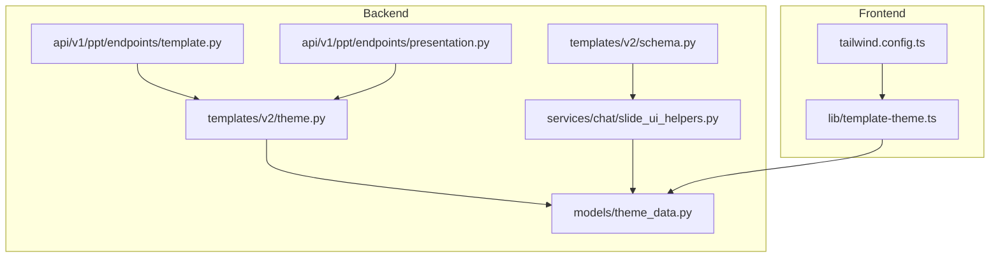

**Diagram sources**
- [theme.py:145-258](file://servers/fastapi/templates/v2/theme.py#L145-L258)
- [theme_data.py:1-35](file://servers/fastapi/models/theme_data.py#L1-L35)
- [slide_ui_helpers.py:614-702](file://servers/fastapi/services/chat/slide_ui_helpers.py#L614-L702)
- [schema.py:106-160](file://servers/fastapi/templates/v2/schema.py#L106-L160)
- [template-theme.ts:78-122](file://servers/nextjs/lib/template-theme.ts#L78-L122)
- [tailwind.config.ts:12-91](file://servers/nextjs/tailwind.config.ts#L12-L91)
- [presentation.py:116-116](file://servers/fastapi/api/v1/ppt/endpoints/presentation.py#L116-L116)
- [template.py:79-79](file://servers/fastapi/api/v1/ppt/endpoints/template.py#L79-L79)

**Section sources**
- [theme.py:145-258](file://servers/fastapi/templates/v2/theme.py#L145-L258)
- [template-theme.ts:78-122](file://servers/nextjs/lib/template-theme.ts#L78-L122)
- [slide_ui_helpers.py:614-702](file://servers/fastapi/services/chat/slide_ui_helpers.py#L614-L702)
- [schema.py:106-160](file://servers/fastapi/templates/v2/schema.py#L106-L160)
- [tailwind.config.ts:12-91](file://servers/nextjs/tailwind.config.ts#L12-L91)
- [presentation.py:116-116](file://servers/fastapi/api/v1/ppt/endpoints/presentation.py#L116-L116)
- [template.py:79-79](file://servers/fastapi/api/v1/ppt/endpoints/template.py#L79-L79)

## Core Components
- PresentationThemeData: Canonical theme model containing colors and fonts.
- TemplateTheme: Frontend-normalized theme shape with semantic color keys and optional text font.
- ThemeProfile: Intermediate profile of observed colors, pairs, and fonts extracted from layout JSON.
- ThemeRoleSelection: Semantic role mapping produced by LLM or deterministic selection.
- Slide chart palette resolver: Applies theme graph colors to charts and infographics.

Key responsibilities:
- Extract style signals from template layouts.
- Cluster and rank colors; compute contrast and accessibility.
- Select semantic roles (background, primary, card, stroke, text colors, graph palette).
- Materialize a validated theme object.
- Normalize and apply theme at runtime in the browser.

**Section sources**
- [theme_data.py:1-35](file://servers/fastapi/models/theme_data.py#L1-L35)
- [template-theme.ts:1-49](file://servers/nextjs/lib/template-theme.ts#L1-L49)
- [theme.py:34-88](file://servers/fastapi/templates/v2/theme.py#L34-L88)
- [slide_ui_helpers.py:66-76](file://servers/fastapi/services/chat/slide_ui_helpers.py#L66-L76)

## Architecture Overview
The theme pipeline has two main flows:
- Generation flow: Build a style profile from template layouts, select semantic roles (LLM with deterministic fallback), materialize a validated theme.
- Application flow: Normalize incoming theme payloads, resolve defaults, and apply tokens to UI and charts.

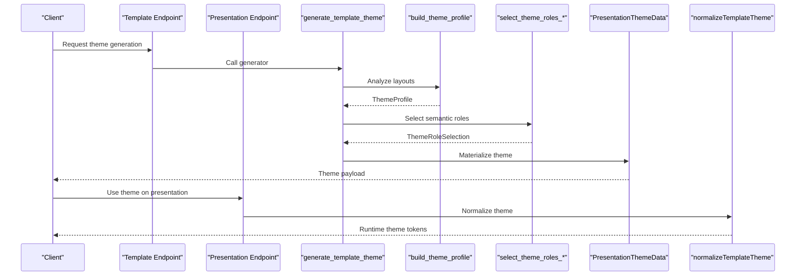

**Diagram sources**
- [template.py:79-79](file://servers/fastapi/api/v1/ppt/endpoints/template.py#L79-L79)
- [presentation.py:116-116](file://servers/fastapi/api/v1/ppt/endpoints/presentation.py#L116-L116)
- [theme.py:246-258](file://servers/fastapi/templates/v2/theme.py#L246-L258)
- [theme.py:145-243](file://servers/fastapi/templates/v2/theme.py#L145-L243)
- [theme.py:261-302](file://servers/fastapi/templates/v2/theme.py#L261-L302)
- [theme.py:357-402](file://servers/fastapi/templates/v2/theme.py#L357-L402)
- [template-theme.ts:78-122](file://servers/nextjs/lib/template-theme.ts#L78-L122)

## Detailed Component Analysis

### Theme Data Model
The canonical theme model defines semantic color roles and typography:
- Colors: background, primary, card, stroke, background_text, primary_text, and a fixed set of graph colors.
- Fonts: A text font with name and URL.

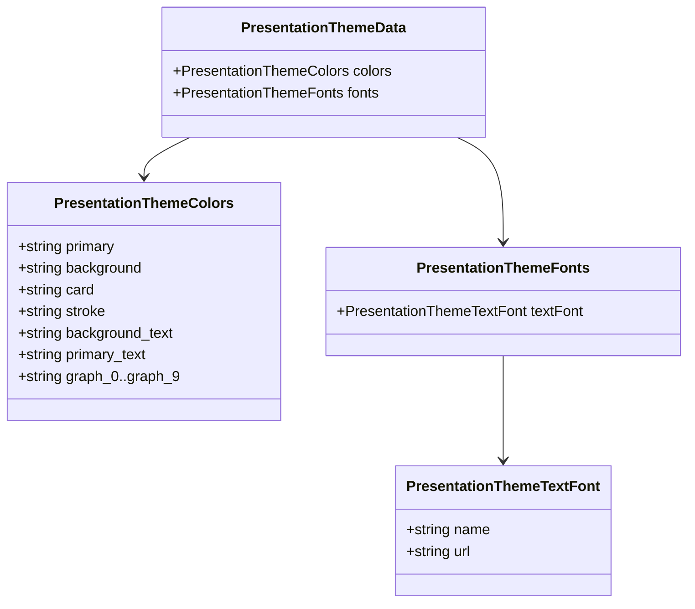

**Diagram sources**
- [theme_data.py:1-35](file://servers/fastapi/models/theme_data.py#L1-L35)

**Section sources**
- [theme_data.py:1-35](file://servers/fastapi/models/theme_data.py#L1-L35)

### Automatic Color Scheme Extraction
The backend extracts a compact style profile from template layout JSON:
- Collects fills, strokes, text colors, chart/infographic colors, and embedded fonts.
- Clusters similar colors and ranks them by importance (area, frequency, slide coverage).
- Tracks foreground/background pairs and computes contrast ratios.
- Builds a limited palette and top fonts.

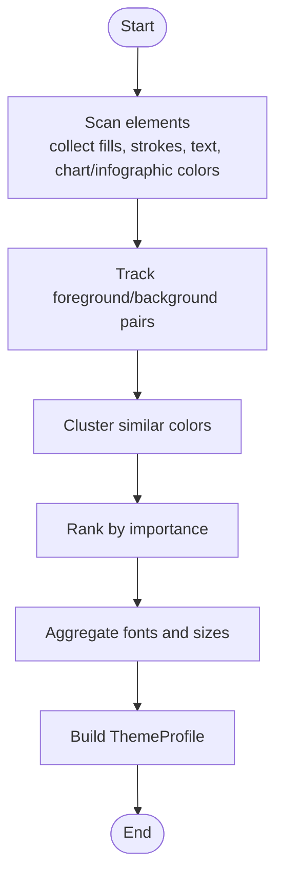

**Diagram sources**
- [theme.py:145-243](file://servers/fastapi/templates/v2/theme.py#L145-L243)
- [theme.py:431-513](file://servers/fastapi/templates/v2/theme.py#L431-L513)
- [theme.py:567-635](file://servers/fastapi/templates/v2/theme.py#L567-L635)
- [theme.py:638-661](file://servers/fastapi/templates/v2/theme.py#L638-L661)

**Section sources**
- [theme.py:145-243](file://servers/fastapi/templates/v2/theme.py#L145-L243)
- [theme.py:431-513](file://servers/fastapi/templates/v2/theme.py#L431-L513)
- [theme.py:567-635](file://servers/fastapi/templates/v2/theme.py#L567-L635)
- [theme.py:638-661](file://servers/fastapi/templates/v2/theme.py#L638-L661)

### Semantic Theme Role Selection
Semantic roles are selected via an LLM call with strict validation against the profile. If the LLM fails, deterministic selection is used:
- Background: largest surface area and slide coverage.
- Primary: most saturated accent used in charts/infographics.
- Card and Stroke: secondary surfaces derived from backgrounds and usage.
- Text colors: chosen for contrast against surfaces.
- Graph colors: distinct observed or generated palette.

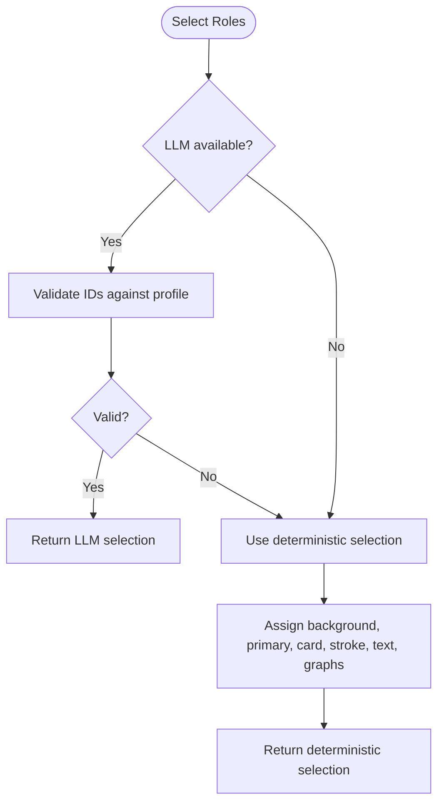

**Diagram sources**
- [theme.py:261-302](file://servers/fastapi/templates/v2/theme.py#L261-L302)
- [theme.py:305-354](file://servers/fastapi/templates/v2/theme.py#L305-L354)

**Section sources**
- [theme.py:261-302](file://servers/fastapi/templates/v2/theme.py#L261-L302)
- [theme.py:305-354](file://servers/fastapi/templates/v2/theme.py#L305-L354)

### Theme Materialization and Validation
Materialization maps selected role IDs to concrete colors and fonts, repairs inaccessible text colors, ensures card/stroke contrast, and completes the graph palette.

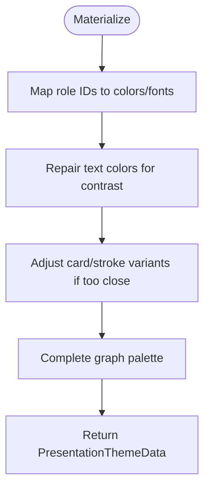

**Diagram sources**
- [theme.py:357-402](file://servers/fastapi/templates/v2/theme.py#L357-L402)
- [theme.py:680-720](file://servers/fastapi/templates/v2/theme.py#L680-L720)

**Section sources**
- [theme.py:357-402](file://servers/fastapi/templates/v2/theme.py#L357-L402)
- [theme.py:680-720](file://servers/fastapi/templates/v2/theme.py#L680-L720)

### Frontend Theme Normalization and Application
The frontend normalizes various theme payload shapes into a consistent TemplateTheme:
- Accepts nested or flat structures.
- Validates and fills missing semantic keys with defaults.
- Resolves text font metadata when present.
- Provides helpers to extract graph colors and derive theme from presentations or templates.

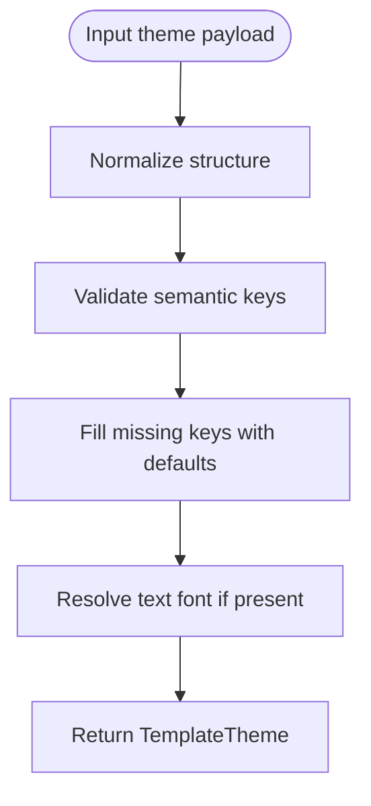

**Diagram sources**
- [template-theme.ts:78-122](file://servers/nextjs/lib/template-theme.ts#L78-L122)
- [template-theme.ts:119-149](file://servers/nextjs/lib/template-theme.ts#L119-L149)
- [template-theme.ts:283-354](file://servers/nextjs/lib/template-theme.ts#L283-L354)

**Section sources**
- [template-theme.ts:78-122](file://servers/nextjs/lib/template-theme.ts#L78-L122)
- [template-theme.ts:119-149](file://servers/nextjs/lib/template-theme.ts#L119-L149)
- [template-theme.ts:283-354](file://servers/nextjs/lib/template-theme.ts#L283-L354)

### Chart Palette Integration
Charts and infographics use theme tokens:
- If explicit colors are not provided, the system uses the theme’s graph palette.
- Axis/grid/title/legend colors fall back to theme tokens like background_text, primary, stroke, card.
- Palette resolution adapts to chart type and series/category counts.

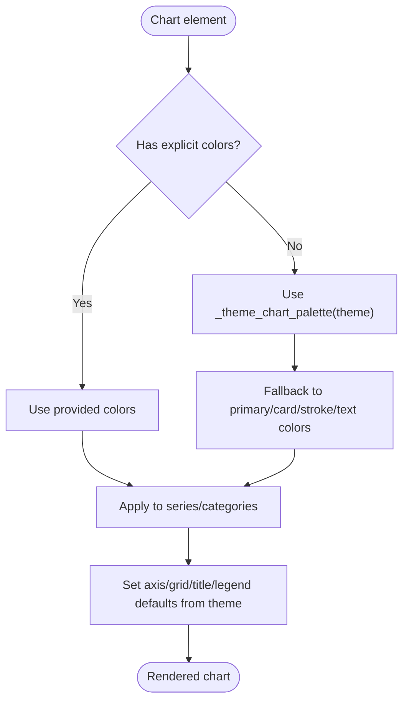

**Diagram sources**
- [slide_ui_helpers.py:614-690](file://servers/fastapi/services/chat/slide_ui_helpers.py#L614-L690)
- [slide_ui_helpers.py:109-221](file://servers/fastapi/services/chat/slide_ui_helpers.py#L109-L221)

**Section sources**
- [slide_ui_helpers.py:614-690](file://servers/fastapi/services/chat/slide_ui_helpers.py#L614-L690)
- [slide_ui_helpers.py:109-221](file://servers/fastapi/services/chat/slide_ui_helpers.py#L109-L221)

### Typography and Responsive Design Tokens
Typography and responsive tokens are applied through:
- Schema-driven text capacity calculations based on font size, boldness, letter spacing, and line height.
- Tailwind CSS variables for UI colors and radii, enabling dark mode and responsive scaling.
- Optional custom font families via CSS variables.

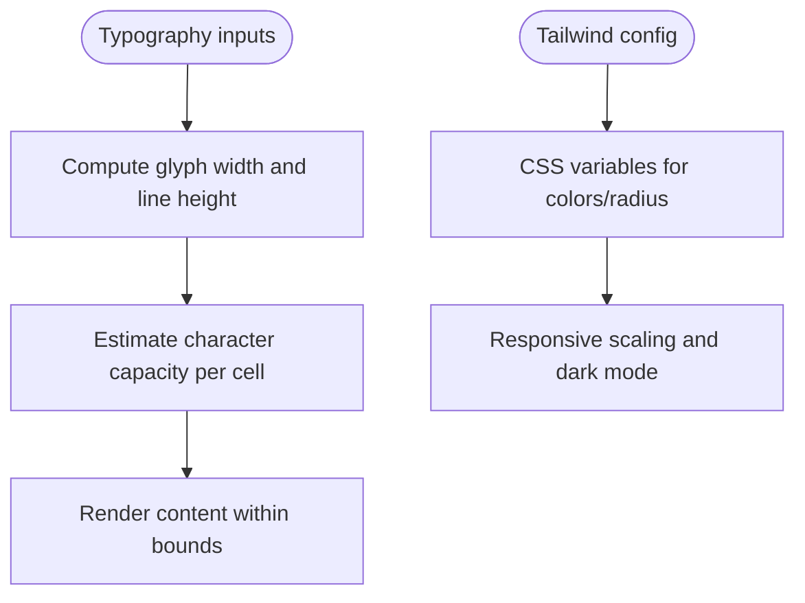

**Diagram sources**
- [schema.py:106-160](file://servers/fastapi/templates/v2/schema.py#L106-L160)
- [tailwind.config.ts:12-91](file://servers/nextjs/tailwind.config.ts#L12-L91)

**Section sources**
- [schema.py:106-160](file://servers/fastapi/templates/v2/schema.py#L106-L160)
- [tailwind.config.ts:12-91](file://servers/nextjs/tailwind.config.ts#L12-L91)

### Theme Inheritance and Customization
- Explicit theme payloads take precedence over inferred ones.
- If no explicit theme exists, the frontend derives a stable theme from stored layout JSON.
- Presentations can wrap template-generated themes for downstream consumption.

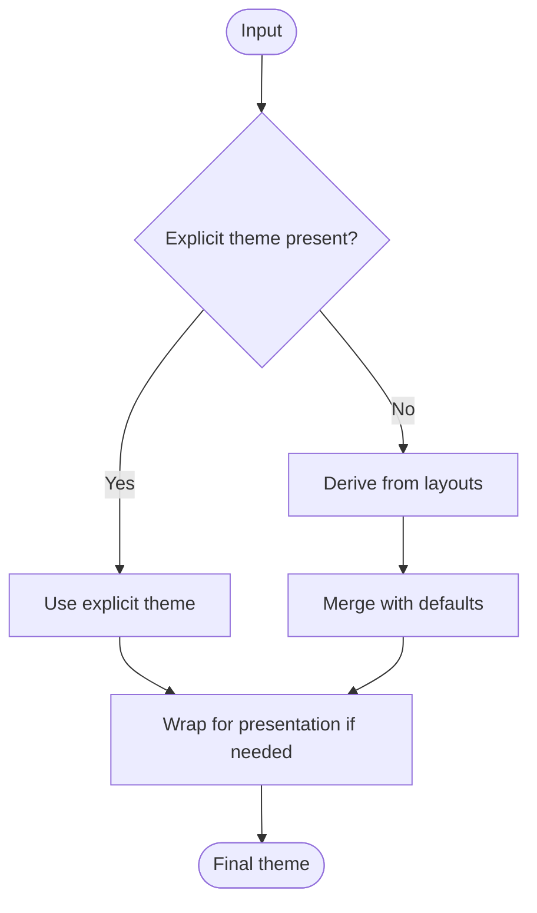

**Diagram sources**
- [template-theme.ts:283-354](file://servers/nextjs/lib/template-theme.ts#L283-L354)
- [theme.py:405-420](file://servers/fastapi/templates/v2/theme.py#L405-L420)

**Section sources**
- [template-theme.ts:283-354](file://servers/nextjs/lib/template-theme.ts#L283-L354)
- [theme.py:405-420](file://servers/fastapi/templates/v2/theme.py#L405-L420)

### Dynamic Theme Switching
Dynamic switching is achieved by:
- Normalizing new theme payloads at runtime.
- Applying normalized tokens to DOM and chart components.
- Using Tailwind CSS variables for instant UI updates without re-rendering entire pages.

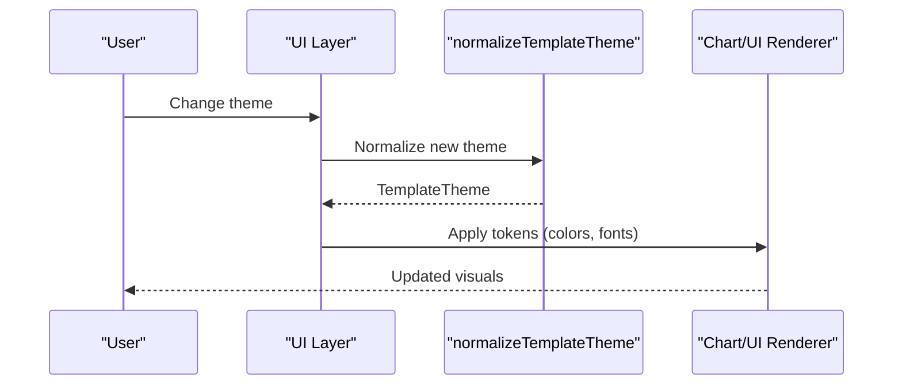

**Diagram sources**
- [template-theme.ts:78-122](file://servers/nextjs/lib/template-theme.ts#L78-L122)
- [slide_ui_helpers.py:614-702](file://servers/fastapi/services/chat/slide_ui_helpers.py#L614-L702)
- [tailwind.config.ts:12-91](file://servers/nextjs/tailwind.config.ts#L12-L91)

**Section sources**
- [template-theme.ts:78-122](file://servers/nextjs/lib/template-theme.ts#L78-L122)
- [slide_ui_helpers.py:614-702](file://servers/fastapi/services/chat/slide_ui_helpers.py#L614-L702)
- [tailwind.config.ts:12-91](file://servers/nextjs/tailwind.config.ts#L12-L91)

## Dependency Analysis
- Backend endpoints delegate theme generation to the theme module.
- Theme module depends on Pydantic models and LLM configuration.
- Frontend theme utilities depend on the same semantic color keys and provide fallbacks.
- Chart helpers depend on theme tokens to render accessible and consistent visuals.

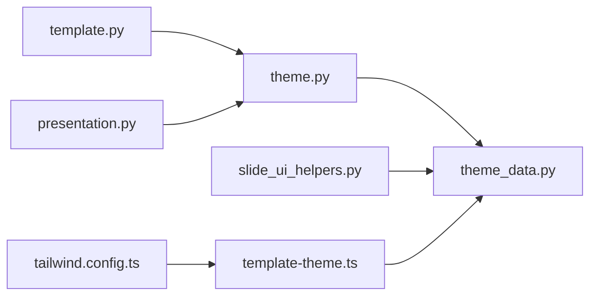

**Diagram sources**
- [template.py:79-79](file://servers/fastapi/api/v1/ppt/endpoints/template.py#L79-L79)
- [presentation.py:116-116](file://servers/fastapi/api/v1/ppt/endpoints/presentation.py#L116-L116)
- [theme.py:145-258](file://servers/fastapi/templates/v2/theme.py#L145-L258)
- [theme_data.py:1-35](file://servers/fastapi/models/theme_data.py#L1-L35)
- [slide_ui_helpers.py:614-702](file://servers/fastapi/services/chat/slide_ui_helpers.py#L614-L702)
- [template-theme.ts:78-122](file://servers/nextjs/lib/template-theme.ts#L78-L122)
- [tailwind.config.ts:12-91](file://servers/nextjs/tailwind.config.ts#L12-L91)

**Section sources**
- [template.py:79-79](file://servers/fastapi/api/v1/ppt/endpoints/template.py#L79-L79)
- [presentation.py:116-116](file://servers/fastapi/api/v1/ppt/endpoints/presentation.py#L116-L116)
- [theme.py:145-258](file://servers/fastapi/templates/v2/theme.py#L145-L258)
- [theme_data.py:1-35](file://servers/fastapi/models/theme_data.py#L1-L35)
- [slide_ui_helpers.py:614-702](file://servers/fastapi/services/chat/slide_ui_helpers.py#L614-L702)
- [template-theme.ts:78-122](file://servers/nextjs/lib/template-theme.ts#L78-L122)
- [tailwind.config.ts:12-91](file://servers/nextjs/tailwind.config.ts#L12-L91)

## Performance Considerations
- Profile construction scans all elements once; clustering and ranking operate on aggregated stats, keeping complexity manageable relative to layout size.
- LLM role selection includes retries and validation; deterministic fallback avoids blocking the pipeline.
- Graph palette completion generates additional hues only when needed, bounded to a fixed count.
- Frontend normalization is lightweight and operates on small theme objects.

[No sources needed since this section provides general guidance]

## Troubleshooting Guide
Common issues and resolutions:
- Unknown theme color/font IDs: Ensure selections reference IDs present in the profile; the LLM validator enforces this.
- Low contrast text: The system repairs text colors to meet contrast thresholds; verify surfaces and text candidates.
- Missing graph colors: Palette falls back to primary and other tokens; ensure primary is defined.
- Invalid theme payload: Normalize function requires at least one semantic color key; otherwise defaults are used.

**Section sources**
- [theme.py:261-302](file://servers/fastapi/templates/v2/theme.py#L261-L302)
- [theme.py:680-720](file://servers/fastapi/templates/v2/theme.py#L680-L720)
- [template-theme.ts:78-122](file://servers/nextjs/lib/template-theme.ts#L78-L122)

## Conclusion
The theme and styling system provides a robust, extensible pipeline that:
- Extracts style signals from template layouts
- Selects semantic roles reliably (LLM with deterministic fallback)
- Produces validated, accessible themes
- Normalizes and applies themes dynamically across UI and charts
- Supports brand integration and responsive design through consistent tokens

[No sources needed since this section summarizes without analyzing specific files]

## Appendices

### Example: Creating a Brand Theme
- Provide a template with brand colors and fonts in its layouts.
- Generate the theme using the backend endpoint; the system will infer semantic roles.
- Optionally override with an explicit theme payload to enforce brand constraints.
- Apply the theme in the frontend; charts will automatically use the graph palette.

**Section sources**
- [template.py:79-79](file://servers/fastapi/api/v1/ppt/endpoints/template.py#L79-L79)
- [theme.py:246-258](file://servers/fastapi/templates/v2/theme.py#L246-L258)
- [template-theme.ts:78-122](file://servers/nextjs/lib/template-theme.ts#L78-L122)

### Example: Responsive Design Patterns
- Use Tailwind CSS variables for colors and radii to support dark mode and scaling.
- Define custom font families via CSS variables and integrate them into the theme’s text font.
- Leverage schema-driven typography calculations to ensure content fits within component bounds.

**Section sources**
- [tailwind.config.ts:12-91](file://servers/nextjs/tailwind.config.ts#L12-L91)
- [schema.py:106-160](file://servers/fastapi/templates/v2/schema.py#L106-L160)