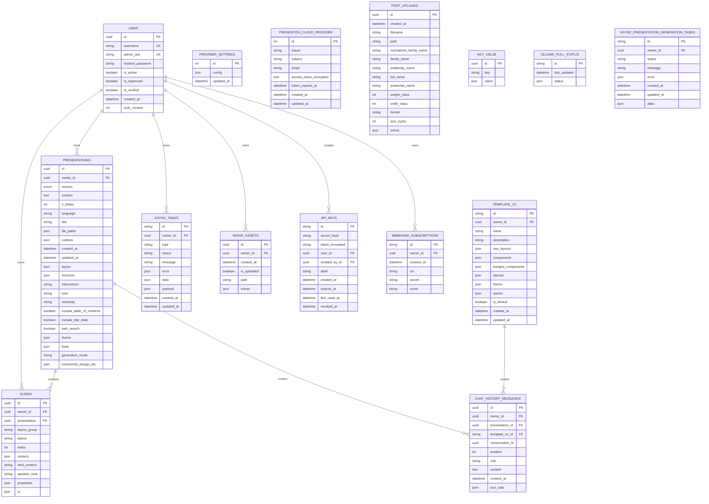
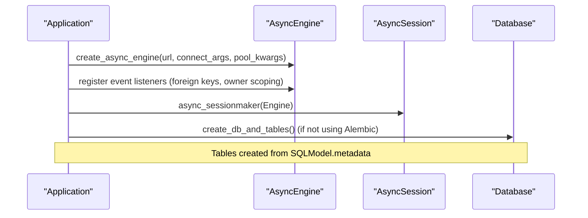
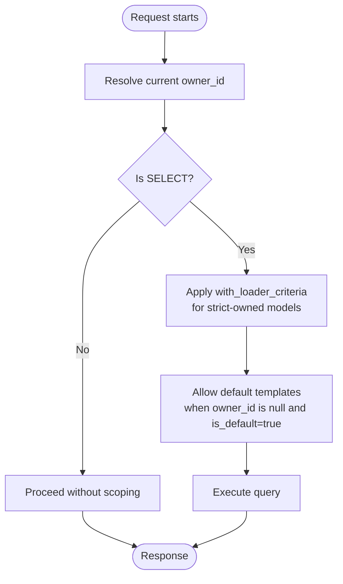
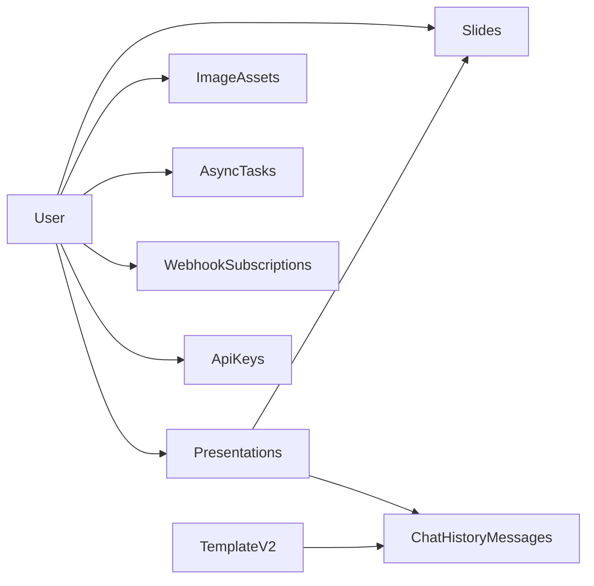

# Database Schema

<cite>
**Referenced Files in This Document**
- [database.py](file://servers/fastapi/services/database.py)
- [env.py](file://servers/fastapi/alembic/env.py)
- [presentation.py](file://servers/fastapi/models/sql/presentation.py)
- [slide.py](file://servers/fastapi/models/sql/slide.py)
- [template_v2.py](file://servers/fastapi/models/sql/template_v2.py)
- [user.py](file://servers/fastapi/models/sql/user.py)
- [async_task.py](file://servers/fastapi/models/sql/async_task.py)
- [image_asset.py](file://servers/fastapi/models/sql/image_asset.py)
- [chat_history_message.py](file://servers/fastapi/models/sql/chat_history_message.py)
- [api_key.py](file://servers/fastapi/models/sql/api_key.py)
- [provider_settings.py](file://servers/fastapi/models/sql/provider_settings.py)
- [presenton_cloud_provider.py](file://servers/fastapi/models/sql/presenton_cloud_provider.py)
- [webhook_subscription.py](file://servers/fastapi/models/sql/webhook_subscription.py)
- [font_upload.py](file://servers/fastapi/models/sql/font_upload.py)
- [key_value.py](file://servers/fastapi/models/sql/key_value.py)
- [ollama_pull_status.py](file://servers/fastapi/models/sql/ollama_pull_status.py)
- [async_presentation_generation_status.py](file://servers/fastapi/models/sql/async_presentation_generation_status.py)
</cite>

## Table of Contents
1. [Introduction](#introduction)
2. [Project Structure](#project-structure)
3. [Core Components](#core-components)
4. [Architecture Overview](#architecture-overview)
5. [Detailed Component Analysis](#detailed-component-analysis)
6. [Dependency Analysis](#dependency-analysis)
7. [Performance Considerations](#performance-considerations)
8. [Troubleshooting Guide](#troubleshooting-guide)
9. [Conclusion](#conclusion)
10. [Appendices](#appendices)

## Introduction
This document describes Presenton’s database schema and data modeling. It focuses on the SQLAlchemy ORM models for presentations, slides, templates, users, and related entities; explains Alembic migration strategy; documents indexing and query optimization patterns; outlines validation rules and referential integrity; and provides operational guidance for backups, archival, maintenance, monitoring, connection pooling, and scaling.

## Project Structure
The database layer is implemented with SQLModel (built on SQLAlchemy). Core ORM models live under a dedicated directory, while engine/session configuration and tenant scoping are centralized in a service module. Alembic is configured to import all models at runtime so migrations can be auto-generated and executed against the active database.

```mermaid
graph TB
subgraph "FastAPI Backend"
DB_SVC["services/database.py"]
ALEMBIC_ENV["alembic/env.py"]
end
subgraph "ORM Models"
USER_M["models/sql/user.py"]
PRESENTATION_M["models/sql/presentation.py"]
SLIDE_M["models/sql/slide.py"]
TEMPLATE_M["models/sql/template_v2.py"]
ASYNC_TASK_M["models/sql/async_task.py"]
IMG_ASSET_M["models/sql/image_asset.py"]
CHAT_MSG_M["models/sql/chat_history_message.py"]
API_KEY_M["models/sql/api_key.py"]
PROVIDER_SETTINGS_M["models/sql/provider_settings.py"]
CLOUD_PROVIDER_M["models/sql/presenton_cloud_provider.py"]
WEBHOOK_M["models/sql/webhook_subscription.py"]
FONT_UPLOAD_M["models/sql/font_upload.py"]
KV_M["models/sql/key_value.py"]
OLLAMA_M["models/sql/ollama_pull_status.py"]
ASYNC_GEN_M["models/sql/async_presentation_generation_status.py"]
end
DB_SVC --> USER_M
DB_SVC --> PRESENTATION_M
DB_SVC --> SLIDE_M
DB_SVC --> TEMPLATE_M
DB_SVC --> ASYNC_TASK_M
DB_SVC --> IMG_ASSET_M
DB_SVC --> CHAT_MSG_M
DB_SVC --> API_KEY_M
DB_SVC --> PROVIDER_SETTINGS_M
DB_SVC --> CLOUD_PROVIDER_M
DB_SVC --> WEBHOOK_M
DB_SVC --> FONT_UPLOAD_M
DB_SVC --> KV_M
DB_SVC --> OLLAMA_M
DB_SVC --> ASYNC_GEN_M
ALEMBIC_ENV --> USER_M
ALEMBIC_ENV --> PRESENTATION_M
ALEMBIC_ENV --> SLIDE_M
ALEMBIC_ENV --> TEMPLATE_M
ALEMBIC_ENV --> ASYNC_TASK_M
ALEMBIC_ENV --> IMG_ASSET_M
ALEMBIC_ENV --> CHAT_MSG_M
ALEMBIC_ENV --> API_KEY_M
ALEMBIC_ENV --> PROVIDER_SETTINGS_M
ALEMBIC_ENV --> CLOUD_PROVIDER_M
ALEMBIC_ENV --> WEBHOOK_M
ALEMBIC_ENV --> FONT_UPLOAD_M
ALEMBIC_ENV --> KV_M
ALEMBIC_ENV --> OLLAMA_M
ALEMBIC_ENV --> ASYNC_GEN_M
```

**Diagram sources**
- [database.py:12-28](file://servers/fastapi/services/database.py#L12-L28)
- [env.py:15-33](file://servers/fastapi/alembic/env.py#L15-L33)

**Section sources**
- [database.py:1-153](file://servers/fastapi/services/database.py#L1-L153)
- [env.py:1-99](file://servers/fastapi/alembic/env.py#L1-L99)

## Core Components
This section summarizes the primary entities and their relationships.

- User: Identity and authentication account.
- Presentation: A presentation record containing content, metadata, layout, structure, theme, fonts, and generation options.
- Slide: Individual slide belonging to a presentation.
- TemplateV2: Reusable template definition with layouts, components, theme, and assets.
- AsyncTask: Generic asynchronous task tracking.
- AsyncPresentationGenerationTask: Generation job status and payload.
- ImageAsset: Uploaded or generated image asset metadata.
- ChatHistoryMessage: Chat messages associated with presentations and templates.
- ApiKey: Revocable API keys scoped to users.
- ProviderSettings: Singleton provider configuration.
- PresentonCloudProvider: Singleton cloud provider credentials.
- WebhookSubscription: Event-driven webhook endpoints.
- FontUpload: Metadata for uploaded font files.
- KeyValueSqlModel: Key-value store.
- OllamaPullStatus: Status of model pulls.

**Diagram sources**
- [user.py:16-46](file://servers/fastapi/models/sql/user.py#L16-L46)
- [presentation.py:21-81](file://servers/fastapi/models/sql/presentation.py#L21-L81)
- [slide.py:9-30](file://servers/fastapi/models/sql/slide.py#L9-L30)
- [template_v2.py:16-60](file://servers/fastapi/models/sql/template_v2.py#L16-L60)
- [async_task.py:16-56](file://servers/fastapi/models/sql/async_task.py#L16-L56)
- [image_asset.py:12-28](file://servers/fastapi/models/sql/image_asset.py#L12-L28)
- [chat_history_message.py:12-49](file://servers/fastapi/models/sql/chat_history_message.py#L12-L49)
- [api_key.py:12-55](file://servers/fastapi/models/sql/api_key.py#L12-L55)
- [provider_settings.py:10-23](file://servers/fastapi/models/sql/provider_settings.py#L10-L23)
- [presenton_cloud_provider.py:10-33](file://servers/fastapi/models/sql/presenton_cloud_provider.py#L10-L33)
- [webhook_subscription.py:12-31](file://servers/fastapi/models/sql/webhook_subscription.py#L12-L31)
- [font_upload.py:11-31](file://servers/fastapi/models/sql/font_upload.py#L11-L31)
- [key_value.py:5-8](file://servers/fastapi/models/sql/key_value.py#L5-L8)
- [ollama_pull_status.py:6-9](file://servers/fastapi/models/sql/ollama_pull_status.py#L6-L9)
- [async_presentation_generation_status.py:11-30](file://servers/fastapi/models/sql/async_presentation_generation_status.py#L11-L30)

**Section sources**
- [presentation.py:21-81](file://servers/fastapi/models/sql/presentation.py#L21-L81)
- [slide.py:9-30](file://servers/fastapi/models/sql/slide.py#L9-L30)
- [template_v2.py:16-60](file://servers/fastapi/models/sql/template_v2.py#L16-L60)
- [user.py:16-46](file://servers/fastapi/models/sql/user.py#L16-L46)
- [async_task.py:16-56](file://servers/fastapi/models/sql/async_task.py#L16-L56)
- [image_asset.py:12-28](file://servers/fastapi/models/sql/image_asset.py#L12-L28)
- [chat_history_message.py:12-49](file://servers/fastapi/models/sql/chat_history_message.py#L12-L49)
- [api_key.py:12-55](file://servers/fastapi/models/sql/api_key.py#L12-L55)
- [provider_settings.py:10-23](file://servers/fastapi/models/sql/provider_settings.py#L10-L23)
- [presenton_cloud_provider.py:10-33](file://servers/fastapi/models/sql/presenton_cloud_provider.py#L10-L33)
- [webhook_subscription.py:12-31](file://servers/fastapi/models/sql/webhook_subscription.py#L12-L31)
- [font_upload.py:11-31](file://servers/fastapi/models/sql/font_upload.py#L11-L31)
- [key_value.py:5-8](file://servers/fastapi/models/sql/key_value.py#L5-L8)
- [ollama_pull_status.py:6-9](file://servers/fastapi/models/sql/ollama_pull_status.py#L6-L9)
- [async_presentation_generation_status.py:11-30](file://servers/fastapi/models/sql/async_presentation_generation_status.py#L11-L30)

## Architecture Overview
The application uses an async SQLAlchemy engine with session factories. On startup, tables are created if not managed by Alembic. Tenant isolation is enforced via an ORM event that injects owner-scoped filters into SELECT statements and stamps new rows with the current owner ID during flush.

**Diagram sources**
- [database.py:34-53](file://servers/fastapi/services/database.py#L34-L53)
- [database.py:117-142](file://servers/fastapi/services/database.py#L117-L142)

**Section sources**
- [database.py:34-53](file://servers/fastapi/services/database.py#L34-L53)
- [database.py:117-142](file://servers/fastapi/services/database.py#L117-L142)

## Detailed Component Analysis

### Data Access and Tenancy
- Connection pooling: Uses get_pool_kwargs for server-class databases; SQLite ignores pool settings.
- Foreign keys: Enabled explicitly for SQLite via PRAGMA.
- Tenant scoping: An ORM event adds loader criteria to restrict reads to the current owner and allows default templates when owner_id is null and is_default is true.
- Owner stamping: New owned rows automatically receive the current owner_id during flush.

**Diagram sources**
- [database.py:67-98](file://servers/fastapi/services/database.py#L67-L98)

**Section sources**
- [database.py:34-53](file://servers/fastapi/services/database.py#L34-L53)
- [database.py:67-109](file://servers/fastapi/services/database.py#L67-L109)

### Entity: User
- Primary key: UUID.
- Username: Unique, indexed, required.
- Admin slot: Unique, optional.
- Password: Hashed, required.
- Flags: Active, superuser, verified booleans with defaults.
- Timestamps: Optional creation time; auth version integer.

**Section sources**
- [user.py:16-46](file://servers/fastapi/models/sql/user.py#L16-L46)

### Entity: Presentation
- Primary key: UUID.
- Owner: Optional foreign key to user with cascade delete and index.
- Version: Enum stored as string with constraint.
- Content and metadata: Text, integers, strings, JSON fields for file paths, outlines, layout, structure, theme, fonts, community design IDs.
- Generation options: Boolean flags and string enums for tone, verbosity, generation mode.
- Timestamps: Created and updated with timezone-aware defaults.

**Section sources**
- [presentation.py:21-81](file://servers/fastapi/models/sql/presentation.py#L21-L81)

### Entity: Slide
- Primary key: UUID.
- Owner: Optional foreign key to user with cascade delete and index.
- Presentation: Required foreign key to presentations with cascade delete and index.
- Layout and content: Strings for layout identifiers; JSON for content and properties; optional HTML content and speaker notes; optional UI state.

**Section sources**
- [slide.py:9-30](file://servers/fastapi/models/sql/slide.py#L9-L30)

### Entity: TemplateV2
- Primary key: String UUID.
- Owner: Optional foreign key to user with cascade delete and index.
- Definition: Name, description, JSON fields for raw layouts, components, merged components, layouts, theme, assets.
- Defaults: Boolean flag for default templates.
- Timestamps: Created and updated with timezone-aware defaults.

**Section sources**
- [template_v2.py:16-60](file://servers/fastapi/models/sql/template_v2.py#L16-L60)

### Entity: AsyncTask
- Primary key: Random hex string prefixed with task identifier.
- Owner: Optional foreign key to user with cascade delete and index.
- Tracking: Type, status (string), message, JSON error/data/payload.
- Timestamps: Created and updated with timezone-aware defaults.

**Section sources**
- [async_task.py:16-56](file://servers/fastapi/models/sql/async_task.py#L16-L56)

### Entity: AsyncPresentationGenerationTask
- Primary key: Random hex string prefixed with task identifier.
- Owner: Optional foreign key to user with cascade delete and index.
- Tracking: Status, message, JSON error/data.
- Timestamps: Created and updated with defaults.

**Section sources**
- [async_presentation_generation_status.py:11-30](file://servers/fastapi/models/sql/async_presentation_generation_status.py#L11-L30)

### Entity: ImageAsset
- Primary key: UUID.
- Owner: Optional foreign key to user with cascade delete and index.
- Metadata: Creation timestamp, upload flag, path, JSON extras.

**Section sources**
- [image_asset.py:12-28](file://servers/fastapi/models/sql/image_asset.py#L12-L28)

### Entity: ChatHistoryMessage
- Primary key: UUID.
- Owner: Optional foreign key to user with cascade delete and index.
- Context: Optional foreign keys to presentations and template_v2 with indexes.
- Conversation: Indexed conversation_id and position (ge=1).
- Message: Role, text content, optional JSON tool calls.
- Timestamps: Creation time.

**Section sources**
- [chat_history_message.py:12-49](file://servers/fastapi/models/sql/chat_history_message.py#L12-L49)

### Entity: ApiKey
- Primary key: Short random hex string.
- Security: Secret hash and optional encrypted token.
- Ownership: Required user_id and created_by_id foreign keys with indexes.
- Lifecycle: Label, creation time, expiration, last used, revocation timestamps.

**Section sources**
- [api_key.py:12-55](file://servers/fastapi/models/sql/api_key.py#L12-L55)

### Entity: ProviderSettings
- Singleton row with JSON config and update timestamp.

**Section sources**
- [provider_settings.py:10-23](file://servers/fastapi/models/sql/provider_settings.py#L10-L23)

### Entity: PresentonCloudProvider
- Singleton row storing issuer, subject, email, encrypted access token, expiration, and timestamps.

**Section sources**
- [presenton_cloud_provider.py:10-33](file://servers/fastapi/models/sql/presenton_cloud_provider.py#L10-L33)

### Entity: WebhookSubscription
- Primary key: Random hex string prefixed with webhook identifier.
- Owner: Optional foreign key to user with cascade delete and index.
- Configuration: URL, optional secret, indexed event type.
- Timestamps: Creation time.

**Section sources**
- [webhook_subscription.py:12-31](file://servers/fastapi/models/sql/webhook_subscription.py#L12-L31)

### Entity: FontUpload
- Primary key: UUID.
- Metadata: Filename, path, normalized family name (indexed), optional font attributes, size, JSON extras.
- Timestamps: Creation time.

**Section sources**
- [font_upload.py:11-31](file://servers/fastapi/models/sql/font_upload.py#L11-L31)

### Entity: KeyValueSqlModel
- Simple key-value store with indexed key and JSON value.

**Section sources**
- [key_value.py:5-8](file://servers/fastapi/models/sql/key_value.py#L5-L8)

### Entity: OllamaPullStatus
- Primary key: String identifier.
- Tracking: Last updated timestamp and JSON status.

**Section sources**
- [ollama_pull_status.py:6-9](file://servers/fastapi/models/sql/ollama_pull_status.py#L6-L9)

## Dependency Analysis
The following diagram shows how core entities relate through foreign keys and ownership.

**Diagram sources**
- [presentation.py:24-33](file://servers/fastapi/models/sql/presentation.py#L24-L33)
- [slide.py:12-22](file://servers/fastapi/models/sql/slide.py#L12-L22)
- [image_asset.py:13-19](file://servers/fastapi/models/sql/image_asset.py#L13-L19)
- [async_task.py:23-28](file://servers/fastapi/models/sql/async_task.py#L23-L28)
- [webhook_subscription.py:18-23](file://servers/fastapi/models/sql/webhook_subscription.py#L18-L23)
- [api_key.py:28-36](file://servers/fastapi/models/sql/api_key.py#L28-L36)
- [chat_history_message.py:23-38](file://servers/fastapi/models/sql/chat_history_message.py#L23-L38)

**Section sources**
- [presentation.py:24-33](file://servers/fastapi/models/sql/presentation.py#L24-L33)
- [slide.py:12-22](file://servers/fastapi/models/sql/slide.py#L12-L22)
- [image_asset.py:13-19](file://servers/fastapi/models/sql/image_asset.py#L13-L19)
- [async_task.py:23-28](file://servers/fastapi/models/sql/async_task.py#L23-L28)
- [webhook_subscription.py:18-23](file://servers/fastapi/models/sql/webhook_subscription.py#L18-L23)
- [api_key.py:28-36](file://servers/fastapi/models/sql/api_key.py#L28-L36)
- [chat_history_message.py:23-38](file://servers/fastapi/models/sql/chat_history_message.py#L23-L38)

## Performance Considerations

### Indexing Strategy
- Owner-scoped queries benefit from indexes on owner_id across multiple entities (presentations, slides, image assets, async tasks, webhook subscriptions).
- Frequent lookup columns are indexed:
  - Presentations.owner_id
  - Slides.presentation and Slides.owner_id
  - ChatHistoryMessage.conversation_id, position, presentation_id, template_v2_id
  - ApiKey.expires_at, revoked_at, user_id, created_by_id
  - FontUpload.normalized_family_name
  - KeyValue.key
  - AsyncTask.type, status
  - WebhookSubscription.event

These indexes reduce cost for common filtering and join operations.

**Section sources**
- [presentation.py:24-33](file://servers/fastapi/models/sql/presentation.py#L24-L33)
- [slide.py:12-22](file://servers/fastapi/models/sql/slide.py#L12-L22)
- [chat_history_message.py:23-41](file://servers/fastapi/models/sql/chat_history_message.py#L23-L41)
- [api_key.py:28-54](file://servers/fastapi/models/sql/api_key.py#L28-L54)
- [font_upload.py:22-22](file://servers/fastapi/models/sql/font_upload.py#L22-L22)
- [key_value.py:6-7](file://servers/fastapi/models/sql/key_value.py#L6-L7)
- [async_task.py:23-33](file://servers/fastapi/models/sql/async_task.py#L23-L33)
- [webhook_subscription.py:18-31](file://servers/fastapi/models/sql/webhook_subscription.py#L18-L31)

### Query Optimization Patterns
- Use pagination and selective field loading for large result sets (e.g., listing presentations or chat history).
- Prefer filtering by indexed columns (owner_id, presentation_id, conversation_id, type, status).
- Avoid selecting entire JSON blobs unless needed; use application-level parsing only when necessary.
- Leverage the built-in owner scoping to avoid manual WHERE clauses for multi-tenant safety.

[No sources needed since this section provides general guidance]

### Connection Pooling and Engine Configuration
- The engine is created with dynamic connect args and pool kwargs derived from environment.
- For SQLite, pool kwargs are omitted due to file-lock semantics.
- Foreign key enforcement is enabled for SQLite via PRAGMA.

**Section sources**
- [database.py:34-53](file://servers/fastapi/services/database.py#L34-L53)

### Scaling Considerations
- Horizontal scaling: Stateless app instances share the same database; ensure connection pool sizing matches concurrency.
- Read replicas: Suitable for read-heavy workloads like listing presentations or retrieving slides; write operations remain on primary.
- Partitioning: Consider partitioning chat_history_messages by conversation_id or time-based partitions for very large datasets.
- Archival: Move older chat history or completed async tasks to archive tables or cold storage based on retention policies.

[No sources needed since this section provides general guidance]

## Troubleshooting Guide

### Migrations and Schema Drift
- Alembic env imports all models to ensure metadata reflects current schema.
- URL resolution prefers explicit configuration, then environment variables, then local SQLite fallback.
- Offline and online modes are supported for generating and applying migrations.

Common issues:
- Missing model imports in alembic/env.py will cause autogenerate to miss changes.
- Incorrect DATABASE_URL leads to connection failures or wrong target database.

**Section sources**
- [env.py:15-33](file://servers/fastapi/alembic/env.py#L15-L33)
- [env.py:46-58](file://servers/fastapi/alembic/env.py#L46-L58)
- [env.py:61-92](file://servers/fastapi/alembic/env.py#L61-L92)

### Tenant Scoping Failures
- If queries return cross-tenant data, verify that owner scoping events are active and that skip_owner_scope is not inadvertently set.
- Ensure get_current_owner_id returns the expected value within request context.

**Section sources**
- [database.py:67-98](file://servers/fastapi/services/database.py#L67-L98)

### Foreign Key Constraints
- On SQLite, foreign keys must be enabled explicitly; the code enables them via PRAGMA.
- Cascade deletes propagate from user to dependent entities.

**Section sources**
- [database.py:45-50](file://servers/fastapi/services/database.py#L45-L50)
- [presentation.py:24-33](file://servers/fastapi/models/sql/presentation.py#L24-L33)
- [slide.py:12-22](file://servers/fastapi/models/sql/slide.py#L12-L22)

### Startup Table Creation
- When not running Alembic, the application creates tables from SQLModel.metadata for all registered models.

**Section sources**
- [database.py:117-142](file://servers/fastapi/services/database.py#L117-L142)

## Conclusion
Presenton’s database schema centers around a clear ownership model with robust referential integrity and tenant isolation. Indexes are strategically placed on frequently filtered columns, and Alembic ensures schema evolution is controlled. Operational practices such as connection pooling, foreign key enforcement, and startup table creation provide a solid foundation for production deployments.

[No sources needed since this section summarizes without analyzing specific files]

## Appendices

### Backup and Recovery Strategies
- Logical backups: Regular pg_dump/mysql dump exports of all tables, including metadata and constraints.
- Point-in-time recovery: Enable WAL and continuous archiving where supported by the database engine.
- Validation: Periodically restore backups to a staging environment and validate referential integrity.

[No sources needed since this section provides general guidance]

### Data Archival Policies
- Chat history: Archive messages older than retention window to separate tables or external storage.
- Async tasks: Purge completed tasks after a defined period; retain recent tasks for monitoring.
- Images: Retain images referenced by active presentations; remove orphaned assets periodically.

[No sources needed since this section provides general guidance]

### Maintenance Procedures
- Vacuum/analyze: Schedule regular maintenance to update statistics and reclaim space.
- Index rebuilds: Rebuild fragmented indexes based on usage patterns.
- Monitoring: Track slow queries, lock contention, and connection pool saturation.

[No sources needed since this section provides general guidance]

### Database Performance Monitoring
- Metrics: Monitor query latency, throughput, connection pool utilization, and replication lag.
- Alerts: Set thresholds for long-running queries and high lock waits.
- Profiling: Use EXPLAIN plans for critical queries involving presentations, slides, and chat history.

[No sources needed since this section provides general guidance]