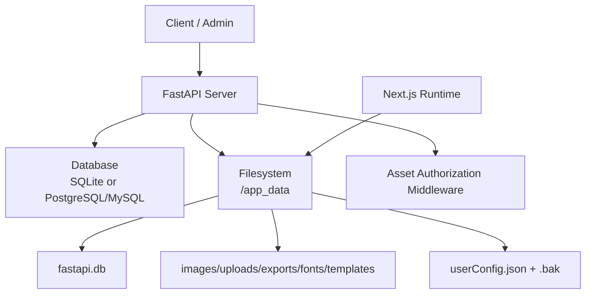
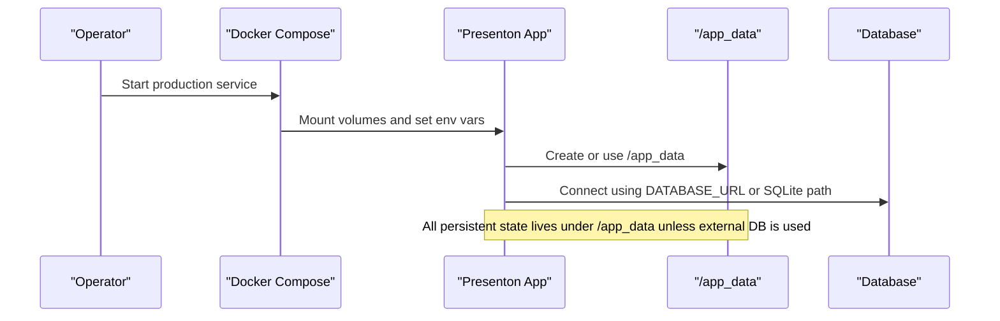
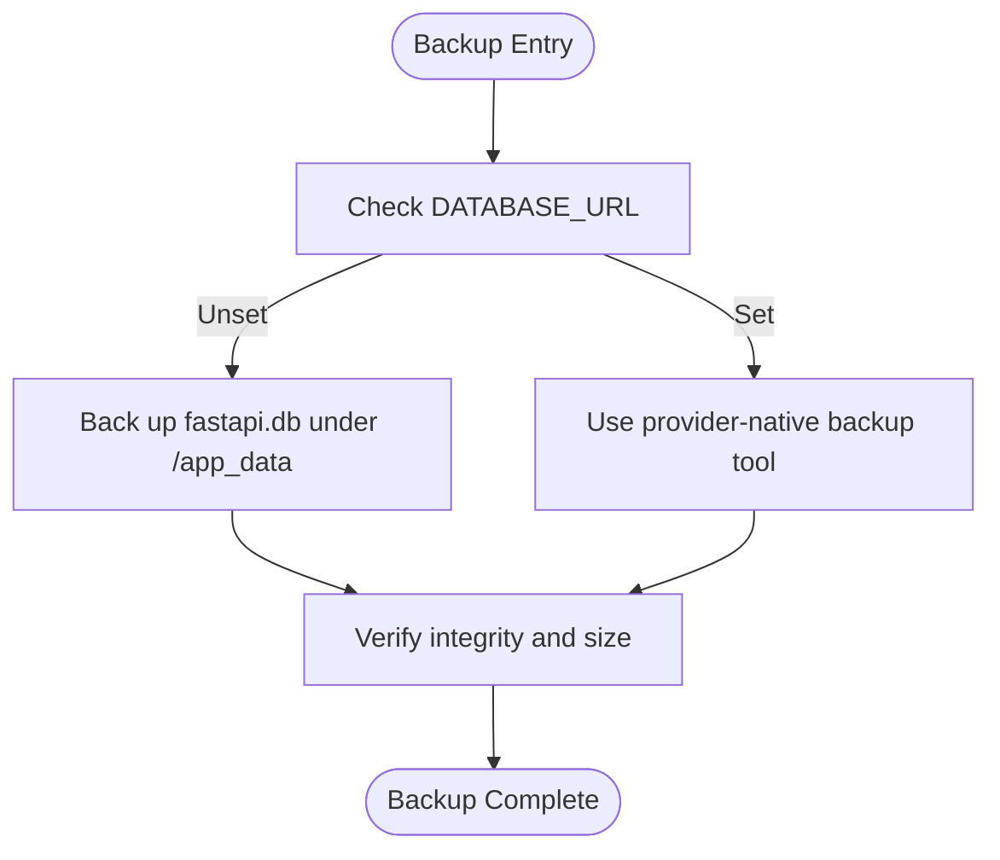
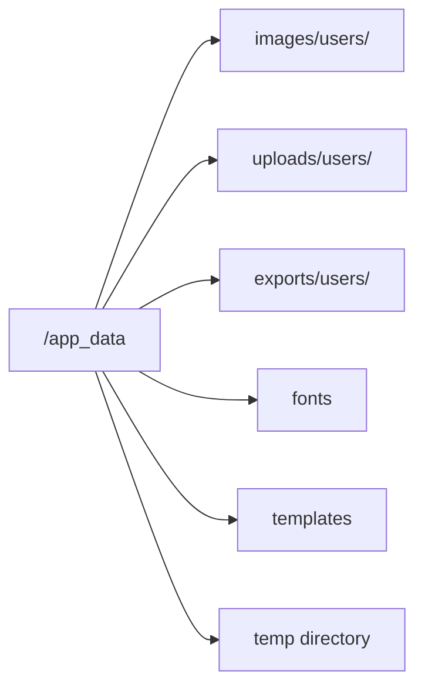
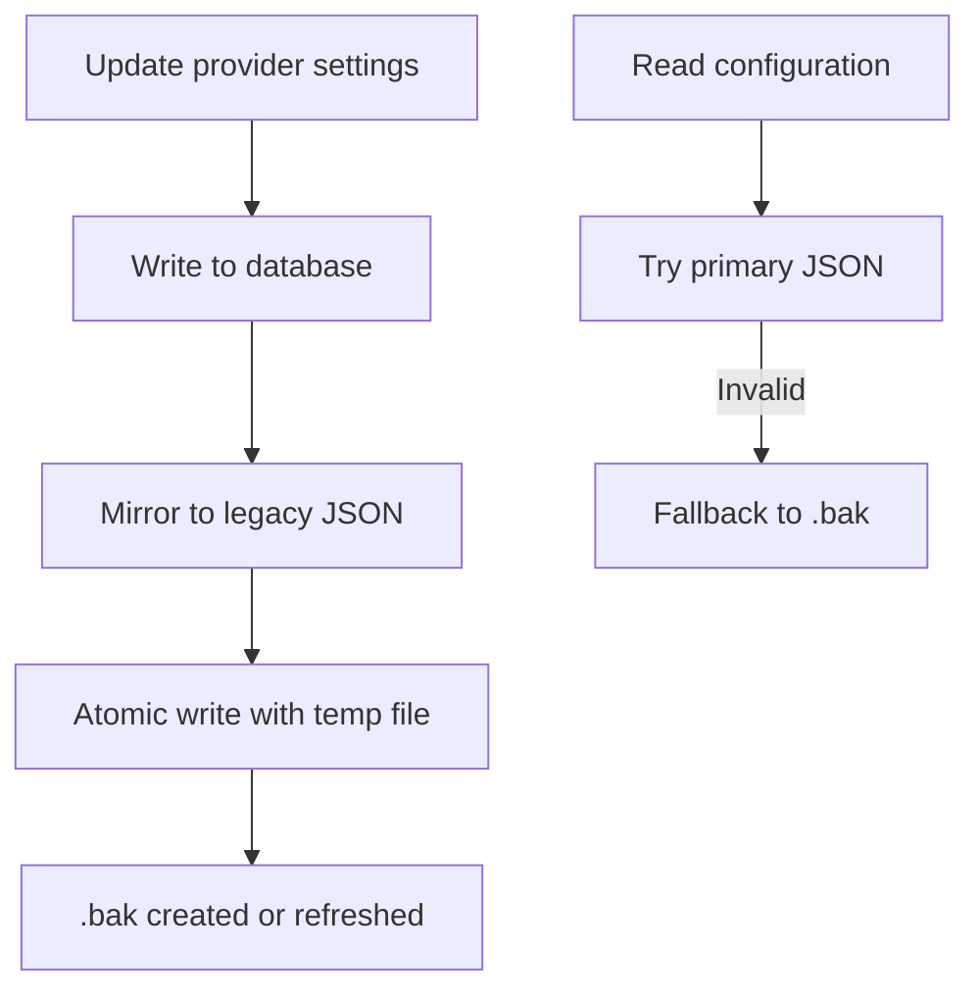
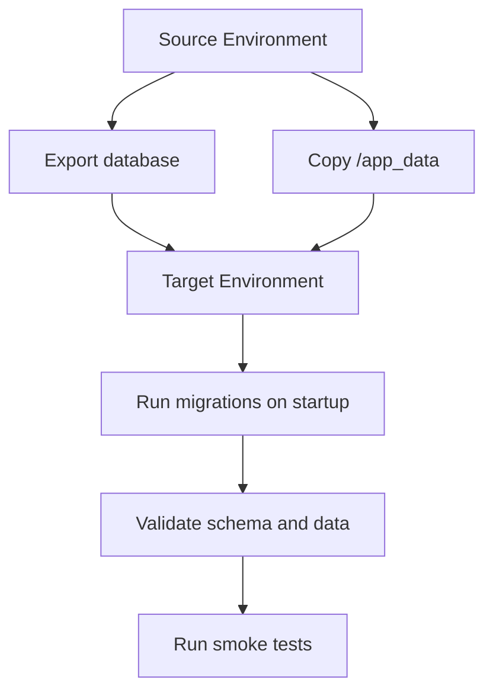
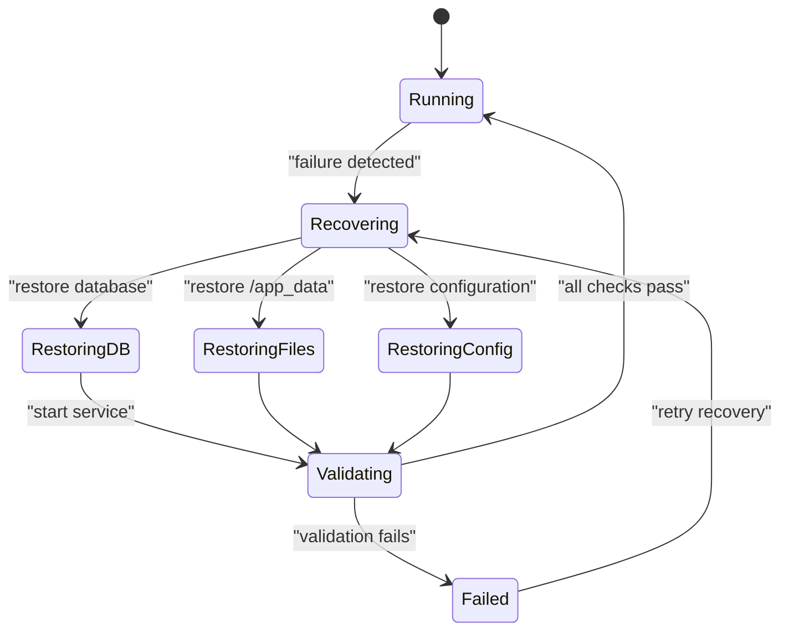
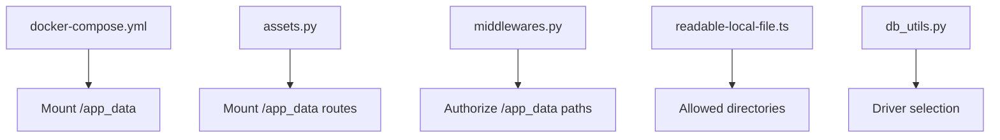

# Backup & Disaster Recovery

<cite>
**Referenced Files in This Document**
- [README.md](file://README.md)
- [docker-compose.yml](file://docker-compose.yml)
- [db_utils.py](file://servers/fastapi/utils/db_utils.py)
- [user_config_store.py](file://servers/fastapi/utils/user_config_store.py)
- [provider_settings.py](file://servers/fastapi/services/provider_settings.py)
- [assets.py](file://servers/fastapi/api/v1/auth/assets.py)
- [middlewares.py](file://servers/fastapi/api/middlewares.py)
- [readable-local-file.ts](file://servers/nextjs/lib/readable-local-file.ts)
- [route.ts](file://servers/nextjs/app/api/read-file/route.ts)
- [test_user_config_store.py](file://servers/fastapi/tests/unit/test_user_config_store.py)
- [test_migrations.py](file://servers/fastapi/tests/unit/test_migrations.py)
</cite>

## Table of Contents
1. [Introduction](#introduction)
2. [Project Structure](#project-structure)
3. [Core Components](#core-components)
4. [Architecture Overview](#architecture-overview)
5. [Detailed Component Analysis](#detailed-component-analysis)
6. [Dependency Analysis](#dependency-analysis)
7. [Performance Considerations](#performance-considerations)
8. [Troubleshooting Guide](#troubleshooting-guide)
9. [Conclusion](#conclusion)
10. [Appendices](#appendices)

## Introduction
This document defines backup and disaster recovery procedures for Presenton deployments. It explains how to back up the database, file storage, and configuration; how to automate backups with retention policies; how to verify backups; how to migrate data between environments; and how to recover from corruption or system failures. It also covers off-site storage options and compliance considerations.

Presenton stores:
- Application data under a persistent volume mounted at `/app_data`.
- The default SQLite database as `fastapi.db` inside application data when no external database is configured.
- Provider settings in the database with a compatibility mirror to a legacy JSON configuration file.
- User assets such as images, uploads, exports, fonts, templates, and temporary files under controlled directories.

## Project Structure
The deployment surface relevant to backup and recovery includes:
- Docker Compose service definitions that mount `/app_data` and pass environment variables for database and application behavior.
- FastAPI utilities that determine the database URL, driver selection, and connection arguments.
- Configuration persistence utilities that create atomic writes and `.bak` backups for user configuration.
- Asset serving and authorization middleware that expose only allowed subdirectories under `/app_data`.
- Next.js helpers that restrict readable local file paths to safe app data directories.

**Diagram sources**
- [docker-compose.yml:13-15](file://docker-compose.yml#L13-L15)
- [db_utils.py:57-71](file://servers/fastapi/utils/db_utils.py#L57-L71)
- [assets.py:19-24](file://servers/fastapi/api/v1/auth/assets.py#L19-L24)
- [middlewares.py:135-146](file://servers/fastapi/api/middlewares.py#L135-L146)

**Section sources**
- [docker-compose.yml:13-15](file://docker-compose.yml#L13-L15)
- [README.md:486-492](file://README.md#L486-L492)

## Core Components
- Database layer: Determines whether to use SQLite or an external database, selects async drivers, and prepares connection arguments.
- File storage layer: Serves and authorizes access to `/app_data` subdirectories.
- Configuration layer: Persists provider settings in the database and mirrors selected values to a legacy JSON file with atomic writes and `.bak` backups.
- Deployment layer: Mounts `/app_data`, exposes ports, and passes environment variables for database and runtime behavior.

**Section sources**
- [db_utils.py:34-100](file://servers/fastapi/utils/db_utils.py#L34-L100)
- [assets.py:19-24](file://servers/fastapi/api/v1/auth/assets.py#L19-L24)
- [middlewares.py:135-146](file://servers/fastapi/api/middlewares.py#L135-L146)
- [user_config_store.py:17-22](file://servers/fastapi/utils/user_config_store.py#L17-L22)
- [provider_settings.py:84-100](file://servers/fastapi/services/provider_settings.py#L84-L100)
- [docker-compose.yml:13-15](file://docker-compose.yml#L13-L15)

## Architecture Overview
Presenton’s data protection surface consists of three primary artifacts:
1. Database: Either SQLite (`fastapi.db`) or an external database referenced by `DATABASE_URL`.
2. File storage: Persistent `/app_data` directory containing user assets, exports, fonts, templates, and temporary files.
3. Configuration: Database-backed provider settings plus a legacy JSON configuration file used for compatibility and recovery.

**Diagram sources**
- [docker-compose.yml:13-15](file://docker-compose.yml#L13-L15)
- [db_utils.py:57-71](file://servers/fastapi/utils/db_utils.py#L57-L71)

## Detailed Component Analysis

### Database Backup Strategy
- Default SQLite mode: When `DATABASE_URL` is unset, Presenton uses SQLite under application data. Back up the database file directly.
- External databases: When `DATABASE_URL` points to PostgreSQL or MySQL, back up the managed database instance according to your cloud or on-premises provider’s recommended procedure.
- Driver handling: The application normalizes driver prefixes for async runtime and sync migration tools.

Recommended actions:
- For SQLite: Stop the service or pause writes during backup if possible; otherwise rely on filesystem snapshots with consistent I/O.
- For external databases: Use native backup tools (for example, logical dumps or snapshot-based backups) and ensure migrations are not running concurrently.

**Diagram sources**
- [db_utils.py:57-71](file://servers/fastapi/utils/db_utils.py#L57-L71)
- [db_utils.py:103-126](file://servers/fastapi/utils/db_utils.py#L103-L126)

**Section sources**
- [db_utils.py:57-71](file://servers/fastapi/utils/db_utils.py#L57-L71)
- [db_utils.py:103-126](file://servers/fastapi/utils/db_utils.py#L103-L126)
- [README.md:486-492](file://README.md#L486-L492)

### File Storage Backup Strategy
- Persistent root: `/app_data` contains user-scoped images, uploads, exports, fonts, templates, and temporary files.
- Safe directories: The Next.js runtime allows reading only specific subdirectories under `/app_data` and temp directories.
- Web exposure: Only authorized subdirectories under `/app_data` are served through the asset router.

Recommended actions:
- Include the entire `/app_data` directory in backups.
- Exclude transient cache files if needed, but retain `images`, `uploads`, `exports`, `fonts`, `templates`, and user-scoped temp directories.
- Ensure ownership and permissions are preserved during copy or snapshot operations.

**Diagram sources**
- [readable-local-file.ts:29-73](file://servers/nextjs/lib/readable-local-file.ts#L29-L73)
- [assets.py:19-24](file://servers/fastapi/api/v1/auth/assets.py#L19-L24)

**Section sources**
- [readable-local-file.ts:29-73](file://servers/nextjs/lib/readable-local-file.ts#L29-L73)
- [assets.py:19-24](file://servers/fastapi/api/v1/auth/assets.py#L19-L24)
- [middlewares.py:135-146](file://servers/fastapi/api/middlewares.py#L135-L146)

### Configuration Backup Strategy
- Primary persistence: Provider settings are stored in the database.
- Compatibility mirror: Selected provider settings are mirrored to a legacy JSON configuration file.
- Atomic writes and backups: Configuration updates write atomically and maintain a `.bak` file. If the primary JSON is malformed, the backup is read automatically.

Recommended actions:
- Back up both the database and the legacy configuration file.
- Preserve `.bak` files because they can be used to recover configuration when the primary file is corrupted.
- Do not manually edit credential fields in the configuration file unless performing a controlled recovery operation.

**Diagram sources**
- [provider_settings.py:84-100](file://servers/fastapi/services/provider_settings.py#L84-L100)
- [user_config_store.py:154-199](file://servers/fastapi/utils/user_config_store.py#L154-L199)
- [test_user_config_store.py:8-16](file://servers/fastapi/tests/unit/test_user_config_store.py#L8-L16)

**Section sources**
- [provider_settings.py:84-100](file://servers/fastapi/services/provider_settings.py#L84-L100)
- [user_config_store.py:17-22](file://servers/fastapi/utils/user_config_store.py#L17-L22)
- [user_config_store.py:154-199](file://servers/fastapi/utils/user_config_store.py#L154-L199)
- [test_user_config_store.py:8-16](file://servers/fastapi/tests/unit/test_user_config_store.py#L8-L16)

### Automated Backup Scheduling and Retention Policies
Automate backups using your platform’s scheduler:
- Schedule frequent database backups for external databases.
- Schedule periodic snapshots or copies of `/app_data`.
- Implement retention policies based on RPO and RTO requirements.
- Rotate `.bak` configuration files and archive older backups securely.

Operational guidance:
- Run backups outside peak generation windows to reduce contention.
- Validate checksums or sizes after each backup.
- Test restore procedures regularly.

[No sources needed since this section provides general guidance]

### Backup Verification Procedures
Verification should confirm:
- Database schema and row counts match expectations.
- Critical tables exist and recent records are present.
- File storage contains expected assets and exports.
- Configuration can be parsed without errors.

Suggested checks:
- For SQLite: Open the database with a compatible reader and run simple queries.
- For external databases: Restore to a test instance and run health checks.
- For files: List key directories and validate sample assets.
- For configuration: Parse the JSON and `.bak` files and confirm required keys.

[No sources needed since this section provides general guidance]

### Data Migration Strategies Between Environments
Migration steps:
1. Export the source database using the provider’s native tool.
2. Copy `/app_data` from the source environment to the target environment.
3. Apply migrations on the target environment.
4. Validate provider settings and credentials.
5. Run smoke tests against presentation generation and export endpoints.

Version compatibility:
- Migrations are managed by Alembic and run on startup when enabled.
- Legacy database stamps may be applied before consolidated migrations.
- Tests cover stamping and repair paths for unversioned or partially versioned databases.

**Diagram sources**
- [test_migrations.py:736-843](file://servers/fastapi/tests/unit/test_migrations.py#L736-L843)
- [README.md:486-492](file://README.md#L486-L492)

**Section sources**
- [test_migrations.py:736-843](file://servers/fastapi/tests/unit/test_migrations.py#L736-L843)
- [README.md:486-492](file://README.md#L486-L492)

### Disaster Recovery Procedures
Recovery scenarios:

- Full system failure:
  - Provision a new host or container runtime.
  - Restore the latest database backup.
  - Restore `/app_data`.
  - Start the service and verify migrations.
  - Confirm login, asset access, and presentation generation.

- Database corruption:
  - Stop the service.
  - Replace the database with the latest known-good backup.
  - Restart and run migrations.
  - Validate critical entities and recent presentations.

- Configuration corruption:
  - Let the application fall back to the `.bak` file automatically.
  - If necessary, replace the primary configuration file with the `.bak` file.
  - Restart the service and verify provider settings.

[No sources needed since this diagram shows conceptual workflow, not actual code structure]

### Failover Mechanisms and Business Continuity Planning
- Prefer external databases for high availability and managed failover.
- Keep `/app_data` on durable, replicated storage where feasible.
- Maintain separate development, staging, and production backups.
- Define RPO and RTO targets and test failover drills regularly.
- Document runbooks for common failure modes and escalation paths.

[No sources needed since this section provides general guidance]

### Examples of Restoring From Backups
- Restore SQLite database:
  - Stop the service.
  - Replace `fastapi.db` with the backup.
  - Start the service and verify migrations.
- Restore external database:
  - Restore via provider tooling.
  - Set `DATABASE_URL` to point to the restored instance.
  - Start the service and verify connectivity.
- Restore `/app_data`:
  - Stop the service.
  - Replace `/app_data` with the backup.
  - Start the service and verify assets and exports.
- Restore configuration:
  - If the primary JSON is invalid, the application reads the `.bak` file automatically.
  - Otherwise, replace the primary file with the `.bak` file and restart.

**Section sources**
- [db_utils.py:57-71](file://servers/fastapi/utils/db_utils.py#L57-L71)
- [user_config_store.py:89-95](file://servers/fastapi/utils/user_config_store.py#L89-L95)
- [test_user_config_store.py:8-16](file://servers/fastapi/tests/unit/test_user_config_store.py#L8-L16)

### Handling Data Corruption
- Database corruption:
  - Stop writes.
  - Restore from the last verified backup.
  - Re-run migrations and validate schema.
- File corruption:
  - Identify affected directories under `/app_data`.
  - Remove or quarantine corrupted files.
  - Restore from backup and regenerate assets if needed.
- Configuration corruption:
  - Allow fallback to `.bak`.
  - If needed, replace the primary file with `.bak`.
  - Verify provider settings and authentication.

**Section sources**
- [user_config_store.py:89-95](file://servers/fastapi/utils/user_config_store.py#L89-L95)
- [test_user_config_store.py:8-16](file://servers/fastapi/tests/unit/test_user_config_store.py#L8-L16)

### Recovering From System Failures
- Container or VM failure:
  - Recreate the runtime.
  - Attach the persisted volume or restore `/app_data`.
  - Restore the database.
  - Start the service and verify.
- Network or storage outage:
  - Bring storage back online.
  - Verify file permissions and ownership.
  - Restart services and validate asset access.

[No sources needed since this section provides general guidance]

### Cloud Storage Integration Options and Off-Site Backups
- Store database backups in object storage with encryption and versioning.
- Replicate `/app_data` snapshots to off-site storage.
- Encrypt backups at rest and in transit.
- Restrict access to backup repositories using least-privilege IAM policies.
- Monitor backup jobs and alert on failures.

[No sources needed since this section provides general guidance]

### Compliance Considerations for Data Protection
- Classify sensitive data in presentations, uploads, and configuration.
- Encrypt backups and restrict access.
- Retain backups according to policy and legal requirements.
- Audit backup and restore operations.
- Avoid storing secrets in plain text; prefer provider-managed secret stores.

[No sources needed since this section provides general guidance]

## Dependency Analysis
Presenton’s backup-relevant dependencies include:
- Docker Compose mounting `/app_data`.
- FastAPI asset router exposing `/app_data` subdirectories.
- Middleware authorizing access to `/app_data`.
- Next.js runtime restricting readable local file paths.
- Database utilities selecting drivers and connection parameters.

**Diagram sources**
- [docker-compose.yml:13-15](file://docker-compose.yml#L13-L15)
- [assets.py:19-24](file://servers/fastapi/api/v1/auth/assets.py#L19-L24)
- [middlewares.py:135-146](file://servers/fastapi/api/middlewares.py#L135-L146)
- [readable-local-file.ts:29-73](file://servers/nextjs/lib/readable-local-file.ts#L29-L73)
- [db_utils.py:57-71](file://servers/fastapi/utils/db_utils.py#L57-L71)

**Section sources**
- [docker-compose.yml:13-15](file://docker-compose.yml#L13-L15)
- [assets.py:19-24](file://servers/fastapi/api/v1/auth/assets.py#L19-L24)
- [middlewares.py:135-146](file://servers/fastapi/api/middlewares.py#L135-L146)
- [readable-local-file.ts:29-73](file://servers/nextjs/lib/readable-local-file.ts#L29-L73)
- [db_utils.py:57-71](file://servers/fastapi/utils/db_utils.py#L57-L71)

## Performance Considerations
- Avoid concurrent backups and heavy generation workloads on the same disk to reduce I/O contention.
- Use snapshot-based backups for minimal write disruption.
- Tune database pool settings if using external databases.
- Separate backup storage from active storage to avoid resource competition.

**Section sources**
- [db_utils.py:34-54](file://servers/fastapi/utils/db_utils.py#L34-L54)

## Troubleshooting Guide
Common issues and resolutions:
- Cannot read configuration:
  - The application falls back to the `.bak` file when the primary JSON is invalid.
  - Verify permissions and content of both files.
- Unauthorized asset access:
  - Requests to `/app_data` must pass authorization middleware.
  - Ensure the request originates from an authenticated context.
- Next.js cannot read local files:
  - Only allowed directories under `/app_data` and temp directories are permitted.
  - Validate the requested path against allowed roots.

**Section sources**
- [user_config_store.py:89-95](file://servers/fastapi/utils/user_config_store.py#L89-L95)
- [middlewares.py:135-146](file://servers/fastapi/api/middlewares.py#L135-L146)
- [readable-local-file.ts:29-73](file://servers/nextjs/lib/readable-local-file.ts#L29-L73)
- [route.ts:8-34](file://servers/nextjs/app/api/read-file/route.ts#L8-L34)

## Conclusion
A robust Presenton backup and disaster recovery strategy centers on protecting three areas: the database, `/app_data`, and configuration. Automate backups, enforce retention, verify integrity, and practice restores. Use external databases for high availability, replicate off-site, and align procedures with compliance requirements.

[No sources needed since this section summarizes without analyzing specific files]

## Appendices

### Key Paths and Artifacts
- Application data: `/app_data`
- Default SQLite database: `fastapi.db`
- Configuration primary: `userConfig.json`
- Configuration backup: `userConfig.json.bak`
- Web-accessible prefix: `/app_data`

**Section sources**
- [docker-compose.yml:13-15](file://docker-compose.yml#L13-L15)
- [db_utils.py:57-71](file://servers/fastapi/utils/db_utils.py#L57-L71)
- [user_config_store.py:17-22](file://servers/fastapi/utils/user_config_store.py#L17-L22)
- [assets.py:19-24](file://servers/fastapi/api/v1/auth/assets.py#L19-L24)