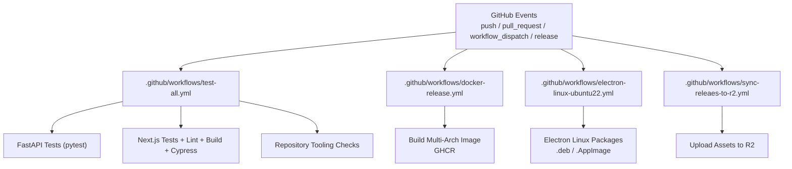
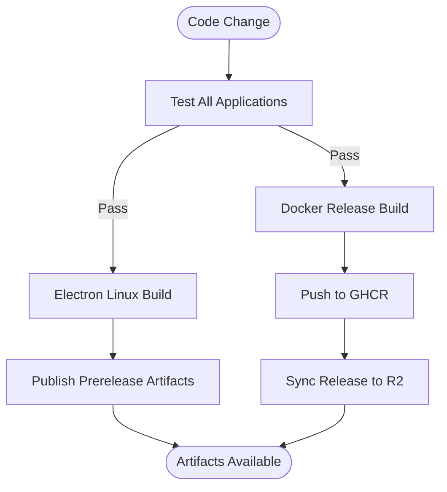
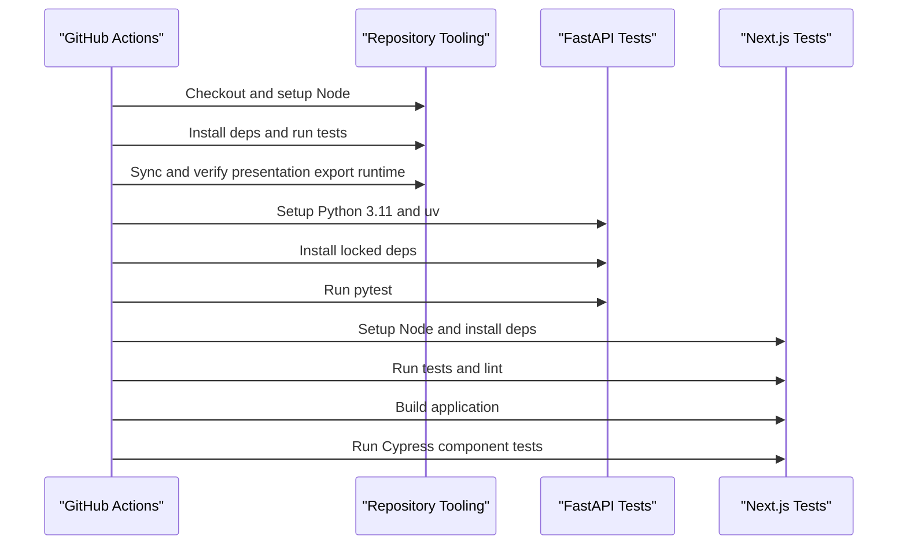
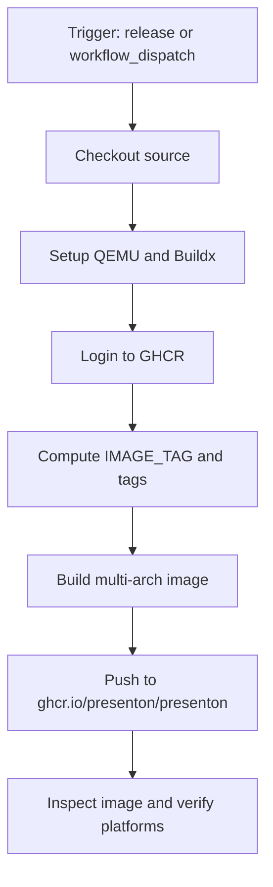
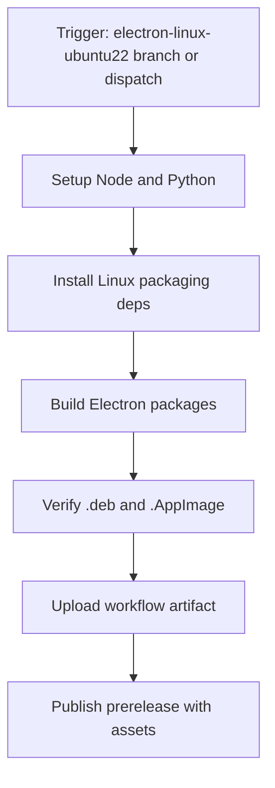
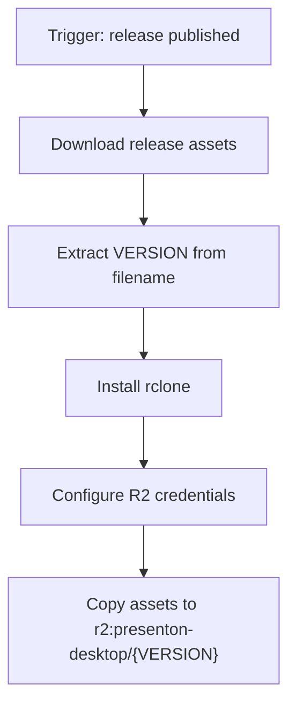
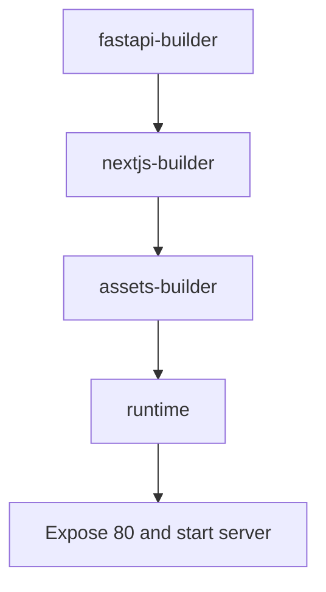
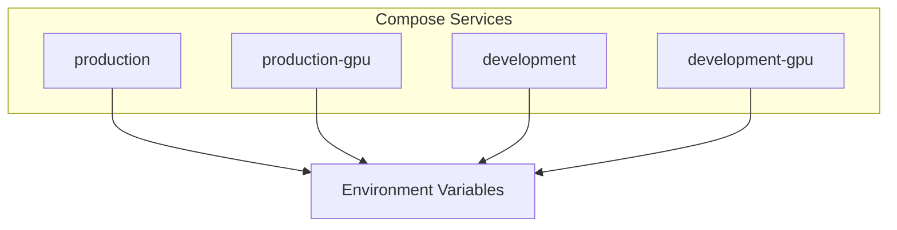
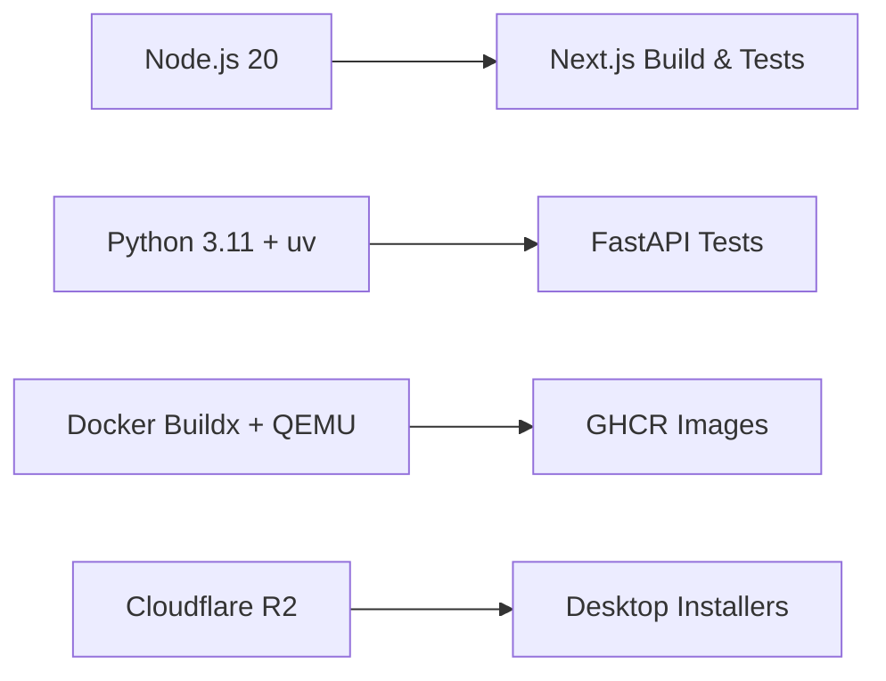

# CI/CD Pipelines

<cite>
**Referenced Files in This Document**
- [test-all.yml](file://.github/workflows/test-all.yml)
- [docker-release.yml](file://.github/workflows/docker-release.yml)
- [electron-linux-ubuntu22.yml](file://.github/workflows/electron-linux-ubuntu22.yml)
- [sync-releaes-to-r2.yml](file://.github/workflows/sync-releaes-to-r2.yml)
- [README.md](file://.github/workflows/README.md)
- [Dockerfile](file://Dockerfile)
- [docker-compose.yml](file://docker-compose.yml)
- [pyproject.toml](file://servers/fastapi/pyproject.toml)
- [package.json](file://servers/nexjs/package.json)
- [package.json](file://electron/package.json)
</cite>

## Table of Contents
1. [Introduction](#introduction)
2. [Project Structure](#project-structure)
3. [Core Components](#core-components)
4. [Architecture Overview](#architecture-overview)
5. [Detailed Component Analysis](#detailed-component-analysis)
6. [Dependency Analysis](#dependency-analysis)
7. [Performance Considerations](#performance-considerations)
8. [Troubleshooting Guide](#troubleshooting-guide)
9. [Conclusion](#conclusion)
10. [Appendices](#appendices)

## Introduction
This document explains Presenton’s continuous integration and deployment pipelines. It covers GitHub Actions workflows, automated testing strategies, build processes, code quality checks, linting, static analysis, artifact management, versioning, and environment-specific deployments. The goal is to help contributors understand how changes are validated and how releases are produced for Docker images and Electron desktop installers.

## Project Structure
Presenton’s CI/CD configuration lives under `.github/workflows`. There are four primary workflows:

- Test All Applications: validates repository tooling, FastAPI, and Next.js on push and pull requests to `main`, and can be manually triggered.
- Docker Release: builds multi-architecture Docker images and pushes them to the GitHub Container Registry.
- Electron Linux Ubuntu 22.04 Test Release: builds Electron packages for Linux and publishes a temporary prerelease asset.
- Upload Release to R2: copies published release assets to Cloudflare R2 storage.

**Diagram sources**
- [test-all.yml:1-112](file://.github/workflows/test-all.yml#L1-L112)
- [docker-release.yml:1-78](file://.github/workflows/docker-release.yml#L1-L78)
- [electron-linux-ubuntu22.yml:1-111](file://.github/workflows/electron-linux-ubuntu22.yml#L1-L111)
- [sync-releaes-to-r2.yml:1-54](file://.github/workflows/sync-releaes-to-r2.yml#L1-L54)

**Section sources**
- [README.md:1-64](file://.github/workflows/README.md#L1-L64)

## Core Components
- Test All Applications workflow enforces:
  - Repository tooling tests and presentation export runtime verification.
  - FastAPI unit and integration tests using Python 3.11 and locked dependencies.
  - Next.js unit tests, ESLint, production build, and Cypress component tests.
- Docker Release workflow builds and pushes multi-architecture images to GHCR with tags derived from release tags or a moving tag.
- Electron Linux Ubuntu 22.04 workflow builds deb and AppImage artifacts and uploads them as a prerelease.
- Upload Release to R2 workflow downloads release assets and syncs them to Cloudflare R2.

Key environment variables and scripts used by the workflows are defined in the root Dockerfile and docker-compose files, which also describe development and production service configurations.

**Section sources**
- [test-all.yml:1-112](file://.github/workflows/test-all.yml#L1-L112)
- [docker-release.yml:1-78](file://.github/workflows/docker-release.yml#L1-L78)
- [electron-linux-ubuntu22.yml:1-111](file://.github/workflows/electron-linux-ubuntu22.yml#L1-L111)
- [sync-releaes-to-r2.yml:1-54](file://.github/workflows/sync-releaes-to-r2.yml#L1-L54)
- [Dockerfile:1-146](file://Dockerfile#L1-L146)
- [docker-compose.yml:1-535](file://docker-compose.yml#L1-L535)

## Architecture Overview
The CI/CD system follows a layered approach:

- Validation Layer: Runs on every change to ensure code quality and correctness across all components.
- Build Layer: Produces container images and desktop installers.
- Distribution Layer: Publishes artifacts to registries and object storage.

**Diagram sources**
- [test-all.yml:1-112](file://.github/workflows/test-all.yml#L1-L112)
- [docker-release.yml:1-78](file://.github/workflows/docker-release.yml#L1-L78)
- [electron-linux-ubuntu22.yml:1-111](file://.github/workflows/electron-linux-ubuntu22.yml#L1-L111)
- [sync-releaes-to-r2.yml:1-54](file://.github/workflows/sync-releaes-to-r2.yml#L1-L54)

## Detailed Component Analysis

### Test All Applications Workflow
This workflow runs three major test groups:

- Repository Tooling
  - Installs Node dependencies and runs repository-level tests.
  - Synchronizes and verifies the bundled presentation export runtime.

- FastAPI Backend
  - Uses Python 3.11 and uv with locked dependencies.
  - Creates required directories for app data and temp storage.
  - Runs pytest with verbose output and short tracebacks.

- Next.js Frontend
  - Installs dependencies, runs unit tests, lints with ESLint, builds the application, and executes Cypress component tests.

**Diagram sources**
- [test-all.yml:14-39](file://.github/workflows/test-all.yml#L14-L39)
- [test-all.yml:40-76](file://.github/workflows/test-all.yml#L40-L76)
- [test-all.yml:77-112](file://.github/workflows/test-all.yml#L77-L112)

**Section sources**
- [test-all.yml:1-112](file://.github/workflows/test-all.yml#L1-L112)
- [pyproject.toml:56-86](file://servers/fastapi/pyproject.toml#L56-L86)
- [package.json:6-12](file://servers/nexjs/package.json#L6-L12)

### Docker Release Workflow
The Docker Release workflow:

- Triggers on manual dispatch or when a GitHub release is published.
- Sets up QEMU and Docker Buildx for multi-architecture builds.
- Logs in to the GitHub Container Registry.
- Computes image tags based on release tag or a moving tag.
- Builds and pushes images for linux/amd64 and linux/arm64.
- Verifies that both architectures are present in the final image.

**Diagram sources**
- [docker-release.yml:1-78](file://.github/workflows/docker-release.yml#L1-L78)

**Section sources**
- [docker-release.yml:1-78](file://.github/workflows/docker-release.yml#L1-L78)

### Electron Linux Ubuntu 22.04 Test Release Workflow
This workflow:

- Triggers on push to a specific branch or manual dispatch.
- Sets up Node.js and Python, installs packaging dependencies, and builds Electron packages.
- Verifies that deb and AppImage artifacts exist.
- Uploads artifacts as a workflow artifact.
- Publishes a temporary prerelease in a separate repository with attached assets.

**Diagram sources**
- [electron-linux-ubuntu22.yml:1-111](file://.github/workflows/electron-linux-ubuntu22.yml#L1-L111)

**Section sources**
- [electron-linux-ubuntu22.yml:1-111](file://.github/workflows/electron-linux-ubuntu22.yml#L1-L111)

### Upload Release to R2 Workflow
This workflow:

- Triggers on published releases.
- Downloads release assets matching common installer patterns.
- Extracts version from filenames.
- Installs rclone and configures Cloudflare R2 credentials.
- Copies assets to an R2 bucket under a versioned path.

**Diagram sources**
- [sync-releaes-to-r2.yml:1-54](file://.github/workflows/sync-releaes-to-r2.yml#L1-L54)

**Section sources**
- [sync-releaes-to-r2.yml:1-54](file://.github/workflows/sync-releaes-to-r2.yml#L1-L54)

### Build Process and Runtime Image
The Dockerfile defines a multi-stage build:

- FastAPI builder stage installs Python dependencies and warms caches.
- Next.js builder stage installs dependencies and builds the frontend.
- Assets builder stage prepares the presentation export runtime.
- Runtime stage installs system dependencies, copies built artifacts, and exposes port 80.

**Diagram sources**
- [Dockerfile:1-146](file://Dockerfile#L1-L146)

**Section sources**
- [Dockerfile:1-146](file://Dockerfile#L1-L146)

### Environment-Specific Deployments
The docker-compose file defines services for production, production-gpu, development, and development-gpu. These compose profiles expose environment variables for LLM providers, image generation, database configuration, authentication, and other runtime settings. They are intended for local and managed deployments rather than direct CI-driven environment promotion.

**Diagram sources**
- [docker-compose.yml:1-535](file://docker-compose.yml#L1-L535)

**Section sources**
- [docker-compose.yml:1-535](file://docker-compose.yml#L1-L535)

## Dependency Analysis
The CI pipeline depends on:

- Node.js 20+ for repository tooling and Next.js.
- Python 3.11 with uv for FastAPI.
- Docker Buildx and QEMU for multi-architecture images.
- GitHub Container Registry for image publishing.
- Cloudflare R2 for asset distribution.

**Diagram sources**
- [test-all.yml:1-112](file://.github/workflows/test-all.yml#L1-L112)
- [docker-release.yml:1-78](file://.github/workflows/docker-release.yml#L1-L78)
- [sync-releaes-to-r2.yml:1-54](file://.github/workflows/sync-releaes-to-r2.yml#L1-L54)

**Section sources**
- [test-all.yml:1-112](file://.github/workflows/test-all.yml#L1-L112)
- [docker-release.yml:1-78](file://.github/workflows/docker-release.yml#L1-L78)
- [sync-releaes-to-r2.yml:1-54](file://.github/workflows/sync-releaes-to-r2.yml#L1-L54)

## Performance Considerations
- Use dependency caching for npm and uv to reduce install times.
- Prefer locked dependency files (`uv.lock`, `package-lock.json`) for deterministic builds.
- Keep test environments minimal and isolated to avoid flaky external dependencies.
- Cache Docker layers via BuildKit and GitHub Actions cache where appropriate.
- Limit parallel image generation in tests to reduce resource contention.

[No sources needed since this section provides general guidance]

## Troubleshooting Guide
Common issues and resolutions:

- Missing Python or Node versions: Ensure the correct versions are installed in the runner environment.
- Locked dependency failures: Confirm that `uv.lock` and `package-lock.json` match the expected versions.
- Presentation export runtime mismatch: Re-run synchronization and verification steps.
- Docker multi-architecture build failures: Verify QEMU and Buildx setup and platform flags.
- R2 upload failures: Check R2 credentials and account ID configuration.

**Section sources**
- [test-all.yml:1-112](file://.github/workflows/test-all.yml#L1-L112)
- [docker-release.yml:1-78](file://.github/workflows/docker-release.yml#L1-L78)
- [sync-releaes-to-r2.yml:1-54](file://.github/workflows/sync-releaes-to-r2.yml#L1-L54)

## Conclusion
Presenton’s CI/CD pipelines provide comprehensive validation and release automation. The test workflow ensures code quality across FastAPI and Next.js, while the Docker and Electron workflows produce reproducible artifacts. The R2 sync workflow distributes desktop installers for public access. Contributors should follow the documented steps to customize workflows, add new jobs, and configure environment-specific deployments safely.

[No sources needed since this section summarizes without analyzing specific files]

## Appendices

### Customizing Workflows
- Add a new job by duplicating an existing job block and adjusting triggers, environment variables, and steps.
- Integrate additional linters or static analyzers into the Next.js or FastAPI jobs.
- Extend the Docker Release workflow to include additional platforms or registries.

**Section sources**
- [test-all.yml:1-112](file://.github/workflows/test-all.yml#L1-L112)
- [docker-release.yml:1-78](file://.github/workflows/docker-release.yml#L1-L78)

### Versioning Strategies
- Docker images use release tags or a moving tag for development builds.
- Desktop installers derive version from filenames during R2 sync.
- Electron package metadata includes version and export version fields.

**Section sources**
- [docker-release.yml:1-78](file://.github/workflows/docker-release.yml#L1-L78)
- [sync-releaes-to-r2.yml:1-54](file://.github/workflows/sync-releaes-to-r2.yml#L1-L54)
- [package.json:1-10](file://electron/package.json#L1-L10)

### Rollback Procedures
- For Docker images, roll back by redeploying the previous known-good image tag.
- For desktop installers, re-publish the desired version to R2 and update distribution links accordingly.
- Maintain clear tagging conventions to simplify rollback identification.

[No sources needed since this section provides general guidance]