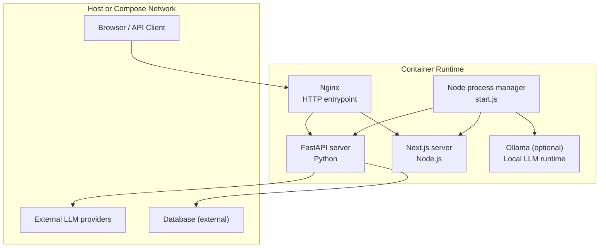
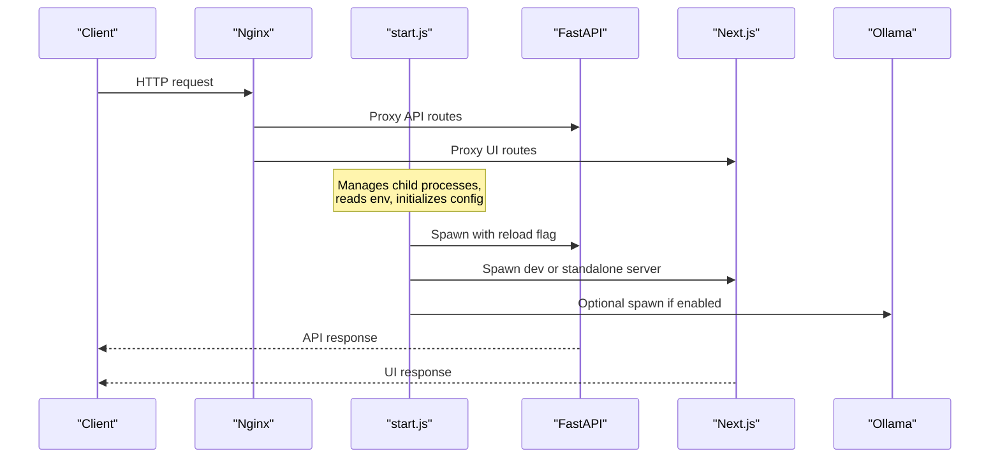
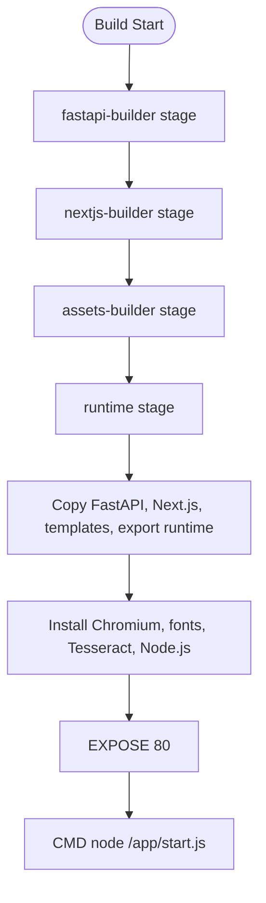
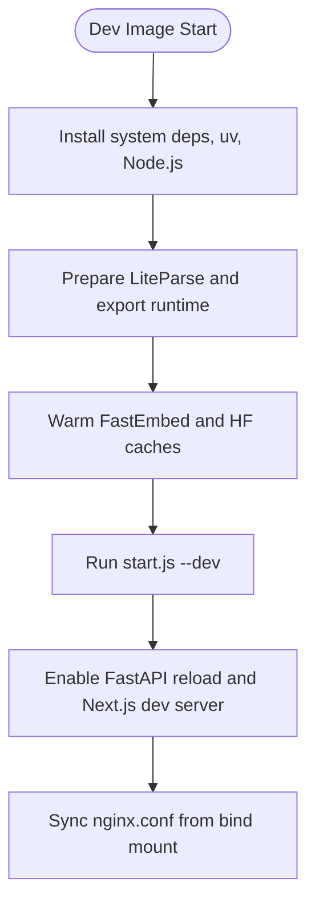
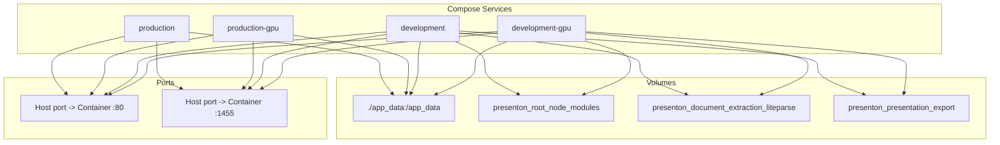
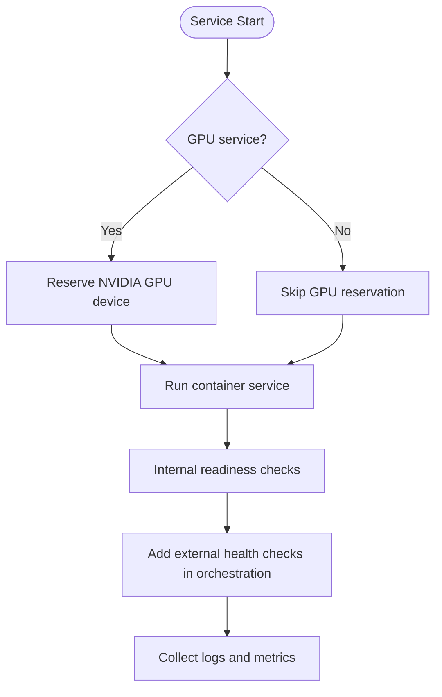
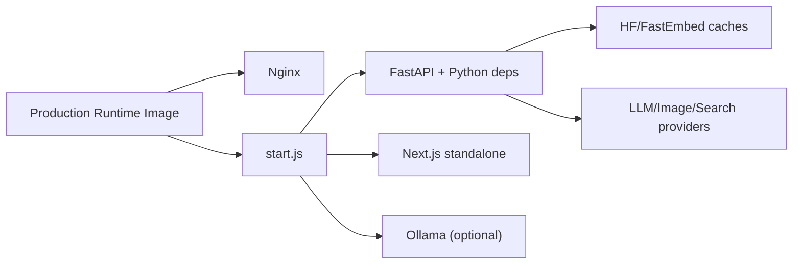

# Containerization & Docker

<cite>
**Referenced Files in This Document**   
- [Dockerfile](file://Dockerfile)
- [Dockerfile.dev](file://Dockerfile.dev)
- [docker-compose.yml](file://docker-compose.yml)
- [start.js](file://start.js)
- [nginx.conf](file://nginx.conf)
- [multi-docker-build.md](file://docs/multi-docker-build.md)
</cite>

## Table of Contents
1. [Introduction](#introduction)
2. [Project Structure](#project-structure)
3. [Core Components](#core-components)
4. [Architecture Overview](#architecture-overview)
5. [Detailed Component Analysis](#detailed-component-analysis)
6. [Dependency Analysis](#dependency-analysis)
7. [Performance Considerations](#performance-considerations)
8. [Troubleshooting Guide](#troubleshooting-guide)
9. [Conclusion](#conclusion)
10. [Appendices](#appendices)

## Introduction
This document explains Presenton’s containerization strategy and Docker deployment. It covers the multi-stage production build, development image setup with hot reloading and debugging, docker-compose orchestration for local environments, environment variable configuration, secrets handling, security best practices, customization examples, resource allocation, health checks, and monitoring integration.

The application runs inside a single container that starts Nginx as an external reverse proxy, then launches FastAPI, Next.js, and optional Ollama through a Node-based process manager script. The production image is optimized for size and startup performance using BuildKit caching, prebuilt dependencies, and a standalone Next.js server.

## Project Structure
The containerization surface area consists of:
- Production Dockerfile with multiple build stages.
- Development Dockerfile with system Python packages, dev tooling, and bind mounts.
- docker-compose.yml defining production, GPU-enabled production, development, and GPU-enabled development services.
- start.js orchestrating child processes, readiness checks, user configuration, and runtime asset synchronization.
- nginx.conf providing the HTTP entry point.
- Multi-architecture release documentation for GitHub Container Registry.

**Diagram sources**
- [start.js:44-47](file://start.js#L44-L47)
- [start.js:549-594](file://start.js#L549-L594)
- [start.js:686-707](file://start.js#L686-L707)
- [nginx.conf:1-200](file://nginx.conf#L1-L200)

**Section sources**
- [Dockerfile:1-146](file://Dockerfile#L1-L146)
- [Dockerfile.dev:1-94](file://Dockerfile.dev#L1-L94)
- [docker-compose.yml:1-535](file://docker-compose.yml#L1-L535)
- [start.js:1-767](file://start.js#L1-L767)

## Core Components
- Production image builder stages:
  - FastAPI builder stage installs Python dependencies and caches Hugging Face and FastEmbed assets.
  - Next.js builder stage builds the frontend into a standalone server.
  - Assets builder stage prepares presentation export tools and LiteParse dependencies.
  - Runtime stage installs Chromium, fonts, Tesseract, Node.js, and copies built artifacts.
- Development image:
  - Installs system Python packages, Node.js, uv, Chromium, Tesseract, and required fonts.
  - Prepares presentation export runtime and caches model weights at build time.
  - Uses system site-packages to avoid conflicts when binding the source tree.
- Process orchestration:
  - start.js manages Nginx, FastAPI, Next.js, and optional Ollama.
  - Performs readiness checks, user configuration initialization, and runtime dependency repair.
- docker-compose services:
  - production and production-gpu for containerized deployments.
  - development and development-gpu for local development with bind mounts.
  - Volume definitions for node_modules and presentation export cache.

**Section sources**
- [Dockerfile:3-146](file://Dockerfile#L3-L146)
- [Dockerfile.dev:1-94](file://Dockerfile.dev#L1-L94)
- [start.js:44-47](file://start.js#L44-L47)
- [start.js:549-594](file://start.js#L549-L594)
- [start.js:748-764](file://start.js#L748-L764)
- [docker-compose.yml:1-535](file://docker-compose.yml#L1-L535)

## Architecture Overview
Presenton’s container architecture uses Nginx as the public-facing HTTP server on port 80. Inside the container, start.js spawns FastAPI and Next.js on loopback ports and optionally starts Ollama if requested. In development mode, start.js also syncs the development nginx configuration from a bind mount and restarts child processes on clean exits.

**Diagram sources**
- [start.js:549-594](file://start.js#L549-L594)
- [start.js:686-707](file://start.js#L686-L707)
- [start.js:723-746](file://start.js#L723-L746)
- [nginx.conf:1-200](file://nginx.conf#L1-L200)

## Detailed Component Analysis

### Multi-Stage Production Dockerfile
The production Dockerfile defines four stages:
- fastapi-builder: Creates a virtual environment, exports dependencies with uv, installs them, and preloads spaCy language models and FastEmbed caches.
- nextjs-builder: Installs Node dependencies and builds Next.js into a standalone server.
- assets-builder: Initializes LiteParse and synchronizes presentation export runtime.
- runtime: Installs Chromium, fonts, Tesseract, Node.js, and copies all built artifacts. It exposes port 80 and runs start.js.

Key optimization techniques:
- BuildKit cache mounts for uv and npm caches.
- Precompiled bytecode and copy link mode for Python dependencies.
- Pre-warmed Hugging Face and FastEmbed caches baked into the image.
- Stripped non-Noto fonts to reduce image size.
- Standalone Next.js server for faster cold starts.
- Conditional Tesseract installation via ARG.

**Diagram sources**
- [Dockerfile:3-146](file://Dockerfile#L3-L146)

**Section sources**
- [Dockerfile:3-146](file://Dockerfile#L3-L146)

### Development Dockerfile
The development Dockerfile is designed for interactive development:
- Installs system Python packages and uv.
- Installs Node.js and prepares LiteParse and presentation export runtime.
- Caches model weights at build time to avoid per-run downloads.
- Uses system site-packages so bind-mounted source code works without conflicting venvs.
- Runs start.js in development mode with --dev flag.

Development-specific behaviors:
- Bind mounts allow live code changes.
- start.js detects development mode and enables FastAPI reload and Next.js dev server.
- Development nginx configuration can be synced from host.

**Diagram sources**
- [Dockerfile.dev:1-94](file://Dockerfile.dev#L1-L94)
- [start.js:40-42](file://start.js#L40-L42)
- [start.js:496-507](file://start.js#L496-L507)

**Section sources**
- [Dockerfile.dev:1-94](file://Dockerfile.dev#L1-L94)
- [start.js:40-42](file://start.js#L40-L42)
- [start.js:496-507](file://start.js#L496-L507)

### docker-compose Services and Networking
The compose file defines four services:
- production: Builds from Dockerfile, maps host port to container port 80, exposes OAuth callback port, mounts app_data and read-only templates.
- production-gpu: Same as production but reserves one NVIDIA GPU device.
- development: Builds from Dockerfile.dev, binds the entire source tree, caches node_modules and presentation export volumes, mounts app_data.
- development-gpu: Same as development but reserves one NVIDIA GPU device.

Networking and volume management:
- Host-to-container port mapping for HTTP and OAuth callback.
- Named volumes for node_modules, LiteParse package, and presentation export cache.
- Persistent app_data directory for exports, images, uploads, fonts, templates, and conversion outputs.

**Diagram sources**
- [docker-compose.yml:1-535](file://docker-compose.yml#L1-L535)

**Section sources**
- [docker-compose.yml:1-535](file://docker-compose.yml#L1-L535)

### Environment Variables and Secrets Management
Environment variables control:
- LLM provider selection and credentials.
- Image generation providers and keys.
- Web search and grounding options.
- Mem0 memory settings.
- LiteParse DPI and worker count.
- Authentication username/password and override behavior.
- Public URL and host HTTP port.

Secrets handling recommendations:
- Use Docker secrets or Kubernetes secrets for sensitive values such as API keys and database URLs.
- Avoid committing .env files with secrets; use secret managers or CI/CD secret injection.
- For local development, prefer environment files excluded from version control and validate required variables before starting services.
- Use AUTH_OVERRIDE_FROM_ENV carefully; it allows overriding stored authentication configuration from environment variables.

Important variables exposed by compose include:
- LLM provider keys and models: OPENAI_API_KEY, DEEPSEEK_API_KEY, GOOGLE_API_KEY, VERTEX_API_KEY, AZURE_OPENAI_API_KEY, BEDROCK_* variables, OPENROUTER_API_KEY, FIREWORKS_API_KEY, TOGETHER_API_KEY, CEREBRAS_API_KEY, ANTHROPIC_API_KEY, CUSTOM_LLM_API_KEY, LITELLM_API_KEY, LMSTUDIO_API_KEY, CODEX_MODEL.
- Image generation: IMAGE_PROVIDER, PEXELS_API_KEY, PIXABAY_API_KEY, GPT_IMAGE_2_QUALITY, GPT_IMAGE_1_5_QUALITY, COMFYUI_URL, OPEN_WEBUI_IMAGE_URL, OPENAI_COMPAT_IMAGE_BASE_URL.
- Web search: WEB_GROUNDING, WEB_SEARCH_PROVIDER, SEARXNG_BASE_URL, TAVILY_API_KEY, EXA_API_KEY, BRAVE_SEARCH_API_KEY, SERPER_API_KEY.
- Memory and embeddings: MEM0_* variables including embedder provider, model, dimensions, and spaCy model requirements.
- Runtime behavior: PRESENTATION_GENERATION_MODE, START_OLLAMA, DISABLE_ANONYMOUS_TRACKING, DATABASE_URL, MIGRATE_DATABASE_ON_STARTUP.

**Section sources**
- [docker-compose.yml:16-128](file://docker-compose.yml#L16-L128)
- [docker-compose.yml:150-262](file://docker-compose.yml#L150-L262)
- [docker-compose.yml:279-393](file://docker-compose.yml#L279-L393)
- [docker-compose.yml:417-529](file://docker-compose.yml#L417-L529)
- [start.js:517-525](file://start.js#L517-L525)

### Security Best Practices for Containers
- Run containers with minimal privileges and avoid root where possible.
- Pin base images and dependency versions to ensure reproducible builds.
- Scan images for vulnerabilities and enforce policies in CI.
- Restrict network access and expose only necessary ports.
- Use read-only mounts for static assets where feasible.
- Validate and sanitize environment variables before writing user configuration.
- Limit resource usage with CPU and memory constraints in orchestration platforms.
- Rotate secrets regularly and avoid logging sensitive values.

**Section sources**
- [Dockerfile:73-87](file://Dockerfile#L73-L87)
- [Dockerfile.dev:10-20](file://Dockerfile.dev#L10-L20)
- [docker-compose.yml:13-15](file://docker-compose.yml#L13-L15)
- [docker-compose.yml:148-149](file://docker-compose.yml#L148-L149)

### Customizing Docker Images
Common customizations:
- Change the host HTTP port by setting PRESENTON_HTTP_HOST_PORT or PRESENTON_HOST_HTTP_PORT.
- Disable Tesseract in production by building with INSTALL_TESSERACT=false.
- Override Chromium version and snapshot for specific security or compatibility needs.
- Add custom fonts by mounting a fonts directory or extending the runtime stage.
- Extend the assets builder to include additional Node packages for export workflows.
- Configure custom LLM endpoints and models through environment variables.

Example customization paths:
- Production build arguments and runtime environment: [Dockerfile:73-87](file://Dockerfile#L73-L87).
- Development environment and system packages: [Dockerfile.dev:10-49](file://Dockerfile.dev#L10-L49).
- Compose service overrides: [docker-compose.yml:1-535](file://docker-compose.yml#L1-L535).

**Section sources**
- [Dockerfile:73-87](file://Dockerfile#L73-L87)
- [Dockerfile.dev:10-49](file://Dockerfile.dev#L10-L49)
- [docker-compose.yml:1-535](file://docker-compose.yml#L1-L535)

### Resource Allocation, Health Checks, and Monitoring
Resource allocation:
- GPU reservations are defined for production-gpu and development-gpu services using NVIDIA driver and device count.
- CPU and memory limits should be configured at the orchestration layer (Docker Swarm, Kubernetes) based on workload characteristics.

Health checks:
- No explicit HEALTHCHECK directives are present in the compose file.
- Readiness is handled internally by start.js waiting for FastAPI and Next.js to respond or report ready output.
- For production orchestration, add external health checks against Nginx or internal endpoints.

Monitoring integration:
- Telemetry can be disabled via DISABLE_ANONYMOUS_TRACKING.
- Application logs are forwarded by start.js to the container stdout/stderr.
- Metrics and tracing should be integrated at the application level and exported to your monitoring stack.

**Diagram sources**
- [docker-compose.yml:136-142](file://docker-compose.yml#L136-L142)
- [docker-compose.yml:400-406](file://docker-compose.yml#L400-L406)
- [start.js:657-670](file://start.js#L657-L670)

**Section sources**
- [docker-compose.yml:136-142](file://docker-compose.yml#L136-L142)
- [docker-compose.yml:400-406](file://docker-compose.yml#L400-L406)
- [start.js:657-670](file://start.js#L657-L670)

## Dependency Analysis
The container depends on:
- Python FastAPI backend with preinstalled dependencies and cached models.
- Node.js Next.js frontend built as a standalone server.
- Nginx as the HTTP reverse proxy.
- Chromium for Puppeteer-based exports.
- Tesseract for OCR (optional).
- Optional Ollama runtime for local LLM inference.

**Diagram sources**
- [Dockerfile:121-146](file://Dockerfile#L121-L146)
- [start.js:549-594](file://start.js#L549-L594)
- [start.js:686-707](file://start.js#L686-L707)

**Section sources**
- [Dockerfile:121-146](file://Dockerfile#L121-L146)
- [start.js:549-594](file://start.js#L549-L594)
- [start.js:686-707](file://start.js#L686-L707)

## Performance Considerations
- Use BuildKit cache mounts for uv and npm to speed up repeated builds.
- Precompile Python bytecode and use copy link mode to reduce install overhead.
- Warm model caches during build to avoid runtime downloads.
- Strip unnecessary fonts to minimize image size.
- Prefer standalone Next.js server in production for faster startup.
- Limit concurrent workers for LiteParse based on available resources.
- Enable parallel image generation only when needed to balance throughput and resource usage.

[No sources needed since this section provides general guidance]

## Troubleshooting Guide
Common issues and resolutions:
- Missing APP_DATA_DIRECTORY: start.js requires this environment variable; ensure it is set in compose or runtime.
- Presentation export runtime missing: start.js attempts to sync or repair dependencies; rebuild the image or clear volumes if Sharp native modules fail.
- Ollama not installed: If START_OLLAMA=true but binary is absent, start.js will attempt to install it; otherwise configure OLLAMA_URL for a remote daemon.
- Nginx configuration mismatch in development: start.js syncs nginx.conf from the source tree in dev mode; verify the mounted path.
- Port conflicts: Ensure PRESENTON_HTTP_HOST_PORT and OAuth callback port 1455 are available on the host.
- Permission errors on app_data: start.js sets directory modes best-effort; ensure the host volume permissions allow writing.

Operational checks:
- Verify FastAPI readiness endpoint responds on the internal port.
- Confirm Next.js reports ready output or serves requests.
- Inspect container logs for process startup messages and errors.

**Section sources**
- [start.js:48-51](file://start.js#L48-L51)
- [start.js:236-255](file://start.js#L236-L255)
- [start.js:456-470](file://start.js#L456-L470)
- [start.js:496-507](file://start.js#L496-L507)
- [start.js:657-670](file://start.js#L657-L670)

## Conclusion
Presenton’s containerization strategy emphasizes reproducibility, performance, and developer ergonomics. The multi-stage production build prebuilds and caches heavy dependencies, while the development image supports hot reloading and bind mounts. docker-compose provides consistent local environments with GPU support and persistent volumes. Environment variables and secrets should be managed securely, and health checks and monitoring should be added at the orchestration layer for production reliability.

[No sources needed since this section summarizes without analyzing specific files]

## Appendices

### Multi-Architecture Release Workflow
The repository includes documentation for publishing multi-architecture images to GitHub Container Registry. The workflow involves building native images per platform, pushing architecture-specific tags, creating a manifest, and promoting to latest.

**Section sources**
- [multi-docker-build.md:1-95](file://docs/multi-docker-build.md#L1-L95)