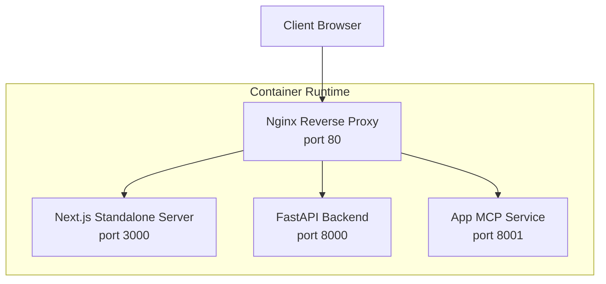
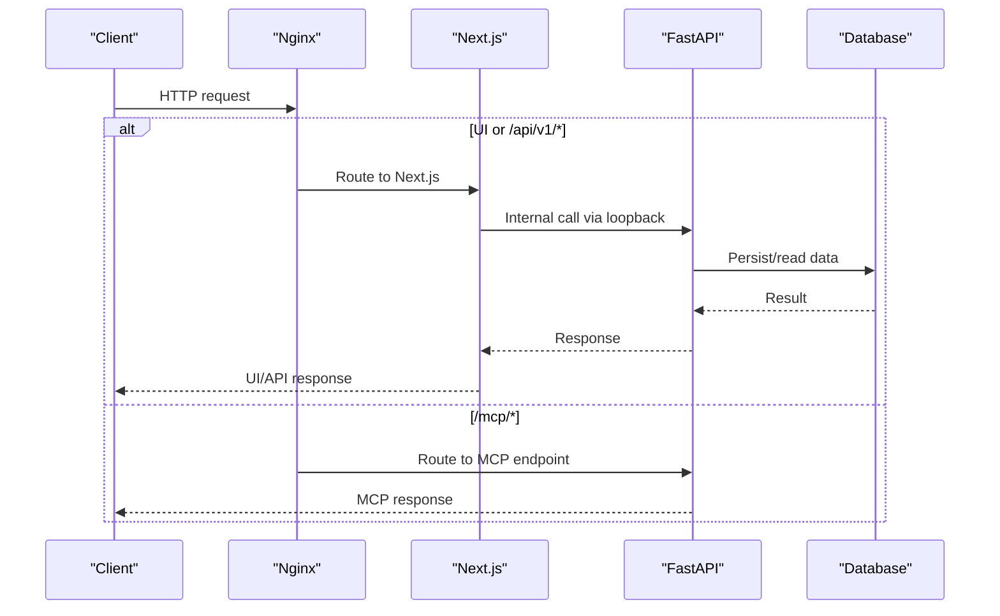
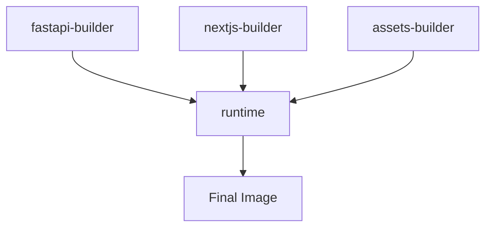
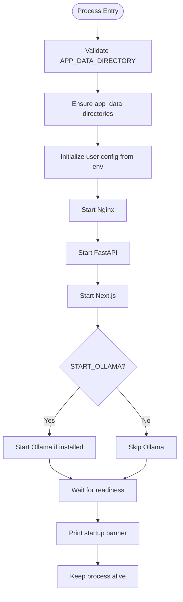
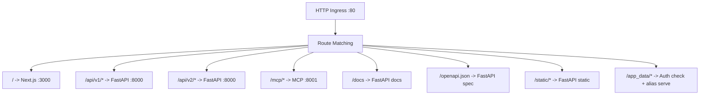
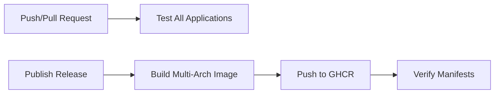
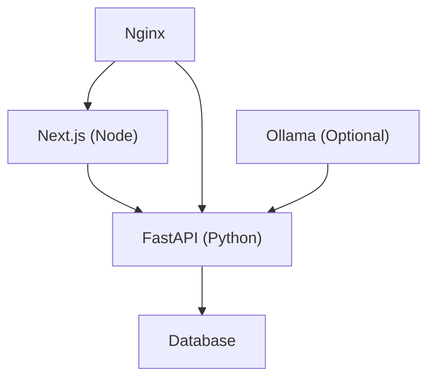

# Deployment & DevOps

<cite>
**Referenced Files in This Document**
- [Dockerfile](file://Dockerfile)
- [docker-compose.yml](file://docker-compose.yml)
- [nginx.conf](file://nginx.conf)
- [start.js](file://start.js)
- [.github/workflows/docker-release.yml](file://.github/workflows/docker-release.yml)
- [.github/workflows/test-all.yml](file://.github/workflows/test-all.yml)
- [.do/deploy.template.yaml](file://.do/deploy.template.yaml)
- [servers/fastapi/pyproject.toml](file://servers/fastapi/pyproject.toml)
- [servers/nextjs/package.json](file://servers/nextjs/package.json)
</cite>

## Table of Contents
1. [Introduction](#introduction)
2. [Project Structure](#project-structure)
3. [Core Components](#core-components)
4. [Architecture Overview](#architecture-overview)
5. [Detailed Component Analysis](#detailed-component-analysis)
6. [Dependency Analysis](#dependency-analysis)
7. [Performance Considerations](#performance-considerations)
8. [Troubleshooting Guide](#troubleshooting-guide)
9. [Conclusion](#conclusion)
10. [Appendices](#appendices)

## Introduction
This document provides production-grade deployment and operations guidance for Presenton. It covers containerization, multi-stage builds, orchestration patterns, environment configuration, CI/CD pipelines, monitoring and logging considerations, scaling and performance tuning, backup and disaster recovery, and troubleshooting. The guidance is grounded in the repository’s Dockerfile, docker-compose definitions, Nginx reverse proxy configuration, application bootstrap script, and GitHub Actions workflows.

## Project Structure
Presenton ships as a single container image that runs:
- Nginx as the external-facing reverse proxy on port 80
- Next.js (standalone server) on port 3000
- FastAPI backend on port 8000
- Optional Ollama runtime when enabled
- Presentation export tooling and embedded assets

**Diagram sources**
- [nginx.conf:25-107](file://nginx.conf#L25-L107)
- [start.js:44-46](file://start.js#L44-L46)

**Section sources**
- [Dockerfile:69-145](file://Dockerfile#L69-L145)
- [docker-compose.yml:1-129](file://docker-compose.yml#L1-L129)

## Core Components
- Container image builder: Multi-stage build producing optimized artifacts for FastAPI, Next.js, and presentation export assets.
- Application bootstrap: start.js orchestrates Nginx, FastAPI, Next.js, optional Ollama, and user configuration initialization.
- Reverse proxy: nginx.conf routes HTTP traffic to Next.js and FastAPI, enforces auth for sensitive static paths, and proxies MCP endpoints.
- Orchestration: docker-compose defines production and development profiles with GPU support and extensive environment variables.
- CI/CD: GitHub Actions workflows for testing and multi-arch image release.
- Cloud-native: DigitalOcean App Platform template for quick deployment.

**Section sources**
- [Dockerfile:1-145](file://Dockerfile#L1-L145)
- [start.js:48-108](file://start.js#L48-L108)
- [nginx.conf:1-214](file://nginx.conf#L1-L214)
- [docker-compose.yml:1-129](file://docker-compose.yml#L1-L129)
- [.github/workflows/docker-release.yml:1-78](file://.github/workflows/docker-release.yml#L1-L78)
- [.do/deploy.template.yaml:1-26](file://.do/deploy.template.yaml#L1-L26)

## Architecture Overview
The runtime architecture uses an internal loopback topology within the container. Nginx is the only externally exposed service. Next.js serves the UI and some API routes; FastAPI provides the core business logic and data persistence. Optional local LLM inference can be provided by Ollama.

**Diagram sources**
- [nginx.conf:29-69](file://nginx.conf#L29-L69)
- [start.js:549-594](file://start.js#L549-L594)

## Detailed Component Analysis

### Container Image and Multi-Stage Builds
The image is built in stages:
- fastapi-builder: installs Python dependencies and pre-warms model caches.
- nextjs-builder: builds the Next.js standalone server.
- assets-builder: prepares presentation export tooling and Node dependencies.
- runtime: final minimal image with Nginx, Chromium, fonts, and all compiled artifacts.

Key characteristics:
- Deterministic dependency resolution using uv.lock and package-lock.json.
- Pre-cached HuggingFace and FastEmbed assets baked into the image.
- Optional Tesseract OCR installation controlled by an ARG.
- Chromium pinned via snapshot source for reproducible headless rendering.

**Diagram sources**
- [Dockerfile:3-29](file://Dockerfile#L3-L29)
- [Dockerfile:32-44](file://Dockerfile#L32-L44)
- [Dockerfile:47-67](file://Dockerfile#L47-L67)
- [Dockerfile:69-145](file://Dockerfile#L69-L145)

**Section sources**
- [Dockerfile:1-145](file://Dockerfile#L1-L145)

### Application Bootstrap and Process Management
start.js performs:
- Ensures APP_DATA_DIRECTORY exists and has correct permissions.
- Initializes user configuration from environment variables.
- Starts Nginx, FastAPI, Next.js, and optionally Ollama.
- Waits for services to become ready before exposing the startup banner.
- Manages process lifecycle and graceful shutdown.

**Diagram sources**
- [start.js:48-108](file://start.js#L48-L108)
- [start.js:517-525](file://start.js#L517-L525)
- [start.js:723-763](file://start.js#L723-L763)

**Section sources**
- [start.js:48-108](file://start.js#L48-L108)
- [start.js:517-525](file://start.js#L517-L525)
- [start.js:723-763](file://start.js#L723-L763)

### Reverse Proxy and Security Boundaries
Nginx:
- Listens on port 80 and proxies to Next.js and FastAPI.
- Preserves Host and forwarded headers for correct URL generation.
- Enforces authentication for sensitive app_data paths via an internal auth subrequest.
- Serves static assets directly for performance.
- Proxies MCP endpoints to the internal MCP service.

Security notes:
- Static asset aliasing is constrained to prevent path traversal.
- Large file uploads are limited at the proxy layer.

**Diagram sources**
- [nginx.conf:25-107](file://nginx.conf#L25-L107)
- [nginx.conf:130-211](file://nginx.conf#L130-L211)

**Section sources**
- [nginx.conf:1-214](file://nginx.conf#L1-L214)

### Environment Configuration and Secrets
Environment-driven configuration is extensive. Key categories include:
- LLM providers and models (OpenAI, Google, Vertex, Azure OpenAI, Bedrock, Anthropic, Ollama, custom endpoints).
- Image generation providers and options.
- Web search grounding and providers.
- Database connection string.
- Authentication credentials and toggles.
- Feature flags (community mode, parallel image generation, reasoning modes).

Recommendations:
- Use a secrets manager to inject environment variables at runtime.
- Avoid committing secrets to version control.
- Validate required keys before starting the service.
- For Kubernetes, use Secrets and ConfigMaps; for Docker Compose, use .env files.

Operational variables observed:
- DATABASE_URL, AUTH_USERNAME, AUTH_PASSWORD, PRESENTON_PUBLIC_URL, START_OLLAMA, and many provider-specific keys.

**Section sources**
- [docker-compose.yml:16-129](file://docker-compose.yml#L16-L129)
- [docker-compose.yml:150-262](file://docker-compose.yml#L150-L262)
- [docker-compose.yml:279-393](file://docker-compose.yml#L279-L393)
- [docker-compose.yml:417-529](file://docker-compose.yml#L417-L529)

### Docker Compose Orchestration
Profiles:
- production: CPU-only, binds host port to container port 80, mounts persistent volumes.
- production-gpu: Adds NVIDIA device reservation for GPU workloads.
- development: Hot-reload friendly with bind mounts and cached node_modules.
- development-gpu: Development profile with GPU reservation.

Important behaviors:
- Persistent storage under ./app_data.
- Read-only templates mount for FastAPI templates.
- Codex OAuth callback port mapping to 1455.

**Section sources**
- [docker-compose.yml:1-129](file://docker-compose.yml#L1-L129)
- [docker-compose.yml:130-262](file://docker-compose.yml#L130-L262)
- [docker-compose.yml:264-393](file://docker-compose.yml#L264-L393)
- [docker-compose.yml:395-535](file://docker-compose.yml#L395-L535)

### CI/CD Pipelines
Testing workflow:
- Runs repository-level tests, FastAPI pytest suite, Next.js tests and lint, and Cypress component tests.
- Uses isolated working directories and temporary databases for tests.

Release workflow:
- Builds multi-architecture images (linux/amd64, linux/arm64).
- Publishes to GHCR with tags derived from releases or moving dev tag.
- Verifies multi-arch manifests post-build.

**Diagram sources**
- [.github/workflows/test-all.yml:1-112](file://.github/workflows/test-all.yml#L1-L112)
- [.github/workflows/docker-release.yml:1-78](file://.github/workflows/docker-release.yml#L1-L78)

**Section sources**
- [.github/workflows/test-all.yml:1-112](file://.github/workflows/test-all.yml#L1-L112)
- [.github/workflows/docker-release.yml:1-78](file://.github/workflows/docker-release.yml#L1-L78)

### Cloud-Native Deployment Options
DigitalOcean App Platform:
- Template deploys a single service from GHCR with environment variables for migration and Ollama toggle.
- Includes basic alerts for deployment and domain failures.

Kubernetes and Helm:
- No official Helm chart is present in this repository.
- Deploy using standard Kubernetes primitives: Deployment, Service, Ingress, PersistentVolumeClaim, Secret, and ConfigMap.
- Expose port 80 via Ingress; map to container port 80.
- Mount PVCs to /app_data for persistence.
- Inject secrets via Kubernetes Secrets and reference them in environment variables.

OpenShift:
- Similar to Kubernetes; ensure SCC allows necessary capabilities and volume mounts.

**Section sources**
- [.do/deploy.template.yaml:1-26](file://.do/deploy.template.yaml#L1-L26)

## Dependency Analysis
Runtime components and their roles:
- FastAPI: Python web framework providing APIs, database migrations, and business logic.
- Next.js: React-based frontend serving the editor and dashboard.
- Nginx: Reverse proxy and static asset server.
- Optional Ollama: Local LLM inference runtime.

External dependencies:
- Database (configured via DATABASE_URL).
- External LLM providers and image generation services.
- System libraries for Chromium, fonts, and optional OCR.

**Diagram sources**
- [servers/fastapi/pyproject.toml:1-39](file://servers/fastapi/pyproject.toml#L1-L39)
- [servers/nextjs/package.json:1-94](file://servers/nextjs/package.json#L1-L94)
- [start.js:549-594](file://start.js#L549-L594)

**Section sources**
- [servers/fastapi/pyproject.toml:1-86](file://servers/fastapi/pyproject.toml#L1-L86)
- [servers/nextjs/package.json:1-94](file://servers/nextjs/package.json#L1-L94)
- [start.js:549-594](file://start.js#L549-L594)

## Performance Considerations
- Reverse proxy timeouts: Nginx read/send/connect timeouts are set to 30 minutes for long-running operations such as exports and streaming.
- Upload limits: client_max_body_size is configured per location to accommodate large files.
- Static assets: Nginx serves static files directly with caching headers to reduce backend load.
- Fonts: Only Noto fonts are retained to minimize image size while ensuring consistent rendering.
- Headless browser: Chromium is pinned and bundled for deterministic PDF/PPTX exports.
- Concurrency: worker_processes auto and worker_connections tuned for typical deployments.

Tuning recommendations:
- Adjust worker_connections based on expected concurrency.
- Tune client_max_body_size according to maximum upload sizes.
- Enable CDN or edge caching for static assets where appropriate.
- Monitor memory usage for Chromium-based exports and scale horizontally if needed.

**Section sources**
- [nginx.conf:1-214](file://nginx.conf#L1-L214)
- [Dockerfile:89-115](file://Dockerfile#L89-L115)

## Troubleshooting Guide
Common issues and resolutions:
- Missing APP_DATA_DIRECTORY: The bootstrap script requires this environment variable and will fail if not set.
- Permission errors on mounted volumes: The bootstrap attempts best-effort chmod; ensure the host volume is readable/writable by the container user.
- Sharp native module missing: In development, the bootstrap repairs root node_modules; otherwise rebuild the image.
- Ollama not found: If START_OLLAMA=true but Ollama binary is absent, either install it at runtime or point to a remote Ollama instance via OLLAMA_URL.
- Next.js or FastAPI not ready: The bootstrap waits for readiness signals; check logs for startup messages and health endpoints.
- Large file upload failures: Nginx returns 413 when exceeding configured limits; adjust client_max_body_size accordingly.
- Static asset access denied: Ensure proper authentication cookies or tokens are present for protected app_data paths.

Operational checks:
- Verify ports: 80 (Nginx), 3000 (Next.js), 8000 (FastAPI), 8001 (MCP).
- Confirm environment variables for database and provider keys.
- Inspect Nginx error logs and application stdout/stderr.

**Section sources**
- [start.js:48-51](file://start.js#L48-L51)
- [start.js:71-85](file://start.js#L71-L85)
- [start.js:236-255](file://start.js#L236-L255)
- [start.js:456-470](file://start.js#L456-L470)
- [start.js:657-670](file://start.js#L657-L670)
- [nginx.conf:71-74](file://nginx.conf#L71-L74)

## Conclusion
Presenton’s deployment model centers on a single container image that bundles Nginx, Next.js, FastAPI, and supporting tools. Production readiness is supported by multi-stage builds, comprehensive environment configuration, and CI/CD automation. While no official Helm chart is included, the stack maps cleanly onto Kubernetes primitives. Operators should focus on secure secrets management, persistent storage for app_data, and careful tuning of Nginx and resource allocations for high-traffic scenarios.

## Appendices

### Environment Variables Reference
- Database: DATABASE_URL
- Authentication: AUTH_USERNAME, AUTH_PASSWORD, AUTH_OVERRIDE_FROM_ENV, RESET_AUTH
- Public URL and host: PRESENTON_PUBLIC_URL, PRESENTON_HOST_HTTP_PORT
- LLM providers: OPENAI_API_KEY/MODEL, DEEPSEEK_*_*, GOOGLE_API_KEY/MODEL, VERTEX_*_*, AZURE_OPENAI_*_*, BEDROCK_*_*, ANTHROPIC_API_KEY/MODEL, OLLAMA_URL/MODEL, CUSTOM_LLM_*_*, LITELLM_*_*, LMSTUDIO_*_*, CODEX_MODEL
- Image generation: IMAGE_PROVIDER, PEXELS_API_KEY, PIXABAY_API_KEY, GPT_IMAGE_*_*, COMFYUI_URL/WORKFLOW, OPEN_WEBUI_IMAGE_*_*, OPENAI_COMPAT_IMAGE_*_*
- Reasoning and behavior: EXTENDED_REASONING, DISABLE_THINKING, LLM_GENERATION_PROFILE, LLM_MAX_OUTPUT_TOKENS, MAX_OUTLINE_WORDS, LLM_REASONING_MODE/EFFORT/BUDGET_TOKENS
- OpenRouter settings: OPENROUTER_*_*, OPENROUTER_ALLOW_FALLBACKS, OPENROUTER_REQUIRE_PARAMETERS, OPENROUTER_DATA_COLLECTION, OPENROUTER_ZDR
- Web grounding: WEB_GROUNDING, WEB_SEARCH_PROVIDER, WEB_SEARCH_MAX_RESULTS, SEARXNG_BASE_URL, TAVILY_API_KEY, EXA_API_KEY, BRAVE_SEARCH_API_KEY, SERPER_API_KEY
- Community and features: PRESENTON_COMMUNITY_ENABLED, DISABLE_ANONYMOUS_TRACKING
- Memory store: MEM0_*_*, including provider, model, spacy model, and directory
- Export tooling: LITEPARSE_DPI, LITEPARSE_NUM_WORKERS

**Section sources**
- [docker-compose.yml:16-129](file://docker-compose.yml#L16-L129)
- [docker-compose.yml:150-262](file://docker-compose.yml#L150-L262)
- [docker-compose.yml:279-393](file://docker-compose.yml#L279-L393)
- [docker-compose.yml:417-529](file://docker-compose.yml#L417-L529)