# Monitoring & Observability

<cite>
**Referenced Files in This Document**
- [sentry.ts](file://electron/app/preloads/sentry.ts)
- [main.ts](file://electron/app/sentry/main.ts)
- [main.py](file://servers/fastapi/api/main.py)
- [lifespan.py](file://servers/fastapi/api/lifespan.py)
- [test_app_logging.py](file://servers/fastapi/tests/unit/test_app_logging.py)
- [start.js](file://start.js)
- [nginx.conf](file://nginx.conf)
- [templatePreviewAnalytics.ts](file://servers/nxtjs/app/(presentation-generator)/template-preview/components/editor/templatePreviewAnalytics.ts)
- [chat-activity.ts](file://servers/nxtjs/app/(presentation-generator)/presentation/components/chat/chat-activity.ts)
- [chat.ts](file://servers/nxtjs/app/(presentation-generator)/services/api/chat.ts)
- [service.py](file://servers/fastapi/services/chat/service.py)
- [presenton-resource-usage.md](file://docs/presenton-resource-usage.md)
</cite>

## Table of Contents
1. [Introduction](#introduction)
2. [Project Structure](#project-structure)
3. [Core Components](#core-components)
4. [Architecture Overview](#architecture-overview)
5. [Detailed Component Analysis](#detailed-component-analysis)
6. [Dependency Analysis](#dependency-analysis)
7. [Performance Considerations](#performance-considerations)
8. [Troubleshooting Guide](#troubleshooting-guide)
9. [Conclusion](#conclusion)

## Introduction
This document explains monitoring and observability for Presenton deployments across the Electron desktop app, Next.js frontend, FastAPI backend, and container orchestration layers. It covers:
- Sentry integration for error tracking, performance monitoring, and user experience metrics
- Application logging strategies, structured logging patterns, and log aggregation
- Health checks, readiness probes, and liveness probes for containers
- Performance monitoring, resource utilization tracking, and bottleneck identification
- Custom metrics, dashboards, and alerting guidance
- Debugging tools, tracing mechanisms, and production troubleshooting methodologies

## Project Structure
Presenton’s observability spans multiple runtime boundaries:
- Electron main and renderer processes report errors, traces, and runtime context to Sentry
- The FastAPI backend initializes optional Sentry SDK support and configures application logging at startup
- The Next.js frontend emits analytics events and renders chat tool-call traces for user-facing diagnostics
- A Node orchestrator starts FastAPI, Next.js, and Nginx, and implements readiness detection
- Nginx proxies API documentation and OpenAPI endpoints
- Resource usage analysis is documented with CPU, memory, queue length, and heap observations

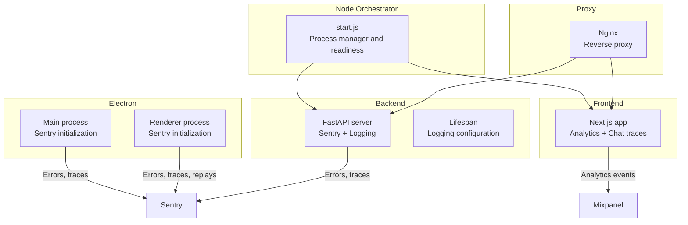

**Diagram sources**
- [main.ts:53-103](file://electron/app/sentry/main.ts#L53-L103)
- [sentry.ts:26-75](file://electron/app/preloads/sentry.ts#L26-L75)
- [main.py:32-63](file://servers/fastapi/api/main.py#L32-L63)
- [lifespan.py:19-42](file://servers/fastapi/api/lifespan.py#L19-L42)
- [start.js:297-444](file://start.js#L297-L444)
- [nginx.conf:110-128](file://nginx.conf#L110-L128)

**Section sources**
- [main.ts:53-103](file://electron/app/sentry/main.ts#L53-L103)
- [sentry.ts:26-75](file://electron/app/preloads/sentry.ts#L26-L75)
- [main.py:32-63](file://servers/fastapi/api/main.py#L32-L63)
- [lifespan.py:19-42](file://servers/fastapi/api/lifespan.py#L19-L42)
- [start.js:297-444](file://start.js#L297-L444)
- [nginx.conf:110-128](file://nginx.conf#L110-L128)

## Core Components
- Sentry Electron main process: Initializes error tracking, startup tracing, environment, release, sample rates, and runtime tags.
- Sentry Electron renderer process: Initializes browser tracing, session replays, feedback, and logs based on environment flags.
- FastAPI backend: Optionally initializes Sentry SDK using environment variables; configures application logging during lifespan startup.
- Next.js frontend: Emits analytics events via a centralized tracker and formats chat tool-call traces for UI activity.
- Orchestration script: Starts services, forwards logs, detects readiness by output lines or HTTP health checks, and manages lifecycle.
- Nginx: Proxies API docs and OpenAPI schema endpoints.

**Section sources**
- [main.ts:53-103](file://electron/app/sentry/main.ts#L53-L103)
- [sentry.ts:26-75](file://electron/app/preloads/sentry.ts#L26-L75)
- [main.py:32-63](file://servers/fastapi/api/main.py#L32-L63)
- [lifespan.py:19-42](file://servers/fastapi/api/lifespan.py#L19-L42)
- [templatePreviewAnalytics.ts:43-48](file://servers/nxtjs/app/(presentation-generator)/template-preview/components/editor/templatePreviewAnalytics.ts#L43-L48)
- [chat-activity.ts:196-261](file://servers/nxtjs/app/(presentation-generator)/presentation/components/chat/chat-activity.ts#L196-L261)
- [start.js:297-444](file://start.js#L297-L444)
- [nginx.conf:110-128](file://nginx.conf#L110-L128)

## Architecture Overview
The observability architecture connects client-side telemetry, backend instrumentation, and infrastructure-level readiness checks.

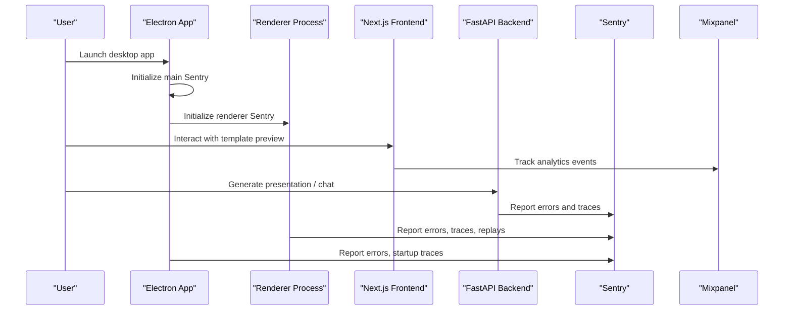

**Diagram sources**
- [main.ts:53-103](file://electron/app/sentry/main.ts#L53-L103)
- [sentry.ts:26-75](file://electron/app/preloads/sentry.ts#L26-L75)
- [templatePreviewAnalytics.ts:43-48](file://servers/nxtjs/app/(presentation-generator)/template-preview/components/editor/templatePreviewAnalytics.ts#L43-L48)
- [main.py:32-63](file://servers/fastapi/api/main.py#L32-L63)

## Detailed Component Analysis

### Sentry Integration

#### Electron Main Process
- Initializes Sentry with environment, release, debug, PII settings, and startup tracing.
- Sets process tags and runtime context including platform, versions, and packaged state.
- Provides helpers to capture exceptions, add breadcrumbs, and set runtime context safely.

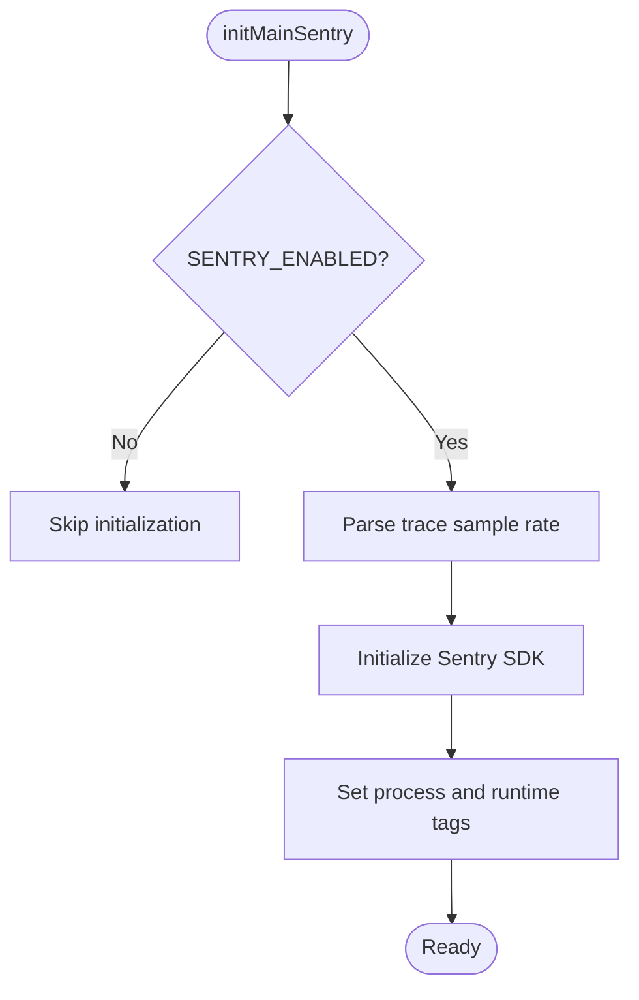

**Diagram sources**
- [main.ts:53-103](file://electron/app/sentry/main.ts#L53-L103)

**Section sources**
- [main.ts:53-103](file://electron/app/sentry/main.ts#L53-L103)

#### Electron Renderer Process
- Enables browser tracing, session replays, and feedback integrations based on environment flags.
- Configures trace and replay sampling rates and controls default PII and log emission.

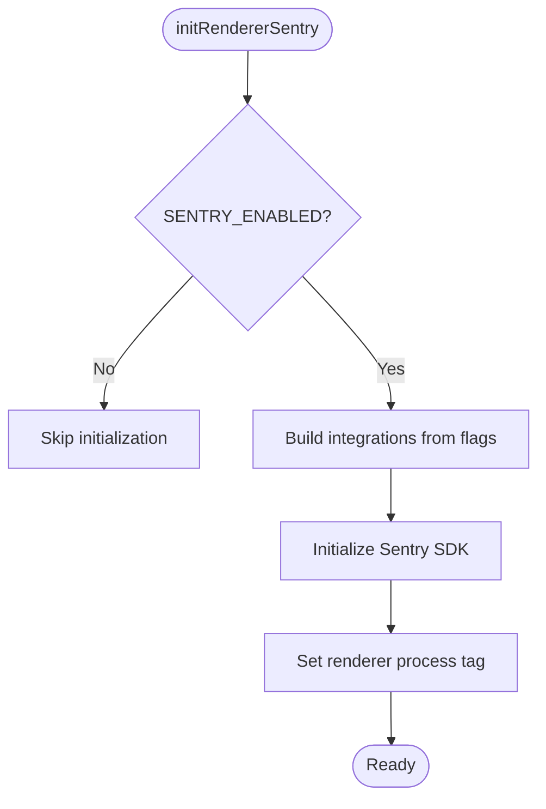

**Diagram sources**
- [sentry.ts:26-75](file://electron/app/preloads/sentry.ts#L26-L75)

**Section sources**
- [sentry.ts:26-75](file://electron/app/preloads/sentry.ts#L26-L75)

#### FastAPI Backend
- Conditionally initializes Sentry SDK when DSN is configured.
- Parses trace sample rate and PII settings from environment variables.
- Integrates with FastAPI middleware and routers after initialization.

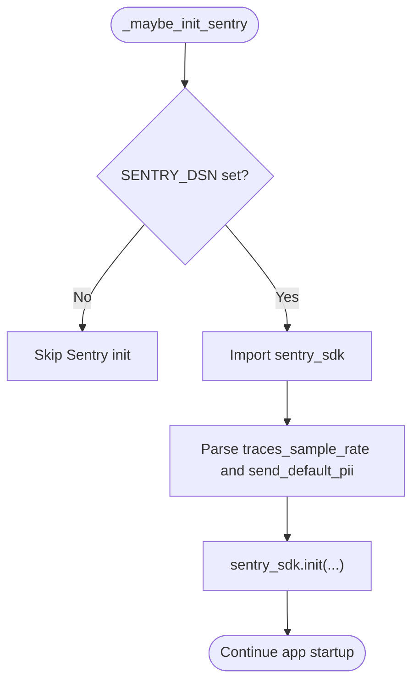

**Diagram sources**
- [main.py:32-63](file://servers/fastapi/api/main.py#L32-L63)

**Section sources**
- [main.py:32-63](file://servers/fastapi/api/main.py#L32-L63)

### Application Logging Strategy

#### Backend Logging Configuration
- Honors LOG_LEVEL (default INFO) and attaches visible handlers from Uvicorn to the root logger.
- Falls back to basic logging configuration if no handlers are present.
- Ensures template and export diagnostics are visible in terminal output.

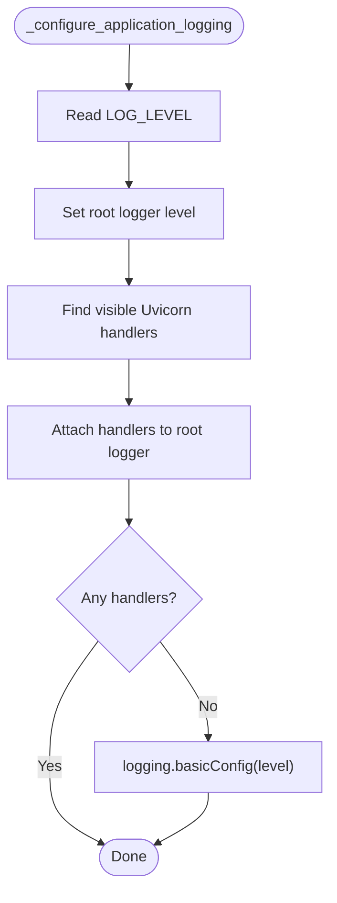

**Diagram sources**
- [lifespan.py:19-42](file://servers/fastapi/api/lifespan.py#L19-L42)

**Section sources**
- [lifespan.py:19-42](file://servers/fastapi/api/lifespan.py#L19-L42)
- [test_app_logging.py:7-35](file://servers/fastapi/tests/unit/test_app_logging.py#L7-L35)

#### Frontend Analytics and Telemetry
- Centralized analytics event names and tracking function forward events to Mixpanel.
- Utility functions sanitize error messages and enrich events with time-based properties.
- Page view hook ensures single page-view tracking per component mount.

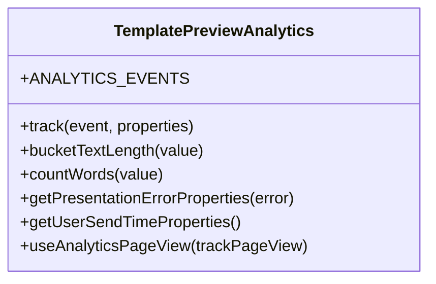

**Diagram sources**
- [templatePreviewAnalytics.ts:7-48](file://servers/nxtjs/app/(presentation-generator)/template-preview/components/editor/templatePreviewAnalytics.ts#L7-L48)
- [templatePreviewAnalytics.ts:50-103](file://servers/nxtjs/app/(presentation-generator)/template-preview/components/editor/templatePreviewAnalytics.ts#L50-L103)

**Section sources**
- [templatePreviewAnalytics.ts:7-103](file://servers/nxtjs/app/(presentation-generator)/template-preview/components/editor/templatePreviewAnalytics.ts#L7-L103)

### Health Checks, Readiness, and Liveness

#### Orchestration Readiness Detection
- Waits for Next.js readiness by matching output lines such as “Ready in” or “started server on”.
- For FastAPI in non-development mode, performs HTTP polling against an internal endpoint until it responds.
- Supports line-by-line stream inspection and timeout handling for both stdout and stderr.

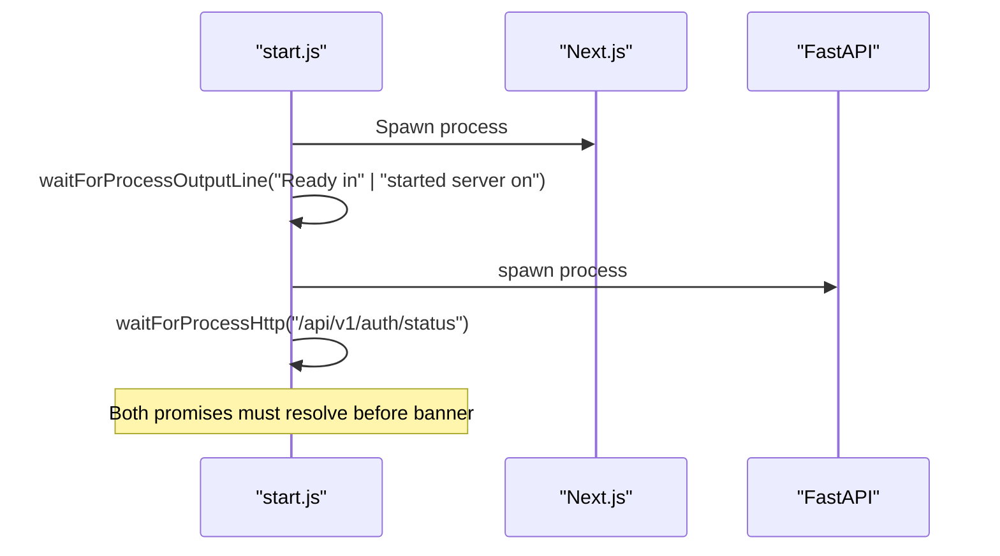

**Diagram sources**
- [start.js:297-358](file://start.js#L297-L358)
- [start.js:360-444](file://start.js#L360-L444)
- [start.js:657-670](file://start.js#L657-L670)

**Section sources**
- [start.js:297-358](file://start.js#L297-L358)
- [start.js:360-444](file://start.js#L360-L444)
- [start.js:657-670](file://start.js#L657-L670)

#### Container Health Endpoints
- The orchestrator uses `/api/v1/auth/status` as the FastAPI readiness probe target in non-development mode.
- Nginx proxies `/docs` and `/openapi.json` to FastAPI for developer access.

**Section sources**
- [start.js:657-670](file://start.js#L657-L670)
- [nginx.conf:110-128](file://nginx.conf#L110-L128)

### Performance Monitoring and Resource Utilization

#### Backend Tracing and Sampling
- FastAPI optionally enables Sentry tracing with configurable sample rate and PII policy.
- Trace sampling defaults to full sampling unless overridden by environment variables.

**Section sources**
- [main.py:32-63](file://servers/fastapi/api/main.py#L32-L63)

#### Frontend Tracing and Replays
- Renderer Sentry supports browser tracing and session replays controlled by environment flags and sample rates.
- Replay sampling can be tuned for all sessions and error-triggered replays independently.

**Section sources**
- [sentry.ts:38-70](file://electron/app/preloads/sentry.ts#L38-L70)

#### Desktop Startup Tracing
- Main process includes startup tracing integration to capture early boot issues.
- Release and environment metadata improve correlation between crashes and deployment versions.

**Section sources**
- [main.ts:65-81](file://electron/app/sentry/main.ts#L65-L81)

#### Resource Usage Analysis
- The repository documents a controlled concurrency workload with k6 and continuous container resource monitoring.
- Metrics include CPU utilization, processor queue length, memory utilization, available/free memory, and heap memory estimates.
- Interpretation notes clarify that heap_memory_mb is an aggregate estimate rather than a managed-runtime heap counter.
- The final-minute burst shows correlated increases in CPU, queue length, memory utilization, and heap memory, indicating compute and memory pressure.

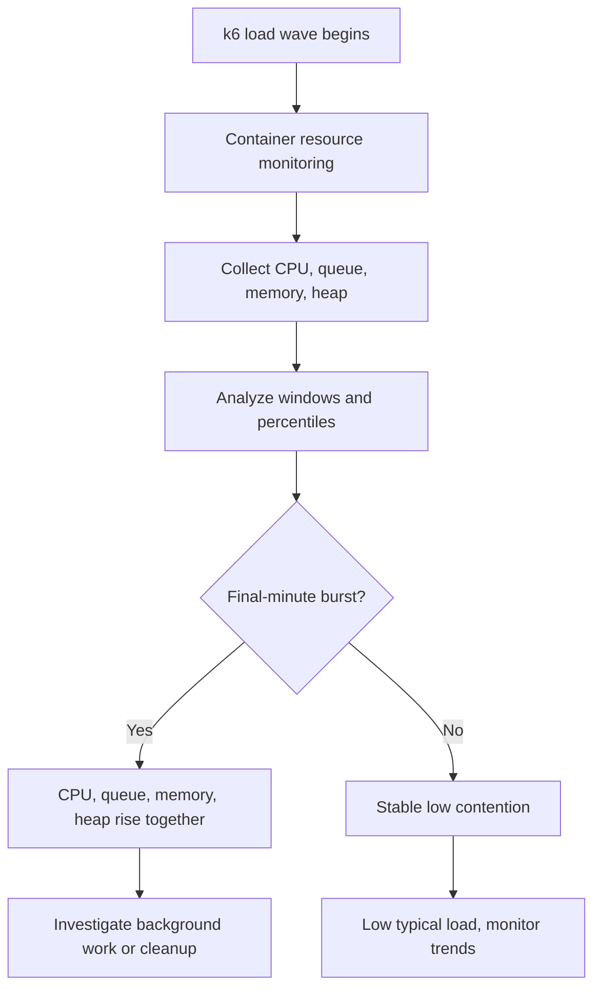

**Diagram sources**
- [presenton-resource-usage.md:23-33](file://docs/presenton-resource-usage.md#L23-L33)
- [presenton-resource-usage.md:74-147](file://docs/presenton-resource-usage.md#L74-L147)
- [presenton-resource-usage.md:151-170](file://docs/presenton-resource-usage.md#L151-L170)

**Section sources**
- [presenton-resource-usage.md:23-33](file://docs/presenton-resource-usage.md#L23-L33)
- [presenton-resource-usage.md:74-147](file://docs/presenton-resource-usage.md#L74-L147)
- [presenton-resource-usage.md:151-170](file://docs/presenton-resource-usage.md#L151-L170)

### Chat Tool-Call Traces and User Experience Metrics

#### Backend Trace Emission
- The chat service yields structured trace events for tool execution, including start, success, and error states.
- Trace payloads include round numbers, tool names, status, and summarized messages.

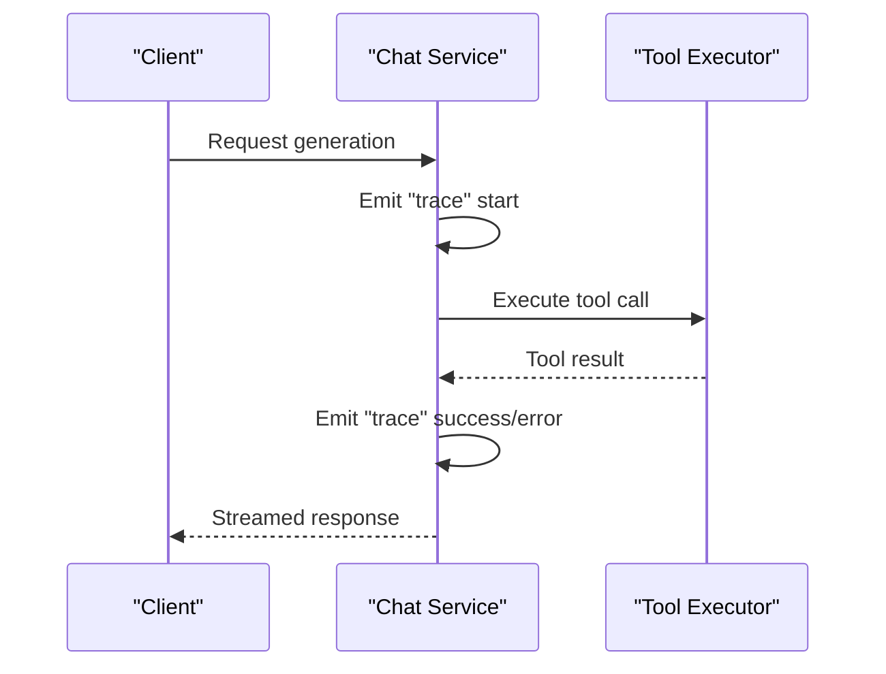

**Diagram sources**
- [service.py:201-227](file://servers/fastapi/services/chat/service.py#L201-L227)

**Section sources**
- [service.py:201-227](file://servers/fastapi/services/chat/service.py#L201-L227)

#### Frontend Trace Rendering
- The frontend formats trace activities into human-readable labels and states for the UI.
- It normalizes trace fields and maps slide indices for visual highlighting.

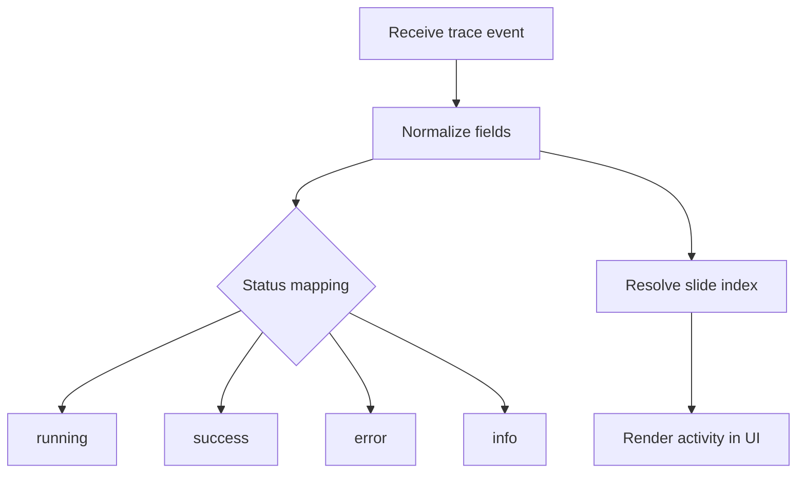

**Diagram sources**
- [chat-activity.ts:196-261](file://servers/nxtjs/app/(presentation-generator)/presentation/components/chat/chat-activity.ts#L196-L261)
- [chat.ts:230-260](file://servers/nxtjs/app/(presentation-generator)/services/api/chat.ts#L230-L260)

**Section sources**
- [chat-activity.ts:196-261](file://servers/nxtjs/app/(presentation-generator)/presentation/components/chat/chat-activity.ts#L196-L261)
- [chat.ts:230-260](file://servers/nxtjs/app/(presentation-generator)/services/api/chat.ts#L230-L260)

## Dependency Analysis
Observability dependencies connect environment-driven configuration to runtime behavior:
- Environment variables control Sentry enablement, tracing, replays, feedback, PII, and log levels.
- The orchestrator depends on service output lines and HTTP responses to determine readiness.
- Nginx depends on upstream ports to proxy API documentation and OpenAPI schemas.

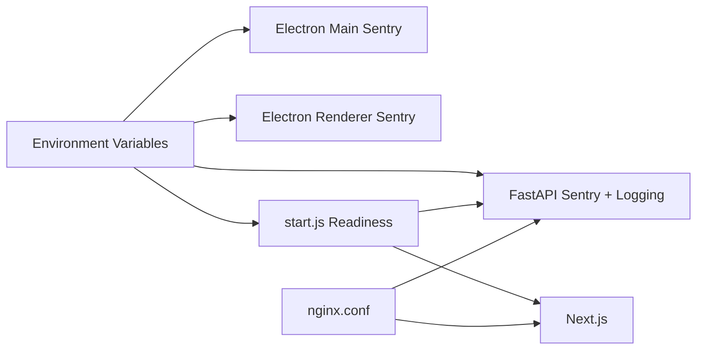

**Diagram sources**
- [main.ts:33-50](file://electron/app/sentry/main.ts#L33-L50)
- [sentry.ts:31-70](file://electron/app/preloads/sentry.ts#L31-L70)
- [main.py:32-63](file://servers/fastapi/api/main.py#L32-L63)
- [start.js:297-444](file://start.js#L297-L444)
- [nginx.conf:110-128](file://nginx.conf#L110-L128)

**Section sources**
- [main.ts:33-50](file://electron/app/sentry/main.ts#L33-L50)
- [sentry.ts:31-70](file://electron/app/preloads/sentry.ts#L31-L70)
- [main.py:32-63](file://servers/fastapi/api/main.py#L32-L63)
- [start.js:297-444](file://start.js#L297-L444)
- [nginx.conf:110-128](file://nginx.conf#L110-L128)

## Performance Considerations
- Use Sentry trace sampling conservatively in production to balance visibility and overhead.
- Enable session replays selectively; prefer error-triggered replays for high-fidelity debugging without excessive storage costs.
- Monitor CPU spikes, processor queue length, and memory utilization together to identify transient vs sustained bottlenecks.
- Treat heap memory growth as an aggregate signal; correlate with request stages and background tasks to distinguish expected allocation from retention.
- Extend readiness checks to include database connectivity and provider availability where appropriate.

[No sources needed since this section provides general guidance]

## Troubleshooting Guide

### Diagnosing Errors with Sentry
- Verify Sentry is enabled via environment variables in Electron main and renderer processes.
- Inspect runtime tags and contexts to correlate crashes with platform, versions, and packaged state.
- Use breadcrumbs and startup tracing to reconstruct pre-crash execution paths.

**Section sources**
- [main.ts:53-103](file://electron/app/sentry/main.ts#L53-L103)
- [sentry.ts:26-75](file://electron/app/preloads/sentry.ts#L26-L75)

### Investigating Backend Logs
- Confirm LOG_LEVEL is set appropriately and that Uvicorn handlers are attached to the root logger.
- Review template and export diagnostics emitted during application lifespan startup.

**Section sources**
- [lifespan.py:19-42](file://servers/fastapi/api/lifespan.py#L19-L42)
- [test_app_logging.py:7-35](file://servers/fastapi/tests/unit/test_app_logging.py#L7-L35)

### Resolving Readiness Failures
- Check whether Next.js outputs readiness markers or FastAPI responds to the readiness endpoint.
- Validate timeouts and retry intervals in the orchestrator’s readiness logic.

**Section sources**
- [start.js:297-358](file://start.js#L297-L358)
- [start.js:360-444](file://start.js#L360-L444)
- [start.js:657-670](file://start.js#L657-L670)

### Analyzing Performance Bursts
- Correlate CPU, queue, memory, and heap metrics during peak intervals.
- Identify whether bursts occur during active load or post-load cleanup.
- Add workload-stage markers and extend captures through idle recovery periods.

**Section sources**
- [presenton-resource-usage.md:119-147](file://docs/presenton-resource-usage.md#L119-L147)
- [presenton-resource-usage.md:151-170](file://docs/presenton-resource-usage.md#L151-L170)

## Conclusion
Presenton’s observability combines client-side error tracking, backend tracing, structured logging, and infrastructure readiness checks. Sentry provides cross-process error and performance insights, while the orchestrator and Nginx ensure reliable service startup and developer access to API documentation. Resource usage analysis highlights the importance of correlating CPU, queue, memory, and heap signals to distinguish transient spikes from persistent bottlenecks. By tuning sampling rates, enabling targeted replays, and extending readiness checks, operators can build robust dashboards and alerts that keep Presenton performant and resilient in production.