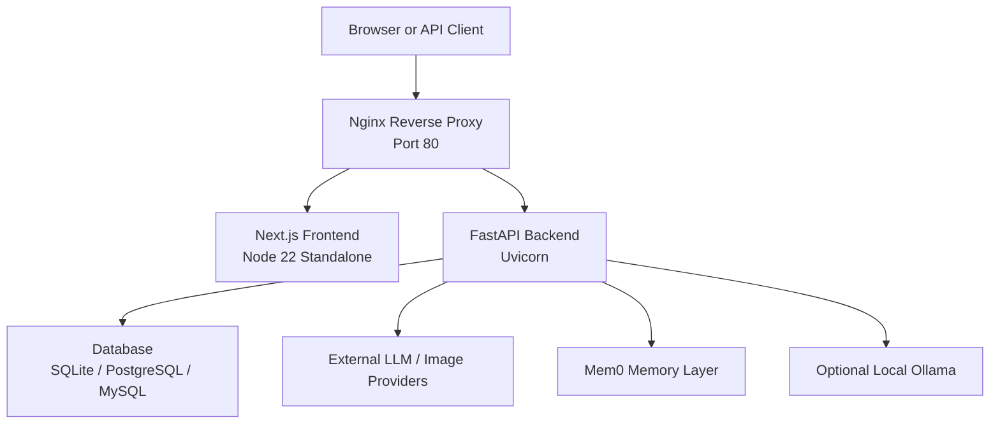
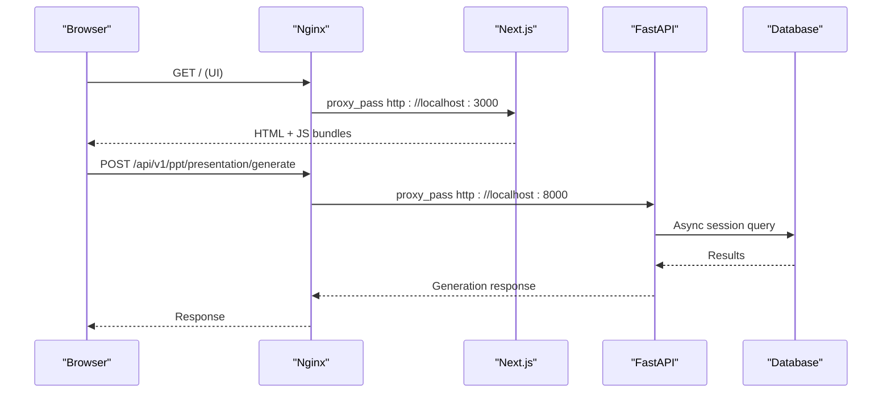
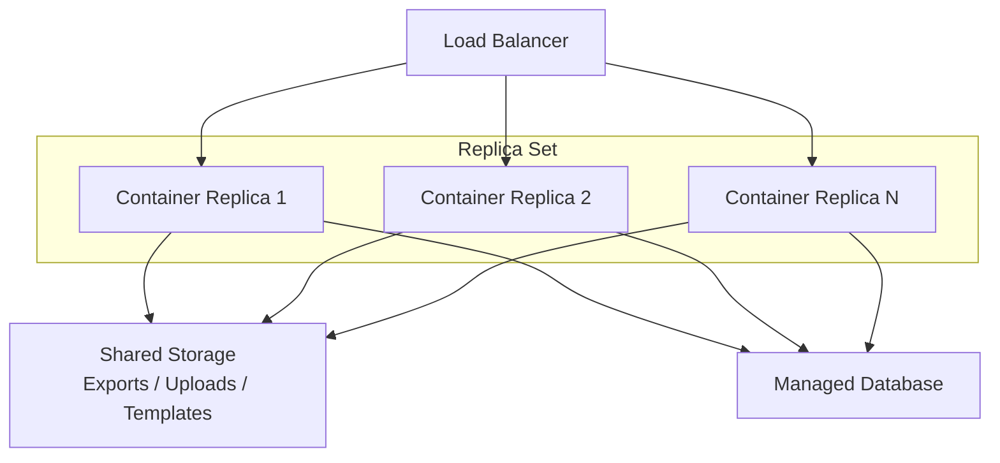
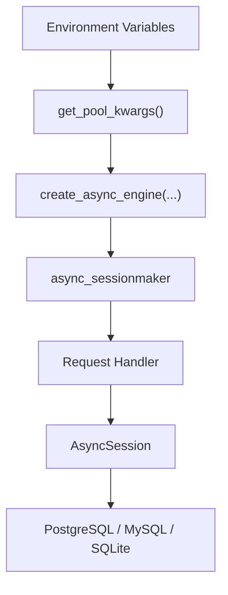
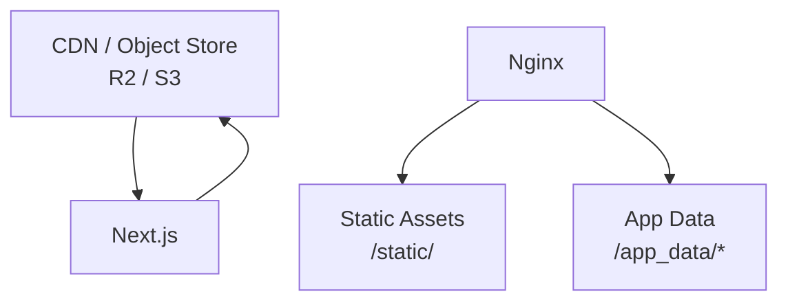
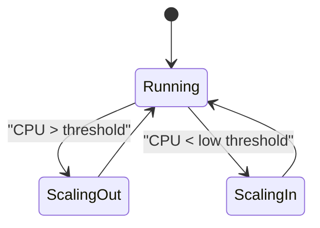
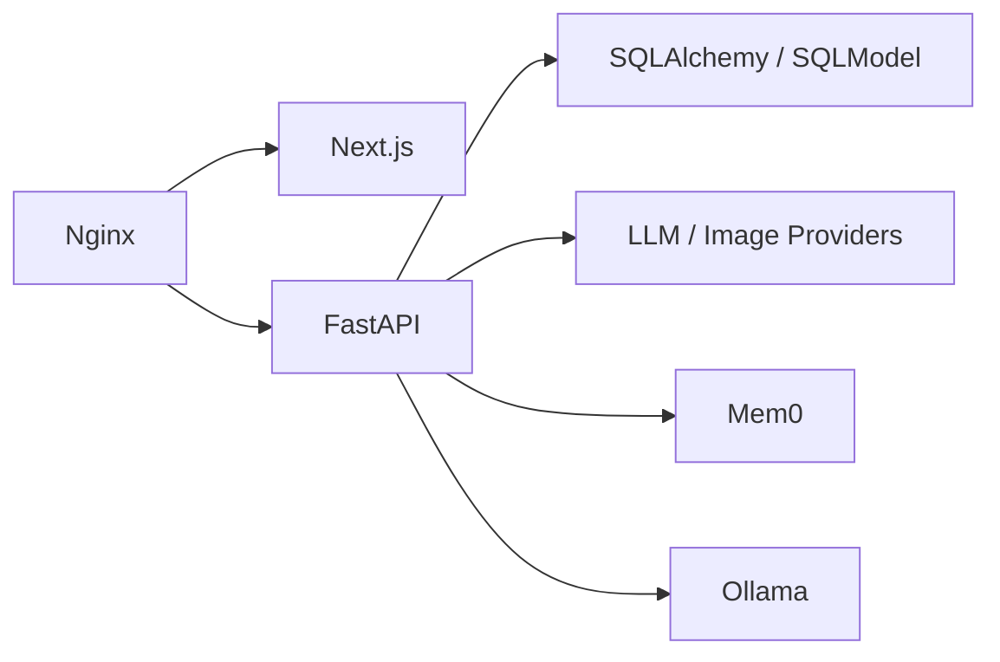

# Scaling & Performance Tuning

<cite>
**Referenced Files in This Document**   
- [README.md](file://README.md)
- [nginx.conf](file://nginx.conf)
- [docker-compose.yml](file://docker-compose.yml)
- [Dockerfile](file://Dockerfile)
- [server.py](file://servers/fastapi/server.py)
- [database.py](file://servers/fastapi/services/database.py)
- [db_utils.py](file://servers/fastapi/utils/db_utils.py)
- [next.config.mjs](file://servers/nex tjs/next.config.mjs)
- [runtime-limits.ts](file://servers/nex tjs/lib/runtime-limits.ts)
- [presenton-resource-usage.md](file://docs/presenton-resource-usage.md)
- [deploy.template.yaml](file:.do/deploy.template.yaml)
</cite>

## Table of Contents
1. [Introduction](#introduction)
2. [Project Structure](#project-structure)
3. [Core Components](#core-components)
4. [Architecture Overview](#architecture-overview)
5. [Detailed Component Analysis](#detailed-component-analysis)
6. [Dependency Analysis](#dependency-analysis)
7. [Performance Considerations](#performance-considerations)
8. [Troubleshooting Guide](#troubleshooting-guide)
9. [Conclusion](#conclusion)

## Introduction
This document explains how to scale Presenton applications and optimize performance in production environments. It covers horizontal and vertical scaling, load balancing with nginx, database connection pooling, memory management for Node.js and Python processes, caching and CDN integration, asset optimization, database scaling and indexing considerations, auto-scaling configuration examples, performance profiling tools, capacity planning methodologies, and common high-traffic bottlenecks.

Presenton ships a Next.js frontend, a FastAPI backend, an embedded nginx reverse proxy, and optional GPU-enabled runtime profiles. The repository provides Docker Compose configurations, environment variables, and deployment templates that form the foundation for production scaling.

## Project Structure
At a high level, the production image builds three layers:
- A FastAPI Python service built with uv and installed into a virtual environment.
- A Next.js standalone frontend built with Node 22.
- An assets layer bundling presentation export dependencies and LiteParse tooling.

The runtime container installs nginx, Chromium, fonts, ImageMagick, Node.js, and the application code, then starts the bundled entry point.



**Diagram sources**
- [Dockerfile:69-145](file://Dockerfile#L69-L145)
- [nginx.conf:25-107](file://nginx.conf#L25-L107)
- [server.py:1-29](file://servers/fastapi/server.py#L1-L29)

**Section sources**
- [Dockerfile:1-146](file://Dockerfile#L1-L146)
- [docker-compose.yml:1-129](file://docker-compose.yml#L1-L129)

## Core Components
- **Nginx**: Reverse proxy, static asset server, request size limits, WebSocket support, auth subrequests for protected app data, and long timeouts for generation endpoints.
- **Next.js Frontend**: Standalone build output, remote image allowlist, Electron-specific unoptimized image behavior, and runtime asset URL normalization.
- **FastAPI Backend**: Uvicorn-driven API, async SQLAlchemy engine, tenant-scoped ORM events, Alembic migrations, and configurable database pool settings.
- **Runtime Container**: Bundles Python, Node.js, nginx, Chromium, fonts, and presentation export tooling.

Key operational controls are exposed through environment variables defined in `docker-compose.yml` and documented in `README.md`.

**Section sources**
- [nginx.conf:1-214](file://nginx.conf#L1-L214)
- [next.config.mjs:1-72](file://servers/nex tjs/next.config.mjs#L1-L72)
- [server.py:1-29](file://servers/fastapi/server.py#L1-L29)
- [database.py:1-153](file://servers/fastapi/services/database.py#L1-L153)
- [README.md:345-520](file://README.md#L345-L520)

## Architecture Overview
The default production path routes browser traffic through nginx on port 80. Static UI assets and generated exports are served directly by nginx when safe; otherwise, requests are proxied to Next.js or FastAPI. Long-running operations such as presentation generation use extended proxy timeouts.



**Diagram sources**
- [nginx.conf:29-57](file://nginx.conf#L29-L57)
- [server.py:23-29](file://servers/fastapi/server.py#L23-L29)
- [database.py:34-53](file://servers/fastapi/services/database.py#L34-L53)

## Detailed Component Analysis

### Horizontal and Vertical Scaling Strategies

#### Horizontal Scaling
Horizontal scaling means running multiple identical instances behind a load balancer. In this repository:
- The Docker Compose file exposes ports and mounts shared `app_data`, which is important for multi-instance deployments where storage must be externalized.
- The README documents environment variables for LLM providers, image providers, database URLs, and feature flags that should be consistent across replicas.
- The DigitalOcean template shows a single instance configuration, but it demonstrates how to pass runtime environment variables and set instance count and size.

Recommended approach:
- Run multiple containers per replica set.
- Place a Kubernetes Ingress, Cloud Load Balancer, or nginx upstream cluster in front of them.
- Move `app_data` to a shared filesystem or object store if needed for exports and uploads.
- Use an external managed database instead of SQLite for multi-node safety.



**Diagram sources**
- [docker-compose.yml:1-129](file://docker-compose.yml#L1-L129)
- [deploy.template.yaml:1-25](file:.do/deploy.template.yaml#L1-L25)

**Section sources**
- [docker-compose.yml:1-129](file://docker-compose.yml#L1-L129)
- [README.md:345-520](file://README.md#L345-L520)
- [deploy.template.yaml:1-25](file:.do/deploy.template.yaml#L1-L25)

#### Vertical Scaling
Vertical scaling increases CPU, memory, and I/O capacity per instance. Relevant signals include:
- CPU utilization and processor queue length from resource usage reports.
- Heap memory spikes during presentation generation.
- Database connection saturation under concurrent workloads.

The resource usage report highlights that heap memory can grow significantly during workload bursts, so capacity planning should account for peak memory rather than only average usage.

**Section sources**
- [presenton-resource-usage.md:74-169](file://docs/presenton-resource-usage.md#L74-L169)

### Load Balancing and Reverse Proxy Configuration Using Nginx
Nginx is responsible for:
- Routing `/` to Next.js on port 3000.
- Routing `/api/v1/`, `/api/v2/`, `/mcp/`, `/mcp`, `/docs`, and `/openapi.json` to FastAPI on port 8000.
- Serving static and user-generated assets directly from disk.
- Enforcing authentication for sensitive app data paths using an internal auth subrequest.
- Setting large body size limits for file uploads and exports.
- Configuring long read/send/connect timeouts for generation-heavy endpoints.

```mermaid
flowchart TD
Start["Incoming Request"] --> PathCheck{"Path Match"}
PathCheck --> |"/"| NextJS["Proxy to Next.js :3000"]
PathCheck --> |"/api/v1/"| FastAPI["Proxy to FastAPI :8000"]
PathCheck --> |"/api/v2/"| FastAPI
PathCheck --> |"/mcp/"| MCP["Proxy to MCP :8001"]
PathCheck --> |"/mcp"| MCP
PathCheck --> |"/docs" or "/openapi.json"| FastAPIDocs["FastAPI Docs/OpenAPI"]
PathCheck --> |"/static/"| StaticAssets["Serve Static Assets"]
PathCheck --> |"/app_data/*"| AppData["Auth Check + Serve App Data"]
NextJS --> End["Response"]
FastAPI --> End
MCP --> End
FastAPIDocs --> End
StaticAssets --> End
AppData --> End
```

**Diagram sources**
- [nginx.conf:25-107](file://nginx.conf#L25-L107)
- [nginx.conf:130-213](file://nginx.conf#L130-L213)

Important tuning points:
- `worker_processes auto` and `worker_connections 1024` control nginx concurrency.
- `client_max_body_size` is increased for API and MCP routes.
- `proxy_read_timeout`, `proxy_send_timeout`, and `proxy_connect_timeout` are set to 30 minutes for long-running generation flows.
- Protected app data directories use `auth_request` against FastAPI’s verification endpoint.

**Section sources**
- [nginx.conf:1-214](file://nginx.conf#L1-L214)

### Database Connection Pooling and Scaling
The FastAPI backend uses SQLAlchemy async engines and SQLModel. For non-SQLite databases, connection pool parameters are applied; SQLite ignores pool settings because it uses a file-lock model.

Pool configuration is driven by environment variables:
- `DB_POOL_SIZE`: maximum persistent connections.
- `DB_MAX_OVERFLOW`: extra connections above pool size.
- `DB_POOL_TIMEOUT`: seconds to wait for a connection.
- `DB_POOL_RECYCLE`: seconds before recycling a connection.
- `DB_POOL_PRE_PING`: enable liveness checks.

The database module also applies tenant-scoped ownership criteria automatically for selected models and ensures foreign keys are enabled for SQLite.



**Diagram sources**
- [db_utils.py:34-54](file://servers/fastapi/utils/db_utils.py#L34-L54)
- [database.py:34-53](file://servers/fastapi/services/database.py#L34-L53)

Scaling recommendations:
- For PostgreSQL or MySQL, tune `DB_POOL_SIZE` based on worker count and database capacity.
- Increase `DB_MAX_OVERFLOW` cautiously to handle bursty workloads without overwhelming the database.
- Use `DB_POOL_RECYCLE` to avoid stale connections after database restarts.
- Keep `DB_POOL_PRE_PING` enabled unless you have a custom health-check strategy.
- Avoid SQLite in multi-replica deployments; use a managed relational database.

**Section sources**
- [db_utils.py:1-68](file://servers/fastapi/utils/db_utils.py#L1-L68)
- [database.py:1-153](file://servers/fastapi/services/database.py#L1-L153)

### Memory Management and Garbage Collection Tuning

#### Node.js Processes
The Next.js frontend runs as a standalone Node.js application. The repository includes a memory snapshot utility that reports RSS, heap used, heap total, external memory, and array buffers. This is useful for monitoring and alerting on Node.js memory pressure.

Recommendations:
- Monitor `rss_mb`, `heap_used_mb`, and `external_mb` from the memory snapshot utility.
- Set appropriate Node.js memory limits at the container or process level.
- Watch for large generated presentations, exported files, and image processing pipelines that may allocate significant heap or external memory.
- Use container orchestration health checks to restart nodes that exceed memory thresholds.

**Section sources**
- [runtime-limits.ts:1-34](file://servers/nex tjs/lib/runtime-limits.ts#L1-L34)

#### Python Processes
The FastAPI backend runs via Uvicorn. While the repository does not expose Python garbage collection flags directly in the startup script, production deployments should:
- Set Python memory limits through container orchestration.
- Monitor Python RSS and GC statistics externally.
- Tune database pool sizes to prevent excessive memory allocation per connection.
- Avoid holding large presentation payloads in memory longer than necessary.

**Section sources**
- [server.py:1-29](file://servers/fastapi/server.py#L1-L29)
- [database.py:34-53](file://servers/fastapi/services/database.py#L34-L53)

### Resource Limits for Node.js and Python
The Docker image installs both Node.js and Python runtimes. Production deployments should enforce:
- Container CPU and memory limits.
- Process-level limits where possible.
- Disk quotas for `app_data`, especially exports, uploads, and temporary presentation files.
- File upload limits aligned with nginx `client_max_body_size`.

The resource usage report shows that heap memory can spike during presentation generation, reinforcing the need for generous but bounded memory limits and robust restart policies.

**Section sources**
- [Dockerfile:69-145](file://Dockerfile#L69-L145)
- [presenton-resource-usage.md:119-169](file://docs/presenton-resource-usage.md#L119-L169)

### Caching Strategies, CDN Integration, and Asset Optimization
Nginx serves:
- Static assets under `/static/` with immutable cache headers.
- User-generated images, exports, uploads, fonts, templates, and conversion outputs under `/app_data/*` with long expiration and private cache headers where appropriate.
- Auth-gated access to sensitive app data through an internal FastAPI verification endpoint.

Next.js allows remote image patterns for external CDNs and object stores, including R2 and S3 buckets. This supports offloading image delivery to a CDN while keeping Presenton’s own assets local.



**Diagram sources**
- [nginx.conf:144-213](file://nginx.conf#L144-L213)
- [next.config.mjs:24-67](file://servers/nex tjs/next.config.mjs#L24-L67)

Optimization guidance:
- Cache immutable static assets aggressively.
- Use CDN origins for remote images and public templates.
- Keep user-generated assets private unless explicitly made public.
- Enable HTTP/2 or HTTP/3 at the edge for better multiplexing.
- Compress responses at the load balancer or CDN layer.

**Section sources**
- [nginx.conf:144-213](file://nginx.conf#L144-L213)
- [next.config.mjs:1-72](file://servers/nex tjs/next.config.mjs#L1-L72)

### Database Scaling Considerations, Query Optimization, and Indexing
The application uses SQLModel and SQLAlchemy with async drivers. Tenant isolation is enforced through ORM loader criteria, which adds filtering conditions to SELECT statements for owned resources.

For production scaling:
- Use a managed PostgreSQL or MySQL database.
- Create indexes on frequently filtered columns such as owner identifiers, presentation IDs, slide references, and status fields.
- Monitor slow queries and adjust ORM filters to avoid full-table scans.
- Partition or archive large tables like chat history, async tasks, and presentation metadata if growth is predictable.
- Use connection pooling tuned to your database’s max connections and worker count.

The ORM event system automatically scopes selects and stamps new rows with owner context, reducing accidental cross-tenant reads but adding WHERE clauses that benefit from proper indexing.

**Section sources**
- [database.py:56-98](file://servers/fastapi/services/database.py#L56-L98)
- [database.py:116-153](file://servers/fastapi/services/database.py#L116-L153)

### Auto-Scaling Configuration Examples
The DigitalOcean template defines a service with a fixed instance count and instance size. For auto-scaling:
- Define metrics-based scaling rules for CPU, memory, request latency, and queue depth.
- Scale out FastAPI and Next.js replicas independently if their workloads differ.
- Keep database scaling separate; use read replicas for read-heavy workloads.
- Ensure shared storage and external caches are available to all replicas.



[No diagram sources since this diagram shows conceptual auto-scaling state transitions]

**Section sources**
- [deploy.template.yaml:1-25](file:.do/deploy.template.yaml#L1-L25)

### Performance Profiling Tools and Capacity Planning Methodologies
The repository includes a resource usage report generated with k6 and container monitoring. It captures CPU utilization, processor queue length, memory utilization, available/free memory, and heap memory estimates.

Capacity planning steps:
1. Establish baseline metrics under expected steady-state load.
2. Run controlled concurrency tests similar to the existing k6 profile.
3. Measure p95 and peak CPU, memory, and heap usage.
4. Identify whether bottlenecks are compute-bound, memory-bound, I/O-bound, or database-bound.
5. Set alerts for sustained high CPU, rising heap memory, and database connection saturation.
6. Plan headroom for peak generation bursts, not just average load.

The report notes that heap memory can surge dramatically in the final minutes of a test, indicating that post-workload cleanup and memory retention require attention.

**Section sources**
- [presenton-resource-usage.md:23-36](file://docs/presenton-resource-usage.md#L23-L36)
- [presenton-resource-usage.md:74-169](file://docs/presenton-resource-usage.md#L74-L169)

## Dependency Analysis
The runtime depends on:
- Nginx for routing and static serving.
- Next.js for the frontend.
- FastAPI/Uvicorn for the backend API.
- SQLAlchemy/SQLModel for database access.
- Optional external LLM and image providers.
- Optional local Ollama and Mem0 memory layer.



**Diagram sources**
- [Dockerfile:69-145](file://Dockerfile#L69-L145)
- [server.py:1-29](file://servers/fastapi/server.py#L1-L29)
- [database.py:1-33](file://servers/fastapi/services/database.py#L1-L33)

**Section sources**
- [Dockerfile:69-145](file://Dockerfile#L69-L145)
- [server.py:1-29](file://servers/fastapi/server.py#L1-L29)
- [database.py:1-53](file://servers/fastapi/services/database.py#L1-L53)

## Performance Considerations
- **Long-running endpoints**: Presentation generation can take several minutes. Ensure nginx timeouts, FastAPI request handling, and client-side polling strategies align.
- **File uploads**: Align nginx `client_max_body_size` with expected export and upload sizes.
- **Static assets**: Prefer nginx direct serving for immutable assets and CDN-backed remote images.
- **Database connections**: Tune pool settings for concurrent workers and database capacity.
- **Memory spikes**: Prepare for heap growth during presentation generation and cleanup phases.
- **Concurrency**: Adjust nginx worker connections and backend worker counts to match hardware and workload characteristics.

[No sources needed since this section provides general guidance]

## Troubleshooting Guide
Common issues and resolution strategies:
- **413 Request Entity Too Large**: Occurs when uploads exceed nginx limits. Increase `client_max_body_size` for relevant locations and verify backend expectations.
- **Timeouts on Generation Requests**: Extend nginx proxy timeouts and ensure backend workers can handle long-running tasks.
- **Authentication Failures for App Data**: Verify the internal auth subrequest path and cookie forwarding.
- **Database Connection Exhaustion**: Reduce pool size, increase database capacity, or add read replicas.
- **High Memory Usage**: Inspect Node.js memory snapshots, monitor Python RSS, and check for retained presentation payloads or large image buffers.

**Section sources**
- [nginx.conf:45-74](file://nginx.conf#L45-L74)
- [nginx.conf:130-142](file://nginx.conf#L130-L142)
- [db_utils.py:34-54](file://servers/fastapi/utils/db_utils.py#L34-L54)
- [runtime-limits.ts:25-34](file://servers/nex tjs/lib/runtime-limits.ts#L25-L34)

## Conclusion
Scaling Presenton effectively requires coordinating the frontend, backend, reverse proxy, database, and external services. Nginx provides routing, security, and caching; FastAPI manages async database access with tunable connection pools; Next.js handles the UI and remote asset patterns; and the runtime container bundles all required tooling.

For production:
- Use horizontal scaling with a load balancer and shared storage.
- Tune nginx for concurrency, timeouts, and static asset caching.
- Configure database connection pooling for your chosen database engine.
- Monitor Node.js and Python memory, and plan for peak heap usage during presentation generation.
- Integrate CDN delivery for remote images and public assets.
- Apply capacity planning based on controlled load tests and real-world telemetry.