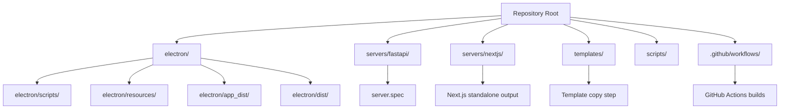
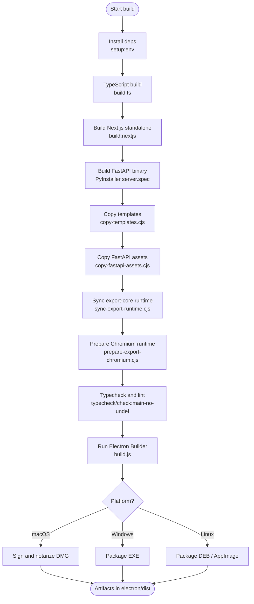
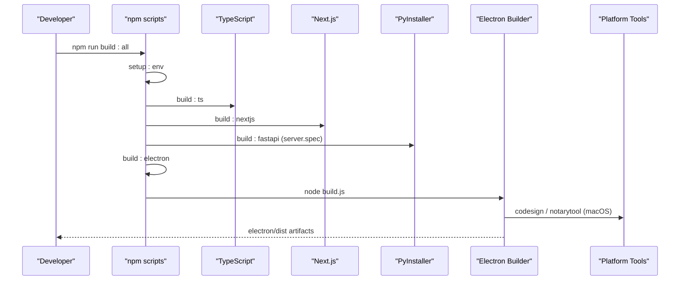
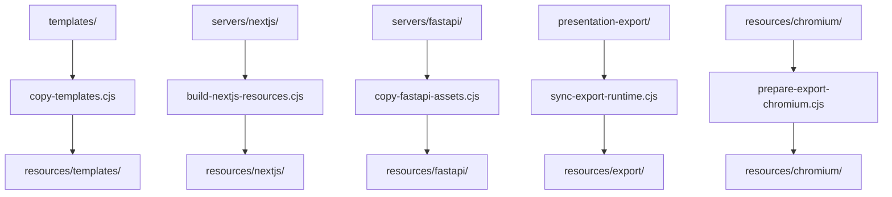
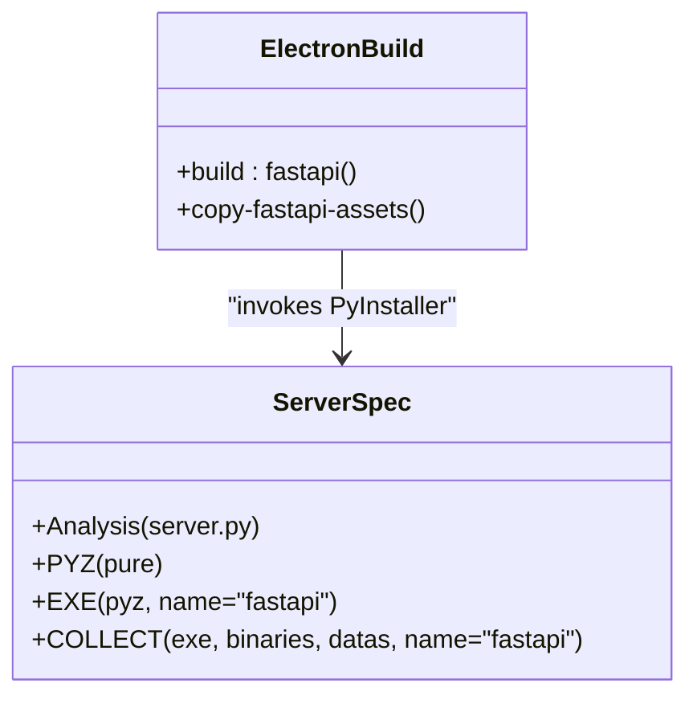
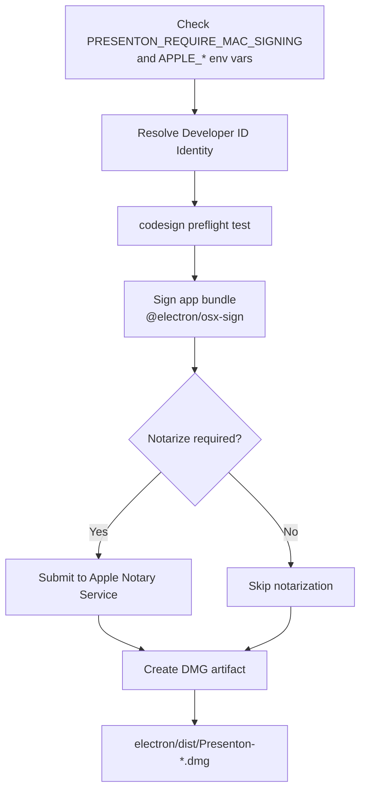
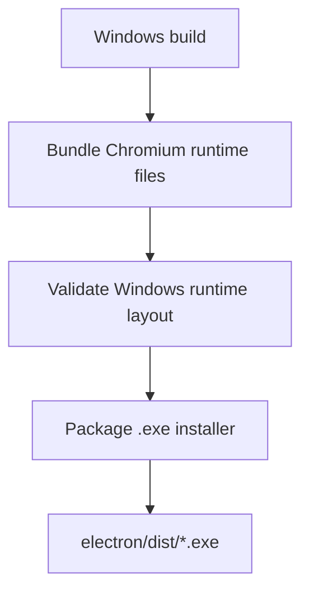
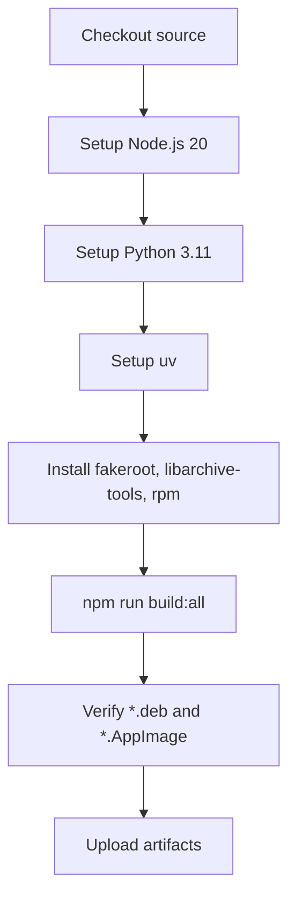
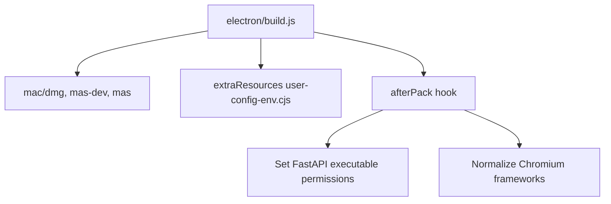
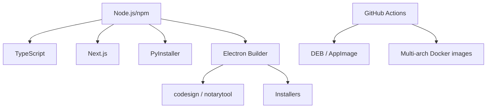

# Build & Packaging

<cite>
**Referenced Files in This Document**
- [README.md](file://README.md)
- [package.json](file://package.json)
- [electron/package.json](file://electron/package.json)
- [electron/build.js](file://electron/build.js)
- [electron/scripts/copy-templates.cjs](file://electron/scripts/copy-templates.cjs)
- [electron/scripts/sync-export-runtime.cjs](file://electron/scripts/sync-export-runtime.cjs)
- [electron/scripts/prepare-export-chromium.cjs](file://electron/scripts/prepare-export-chromium.cjs)
- [electron/scripts/build-nextjs-resources.cjs](file://electron/scripts/build-nextjs-resources.cjs)
- [electron/scripts/copy-fastapi-assets.cjs](file://electron/scripts/copy-fastapi-assets.cjs)
- [servers/fastapi/server.spec](file://servers/fastapi/server.spec)
- [.github/workflows/electron-linux-ubuntu22.yml](file://.github/workflows/electron-linux-ubuntu22.yml)
- [.github/workflows/docker-release.yml](file://.github/workflows/docker-release.yml)
</cite>

## Table of Contents
1. [Introduction](#introduction)
2. [Project Structure](#project-structure)
3. [Core Components](#core-components)
4. [Architecture Overview](#architecture-overview)
5. [Detailed Component Analysis](#detailed-component-analysis)
6. [Dependency Analysis](#dependency-analysis)
7. [Performance Considerations](#performance-considerations)
8. [Troubleshooting Guide](#troubleshooting-guide)
9. [Conclusion](#conclusion)

## Introduction
This document explains the build and packaging pipeline for the Presenton desktop application. It covers the multi-stage Electron build, asset copying, dependency bundling, platform-specific configurations, code signing and notarization flows, installer generation, and distribution preparation for Windows, macOS, and Linux. It also documents how templates, fonts, Next.js resources, FastAPI assets, and binary dependencies are bundled into the final app bundles.

## Project Structure
The desktop build is centered under `electron/`. The top-level repository contains shared scripts, server components, templates, and CI workflows that support the Electron packaging process.

**Diagram sources**
- [electron/package.json:32-69](file://electron/package.json#L32-L69)
- [electron/scripts/copy-templates.cjs:1-17](file://electron/scripts/copy-templates.cjs#L1-L17)
- [electron/scripts/build-nextjs-resources.cjs:1-89](file://electron/scripts/build-nextjs-resources.cjs#L1-L89)
- [electron/scripts/copy-fastapi-assets.cjs:1-36](file://electron/scripts/copy-fastapi-assets.cjs#L1-L36)
- [servers/fastapi/server.spec:1-136](file://servers/fastapi/server.spec#L1-L136)
- [.github/workflows/electron-linux-ubuntu22.yml:1-111](file://.github/workflows/electron-linux-ubuntu22.yml#L1-L111)

**Section sources**
- [README.md:276-317](file://README.md#L276-L317)
- [electron/package.json:1-100](file://electron/package.json#L1-L100)

## Core Components
- Electron package configuration and scripts define the build targets, environment setup, and packaging commands.
- A custom `build.js` orchestrates Electron Builder, macOS signing/notarization, resource validation, and post-packaging steps.
- Helper scripts prepare Next.js static assets, FastAPI assets, presentation export runtime, Chromium runtime, and template files.
- PyInstaller spec defines the bundled FastAPI backend included with the desktop app.
- GitHub Actions automate Linux packaging and Docker image publishing.

Key responsibilities:
- Asset copying: templates, Next.js resources, FastAPI assets.
- Dependency bundling: Python FastAPI binary via PyInstaller, Node export-core runtime, Chromium runtime.
- Platform-specific configuration: macOS entitlements, signing identities, notarization; Windows executable layout; Linux deb/AppImage outputs.
- Distribution artifacts: DMG (macOS), EXE (Windows), DEB and AppImage (Linux).

**Section sources**
- [electron/package.json:32-69](file://electron/package.json#L32-L69)
- [electron/build.js:1-120](file://electron/build.js#L1-L120)
- [electron/scripts/build-nextjs-resources.cjs:1-89](file://electron/scripts/build-nextjs-resources.cjs#L1-L89)
- [electron/scripts/copy-fastapi-assets.cjs:1-36](file://electron/scripts/copy-fastapi-assets.cjs#L1-L36)
- [electron/scripts/sync-export-runtime.cjs:1-82](file://electron/scripts/sync-export-runtime.cjs#L1-L82)
- [electron/scripts/prepare-export-chromium.cjs:1-544](file://electron/scripts/prepare-export-chromium.cjs#L1-L544)
- [servers/fastapi/server.spec:1-136](file://servers/fastapi/server.spec#L1-L136)

## Architecture Overview
The desktop build follows a staged pipeline:

1. Environment setup and dependency installation.
2. Build Next.js frontend to standalone output.
3. Build FastAPI backend into a packaged binary using PyInstaller.
4. Copy templates and FastAPI assets into Electron resources.
5. Sync and validate the presentation export runtime.
6. Prepare and bundle Chromium runtime for exports.
7. Compile TypeScript and run type checks.
8. Run Electron Builder with platform-specific signing and packaging rules.
9. Post-packaging adjustments on macOS (permissions, framework normalization).

**Diagram sources**
- [electron/package.json:32-69](file://electron/package.json#L32-L69)
- [electron/scripts/build-nextjs-resources.cjs:1-89](file://electron/scripts/build-nextjs-resources.cjs#L1-L89)
- [electron/scripts/copy-fastapi-assets.cjs:1-36](file://electron/scripts/copy-fastapi-assets.cjs#L1-L36)
- [electron/scripts/sync-export-runtime.cjs:1-82](file://electron/scripts/sync-export-runtime.cjs#L1-L82)
- [electron/scripts/prepare-export-chromium.cjs:1-544](file://electron/scripts/prepare-export-chromium.cjs#L1-L544)
- [servers/fastapi/server.spec:1-136](file://servers/fastapi/server.spec#L1-L136)
- [electron/build.js:881-925](file://electron/build.js#L881-L925)

## Detailed Component Analysis

### Multi-Stage Build Pipeline
The main entry points are npm scripts in `electron/package.json`:
- `build:all` orchestrates environment setup, TypeScript build, FastAPI build, Next.js build, and Electron build.
- `build:electron` runs template copying, version generation, export runtime sync, Chromium preparation, type checks, TypeScript compilation, and finally `build.js`.
- Platform-specific variants exist for signed macOS builds and Mac App Store targets.

**Diagram sources**
- [electron/package.json:32-69](file://electron/package.json#L32-L69)
- [electron/build.js:881-925](file://electron/build.js#L881-L925)

**Section sources**
- [electron/package.json:32-69](file://electron/package.json#L32-L69)
- [README.md:276-317](file://README.md#L276-L317)

### Asset Copying and Resource Bundling
- Templates: copied from `templates/` into `electron/resources/templates`.
- Next.js resources: built to standalone output and copied into `electron/resources/nextjs`, including static and public directories.
- FastAPI assets: `static` and `assets` directories copied into `electron/resources/fastapi`.
- Export runtime: `presentation-export` synced into `electron/resources/export` with version validation and Sharp runtime checks.
- Chromium runtime: downloaded or reused from cache, validated per platform, normalized for macOS frameworks, and packaged.

**Diagram sources**
- [electron/scripts/copy-templates.cjs:1-17](file://electron/scripts/copy-templates.cjs#L1-L17)
- [electron/scripts/build-nextjs-resources.cjs:1-89](file://electron/scripts/build-nextjs-resources.cjs#L1-L89)
- [electron/scripts/copy-fastapi-assets.cjs:1-36](file://electron/scripts/copy-fastapi-assets.cjs#L1-L36)
- [electron/scripts/sync-export-runtime.cjs:1-82](file://electron/scripts/sync-export-runtime.cjs#L1-L82)
- [electron/scripts/prepare-export-chromium.cjs:1-544](file://electron/scripts/prepare-export-chromium.cjs#L1-L544)

**Section sources**
- [electron/scripts/copy-templates.cjs:1-17](file://electron/scripts/copy-templates.cjs#L1-L17)
- [electron/scripts/build-nextjs-resources.cjs:1-89](file://electron/scripts/build-nextjs-resources.cjs#L1-L89)
- [electron/scripts/copy-fastapi-assets.cjs:1-36](file://electron/scripts/copy-fastapi-assets.cjs#L1-L36)
- [electron/scripts/sync-export-runtime.cjs:1-82](file://electron/scripts/sync-export-runtime.cjs#L1-L82)
- [electron/scripts/prepare-export-chromium.cjs:1-544](file://electron/scripts/prepare-export-chromium.cjs#L1-L544)

### Binary Dependencies and Backend Packaging
- The FastAPI backend is packaged into a single executable using PyInstaller with `servers/fastapi/server.spec`.
- The spec collects binaries, data assets, and hidden imports for libraries such as fastembed, onnxruntime, pptx, docx2everything, greenlet, llmai, spacy, and spacy models.
- The Electron build invokes PyInstaller through an npm script and then copies additional FastAPI assets into the Electron resources directory.

**Diagram sources**
- [servers/fastapi/server.spec:1-136](file://servers/fastapi/server.spec#L1-L136)
- [electron/package.json:54](file://electron/package.json#L54)
- [electron/scripts/copy-fastapi-assets.cjs:1-36](file://electron/scripts/copy-fastapi-assets.cjs#L1-L36)

**Section sources**
- [servers/fastapi/server.spec:1-136](file://servers/fastapi/server.spec#L1-L136)
- [electron/package.json:54](file://electron/package.json#L54)

### Code Signing and Notarization (macOS)
- Direct distribution DMG signing requires a Developer ID Application certificate and Apple notarization credentials.
- The build validates identity availability, performs preflight tests, and configures Electron Builder’s `sign` and `notarize` options.
- MAS (Mac App Store) builds use separate provisioning profiles and identities, with entitlements configured accordingly.
- Custom signing logic handles timestamp retries and nested resource exceptions for notarization compliance.

**Diagram sources**
- [electron/build.js:516-650](file://electron/build.js#L516-L650)
- [electron/build.js:881-925](file://electron/build.js#L881-L925)

**Section sources**
- [electron/build.js:516-650](file://electron/build.js#L516-L650)
- [electron/build.js:881-925](file://electron/build.js#L881-L925)

### Windows Packaging and Portable Executables
- Electron Builder produces `.exe` installers for Windows.
- The Chromium runtime for exports includes specific Windows files (DLLs, PAK files, ICU data, V8 snapshot, locale packs).
- The build validates the Chromium runtime layout and removes stale builds.

**Diagram sources**
- [electron/scripts/prepare-export-chromium.cjs:18-26](file://electron/scripts/prepare-export-chromium.cjs#L18-L26)
- [electron/scripts/prepare-export-chromium.cjs:95-126](file://electron/scripts/prepare-export-chromium.cjs#L95-L126)
- [electron/build.js:881-925](file://electron/build.js#L881-L925)

**Section sources**
- [electron/scripts/prepare-export-chromium.cjs:18-26](file://electron/scripts/prepare-export-chromium.cjs#L18-L26)
- [electron/scripts/prepare-export-chromium.cjs:95-126](file://electron/scripts/prepare-export-chromium.cjs#L95-L126)

### Linux Distribution Requirements
- GitHub Actions on Ubuntu 22.04 installs packaging dependencies (`fakeroot`, `libarchive-tools`, `rpm`) and runs `npm run build:all`.
- Outputs include `.deb` and `.AppImage` packages.
- The workflow uploads artifacts and publishes temporary releases for compatibility testing.

**Diagram sources**
- [.github/workflows/electron-linux-ubuntu22.yml:1-111](file://.github/workflows/electron-linux-ubuntu22.yml#L1-L111)

**Section sources**
- [.github/workflows/electron-linux-ubuntu22.yml:1-111](file://.github/workflows/electron-linux-ubuntu22.yml#L1-L111)

### Packaging Scripts and Electron Builder Configuration
- `electron/package.json` defines scripts for building, distributing, and preparing resources.
- `electron/build.js` configures Electron Builder, sets output directories, includes resources, and applies platform-specific settings.
- After packaging on macOS, it sets executable permissions for the FastAPI binary and normalizes Chromium framework symlinks.

**Diagram sources**
- [electron/build.js:881-925](file://electron/build.js#L881-L925)
- [electron/build.js:763-796](file://electron/build.js#L763-L796)

**Section sources**
- [electron/package.json:32-69](file://electron/package.json#L32-L69)
- [electron/build.js:763-796](file://electron/build.js#L763-L796)
- [electron/build.js:881-925](file://electron/build.js#L881-L925)

### Versioning and Metadata
- Top-level `package.json` includes metadata like `version` and `presentationExportVersion`.
- `electron/package.json` includes `exportVersion` and Chromium build IDs used by the export runtime and Chromium bundler.
- A version generation script is invoked during the Electron build.

**Section sources**
- [package.json:1-21](file://package.json#L1-L21)
- [electron/package.json:1-10](file://electron/package.json#L1-L10)
- [electron/package.json:55](file://electron/package.json#L55)

## Dependency Analysis
The build depends on multiple subsystems:
- Node.js toolchain and npm scripts orchestrate the overall flow.
- TypeScript compiler compiles Electron main code.
- Next.js builds the frontend into a standalone server.
- PyInstaller packages the FastAPI backend.
- Electron Builder creates platform installers.
- macOS tools (`codesign`, `notarytool`) handle signing and notarization.
- GitHub Actions automate Linux packaging and Docker image publishing.

**Diagram sources**
- [electron/package.json:89-98](file://electron/package.json#L89-L98)
- [.github/workflows/electron-linux-ubuntu22.yml:1-111](file://.github/workflows/electron-linux-ubuntu22.yml#L1-L111)
- [.github/workflows/docker-release.yml:1-78](file://.github/workflows/docker-release.yml#L1-L78)

**Section sources**
- [electron/package.json:89-98](file://electron/package.json#L89-L98)
- [.github/workflows/electron-linux-ubuntu22.yml:1-111](file://.github/workflows/electron-linux-ubuntu22.yml#L1-L111)
- [.github/workflows/docker-release.yml:1-78](file://.github/workflows/docker-release.yml#L1-L78)

## Performance Considerations
- Reuse cached Chromium runtime to avoid repeated downloads.
- Use `SKIP_BUNDLED_CHROMIUM=1` only when external Chromium is provided intentionally.
- Avoid rebuilding all stages by running targeted scripts (e.g., `build:nextjs`, `build:fastapi`).
- Disable notarization locally if needed for faster iteration, but ensure production builds enable it.
- Prune unsupported prebuilds after packaging on macOS to reduce bundle size.

[No sources needed since this section provides general guidance]

## Troubleshooting Guide

Common issues and resolutions:

- Missing Electron bundle resources before packaging:
  - Ensure Next.js and FastAPI builds complete successfully.
  - Run `npm run build:nextjs && npm run build:fastapi` before packaging-only scripts.
  - Verify presence of FastAPI binary, LLM model metadata, Next.js standalone server, export runner, and Sharp runtime.

- macOS signing and notarization failures:
  - Confirm Developer ID Application certificate is installed and accessible.
  - Provide Apple notarization credentials via one of the supported groups:
    - `APPLE_ID`, `APPLE_APP_SPECIFIC_PASSWORD`, `APPLE_TEAM_ID`
    - `APPLE_API_KEY`, `APPLE_API_KEY_ID`, `APPLE_API_ISSUER`
    - `APPLE_KEYCHAIN_PROFILE` (optionally `APPLE_KEYCHAIN`)
  - Unlock login keychain and allow codesign access to private keys.
  - For MAS builds, ensure both app and installer certificates are present and provisioning profiles are valid.

- Chromium runtime validation errors:
  - On Windows, verify required runtime files exist alongside the executable.
  - On macOS, ensure framework symlinks are canonicalized and the bundle is re-signed.
  - On Linux, confirm the executable responds to `--version` and outputs expected Chrome/Chromium text.

- Export runtime version mismatch:
  - Ensure `exportVersion` in `electron/package.json` matches the synced `presentation-export` package.
  - Run `npm run setup:export-runtime` or `npm run fetch:export-runtime` to refresh the runtime.

- Linux packaging dependencies missing:
  - Install `fakeroot`, `libarchive-tools`, and `rpm` on Ubuntu 22.04.
  - Run the CI job or equivalent local commands to replicate the environment.

**Section sources**
- [electron/build.js:730-761](file://electron/build.js#L730-L761)
- [electron/build.js:593-623](file://electron/build.js#L593-L623)
- [electron/scripts/prepare-export-chromium.cjs:95-126](file://electron/scripts/prepare-export-chromium.cjs#L95-L126)
- [electron/scripts/prepare-export-chromium.cjs:399-445](file://electron/scripts/prepare-export-chromium.cjs#L399-L445)
- [electron/scripts/sync-export-runtime.cjs:35-47](file://electron/scripts/sync-export-runtime.cjs#L35-L47)
- [.github/workflows/electron-linux-ubuntu22.yml:47-55](file://.github/workflows/electron-linux-ubuntu22.yml#L47-L55)

## Conclusion
The Presenton desktop build integrates multiple subsystems—TypeScript, Next.js, FastAPI, PyInstaller, Electron Builder, and platform-specific tools—to produce secure, distributable installers across Windows, macOS, and Linux. The pipeline emphasizes robust resource bundling, strict validation of critical dependencies, and comprehensive signing and notarization for macOS. With clear scripts and CI automation, developers can reproduce reliable builds and distributions while troubleshooting common issues efficiently.