# Desktop Application

<cite>
**Referenced Files in This Document**
- [main.ts](file://electron/app/main.ts)
- [package.json](file://electron/package.json)
- [build.js](file://electron/build.js)
- [index.ts](file://electron/app/preloads/index.ts)
- [ipc_index.ts](file://electron/app/ipc/index.ts)
- [export_handlers.ts](file://electron/app/ipc/export_handlers.ts)
- [read_file.ts](file://electron/app/ipc/read_file.ts)
- [servers.ts](file://electron/app/utils/servers.ts)
- [dialog.ts](file://electron/app/utils/dialog.ts)
- [update-checker.ts](file://electron/app/utils/update-checker.ts)
- [open-target.ts](file://electron/app/utils/open-target.ts)
- [sentry_main.ts](file://electron/app/sentry/main.ts)
- [version.json](file://electron/version.json)
</cite>

## Table of Contents
1. [Introduction](#introduction)
2. [Project Structure](#project-structure)
3. [Core Components](#core-components)
4. [Architecture Overview](#architecture-overview)
5. [Detailed Component Analysis](#detailed-component-analysis)
6. [Dependency Analysis](#dependency-analysis)
7. [Performance Considerations](#performance-considerations)
8. [Troubleshooting Guide](#troubleshooting-guide)
9. [Conclusion](#conclusion)
10. [Appendices](#appendices)

## Introduction
This document explains the Presenton Electron desktop application architecture and implementation. It covers:
- Main process orchestration and renderer process management
- System integration features (file system access, native dialogs, OS notifications via external links)
- IPC patterns between main and renderer processes
- Security considerations and sandboxing strategies
- Build and packaging for Windows, macOS, and Linux
- Code signing and notarization workflows
- Update mechanisms and crash reporting
- Development workflow, debugging techniques, and platform-specific considerations

## Project Structure
The Electron app is organized under `electron/`:
- `app/main.ts` — main entry point, window lifecycle, server orchestration, update checker
- `app/preloads/index.ts` — preload script exposing safe APIs to the renderer
- `app/ipc/` — IPC handlers for export and file reading
- `app/utils/` — utilities for servers, dialogs, open target handling, update checking, Sentry initialization
- `app/sentry/main.ts` — Sentry integration for main process error tracking
- `build.js` — electron-builder configuration, signing, notarization, and post-pack hooks
- `package.json` — scripts, dependencies, and metadata
- `version.json` — update manifest used by the update checker

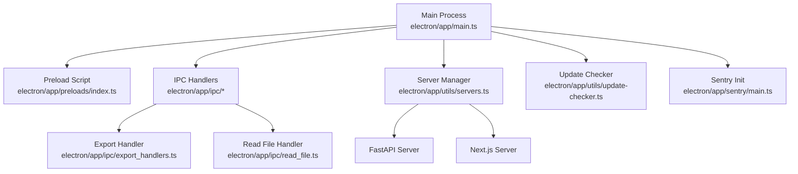

**Diagram sources**
- [main.ts:1-548](file://electron/app/main.ts#L1-L548)
- [index.ts:1-15](file://electron/app/preloads/index.ts#L1-L15)
- [ipc_index.ts:1-8](file://electron/app/ipc/index.ts#L1-L8)
- [export_handlers.ts:1-487](file://electron/app/ipc/export_handlers.ts#L1-L487)
- [read_file.ts:1-15](file://electron/app/ipc/read_file.ts#L1-L15)
- [servers.ts:1-429](file://electron/app/utils/servers.ts#L1-L429)
- [update-checker.ts:1-391](file://electron/app/utils/update-checker.ts#L1-L391)
- [sentry_main.ts:1-170](file://electron/app/sentry/main.ts#L1-L170)

**Section sources**
- [main.ts:1-548](file://electron/app/main.ts#L1-L548)
- [package.json:1-100](file://electron/package.json#L1-L100)

## Core Components
- Main process orchestrates:
  - Single instance lock and window creation
  - Local FastAPI and Next.js server startup and shutdown
  - IPC handler registration
  - Chromium cache recovery and Sentry context updates
  - Update checker lifecycle
- Renderer process:
  - Loads the Next.js UI from localhost
  - Uses a preload script to safely call main-process capabilities via IPC
- Utilities:
  - Dialog helpers for user prompts
  - Open target validation and OS shell integration
  - Update checker polling and banner injection
  - Sentry initialization and breadcrumb capture

Key responsibilities are implemented across:
- Main entry and lifecycle: [main.ts:1-548](file://electron/app/main.ts#L1-L548)
- Preload API surface: [index.ts:1-15](file://electron/app/preloads/index.ts#L1-L15)
- IPC routing: [ipc_index.ts:1-8](file://electron/app/ipc/index.ts#L1-L8)
- Export pipeline: [export_handlers.ts:1-487](file://electron/app/ipc/export_handlers.ts#L1-L487)
- File read bridge: [read_file.ts:1-15](file://electron/app/ipc/read_file.ts#L1-L15)
- Server management: [servers.ts:1-429](file://electron/app/utils/servers.ts#L1-L429)
- Dialogs: [dialog.ts:1-44](file://electron/app/utils/dialog.ts#L1-L44)
- External URL/file opening: [open-target.ts:1-117](file://electron/app/utils/open-target.ts#L1-L117)
- Update mechanism: [update-checker.ts:1-391](file://electron/app/utils/update-checker.ts#L1-L391), [version.json:1-10](file://electron/version.json#L1-L10)
- Crash reporting: [sentry_main.ts:1-170](file://electron/app/sentry/main.ts#L1-L170)

**Section sources**
- [main.ts:1-548](file://electron/app/main.ts#L1-L548)
- [index.ts:1-15](file://electron/app/preloads/index.ts#L1-L15)
- [ipc_index.ts:1-8](file://electron/app/ipc/index.ts#L1-L8)
- [export_handlers.ts:1-487](file://electron/app/ipc/export_handlers.ts#L1-L487)
- [read_file.ts:1-15](file://electron/app/ipc/read_file.ts#L1-L15)
- [servers.ts:1-429](file://electron/app/utils/servers.ts#L1-L429)
- [dialog.ts:1-44](file://electron/app/utils/dialog.ts#L1-L44)
- [open-target.ts:1-117](file://electron/app/utils/open-target.ts#L1-L117)
- [update-checker.ts:1-391](file://electron/app/utils/update-checker.ts#L1-L391)
- [version.json:1-10](file://electron/version.json#L1-L10)
- [sentry_main.ts:1-170](file://electron/app/sentry/main.ts#L1-L170)

## Architecture Overview
Presenton’s desktop app uses a classic Electron pattern:
- Main process manages native resources and child processes
- Renderer runs the Next.js UI in an isolated context with a minimal preload API
- Internal servers (FastAPI and Next.js) run as child processes and communicate over localhost
- IPC provides secure bridges for privileged operations like exporting files and reading local content

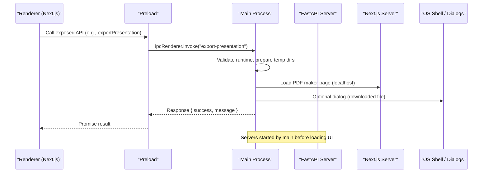

**Diagram sources**
- [index.ts:1-15](file://electron/app/preloads/index.ts#L1-L15)
- [export_handlers.ts:1-487](file://electron/app/ipc/export_handlers.ts#L1-L487)
- [servers.ts:1-429](file://electron/app/utils/servers.ts#L1-L429)
- [dialog.ts:1-44](file://electron/app/utils/dialog.ts#L1-L44)

## Detailed Component Analysis

### Main Process Orchestration
Responsibilities:
- Initialize paths, directories, and Sentry
- Enforce single-instance behavior
- Configure Chromium switches per platform
- Create BrowserWindow with strict webPreferences
- Guard navigation to allowed origins; open unsupported URLs externally
- Start FastAPI and Next.js servers, wait for readiness
- Load the app URL and start update checker
- Graceful shutdown on close events

Security highlights:
- contextIsolation enabled, nodeIntegration disabled
- Explicit preload path
- Navigation guard restricts frame navigation to app origin
- External link protocol allowlist (http, https)

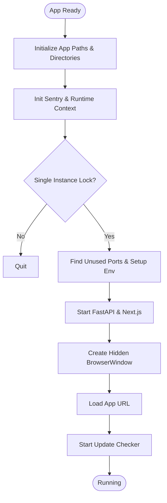

**Diagram sources**
- [main.ts:189-548](file://electron/app/main.ts#L189-L548)

**Section sources**
- [main.ts:1-548](file://electron/app/main.ts#L1-L548)

### Renderer Process Management and Preload API
- The renderer loads the Next.js UI served locally by the main process.
- The preload script exposes a minimal, typed API surface:
  - `env`: environment variables needed by the UI
  - `electron.exportPresentation(id, title, format)`: triggers export via IPC
  - `electron.readFile(filePath)`: reads readable local files via IPC

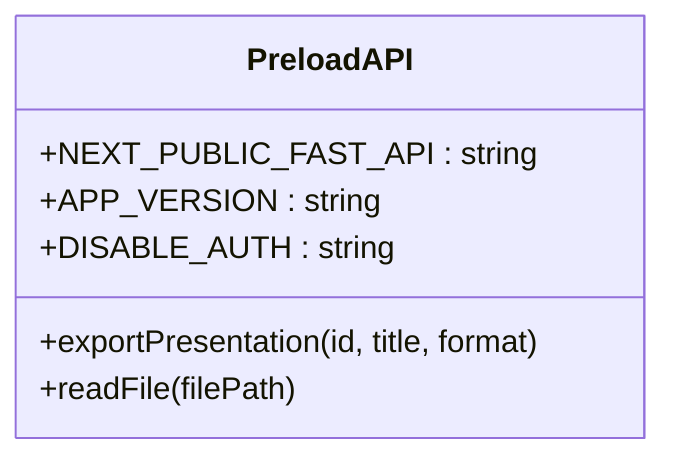

**Diagram sources**
- [index.ts:1-15](file://electron/app/preloads/index.ts#L1-L15)

**Section sources**
- [index.ts:1-15](file://electron/app/preloads/index.ts#L1-L15)

### IPC Patterns and Security Model
- IPC routes are centralized in `setupIpcHandlers`, which registers:
  - Export handler: orchestrates presentation export using a bundled runner and Chromium
  - Read file handler: reads readable local files through a controlled utility
- The renderer calls IPC via `ipcRenderer.invoke` from the preload script.

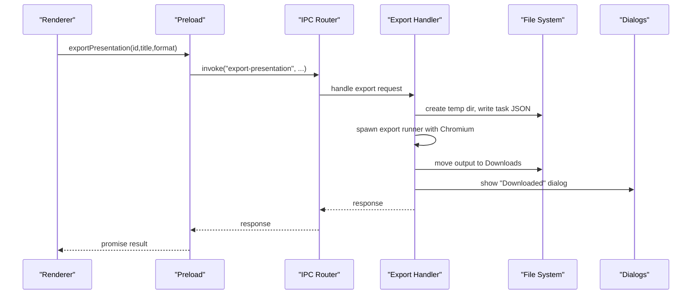

**Diagram sources**
- [ipc_index.ts:1-8](file://electron/app/ipc/index.ts#L1-L8)
- [export_handlers.ts:1-487](file://electron/app/ipc/export_handlers.ts#L1-L487)
- [dialog.ts:1-44](file://electron/app/utils/dialog.ts#L1-L44)

**Section sources**
- [ipc_index.ts:1-8](file://electron/app/ipc/index.ts#L1-L8)
- [export_handlers.ts:1-487](file://electron/app/ipc/export_handlers.ts#L1-L487)
- [read_file.ts:1-15](file://electron/app/ipc/read_file.ts#L1-L15)

### System Integration Features
- File system access:
  - Export pipeline writes temporary tasks and moves final outputs to the user’s Downloads folder
  - Readable file access is provided through a controlled IPC endpoint
- Native dialogs:
  - Post-export dialog offers “Open File” or “Open Folder” actions
  - Error dialogs inform users when OS cannot open targets
- Operating system interactions:
  - External URLs opened via OS shell with protocol allowlisting
  - Local paths validated and opened via OS shell

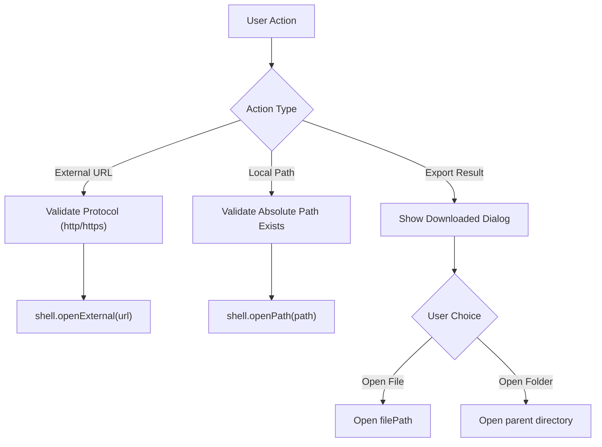

**Diagram sources**
- [open-target.ts:1-117](file://electron/app/utils/open-target.ts#L1-L117)
- [dialog.ts:1-44](file://electron/app/utils/dialog.ts#L1-L44)

**Section sources**
- [open-target.ts:1-117](file://electron/app/utils/open-target.ts#L1-L117)
- [dialog.ts:1-44](file://electron/app/utils/dialog.ts#L1-L44)
- [export_handlers.ts:1-487](file://electron/app/ipc/export_handlers.ts#L1-L487)
- [read_file.ts:1-15](file://electron/app/ipc/read_file.ts#L1-L15)

### Build and Packaging (Windows, macOS, Linux)
- Electron Builder is configured via `build.js` and invoked through npm scripts in `package.json`.
- Key build scripts:
  - `npm run dist` — generic packaging
  - Platform-specific signed builds and MAS targets via environment variables
- Resources required at build time include FastAPI binary, Next.js standalone server, export runner, and Sharp runtime.

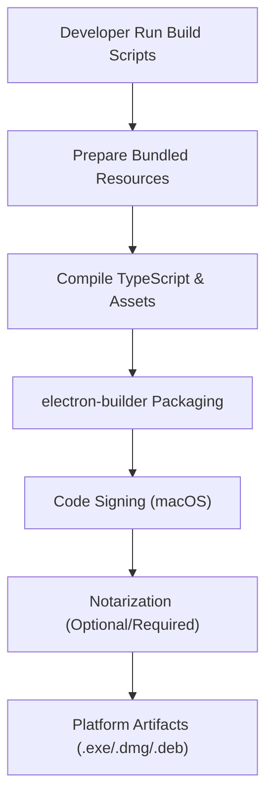

**Diagram sources**
- [package.json:32-69](file://electron/package.json#L32-L69)
- [build.js:1-800](file://electron/build.js#L1-L800)

**Section sources**
- [package.json:1-100](file://electron/package.json#L1-L100)
- [build.js:1-800](file://electron/build.js#L1-L800)

### Code Signing and Notarization (macOS)
- Direct distribution builds:
  - Requires Developer ID Application certificate
  - Notarization credentials can be provided via Apple ID/API key/keychain profile
- Mac App Store (MAS) builds:
  - Requires matching app and installer identities
  - Provisioning profiles resolved automatically if present
- Timestamp retry logic improves reliability during signing.

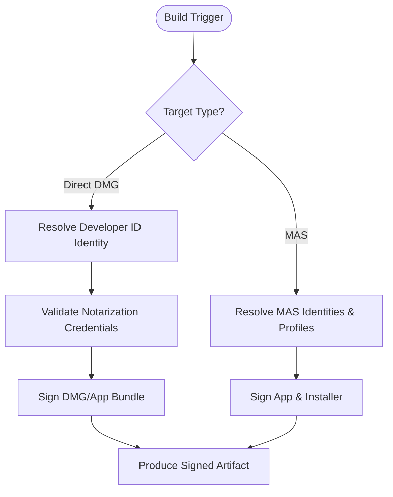

**Diagram sources**
- [build.js:13-65](file://electron/build.js#L13-L65)
- [build.js:216-307](file://electron/build.js#L216-L307)
- [build.js:309-483](file://electron/build.js#L309-L483)
- [build.js:516-650](file://electron/build.js#L516-L650)

**Section sources**
- [build.js:1-800](file://electron/build.js#L1-L800)

### Update Mechanism
- The main process starts an update checker after the UI loads.
- It polls a version manifest (GitHub raw JSON) and injects a non-intrusive banner into the UI when a newer version is available.
- The banner includes a “View details” overlay and a download link.

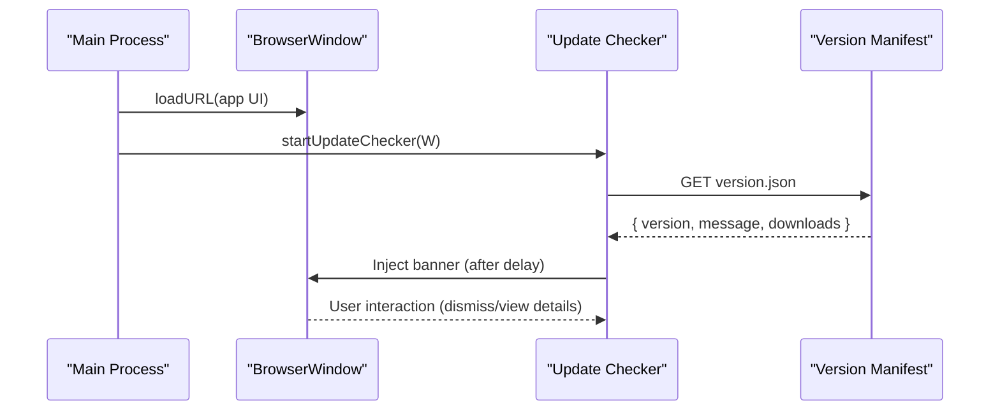

**Diagram sources**
- [main.ts:524-529](file://electron/app/main.ts#L524-L529)
- [update-checker.ts:1-391](file://electron/app/utils/update-checker.ts#L1-L391)
- [version.json:1-10](file://electron/version.json#L1-L10)

**Section sources**
- [update-checker.ts:1-391](file://electron/app/utils/update-checker.ts#L1-L391)
- [version.json:1-10](file://electron/version.json#L1-L10)
- [main.ts:524-529](file://electron/app/main.ts#L524-L529)

### Crash Reporting and Diagnostics
- Sentry is initialized in the main process with environment-driven toggles and sampling rates.
- Runtime tags and contexts include Electron, Chromium, Node versions, platform, and app version.
- Breadcrumbs and exceptions are captured around critical flows (e.g., process gone events, export lifecycle).

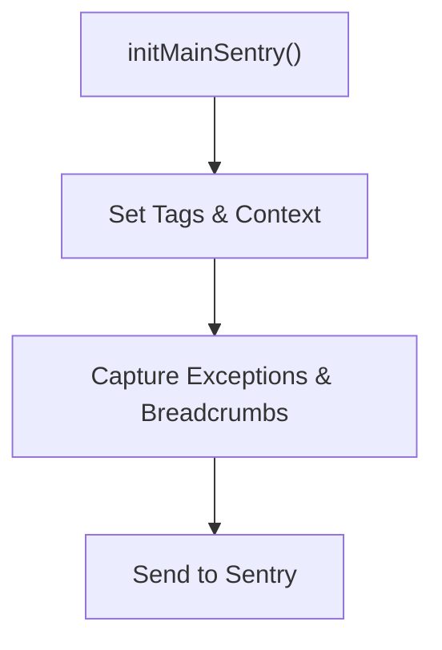

**Diagram sources**
- [sentry_main.ts:1-170](file://electron/app/sentry/main.ts#L1-L170)

**Section sources**
- [sentry_main.ts:1-170](file://electron/app/sentry/main.ts#L1-L170)
- [main.ts:118-143](file://electron/app/main.ts#L118-L143)

### Desktop-Specific Utilities
- Clipboard management:
  - No dedicated clipboard module is present in the analyzed files; clipboard functionality is likely handled within the renderer/UI layer.
- Window management:
  - Main process creates, focuses, and closes windows; guards navigation; opens external links.
- System resource monitoring:
  - Memory snapshots are logged at startup and export steps; child process exit codes and signals are recorded.

**Section sources**
- [main.ts:208-211](file://electron/app/main.ts#L208-L211)
- [export_handlers.ts:350-359](file://electron/app/ipc/export_handlers.ts#L350-L359)

## Dependency Analysis
High-level dependencies:
- Main depends on:
  - IPC handlers for export and file reading
  - Server manager for FastAPI and Next.js
  - Update checker for version polling
  - Sentry for diagnostics
- Renderer depends on:
  - Preload-exposed APIs for IPC
  - Localhost URLs for internal services

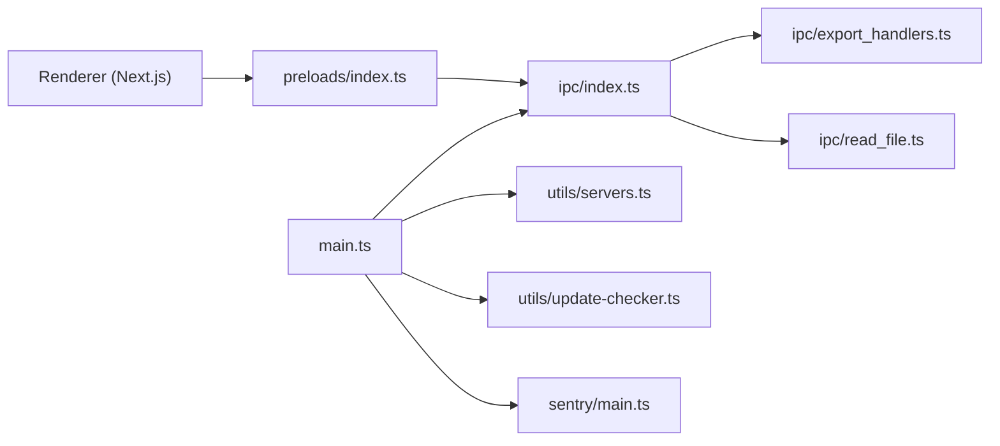

**Diagram sources**
- [main.ts:1-548](file://electron/app/main.ts#L1-L548)
- [ipc_index.ts:1-8](file://electron/app/ipc/index.ts#L1-L8)
- [export_handlers.ts:1-487](file://electron/app/ipc/export_handlers.ts#L1-L487)
- [read_file.ts:1-15](file://electron/app/ipc/read_file.ts#L1-L15)
- [servers.ts:1-429](file://electron/app/utils/servers.ts#L1-L429)
- [update-checker.ts:1-391](file://electron/app/utils/update-checker.ts#L1-L391)
- [sentry_main.ts:1-170](file://electron/app/sentry/main.ts#L1-L170)
- [index.ts:1-15](file://electron/app/preloads/index.ts#L1-L15)

**Section sources**
- [main.ts:1-548](file://electron/app/main.ts#L1-L548)
- [ipc_index.ts:1-8](file://electron/app/ipc/index.ts#L1-L8)
- [export_handlers.ts:1-487](file://electron/app/ipc/export_handlers.ts#L1-L487)
- [read_file.ts:1-15](file://electron/app/ipc/read_file.ts#L1-L15)
- [servers.ts:1-429](file://electron/app/utils/servers.ts#L1-L429)
- [update-checker.ts:1-391](file://electron/app/utils/update-checker.ts#L1-L391)
- [sentry_main.ts:1-170](file://electron/app/sentry/main.ts#L1-L170)
- [index.ts:1-15](file://electron/app/preloads/index.ts#L1-L15)

## Performance Considerations
- Child process management:
  - Servers and export runners are spawned with bounded stdio logging and cleanup listeners to avoid leaks.
- Resource usage:
  - Memory snapshots are taken at key points to aid diagnostics.
- Startup optimization:
  - Chromium cache recovery and broken cache cleanup reduce failures during launch and export.
- Rendering stability:
  - Hardware acceleration is disabled to mitigate white screen issues on some platforms.

[No sources needed since this section provides general guidance]

## Troubleshooting Guide
Common issues and resolutions:
- Server startup failure:
  - The main process shows an error box and exits if FastAPI or Next.js fail to start.
  - Check logs in the app’s logs directory and ensure ports are available.
- Export runtime missing:
  - In development, ensure the desktop runtime is set up; in production, reinstall the app to restore bundled exports.
- Chromium not found for export:
  - Ensure the bundled Chromium runtime is present; the main process resolves and validates it before spawning the exporter.
- macOS signing/notarization errors:
  - Verify Developer ID identity and notarization credentials; ensure Keychain access is granted.
- External link or file open failures:
  - Only http/https protocols are supported for external links; verify the OS has registered handlers for local paths.

**Section sources**
- [main.ts:492-501](file://electron/app/main.ts#L492-L501)
- [export_handlers.ts:57-70](file://electron/app/ipc/export_handlers.ts#L57-L70)
- [export_handlers.ts:118-125](file://electron/app/ipc/export_handlers.ts#L118-L125)
- [build.js:593-623](file://electron/build.js#L593-L623)
- [open-target.ts:20-46](file://electron/app/utils/open-target.ts#L20-L46)

## Conclusion
Presenton’s Electron desktop application follows a secure, modular architecture:
- The main process controls lifecycle, security boundaries, and native integrations
- The renderer remains isolated and communicates via a minimal preload API
- IPC is explicit and auditable, with robust error handling and diagnostics
- Build and packaging support cross-platform distribution with strong macOS signing and notarization flows
- Update checks and crash reporting provide operational visibility

[No sources needed since this section summarizes without analyzing specific files]

## Appendices

### Development Workflow
- Install dependencies and prepare desktop runtime:
  - Use the provided npm scripts to set up exported runtimes, templates, and dev servers.
- Run in development mode:
  - Launch the app with dev flags that enable hot reload for Next.js and verbose logging.
- Build artifacts:
  - Use the full build pipeline to compile assets, bundle servers, and package distributions.

**Section sources**
- [package.json:32-69](file://electron/package.json#L32-L69)

### Debugging Techniques
- Enable Sentry diagnostics via environment variables to capture exceptions and breadcrumbs.
- Inspect child process stdout/stderr streams for FastAPI and Next.js.
- Review memory snapshots and export logs to diagnose performance issues.

**Section sources**
- [sentry_main.ts:53-103](file://electron/app/sentry/main.ts#L53-L103)
- [servers.ts:146-195](file://electron/app/utils/servers.ts#L146-L195)
- [export_handlers.ts:350-359](file://electron/app/ipc/export_handlers.ts#L350-L359)

### Platform-Specific Considerations
- macOS:
  - Disable mock keychain for local builds to avoid Keychain prompts
  - Handle helper executable for Node mode to keep Dock hidden
  - Set executable permissions for FastAPI binary after packaging
- Linux:
  - Detect chrome-sandbox permissions and disable sandbox if invalid
  - Disable dev-shm usage when `/dev/shm` is not writable
- Windows:
  - Hide console windows for production server processes
  - Support both `node.exe` and `node.cmd` for export runtimes

**Section sources**
- [main.ts:59-91](file://electron/app/main.ts#L59-L91)
- [servers.ts:34-62](file://electron/app/utils/servers.ts#L34-L62)
- [build.js:763-795](file://electron/build.js#L763-L795)
- [export_handlers.ts:199-209](file://electron/app/ipc/export_handlers.ts#L199-L209)